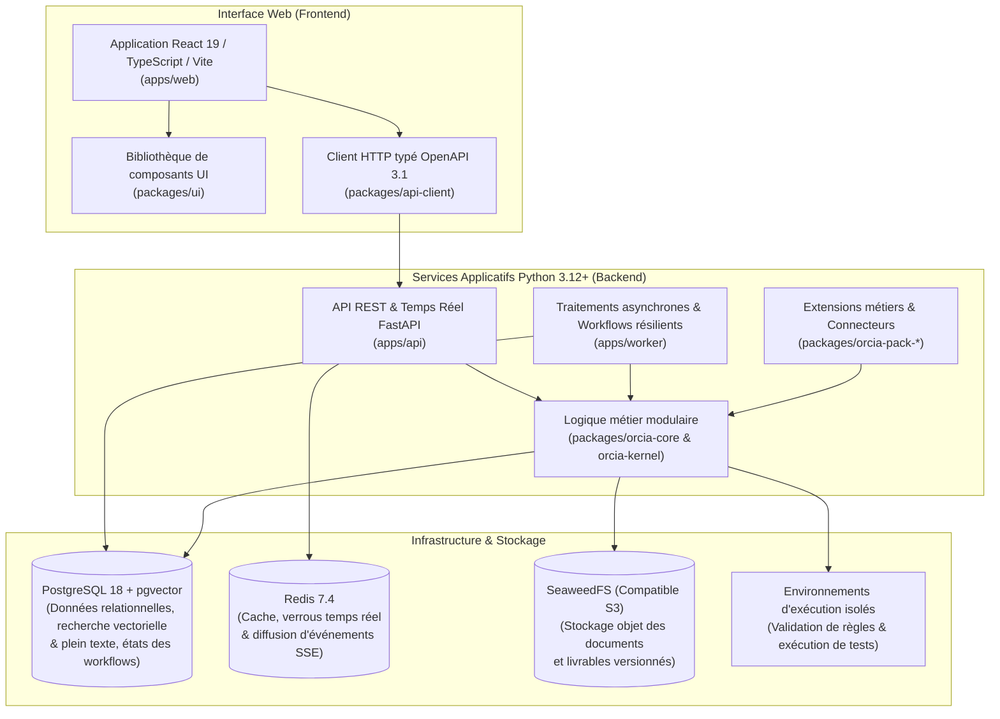

# ORCIA — Orchestration of Processes, Context, and Intelligent Agents

**ORCIA** est une plateforme d'orchestration d'agents IA, de compétences réutilisables (*Skills*) et de processus métiers gouvernés par l'humain.

Conçue pour les équipes informatiques et métiers (développeurs, architectes, DevOps, chefs de projet, DSI), ORCIA permet d'intégrer l'intelligence artificielle générative dans les flux de travail de l'entreprise de manière structurée, traçable et sécurisée, sans jamais transformer l'IA en « boîte noire » autonome hors de contrôle.

---

## 1. À quels problèmes concrets répond ORCIA ?

Lorsqu'une organisation déploie l'IA à l'échelle d'une équipe ou d'un département, elle se heurte rapidement à quatre difficultés majeures auxquelles ORCIA apporte une réponse directe :

### 1.1. Éviter l'effet « boîte noire » grâce à la validation humaine et à la traçabilité des sources
- **Le problème** : Les assistants IA ne doivent pas générer de longs documents ou du code sans expliquer leurs choix, sans citer précisément leurs sources et sans laisser à l'humain la possibilité de cadrer les décisions structurantes avant la génération.
- **La réponse d'ORCIA** :
  - Chaque réponse ou livrable produit par l'IA s'accompagne de **citations explicites et vérifiables** pointant vers les documents, tickets ou fichiers de code de l'entreprise.
  - Les décisions d'orientation (objectifs métier, choix d'architecture, arbitrages entre plusieurs options) restent **explicitement validées par l'humain**.
  - Chaque étape d'un processus peut être soumise à des contrôles automatisés (vérification de format, exécution de tests, relecture croisée par un second modèle IA) avant d'être présentée pour validation humaine.

### 1.2. Organiser le travail par Espaces de travail connectés aux outils de l'entreprise
- **Le problème** : Le contexte d'un projet est dispersé entre plusieurs outils (dépôts de code, wikis documentaires, outils de gestion de tickets, bases de données), et les équipes perdent du temps à copier-coller des informations dans des discussions IA isolées.
- **La réponse d'ORCIA** :
  - Le travail est structuré en **Espaces de travail** dédiés à un produit, un projet ou une équipe.
  - Chaque Espace se connecte directement aux sources de l'entreprise : dépôts **Git**, bases documentaires **Confluence**, projets **Jira**, schémas de **bases de données** et outils externes exposés via le protocole standard **MCP** (*Model Context Protocol*).
  - Un glossaire métier et technique partagé permet d'harmoniser le vocabulaire entre les équipes métiers et les équipes d'ingénierie, du niveau global de l'entreprise jusqu'à chaque espace projet.

### 1.3. Structurer clairement les usages : Assistant, Agents, Compétences et Processus
- **Le problème** : Dans la plupart des outils, tout se mélange dans de simples prompts copiés d'un utilisateur à l'autre, difficiles à maintenir, à tester et à partager.
- **La réponse d'ORCIA** : ORCIA sépare clairement quatre briques complémentaires :

| Concept                       | Rôle concret pour l'équipe                                                                                                                                                                  | Exemple d'usage                                                                                                            |
| :---------------------------- | :------------------------------------------------------------------------------------------------------------------------------------------------------------------------------------------ | :------------------------------------------------------------------------------------------------------------------------- |
| **Assistant conversationnel** | Interlocuteur quotidien pour explorer les sources d'un espace, poser des questions avec citations vérifiées, rédiger des notes et collaborer avec ses collègues dans des dossiers partagés. | « Synthétise les impacts de ce ticket Jira sur notre API de facturation en citant la documentation et le code concernés. » |
| **Agents**                    | Rôles spécialisés dotés d'instructions métier précises, d'un périmètre d'action défini et d'un accès contrôlé aux outils de l'espace.                                                       | Agent *Architecte Logiciel*, Agent *Analyste Fonctionnel*, Agent *Auditeur Sécurité*.                                      |
| **Compétences (*Skills*)**    | Savoir-faire atomiques, testables et réutilisables par plusieurs agents ou processus (analyse de code, vérification de règles métiers, génération de schéma, etc.).                         | Compétence *Vérifier la conformité d'un contrat OpenAPI*, Compétence *Extraire les critères d'acceptation d'un ticket*.    |
| **Processus**                 | Chaînes d'étapes orchestrées combinant travail humain, intervention d'agents, exécution de compétences et jalons de validation jusqu'à la publication d'un livrable.                        | Processus *Transformer un ticket fonctionnel en spécification technique validée*, Processus *Revue de mise en production*. |

### 1.4. Maîtriser la sécurité et les coûts d'utilisation des modèles IA
- **Le problème** : Ouvrir des accès IA sur le système d'information soulève des risques de fuite de données, d'actions non autorisées sur les outils de production et de dérive budgétaire liée à la consommation de jetons (*tokens*).
- **La réponse d'ORCIA** :
  - **Contrôle d'accès par rôle et par périmètre** : Les droits de consultation, de modification, d'exécution et d'administration sont gérés finement selon la hiérarchie de l'organisation (Plateforme globale, Direction / Business Unit, Équipe, Espace de travail). Un utilisateur ne voit et n'interroge que les sources auxquelles il est habilité.
  - **Protection des secrets et des écritures externes** : Les clés d'API et jetons d'accès sont chiffrés en base de données. Toute modification vers un outil externe (comme la mise à jour d'un ticket Jira ou la publication d'un document) est préparée en brouillon et nécessite une validation avant exécution.
  - **Exécution isolée (*Sandbox*)** : Les vérifications techniques, scripts de validation et suites de tests s'exécutent dans des environnements isolés sans accès réseau non autorisé.
  - **Suivi des coûts et quotas** : Un tableau de bord dédié permet de suivre en temps réel la consommation des modèles IA par espace, par équipe et par processus, de définir des plafonds budgétaires et d'orienter les données sensibles vers des modèles hébergés localement.

---

## 2. Vue d'ensemble fonctionnelle (Les 8 écrans de l'application)

L'interface web d'ORCIA s'organise autour d'une barre de navigation latérale donnant accès à **8 écrans complémentaires**, complétés par une recherche rapide globale (`⌘K` / `Ctrl+K`) et un sélecteur d'espace de travail :

1. **Cockpit** :
   - Vue synthétique des actions en attente pour l'utilisateur connecté et son équipe : arbitrages demandés par un agent, étapes de processus prêtes à être relues ou validées, et suivi des exécutions en cours.
   - Permet de prendre en charge une tâche en un clic afin d'éviter que deux membres d'une même équipe ne travaillent simultanément sur la même validation.
2. **Mon Assistant** :
   - Espace de travail conversationnel connecté aux sources documentaires et aux dépôts de code de l'espace actif.
   - Propose trois modes de réponse selon le besoin (*Rapide*, *Appel d'un Agent ou d'une Compétence*, *Analyse approfondie*), affiche les citations exactes des sources utilisées et permet d'organiser ses échanges dans des **dossiers thématiques** privés ou partagés avec l'équipe.
3. **Mes Espaces** :
   - Gestion complète des Espaces de travail : connexion aux sources de données (Git, Confluence, Jira, bases de données), suivi de l'indexation documentaire, configuration des emplacements de publication des livrables et gestion du glossaire métier et des règles de l'espace.
4. **Mes Agents & Compétences** :
   - Catalogue centralisé permettant de consulter, configurer et tester les **Agents** spécialisés, les **Compétences (*Skills*)** réutilisables ainsi que les connecteurs et serveurs d'outils externes (**MCP** et agents distants) avec un banc de test intégré.
5. **Mes Processus** :
   - Conception, personnalisation et exécution des chaînes de travail multi-étapes.
   - Permet de suivre l'avancement détaillé de chaque exécution, de consulter les synthèses de revue à chaque jalon de validation, et de relancer un processus à partir d'une étape précise en cas d'ajustement sans perdre l'historique des étapes précédentes.
6. **Centre de Contrôle & Coûts** :
   - Tableau de bord de supervision opérationnelle et financière : suivi des coûts d'utilisation des modèles IA, consommation de jetons par équipe et par espace, respect des budgets et consultation du journal d'audit immuable des opérations.
7. **Paramètres** :
   - Administration de la plateforme et des périmètres : gestion de l'arborescence organisationnelle, des utilisateurs et des rôles, configuration des fournisseurs de modèles IA (cloud ou locaux), gestion des connecteurs et des secrets.
8. **Aide contextuelle** :
   - Centre de documentation intégré et volet d'aide latéral (`❓`) qui affiche automatiquement le guide d'utilisation correspondant à l'écran actif pour accompagner les utilisateurs pas à pas.

---

## 3. Architecture technique

ORCIA repose sur une architecture modulaire moderne, bâtie sur des composants standards et éprouvés de l'industrie :



### Principaux choix technologiques

| Couche                                  | Technologies standards utilisées                                                                          | Rôle dans la plateforme                                                                                                                                                                                                               |
| :-------------------------------------- | :-------------------------------------------------------------------------------------------------------- | :------------------------------------------------------------------------------------------------------------------------------------------------------------------------------------------------------------------------------------ |
| **Frontend Web**                        | **React 19**, **TypeScript 5.8**, **Vite 6**, **TanStack Router**, **TanStack Query**, **Tailwind CSS 4** | Application web monopage (SPA) réactive, typée de bout en bout et disponible en français et en anglais.                                                                                                                               |
| **Client API**                          | **OpenAPI 3.1**, `openapi-typescript`, `openapi-fetch`                                                    | Client HTTP TypeScript généré automatiquement à partir des schémas de l'API Python pour garantir la cohérence entre le frontend et le backend.                                                                                        |
| **API Backend**                         | **Python 3.12+**, **FastAPI**, **Pydantic v2**, **Uvicorn**, **OpenTelemetry**                            | Exposition des routes REST, flux d'événements temps réel (*Server-Sent Events*), serveur compatible **MCP** et traçabilité distribuée.                                                                                                |
| **Traitements asynchrones & Workflows** | **DBOS Transact**, **Dramatiq**, **Docling**, **LiteLLM**                                                 | Exécution de workflows résilients aux pannes (capables de reprendre exactement à l'étape interrompue ou de rejouer une étape spécifique), indexation documentaire en tâche de fond et routage multi-fournisseurs vers les modèles IA. |
| **Base de données**                     | **PostgreSQL 18**, **pgvector**, **SQLAlchemy 2.1 (Asyncio)**, **Alembic**                                | Stockage transactionnel, recherche documentaire hybride combinant recherche vectorielle sémantique (`pgvector`) et recherche plein texte (`tsvector`), et journalisation d'audit.                                                     |
| **Cache & Temps réel**                  | **Redis 7.4**                                                                                             | Cache applicatif, gestion des verrous de prise en charge simultanée entre utilisateurs et file de messages pour les notifications en temps réel.                                                                                      |
| **Stockage objet**                      | **SeaweedFS** (API compatible Amazon S3)                                                                  | Archivage versionné et vérifiable par empreinte cryptographique (`SHA-256`) des documents sources et des livrables produits.                                                                                                          |
| **Exécution isolée (*Sandbox*)**        | **Wasmtime**, **Starlark**, **Conteneurs isolés sans réseau**                                             | Exécution sécurisée des scripts de validation métier, des analyseurs statiques et des tests automatisés.                                                                                                                              |

---

## 4. Organisation du dépôt (Monorepo)

Le projet est organisé sous forme de monorepo réunissant les applications frontend et backend, les bibliothèques partagées et l'infrastructure locale :

```text
ORCIA/
├── apps/
│   ├── web/                    # Interface utilisateur web (React 19, TypeScript, Vite)
│   ├── api/                    # Serveur d'API REST, flux temps réel SSE et point d'accès MCP (FastAPI)
│   └── worker/                 # Processus d'arrière-plan (orchestration des workflows, indexation documentaire)
├── packages/
│   ├── ui/                     # Bibliothèque de composants graphiques partagés (@orcia/ui)
│   ├── api-client/             # Client TypeScript généré automatiquement depuis le contrat OpenAPI de l'API
│   ├── orcia-kernel/           # Briques techniques de base Python (identifiants, gestion d'erreurs, interfaces)
│   ├── orcia-core/             # Logique métier principale (espaces, droits d'accès, catalogue, recherche, processus, coûts)
│   ├── orcia-pack-sdlc/        # Connecteurs et outils dédiés à l'ingénierie logicielle (Git, Jira, Confluence)
│   └── orcia-pack-builder/     # Outils de création, de test et de publication de nouveaux packs métiers
├── infra/
│   ├── docker/                 # Configuration Docker Compose (PostgreSQL 18, Redis 7.4, stockage S3 SeaweedFS)
│   ├── migrations/             # Scripts de migration de base de données (Alembic)
│   ├── sandbox/                # Exécuteurs isolés pour la validation des règles et des tests
│   └── scripts/maintenance/    # Scripts d'initialisation et de remise à zéro de la base de données
├── scripts/
│   └── manage.py               # Utilitaire d'administration locale appelé par ./manage.sh
├── tests/                      # Suites de tests automatisés (unitaires, intégration et contrats d'API)
└── docs/                       # Documentation technique et fonctionnelle détaillée du projet
```

---

## 5. Guide de démarrage rapide (Quickstart)

### 5.1. Prérequis

Sur un environnement Linux, macOS ou Windows (via WSL2), assurez-vous d'avoir installé :
- **Docker** et **Docker Compose v2**
- **Python** `>= 3.12` et le gestionnaire de paquets [**uv**](https://docs.astral.sh/uv/)
- **Node.js** `>= 22.0.0` et **pnpm** `>= 10.6.0` (`corepack enable && corepack prepare pnpm@10.6.0 --activate`)
- **Git**

### 5.2. Installation et premier lancement pas à pas

#### Étape 1 — Cloner le dépôt et préparer la configuration locale

```bash
git clone <url-du-depot> ORCIA
cd ORCIA

# Créer le fichier de configuration local à partir du modèle fourni
cp .env.example .env

# Générer automatiquement les clés de chiffrement locales dans le fichier .env
./manage.sh init-secrets
```

#### Étape 2 — Installer les dépendances Python et TypeScript

```bash
# Créer l'environnement virtuel Python (.venv) et installer les paquets backend
uv venv .venv --python 3.12
uv pip install --python .venv/bin/python -e ".[dev]"

# Installer les dépendances JavaScript / TypeScript du monorepo
pnpm install
```

#### Étape 3 — Démarrer l'infrastructure Docker et initialiser la base de données

```bash
# 1. Lancer PostgreSQL (port 5433), Redis (port 6380) et le stockage S3 SeaweedFS (port 9000)
pnpm db:up

# 2. Appliquer les migrations de schéma sur la base PostgreSQL
pnpm db:migrate

# 3. Charger les données système initiales (configuration de base et guides d'aide)
pnpm db:seed
```

#### Étape 4 — Lancer la plateforme

Vous pouvez démarrer l'ensemble des services en arrière-plan via le script d'administration unifié :

```bash
./manage.sh start all
```

Ou lancer l'API et le frontend dans deux terminaux séparés pour le développement :

```bash
# Terminal 1 — API Backend FastAPI
pnpm dev:api

# Terminal 2 — Interface Web React / Vite
pnpm dev:web
```

Une fois les services démarrés :
- **Application Web ORCIA** : [http://localhost:3100](http://localhost:3100)
- **Documentation interactive de l'API (Swagger / OpenAPI)** : [http://localhost:8000/docs](http://localhost:8000/docs)

#### Étape 5 — Créer le premier compte administrateur au premier lancement

Lorsque vous ouvrez [http://localhost:3100](http://localhost:3100) pour la toute première fois sur une base de données vierge (aucun utilisateur enregistré), ORCIA affiche automatiquement une fenêtre d'initialisation vous invitant à **créer le premier compte Administrateur** de la plateforme :
1. Renseignez votre nom complet, votre adresse e-mail et votre mot de passe administrateur.
2. Dès la validation, le compte est enregistré de manière sécurisée dans PostgreSQL (mot de passe haché avec `Argon2id`) et vous êtes immédiatement connecté.
3. Vous pouvez ensuite configurer votre premier fournisseur de modèle IA et créer votre premier Espace de travail depuis l'interface.

#### Étape 6 — Remettre la base de données à zéro (si besoin)

Si vous souhaitez revenir à l'état initial du premier lancement (supprimer tous les comptes utilisateurs et les données de test tout en conservant le schéma et la configuration système de base) :

```bash
pnpm db:reset
```

---

## 6. Commandes utiles au quotidien

### Gestion des services locaux (`./manage.sh` et `pnpm`)

| Action                                                             | Commande                                                      |
| :----------------------------------------------------------------- | :------------------------------------------------------------ |
| Démarrer toute la plateforme (Docker + API + Worker + Web)         | `./manage.sh start all`                                       |
| Vérifier l'état des services et les ports actifs                   | `./manage.sh status`                                          |
| Consulter les journaux d'exécution (tous les services ou un seul)  | `./manage.sh logs all -n 50` ou `./manage.sh logs api -n 100` |
| Redémarrer un service spécifique (`api`, `worker`, `web`, `infra`) | `./manage.sh restart api`                                     |
| Arrêter tous les services                                          | `./manage.sh stop all`                                        |
| Réinitialiser la base de données à l'état du premier lancement     | `pnpm db:reset`                                               |

### Qualité du code et exécution des tests

Toutes les commandes Python s'exécutent via l'environnement virtuel `.venv/bin/` situé à la racine du projet :

```bash
# Vérifier le style et le formatage du code Python (Ruff)
.venv/bin/ruff check .
.venv/bin/ruff format --check .

# Vérifier le typage statique Python (Mypy)
.venv/bin/mypy --strict packages/orcia-kernel packages/orcia-core apps/api apps/worker

# Vérifier le respect de l'isolation entre les modules Python (import-linter)
.venv/bin/lint-imports

# Exécuter la suite de tests Python avec contrôle de la couverture de code (>= 90 %)
.venv/bin/pytest --cov=packages/orcia-kernel --cov=packages/orcia-core --cov-fail-under=90

# Exécuter le linter, la vérification de types et les tests Frontend / TypeScript
pnpm turbo run lint typecheck test
```

---

## 7. Documentation complémentaire

Pour approfondir le fonctionnement de la plateforme ou contribuer au développement :
- **Guides d'aide intégrés (FR / EN)** : [`docs/help/`](docs/help/)
- **Documentation d'architecture et de conception** : [`docs/planning-artifacts/`](docs/planning-artifacts/)
- **Historique des rapports d'implémentation technique** : [`docs/implementation-artifacts/tech-lead-reports/`](docs/implementation-artifacts/tech-lead-reports/)
- **Conventions de développement du dépôt** : [`AGENTS.md`](AGENTS.md)
