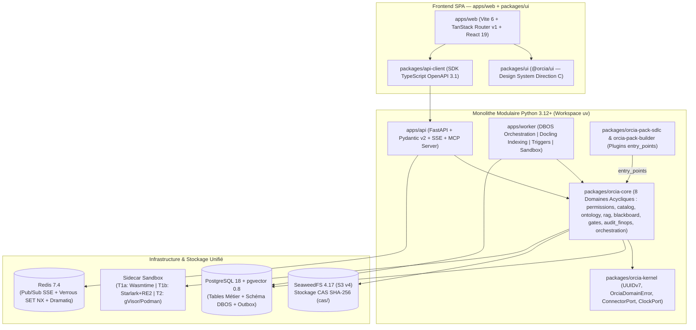

# ORCIA — Orchestration of Processes, Context, and Intelligent Agents

> **« Human-Led, Agent-Accelerated — Gouverné par l'Intention Humaine, Exécuté en Co-Pilotage ou en Autonomie sous Contrat »**

**ORCIA** est une plateforme d'exécution de processus d'entreprise et personnels qui réconcilie la rigueur des moteurs de workflows gouvernés avec l'intelligence adaptative des agents IA, tout en garantissant que **l'humain conserve la maîtrise intellectuelle, la responsabilité décisionnelle et la compréhension durable de ses systèmes**.

---

## 1. Pourquoi ORCIA est nécessaire ? (Problématique)

Aujourd'hui, les organisations et les équipes d'ingénierie font face à quatre limites structurelles lorsqu'elles déploient l'IA générative et l'automatisation à grande échelle :

1. **Le fossé entre le "Chat IA" libre et l'automatisation rigide (BPM/RPA classique)** :
   - Les moteurs de workflows traditionnels imposent des interfaces techniques rigides et gèrent mal le raisonnement probabiliste, la co-création humaine ou l'injection dynamique de connaissances.
   - À l'inverse, les chats IA classiques fonctionnent hors de tout processus gouverné, sans jalons formels (*Gates*) ni contrat de livrable (*Gabarits d'Artefacts*).
2. **Le piège cognitif du "relecteur passif" et la perte de maîtrise humaine (*Pattern Drift*)** :
   - Lorsque l'IA génère directement des documents ou du code de 50 pages, l'humain subit un **biais d'ancrage** massif et finit par valider à l'aveugle (*Rubber-Stamping*).
   - Les agents prennent des décisions d'architecture ou de gestion arbitraires en silence face à des options équivalentes, entraînant une dérive des patterns (*Pattern Drift*) et une perte de **Réversibilité Humaine** (incapacité pour l'équipe de reprendre la main sur son propre système).
3. **Le cloisonnement des connaissances, des outils et des habilitations en entreprise** :
   - La vérité d'un projet est dispersée entre de multiples dépôts **Git** , projets **Jira** , espaces **Confluence** , bases de données  et registres d'artefacts .
   - Les équipes créent des prompts, des *Skills* et des agents en silo sans gouvernance RBAC/ABAC, sans alignement sémantique entre le vocabulaire Métier/Direction et le vocabulaire Technique, et perdent un temps précieux face aux blocages d'habilitations.
4. **L'absence de traçabilité déterministe, de reproductibilité (*Replay*) et de contrôle FinOps** :
   - Lorsqu'un processus long échoue ou change d'hypothèse à l'étape 4 sur 6, il est impossible de rejouer uniquement à partir de l'étape 4 sur un état figé (*Version Pinning* `SHA-256`), ni d'imputer finement le coût complet (Setup + Tokens Run vs gain de *Time-to-Market*) par équipe ou par Business Unit.

---

## 2. Les Objectifs d'ORCIA

ORCIA répond à ces défis à travers quatre objectifs directeurs :

- **Garantir la posture "Human-Led, Agent-Accelerated" (Objectif Cognitif)** :
  - Maintenir la réflexion humaine (*Think*) en amont de la génération IA grâce aux **Ancrages Humains Obligatoires** (`human_authored_required: true`).
  - Interdire tout choix implicite d'un agent face à des options équivalentes (**Arbitrage Humain** explicite ou départage par axiome d'**Ontologie**).
  - Éliminer la fatigue de relecture grâce au **Briefing de Revue** structuré en 4 blocs et à la **Validation par Découpage** (*Chunked Review*).
- **Orchestrer et Gouverner de bout en bout (Objectif Fonctionnel)** :
  - Exécuter des **Workflows** collaboratifs ou **Autonomes sous Contrat** combinant **Agents Exécuteurs**, **Sous-Workflows** (jusqu'à 3 niveaux de profondeur), **Skills**, **Bases de Connaissances** et interventions humaines.
  - Sécuriser chaque transition par des **Gates Multi-Niveaux** (**Déterministes** en Sandbox, **Agentiques Cross-Model** à modèles orthogonaux, et **Humaines** à politique adaptative) et par le **Contrôle Transverse d'Invariants** (`Intention -> Code`).
- **Fédérer l'Entreprise sans Duplication (Objectif Opérationnel)** :
  - Résoudre à la volée les ressources (`git://`, `jira://`, `confluence://`, `db://`, `nexus://`, `orcia://`) avec un cache immuable Content-Addressable (`SHA-256` / `run-lock.json`).
  - Aligner le langage de toute l'organisation via une **Ontologie Dynamique à 4 Niveaux** et débloquer proactivement les accès via un **Permission Broker** intelligent.
- **Maîtriser le ROI Budgétaire et la Souveraineté (Objectif Stratégique & FinOps)** :
  - Mesurer en temps réel le ROI complet (Coût de Setup + Coût de Run vs TTM), prévenir le *Rubber-Stamping* et le *Pattern Drift*, et confiner strictement les flux IA selon le palier de souveraineté (`SovereigntyTier` `C0` à `C3`, avec modèles locaux Ollama/vLLM pour les actifs sensibles).

---

## 3. Fonctionnalités Clés

L'expérience ORCIA est structurée autour de **7 espaces fonctionnels** accessibles selon le **Profil Humain** (RBAC/ABAC) et le **Sélecteur de Périmètre Hiérarchique (`⌘W` : `🌐 Plateforme Globale → 🏢 BU / Tribu → 👥 Équipe → 🗂️ Workspace`)** :

### 3.1. Interface "Chat-First + Canvas" & Agent Assistant Adaptatif
- **Adaptation au Profil Humain** : L'**Agent Assistant** ajuste automatiquement son niveau de synthèse et sa terminologie via l'**Ontologie** (KPIs budgétaires, TTM et risques pour une *Directrice BU* ; schémas d'API, AST et logs de Sandbox pour un *Tech Lead* ; rapports de conformité pour un *Auditeur SecOps*).
- **Canvas interactif en Split-View** : Co-édition d'artefacts, passage des Gates, inspection du graphe d'exécution et revue par découpage côte à côte avec la conversation.

### 3.2. Centre de Notifications Unifié & Pilotage Multi-Workspaces
- **Boîte de réception individuelle et d'équipe** : Séparation claire entre **⚡ Actions Requises (Contributeur)**, **👁️ Workflows suivis (Consultation seule `READ_ONLY_OBSERVER`)** et **🤖 Exécutions Autonomes sous Contrat**.
- **Prise en charge (*Claim*) temps réel (`< 500 ms`)** : Verrouillage atomique Redis + diffusion Server-Sent Events (SSE) empêchant deux membres d'une même équipe de traiter simultanément la même tâche.
- **Centre de Pilotage Fractal des Workspaces** : Gestion multi-sources (`N × git://`, `N × jira://`, `N × confluence://`, `db://`, `nexus://`), suivi des instances de *Runs*, et surcharges à 4 niveaux (`Base → Team → Workspace → User`).

### 3.3. Ingénierie Cognitive & Exécution Durable ("Human-Led")
- **Ancrages Humains Obligatoires (`human_authored_required: true`)** : Verrouillage API interdisant à tout agent IA de pré-remplir les sections d'intention stratégique, de valeur métier ou de choix d'architecture réservées à l'humain.
- **Arbitrage Humain Systématique (`request_human_arbitration`)** : Suspension du Step dès qu'un agent rencontre plusieurs options équivalentes, ou application d'une politique déterministe sous contrat (`ONTOLOGY_AXIOM_FIRST`, `DEFER_AND_CONTINUE_WITH_ASSUMPTION`, `PAUSE_AND_ESCALATE`).
- **Boucles de Rétroaction Amont, Rewind & Replay Non-Destructif** : Possibilité pour une étape aval (ex: Architecte ou Tech Lead détectant une incompatibilité d'API ou une règle métier trop coûteuse) de challenger une étape amont, avec simulation d'impact (*What-If*) et **Replay ciblé** à partir de l'étape $N$ (`DBOS.fork_workflow`) sans perdre l'historique.
- **Souveraineté Bidirectionnelle (`ExternalEditRebaser`)** : Détection et ré-import automatique par diff structurel des modifications faites par un humain directement dans Git ou Confluence après publication (`HUMAN_AMENDED_EXTERNAL`), protégées contre tout écrasement ultérieur par un agent.

### 3.4. Système de Gates Multi-Niveaux & Sandbox à 2 Paliers
- **Gate Déterministe** :
  - *Palier 1a (`Wasmtime < 5s`)* : Validation structurelle des Gabarits d'Artefacts (JSON/YAML Schema, sections Markdown).
  - *Palier 1b (`Starlark + Google RE2 < 2ms`)* : Exécution déterministe sans réseau des règles métiers compilées via `Text-to-Starlark` (`0 $` LLM au Run-Time, immunisé contre les ReDoS).
  - *Palier 2 (`Conteneur isolé gVisor / Podman Rootless < 60s`)* : Exécution hors processus des linters, compilateurs et suites de tests unitaires (`ruff`, `mypy`, `pytest`, `semgrep`).
- **Gate Agentique Cross-Model (Orthogonalité des Modèles)** :
  - Audit indépendant par un **Agent Évaluateur** d'une famille de modèles distincte de l'**Agent Exécuteur** (`evaluator_model_family != executor_model_family`), confiné au même palier de souveraineté (`SovereigntyTier`).
  - Exécution d'un **DAG de 5 Lentilles d'Évaluation** : (1) *Alignement Transverse Étape 1 (PRD/Archi)*, (2) *Vérification Atomique de Faits (`fact_verification`)* contre les sources épinglées dans `run-lock.json`, (3) *Attaque Adversariale & Edge-Cases*, (4) *Conformité Métier/Sécurité*, et (5) *Synthèse & Génération du Briefing de Revue en 4 blocs*.
- **Gate Humaine Adaptative** :
  - Déclenchement selon la politique `mandatory_full`, `risk_or_exception_based` ou `sampling`, accompagné du **Briefing de Revue** (*Résumé*, *Éléments clés*, *Décisions prises*, *Hypothèses retenues*) et de la **Validation par Découpage**.

### 3.5. Ontologie Dynamique à 4 Niveaux & Chaîne Causale ADN
- **4 Strates avec héritage** : `1_ENTERPRISE` (Socle Corporate) $\rightarrow$ `2_DOMAIN` (BU / Métier) $\rightarrow$ `3_TEAM` & `3_WORKSPACE` $\rightarrow$ `4_RUN_EPHEMERAL` (concepts découverts en cours d'exécution).
- **Chaîne Causale ADN (`🛡️ DIRECTIVE ➔ 📏 NORME ➔ ⚙️ MÉCANISME`)** : Chaque règle vérifiée par une Gate est reliée à la norme qu'elle implémente et à la directive d'entreprise qu'elle opérationnalise.
- **Promotion "Zero-Corvée" (*In-Flow Promotion*)** : Intégration directe des `Top-3` concepts découverts à haute confiance dans le Briefing de Revue de fin de workflow pour une promotion au Glossaire en un clic.

### 3.6. RAG Hybride Multi-Sources & Graphe Tripartite (`Confluence ↔ Jira ↔ Git`)
- **Indexation incrémentale différenciée** :
  - *Documentation & Confluence* : Découpage hiérarchique *Parent-Child* (`Docling` sur worker dédié).
  - *Jira Hybride* : Vectorisation contextuelle des tickets porteurs de connaissance durable (Epics, US, Post-mortems).
  - *Codebases Git* : Découpage syntaxique AST via `tree-sitter` (`0 $` LLM sur simple `git push`) et construction du graphe d'appel.
- **Recherche Hybride Native** : Vecteurs `pgvector` `halfvec(1024)` (HNSW) + recherche lexicale `tsvector` fusionnés par **Reciprocal Rank Fusion (`RRF`)**, détection automatique d'obsolescence (`[STALE_WARNING]`) et **Actions Jira Staged** (préparées en brouillon et exécutées uniquement après validation de la Gate).

### 3.7. Permission Broker, Exécution Autonome sous Contrat & FinOps
- **Permission Broker IA** : Gestion des identités déléguées (*Passthrough* OAuth/PAT chiffré en AES-256-GCM ou *Service Principal* à privilèges minimaux) et accompagnement automatique de l'utilisateur en cas de refus d'accès (`401/403`) avec la procédure d'habilitation exacte de l'entreprise.
- **Déclencheurs Événementiels & Auto-Remédiation (`AUTONOMOUS_CONTRACT`)** : Déclenchement idempotent par **Cron**, **Webhook** ou **Alerte de Puits de Logs (`LOG_SINK_ALERT`)** sous contrat signé (`max_cost_per_run_usd`, `tie_break_policy`), avec vérification post-action en boucle fermée (`POST_ACTION_VERIFICATION`) et **Auto-Rollback / Kill-Switch** en cas d'anomalie.
- **Cockpit FinOps, Audit Immuable & Réversibilité** : Grand livre append-only (`audit_ledger`, `blackboard_snapshots`), suivi des budgets et quotas de tokens, détection du *Rubber-Stamping* (`< 10s`) et mesure de l'indice de *Pattern Drift*.

---

## 4. Composants Techniques & Architecture

ORCIA repose sur un **Monolithe Modulaire Hexagonal (Ports & Adapters)** couplé à un moteur d'orchestration durable transactionnel (**DBOS Transact** sur PostgreSQL 18), organisé dans un **Monorepo Hybride TypeScript + Python**.



### 4.1. Pile Technologique (Stack)

| Couche                                      | Technologies & Composants                                                                                                           | Rôle dans ORCIA                                                                                                                                                                                                              |
| :------------------------------------------ | :---------------------------------------------------------------------------------------------------------------------------------- | :--------------------------------------------------------------------------------------------------------------------------------------------------------------------------------------------------------------------------- |
| **Frontend Web (`apps/web`)**               | **TypeScript 5.8**, **React 19**, **Vite 6.4**, **TanStack Router v1**, **TanStack Query v5**, **Zustand v5**, **Tailwind CSS 4.3** | SPA réactive pure organisée par domaine fonctionnel (`cockpit`, `inbox`, `workspaces`, `catalog`, `ontology`, `gates`, `finops`, `admin`), internationalisée (`FR`/`EN`).                                                    |
| **Design System (`packages/ui`)**           | **`@orcia/ui`**, Tokens CSS sémantiques **Direction C**                                                                             | Composants UI purs et composants cognitifs (`HumanLedAnchorCard` en violet exclusif `#6D28D9`, Briefing de Revue, Validation par Découpage) sans couplage réseau.                                                            |
| **Contrat API (`packages/api-client`)**     | **OpenAPI 3.1**, `openapi-typescript`, `openapi-fetch`                                                                              | SDK client TypeScript typé de bout en bout, généré automatiquement depuis les schémas Pydantic v2 de `apps/api`.                                                                                                             |
| **API Backend (`apps/api`)**                | **Python 3.12+**, **FastAPI**, **Pydantic v2**, **Uvicorn**, **Structlog**, **OpenTelemetry**                                       | Point d'assemblage (*Composition Root*), routes REST, erreurs **RFC 9457 (`application/problem+json`)**, flux temps réel **SSE** (`/api/v1/events/stream`) et serveur **MCP** (`/api/v1/mcp`).                               |
| **Orchestration & Workers (`apps/worker`)** | **DBOS Transact (`dbos`)**, **Dramatiq 2.1**, **Docling**, **LiteLLM**                                                              | Exécution durable transactionnelle (`@DBOS.workflow`, `@DBOS.step`, `DBOS.fork_workflow`), relais Outbox PostgreSQL, indexation documentaire et routage multi-LLM orthogonal.                                                |
| **Noyau Hexagonal (`packages/*`)**          | **`orcia-kernel`**, **`orcia-core`**, **`orcia-pack-sdlc`**, **`orcia-pack-builder`**                                               | Noyau métier pur sans dépendance framework (vérifié par **`import-linter`**), extensible par plugins `entry_points` (`orcia.connectors`, `orcia.indexers`, `orcia.workflow_policies`, `orcia.packs`).                        |
| **Base de Données & RAG**                   | **PostgreSQL 18.0** + **`pgvector 0.8.7`**, **SQLAlchemy 2.1 Asyncio** (`asyncpg`), **Alembic**                                     | Stockage relationnel (clés primaires `UUIDv7`), checkpoints durables DBOS, table Outbox transactionnelle, tables append-only (`audit_ledger`, `blackboard_snapshots`) et recherche hybride `halfvec(1024)` + `tsvector` RRF. |
| **Temps Réel & Files**                      | **Redis 7.4**                                                                                                                       | Diffusion Pub/Sub pour les notifications SSE (`< 500 ms`), verrous de présence atomiques (`SET lock:step:<id> NX`) et files de tâches Dramatiq.                                                                              |
| **Stockage Objet CAS**                      | **SeaweedFS 4.17** (API S3 v4, licence Apache-2.0)                                                                                  | Stockage immuable adressé par le contenu (`cas/<sha256>`) des ressources fédérées et des artefacts figés dans `run-lock.json`.                                                                                               |
| **Sandbox d'Exécution**                     | **Wasmtime** (`wasmtime-py`), **Starlark** (`starlark-pyo3` + `google-re2`), **gVisor / Podman Rootless**                           | Exécution isolée sans réseau à 2 paliers pour les Gates déterministes, les règles métiers et les tests d'auto-remédiation.                                                                                                   |

### 4.2. Structure du Monorepo

```text
ORCIA/
├── apps/
│   ├── api/                    # Serveur FastAPI (Composition Root, schémas OpenAPI 3.1, SSE, MCP)
│   ├── worker/                 # Workers (DBOS orchestration, Outbox relay, Docling indexer, Triggers)
│   └── web/                    # Application SPA (Vite 6 + TanStack Router + React 19)
├── packages/
│   ├── orcia-kernel/           # Primitives fondamentales (UUIDv7, OrciaDomainError, ConnectorPort, ClockPort)
│   ├── orcia-core/             # 8 Domaines métiers hexagonaux acycliques (permissions, catalog, ontology, rag, blackboard, gates, audit_finops, orchestration)
│   ├── orcia-pack-sdlc/        # Pack métier Ingénierie Logicielle (connecteurs Git/Jira/Confluence/Nexus, indexeurs AST/Jira, politique FR-13)
│   ├── orcia-pack-builder/     # Pack Studio de création et validation de packs métiers
│   ├── ui/                     # Librairie Design System @orcia/ui (Direction C)
│   └── api-client/             # SDK TypeScript généré depuis le contrat OpenAPI 3.1
├── infra/
│   ├── docker/                 # Stack Docker Compose de développement (PostgreSQL 18 + pgvector, Redis 7.4, SeaweedFS 4.17)
│   ├── migrations/             # Migrations de schéma Alembic incrémentales (SQL brut Expand -> Backfill -> Contract)
│   ├── sandbox/                # Configuration des environnements d'exécution isolés
│   └── scripts/maintenance/    # Scripts d'initialisation, vérification d'invariants et seeding idempotent
├── scripts/
│   └── manage.py               # Orchestrateur unifié du cycle de vie local ( invoqué par ./manage.sh )
├── tests/                      # Suites de tests (Unitaires, Propriétés Hypothesis, Contrats, Intégration Testcontainers)
└── docs/                       # Documentation complète (PRD, Architecture Spine, UX Design, Epics, Rapports Tech Lead)
```

---

## 5. Mode d'Installation & Démarrage Rapide

### 5.1. Prérequis

Assurez-vous de disposer des outils suivants sur votre machine locale (Linux / macOS / WSL2) :

- **Python** `>= 3.12` et [**uv**](https://docs.astral.sh/uv/) (gestionnaire de workspace Python)
- **Node.js** `>= 22.0.0` et **pnpm** `>= 10.6.0` (`corepack enable && corepack prepare pnpm@10.6.0 --activate`)
- **Docker** et **Docker Compose v2** (pour PostgreSQL 18 + `pgvector`, Redis 7.4 et SeaweedFS S3)
- **Git**

### 5.2. Installation pas à pas

#### 1. Cloner le dépôt et configurer les variables d'environnement

```bash
git clone <url-du-repo> ORCIA
cd ORCIA

# Créer le fichier .env local à partir du modèle fourni
cp .env.example .env
```

> **Note sur les ports par défaut (`.env`)** : Pour éviter tout conflit avec des services déjà présents sur votre poste, ORCIA utilise par défaut :
> - **Web (SPA)** : `http://127.0.0.1:3100`
> - **API (FastAPI)** : `http://127.0.0.1:8000` (Swagger/OpenAPI sur `/docs`)
> - **PostgreSQL 18 (`pgvector`)** : `127.0.0.1:5433`
> - **Redis 7.4** : `127.0.0.1:6380`
> - **SeaweedFS S3 (CAS)** : `http://127.0.0.1:9000` (Master sur `:9333`)

#### 2. Créer l'environnement virtuel Python (`.venv`) et installer les packages

```bash
# Créer le virtualenv en Python 3.12+ à la racine du projet
uv venv .venv --python 3.12

# Installer l'ensemble du workspace Python en mode éditable avec les dépendances de développement
uv pip install --python .venv/bin/python -e ".[dev]"
```

#### 3. Installer les dépendances TypeScript / Frontend

```bash
pnpm install
```

#### 4. Initialiser les secrets cryptographiques locaux

```bash
# Génère automatiquement ORCIA_JWT_SIGNING_SECRET et ORCIA_PASSTHROUGH_MASTER_KEY dans .env
./manage.sh init-secrets
```

#### 5. Démarrer l'infrastructure Docker, appliquer les migrations et amorcer les données (Seed)

```bash
# 1. Démarrer PostgreSQL 18 + pgvector, Redis 7.4 et SeaweedFS S3
pnpm db:up
# (ou via : ./manage.sh start infra)

# 2. Appliquer toutes les migrations Alembic jusqu'à head
pnpm db:migrate
# (équivalent à : .venv/bin/alembic -c infra/migrations/alembic.ini upgrade head)

# 3. Vérifier les invariants DB et charger les données de référence Jour 0 (Organisation, Catalogue, Permission Broker, Bootstrap)
pnpm db:seed

# Optionnel : Charger le jeu de données complet de recette / démonstration (UAT)
./manage.sh seed-uat --apply
```

---

### 5.3. Lancement et Exploitation au Quotidien (`./manage.sh`)

ORCIA fournit un script d'administration unifié [`./manage.sh`](manage.sh) (qui délègue automatiquement au Python de `.venv/bin/python`) permettant de piloter toute la stack ou chaque brique individuellement :

```bash
# Démarrer l'ensemble de la plateforme (infra Docker + API FastAPI + Worker + Web SPA)
./manage.sh start all

# Vérifier l'état de santé et les ports de tous les composants
./manage.sh status

# Consulter les journaux d'exécution (tous les services ou un service spécifique)
./manage.sh logs all -n 50
./manage.sh logs api -n 100

# Redémarrer ou arrêter un composant spécifique (all | infra | postgres | redis | minio | api | worker | web)
./manage.sh restart api
./manage.sh stop all
```

Vous pouvez également lancer les serveurs applicatifs en mode interactif lors du développement :

```bash
# Terminal 1 — Backend API FastAPI (http://127.0.0.1:8000)
pnpm dev:api

# Terminal 2 — Frontend Web SPA Vite (http://127.0.0.1:3100)
pnpm dev:web
```

---

### 5.4. Vérification de la Qualité, Architecture & Tests

Toutes les commandes Python doivent être exécutées via l'environnement virtuel `.venv/bin/` :

```bash
# 1. Linter & Formatage Python (Ruff)
.venv/bin/ruff check .
.venv/bin/ruff format --check .

# 2. Typage statique strict Python (Mypy)
.venv/bin/mypy --strict packages/orcia-kernel packages/orcia-core apps/api apps/worker

# 3. Vérification des frontières d'architecture hexagonale (AD-19 / import-linter)
.venv/bin/lint-imports

# 4. Exécution des tests Python avec couverture minimale obligatoire (>= 90%)
.venv/bin/pytest --cov=packages/orcia-kernel --cov=packages/orcia-core --cov-fail-under=90

# 5. Linter, Typage et Tests TypeScript / UI (Turborepo)
pnpm turbo run lint typecheck test
```

---

## 6. Documentation de Référence

Pour approfondir la conception et les règles d'ingénierie d'ORCIA :

- **Vision & Produit** :
  - [Product Brief (`docs/planning-artifacts/product-brief.md`)](docs/planning-artifacts/product-brief.md)
  - [Product Requirements Document — PRD (`docs/planning-artifacts/prds/prd-ORCIA-2026-10-24/prd.md`)](docs/planning-artifacts/prds/prd-ORCIA-2026-10-24/prd.md)
  - [Epics & User Stories (`docs/planning-artifacts/epics.md`)](docs/planning-artifacts/epics.md)
- **Architecture & Décisions Techniques (AD-1 à AD-20)** :
  - [Architecture Spine (`docs/planning-artifacts/architecture/architecture-ORCIA-2026-10-24/ARCHITECTURE-SPINE.md`)](docs/planning-artifacts/architecture/architecture-ORCIA-2026-10-24/ARCHITECTURE-SPINE.md)
  - [Architecture Détaillée & Schéma de Données (`docs/planning-artifacts/architecture/architecture-ORCIA-2026-10-24/architecture.md`)](docs/planning-artifacts/architecture/architecture-ORCIA-2026-10-24/architecture.md)
- **Expérience Utilisateur & Design System (Direction C)** :
  - [Spécifications d'Expérience (`docs/planning-artifacts/ux-designs/ux-ORCIA-2026-10-24/EXPERIENCE.md`)](docs/planning-artifacts/ux-designs/ux-ORCIA-2026-10-24/EXPERIENCE.md)
  - [Système de Design & Tokens (`docs/planning-artifacts/ux-designs/ux-ORCIA-2026-10-24/DESIGN.md`)](docs/planning-artifacts/ux-designs/ux-ORCIA-2026-10-24/DESIGN.md)
- **Standards de Développement & Rapports Tech Lead** :
  - [Guide & Politiques de Développement (`AGENTS.md`)](AGENTS.md)
  - [Rapports d'Implémentation Tech Lead (`docs/implementation-artifacts/tech-lead-reports/`)](docs/implementation-artifacts/tech-lead-reports/)
