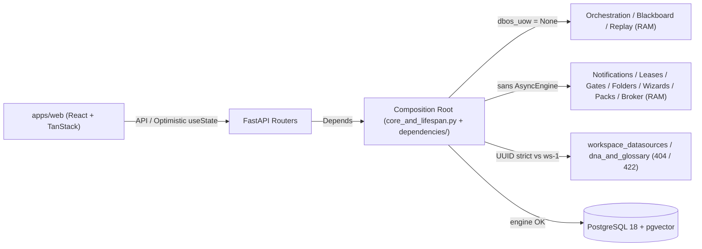
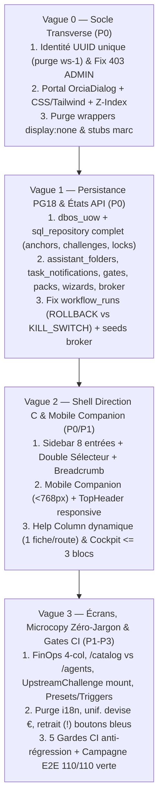

# Audit Architectural & Arbitrages Techniques — Campagne E2E Epic 21 (`notes-audit-winston-architecture.md`)

- **Auteur** : Winston (`bmad-architect-worker`, System Architect ORCIA) — Story `21.8`
- **Date** : `2026-11-18`
- **Branche / Référentiel** : `feat/epic-21-user-journeys-e2e-db-audit` (`575cf4a`)
- **Sources vérifiées** :
  - [`ARCHITECTURE-SPINE.md`](file:///home/romain/Documents/Projects/ORCIA/docs/planning-artifacts/architecture/architecture-ORCIA-2026-10-24/ARCHITECTURE-SPINE.md) (`AD-1`..`AD-24`)
  - [`bilan-execution-tests-e2e-epic-21.md`](file:///home/romain/Documents/Projects/ORCIA/docs/implementation-artifacts/e2e-campaign-epic-21/bilan-execution-tests-e2e-epic-21.md) (`47` PASS / `36` FAIL / `11` TIMEOUT / `16` SKIP sur `110` cas)
  - [`notes-audit-sally-ux.md`](file:///home/romain/Documents/Projects/ORCIA/docs/implementation-artifacts/e2e-campaign-epic-21/notes-audit-sally-ux.md) (constats P0–P3 et 5 questions à l'architecture)
  - [`DESIGN.md`](file:///home/romain/Documents/Projects/ORCIA/docs/planning-artifacts/ux-designs/ux-ORCIA-2026-10-24/DESIGN.md) & [`EXPERIENCE.md`](file:///home/romain/Documents/Projects/ORCIA/docs/planning-artifacts/ux-designs/ux-ORCIA-2026-10-24/EXPERIENCE.md)

> **Constat directeur** : La pile d'infrastructure E2E (`PostgreSQL 18 + pgvector`, `Redis 7.4`, Alembic `head`, FastAPI, cassette LLM `0 $`, Vite) fonctionne nominalement (`00-stack-smoke` et `01-day0-boot` à `100 %`). En revanche, **la plateforme souffre d'une schizophrénie structurelle « Dual-Stack »** héritée des Epics 1–12 : d'un côté, des tables PostgreSQL 18 et adaptateurs SQL existent ; de l'autre, le **Composition Root** (`core_and_lifespan.py`, `dependencies/`) continue d'instancier des singletons RAM sans `AsyncEngine`, tandis que plusieurs vues React (`platformSetupStore`, `wizards.tsx`, `workspaces`, `catalog`) maintiennent un état local optimiste ou masquent d'anciens panneaux via `style={{ display: "none" }}` pour satisfaire des tests statiques d'audit.

---

## 1. Diagnostic Architectural des Silos RAM vs PostgreSQL 18

### 1.1 Vue d'ensemble du Composition Root (`core_and_lifespan.py` & `dependencies/`)

Contrairement à [`AD-1`](file:///home/romain/Documents/Projects/ORCIA/docs/planning-artifacts/architecture/architecture-ORCIA-2026-10-24/ARCHITECTURE-SPINE.md#L89-L97) (« Point Unique d'Assemblage `lifespan + Depends`, `InMemory*` réservé aux tests unitaires »), le démarrage réel de FastAPI (`apps/api/src/orcia_api/dependencies/core_and_lifespan.py`) injecte deux générations de services :
1. **Services réellement câblés PG18** : `auth` / `users` (`01-day0-boot`), `enterprise_connectors`, `workspace_llm_tier_mappings`, `rag_reindexing_jobs`, `audit_ledger`, `autonomy_contracts`, `workflow_triggers`, `reflexive_execution_sessions`, `workflow_definitions_v2`, `vsm_definitions_v2`, `finops_scope_budgets`, `ontology_*`, `role_permission_grants`, `user_preferences`, `user_mcp_tokens`.
2. **Silos RAM ou demi-câblés** : **9 domaines/tables** où l'API retourne `HTTP 200/201` ou affiche un succès optimiste en UI alors que `0` ligne valide n'est persistée dans PostgreSQL 18.

### 1.2 Cartographie Table par Table et Routeur par Routeur des `16` Échecs de Persistance

| Table PG18 ciblée | Specs E2E en échec | Routeur(s) FastAPI & Provider `dependencies/` | Cause racine exacte (fichiers & lignes) |
| :--- | :--- | :--- | :--- |
| **`assistant_folders`** (`assistant_threads`) | `02-assistant` (`×4` : Desktop `×2`, Mobile `×2`) | `routers/assistant_workspace_folders.py` ; `dependencies/portal_and_assistant.py:162-172` | `get_assistant_folders_service` instancie `AssistantFoldersAndSharingService()` **sans `engine` ni `session_maker`**. `assistant_folders_and_sharing.py:173-177` stocke `_folders` et `_threads` dans des `dict` RAM en mémoire. |
| **`human_anchor_signatures`** | `03-human-led` (`×2`), `19-orchestration` #1 | `routers/blackboard_and_engine.py:164-196` ; `routers/orchestration_sql_wiring.py:50-60` | 1) `resolve_optional_dbos_uow` cherche `app.state.dbos_uow` ou `app.state.dbos_datasource` — **aucun des deux n'est initialisé dans `core_and_lifespan.py`**. 2) Même si `dbos_uow` existait, `sign_human_anchor` (`blackboard_and_engine.py`) passe `snapshot=None` à `sync_step_execution_and_snapshot_to_sql`, et `orcia_core/orchestration/_internal/sql_repository.py` ne possède **aucune méthode SQL** pour `human_anchor_signatures`. |
| **`workflow_runs`**, **`step_executions`**, **`blackboard_snapshots`**, **`upstream_challenges`**, **`run_lock_manifests`** | `19-orchestration` #1 | `routers/orchestration.py:203-220` ; `routers/challenge_and_replay.py:132-158` | 1) `app.state.dbos_uow` = `None` (silo RAM). 2) `get_orchestration_state` (`orchestration.py:203-220`) lit exclusivement en RAM. 3) `submit_upstream_challenge` (`challenge_and_replay.py:132-158`) n'appelle pas la couche SQL. 4) `sql_repository.py` ne couvre que `workflow_runs`, `step_executions`, `blackboard_snapshots` et `domain_events_outbox` — **zéro adaptateur SQL** pour `upstream_challenges` et `run_lock_manifests`. |
| **`task_notifications`** (`resource_leases`) | `04-multi-actor` (`×1`), `15-org` #4 (`×2`) | `routers/inbox_and_leases.py` ; `dependencies/core_and_lifespan.py:219-234` | `core_and_lifespan.py:219-234` instancie `UnifiedNotificationAndClaimService(sse_broker=...)` (et seede des tâches en mémoire si `_e2e_fixtures_enabled()`) ainsi que `ResourceLeaseService()` **sans `AsyncEngine` ni repository PG18**. `inbox_and_leases.py` mute uniquement ces dictionnaires RAM ; `POST /api/v1/tasks/{id}/claim` retourne `200`/`409` en RAM et `task_notifications` reste vide (`0` ligne). |
| **`gate_evaluations`** & **`chunk_approvals`** | `06-gates` (`×1`), `19-orchestration` #2 (`×2`) | `routers/gates.py:117-121,171,357` ; `routers/human_gates.py:105,129,169,195,229` | Tous les endpoints de `gates.py` et `human_gates.py` délèguent à `bootstrap_svc.gate_service` et `bootstrap_svc.gate_service.human_service` en mémoire pure, sans `SqlGateEvaluationRepository` ni `session_factory` PG18. |
| **`workspaces`** | `07-spaces` (`×1`) | `apps/web/src/components/platformSetupStore.tsx:839-888` ; `orcia_core/bootstrap/_internal/sql_platform_setup_relational_sync.py:259-260` | **Perte silencieuse de `slug` + fire-and-forget UI** : `createWorkspace` (`platformSetupStore.tsx:846`) génère l'ID synthétique `"ws-${workspaces.length + 1}"` et construit `newWs: ControlCenterWorkspaceGovItem` **en omettant `slug: input.slug`**. Côté serveur, `sql_platform_setup_relational_sync.py:259-260` fait `raw_slug = str(ws.get("slug") or name)` → `'Espace E2E Comptabilité'` est normalisé en `'espace-e2e-comptabilit'` (le `é` devient `-` puis est trimmé) au lieu de `'espace-e2e-compta'`. De plus, la synchro backend utilise `.catch(() => undefined)` (`platformSetupStore.tsx`). |
| **`workflow_runs` (`KILL_SWITCH_STOPPED`)** | `13-epic-7` (`×1`) | `routers/autonomous_supervision.py:122-143` ; `routers/autonomy_contracts.py:208-292` ; `orcia_core/orchestration/_internal/_sql_autonomous_rollback.py:44-48` | **Collision d'état sur le même `run_id` dans `workflow_runs.status`** : `13-epic-7.spec.ts:92-120` crée un run #1 (trigger) puis un run #2 (`POST .../runs/autonomous` avec `force_post_hoc_sample: true`). `list_autonomous_runs_sql` (`sql_autonomous_supervision.py:94`) trie `ORDER BY wr.created_at DESC`, donc `stopBtns.first()` (`L134`) arrête **le run #2** (`KILL_SWITCH_STOPPED`). Ensuite `/finops` (`L152-154`) exécute `invalidate-and-restore` sur **ce même run #2** : `_sql_autonomous_rollback.py:44-48` exécute `UPDATE workflow_runs SET status = 'ROLLED_BACK' WHERE id = :run_id` **sans garde `AND status <> 'KILL_SWITCH_STOPPED'`** (à l'inverse de `sql_autonomous_supervision.py:202`), écrasant le statut `KILL_SWITCH_STOPPED` par `ROLLED_BACK`. |
| **`workspace_datasources`** | `17-workspace` #1 (`×2`) | `routers/workspace_datasources.py:178` ; `sql_workspace_datasources_mutations.py:76-79` ; `sql_workspace_datasources_queries.py:275-277` | **Schisme d'identifiant `"ws-1"` vs `UUID`** : `platformSetupStore.tsx:846` attribue `"ws-1"` aux workspaces créés via l'UI ; `WorkspaceSourcesRagTab.tsx:42,161` envoie `POST /api/v1/workspaces/ws-1/datasources`. `sql_workspace_datasources_mutations.py:76-79` exécute `UUID(workspace_id.strip())` et lève `ResourceNotFoundError` (**HTTP 404**), tandis que `GET` (`sql_workspace_datasources_queries.py:275-277`) renvoie silencieusement `[]`. Contrairement à `_finops_scope_guards.py:46-51` (`resolve_workspace_uuid_or_setup_key`), ce routeur ignore le mapping `ws-N → UUIDv5`. |
| **`workspace_exception_waivers`** | `17-workspace` #3 (`×2`, bloqué amont par `hidden`) | `apps/web/src/features/workspaces/index.tsx:272-290,321-356` | `onRegisterWaiver` (`L272-290`) écrit uniquement dans le `useState` local `activeWaivers` (aucun appel API). En parallèle, `onCompileFromNorm` (`L321-356`) appelle `compileDnaStarlark("ws-1", ...)` contre `dna_and_glossary.py:65` qui exige `workspace_id: UUID` → `422` et repli local. |
| **`declarative_pack_bundles`** | `18-catalog` #3 (`×2`) | `routers/packs.py:38-43` ; `core_and_lifespan.py:291-294` | `packs.py:38-43` charge les manifests YAML depuis le système de fichiers `packs/<domain>/` dans `app.state.declarative_pack_bundles` sans aucun `INSERT/UPSERT` dans la table `declarative_pack_bundles`. |
| **`wizard_sessions`** | `18-catalog` #4 (`×2`) | `apps/web/src/routes/wizards.tsx:52-103` ; `core_and_lifespan.py:291-294` ; `routers/studio_and_wizards.py` | **Double silo RAM** : côté frontend, `WizardsRouteComponent` (`wizards.tsx:52-103`) conserve `currentStep` et `status` en pur `useState` React sans jamais appeler `@orcia/api-client` (`GET`/`POST` `/api/v1/wizards`). Côté backend, `core_and_lifespan.py:291-294` instancie `DurableOnboardingWizardService()` sans `AsyncEngine`. |
| **`permission_broker_tickets`** | `16-ai-models` #3 (`×2`) | `routers/permission_broker.py` ; `orcia_core/permissions/broker.py:64,225` | `PermissionBrokerService._tickets` est un `dict` en mémoire pure ; aucune écriture SQL vers `permission_broker_tickets` n'existe (en plus du `404` détaillé au § 2.1). |
| **`catalog_items`** (explorateur & exposition MCP) | `18-catalog` #1 & #5 | `apps/web/src/features/catalog/index.tsx:199-229` ; `routers/catalog.py` | Bloqué en E2E par le masquage (`display: none`) et la duplication DOM de `remote-service-test-bench` (cf. § 3.2). |

### 1.3 État d'`AUTH-01` (Bootstrap, Identité par Défaut, Bearer Frontend & Coupe-Circuit PG)

1. **`get_accostage_service` (`dependencies/portal_and_assistant.py:59-70`, consommé par `auth.py:10`)** : instancie encore `ProgressiveDay0AccostageService(orcia_env="local", expected_bootstrap_token="orcia-day0-bootstrap-token")` en dur au lieu de lire la configuration applicative centralisée (en environnement non-local, tout oubli de variable expose un défaut prédictible s'il n'est pas gardé par `orcia_env`).
2. **Identité hardcodée `"marc"` résiduelle dans le frontend** : plusieurs appels Cockpit et Orchestration transmettent encore le query/persona parameter `"marc"` en dur (`apps/web/src/features/cockpit/CockpitHumanLedGovernanceSection.tsx:54,112,157,177,208,243` et `apps/web/src/features/cockpit/index.tsx:155`), alors que le cookie `HttpOnly` `REFRESH_COOKIE_NAME` + rotation `/api/v1/auth/session` / `/api/v1/auth/refresh` (`routers/_auth_session_routes.py:50-126`) hydrate déjà le JWT Bearer dans `useAuthSessionStore`.
3. **Drapeau `ORCIA_DISABLE_PG_BOOTSTRAP_SYNC`** : présent dans `_auth_session_routes.py:46-47` et `enterprise_connectors.py:86-87` et `autonomy_contracts.py:261`, il continue d'autoriser une dégradation silencieuse vers la RAM en cas de bascule d'environnement. En `AD-1`, ce drapeau ne doit plus jamais exister dans les routeurs : seul le **Composition Root** sélectionne les adaptateurs de test en Couche 1 (`AD-17`), et les tests d'intégration/E2E doivent exiger PG18 fail-fast (`503` si moteur absent).

---

## 2. Diagnostic des Échecs HTTP API (`404` / `403` / `422`) et des Timeouts E2E

### 2.1 Rejets HTTP API inattendus (`8` échecs)

1. **`POST /api/v1/permissions/broker/check-access` → `404` (`16-ai-models` #3 ×2)** :
   - **Chaîne causale** : [`16-ai-models.spec.ts:204-215`](file:///home/romain/Documents/Projects/ORCIA/apps/web/e2e/16-ai-models-reindex-connectors-and-broker.spec.ts#L204-L215) soumet `target_uri: "git://gitlab.internal/platform/infra-core"`. Or `DEFAULT_PERMISSION_BROKER_POLICY_SEEDS` (`orcia_core/permissions/seeds.py:163,187`) ne contient que les motifs `git://*/payments/*` et `git://*/archi/*`. Dans `PermissionBrokerService.resolve_matching_policy` (`orcia_core/permissions/broker.py:148-153`), l'absence de règle correspondante lève `ResourceNotFoundError` (**HTTP 404**).
   - **Arbitrage architectural** : En `AD-6`, toute source non couverte par une procédure dédiée doit soit retomber sur une politique socle générique configurable (`git://*`, `jira://*`, `confluence://*` par défaut en base), soit être résolue via la fiche de procédure rattachée à `workspace_datasources` plutôt que d'échouer en `404`.
2. **`POST /api/v1/gates/deterministic/evaluate` → `403` (`19-orchestration` #2 ×2) & `POST /api/v1/executions/reflexive` → `403` (`21-assistant` #1 ×2)** :
   - **Chaîne causale** :
     1. Lors du bootstrap Jour 0 (`bootstrap_accostage.py:159`), le premier administrateur (`Alice Admin E2E`) est rattaché à l'unité racine `primary_org_unit_id = _OU_ENT` (`...0101`).
     2. Quand l'UI crée une BU, une Team et un Espace (`ws-1` côté UI, UUIDv5 `ws.pgWorkspaceId` en PG18), `_bootstrap_evaluator_sync.py:95-125` n'enregistre un `WorkspaceMembershipEntity` explicite que pour `"ws-1"` (pas pour `ws.pgWorkspaceId`), et `sync_evaluator_topology_from_pg` (`_finops_scope_guards.py:114-129`) insère `WorkspaceEntity(id=ws.pgWorkspaceId)` **sans membership associé**.
     3. Dans [`MatrixPermissionEvaluator.resolve_workspace_access`](file:///home/romain/Documents/Projects/ORCIA/packages/orcia-core/src/orcia_core/permissions/evaluator.py#L184-L211), un utilisateur `PLATFORM_ADMIN` sans membership direct reçoit systématiquement `role="OBSERVER"`, `access_mode="READ_ONLY_OBSERVER"`, `access_origin="GLOBAL_ADMIN"`.
     4. Contrairement à `_finops_auth_guards.py:76` qui exempte explicitement `is_platform_admin`, `gates.py:118` (`enforce_scope_mutation_guard`) et `executions_trace.py:97-100` appliquent `resolve_workspace_access` et lèvent **`ObserverModeReadOnlyError` (`HTTP 403`)** dès qu'un `PLATFORM_ADMIN` agit dans son propre espace fraîchement créé !
   - **Arbitrage architectural** : Un `PLATFORM_ADMIN` ne doit basculer en `READ_ONLY_OBSERVER` que sur les espaces `CONFIDENTIAL_RESTRICTED` sans délégation explicite ou lorsqu'il active volontairement le mode observateur (`X-Orcia-Access-Mode: READ_ONLY_OBSERVER`). Sur un espace `STANDARD` et sur les espaces de ses unités, l'unification de l'ID `UUIDv7` (suppression de `"ws-1"`) + un `WorkspaceMembershipEntity` propriétaire pour le créateur/admin résolvent simultanément les deux `403`.
3. **`POST /api/v1/workspaces/{ws}/workflows/wf-01-qualification-prd/triggers` → `422` (`20-process-studio` #2 ×2)** :
   - **Chaîne causale** : [`20-process-studio.spec.ts:153`](file:///home/romain/Documents/Projects/ORCIA/apps/web/e2e/20-process-studio-v2-finops-and-log-sink.spec.ts#L153) envoie `webhook_secret: { action: "set", value: alertSecret }`. Or [`SecretInputPayload`](file:///home/romain/Documents/Projects/ORCIA/apps/api/src/orcia_api/schemas/settings_and_studio.py#L30-L36) porte `model_config = ConfigDict(extra="forbid")` et exige **`plaintext_value`** (comme l'envoie correctement [`useWorkflowTriggers.ts:90-93`](file:///home/romain/Documents/Projects/ORCIA/apps/web/src/features/processes/studio/useWorkflowTriggers.ts#L90-L93)). FastAPI rejette `value` en **HTTP 422**.
   - **Action** : Le contrat Pydantic (`plaintext_value`) est canonique ; corriger la spec E2E (`plaintext_value`) et garantir par tests contrat OpenAPI que le SDK `@orcia/api-client` est utilisé partout au lieu d'objets JSON bruts.

### 2.2 Causes des `11` Timeouts (`35 s`) et `data-testid` Manquants

| Scénario E2E | Cause technique exacte vérifiée |
| :--- | :--- |
| **`14-auth` #1 & `15-org` #1** (`×4` timeouts `open-invite-org-user-modal-btn`) | `SettingsOrganizationUnitsBlock.tsx:56-58,86` masque complètement `open-invite-org-user-modal-btn` tant que `invitableUnits.length === 0`. Même si ce masquage est intentionnel en Jour 0 avant création d'unité, `14-auth` #1 appelle `inviteUserViaOrganizationUi` sans avoir créé d'unité, ou attend le bouton alors que l'état vide n'est pas explicite. **Arbitrage** : garder le bouton visible mais désactivé (`disabled` + infobulle « Créez d'abord une Direction ou Équipe ») **ou** permettre l'invitation au niveau Entreprise racine, et corriger les prérequis dans les parcours. |
| **`14-auth` #2** (`×2` timeouts sur `/` à 35 s) & **`16-ai-models` #2** (`Desktop` timeout 35 s vs **`Mobile` PASS en `9,8 s`**) | **Collision de stacking context entre `UserSettingsModalDialog` et la colonne Aide droite (`340px`)** (cf. § 3.1). Sur Desktop (`1440×900`), `helpColumnOpen` est `true` par défaut : `<aside data-testid="four-zone-contextual-help-column">` (`FourZoneDirectionCShell.tsx:297-309`) recouvre la partie droite de `UserSettingsModalDialog` (notamment `user-settings-modal-close-btn` dans `14-auth:208` et les boutons de droite de `UserSettingsPassthroughTab` dans `16-ai-models:164-169`). Sur Mobile (`390px`), `helpColumnOpen` est `false` par défaut, ce qui explique pourquoi `16-ai-models` #2 **passe en 9,8 s sur Mobile** mais **expire à 35 s sur Desktop** ! |
| **`16-ai-models` #1** (`×2` timeouts `llm-provider-preset-ollama`) | [`settingsAiModelsPresets.ts:50`](file:///home/romain/Documents/Projects/ORCIA/apps/web/src/routes/settingsAiModelsPresets.ts#L50) définit `id: "local-ollama"`, donc `AiModelFormFields.tsx:103` génère `data-testid="llm-provider-preset-local-ollama"` alors que la spec attend `llm-provider-preset-ollama`. |
| **`20-process-studio` #1** (`×2` timeouts `studio-view-mode-whatif`) | [`WorkflowStudioHeaderBar.tsx:153,162`](file:///home/romain/Documents/Projects/ORCIA/apps/web/src/features/processes/studio/WorkflowStudioHeaderBar.tsx#L153-L162) déclare `key: "what_if"` (avec underscore) → `data-testid="studio-view-mode-what_if"`, alors que `20-process-studio.spec.ts:51` cherche `studio-view-mode-whatif`. |
| **`19-orchestration` #1** (`×2` fails `upstream-challenge-reason-input`) | [`UpstreamChallengeRewindModal`](file:///home/romain/Documents/Projects/ORCIA/packages/ui/src/primitives/UpstreamChallengeRewindModal.tsx) est exporté par `@orcia/ui` mais **n'est monté par aucun composant de `apps/web/src/`** (GitNexus `IMPORTS` = `0` appelant applicatif ; absent de [`CockpitHumanLedGovernanceSection.tsx`](file:///home/romain/Documents/Projects/ORCIA/apps/web/src/features/cockpit/CockpitHumanLedGovernanceSection.tsx)). |

---

## 3. Réponses Directes & Arbitrages aux Constats UX de Sally (`notes-audit-sally-ux.md` § 4)

### 3.1 Question 1 — Portails React, Z-Index de l'AppShell & Débordement Vertical des Modales (`P0`)

- **Cause architecturale exacte (triple défaut confirmé)** :
  1. **Tailwind CSS v4 n'est pas compilé dans `apps/web`** : [`package.json`](file:///home/romain/Documents/Projects/ORCIA/apps/web/package.json#L36) déclare `"tailwindcss": "^4.3.0"`, mais [`vite.config.ts:11`](file:///home/romain/Documents/Projects/ORCIA/apps/web/vite.config.ts#L11) n'a que `[react()]` (aucun plugin `@tailwindcss/vite` ni PostCSS) et [`main.tsx:1`](file:///home/romain/Documents/Projects/ORCIA/apps/web/src/main.tsx#L1) importe uniquement `@orcia/ui/styles/tokens.css`. Résultat : **toutes les classes utilitaires non recopiées à la main dans `tokens.css` sont des no-ops CSS**, dont **`.z-50`**, **`.h-[580px]`**, **`.max-w-[820px]`** et **`.w-52`** utilisés par [`UserSettingsModalDialog.tsx:138,142,186`](file:///home/romain/Documents/Projects/ORCIA/packages/ui/src/primitives/UserSettingsModalDialog.tsx#L138-L186) (`tokens.css:421-422` s'arrête à `.z-30` et `.z-40`).
  2. **Absence de React Portal dans `UserSettingsModalDialog`** : contrairement à [`OrciaDialog`](file:///home/romain/Documents/Projects/ORCIA/packages/ui/src/primitives/RadixDesignSystemPrimitives.tsx#L96-L123) qui utilise `DialogPrimitive.Portal`, `UserSettingsModalDialog` rend un `
` **directement à l'intérieur de `<aside data-testid="four-zone-sidebar">`** via [`ShellSidebarAccountControl.tsx:73`](file:///home/romain/Documents/Projects/ORCIA/apps/web/src/components/ShellSidebarAccountControl.tsx#L73) → [`FourZoneSidebarRail.tsx:210`](file:///home/romain/Documents/Projects/ORCIA/packages/ui/src/primitives/FourZoneSidebarRail.tsx#L210).
  3. **Ordre DOM + `position: sticky` de la colonne Aide** : dans [`FourZoneDirectionCShell.tsx:260-335`](file:///home/romain/Documents/Projects/ORCIA/packages/ui/src/primitives/FourZoneDirectionCShell.tsx#L260-L335), Child 1 (`FourZoneSidebarRail`) précède Child 3 (`aside[data-testid="four-zone-contextual-help-column"]` en `position: sticky`). Comme `.z-50` est indéfini (`z-index: auto` = `0`), la colonne Aide (sticky, ultérieure dans le DOM) se peint **par-dessus** la modale.
  4. **Débordement de `AiModelConfigModal` (`1440×900`)** : [`tokens.css:829-847`](file:///home/romain/Documents/Projects/ORCIA/packages/ui/src/styles/tokens.css#L829-L847) applique `max-height: 88vh; overflow-y: auto;` directement sur `.orcia-ds-dialog-content` sans découper en flex colonne (`header` fixe + `body` `flex-1 overflow-y-auto min-h-0` + `footer` `shrink-0` collant). Les boutons `Annuler` / `Enregistrer` (`AiModelConfigModal.tsx:356-395`) sont poussés hors vue en bas de formulaire.
- **Décision d'architecture retenue (`@orcia/ui` + `apps/web`)** :
  1. **Unifier 100 % des modales derrière `<OrciaDialog>` (ou `<OrciaModalPortal>`) basé sur `@radix-ui/react-dialog` (`DialogPrimitive.Portal`)** montant systématiquement dans `document.body`, et migrer `UserSettingsModalDialog`, `FirstBootAdminSetupModal` et `UpstreamChallengeRewindModal` dessus.
  2. **Activer proprement `@tailwindcss/vite`** (avec `@source "../../packages/ui/src"` dans l'entrée CSS de `apps/web`) **OU** bannir les classes Tailwind non définies en fournissant les classes structurelles `.orcia-ds-dialog-*` et tokens `--z-overlay: 1000` / `--z-dialog: 1010` / `--z-popover: 1020` / `--z-tooltip: 1030` dans `tokens.css` *(recommandation pragmatique : activer `@tailwindcss/vite` pour concilier `DESIGN.md` Tailwind 4.3 + tokens CSS sémantiques, tout en gardant les classes `.orcia-ds-*` pour les primitives)*.
  3. **Structurer `.orcia-ds-dialog-content` en 3 zones** (`display: flex; flex-direction: column; max-height: min(90vh, 760px); overflow: hidden;`) avec une zone `.orcia-ds-dialog-body { flex: 1 1 auto; min-height: 0; overflow-y: auto; }` et une zone `.orcia-ds-dialog-footer { flex-shrink: 0; border-top: 1px solid var(--color-border); }` sticky en bas.
- **Garde-fou CI** : test Vitest/Node vérifiant qu'aucun `role="dialog"` de `packages/ui` ou `apps/web` n'est rendu sans `DialogPrimitive.Portal` / `createPortal` + check Playwright *bounding-box* garantissant que chaque bouton du footer d'une modale ouverte est dans `[0, innerHeight] × [0, innerWidth]` et reçoit `elementFromPoint` sans interception par Zone 4.

### 3.2 Question 2 — Source de vérité de `ContextualHelpPanel`, Suppression des Panneaux `display: none` & Fuite `[LAYER_5_...]` (`P0`)

- **Causes architecturales exactes** :
  1. **Colonne d'Aide figée sur `@1.1.0`** : [`ShellContextualHelpColumn.tsx:55`](file:///home/romain/Documents/Projects/ORCIA/apps/web/src/components/ShellContextualHelpColumn.tsx#L55) interroge toujours `pack="core"`, et dans [`contextual_help.py:483-485,675-681`](file:///home/romain/Documents/Projects/ORCIA/packages/orcia-core/src/orcia_core/catalog/contextual_help.py), lorsqu'aucune fiche en base ne correspond à la route active (`/assistant`, `/processes`, `/finops`, etc.), le résolveur retombe sur `next((a for a in pool.values() if a.lang == lang), None)` — qui renvoie la seule fiche Markdown seedée (`docs/help/fr/spaces-sources.md` v`1.1.0` « Connecter et synchroniser vos sources... »). Côté UI, `_contextualHelpSections.ts:139,185` contient les littéraux de test `Chef1` et `aqwZSX`.
  2. **Double montage de `contextual-help-hybrid-panel` sur `/help`** (`21-assistant` #2) : [`routes/help.tsx:45`](file:///home/romain/Documents/Projects/ORCIA/apps/web/src/routes/help.tsx#L45) monte `<ContextualHelpColumnAndCenter mode="HELP_MENU_CENTER" />` dans Zone 3 pendant que [`ShellContainer.tsx:250`](file:///home/romain/Documents/Projects/ORCIA/apps/web/src/components/ShellContainer.tsx#L250) laisse `<ShellContextualHelpColumn>` monter `<ContextualHelpColumnAndCenter mode="COLUMN_340PX" />` dans Zone 4.
  3. **Anti-pattern toxique des wrappers `style={{ display: "none" }}`** : pour faire passer le test statique [`zero-dead-buttons-and-silent-catches-audit.test.tsx:170-194`](file:///home/romain/Documents/Projects/ORCIA/apps/web/src/__tests__/zero-dead-buttons-and-silent-catches-audit.test.tsx#L170-L194) sans connecter les écrans, **4 fichiers** cachent des composants dans le DOM :
     - [`features/catalog/index.tsx:176-229`](file:///home/romain/Documents/Projects/ORCIA/apps/web/src/features/catalog/index.tsx#L176-L229) : cache `catalog-setup-guidance-card` et `CatalogExplorerPanel` dans `style={{ display: "none" }}` (`18-catalog` #1 `hidden`), et monte un **second** `<RemoteServiceTestBenchAndMcpExposureView>` dans `remote-service-test-bench-wrapper` (`display: none`) en plus de celui de `connectionsContent` (`L159`, `18-catalog` #4 strict mode violation `2 elements`). De plus, `/catalog` et `/agents` partagent le même `CatalogFeaturePanel` (`router.tsx:85-92`) qui affiche `AgentsAndSkillsManagerView` en premier.
     - [`features/workspaces/index.tsx:194-409`](file:///home/romain/Documents/Projects/ORCIA/apps/web/src/features/workspaces/index.tsx#L194-L409) : cache `WorkspaceControlCenter`, `WorkspaceTopologyPanel`, `WorkspaceFiveTabsAndExternalRebaseView` et `DnaStarlarkCompilerAndGlossaryLifecycleView` dans `workspaces-legacy-technical-panels` (`style={{ display: "none" }}` → `17-workspace` #2 `hidden`).
     - [`features/inbox/InboxAuxiliaryPanels.tsx:141-214`](file:///home/romain/Documents/Projects/ORCIA/apps/web/src/features/inbox/InboxAuxiliaryPanels.tsx#L141-L214) : cache `AssistantCitationPillsAndArtifactCard` (`display: none` + `sr-only`).
     - [`FourZoneSidebarRail.tsx:189-198`](file:///home/romain/Documents/Projects/ORCIA/packages/ui/src/primitives/FourZoneSidebarRail.tsx#L189-L198) : cache `eight-menu-item-vocabulary` (`display: none`).
  4. **Fuite serveur `[LAYER_5_FOLDER_CONTINUITY ...]`** : [`assistant_folders_and_sharing.py:299-304`](file:///home/romain/Documents/Projects/ORCIA/packages/orcia-core/src/orcia_core/orchestration/assistant_folders_and_sharing.py) préfixe `assembled_layer5_prompt_block` avec `"[LAYER_5_FOLDER_CONTINUITY folder=...]"`, que le routeur `assistant_workspace_folders.py:93,258` renvoie directement à l'UI.
- **Décisions d'architecture retenues** :
  1. **Source de vérité unique du Help Center** : créer une table/catalogue complet d'articles Markdown dans `docs/help/{fr,en}/` couvrant chaque route canonique (`/cockpit`, `/assistant`, `/processes`, `/agents`, `/spaces`, `/workspaces/$id/sources`, `/finops`, `/settings`, `/organization`, `/profile`), seedée dans `catalog_items` (`item_type='HELP_ARTICLE'`) au démarrage (format strict *À quoi sert cet écran / En N gestes / Un exemple réel / Ce qui coince souvent*, zéro `Chef1`/`aqwZSX`), et changer le fallback de `contextual_help.py` pour retourner un **article dédié à la route** (ou `module-overview` contextualisé) au lieu du premier élément arbitraire du pool.
  2. **Suppression immédiate de tous les wrappers `display: none`** :
     - Séparer `/agents` (Agents, Compétences & Connexions MCP avec **1 seule** instance de `RemoteServiceTestBenchAndMcpExposureView`) de `/catalog` (`CatalogExplorerPanel` monté visible comme composant principal de `/catalog`).
     - Monter `WorkspaceFiveTabsAndExternalRebaseView` et `DnaStarlarkCompilerAndGlossaryLifecycleView` directement dans les onglets visibles de `/spaces` et `/workspaces/$wsId` (et supprimer `workspaces-legacy-technical-panels`).
     - Sur `/help`, supprimer le double montage en forçant la fermeture de Zone 4 (`ShellContainer` : lorsque `pathname.startsWith("/help")`, ne pas rendre `<ShellContextualHelpColumn>`).
  3. **Séparation stricte DTO vs Prompt Couche 5** : dans `AssistantFolderOverview`, distinguer `pinned_notes: str` (propre, affiché à l'utilisateur) de `layer5_prompt_injection: str` (interne à `AssistantHarness`, jamais exposé en champ visible dans `apps/api/src/orcia_api/schemas/`).

### 3.3 Question 3 — Architecture du Mobile Companion (`< 768px`) (`P0`)

- **Cause architecturale exacte** :
  - [`MobileCompanionView.tsx`](file:///home/romain/Documents/Projects/ORCIA/packages/ui/src/primitives/MobileCompanionView.tsx) existe dans `packages/ui`, mais `gitnexus` confirme **`0` import dans `apps/web/src/`**.
  - [`FourZoneDirectionCShell.tsx:260-335`](file:///home/romain/Documents/Projects/ORCIA/packages/ui/src/primitives/FourZoneDirectionCShell.tsx#L260-L335) rend toujours le layout Desktop (`FourZoneTopHeaderSection` avec `w-96` sur le bouton de recherche + `FourZoneSidebarRail` fixe `68px`/`240px`) même en `390×844`.
  - Pourquoi `05-mobile-companion.spec.ts` et `13-epic-7` passent alors que des `<select>` et boutons débordent visuellement à droite : [`tokens.css:944-953`](file:///home/romain/Documents/Projects/ORCIA/packages/ui/src/styles/tokens.css#L944-L953) pose `overflow-x: hidden; max-width: 100vw;` sur `html, body` et `.orcia-app-shell`, ce qui **masque le débordement réel de `scrollWidth`** mesuré par `document.documentElement.scrollWidth - window.innerWidth` (`05-mobile-companion.spec.ts:32-35`).
- **Décision d'architecture retenue** :
  1. Introduire un hook `useResponsiveBreakpoint()` dans `@orcia/ui` (`DESKTOP >= 1280px`, `LAPTOP 768..1279px`, `MOBILE < 768px`, aligné sur `MobileCompanionView.tsx:12-18` et `EXPERIENCE.md` § 8) pilotant **dans `FourZoneDirectionCShell`** :
     - `< 768px` : masquer la `FourZoneSidebarRail` latérale, condenser `FourZoneTopHeaderSection` sur une ligne (`max-width: 100%`, recherche en bouton icône `⌘K` compact + sélecteur d'espace tronqué `min-w-0`), et afficher en bas de viewport (`position: fixed; bottom: 0; inset-x: 0`) la barre d'onglets à **3 entrées** (`🧭 Cockpit`, `💬 Assistant / Arbitrage`, `☍ Décisions`, avec `padding-bottom: calc(64px + env(safe-area-inset-bottom))` sur `<main>`).
     - Sur routes Desktop-only (`/settings`, `/processes/studio/*`, `/organization`) en `< 768px`, rendre la bannière de redirection `MobileCompanionView` (« Configuration avancée réservée au poste Desktop ») au lieu de comprimer les formulaires multi-colonnes.
  2. Nettoyer les contraintes rigides de `tokens.css` (`.orcia-canvas-main { min-width: 0 }` sur `< 768px`, grilles `grid-template-columns: minmax(0, 1fr)` et `max-width: 100%` sur tous `<select>` / boutons).
  3. **Garde-fou Playwright anti-faux-positif mobile** : remplacer le simple test `scrollWidth <= innerWidth` par un utilitaire partagé qui parcourt les éléments interactifs et cartes visibles (`button, select, input, [data-testid]`) et vérifie `rect.right <= window.innerWidth + 1 && rect.left >= -1`, ainsi que l'absence d'overlap entre TopHeaderBar / barre basse et le contenu.

### 3.4 Question 4 — Sidebar `8` entrées, Double Sélecteur + Breadcrumb, Loi de Hick Cockpit & Boutons `(!)` (`P1` / `P3`)

- **Dérives vérifiées et arbitrages** :
  1. **Sidebar (`11` items vs `8` dans `DESIGN.md`)** : [`FourZoneSidebarRail.tsx:107-198`](file:///home/romain/Documents/Projects/ORCIA/packages/ui/src/primitives/FourZoneSidebarRail.tsx#L107-L198) injecte `organization`, `activity` et `vocabulary` (`display: none`) par-dessus les `8` entrées, et [`ShellSidebarFooter.tsx:55-66`](file:///home/romain/Documents/Projects/ORCIA/apps/web/src/components/ShellSidebarFooter.tsx#L55-L66) ajoute `Documentation`. En parallèle, [`shellPresets.ts:88,96`](file:///home/romain/Documents/Projects/ORCIA/apps/web/src/components/shellPresets.ts) mappe `/help`, `/showcase` et `/profile` par défaut sur `activeMenuKey = "cockpit"`.
     - **Arbitrage** : revenir strictement aux **8 entrées de `DESIGN.md` § 2** (`Cockpit`, `Mon Assistant`, `Mes Processus`, `Mes Agents`, `Mes Espaces`, `FinOps`, `Configuration`, `Aide`). Intégrer `Glossaire` en sous-onglet de `Mes Espaces`, `Mon Organisation` dans `Configuration › Organisation` (ou sous-vue scopée), et `Journal d'Activité` en onglet de `FinOps` (avec lien direct depuis la cloche `🔔 Notifications`). Aligner le libellé `"FinOps"` entre sidebar et titre de page. Ne surligner aucun des 8 items quand on est sur `/profile`.
  2. **Double Sélecteur `Équipe / BU` + `Espace` & Fil d'Ariane (`Breadcrumb`)** : [`FourZoneTopHeaderSection.tsx:53-134`](file:///home/romain/Documents/Projects/ORCIA/packages/ui/src/primitives/FourZoneTopHeaderSection.tsx#L53-L134) ne possède qu'un seul dropdown plat mélangeant BU, Team et Workspaces ([`shellScopeOptions.ts:62-100`](file:///home/romain/Documents/Projects/ORCIA/apps/web/src/components/shellScopeOptions.ts#L62-L100)) et aucun Breadcrumb.
     - **Arbitrage** : placer le **Double Sélecteur Empilé (`Équipe / BU` puis `Espace`)** en tête de `FourZoneSidebarRail` et afficher dans `FourZoneTopHeaderSection` à gauche le **Breadcrumb cliquable** (`BU › Équipe › Espace › Écran`).
  3. **Cockpit (`> 3` blocs + bug `Étape 1` + `"LOCK TABLE users IN EXCLUSIVE MODE"`)** :
     - [`ProgressiveDay0AccostageBanner.tsx:66,176-245`](file:///home/romain/Documents/Projects/ORCIA/packages/ui/src/primitives/ProgressiveDay0AccostageBanner.tsx#L66-L245) initialise `adminCreated = false` en `useState`, affiche encore le formulaire de création admin même quand `platformAdmin !== null`, et rend littéralement `"LOCK TABLE users IN EXCLUSIVE MODE"` (`L243`).
     - [`features/cockpit/index.tsx:94-100,204-420`](file:///home/romain/Documents/Projects/ORCIA/apps/web/src/features/cockpit/index.tsx) empile `6` blocs et marque `step-iam` complétée dès `rbacGrants.length > 0` (vrai par défaut même avec `0` `org_units`).
     - **Arbitrage** : piloter la complétion d'`Accostage` depuis l'état serveur réhydraté (`platformAdmin !== null` → Étape 1 masquée/cochée ; `orgUnits.length > 0` → Étape 2), supprimer `"LOCK TABLE..."` et limiter le Cockpit à **≤ 3 blocs** (Accostage ou Décision prioritaire + Accès rapides). Déplacer les formulaires permanents (`/processes`, `/workspaces`) vers des modales `+ Nouveau...` et masquer les compteurs quand `total === 0`.
  4. **Indicateurs rouges `(!)` dans les boutons primaires (`P3`)** : [`DisabledButtonAlertIndicator.tsx`](file:///home/romain/Documents/Projects/ORCIA/packages/ui/src/components/DisabledButtonAlertIndicator.tsx) rend un rond rouge `(!)` directement à l'intérieur des `<button className="orcia-ds-btn-primary">` désactivés. Déporter la justification de prérequis en **texte d'aide sous le bouton / infobulle sobre** et ne jamais afficher de pastille rouge sur l'onglet actif de la sidebar.
  5. **Grilles P2 & Formats locaux (`€` / `jj/mm/aaaa`)** : passer les 4 KPIs `/finops` en `grid-cols-4` desktop (`1440px`), `/profile` en grille `2×2` ou `4×1`, `/ontology` en `2×2`, corriger le format date en `Intl.DateTimeFormat(locale)` sur `/activity`, dédupliquer le badge version `v1.0.1` (`WorkflowStudioHeaderBar.tsx:107-112` met un `span.sr-only` ou texte doublé) et unifier la devise (`€` ou devise configurée, jamais mix `$` et `€` sur `/spaces` vs `/finops`).

### 3.5 Question 5 — Gouvernance `i18n` & Gardes Anti-Jargon / Anti-Régression en CI

- **Fuites confirmées dans le code actuel** :
  - [`AssistantThinkingSubWindow.tsx:29-62`](file:///home/romain/Documents/Projects/ORCIA/packages/ui/src/primitives/AssistantThinkingSubWindow.tsx#L29-L62) ne filtre qu'un sous-ensemble (`pgvector`, `RBAC`, `PLATFORM_ADMIN`), laissant passer des statuts bruts (`SYNTHESIS_READY`, `PENDING`, `TECH_LEAD`, `IMMUTABLE`, `PAUSE_AND_ESCALATE`, `OPT_A_SPOT_15M`) et le tag `[LAYER_5_FOLDER_CONTINUITY ...]`.
  - [`finops_labels.ts:160-161`](file:///home/romain/Documents/Projects/ORCIA/apps/web/src/i18n/locales/finops_labels.ts#L160-L161) expose encore `"Tier cognitif"` (`tierCol`) et `"dollars"` (`L186,199`) ; [`workflow_triggers_labels.ts:51`](file:///home/romain/Documents/Projects/ORCIA/apps/web/src/i18n/locales/workflow_triggers_labels.ts#L51) expose `(USD)` ; [`ai_models_hub_labels.ts:88,94,100`](file:///home/romain/Documents/Projects/ORCIA/apps/web/src/i18n/locales/ai_models_hub_labels.ts#L88-L100) expose `AES-256`, `tiers cognitifs`, `Tier Cognitif` ; [`_contextualHelpSections.ts:139,185`](file:///home/romain/Documents/Projects/ORCIA/apps/web/src/components/_contextualHelpSections.ts#L139-L185) expose `Chef1` et `aqwZSX` ; [`packs/sdlc/help/fr/spaces-sources.md:16,20,23`](file:///home/romain/Documents/Projects/ORCIA/packs/sdlc/help/fr/spaces-sources.md) expose `[STALE_WARNING]`, `human_authored_required`, `Staged`.
  - [`tests/unit/test_codebase_architectural_anti_patterns_audit.py`](file:///home/romain/Documents/Projects/ORCIA/tests/unit/test_codebase_architectural_anti_patterns_audit.py) ne vérifie que le Python ; côté TS, aucune liste noire ne bloque les chaînes UI ou les `display: none`.
- **Gardes-fous CI à ajouter en Epic 22** :
  1. **Vitest `anti-jargon-and-secrets-ui-audit.test.ts`** : scan récursif sur `apps/web/src/i18n/locales/*.ts`, `apps/web/src/components/_contextualHelpSections.ts`, `packages/ui/src/**`, `docs/help/**/*.md` et `packs/**/help/**/*.md` interdisant les identifiants d'implémentation (`LOCK TABLE`, `LAYER_5_`, `SYNTHESIS_READY`, `OAUTH2_PASSTHROUGH`, `PAUSE_AND_ESCALATE`, `OPT_A_`, `WritePreviewCard`, `DeclarativePackLoader`, `Chef1`, `aqwZSX`, `AES-256-GCM`, `1024-dim`, `Tier cognitif`, `Dry-Run`, `Guardrails`, routes brutes `/settings` ou `/workspaces/$wsId/...` hors liens).
  2. **Vitest `no-hidden-legacy-panels-audit.test.ts`** : interdire `style={{ display: "none" }}` (et `className="hidden"` sur des panneaux métier) dans `apps/web/src/features/` et `packages/ui/src/`, et remplacer le test `zero-dead-buttons` par un montage sur les vraies routes TanStack plutôt que sur des wrappers cachés.
  3. **Vitest `css-class-integrity-audit.test.ts`** : vérifier que toute classe utilisée dans `packages/ui/src` existe soit dans `tokens.css`, soit via `@tailwindcss/vite` activé.
  4. **Pytest `test_no_raw_enum_codes_in_ui_streams.py` + `no-pg-disable-flag`** : vérifier que les schémas API de streaming/dossier ne renvoient jamais `[LAYER_5_*]` dans les champs destinés à l'utilisateur, et supprimer `ORCIA_DISABLE_PG_BOOTSTRAP_SYNC` hors harnais unitaires.
  5. **Playwright Gate géométrique Desktop & Mobile** : vérifier pour chaque écran critique que `scrollWidth <= innerWidth`, qu'aucun contrôle visible ne sort de `[0, innerWidth]` (`getBoundingClientRect().right`), et qu'aucune modale ouverte n'a son bouton de fermeture ou de sauvegarde intercepté par Zone 4 (`elementFromPoint`).

---

## 4. Architecture de Remédiation Recommandée & Ordonnancement pour l'Epic 22

Pour éviter de réparer des écrans sur des fondations mouvantes (notamment le couple `"ws-1"` vs `UUID` qui casse simultanément permissions, sources, ADN et supervisions), l'Epic 22 doit s'exécuter en **4 vagues strictement ordonnées** :

### Vague 0 — Socle Transverse & Déblocage Critique (`Semaine 1 / Stories 22.1–22.3`)
*Prérequis absolu avant toute retouche d'écran ou d'adaptateur SQL :*
1. **Unification des IDs Workspace (`UUID` PG18 exclusif)** : supprimer la génération synthétique `"ws-${workspaces.length + 1}"` dans `platformSetupStore.tsx:846` ; `POST /api/v1/workspaces` doit retourner immédiatement l'UUID PostgreSQL réel (et propager `input.slug` exact pour résoudre `07-spaces`), puis supprimer les workarounds `ws-\d+` dans les routeurs et lier le créateur / `PLATFORM_ADMIN` comme membre propriétaire dans `_bootstrap_evaluator_sync` / `MatrixPermissionEvaluator` (résout `07-spaces`, `17-workspace` #1, `19-orchestration` #2 et `21-assistant` #1).
2. **Socle Modales Portal + Compilation CSS** : activer `@tailwindcss/vite` (ou compléter `tokens.css` avec `--z-dialog` / layout sticky footer) et faire reposer **100 % des modales** (`UserSettingsModalDialog`, `AiModelConfigModal`, `FirstBootAdminSetupModal`, `UpstreamChallengeRewindModal`) sur `OrciaDialog` (`DialogPrimitive.Portal`) (résout `14-auth` #2 et `16-ai-models` #2 Desktop).
3. **Purge du code mort `display: none` et découplage `/agents` vs `/catalog` vs `/help`** : supprimer les 4 blocs cachés (`features/catalog`, `features/workspaces`, `InboxAuxiliaryPanels`, `FourZoneSidebarRail`), dissocier `/catalog` (`CatalogExplorerPanel`) de `/agents` (1 seul `RemoteServiceTestBench`), désactiver Zone 4 sur `/help` (résout `17-workspace` #2, `18-catalog` #1 & #4, `21-assistant` #2). Supprimer également le défaut `"marc"` dans `cockpit/` au profit de l'identité JWT session.

### Vague 1 — Élimination des Silos RAM & Persistance PostgreSQL 18 (`Stories 22.4–22.8`)
*Une fois les IDs UUID et routes stabilisés :*
1. **Orchestration, Blackboard, Ancres & Replay (`03-human-led`, `19-orchestration`)** : initialiser `dbos_uow` / `AsyncEngine` dans `core_and_lifespan.py`, étendre `sql_repository.py` pour `human_anchor_signatures`, `upstream_challenges` et `run_lock_manifests`, faire lire `get_orchestration_state` depuis PG18 et monter `UpstreamChallengeRewindModal` dans la Vue Fokus / Cockpit.
2. **Notifications, Baux & Gates (`04-multi-actor`, `06-gates`, `15-org`, `19-orchestration`)** : implémenter `SqlTaskNotificationRepository` + `SqlResourceLeaseRepository` (PG18 + verrou Redis `SET NX` conservé pour le `< 500 ms` SSE) et `SqlGateEvaluationRepository` (`gate_evaluations` + `chunk_approvals`), injectés dans `core_and_lifespan.py`.
3. **Assistant Folders, Wizards, Packs & Permission Broker (`02-assistant`, `16-ai-models`, `18-catalog`)** :
   - Injecter `AsyncEngine` dans `AssistantFoldersAndSharingService` (`portal_and_assistant.py`) + nettoyer le marqueur `[LAYER_5_FOLDER_CONTINUITY ...]`.
   - Câbler `routes/wizards.tsx` sur `@orcia/api-client` + injecter `AsyncEngine` dans `DurableOnboardingWizardService` (`wizard_sessions`).
   - Persister le seed et les bundles dans `declarative_pack_bundles` au démarrage/mutation (`packs.py`).
   - Persister `permission_broker_tickets` en SQL + ajouter une politique fallback configurable dans `permissions/seeds.py` pour éviter le `404` sur `git://*`.
4. **Machine à états `workflow_runs` (`13-epic-7`)** : protéger `_sql_autonomous_rollback.py:44-48` par `AND status <> 'KILL_SWITCH_STOPPED'` (ou dissocier `artifact_rollback_status` dans `autonomous_post_hoc_audits`) et assurer que le kill-switch et le rollback post-hoc ciblent explicitement des runs distincts sans écrasement d'état.

### Vague 2 — Refonte Shell Direction C, Mobile Companion & Aide Dynamique (`Stories 22.9–22.11`)
1. **Sidebar `8` entrées + Double Sélecteur + Breadcrumb** (`FourZoneSidebarRail`, `FourZoneTopHeaderSection`, `shellPresets.ts`) et règle active neutre sur `/profile`.
2. **Mobile Companion (`< 768px`)** : bascule responsive réelle vers la barre basse à `3` onglets (`MobileCompanionView` / `FourZoneDirectionCShell`), suppression des `overflow-x: hidden` masquants sur `body`, et écrans de redirection Desktop sur `/settings` et Studio lourd.
3. **Aide Contextuelle dynamique & Cockpit `<= 3` blocs** : peupler les fiches `docs/help/{fr,en}/*.md` pour chaque écran dans `catalog_items` (sans `Chef1`/`aqwZSX`), résoudre dynamiquement par `pathname` dans `ShellContextualHelpColumn`, réparer `ProgressiveDay0AccostageBanner` (réhydratation réelle `Étape 1` / `Étape 2`, suppression `"LOCK TABLE..."`), et passer les créations `/processes` & `/workspaces` en modales.

### Vague 3 — Finitions Écrans, Purge Jargon, Alignement Specs & Gardes CI (`Stories 22.12–22.13`)
1. **Alignements ciblés E2E & UI** : harmoniser les `data-testid` (`local-ollama` vs spec, `what_if` vs spec, bouton invitation sur `/organization` visible/expliqué), réparer les grilles `/finops` (`grid-cols-4`), `/profile` (`2×2`), `/ontology` (`2×2`), retirer les `(!)` rouges des boutons primaires (`DisabledButtonAlertIndicator`), et unifier la devise (`€`) et le format de date (`fr-FR`).
2. **Activation des 5 Gardes CI anti-régression** (cf. § 3.5) et re-jeu complet de la campagne Playwright Desktop + Mobile + vérifications PG18 (`110/110` attendu avec `0` timeout et `0` contournement `display: none`).

---
*Signé : **Winston** — System Architect ORCIA (`bmad-architect-worker`, Story 21.8)*
