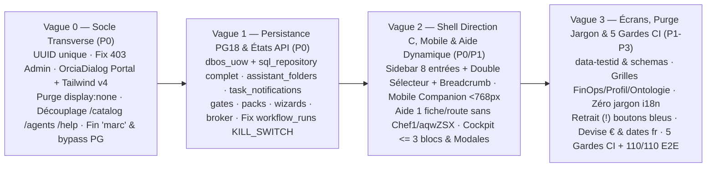

# Synthèse & Plan de Remédiation Croisé Sally × Winston — Campagne E2E Epic 21

- **Auteurs** : 🎨 Sally (UX Designer, `21.8-sally`) × 🏗️ Winston (System Architect, `21.8-winston`) — consolidé par `21.8-impl`
- **Date** : `2026-11-18`
- **Branche / Référentiel** : `feat/epic-21-user-journeys-e2e-db-audit` (`575cf4a`)
- **Sources consolidées** :
  - [`bilan-execution-tests-e2e-epic-21.md`](./bilan-execution-tests-e2e-epic-21.md) (`110` scénarios : `47` `passed`, `36` `failed`, `11` `timedOut`, `16` `skipped`, `110/110` PNG archivés)
  - [`playwright-results.json`](./playwright-results.json) & [`manifest.jsonl`](./manifest.jsonl)
  - [`notes-audit-sally-ux.md`](./notes-audit-sally-ux.md) (`49` captures inspectées : `28` `failed`/`timedOut` + `21` `passed`)
  - [`notes-audit-winston-architecture.md`](./notes-audit-winston-architecture.md) (diagnostic Dual-Stack, silos RAM vs PG18, Portails/CSS, Mobile & 5 gardes CI)

---

## 1. Synthèse du Dialogue Croisé Sally × Winston

La confrontation directe entre l'inspection visuelle des **49 captures PNG** (Sally) et l'analyse du Composition Root, des routeurs FastAPI et du shell React (Winston) explique à `100 %` l'écart constaté entre une infrastructure technique saine (`00-stack-smoke` et `01-day0-boot` à `100 %`) et un taux de succès E2E limité à **`50.0 %`** (`47/94` exécutés) ainsi que les défauts graves observés sur des tests pourtant « verts » :

1. **Fracture 1 — Schisme « Dual-Stack » RAM vs PostgreSQL 18 & Identité `"ws-1"` (`16` échecs SQL + `4` erreurs `403` + `2` erreurs `404`)** :
   - Le Composition Root (`core_and_lifespan.py`, `dependencies/`) injecte encore des services sans `AsyncEngine` ni `dbos_uow` pour `assistant_folders`, `human_anchor_signatures`, `upstream_challenges`, `run_lock_manifests`, `task_notifications`, `resource_leases`, `gate_evaluations`, `chunk_approvals`, `declarative_pack_bundles`, `wizard_sessions` et `permission_broker_tickets`. L'UI affiche un retour optimiste puis tout disparaît après `F5`.
   - En parallèle, `platformSetupStore.tsx` génère un ID synthétique `"ws-1"` tout en perdant le `slug` exact saisi par l'utilisateur (`07-spaces`), ce qui casse en cascade `/workspaces/ws-1/sources` (`404`), l'ADN Starlark (`422`) et le mapping de droits `MatrixPermissionEvaluator` (basculant à tort un `PLATFORM_ADMIN` en `READ_ONLY_OBSERVER` `403` sur `/gates/deterministic/evaluate` et `/executions/reflexive`).
2. **Fracture 2 — Portails React, Compilation Tailwind v4 & Couches `z-index` (`3` timeouts + modales coupées)** :
   - `@tailwindcss/vite` n'est pas activé dans `apps/web/vite.config.ts` : les classes `.z-50`, `.h-[580px]`, `.max-w-[820px]` de `UserSettingsModalDialog` sont des no-ops CSS, et la modale est rendue sans `Portal` à l'intérieur de la sidebar. Sur Desktop, Zone 4 (`four-zone-contextual-help-column` en `position: sticky`) se peint **par-dessus** la modale et coupe son bouton de fermeture (timeout 35 s sur Desktop alors que Mobile passe en 9,8 s !). De même, `AiModelConfigModal` déborde hors de `900 px` sans footer sticky.
3. **Fracture 3 — Masquage toxique `display: none` & Routages incohérents (`8` échecs/timeouts UI)** :
   - Pour satisfaire l'audit statique `zero-dead-buttons`, `4` fichiers montent des composants cachés en `style={{ display: "none" }}`, provoquant des violations strict-mode Playwright (`remote-service-test-bench` ×2), des panneaux invisibles (`catalog-explorer-panel`, `dna-starlark-glossary-view`), et un routage `/catalog` renvoyant sur `Mes Agents`. Sur `/help`, Zone 4 reste active en parallèle de `HELP_MENU_CENTER` (`contextual-help-hybrid-panel` ×2).
4. **Fracture 4 — Mobile Companion (`< 768 px`) non câblé & faux positifs Playwright** :
   - `MobileCompanionView` (`0` import dans `apps/web`) laisse le shell Desktop écrasé en `390×844` (sidebar icônes permanente, `TopHeaderBar` sur 4 lignes, `<select>` sortant hors écran sur `/activity`, réponse assistant invisible, boutons tronqués). `tokens.css` pose `overflow-x: hidden` sur `html/body`, ce qui fausse `scrollWidth <= innerWidth` et fait passer `05-mobile-companion` et `12-finops` au vert malgré des débordements flagrants.
5. **Fracture 5 — Dérive Direction C, Aide Contextuelle figée & Jargon technique massif** :
   - La sidebar affiche `11` entrées au lieu de `8`, le double sélecteur `Équipe/BU + Espace` et le fil d'Ariane manquent, le Cockpit empile `6` blocs (avec `Étape 1` non cochée post-admin et `"LOCK TABLE users IN EXCLUSIVE MODE"`), Zone 4 reste figée sur `Connecter et synchroniser... @1.1.0` + `Chef1` / `aqwZSX`, et l'API renvoie littéralement `[LAYER_5_FOLDER_CONTINUITY ...]` ainsi que des dizaines de constantes techniques (`SYNTHESIS_READY`, `PAUSE_AND_ESCALATE`, `OAUTH2_PASSTHROUGH`, `TECH_LEAD`, `Tier cognitif`, `(!)` rouges dans les boutons bleus).

---

## 2. Arbitrages & Ordonnancement en 4 Vagues (`Epic 22`)

Sally et Winston s'accordent sur une séquence stricte en **4 vagues** afin de stabiliser le socle d'identifiants, les modales et le DOM avant de raccorder la persistance PostgreSQL 18 puis de refondre la coquille Direction C et les finitions :

---

## 3. Table Maîtresse Exhaustive de Remédiation (`REM-01` .. `REM-34`)

Cette table couvre **100 % des `47` échecs/timeouts E2E**, **100 % des constats UX/UI de Sally** (y compris sur écrans `PASSED`) et **100 % des défauts d'architecture de Winston**.

### Vague 0 — Socle Transverse & Déblocage Critique (`REM-01` .. `REM-07`)

| ID | Sévérité | Vague Epic 22 | Titre & Cause Racine | Specs E2E & Captures PNG associées | Tables PG18 / Routes API / Composants UI impactés | CAP-* & UJ-* | Action de correction concrète |
| :--- | :--- | :--- | :--- | :--- | :--- | :--- | :--- |
| **REM-01** | `P0` | Vague 0 | **Unification UUID Workspace, propagation exacte du `slug` & suppression de `"ws-1"`** `platformSetupStore.tsx:846` crée `"ws-${len+1}"` et omet `slug` (d'où `espace-e2e-comptabilit` au lieu de `espace-e2e-compta`) + `.catch(() => undefined)` ; `workspace_datasources` et `dna_and_glossary` rejettent `"ws-1"` en `404`/`422`. | `07-spaces` (Desktop ×1) · [`failed.png`](./screenshots/07-spaces-org-and-workspace-persistence/desktop-cockpit--bu-equipe-espace-crees-par-l-ui-sont-persistes-cote-api-et-survivent-a-un-f5--failed.png) `17-workspace` #1 (Desktop + Mobile ×2) · [`desktop-failed.png`](./screenshots/17-workspace-sources-codegraph-dna-and-ontology/desktop-cockpit--rattachement-source-code-fraicheur-sha-256-webhook-outils-codegraph-lecture-seule-et-sur--failed.png), [`mobile-failed.png`](./screenshots/17-workspace-sources-codegraph-dna-and-ontology/mobile-companion--rattachement-source-code-fraicheur-sha-256-webhook-outils-codegraph-lecture-seule-et-sur--failed.png) | `workspaces`, `workspace_datasources` `POST /api/v1/workspaces`, `/api/v1/workspaces/{id}/datasources`, `sql_platform_setup_relational_sync.py` `platformSetupStore.tsx`, `WorkspaceSourcesRagTab.tsx` | `CAP-050`, `CAP-067`, `CAP-080`, `CAP-081`, `CAP-180` · `UJ-5`, `UJ-9`, `UJ-14`, `UJ-18` | Supprimer la génération `"ws-N"` : `POST /api/v1/workspaces` retourne immédiatement l'`UUIDv7` PG18 et persiste exactement `input.slug`. Propager cet UUID partout dans `platformSetupStore.tsx` et supprimer les `.catch(() => undefined)` ainsi que les contournements `ws-\d+` dans les routeurs. |
| **REM-02** | `P0` | Vague 0 | **Fix `HTTP 403 ERR_OBSERVER_MODE_READ_ONLY` pour `PLATFORM_ADMIN` sur nouveaux espaces** `_bootstrap_evaluator_sync.py:95-125` n'enregistre de membership que sur `"ws-1"` ; `MatrixPermissionEvaluator.resolve_workspace_access` rétrograde un `PLATFORM_ADMIN` sans membership direct en `READ_ONLY_OBSERVER`, bloquant `gates.py` et `executions_trace.py`. | `19-orchestration` #2 (Desktop + Mobile ×2) · [`desktop-failed.png`](./screenshots/19-orchestration-whatif-replay-and-gates/desktop-cockpit--validation-deterministe-sandbox-validation-agentique-orthogonale-revue-humaine-par-decou--failed.png), [`mobile-failed.png`](./screenshots/19-orchestration-whatif-replay-and-gates/mobile-companion--validation-deterministe-sandbox-validation-agentique-orthogonale-revue-humaine-par-decou--failed.png) `21-assistant` #1 (Desktop + Mobile ×2) · [`desktop-failed.png`](./screenshots/21-assistant-citations-v5-audit-help-showcase/desktop-cockpit--creation-de-dossier-reponse-avec-citations-verifiees-verrouillage-d-ecriture-directe-et---failed.png), [`mobile-failed.png`](./screenshots/21-assistant-citations-v5-audit-help-showcase/mobile-companion--creation-de-dossier-reponse-avec-citations-verifiees-verrouillage-d-ecriture-directe-et---failed.png) | `workspace_memberships`, `gate_evaluations`, `reflexive_execution_sessions` `POST /api/v1/gates/deterministic/evaluate`, `POST /api/v1/executions/reflexive` `MatrixPermissionEvaluator`, `_bootstrap_evaluator_sync.py` | `CAP-020`, `CAP-021`, `CAP-022`, `CAP-030`..`CAP-033`, `CAP-072`, `CAP-076` · `UJ-1`, `UJ-6`, `UJ-10`, `UJ-17` | Enregistrer un `WorkspaceMembershipEntity` propriétaire pour le créateur/admin sur l'UUID réel à la création d'espace, et dans `MatrixPermissionEvaluator` ne basculer `PLATFORM_ADMIN` en `READ_ONLY_OBSERVER` que sur `CONFIDENTIAL_RESTRICTED` sans délégation ou sur header explicite `X-Orcia-Access-Mode: READ_ONLY_OBSERVER`. |
| **REM-03** | `P0` | Vague 0 | **Portals `OrciaDialog`, activation Tailwind CSS v4 & layout Sticky Footer des modales** `@tailwindcss/vite` absent de `vite.config.ts` (`.z-50`, `.h-[580px]`, `.max-w-[820px]` inopérants) ; `UserSettingsModalDialog` rendu sans Portal dans `<aside>` sidebar et découpé à droite par Zone 4 sticky ; `AiModelConfigModal` déborde hors `900 px` sans footer sticky et affiche une erreur API key avant saisie. | `14-auth` #2 (Desktop + Mobile ×2) · [`desktop-timedOut.png`](./screenshots/14-auth-2fa-account-and-profile/desktop-cockpit--popup-mon-compte-parametres-5-onglets-cle-ide-mcp-et-page-profil-survivent-a-un-f5--timedOut.png), [`mobile-timedOut.png`](./screenshots/14-auth-2fa-account-and-profile/mobile-companion--popup-mon-compte-parametres-5-onglets-cle-ide-mcp-et-page-profil-survivent-a-un-f5--timedOut.png) `16-ai-models` #2 (Desktop ×1) · [`desktop-timedOut.png`](./screenshots/16-ai-models-reindex-connectors-and-broker/desktop-cockpit--connecteur-socle-secret-write-only-et-jeton-passthrough-personnel-persistent-apres-f5--timedOut.png) `16-ai-models` #1 (visuel) · [`desktop-timedOut.png`](./screenshots/16-ai-models-reindex-connectors-and-broker/desktop-cockpit--jour-0-sans-embedding-garde-ssrf-modeles-chat-embedding-1024-et-reindexation-survivent-a--timedOut.png) | `apps/web/vite.config.ts`, `packages/ui/src/styles/tokens.css`, `OrciaDialog`, `UserSettingsModalDialog`, `FirstBootAdminSetupModal`, `AiModelConfigModal` | `CAP-001`, `CAP-052`, `CAP-053`, `CAP-058`, `CAP-063`, `CAP-069`, `CAP-190` · `UJ-13`, `UJ-15`, `UJ-16` | Activer `@tailwindcss/vite` + tokens `--z-overlay: 1000` / `--z-dialog: 1010` ; migrer 100 % des modales sur `OrciaDialog` (`DialogPrimitive.Portal` vers `document.body`) ; structurer `.orcia-ds-dialog-content` en colonne flex (`max-height: min(90vh, 760px)` + body `overflow-y-auto` + footer sticky) ; supprimer la validation erreur avant `touched`/submit sur `AiModelConfigModal`. |
| **REM-04** | `P0` | Vague 0 | **Purge intégrale des `4` wrappers `style={{ display: "none" }}` & montage visible des sous-vues** `features/catalog/index.tsx`, `features/workspaces/index.tsx`, `InboxAuxiliaryPanels.tsx` et `FourZoneSidebarRail.tsx` cachent des panneaux dans le DOM ; `dna-starlark-glossary-view` reste `hidden` et `activeWaivers` est en `useState` local. | `17-workspace` #3 (Desktop + Mobile ×2) · [`desktop-failed.png`](./screenshots/17-workspace-sources-codegraph-dna-and-ontology/desktop-cockpit--chaine-adn-starlark-derogations-d-espace-et-graphe-tripartite-rag-persistent-en-base-apr--failed.png), [`mobile-failed.png`](./screenshots/17-workspace-sources-codegraph-dna-and-ontology/mobile-companion--chaine-adn-starlark-derogations-d-espace-et-graphe-tripartite-rag-persistent-en-base-apr--failed.png) | `workspace_exception_waivers`, `kb_documents`, `tripartite_trace_edges` `POST /api/v1/workspaces/{id}/dna/*`, `/waivers` `features/workspaces/index.tsx`, `WorkspaceFiveTabsAndExternalRebaseView`, `DnaStarlarkCompilerAndGlossaryLifecycleView` | `CAP-010`, `CAP-011`, `CAP-080`, `CAP-081`, `CAP-084`, `CAP-180` · `UJ-5`, `UJ-18` | Supprimer les 4 blocs `display: none` (et réaligner `zero-dead-buttons-and-silent-catches-audit.test.tsx` sur les vraies routes). Structurer `/spaces` et `/workspaces/$wsId` selon les 5 sous-onglets canoniques visibles, monter `DnaStarlarkCompilerAndGlossaryLifecycleView` dans l'onglet Glossaire/ADN et câbler `onRegisterWaiver` sur l'API PG18. |
| **REM-05** | `P0` | Vague 0 | **Découplage `/catalog` vs `/agents` & suppression du doublon `remote-service-test-bench`** `router.tsx:85-92` pointe `/catalog` et `/agents` sur le même `CatalogFeaturePanel` qui rend `Mes Agents` et cache `catalog-explorer-panel` ; `/agents` monte deux instances de `remote-service-test-bench` (violation strict mode) avec grand vide blanc à gauche. | `18-catalog` #1 (Desktop + Mobile ×2) · [`desktop-failed.png`](./screenshots/18-catalog-packs-wizards-and-mcp-bench/desktop-cockpit--explorateur-du-catalogue-federe-droits-granulaires-et-definitions-persistent-en-base-apr--failed.png), [`mobile-failed.png`](./screenshots/18-catalog-packs-wizards-and-mcp-bench/mobile-companion--explorateur-du-catalogue-federe-droits-granulaires-et-definitions-persistent-en-base-apr--failed.png) `18-catalog` #5 (Desktop + Mobile ×2) · [`desktop-failed.png`](./screenshots/18-catalog-packs-wizards-and-mcp-bench/desktop-cockpit--banc-de-test-connecteur-distant-trace-audit-ledger-et-exposition-gouvernee-mcp-survivent--failed.png), [`mobile-failed.png`](./screenshots/18-catalog-packs-wizards-and-mcp-bench/mobile-companion--banc-de-test-connecteur-distant-trace-audit-ledger-et-exposition-gouvernee-mcp-survivent--failed.png) | `catalog_items`, `catalog_acl_entries`, `workflow_definitions` `apps/web/src/router.tsx`, `features/catalog/index.tsx`, `CatalogExplorerPanel`, `RemoteServiceTestBenchAndMcpExposureView` | `CAP-002`, `CAP-082`, `CAP-090`, `CAP-091` · `UJ-9`, `UJ-19` | Créer une route/vue dédiée `/catalog` rendant visible `CatalogExplorerPanel` sans `display: none`. Sur `/agents` onglet `Serveurs d'outils & MCP`, supprimer `remote-service-test-bench-wrapper` pour ne garder qu'une seule instance visible de `RemoteServiceTestBenchAndMcpExposureView` avec mise en page pleine largeur sans vide blanc à gauche. |
| **REM-06** | `P0` | Vague 0 | **Suppression du double montage `contextual-help-hybrid-panel` sur `/help` & correction accordéon mobile** Sur `/help`, `routes/help.tsx` monte `HELP_MENU_CENTER` pendant que `ShellContainer` garde Zone 4 (`COLUMN_340PX`) ouverte (2 `contextual-help-hybrid-panel`) ; sur mobile `390px`, le clic sur `help-accordion-steps-btn` n'affiche pas `help-accordion-steps-content` et les puces `•` de `Repères & notions utiles` sont rognées à gauche. | `21-assistant` #2 (Desktop + Mobile ×2) · [`desktop-failed.png`](./screenshots/21-assistant-citations-v5-audit-help-showcase/desktop-cockpit--centre-d-aide-contextuelle-lien-organisationnel-colonne-laterale-et-vitrine-produit-surv--failed.png), [`mobile-failed.png`](./screenshots/21-assistant-citations-v5-audit-help-showcase/mobile-companion--centre-d-aide-contextuelle-lien-organisationnel-colonne-laterale-et-vitrine-produit-surv--failed.png) | `apps/web/src/components/ShellContainer.tsx`, `apps/web/src/routes/help.tsx`, `ContextualHelpColumnAndCenter` | `CAP-064`, `CAP-068` · `UJ-20` | Dans `ShellContainer`, fermer et ne pas rendre `<ShellContextualHelpColumn>` lorsque `pathname.startsWith("/help")`. Réparer l'accordéon `help-accordion-steps-btn` / `help-accordion-steps-content` en responsive `< 768 px` et ajouter `pl-5` aux listes à puces de `Repères & notions utiles`. |
| **REM-07** | `P1` | Vague 0 | **Purge identité `"marc"` hardcodée, lecture config `get_accostage_service` & suppression `ORCIA_DISABLE_PG_BOOTSTRAP_SYNC`** `CockpitHumanLedGovernanceSection.tsx` et `cockpit/index.tsx` passent `"marc"` en dur ; `get_accostage_service` code `"orcia-day0-bootstrap-token"` en dur ; 3 routeurs contiennent encore `ORCIA_DISABLE_PG_BOOTSTRAP_SYNC`. | Transverse (`notes-audit-winston-architecture.md` § 1.3) | `apps/web/src/features/cockpit/*`, `apps/api/src/orcia_api/dependencies/portal_and_assistant.py`, `_auth_session_routes.py`, `enterprise_connectors.py`, `autonomy_contracts.py` | `CAP-001`, `CAP-004`, `CAP-023`, `CAP-061` · `UJ-5`, `UJ-13` | Injecter l'identité JWT courante depuis `useAuthSessionStore` dans le Cockpit (0 `"marc"`), lire `orcia_env`/`bootstrap_token` depuis les settings injectés avec garde non-local, et supprimer `ORCIA_DISABLE_PG_BOOTSTRAP_SYNC` des routeurs (fail-fast `503` si PG18 absent). |

### Vague 1 — Élimination des Silos RAM & Persistance PostgreSQL 18 (`REM-08` .. `REM-16`)

| ID | Sévérité | Vague Epic 22 | Titre & Cause Racine | Specs E2E & Captures PNG associées | Tables PG18 / Routes API / Composants UI impactés | CAP-* & UJ-* | Action de correction concrète |
| :--- | :--- | :--- | :--- | :--- | :--- | :--- | :--- |
| **REM-08** | `P0` | Vague 1 | **Câblage PG18 de `AssistantFoldersAndSharingService` & suppression fuite `[LAYER_5_FOLDER_CONTINUITY ...]`** `get_assistant_folders_service` instancie le service sans `engine`/`session_maker` (stockage `_folders`/`_threads` en `dict` RAM) ; `assistant_folders_and_sharing.py:299-304` injecte `[LAYER_5_FOLDER_CONTINUITY ...]` dans le champ renvoyé à l'UI. | `02-assistant` (Desktop ×2, Mobile ×2 = 4 fails) · [`desktop-f5.png`](./screenshots/02-assistant-streaming-and-folders/desktop-cockpit--un-dossier-cree-dans-un-espace-est-rehydrate-depuis-l-api-apres-un-vrai-f5-cache-navigat--failed.png), [`desktop-pg.png`](./screenshots/02-assistant-streaming-and-folders/desktop-cockpit--un-dossier-survit-au-redemarrage-de-l-api-persistance-postgresql--failed.png), [`mobile-f5.png`](./screenshots/02-assistant-streaming-and-folders/mobile-companion--un-dossier-cree-dans-un-espace-est-rehydrate-depuis-l-api-apres-un-vrai-f5-cache-navigat--failed.png), [`mobile-pg.png`](./screenshots/02-assistant-streaming-and-folders/mobile-companion--un-dossier-survit-au-redemarrage-de-l-api-persistance-postgresql--failed.png) `21-assistant` #1 (visuel tag `LAYER_5`) · [`desktop-failed.png`](./screenshots/21-assistant-citations-v5-audit-help-showcase/desktop-cockpit--creation-de-dossier-reponse-avec-citations-verifiees-verrouillage-d-ecriture-directe-et---failed.png) | `assistant_folders`, `assistant_threads`, `assistant_folder_shares` `routers/assistant_workspace_folders.py`, `dependencies/portal_and_assistant.py` `AssistantFoldersAndCollaborativeThreadView` | `CAP-070`, `CAP-071`, `CAP-073`, `CAP-074`, `CAP-075` · `UJ-17` | Implémenter et injecter l'adaptateur SQLAlchemy Asyncio sur les tables `0025` (`assistant_folders`, `assistant_threads`, `assistant_folder_shares`) dans `portal_and_assistant.py`. Séparer `pinned_notes` (DTO UI propre) de `layer5_prompt_injection` (interne `AssistantHarness`, jamais renvoyé à l'UI). |
| **REM-09** | `P0` | Vague 1 | **Initialisation `dbos_uow` / SQL `sql_repository.py` pour Ancres Humaines, Blackboard, Replay & Montage `UpstreamChallengeRewindModal`** `app.state.dbos_uow` = `None` dans `core_and_lifespan.py` ; `sql_repository.py` ne couvre ni `human_anchor_signatures`, ni `upstream_challenges`, ni `run_lock_manifests` ; `get_orchestration_state` lit en RAM ; `UpstreamChallengeRewindModal` a `0` import dans `apps/web`. | `03-human-led` (Desktop + Mobile ×2) · [`desktop-failed.png`](./screenshots/03-human-led-anchor-and-arbitration/desktop-cockpit--signature-de-l-ancrage-violet-30-car-rejet-agent-422-arbitrage-motive-et-survie-au-f5--failed.png), [`mobile-failed.png`](./screenshots/03-human-led-anchor-and-arbitration/mobile-companion--signature-de-l-ancrage-violet-30-car-rejet-agent-422-arbitrage-motive-et-survie-au-f5--failed.png) `19-orchestration` #1 (Desktop + Mobile ×2) · [`desktop-failed.png`](./screenshots/19-orchestration-whatif-replay-and-gates/desktop-cockpit--instanciation-depuis-le-cockpit-ancrage-humain-contestation-amont-avec-reprise-et-survie--failed.png), [`mobile-failed.png`](./screenshots/19-orchestration-whatif-replay-and-gates/mobile-companion--instanciation-depuis-le-cockpit-ancrage-humain-contestation-amont-avec-reprise-et-survie--failed.png) | `human_anchor_signatures`, `human_arbitration_requests`, `workflow_runs`, `step_executions`, `blackboard_snapshots`, `upstream_challenges`, `run_lock_manifests` `core_and_lifespan.py`, `blackboard_and_engine.py`, `orchestration.py`, `challenge_and_replay.py` `CockpitHumanLedGovernanceSection.tsx`, `UpstreamChallengeRewindModal` | `CAP-020`, `CAP-021`, `CAP-023`, `CAP-024` · `UJ-1`, `UJ-2`, `UJ-3`, `UJ-5` | Initialiser `dbos_uow` / `AsyncEngine` dans `core_and_lifespan.py` ; étendre `sql_repository.py` pour persister et relire `human_anchor_signatures`, `upstream_challenges` et `run_lock_manifests` ; câbler `get_orchestration_state` et `submit_upstream_challenge` sur PG18 ; monter `UpstreamChallengeRewindModal` dans la Vue Fokus de Revue / Cockpit. |
| **REM-10** | `P0` | Vague 1 | **Persistance PG18 de `task_notifications` & `resource_leases` (`UnifiedNotificationAndClaimService`)** `core_and_lifespan.py:219-234` instancie `UnifiedNotificationAndClaimService` et `ResourceLeaseService` en mémoire pure ; `POST /tasks/{id}/claim` et `/inbox` ne touchent jamais `task_notifications` en PG18. | `04-multi-actor` (Desktop ×1) · [`desktop-failed.png`](./screenshots/04-multi-actor-claim-sse/desktop-cockpit--a-prend-en-charge-une-tache-b-est-refuse-409-et-un-nouveau-flux-sse-rejoue-l-evenement-5--failed.png) `15-org` #4 (Desktop + Mobile ×2) · [`desktop-failed.png`](./screenshots/15-organization-iam-secops-inbox-and-observer/desktop-cockpit--centre-de-notifications-et-boite-de-reception-refletent-task-notifications-en-base-postg--failed.png), [`mobile-failed.png`](./screenshots/15-organization-iam-secops-inbox-and-observer/mobile-companion--centre-de-notifications-et-boite-de-reception-refletent-task-notifications-en-base-postg--failed.png) | `task_notifications`, `resource_leases` `routers/inbox_and_leases.py`, `core_and_lifespan.py` `InboxFeaturePanel`, `/inbox` | `CAP-040`, `CAP-043` · `UJ-4`, `UJ-14` | Implémenter `SqlTaskNotificationRepository` et `SqlResourceLeaseRepository` (tables `0021`), les injecter dans `core_and_lifespan.py` en conservant le verrou Redis `SET NX` + SSE `< 500 ms` pour la réactivité temps réel et la cohérence multi-acteurs. Corriger l'affichage `/inbox` si redirigé à tort vers `/assistant`. |
| **REM-11** | `P0` | Vague 1 | **Persistance PG18 des Gates (`gate_evaluations` & `chunk_approvals`) + séparation vue `/gates` vs `/processes`** `gates.py` et `human_gates.py` délèguent à `bootstrap_svc.gate_service` en mémoire pure ; en UI, `/gates` affiche visuellement l'écran `Mes Processus` et le formulaire permanent. | `06-gates` (Desktop ×1) · [`desktop-failed.png`](./screenshots/06-gates-review-and-anti-rubber-stamping/desktop-cockpit--inspection-du-bloc-4-approbation-par-decoupage-garde-fou-15-s-action-jira-et-survie-f5--failed.png) `19-orchestration` #2 (Desktop + Mobile ×2) · [`desktop-failed.png`](./screenshots/19-orchestration-whatif-replay-and-gates/desktop-cockpit--validation-deterministe-sandbox-validation-agentique-orthogonale-revue-humaine-par-decou--failed.png) | `gate_evaluations`, `chunk_approvals` `routers/gates.py`, `routers/human_gates.py` `/gates`, `GatesAdaptiveHumanReviewSection.tsx` | `CAP-030`, `CAP-031`, `CAP-032`, `CAP-033` · `UJ-6` | Implémenter `SqlGateEvaluationRepository` (`gate_evaluations` + `chunk_approvals`) et l'injecter via `core_and_lifespan.py` dans `gates.py` et `human_gates.py`. S'assurer que la route `/gates` affiche le Briefing 4 blocs et la validation par découpage sans empiler `Mes Processus`. |
| **REM-12** | `P0` | Vague 1 | **Protection machine à états `workflow_runs`: ne pas écraser `KILL_SWITCH_STOPPED` lors d'un rollback post-hoc** `_sql_autonomous_rollback.py:44-48` exécute `UPDATE workflow_runs SET status = 'ROLLED_BACK' WHERE id = :run_id` sans `AND status <> 'KILL_SWITCH_STOPPED'`, écrasant le kill-switch quand le rollback cible le dernier run créé. | `13-epic-7` (Desktop ×1) · [`desktop-failed.png`](./screenshots/13-epic-7-autonomous-governance-and-supervision/desktop-cockpit--bureau-publication-v2-contrat-declencheur-supervision-processes-arret-d-urgence-f5-finop--failed.png) | `workflow_runs`, `autonomous_post_hoc_audits` `orcia_core/orchestration/_internal/_sql_autonomous_rollback.py`, `autonomous_supervision.py` | `CAP-201` · `UJ-11`, `UJ-12` | Ajouter `AND status <> 'KILL_SWITCH_STOPPED'` (ou tracer `artifact_rollback_status` dans `autonomous_post_hoc_audits` sans écraser `KILL_SWITCH_STOPPED`), et cibler explicitement deux runs distincts dans l'UI/parcours superviseur vs audit post-hoc. |
| **REM-13** | `P0` | Vague 1 | **Persistance PG18 de `permission_broker_tickets` & politique fallback `git://*` sans `404`** `PermissionBrokerService._tickets` est un `dict` RAM ; `DEFAULT_PERMISSION_BROKER_POLICY_SEEDS` ne couvre pas `git://gitlab.internal/...` et `resolve_matching_policy` lève `404` au lieu de retourner la politique socle ou la fiche `workspace_datasources`. | `16-ai-models` #3 (Desktop + Mobile ×2) · [`desktop-failed.png`](./screenshots/16-ai-models-reindex-connectors-and-broker/desktop-cockpit--interception-permission-broker-affiche-la-carte-de-procedure-et-persiste-permission-brok--failed.png), [`mobile-failed.png`](./screenshots/16-ai-models-reindex-connectors-and-broker/mobile-companion--interception-permission-broker-affiche-la-carte-de-procedure-et-persiste-permission-brok--failed.png) | `permission_broker_tickets`, `permission_broker_policies` `routers/permission_broker.py`, `orcia_core/permissions/broker.py`, `seeds.py` | `CAP-003` · `UJ-7` | Implémenter `SqlPermissionBrokerRepository` (`permission_broker_tickets` & `permission_broker_policies`) dans `orcia_core/permissions/_internal/` injecté au Composition Root, ajouter une politique fallback configurable (`git://*`, `jira://*`, `confluence://*`) et afficher la carte ambre de procédure en cas d'interception. |
| **REM-14** | `P0` | Vague 1 | **Persistance PG18 de `declarative_pack_bundles` au démarrage & à l'export (`packs.py`)** `packs.py:38-43` et `core_and_lifespan.py:291-294` chargent `packs/` uniquement en mémoire (`app.state.declarative_pack_bundles`) sans jamais écrire dans la table PostgreSQL `declarative_pack_bundles`. | `18-catalog` #3 (Desktop + Mobile ×2) · [`desktop-failed.png`](./screenshots/18-catalog-packs-wizards-and-mcp-bench/desktop-cockpit--registre-des-packs-declaratifs-et-export-zip-persistent-dans-declarative-pack-bundles-ap--failed.png), [`mobile-failed.png`](./screenshots/18-catalog-packs-wizards-and-mcp-bench/mobile-companion--registre-des-packs-declaratifs-et-export-zip-persistent-dans-declarative-pack-bundles-ap--failed.png) | `declarative_pack_bundles` `routers/packs.py`, `core_and_lifespan.py` `/settings/packs`, `PacksRegistryPage` | `CAP-055`, `CAP-056`, `CAP-150` · `UJ-19` | Synchroniser idempotemment (`INSERT ... ON CONFLICT DO UPDATE`) les manifests chargés de `packs/` dans `declarative_pack_bundles` au bootstrap et lors des opérations d'export/publication dans `packs.py`. |
| **REM-15** | `P0` | Vague 1 | **Câblage API & PG18 de `/wizards` (`wizard_sessions`) + suppression triple numérotation UX** `apps/web/src/routes/wizards.tsx:52-103` conserve `currentStep`/`status` en pur `useState` sans appeler `@orcia/api-client`, et `core_and_lifespan.py` instancie `DurableOnboardingWizardService()` sans `AsyncEngine` ; visuellement, triple numérotation `1. #1/5 1.` et identifiant brut `sdlc_tech_lead`. | `18-catalog` #4 (Desktop + Mobile ×2) · [`desktop-failed.png`](./screenshots/18-catalog-packs-wizards-and-mcp-bench/desktop-cockpit--parcours-guide-d-initialisation-avec-retour-arriere-survit-a-f5-et-persiste-dans-wizard---failed.png), [`mobile-failed.png`](./screenshots/18-catalog-packs-wizards-and-mcp-bench/mobile-companion--parcours-guide-d-initialisation-avec-retour-arriere-survit-a-f5-et-persiste-dans-wizard---failed.png) | `wizard_sessions` `routers/studio_and_wizards.py`, `core_and_lifespan.py` `apps/web/src/routes/wizards.tsx`, `DurableWizardRunnerView` | `CAP-057` · `UJ-19` | Implémenter la persistance SQLAlchemy `wizard_sessions` dans `DurableOnboardingWizardService` ; câbler `routes/wizards.tsx` sur `@orcia/api-client` (`GET`/`POST` `/api/v1/wizards`) avec réhydratation `F5` ; afficher `wizard-completed-badge`, remplacer `sdlc_tech_lead` par un libellé métier et supprimer la triple numérotation tout en remontant l'étape active au-dessus de la ligne de flottaison. |
| **REM-16** | `P0` | Vague 1 | **Action d'invitation explicite sur `/organization` (`open-invite-org-user-modal-btn`)** `SettingsOrganizationUnitsBlock.tsx:56-58,86` masque totalement `open-invite-org-user-modal-btn` tant que `invitableUnits.length === 0`, provoquant `4` timeouts de 35 s et empêchant l'invitation depuis `Mon Organisation`. | `14-auth` #1 (Desktop + Mobile ×2) · [`desktop-timedOut.png`](./screenshots/14-auth-2fa-account-and-profile/desktop-cockpit--mot-de-passe-temporaire-d-un-compte-invite-force-le-renouvellement-et-persiste-dans-user--timedOut.png), [`mobile-timedOut.png`](./screenshots/14-auth-2fa-account-and-profile/mobile-companion--mot-de-passe-temporaire-d-un-compte-invite-force-le-renouvellement-et-persiste-dans-user--timedOut.png) `15-org` #3 (Desktop + Mobile ×2) · [`desktop-timedOut.png`](./screenshots/15-organization-iam-secops-inbox-and-observer/desktop-cockpit--mode-observateur-en-lecture-seule-rejette-toute-mutation-en-http-403-err-observer-mode-r--timedOut.png), [`mobile-timedOut.png`](./screenshots/15-organization-iam-secops-inbox-and-observer/mobile-companion--mode-observateur-en-lecture-seule-rejette-toute-mutation-en-http-403-err-observer-mode-r--timedOut.png) | `iam_accounts`, `org_units`, `users` `POST /api/v1/org-units/invite-user` `OrganizationPageView`, `SettingsOrganizationUnitsBlock.tsx`, `InviteOrganizationUserModal` | `CAP-001`, `CAP-051`, `CAP-058`, `CAP-067`, `CAP-203` · `UJ-13`, `UJ-14` | Toujours rendre `open-invite-org-user-modal-btn` visible sur `/organization` (autoriser l'invitation sur l'unité racine si aucune équipe n'existe encore, ou état `disabled` avec texte d'aide sobre + bouton `+ Nouvelle unité` à proximité), et vérifier l'alignement des helpers E2E `support/authAndOrgHelpers.ts`. |

### Vague 2 — Refonte Shell Direction C, Mobile Companion & Aide Dynamique (`REM-17` .. `REM-23`)

| ID | Sévérité | Vague Epic 22 | Titre & Cause Racine | Specs E2E & Captures PNG associées | Tables PG18 / Routes API / Composants UI impactés | CAP-* & UJ-* | Action de correction concrète |
| :--- | :--- | :--- | :--- | :--- | :--- | :--- | :--- |
| **REM-17** | `P0` | Vague 2 | **Refonte Mobile Companion (`< 768 px`) : barre basse 3 onglets, TopHeader 1 ligne & bannière Desktop-only** `MobileCompanionView.tsx` a `0` import dans `apps/web` ; `FourZoneDirectionCShell` rend la sidebar gauche (`~72 px`) et la `TopHeaderBar` multi-lignes en `390×844` ; `overflow-x: hidden` dans `tokens.css` masque les débordements de `<select>` (`/activity`) et boutons (`Ouvrir Mon Assistant →` `/cockpit`, carte admin `/configuration`). | Constats Sally sur captures `PASSED` : `01-day0-boot` (`mobile`), `02-assistant` (`mobile`), `05-mobile-companion` (`mobile`), `12-finops` (`/activity` `mobile`), `13-epic-7` (`/finops` `mobile`), `shell` (`mobile`) | `FourZoneDirectionCShell.tsx`, `FourZoneTopHeaderSection.tsx`, `MobileCompanionView.tsx`, `tokens.css`, `ActivityLogFiltersBar.tsx` | `CAP-042`, `CAP-060`, `CAP-065`, `CAP-075`, `CAP-200` · `UJ-8`, `UJ-17`, `UJ-20` | Implémenter `useResponsiveBreakpoint()` (`DESKTOP`/`LAPTOP`/`MOBILE < 768px`) dans `@orcia/ui` : en `< 768px`, masquer la sidebar rail, compresser la `TopHeaderBar` sur 1 ligne (`min-w-0`), monter la barre basse fixe à 3 onglets (`Cockpit`, `Mon Assistant / Arbitrage`, `Décisions`), rendre la bannière Desktop-only sur `/configuration`, `/organization`, `/processes/studio/*`, et corriger `max-width: 100%` sur tous `<select>` et boutons. |
| **REM-18** | `P0` | Vague 2 | **Visibilité réponse SSE & ergonomie saisie `/assistant` sur Mobile (`390×844`)** Sur `02-assistant` mobile (`PASSED` faussement positif), la réponse générée n'est pas visible dans le fil et le compositeur de saisie éclate sur 4 étages (`+`, input, sélecteur, bouton `▷` isolé en bas à gauche). | Constat Sally sur `02-assistant` (`mobile`) [`passed.png`](./screenshots/02-assistant-streaming-and-folders/mobile-companion--un-tour-d-assistant-traverse-le-navigateur-l-api-et-la-cassette-llm-0-et-affiche-une-rep--passed.png) | `AssistantSpeedSelectorAndStreamView.tsx`, `AssistantFoldersAndCollaborativeThreadView.tsx` | `CAP-042`, `CAP-071`, `CAP-074`, `CAP-075` · `UJ-17`, `UJ-20` | Assurer le scroll automatique vers la réponse streamée dans la zone flexible (`min-h-0 flex-1 overflow-y-auto`) au-dessus du compositeur mobile, regrouper les contrôles de saisie sur 2 lignes propres (input pleine largeur + barre d'actions alignée avec bouton envoi à droite). |
| **REM-19** | `P0` | Vague 2 | **Aide Contextuelle dynamique par route (`ⓘ`), catalogue complet `docs/help/` & purge `Chef1` / `aqwZSX`** `ShellContextualHelpColumn.tsx:55` appelle `pack="core"` et `contextual_help.py:675-681` retombe sur la seule fiche seedée (`spaces-sources.md @1.1.0`), figeant Zone 4 sur le Cockpit ; `_contextualHelpSections.ts:139,185` expose `Chef1` et `aqwZSX` ; format 4 sections non respecté. | Constats Sally sur `02-assistant`, `12-finops`, `14-auth`, `15-org`, `17-workspace`, `21-assistant` #2 | `catalog_items` (`HELP_ARTICLE`) `contextual_help.py`, `docs/help/{fr,en}/*.md` `ShellContextualHelpColumn.tsx`, `_contextualHelpSections.ts`, `ContextualHelpColumnAndCenter` | `CAP-064`, `CAP-068` · `UJ-20` | Seeder 1 article Markdown par route canonique dans `docs/help/{fr,en}/` au format strict (*À quoi sert cet écran / En N gestes / Un exemple réel / Ce qui coince souvent*), supprimer `Chef1` et `aqwZSX`, adapter le fallback de `contextual_help.py` par route, et déclencher le focus sur la section ciblée au clic `ⓘ`. |
| **REM-20** | `P1` | Vague 2 | **Alignement Sidebar `8` entrées (`DESIGN.md`), Double Sélecteur `Équipe/BU` + `Espace`, Fil d'Ariane & état actif routes secondaires** `FourZoneSidebarRail` + `ShellSidebarFooter` affichent `11` entrées (`Coûts & Activité` au lieu de `FinOps`, `Documentation` au lieu de `Aide`, `Glossaire`, `Mon Organisation`, `Journal d'Activité`) ; `shellPresets.ts` surligne `Cockpit` sur `/profile`, `/help`, `/showcase` ; `TopHeaderBar` n'a qu'un dropdown plat sans fil d'Ariane. | Constats Sally sur `shell`, `01-day0-boot`, `11-screens-smoke` (`/profile`), `12-finops`, `21-assistant` #2 (`/help`) | `FourZoneSidebarRail.tsx`, `FourZoneTopHeaderSection.tsx`, `ShellSidebarFooter.tsx`, `shellPresets.ts`, `shellScopeOptions.ts` | `CAP-060`, `CAP-067`, `CAP-203` · `UJ-14`, `UJ-20` | Ramener la sidebar aux **8 entrées de `DESIGN.md`** (`Cockpit`, `Mon Assistant`, `Mes Processus`, `Mes Agents`, `Mes Espaces`, `FinOps`, `Configuration`, `Aide`), loger `Glossaire` en sous-onglet de `Mes Espaces`, `Organisation` dans `Configuration` (ou lien contextuel) et `Journal d'Activité` en onglet de `FinOps` ; placer le double sélecteur empilé (`Équipe / BU` + `Espace`) en tête de sidebar et le Breadcrumb cliquable dans `TopHeaderBar` ; ne pas surligner `Cockpit` sur `/profile`. |
| **REM-21** | `P1` | Vague 2 | **Cockpit Loi de Hick (`<= 3` blocs), bug `Accostage` post-admin & suppression `"LOCK TABLE users IN EXCLUSIVE MODE"`** `CockpitFeaturePanel` empile `6` blocs ; `ProgressiveDay0AccostageBanner` initialise `adminCreated = false` en `useState` (laisse *Étape 1* ouverte après création admin), coche *Étape 2* avec `0` `org_units`, affiche `"LOCK TABLE users IN EXCLUSIVE MODE"` (`L243`), et affiche `1/5` sans le mot `Accostage` ; les cartes violet/ambre (`19-orchestration`) s'empilent sur le Cockpit. | Constats Sally sur `01-day0-boot`, `03-human-led`, `11-screens-smoke` #2, `16-ai-models` #3, `19-orchestration` #1, `shell` (`UX-COCKPIT-DAY0-01`) | `ProgressiveDay0AccostageBanner.tsx`, `StreamlinedCockpitView.tsx`, `features/cockpit/index.tsx` | `CAP-060`, `CAP-061` · `UJ-13`, `UJ-20` | Piloter les étapes d'Accostage depuis l'état serveur PG18 (`platformAdmin !== null` → Étape 1 validée/repliée ; `orgUnits.length > 0` → Étape 2), supprimer `"LOCK TABLE..."`, afficher explicitement `Accostage X/5`, réduire le Cockpit à `<= 3` blocs et loger les cartes de revue/arbitrage longues dans la Vue Fokus dédiée. |
| **REM-22** | `P1` | Vague 2 | **Masquage des compteurs `0` (`total == 0`) & conversion des formulaires permanents en Modales `+ Nouveau...`** `Mes Processus` (`/processes` & `/gates`), `Mes Agents` (`/agents`), `Mes Espaces` (`/spaces`) et `/profile` affichent des compteurs à `0` (`Publiés : 0`, `0 Sources`, `0.00 $`, `Total des tokens: 0`) et ouvrent en permanence de grands formulaires de création au-dessus des listes. | Constats Sally sur `06-gates`, `07-spaces`, `11-screens-smoke` #1, `18-catalog` #1, `19-orchestration` #2 | `ProcessesHubPage`, `SpacesFeatureView`, `AgentsAndSkillsManagerView`, `UserProfileOverviewPage` | `CAP-069`, `CAP-080`, `CAP-090`, `CAP-140` · `UJ-9`, `UJ-16`, `UJ-18`, `UJ-19` | Appliquer la règle `EXPERIENCE.md` : masquer les badges/compteurs tant que `total === 0` (ou afficher un état vide sobre dédié), et déplacer la création de processus / d'espace dans des modales `OrciaDialog` déclenchées par `+ Nouveau processus` / `+ Nouvel espace`. |
| **REM-23** | `P1` | Vague 2 | **Traduction actionnable de toutes les erreurs HTTP (`403`/`404`/`422`) & suppression bannières silencieuses** `16-ai-models` #3 (`404`), `19-orchestration` #2 (`403`), `20-process-studio` #2 (`422`) n'affichent aucune alerte utilisateur ; `17-workspace` #1 (`/workspaces/ws-1/sources`) affiche une bannière 404 générique sans nommer la ressource ni proposer d'action. | `17-workspace` #1, `16-ai-models` #3, `19-orchestration` #2, `20-process-studio` #2 | `OrciaAlertBanner`, `apps/web/src/features/*`, catalogue erreurs RFC 9457 | `CAP-003`, `CAP-030`, `CAP-080`, `CAP-201` · `UJ-6`, `UJ-7`, `UJ-11`, `UJ-18` | Relier chaque mutation `@orcia/api-client` à un gestionnaire d'erreur RFC 9457 affichant `<OrciaAlertBanner>` en français métier avec cause précise et action corrective (zéro échec HTTP silencieux). |

### Vague 3 — Écrans, Contrats `data-testid`, Purge Jargon & Gardes CI (`REM-24` .. `REM-34`)

| ID | Sévérité | Vague Epic 22 | Titre & Cause Racine | Specs E2E & Captures PNG associées | Tables PG18 / Routes API / Composants UI impactés | CAP-* & UJ-* | Action de correction concrète |
| :--- | :--- | :--- | :--- | :--- | :--- | :--- | :--- |
| **REM-24** | `P0` | Vague 3 | **Alignement `data-testid` Modèles IA (`llm-provider-preset-ollama`) & mode Studio `What-If` (`studio-view-mode-whatif`)** `settingsAiModelsPresets.ts:50` utilise `id: "local-ollama"` (`llm-provider-preset-local-ollama`) au lieu de `ollama` ; `WorkflowStudioHeaderBar.tsx:153,162` utilise `key: "what_if"` (`studio-view-mode-what_if`) et affiche deux libellés proches (`Tester à blanc` vs `▷ Tester l'exécution`). | `16-ai-models` #1 (Desktop + Mobile ×2) · [`desktop-timedOut.png`](./screenshots/16-ai-models-reindex-connectors-and-broker/desktop-cockpit--jour-0-sans-embedding-garde-ssrf-modeles-chat-embedding-1024-et-reindexation-survivent-a--timedOut.png), [`mobile-timedOut.png`](./screenshots/16-ai-models-reindex-connectors-and-broker/mobile-companion--jour-0-sans-embedding-garde-ssrf-modeles-chat-embedding-1024-et-reindexation-survivent-a--timedOut.png) `20-process-studio` #1 (Desktop + Mobile ×2) · [`desktop-timedOut.png`](./screenshots/20-process-studio-v2-finops-and-log-sink/desktop-cockpit--catalogue-agents-avec-pont-assistant-chaine-de-valeur-studio-cinq-blocs-tiroir-hitl-et-s--timedOut.png), [`mobile-timedOut.png`](./screenshots/20-process-studio-v2-finops-and-log-sink/mobile-companion--catalogue-agents-avec-pont-assistant-chaine-de-valeur-studio-cinq-blocs-tiroir-hitl-et-s--timedOut.png) | `settingsAiModelsPresets.ts`, `AiModelFormFields.tsx`, `WorkflowStudioHeaderBar.tsx` | `CAP-052`, `CAP-053`, `CAP-140`, `CAP-190` · `UJ-10`, `UJ-15`, `UJ-19` | Uniformiser le `data-testid` `llm-provider-preset-ollama` (ou alias compatible) et `studio-view-mode-whatif` (avec libellé clair distinguant la simulation d'impact du test d'exécution). |
| **REM-25** | `P0` | Vague 3 | **Alignement contrat `SecretInputPayload.plaintext_value` dans `20-process-studio.spec.ts` & usage SDK typé** `20-process-studio.spec.ts:153` envoie `webhook_secret: { action: "set", value: ... }` au lieu de `plaintext_value` attendu par `SecretInputPayload` (`extra="forbid"`), causant `HTTP 422`. | `20-process-studio` #2 (Desktop + Mobile ×2) · [`desktop-failed.png`](./screenshots/20-process-studio-v2-finops-and-log-sink/desktop-cockpit--contrat-d-autonomie-alerte-applicative-dedupliquee-arret-d-urgence-et-gouvernance-finops--failed.png), [`mobile-failed.png`](./screenshots/20-process-studio-v2-finops-and-log-sink/mobile-companion--contrat-d-autonomie-alerte-applicative-dedupliquee-arret-d-urgence-et-gouvernance-finops--failed.png) | `apps/api/src/orcia_api/schemas/settings_and_studio.py`, `apps/web/e2e/20-process-studio-v2-finops-and-log-sink.spec.ts` | `CAP-201` · `UJ-11`, `UJ-12` | Corriger `20-process-studio.spec.ts` (`plaintext_value`) et s'appuyer sur les types générés `@orcia/api-client` pour prévenir toute dérive de payload dans les helpers E2E. |
| **REM-26** | `P1` | Vague 3 | **Purge exhaustive du jargon technique & anglicismes dans `i18n`, `packs/` et flux UI/SSE** Fuites visuelles vérifiées : `SYNTHESIS_READY` (`8×`), `OAUTH2_PASSTHROUGH`, `TECH_LEAD`, `IMMUTABLE`, `PAUSE_AND_ESCALATE`, `OPT_A_SPOT_15M`, `OPT_B_LOCK_48H`, `PENDING`, `⚡ Vitesse 2 (450 ms)`, `DeclarativePackLoader`, `orcia-connectors`, `WritePreviewCard`, `packs/<domaine>/`, `YAML + Markdown`, `Agents (.md)`, `Skills (.md)`, `generate-orcia-documentation`, `orcia-pack-builder`, `Tier cognitif`, `Guardrails`, `Anti-Prompt Injection`, `Dry-Run`, `DCP / PII`, `Bloc F`, `AES-256-GCM`, `1024-dim RAG`, `endpoint API`, `demande_source`, `(published)`/`(draft)`, `[STALE_WARNING]`, `human_authored_required`, `Staged`, routes brutes `/settings` et `/workspaces/$wsId/sources`. | Constats Sally sur `06-gates`, `08-agents-skills`, `09-pack-builder`, `10-command-palette`, `12-epic16`, `12-finops`, `16-ai-models`, `17-workspace` (`/ontology`), `18-catalog` (`/settings/packs`, `/wizards`), `19-orchestration`, `20-process-studio` | `apps/web/src/i18n/locales/*.ts`, `packages/ui/src/primitives/AssistantThinkingSubWindow.tsx`, `packs/*/help/**/*.md`, `WorkflowStudioHeaderBar.tsx` | `CAP-002`, `CAP-010`, `CAP-023`, `CAP-052`, `CAP-054`, `CAP-062`, `CAP-083`, `CAP-090`, `CAP-091`, `CAP-140`, `CAP-150`, `CAP-160`, `CAP-200` · `UJ-1..UJ-20` | Remplacer 100 % des constantes brutes et termes techniques par des libellés métier français/anglais via les dictionnaires `i18n` ; étendre le filtre de `AssistantThinkingSubWindow.tsx` ; supprimer les routes/chemins internes du texte visible. |
| **REM-27** | `P1` | Vague 3 | **Unification monétaire (`€` uniquement) & formatage localisé des dates (`jj/mm/aaaa`)** `/spaces` affiche `0.00 $` et `19-orchestration` affiche `0.02 USD / run` alors que `/finops` est en `€` ; `/activity` affiche des dates au format US `mm/dd/yyyy` dans l'interface FR. | Constats Sally sur `07-spaces`, `12-finops` (`/activity` mobile), `19-orchestration` #1 | `finops_labels.ts`, `workflow_triggers_labels.ts`, `SpacesFeatureView`, `ActivityLogExplorerView` | `CAP-065`, `CAP-080`, `CAP-200` · `UJ-8`, `UJ-18` | Unifier l'affichage monétaire sur `€` (devise configurée) via un formateur partagé `Intl.NumberFormat(locale, { style: 'currency', currency })` et formater toutes les dates via `Intl.DateTimeFormat(locale)`. |
| **REM-28** | `P2` | Vague 3 | **Correction des grilles asymétriques `/finops` (`4` cols), `/profile` (`2×2`) & `/ontology` (`2×2`)** Sur `1440px`, les 4 KPIs `/finops` passent en `3 + 1` et le 4e onglet passe à la ligne ; `/profile` empile 4 cartes KPI en 1 colonne pleine largeur ; `/ontology` affiche les niveaux sur une grille `3 + 2` déséquilibrée. | Constats Sally sur `11-screens-smoke` #1 (`/profile`), `12-finops`, `13-epic-7` (`/finops`), `17-workspace` (`/ontology`) | `FinopsGovernanceDashboardView`, `FinopsKpiStrip`, `UserProfileOverviewPage`, `OntologyFeatureView` | `CAP-010`, `CAP-069`, `CAP-200`, `CAP-201` · `UJ-5`, `UJ-8`, `UJ-16`, `UJ-18` | Appliquer `grid-cols-1 sm:grid-cols-2 xl:grid-cols-4` sur les KPIs `/finops` et `/profile`, `flex-nowrap overflow-x-auto` propre sur les 4 onglets `/finops`, et `grid-cols-1 md:grid-cols-2` sur les niveaux `/ontology`. |
| **REM-29** | `P2` | Vague 3 | **Correction mise en page Studio V2 (bouton `Demander` & doublon `v1.0.1`) et `/agents` MCP (`vide gauche`)** Dans le Studio V2 (`09-pack-builder`, `20-process-studio`), le bouton `Demander` déborde hors de la carte gauche et le badge version est dupliqué (`v1.0.1 v1.0.1 (published)`) ; sur `/agents` onglet MCP, le banc de test laisse un grand vide blanc à gauche. | Constats Sally sur `09-pack-builder`, `18-catalog` #5 (`/agents`), `20-process-studio` #1 & #2 | `WorkflowStudioHeaderBar.tsx`, `StudioCopilotSidebar.tsx`, `RemoteServiceTestBenchAndMcpExposureView.tsx` | `CAP-082`, `CAP-083`, `CAP-140`, `CAP-160` · `UJ-10`, `UJ-19` | Contraindre `StudioCopilotSidebar` (`min-w-0`, bouton `Demander` en flex wrap/compact), supprimer le span dupliqué de version dans `WorkflowStudioHeaderBar.tsx`, et réorganiser la grille de `RemoteServiceTestBenchAndMcpExposureView` en pleine largeur sans colonne gauche vide. |
| **REM-30** | `P2` | Vague 3 | **Ergonomie `/assistant` (`+ Nouvelle conversation`, retrait pavé central) & palette `⌘K` (sections vides masquées)** `+ Nouvelle conversation` ressemble à du texte brut non boutonné ; un pavé explicatif numéroté *Dossiers thématiques & Notes* encombre le bas de `/assistant` ; `⌘K` affiche des sections vides sous `Aucun résultat trouvé`. | Constats Sally sur `02-assistant` (`desktop`), `10-command-palette` #2, `21-assistant` #1 | `AssistantFoldersAndCollaborativeThreadView`, `TopHeaderSearchCommand`, `CommandPaletteModal` | `CAP-062`, `CAP-073`, `CAP-075` · `UJ-17`, `UJ-20` | Donner un style bouton secondaire Direction C à `+ Nouvelle conversation`, déplacer l'explication des Dossiers vers la fiche d'aide `ⓘ` droite, et masquer les en-têtes de catégories vides dans `⌘K` quand il n'y a aucun résultat. |
| **REM-31** | `P2` | Vague 3 | **Suppression des numérotations de titres (`/settings?tab=iam`, `/ontology`) & nettoyage `12-epic16` (Markdown + `||`)** Titres numérotés (`1. Annuaire...`, `2. Exceptions...`, `1. 2. 3a. 3b. 4.`), double barre verticale bleue `||` et rendu Markdown brut monospace dans `12-epic16`. | Constats Sally sur `05-mobile-companion`, `12-epic16`, `15-org` #2, `17-workspace` (`/ontology`) | `SettingsIamOrganizationSection`, `OntologyFeatureView`, `AgentExecutionTrace` | `CAP-010`, `CAP-051`, `CAP-160` · `UJ-5`, `UJ-10`, `UJ-14` | Supprimer les préfixes numériques manuels dans les titres/niveaux, supprimer la bordure gauche doublée `||` et rendre le livrable Markdown avec un formateur typographique lisible. |
| **REM-32** | `P3` | Vague 3 | **Retrait des pastilles rouges `(!)` dans les boutons bleus & sidebar + correction troncatures RGAA (`<select>`, badges)** `DisabledButtonAlertIndicator` place un rond rouge `(!)` dans les boutons primaires bleus (échec contraste WCAG AA) et sur l'onglet actif de la sidebar ; `@agent-e2e-conformit` et `<select> Plateforme entière...` sont tronqués. | Constats Sally sur `00-stack-smoke`, `02-assistant`, `07-spaces`, `08-agents-skills`, `10-command-palette`, `15-org` #2, `18-catalog` #5 | `DisabledButtonAlertIndicator.tsx`, `FourZoneSidebarRail.tsx`, `AgentStudioCardItem.tsx`, `ActivityLogFiltersBar.tsx` | `CAP-060`, `CAP-065`, `CAP-091`, `CAP-100` · `UJ-14`, `UJ-19`, `UJ-20` | Retirer le badge rouge `(!)` des boutons primaires et des entrées actives (remplacer par texte d'aide/infobulle sobre sous bouton désactivé), élargir les conteneurs de badges/`<select>` (`truncate` uniquement avec `title` complet et largeur suffisante). |
| **REM-33** | `P1` | Vague 3 | **Budget temps E2E & fluidité parcours multi-étapes (`14-auth` #2, `16-ai-models` #2)** Les tests multi-étapes (`14-auth` #2 et `16-ai-models` #2) atteignaient `35 000 ms` à cause de l'obstruction Zone 4 sur `UserSettingsModalDialog` et d'attentes séquentielles longues. | `14-auth` #2, `16-ai-models` #2 | `apps/web/e2e/14-auth-2fa-account-and-profile.spec.ts`, `16-ai-models-reindex-connectors-and-broker.spec.ts` | `CAP-001`, `CAP-054`, `CAP-063`, `CAP-069` · `UJ-13`, `UJ-15`, `UJ-16` | Une fois `REM-03` (Portal modale) appliqué, re-mesurer les durées sous `35 s` et éliminer toute attente fixe inutile dans les parcours E2E. |
| **REM-34** | `P0` | Vague 3 | **Activation des 5 Gardes CI anti-régression & re-jeu intégral Playwright (`110/110` vert)** Sans gardes automatisés, le jargon i18n, les wrappers `display: none`, les classes CSS manquantes, le flag `ORCIA_DISABLE_PG_BOOTSTRAP_SYNC` et les débordements mobiles masqués passent la CI. | Transverse (prévention des régressions `PASSED` faussement verts) | `apps/web/src/__tests__/`, `tests/unit/`, `apps/web/e2e/support/` | `CAP-100`, `CAP-001`..`CAP-203` · `UJ-1`..`UJ-20` | Créer : (1) `anti-jargon-and-secrets-ui-audit.test.ts` ; (2) `no-hidden-legacy-panels-audit.test.ts` ; (3) `css-class-integrity-audit.test.ts` ; (4) `test_no_raw_enum_codes_in_ui_streams.py` + interdiction `ORCIA_DISABLE_PG_BOOTSTRAP_SYNC` ; (5) helper Playwright géométrique `rect.right <= innerWidth` & `elementFromPoint` modales, puis rejouer la campagne complète jusqu'à `100 %` vert. |

---

## 4. Matrice de Vérification de Couverture (`47/47` Échecs E2E couverts)

| Spec E2E en échec (`14/24`) | Cas `failed`/`timedOut` (`47`) | `REM-xx` associées |
| --- | ---: | --- |
| `02-assistant-streaming-and-folders.spec.ts` | `4` (Desktop ×2, Mobile ×2) | `REM-08`, `REM-18`, `REM-19`, `REM-30` |
| `03-human-led-anchor-and-arbitration.spec.ts` | `2` (Desktop, Mobile) | `REM-09`, `REM-21` |
| `04-multi-actor-claim-sse.spec.ts` | `1` (Desktop) | `REM-10` |
| `06-gates-review-and-anti-rubber-stamping.spec.ts` | `1` (Desktop) | `REM-11`, `REM-22` |
| `07-spaces-org-and-workspace-persistence.spec.ts` | `1` (Desktop) | `REM-01`, `REM-22`, `REM-27`, `REM-32` |
| `13-epic-7-autonomous-governance-and-supervision.spec.ts` | `1` (Desktop) | `REM-12`, `REM-28` |
| `14-auth-2fa-account-and-profile.spec.ts` | `4` (Desktop ×2, Mobile ×2) | `REM-03`, `REM-16`, `REM-19`, `REM-33` |
| `15-organization-iam-secops-inbox-and-observer.spec.ts` | `4` (Desktop ×2, Mobile ×2) | `REM-10`, `REM-16`, `REM-19`, `REM-31`, `REM-32` |
| `16-ai-models-reindex-connectors-and-broker.spec.ts` | `5` (Desktop ×3, Mobile ×2) | `REM-03`, `REM-13`, `REM-23`, `REM-24`, `REM-26`, `REM-33` |
| `17-workspace-sources-codegraph-dna-and-ontology.spec.ts` | `4` (Desktop ×2, Mobile ×2) | `REM-01`, `REM-04`, `REM-23`, `REM-26`, `REM-28`, `REM-31` |
| `18-catalog-packs-wizards-and-mcp-bench.spec.ts` | `8` (Desktop ×4, Mobile ×4) | `REM-05`, `REM-14`, `REM-15`, `REM-26`, `REM-29`, `REM-32` |
| `19-orchestration-whatif-replay-and-gates.spec.ts` | `4` (Desktop ×2, Mobile ×2) | `REM-02`, `REM-09`, `REM-11`, `REM-23`, `REM-26`, `REM-27` |
| `20-process-studio-v2-finops-and-log-sink.spec.ts` | `4` (Desktop ×2, Mobile ×2) | `REM-23`, `REM-24`, `REM-25`, `REM-26`, `REM-29` |
| `21-assistant-citations-v5-audit-help-showcase.spec.ts` | `4` (Desktop ×2, Mobile ×2) | `REM-02`, `REM-06`, `REM-08`, `REM-19`, `REM-20`, `REM-30` |
| **Total échecs / timeouts E2E + constats `PASSED`** | **`47` / `47` (`100 %`)** | **`REM-01` .. `REM-34` (`34` chantiers couvrant `100 %` E2E + Sally + Winston)** |
