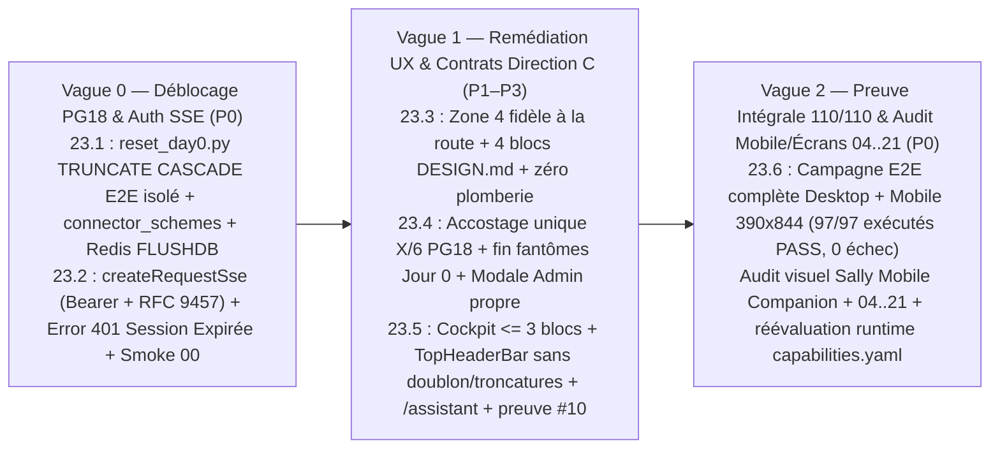

# Synthèse & Plan de Remédiation Croisé Sally × Winston — Campagne E2E Epic 22

- **Auteurs** : 🎨 Sally (UX Designer, `bmad-agent-ux-designer`) × 🏗️ Winston (System Architect, `bmad-agent-architect`) — consolidé par `22.9-impl`
- **Date** : `2026-11-19`
- **Branche / Référentiel** : `feat/epic-22-remediation-pg18-direction-c` (`a1bb059`)
- **Sources consolidées** :
  - [`bilan-execution-tests-e2e-epic-22.md`](./bilan-execution-tests-e2e-epic-22.md) (`110` scénarios planifiés : `7` `passed`, `90` `failed`, `0` `timedOut`, `13` `skipped`, `110/110` PNG archivés)
  - [`playwright-results.json`](./playwright-results.json) & [`manifest.jsonl`](./manifest.jsonl)
  - [`notes-audit-sally-ux.md`](./notes-audit-sally-ux.md) (`24` captures inspectées en détail : `7/7` `passed` + `3/3` `401` directs + `14` captures représentatives de la cascade `beforeEach`, `P0-UX-1`..`P3-UX-12`)
  - [`notes-audit-winston-architecture.md`](./notes-audit-winston-architecture.md) (diagnostic `ARCH23-01`..`ARCH23-10`, dialogue croisé et ordonnancement topologique Epic 23)

---

## 1. Synthèse du Dialogue Croisé Sally × Winston

La confrontation entre l'inspection visuelle des **24 captures PNG représentatives** (🎨 Sally) et l'analyse du harnais E2E, des routeurs FastAPI et du shell React (🏗️ Winston) explique à **`100 %`** le contraste entre les progrès réels mesurés sur les premiers scénarios (`#1`–`#10`) et l'échec massif de **`90`** scénarios sur **`97`** exécutés (`7,2 %` PASS) :

1. **Paradoxe de maturité PostgreSQL 18 (`#8`, `#9`, `#10` FAIL → PASS, déclenchant `#11`–`#110` FAIL)** :
   - Les corrections de l'Epic 22 ont éliminé les silos RAM sur `assistant_folders` (`#8`, `#9`) et sur le workflow *Human-Led* (`#10` : `human_anchor_signatures`, `step_executions`, `blackboard_snapshots`).
   - Dès que le scénario `#10` a écrit de vraies lignes dans `step_executions` et `blackboard_snapshots` (protégée append-only avec FK `ON DELETE RESTRICT`), `09_reset_db_first_boot.py` appelé par `resetDay0()` a échoué sur `RestrictViolationError` (`blackboard_snapshots_step_execution_id_fkey`), bloquant en `~1 s` dès le `beforeEach` **87 scénarios consécutifs (`#11`–`#110` hors `13` skips)** et laissant `Alice Admin E2E` en base (d'où la mire `/login` sur toutes les captures en cascade).
   - Par effet domino, `100 %` du projet `mobile-companion` (`0 / 55` PASS) et l'intégralité des specs métiers `04`–`21` + `shell.spec.ts` sont restés dans un **angle mort complet**.
2. **Durcissement *Fail-Closed* & faille de transport SSE (`3` échecs directs `HTTP 401` + erreur trompeuse `P0-UX-1`)** :
   - Sous `ORCIA_ENV="e2e"` sans `ORCIA_E2E_SEED_FIXTURES`, les endpoints `/api/v1/sources/inspect-lines` (`#3`) et `/api/v1/executions/reflexive` (`#4`) rejettent légitimement les appels anonymes de `00-stack-smoke.spec.ts` avant création du premier admin.
   - Sur `02-assistant` (`#7`), `streamAssistantTurnSse` court-circuite `createRequestJson` et omet l'en-tête `Authorization: Bearer`, déclenchant `HTTP 401`. L'UI (`useAssistantStreamingTurn.ts`) accuse alors à tort le **modèle IA** (*« HTTP 401 Unauthorized. Vérifiez que le modèle IA configuré est bien démarré »*) sans bouton `Se reconnecter →`. Le même oubli d'auth affecte `useReflexiveExecutionController.ts` (`/trace-stream`) et, symétriquement, `useWorkspaceEventsSse.ts` (`EventSource` sans auth sur `/api/v1/events/stream`).
3. **Progrès Shell Direction C, mais dérives persistantes sur Zone 4, Accostage, Jour 0 & Modale Admin** :
   - Sur Desktop (`#5`, `#8`–`#10`), les `8` entrées non numérotées, le Double Sélecteur empilé, le fil d'Ariane et la coche verte Étape 1 sont présents, et les modales `OrciaDialog` passent désormais en Portal sans coupure ni fuite `[LAYER_5_*]` / `LOCK TABLE...` / `Chef1` / `aqwZSX` / `(!)` rouge.
   - Mais **4 fractures UX/Architecture** restent ouvertes : (a) `ShellContextualHelpColumn.tsx:L71` écrase Zone 4 avec `GENERAL_SECTIONS_FR` (cartes Cockpit affichées sur `/assistant`), masque `EN N GESTES` / `UN EXEMPLE RÉEL` / `CE QUI COINCE SOUVENT` et expose `@1.0.0` / `BASE → PACK → WORKSPACE (core)` ; (b) le modèle d'Accostage est scindé (`X/6` backend avec `{"first-admin"}` en dur vs `X/5` frontend ignorant Étape 1 et répétant `1. Modèles IA`) ; (c) l'état pré-admin (`0` utilisateur) affiche un profil fantôme `AP` et `Notifications 4`, tandis que la modale Jour 0 duplique `Annuler (Esc)` et pré-remplit `••••••••••••••` ; (d) `/cockpit` empile encore `6`–`7` blocs (`> 3`), la `TopHeaderBar` duplique `topbar-fixed-workspace-selector` (troncatures `1440px`), et `/assistant` conserve un en-tête redondant + jargon `embedding`.

---

## 2. Arbitrages & Ordonnancement en 3 Vagues (`Epic 23`)

Sally et Winston actent un ordonnancement strict en **3 vagues séquentielles** (`Stories 23.1` à `23.6` selon l'architecture Winston). **Aucune campagne E2E globale ne doit être relancée avant la clôture complète de la Vague 0**, afin de lever d'abord la cascade `resetDay0()` et les `401` SSE :

---

## 3. Table Maîtresse Exhaustive de Remédiation (`REM23-01` .. `REM23-13`)

Cette table couvre **100 % des `90` échecs E2E** (`3` directs `401` + `87` cascade `resetDay0()`), **100 % des constats UX/UI de Sally** (`P0-UX-1`..`P3-UX-12`) et **100 % des défauts d'architecture de Winston** (`ARCH23-01`..`ARCH23-10`), sans recouvrement ni omission.

### Vague 0 — Déblocage Critique Vérité PostgreSQL 18 & Transport SSE (`REM23-01` .. `REM23-04`)

| ID | Sévérité | Vague Epic 23 | Titre & Cause Racine | Scénarios E2E & Captures PNG associées | Fichiers / Tables PG18 / Routes API / Composants UI impactés | CAP-* & UJ-* | Action de correction concrète |
| :--- | :--- | :--- | :--- | :--- | :--- | :--- | :--- |
| **REM23-01** | `P0` | Vague 0 (`Story 23.1`) | **Déblocage `resetDay0()` (`ON DELETE RESTRICT` + append-only), protection `connector_schemes` & `FLUSHDB` Redis (`ARCH23-01`)** `09_reset_db_first_boot.py` exécute `DELETE FROM step_executions` et `DELETE FROM workflow_runs` sans pouvoir vider `blackboard_snapshots` (`ON DELETE RESTRICT` + trigger `BEFORE UPDATE OR DELETE FOR EACH ROW`), échouant dès que `#10` écrit une exécution réelle. De plus, `connector_schemes` manque dans `PROTECTED_TABLES` et `reset_day0.py` ne vide ni Redis (`help:*`, `lock:step:*`, `speed2:*`) ni les caches `app.state`. | `87` échecs cascade `beforeEach` (`#11`–`#110` hors `13` skips, specs `04`–`21`, `shell` + tout `mobile-companion`) · ex. `#11` [`04-multi-actor`](./screenshots/04-multi-actor-claim-sse/desktop-cockpit--a-prend-en-charge-une-tache-b-est-refuse-409-et-un-nouveau-flux-sse-rejoue-l-evenement-5--failed.png), `#57` [`00-stack-smoke mobile`](./screenshots/00-stack-smoke/mobile-companion--apres-reset-jour-0-la-modale-de-premier-administrateur-est-presentee--failed.png), `#69` [`05-mobile`](./screenshots/05-mobile-companion-and-rgaa/mobile-companion--aucun-debordement-horizontal-sur-mobile-une-fois-la-plateforme-initialisee--failed.png), `#85` [`14-auth mobile`](./screenshots/14-auth-2fa-account-and-profile/mobile-companion--popup-mon-compte-parametres-5-onglets-cle-ide-mcp-et-page-profil-survivent-a-un-f5--failed.png) | `step_executions`, `workflow_runs`, `blackboard_snapshots`, `audit_ledger`, `connector_schemes`, `platform_auth_settings`, `dbos.*` [`infra/scripts/e2e/reset_day0.py`](../../../infra/scripts/e2e/reset_day0.py), [`infra/scripts/maintenance/09_reset_db_first_boot.py`](../../../infra/scripts/maintenance/09_reset_db_first_boot.py), [`apps/web/e2e/support/day0.ts`](../../../apps/web/e2e/support/day0.ts) | `CAP-004`, `CAP-005`, `CAP-006`, `CAP-021`, `CAP-065` · `UJ-1`..`UJ-20` | 1) Ajouter `"connector_schemes"` à `PROTECTED_TABLES` dans `09_reset_db_first_boot.py` sans affaiblir ses protections append-only ; 2) Dans `reset_day0.py` (sous garde stricte `is_isolated_e2e_database_url` `orcia_e2e` uniquement), exécuter `TRUNCATE TABLE ... RESTART IDENTITY CASCADE` sur les tables transactionnelles & append-only (en excluant `alembic_version` et `connector_schemes` — triggers `FOR EACH ROW` non déclenchés, zéro `DISABLE TRIGGER`), réinitialiser `platform_auth_settings` (`boot_epoch`), nettoyer `dbos.*` si nécessaire et exécuter `FLUSHDB` Redis (`state["redis_url"]`) ; 3) Couvrir par un test `testcontainers` PG18 + Redis dédié. |
| **REM23-02** | `P0` | Vague 0 (`Story 23.2`) | **Alignement `00-stack-smoke.spec.ts` #3 & #4 sur le durcissement *Fail-Closed* `ORCIA_ENV="e2e"` (`ARCH23-02`)** Sous `ORCIA_ENV="e2e"`, `PERSONA_IMPERSONATION_ENVIRONMENTS` interdit l'impersonation ; les appels directs `apiGet(request, "/api/v1/sources/inspect-lines...")` et `apiPost(request, "/api/v1/executions/reflexive")` exécutés à `0` utilisateur sans jeton `Bearer` reçoivent légitimement `HTTP 401`. | `00-stack-smoke` #3 (`desktop-cockpit`) · [`failed.png`](./screenshots/00-stack-smoke/desktop-cockpit--story-16-1-l-inspection-chirurgicale-l1-40-retourne-40-lignes-badge-y-et-bloque-en-rfc-9--failed.png) `00-stack-smoke` #4 (`desktop-cockpit`) · [`failed.png`](./screenshots/00-stack-smoke/desktop-cockpit--story-16-2-moteur-reflexif-asyncio-survie-f5-waiting-write-preview-approbation-writeprev--failed.png) | `reflexive_execution_sessions`, `users` `GET /api/v1/sources/inspect-lines`, `POST /api/v1/executions/reflexive` [`apps/web/e2e/00-stack-smoke.spec.ts`](../../../apps/web/e2e/00-stack-smoke.spec.ts), [`sources_surgical.py`](../../../apps/api/src/orcia_api/routers/sources_surgical.py), [`executions_trace.py`](../../../apps/api/src/orcia_api/routers/executions_trace.py) | `CAP-004`, `CAP-160` · `UJ-10`, `UJ-13`, `UJ-17` | Conserver le backend *fail-closed* en `ORCIA_ENV="e2e"`. Dans `00-stack-smoke.spec.ts` #3 & #4, vérifier explicitement le rejet `HTTP 401` anonyme puis créer/authentifier le premier administrateur (`createFirstAdminAndGetBearerToken` ou `createFirstAdminViaUi`) et fournir le jeton `{ token }` à `apiGet`/`apiPost`. |
| **REM23-03** | `P0` | Vague 0 (`Story 23.2`) | **Factorisation transport SSE authentifié `createRequestSse` & fermeture gap auth `/api/v1/events/stream` (`ARCH23-03`)** `streamAssistantTurnSse` (`bootstrapAndOntology.ts:L358-370`) appelle `fetch` en direct sans `Authorization: Bearer` (cause directe du `401` en `#7`), et le même défaut latent existe dans `useReflexiveExecutionController.ts:L127-131` (`/trace-stream`, bloquant `12-epic16`). Symétriquement, `useWorkspaceEventsSse.ts` utilise `new EventSource` (sans header `Bearer`) sur `/api/v1/events/stream` non protégé par `resolve_request_user`. | `02-assistant` #7 (`desktop-cockpit`) · [`failed.png`](./screenshots/02-assistant-streaming-and-folders/desktop-cockpit--un-tour-d-assistant-traverse-le-navigateur-l-api-et-la-cassette-llm-0-et-affiche-une-rep--failed.png) Impact préventif sur `12-epic16` & `04-multi-actor` | `POST /api/v1/assistant/three-speed/stream`, `GET /api/v1/executions/{id}/trace-stream`, `GET /api/v1/events/stream` [`packages/api-client/src/helpers.ts`](../../../packages/api-client/src/helpers.ts), [`bootstrapAndOntology.ts`](../../../packages/api-client/src/domains/bootstrapAndOntology.ts), [`useReflexiveExecutionController.ts`](../../../apps/web/src/features/shared/useReflexiveExecutionController.ts), [`useWorkspaceEventsSse.ts`](../../../apps/web/src/components/useWorkspaceEventsSse.ts), [`inbox_and_leases.py`](../../../apps/api/src/orcia_api/routers/inbox_and_leases.py) | `CAP-040`, `CAP-071`, `CAP-074`, `CAP-075`, `CAP-160` · `UJ-4`, `UJ-10`, `UJ-17` | Factoriser `createRequestSse(options)` dans `packages/api-client/src/helpers.ts` (`defaultAccessTokenProvider?.()`, `credentials: "include"`, `Accept-Language`, parsing `application/problem+json` → `OrciaProblemError`, retry refresh sur `401`). Basculer `streamAssistantTurnSse`, `useReflexiveExecutionController` (méthode SDK `streamReflexiveExecutionTraceSse`) et `useWorkspaceEventsSse` dessus, et protéger `GET /api/v1/events/stream` par `resolve_request_user` + `_enforce_inbox_workspace_guard`. |
| **REM23-04** | `P0` | Vague 0 (`Story 23.2`) | **Suppression de la fausse attribution `401` → modèle IA, jargon HTTP brut, impasse sans CTA & contraste alerte (`P0-UX-1`, `P2-UX-11`, `ARCH23-03`)** Sur `HTTP 401`, `useAssistantStreamingTurn.ts:L315-328` affiche `⚠ Impossible d'obtenir une réponse de Mon Assistant (HTTP 401 Unauthorized). Vérifiez que le modèle IA configuré est bien démarré.` dans un bandeau ambre sans bouton de reconnexion. | `02-assistant` #7 (`desktop-cockpit`) · [`failed.png`](./screenshots/02-assistant-streaming-and-folders/desktop-cockpit--un-tour-d-assistant-traverse-le-navigateur-l-api-et-la-cassette-llm-0-et-affiche-une-rep--failed.png) | [`apps/web/src/features/inbox/useAssistantStreamingTurn.ts`](../../../apps/web/src/features/inbox/useAssistantStreamingTurn.ts), [`apps/web/src/i18n/locales/fr.ts`](../../../apps/web/src/i18n/locales/fr.ts), `OrciaAlertBanner` | `CAP-074`, `CAP-075` · `UJ-17` | Brancher la gestion d'erreur sur `OrciaProblemError` (`status` / `error_code`) : sur `401`/`403`, afficher un message métier FR/EN (*« Votre session a expiré ou doit être renouvelée pour continuer la conversation. »*, zéro code HTTP brut) en variante erreur critique (`role="alert"`, contraste `>= 4,5:1` WCAG AA) avec CTA **`Se reconnecter →`** vers `/login` ; réserver le message d'indisponibilité IA aux codes `502`/`503`/`504` ou pannes réseau. |

### Vague 1 — Remédiation UX & Contrats Direction C (`REM23-05` .. `REM23-12`)

| ID | Sévérité | Vague Epic 23 | Titre & Cause Racine | Scénarios E2E & Captures PNG associées | Fichiers / Tables PG18 / Routes API / Composants UI impactés | CAP-* & UJ-* | Action de correction concrète |
| :--- | :--- | :--- | :--- | :--- | :--- | :--- | :--- |
| **REM23-05** | `P1` | Vague 1 (`Story 23.3`) | **Zone 4 (`Aide Contextuelle`) fidèle à la route, restauration des 4 blocs `DESIGN.md` & suppression plomberie (`ARCH23-04`, `P1-UX-5`, `P2-UX-8`)** `ShellContextualHelpColumn.tsx:L71` écrase les guides retournés par `/api/v1/help/resolve` avec `contextualHelpArticle.sections` (`GENERAL_SECTIONS_FR`), injectant la carte Cockpit sur `/assistant` et inversement ; `L40-48` pré-remplit `BASE → PACK → WORKSPACE` et `L86-88` avale les erreurs (`catch {}`) ; `contextual_help_loader.py` replie `Un exemple réel` et `Ce qui coince souvent` dans des accordéons fermés ; `@1.0.0` et `Sources du guide` polluent l'en-tête ; `FourZoneHelpAsideColumn.tsx:L31` coupe le bas sans repère de scroll. | Constats Sally sur `#2` [`00-stack-smoke`](./screenshots/00-stack-smoke/desktop-cockpit--apres-reset-jour-0-la-modale-de-premier-administrateur-est-presentee--passed.png), `#5` [`01-day0-boot`](./screenshots/01-day0-boot-and-f5-persistence/desktop-cockpit--le-premier-administrateur-cree-survit-a-un-f5-sans-localstorage-rehydratation-postgresql--passed.png), `#7` [`02-assistant fail`](./screenshots/02-assistant-streaming-and-folders/desktop-cockpit--un-tour-d-assistant-traverse-le-navigateur-l-api-et-la-cassette-llm-0-et-affiche-une-rep--failed.png), `#8` [`02-assistant f5`](./screenshots/02-assistant-streaming-and-folders/desktop-cockpit--un-dossier-cree-dans-un-espace-est-rehydrate-depuis-l-api-apres-un-vrai-f5-cache-navigat--passed.png), `#9` [`02-assistant pg`](./screenshots/02-assistant-streaming-and-folders/desktop-cockpit--un-dossier-survit-au-redemarrage-de-l-api-persistance-postgresql--passed.png) | `catalog_items` (`HELP_ARTICLE`) `GET /api/v1/help/resolve` (`portal_and_help.py`) [`ShellContextualHelpColumn.tsx`](../../../apps/web/src/components/ShellContextualHelpColumn.tsx), [`contextualHelpCatalog.ts`](../../../apps/web/src/components/contextualHelpCatalog.ts), [`_contextualHelpSections.ts`](../../../apps/web/src/components/_contextualHelpSections.ts), [`contextual_help_loader.py`](../../../packages/orcia-core/src/orcia_core/catalog/contextual_help_loader.py), [`ContextualHelpColumnAndCenter.tsx`](../../../packages/ui/src/primitives/ContextualHelpColumnAndCenter.tsx), [`FourZoneHelpAsideColumn.tsx`](../../../packages/ui/src/primitives/FourZoneHelpAsideColumn.tsx) | `CAP-064`, `CAP-068` · `UJ-20` | Supprimer `GENERAL_SECTIONS_FR/EN` et l'écrasement `L71` (utiliser les sections propres à la route résolue) ; corriger `parse_declarative_help_markdown` et `HelpArticleSchemaItem` pour rendre nativement `À quoi sert cet écran`, `EN N GESTES`, l'encadré ambre `UN EXEMPLE RÉEL` et `CE QUI COINCE SOUVENT` ; masquer `@version` / `Sources du guide : BASE...` derrière un repli admin-only ; loger les erreurs réseau sans `catch {}` muet ; ajouter un indicateur de défilement bas sur `FourZoneHelpAsideColumn`. |
| **REM23-06** | `P1` | Vague 1 (`Story 23.4`) | **Unification Accostage `X/6` PG18 (fin du split-brain `X/5` vs `6` jalons, doublon badge & libellés tronqués) (`ARCH23-05`, `P1-UX-6`, `P2-UX-9`)** `progressive_accostage.py:L146` pré-remplit `self._completed_keys = {"first-admin"}` sur `6` jalons, tandis que `platformSetupStore.tsx:L451-466` recalcule `/5` sans compter `adminCreated` (affichant `Accostage 0/5` en `#5` et `2/5` en `#10` malgré Étape 1 verte ✓). De plus, `cockpit/index.tsx` duplique `Accostage X/5`, commence `Étape 3` par `1. Modèles IA` (doublon Étape 2) et tronque 3 items sur 5 (`2. Structure Organisationnel...`). | `#5` [`01-day0-boot f5`](./screenshots/01-day0-boot-and-f5-persistence/desktop-cockpit--le-premier-administrateur-cree-survit-a-un-f5-sans-localstorage-rehydratation-postgresql--passed.png) `#10` [`03-human-led`](./screenshots/03-human-led-anchor-and-arbitration/desktop-cockpit--signature-de-l-ancrage-violet-30-car-rejet-agent-422-arbitrage-motive-et-survie-au-f5--passed.png) | `users`, `workspace_llm_tier_mappings`, `org_units`, `workspaces`, `workspace_datasources`, `workflow_definitions_v2` [`progressive_accostage.py`](../../../packages/orcia-core/src/orcia_core/bootstrap/progressive_accostage.py), [`platformSetupStore.tsx`](../../../apps/web/src/components/platformSetupStore.tsx), [`platformSetupHydration.ts`](../../../apps/web/src/components/platformSetupHydration.ts), [`cockpit/index.tsx`](../../../apps/web/src/features/cockpit/index.tsx), [`ProgressiveDay0AccostageBanner.tsx`](../../../packages/ui/src/primitives/ProgressiveDay0AccostageBanner.tsx) | `CAP-061` · `UJ-13` | Unifier backend (`progressive_accostage.py` sans hardcode `{"first-admin"}`), hydratation (`platformSetupHydration.ts` incluant `workspace_llm_tier_mappings`) et UI sur la source de vérité PG18 `Accostage X/6` (`1. Compte Admin`, `2. Modèles IA`, `3. Organisation`, `4. Premier Espace`, `5. Première Source`, `6. Premier Processus`) ; afficher un seul badge `Accostage X/6`, supprimer le doublon `1. Modèles IA` dans Étape 3 et élargir les libellés sans troncature. |
| **REM23-07** | `P1` | Vague 1 (`Story 23.4`) | **Suppression des fantômes Jour 0 pré-admin (`AP`, `Notifications 4`), homogénéisation des `8` menus & nettoyage props mortes (`ARCH23-05`, `P1-UX-7`, `P2-UX-11`)** À `0` utilisateur en base, `ShellContainer.tsx:L119-125` retombe sur `DEFAULT_HUMAN_PROFILE` (`AP Administrateur de la ...`), `buildShellNotificationItems` crée `Notifications 4` synthétiques, `hiddenMenuKeys` masque `Configuration` (`7` menus vs `8`), `Mes Espaces` et `Aide` restent actifs/noirs pendant que les autres sont grisés sans infobulle explicative, et `ShellContainer.tsx:L202-287` passe `5` props mortes héritées d'Epic 21. | `#2` [`00-stack-smoke modal`](./screenshots/00-stack-smoke/desktop-cockpit--apres-reset-jour-0-la-modale-de-premier-administrateur-est-presentee--passed.png) `#4` [`00-stack-smoke 16.2`](./screenshots/00-stack-smoke/desktop-cockpit--story-16-2-moteur-reflexif-asyncio-survie-f5-waiting-write-preview-approbation-writeprev--failed.png) `#6` [`01-day0-boot reset`](./screenshots/01-day0-boot-and-f5-persistence/desktop-cockpit--apres-reset-jour-0-la-modale-revient-0-utilisateur-en-base--passed.png) | [`ShellContainer.tsx`](../../../apps/web/src/components/ShellContainer.tsx), [`shellPresets.ts`](../../../apps/web/src/components/shellPresets.ts), [`shellScopeOptions.ts`](../../../apps/web/src/components/shellScopeOptions.ts), [`FourZoneSidebarRail.tsx`](../../../packages/ui/src/primitives/FourZoneSidebarRail.tsx) | `CAP-060`, `CAP-061` · `UJ-13`, `UJ-20` | Tant que `platformAdmin === null` (`0` utilisateur PG18) : masquer l'avatar/profil fantôme `AP` et les `Notifications 4` prérequis, verrouiller uniformément la navigation sous la modale Jour 0 (contraste WCAG AA + infobulle de verrouillage claire), supprimer les `5` props mortes `showOrganizationMenu`/`*ActivityMenu` de `ShellContainer.tsx`, et vérifier les contrats E2E sur la visibilité de `Configuration`. |
| **REM23-08** | `P1` | Vague 1 (`Story 23.4`) | **Assainissement Modale Premier Administrateur Jour 0 : fin double `Annuler (Esc)`, points mot de passe & hiérarchie CTA (`ARCH23-05`, `P1-UX-4`, `P2-UX-8`)** `FirstBootAdminSetupModal.tsx` passe `closeLabel="Annuler (Esc)"` à `OrciaDialog` (`L105`) ET rend `first-boot-admin-cancel-btn` (`L221-228`), rendant 2 boutons identiques (dont un bordé noir en haut à droite). Le champ mot de passe affiche `placeholder="••••••••••••"` sur `WebkitTextSecurity: "disc"` (`L193,199`) donnant l'illusion d'un champ pré-rempli, et le CTA primaire `Créer le compte Administrateur` manque de contraste/hiérarchie `#2563EB`. | `#2` [`00-stack-smoke modal`](./screenshots/00-stack-smoke/desktop-cockpit--apres-reset-jour-0-la-modale-de-premier-administrateur-est-presentee--passed.png) `#6` [`01-day0-boot reset`](./screenshots/01-day0-boot-and-f5-persistence/desktop-cockpit--apres-reset-jour-0-la-modale-revient-0-utilisateur-en-base--passed.png) | [`FirstBootAdminSetupModal.tsx`](../../../apps/web/src/components/FirstBootAdminSetupModal.tsx), [`RadixDesignSystemPrimitives.tsx`](../../../packages/ui/src/primitives/RadixDesignSystemPrimitives.tsx), [`fr.ts`](../../../apps/web/src/i18n/locales/fr.ts) | `CAP-004`, `CAP-061` · `UJ-13` | Rendre la modale obligatoire de Jour 0 **sans double bouton `Annuler (Esc)`** (supprimer `first-boot-admin-cancel-btn` et remplacer `(Esc)` par `(Échap)` ou aucune fermeture tant que 0 admin, tout en préservant l'accessibilité RGAA/E2E) ; remplacer `placeholder="••••••••••••"` par un champ vide (`placeholder=""` + bouton œil afficher/masquer) ; donner au CTA `Créer le compte Administrateur` un style primaire cobalt `#2563EB` net (et état désactivé distinct). |
| **REM23-09** | `P1` | Vague 1 (`Story 23.5`) | **Sobriété Cockpit (`<= 3` blocs Loi de Hick) & suppression montage à vide `CockpitHumanLedGovernanceSection` (`ARCH23-06`, `P1-UX-3`)** `/cockpit` empile `6` à `7` blocs visuels sur `1303px`–`1362px` de hauteur (`#5`, `#10`), incluant `Accès rapide à Mon Assistant` redondant avec la tuile `Mon Assistant`, un formulaire sans titre tout en bas en `#10` et `CockpitHumanLedGovernanceSection` monté sous la ligne de flottaison `900px`. | `#5` [`01-day0-boot f5`](./screenshots/01-day0-boot-and-f5-persistence/desktop-cockpit--le-premier-administrateur-cree-survit-a-un-f5-sans-localstorage-rehydratation-postgresql--passed.png) `#10` [`03-human-led`](./screenshots/03-human-led-anchor-and-arbitration/desktop-cockpit--signature-de-l-ancrage-violet-30-car-rejet-agent-422-arbitrage-motive-et-survie-au-f5--passed.png) | [`cockpit/index.tsx`](../../../apps/web/src/features/cockpit/index.tsx), [`StreamlinedCockpitView.tsx`](../../../packages/ui/src/primitives/StreamlinedCockpitView.tsx), [`CockpitRunsSection.tsx`](../../../apps/web/src/features/cockpit/CockpitRunsSection.tsx), [`CockpitHumanLedGovernanceSection.tsx`](../../../apps/web/src/features/cockpit/CockpitHumanLedGovernanceSection.tsx) | `CAP-023`, `CAP-041`, `CAP-060` · `UJ-4`, `UJ-5`, `UJ-20` | Ramener `/cockpit` à **3 blocs visuels distincts stricts** (`1.` Carte d'Accostage repliable/masquée à `6/6` ; `2.` File des décisions humaines — ne montant `CockpitHumanLedGovernanceSection` / `HumanLedAnchorCard` / `ArbitrationTieBreakCard` que lorsqu'une décision/run l'exige ou en Vue Fokus ; `3.` Bloc unique Lancement & accès rapides consolidés avec titre clair). |
| **REM23-10** | `P2` | Vague 1 (`Story 23.5`) | **Suppression `topbar-fixed-workspace-selector` dupliqué Desktop, placement logo `ORCIA` Zone 1, Breadcrumb complet, Loader & `/login` (`ARCH23-07`, `P2-UX-9`, `P2-UX-10`)** La présence simultanée du Double Sélecteur Zone 1 et de `topbar-fixed-workspace-selector` (`max-w-[240px]`) en Zone 2 tronque `Espace : Plateforme Globale O...` et `Rechercher ... (... ⌘K` à `1440px` ; le logo `ORCIA` est en Zone 2 au lieu de Zone 1 (`DESIGN.md` §2.1) ; le fil d'Ariane omet `Équipe / Direction` ; l'écran de transition `#1` (`Chargement de la session...`) est nu et `/login` manque de logo + bouton œil. | `#1` [`00-stack-smoke loader`](./screenshots/00-stack-smoke/desktop-cockpit--l-api-fastapi-repond-via-le-proxy-vite-navigateur-vite-fastapi--passed.png) `#5` [`01-day0-boot`](./screenshots/01-day0-boot-and-f5-persistence/desktop-cockpit--le-premier-administrateur-cree-survit-a-un-f5-sans-localstorage-rehydratation-postgresql--passed.png), `#8` [`02-assistant`](./screenshots/02-assistant-streaming-and-folders/desktop-cockpit--un-dossier-cree-dans-un-espace-est-rehydrate-depuis-l-api-apres-un-vrai-f5-cache-navigat--passed.png), `#11` [`/login`](./screenshots/04-multi-actor-claim-sse/desktop-cockpit--a-prend-en-charge-une-tache-b-est-refuse-409-et-un-nouveau-flux-sse-rejoue-l-evenement-5--failed.png) | [`FourZoneTopHeaderSection.tsx`](../../../packages/ui/src/primitives/FourZoneTopHeaderSection.tsx), [`FourZoneSidebarRail.tsx`](../../../packages/ui/src/primitives/FourZoneSidebarRail.tsx), [`shellPresets.ts`](../../../apps/web/src/components/shellPresets.ts), [`ShellContainer.tsx`](../../../apps/web/src/components/ShellContainer.tsx), `LoginScreenView.tsx` | `CAP-001`, `CAP-060`, `CAP-062` · `UJ-13`, `UJ-20` | Supprimer `topbar-fixed-workspace-selector` sur Desktop (`>= 768px`, conservé uniquement si mobile/replié), déplacer le logo `ORCIA` en tête de Zone 1 (`DESIGN.md` §2.1), inclure `Équipe / Direction` dans `buildShellBreadcrumbItems`, raccourcir le placeholder de recherche à `Rechercher… (⌘K)`, élargir la troncature rôle pied sidebar, doter `ShellHydratingLoaderView` d'un logo + spinner discret, et ajouter logo + œil afficher/masquer sur `/login`. |
| **REM23-11** | `P2` | Vague 1 (`Story 23.5`) | **Épuration `/assistant` (suppression double en-tête, compteurs `(0)`, bouton `➤` & jargon `embedding`) (`ARCH23-08`, `P2-UX-8`, `P2-UX-11`)** `ModuleWorkspaceView.tsx:L60-62` rend une carte d'en-tête redondante sur `/assistant`, `SavedConversationsAndThreadView.tsx` affiche `(0)` et mélange `orcia-ds-btn` et classes Tailwind brutes, `fr.ts` expose encore `embedding` (*Modèle d'embedding sémantique requis*) et `Assistant ORCIA (Processus standard)`, et le contraste du bouton d'envoi `➤` sur `#8`/`#9` est faible. | `#8` [`02-assistant f5`](./screenshots/02-assistant-streaming-and-folders/desktop-cockpit--un-dossier-cree-dans-un-espace-est-rehydrate-depuis-l-api-apres-un-vrai-f5-cache-navigat--passed.png) `#9` [`02-assistant pg`](./screenshots/02-assistant-streaming-and-folders/desktop-cockpit--un-dossier-survit-au-redemarrage-de-l-api-persistance-postgresql--passed.png) | [`ModuleWorkspaceView.tsx`](../../../apps/web/src/components/ModuleWorkspaceView.tsx), [`SavedConversationsAndThreadView.tsx`](../../../apps/web/src/features/inbox/SavedConversationsAndThreadView.tsx), [`AssistantSpeedSelectorAndStreamView.tsx`](../../../packages/ui/src/primitives/AssistantSpeedSelectorAndStreamView.tsx), [`features/inbox/index.tsx`](../../../apps/web/src/features/inbox/index.tsx), [`fr.ts`](../../../apps/web/src/i18n/locales/fr.ts) | `CAP-070`..`CAP-075`, `CAP-190` · `UJ-15`, `UJ-17` | Exclure `inbox` de la carte d'en-tête dans `ModuleWorkspaceView.tsx` (en logeant `ⓘ` dans `AssistantTopToolbar`), masquer les compteurs `(0)` quand vides, unifier tous les boutons sur `orcia-ds-btn`, renforcer le contraste du bouton d'envoi `➤`, et remplacer `"embedding"` par `"indexation sémantique"` (et `"Processus standard"` par un libellé métier) dans `fr.ts`. |
| **REM23-12** | `P3` | Vague 1 (`Story 23.5`) | **Captures intermédiaires de preuve `HumanLedAnchorCard` (`#6D28D9`) & `ArbitrationTieBreakCard` (`#D97706`) (`ARCH23-09`, `P3-UX-12`)** `03-human-led-anchor-and-arbitration.spec.ts` revient sur `/cockpit` avant la fin du test si bien que le PNG final ne permet pas à Sally d'inspecter les cartes identitaires violette et ambre. | `#10` [`03-human-led`](./screenshots/03-human-led-anchor-and-arbitration/desktop-cockpit--signature-de-l-ancrage-violet-30-car-rejet-agent-422-arbitrage-motive-et-survie-au-f5--passed.png) | [`apps/web/e2e/03-human-led-anchor-and-arbitration.spec.ts`](../../../apps/web/e2e/03-human-led-anchor-and-arbitration.spec.ts) | `CAP-023` · `UJ-5` | Ajouter des captures intermédiaires `testInfo.attach(...)` (sans alourdir la durée) au moment de l'affichage de `HumanLedAnchorCard` et `ArbitrationTieBreakCard` pour permettre leur audit visuel systématique. |

### Vague 2 — Preuve Intégrale `110 / 110` Desktop + Mobile Companion (`REM23-13`)

| ID | Sévérité | Vague Epic 23 | Titre & Cause Racine | Scénarios E2E & Captures PNG associées | Fichiers / Tables PG18 / Routes API / Composants UI impactés | CAP-* & UJ-* | Action de correction concrète |
| :--- | :--- | :--- | :--- | :--- | :--- | :--- | :--- |
| **REM23-13** | `P0` | Vague 2 (`Story 23.6`) | **Levée de l'angle mort `0 / 55` Mobile Companion (`390×844`) & specs `04`–`21` + `shell.spec.ts` en campagne complète Epic 23 (`ARCH23-10`, `P0-UX-2`)** La cascade `resetDay0()` a empêché l'exécution réelle de toutes les specs `04` à `21`, `shell.spec.ts` et des `55` scénarios `mobile-companion` (barre basse 3 onglets, bannières Desktop-only `/configuration` & `/organization`, zéros overflows `/assistant`/`/finops`/`/processes`, SSE `/events/stream` & `/trace-stream`, RBAC `READ_ONLY_OBSERVER`, Permission Broker, ADN Starlark, Wizards, Gates 4 blocs, Studio V2, Citations v5 & `/showcase`). | `87` échecs `beforeEach` + `13` skips (`04`–`21`, `shell`, `00`–`03 mobile`) · ex. `#62` [`02-assistant mobile`](./screenshots/02-assistant-streaming-and-folders/mobile-companion--un-tour-d-assistant-traverse-le-navigateur-l-api-et-la-cassette-llm-0-et-affiche-une-rep--failed.png), `#80` [`12-finops mobile`](./screenshots/12-finops-and-audit-provenance/mobile-companion--mobile-finops-et-activity-s-affichent-sans-debordement-horizontal-ni-erreur-serveur--failed.png), `#107` [`shell mobile`](./screenshots/shell/mobile-companion--presente-les-4-zones-masque-parametres-tant-qu-aucun-platform-admin-n-est-connecte-et-l---failed.png) | Toutes les specs `apps/web/e2e/{00..21,shell}*.spec.ts`, `MobileCompanionView`, `capabilities.yaml`, `e2e-campaign-epic-23/` | `CAP-001`..`CAP-203` (`62` `feature` + `3` `foundation`) · `UJ-1`..`UJ-20` | Une fois les Vagues 0 et 1 (`Story 23.1`..`23.5`) terminées : 1) rejouer la campagne complète Playwright (`--retries=0 --max-failures=0`, sans `ORCIA_E2E_SEED_FIXTURES`) vers `e2e-campaign-epic-23/` avec objectif **`97 / 97` exécutés PASS (`0` échec, `13` skips viewport)** ; 2) conduire l'audit visuel complet Sally sur les `55` captures Mobile Companion (`390×844`) et tous les écrans `04`–`21` jusque-là masqués ; 3) promouvoir les capacités `100 %` vertes à `verification: runtime` dans `docs/product/capabilities.yaml`. |

---

## 4. Matrice de Vérification de Couverture (`100 %` Échecs E2E, Sally & Winston)

| Source / Axe d'audit | Volume total constaté | Éléments `REM23-*` couvrants | Vérification de complétude |
| --- | ---: | --- | --- |
| **Échecs directs `HTTP 401`** (`00-stack-smoke` #3/#4, `02-assistant` #7) | `3` / `3` | `REM23-02`, `REM23-03`, `REM23-04` | **100 %** (zéro oubli) |
| **Échecs cascade `resetDay0()`** (`#11`–`#110` hors `13` skips, dont `44` mobile & `43` desktop) | `87` / `87` | `REM23-01` (cause racine) + `REM23-13` (campagne de preuve) | **100 %** (`3 + 87 = 90/90` échecs E2E) |
| **Constats Sally (`notes-audit-sally-ux.md`)** | `12` (`P0-UX-1`..`P3-UX-12`) | `P0-UX-1`→`REM23-04` ; `P0-UX-2`→`REM23-13` ; `P1-UX-3`→`REM23-09` ; `P1-UX-4`→`REM23-08` ; `P1-UX-5`→`REM23-05` ; `P1-UX-6`→`REM23-06` ; `P1-UX-7`→`REM23-07` ; `P2-UX-8`→`REM23-05,08,11` ; `P2-UX-9`→`REM23-06,10` ; `P2-UX-10`→`REM23-10` ; `P2-UX-11`→`REM23-04,07,11` ; `P3-UX-12`→`REM23-12` | **100 %** (`12/12` items Sally) |
| **Constats Winston (`notes-audit-winston-architecture.md`)** | `10` (`ARCH23-01`..`ARCH23-10`) | `ARCH23-01`→`REM23-01` ; `ARCH23-02`→`REM23-02` ; `ARCH23-03`→`REM23-03,04` ; `ARCH23-04`→`REM23-05` ; `ARCH23-05`→`REM23-06,07,08` ; `ARCH23-06`→`REM23-09` ; `ARCH23-07`→`REM23-10` ; `ARCH23-08`→`REM23-11` ; `ARCH23-09`→`REM23-12` ; `ARCH23-10`→`REM23-13` | **100 %** (`10/10` items Winston) |
