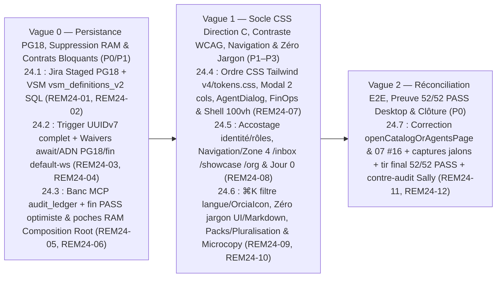

# 🤝 Synthèse & Plan de Remédiation Croisé Sally × Winston — Campagne E2E Epic 23 (`REM24-*`)

- **Auteurs** : 🎨 **Sally** (UX Designer, `bmad-agent-ux-designer`) × 🏗️ **Winston** (System Architect, `bmad-agent-architect`)
- **Date** : `2026-11-20`
- **Branche / Commit figé** : `feat/epic-23-remediation-pg18-sse-direction-c` (`dd2d382` post-`Story 23.6a`)
- **Sources consolidées** :
  - [`bilan-execution-tests-e2e-epic-23.md`](./bilan-execution-tests-e2e-epic-23.md) (`55` scénarios Desktop planifiés : **`44` `passed`**, **`7` `failed`**, **`1` `timedOut`**, **`3` `skipped` `mobile-only`**, **`0` `flaky`**, taux de succès **`84,6 %`** `44 / 52`)
  - [`playwright-results.json`](./playwright-results.json) & [`manifest.jsonl`](./manifest.jsonl) (`58` PNG `< 450 KB`)
  - [`notes-audit-sally-ux.md`](./notes-audit-sally-ux.md) (`58 / 58` PNG inspectées, **`17` écarts `UX23-01`..`UX23-17`** : `1 P0`, `9 P1`, `5 P2`, `2 P3`)
  - [`notes-audit-winston-architecture.md`](./notes-audit-winston-architecture.md) (**`8` fiches causes racines E2E** & **`12` diagnostics architecturaux `ARCH24-01`..`ARCH24-12`**)
  - Continuité : [`synthese-remediation-sally-winston-epic-22.md`](../e2e-campaign-epic-22/synthese-remediation-sally-winston-epic-22.md)

---

## 1. Synthèse du Dialogue Croisé Sally × Winston (`dd2d382`)

La confrontation entre l'audit visuel intégral de 🎨 Sally (`58 / 58` PNG à `1440×900`) et le diagnostic de code + PostgreSQL 18 de 🏗️ Winston explique à **`100 %`** la transition nette depuis l'Epic 22 (`13,2 %` → `84,6 %` Desktop PASS) et isole précisément ce qui empêche encore la clôture directe :

1. **Fin du blocage `resetDay0()` et des rejets `401` SSE (`0` récurrence Epic 22)** : les `18 / 24` specs désormais 100 % vertes démontrent la solidité de la majorité des flux PG18 (`00`–`05`, `08`–`16`, `21`, `shell`).
2. **La persistance à froid (`reloadColdFromPg`) expose `5` poches RAM ou races PG18 restantes (`5` échecs `P0`)** :
   - Actions Jira échelonnées sur `/gates` conservées uniquement en RAM dans `MultiProjectJiraStagedActionService._staged_by_id` sans table PG18 (`#15`, `#47`, `UX23-01`, `ARCH24-01`) ;
   - Chaînes de valeur VSM servies depuis YAML/RAM dans `app.state.vsm_v2_store` sans alimenter `vsm_definitions_v2` (`#48`, `ARCH24-02`) ;
   - Collision mathématique UUIDv7 sur `tid[:8]` (`65,5 s`) provoquant `HTTP 409 ERR_TRIGGER_DUPLICATE_KEY` lors de créations rapprochées de triggers `LOG_SINK_ALERT` (`#49`, `ARCH24-03`) ;
   - Appel UI `void registerWorkspaceExceptionWaiver(...)` non attendu + fallback fantôme `default-ws` + ADN Starlark non persisté (`#40`, `UX23-06`, `ARCH24-04`) ;
   - Banc de test MCP : course UI optimiste `PASS` avant retour API + divergence `ADMIN_CONNECTION_TEST` vs `AdminConnectionTested` dans `audit_ledger` + exposition MCP RAM (`#45`, `ARCH24-05`).
3. **Les `2` autres échecs E2E proviennent de locators/helpers Playwright obsolètes (`#16`, `#41`, `ARCH24-06`)** : `<option>` cachée ciblée par `.first()` sur `/spaces` (`#16`) et `openCatalogOrAgentsPage(..., { route: "/catalog" })` attendant un testid réservé à `/agents` (`#41`).
4. **Les défauts visuels `UX23-02`, `UX23-04` et `UX23-14` ont une cause CSS commune (`ARCH24-08`)** : `@orcia/ui/styles/tokens.css` est importé *après* `virtual:orcia-tailwind.css` dans `apps/web/src/main.tsx:1-2` et redéfinit `.flex-col` / `.grid-cols-1` hors `@layer utilities`, écrasant `md:flex-row` (`UserSettingsModalDialog`, vide 220 px `UX23-02`) et `sm:grid-cols-2 xl:grid-cols-4` (`FinopsKpiStrip`, KPIs empilés `UX23-14`), tandis que `transition: all 150ms ease` sur `.orcia-ds-tab` + `[data-theme="dark"]` dégradent le contraste WCAG AA (`UX23-04`) et `height: 100vh` fige `FourZoneDirectionCShell` à `900 px` (`UX23-13`).
5. **Dernier foyer UX (`UX23-05`, `UX23-07`, `UX23-08`, `UX23-09`, `UX23-10`, `UX23-12`)** : identité Accostage confondant `authDisplayName` et `platformAdmin` (`UX23-07`), recherche `⌘K` non filtrée par `lang` avec émoji rouge `❓` (`UX23-05`), routes `/inbox`/`/showcase`/`/organization` désynchronisées de Zone 4 / Sidebar / Breadcrumb (`UX23-09`), et fuites de jargon technique/enums bruts (`UX23-08`, `UX23-10`, `UX23-12`).

---

## 2. Vérification Explicite de la Porte de Sortie Epic 23 (`Case B` → Epic 24 Obligatoire)

Conformément à la section 7 du [Plan Directeur de Remédiation Epic 23](../../planning-artifacts/sprint-change-proposal-2026-11-18-epic-23-remediation-plan.md) :

| Critère de sortie (`Story 23.7` / `23.8`) | Seuil requis (`Case A` clôture directe) | Mesure réelle figée (`dd2d382`) | Verdict porte |
| --- | :---: | :---: | :---: |
| Campagne Desktop `--project=desktop-cockpit` | `52 / 52` PASS (`0` échec, `0` timeout) | **`44 / 52` PASS** (`7` `failed` + `1` `timedOut`) | ❌ **Échec** |
| Écarts critiques/majeurs Sally (`notes-audit-sally-ux.md`) | `0` `P0` et `0` `P1` | **`1 P0`** (`UX23-01`) + **`9 P1`** (`UX23-02`..`UX23-10`) | ❌ **Échec** |
| Mobile Companion (`CAP-042` / `390×844`) | Reporté hors Epic 23 (`ACTION_ITEM-23.6`) | `3` skips `mobile-only` (`#14`, `#25`, `#27`) conformes | ✅ **Conforme au report** |

**Décision formelle (`Story 23.8`)** : Le critère **`Case A` n'est PAS atteint**. La sortie bascule impérativement en **`Case B`**, imposant la création de l'**Epic 24 (`Stories 24.1` .. `24.7`)** structurée ci-dessous en **3 vagues séquentielles**. Le périmètre Mobile Companion (`CAP-042`) demeure tracé séparément dans `ACTION_ITEM-23.6` ([`sprint-status.yaml`](../../sprint-status.yaml)).

---

## 3. Arbitrages & Ordonnancement en 3 Vagues (`Epic 24`)

---

## 4. Table Maîtresse Consolidée de Remédiation (`REM24-01` .. `REM24-12`)

### Vague 0 — Persistance PostgreSQL 18, Suppression des Silos RAM & Contrats Bloquants (`REM24-01` .. `REM24-06`)

| ID | Sévérité | Vague / Story Epic 24 | Titre & Cause Racine Exacte | Scénarios E2E, `UX23-*` & `ARCH24-*` couverts | Fichiers / Tables PG18 / Routes API / Composants UI impactés | `CAP-*` & `UJ-*` | Action de correction & critère d'acceptation |
| :--- | :---: | :--- | :--- | :--- | :--- | :--- | :--- |
| **`REM24-01`** | **`P0`** | Vague 0 (`Story 24.1`) | **Persistance PostgreSQL 18 des actions Jira échelonnées (`jira_staged_actions`) & suppression des singletons paresseux `jira_and_mcp.py`** `MultiProjectJiraStagedActionService` (`jira_actions.py:191-192,331-354,406`) conserve `_staged_by_id` et `_draft_artifacts_by_step` en RAM ; `_get_jira_service` / `_get_mcp_service` (`jira_and_mcp.py:36-51`) sont instanciés paresseusement hors Composition Root et vidés par `/api/v1/_e2e/evict-memory-caches` (`e2e_test_hooks.py:69-70`). Après F5, `GET /api/v1/jira/actions/staged` renvoie `[]`, démontant `gates-staged-jira-status-badge` (`GatesAdaptiveHumanReviewSection.tsx:44-49,294-311`). | `06 #15`, `19#2 #47` `UX23-01` `ARCH24-01` | *Nouvelle table PG18* `jira_staged_actions` (Alembic), `packages/orcia-connectors/src/orcia_connectors/jira_actions.py`, `apps/api/src/orcia_api/routers/jira_and_mcp.py`, `apps/api/src/orcia_api/dependencies/`, `GatesAdaptiveHumanReviewSection.tsx`, `infra/scripts/maintenance/_first_boot_reset_guards.py` | `CAP-020`, `CAP-021`, `CAP-024`, `CAP-030`, `CAP-031`, `CAP-032`, `CAP-033` · `UJ-1`..`UJ-3`, `UJ-6` | 1) Créer la migration Alembic *Expand* `jira_staged_actions` (PK UUIDv7, `run_id`, `step_execution_id`, `project_key`, `action_type`, `status`, `payload_jsonb`, `external_key`, `provenance_run_lock_sha256`) + `SqlJiraStagedActionsRepository` (et persister `GovernedMcpServerService`) ; 2) Déplacer les singletons de `jira_and_mcp.py` dans `dependencies/` ; 3) Retirer la clé de purge RAM ; 4) Prouver par test `testcontainers` + `#15`/`#47` que `gates-staged-jira-status-badge` (`EXECUTED`) survit à `reloadColdFromPg`. |
| **`REM24-02`** | **`P0`** | Vague 0 (`Story 24.1`) | **Persistance PG18 des chaînes de valeur VSM dans `vsm_definitions_v2` & retrait des stores RAM `_workflows_helpers.py`** `get_vsm_store` (`_workflows_helpers.py:80-91`) sert les VSM exclusivement depuis des YAML en RAM (`app.state.vsm_v2_store`) sans jamais écrire ni lire `vsm_definitions_v2` (`0` ligne dans `20#1`). `sql_workflows_v2.py:100-103,129-130` garde `strict_sql=False` avec `_memory_fallback`. | `20#1 #48` `ARCH24-02` | Table PG18 `vsm_definitions_v2`, `packages/orcia-core/src/orcia_core/workflows/_internal/sql_workflows_v2.py`, `apps/api/src/orcia_api/routers/_workflows_helpers.py`, `apps/api/src/orcia_api/routers/workflows.py`, `apps/api/src/orcia_api/dependencies/reflexive_execution.py` | `CAP-092`, `CAP-140`, `CAP-200`, `CAP-201` · `UJ-8`, `UJ-11`, `UJ-12`, `UJ-19` | 1) Implémenter `SqlVsmDefinitionsV2Store` sur `vsm_definitions_v2` et seeder les VSM des packs par upsert idempotent au démarrage/sync packs ; 2) Migrer `get_vsm_store` et `get_runs_store` vers le Composition Root `dependencies/` ; 3) Activer `strict_sql=True` hors tests unitaires sans DB ; 4) Vérifier `SELECT COUNT(*) FROM vsm_definitions_v2 >= 1` après `reloadClearingStorage` dans `#48`. |
| **`REM24-03`** | **`P0`** | Vague 0 (`Story 24.2`) | **Suppression de la collision UUIDv7 `tid[:8]` (`65,5 s`) sur `workflow_triggers` (`HTTP 409`)** `_triggers_lifecycle_ops.py:46-47` génère `tkey = ... or f"trg-{cmd.trigger_type.lower()}-{tid[:8]}"`. Or les `8` premiers hexadécimaux d'un UUIDv7 encodent uniquement les 32 bits forts du timestamp (`1` incrément toutes les `65 536 ms`). Deux créations de triggers `LOG_SINK_ALERT` sans `trigger_key` (`WorkflowTriggersModal` / `useWorkflowTriggers.ts:77-95` puis API `20#2`) entrent en collision déterministe `TriggerDuplicateKeyError` (`HTTP 409`) dans `sql_workflow_triggers.py:121-131`. | `20#2 #49` `ARCH24-03` | Table PG18 `workflow_triggers`, `packages/orcia-core/src/orcia_core/orchestration/_triggers_lifecycle_ops.py`, `sql_workflow_triggers.py`, `packages/ui/src/primitives/WorkflowTriggersModal.tsx`, `apps/web/src/features/processes/studio/useWorkflowTriggers.ts` | `CAP-092`, `CAP-140`, `CAP-201` · `UJ-11`, `UJ-12` | 1) Utiliser l'UUIDv7 complet ou ses bits aléatoires (`tid` ou `tid.replace("-", "")[-12:]`) dans `_triggers_lifecycle_ops.py:47` ; 2) Permettre la saisie/affichage d'un `trigger_key` lisible unique dans `WorkflowTriggersModal` ; 3) Prouver la création séquentielle en `< 1 s` de `N >= 2` triggers `LOG_SINK_ALERT` en `HTTP 201` dans `20#2 #49` et test unitaire dédié. |
| **`REM24-04`** | **`P0`** | Vague 0 (`Story 24.2`) | **Dérogations `await` strict, persistance ADN Starlark PG18 & éradication du panneau fantôme `default-ws`** `WorkspaceDnaAndWaiversSection.tsx:96` lance `void client.registerWorkspaceExceptionWaiver(...)` sans `await`, causant la course `0` ligne avant `reloadColdFromPg` (`17#3 #40`). De plus, `L45` injecte `?? "default-ws"` sous `workspaces/index.tsx:176-184` dès `0` espace (`UX23-06`), `L171-235` emploie `fallbackMechanism` et `onSignAndActivate` en RAM locale, et `dna_starlark_and_glossary_service` (`workspace_and_packs.py:47-57`) n'a pas de dépôt PG18. | `17#3 #40` `UX23-06` `ARCH24-04` | Tables PG18 `workspace_exception_waivers`, `ontology_relations`, `WorkspaceDnaAndWaiversSection.tsx`, `apps/web/src/features/workspaces/index.tsx`, `dependencies/workspace_and_packs.py`, `routers/workspace_governance.py:129`, `routers/portal_and_help.py:79,94`, `PacksRegistryPage.tsx:35` | `CAP-010`, `CAP-011`, `CAP-080`, `CAP-081`, `CAP-084`, `CAP-180` · `UJ-5`, `UJ-18` | 1) `await` strict + état `submitting` + relecture PG18 sur `registerWorkspaceExceptionWaiver` et `compileDnaStarlark` ; 2) Persister les mécanismes ADN signés dans `ontology_relations.mechanism_payload_jsonb` (`AD-7`) ; 3) Supprimer tous les replis `"default-ws"`, `"ws-claims-alpha"`, `"ws-mon-compte"` et ne jamais monter `WorkspaceDnaAndWaiversSection` / `WorkspaceDetailTabsPanel` à 0 espace (`UX23-06`). |
| **`REM24-05`** | **`P0`** | Vague 0 (`Story 24.3`) | **Banc de test MCP : contrat `audit_ledger`, suppression `PASS` optimiste & persistance PG18 exposition MCP** `mcp_and_test_bench.py:89-109` + `outbox_subscriber.py:139-145,191` écrivent `event_type = 'AdminConnectionTested'` / `actor_type = 'ADMIN_CONNECTION_TEST'`, alors que `18#5` cherche `WHERE event_type = 'ADMIN_CONNECTION_TEST'`. Côté UI, `useCatalogRemoteTestBench.ts:44-160` pose synchroniquement `PASS` avant un `void client.runRemoteServiceTestBench(...)` non attendu et laisse `handleToggleMcp` / `handleActivateRemoteService` en `useState` local ; `RemoteServiceTestBenchAndGovernedMcpService` (`remote_test_bench_and_mcp_exposure.py:114-115`) reste 100 % RAM. | `18#5 #45` `UX23-08` (étapes MCP) `ARCH24-05` | Table `audit_ledger` + table PG18 exposition MCP (`catalog_items` / migration dédiée), `routers/mcp_and_test_bench.py`, `useCatalogRemoteTestBench.ts`, `remote_test_bench_and_mcp_exposure.py`, `dependencies/workspace_and_packs.py:60-70`, `RemoteServiceTestBenchAndMcpExposureView.tsx` | `CAP-002`, `CAP-055`, `CAP-056`, `CAP-057`, `CAP-082`, `CAP-150` · `UJ-9`, `UJ-19` | 1) Aligner le contrat canonique `event_type` / `actor_type` dans `audit_ledger` et `18#5` ; 2) Supprimer le `PASS` optimiste synchrone dans `useCatalogRemoteTestBench.ts` (`await` réel avant badge `PASS`) ; 3) Câbler `handleToggleMcp` / `handleActivateRemoteService` et `RemoteServiceTestBenchAndGovernedMcpService` sur PostgreSQL 18 sans données simulées ; 4) Remplacer `1_NETWORK_TLS_ANTI_SSRF..4_HOT_DRY_RUN` / `PASS` par des libellés FR métier. |
| **`REM24-06`** | **`P1`** | Vague 0 (`Story 24.3`) | **Assainissement Composition Root (`AD-19`), suppression diagnostics codés en dur & poches RAM résiduelles** `PacksRegistryPage.tsx:53-57` affiche un bandeau vert MCP codé en dur (`100 % des connecteurs requis sont opérationnels`) sans test réseau réel ; `cockpit/index.tsx:113` hardcode `orcia://workflows/claims-engineering-delivery` sans utiliser `wfKey` ; `TwoSpeedFederatedSearchService._speed2_cache` utilise un `dict` RAM par worker au lieu de Redis (`300s`). | Transversal `AD-19` / `AD-24` `ARCH24-07`, `ARCH24-12` | `PacksRegistryPage.tsx`, `cockpit/index.tsx:102-116`, `two_speed_search.py:181,192`, `portal_and_assistant.py:87-95,136-173`, `assistant_background_turns.py:15` | `CAP-062`, `CAP-066`, `CAP-150` · `UJ-10`, `UJ-19` | 1) Brancher `handleRefreshHealthchecks` de `PacksRegistryPage` sur la santé réelle des connecteurs API ; 2) Utiliser `wfKey` réel dans `cockpit/index.tsx` ; 3) Migrer `_speed2_cache` vers Redis (`300s` TTL, clé isolée `user/role/workspace`) et auditer l'ensemble des fabriques `dependencies/` (`strict_sql=True`). |

---

### Vague 1 — Socle CSS Direction C, Contraste WCAG, Navigation, Ergonomie & Zéro Jargon (`REM24-07` .. `REM24-10`)

| ID | Sévérité | Vague / Story Epic 24 | Titre & Cause Racine Exacte | Scénarios E2E, `UX23-*` & `ARCH24-*` couverts | Fichiers / Tables PG18 / Routes API / Composants UI impactés | `CAP-*` & `UJ-*` | Action de correction & critère d'acceptation |
| :--- | :---: | :--- | :--- | :--- | :--- | :--- | :--- |
| **`REM24-07`** | **`P1`** | Vague 1 (`Story 24.4`) | **Refonte CSS Tailwind v4 × `tokens.css`, Modales RGAA 2 colonnes / `AgentDetail`, Contraste Onglets & Viewport Shell** Dans `main.tsx:1-2`, `tokens.css` est importé *après* `virtual:orcia-tailwind.css` et redéfinit `.flex-col` (`L262`) et `.grid-cols-1` (`L293`) hors `@layer`, écrasant `md:flex-row` (`UserSettingsModalDialog.tsx:197`, vide 220 px `UX23-02`) et `sm:grid-cols-2 xl:grid-cols-4` (`FinopsKpiStrip.tsx:94`, KPIs empilés `UX23-14`). `AgentDetailAndSandboxModal` n'utilise pas `OrciaDialog` (`max-h-[680px]`, header coupé, `@slug` tronqué, `UX23-03`). `.orcia-ds-tab` (`L559`) transitionne 150 ms et `FinopsScopePills` utilise `.active` au lieu de `[aria-selected]` (`UX23-04`) ; dark-mode (`L184,191,752`) met `#2563EB` sur `#1E293B` (`2,86:1`) ; `FourZoneDirectionCShell` (`100vh`) coupe Zone 1/4 à `900 px` sur `fullPage` (`UX23-13`) et `ProgressiveDay0AccostageBanner` reste déployé sur Cockpit actif (`UX23-14`). | `UX23-02`, `UX23-03`, `UX23-04`, `UX23-13`, `UX23-14`, `UX23-16` *(double scroll)* `ARCH24-08`, `ARCH24-11` | `apps/web/src/main.tsx:1-2`, `packages/ui/src/styles/tokens.css`, `UserSettingsModalDialog.tsx`, `AgentDetailAndSandboxModal.tsx`, `AgentTestBenchSection.tsx`, `FinopsKpiStrip.tsx`, `FinopsGovernanceDashboardView.tsx`, `apps/web/src/features/finops/index.tsx:344-353`, `FourZoneDirectionCShell.tsx:185-193,254-293`, `FourZoneHelpAsideColumn.tsx:65-72`, `cockpit/index.tsx` | `CAP-060`, `CAP-063`, `CAP-090`, `CAP-200` · `UJ-13`, `UJ-16`, `UJ-20` | 1) Charger `tokens.css` *avant* `virtual:orcia-tailwind.css` ou encapsuler les utilitaires dans `@layer utilities` et supprimer les doublons écrasant `sm:`/`md:`/`xl:` ; 2) Restaurer 2 colonnes dans `UserSettingsModalDialog` (`200px` + `1fr`) et grille 2/4 colonnes dans `FinopsKpiStrip` ; 3) Migrer `AgentDetailAndSandboxModal` vers `OrciaDialog` (`max-h-[82vh]`, pied sticky, focus trap, `@slug` entier) ; 4) Supprimer le fade contraste sur `.orcia-ds-tab`, unifier `[aria-selected="true"]` sur `FinopsScopePills`, corriger `--color-sidebar-active-fg` en dark-mode (`>= 4,5:1`) ; 5) Corriger le conteneur scroll/hauteur `FourZoneDirectionCShell` (zéro bande `#EAF2FB` sous `900px`), compacter `Accostage` dès qu'un run/décision est actif sur `/cockpit`, et aligner `Journal d'Activité →` avec le header `/finops`. |
| **`REM24-08`** | **`P1`** | Vague 1 (`Story 24.5`) | **Identité & permissions Accostage Cockpit, Synchronisation Navigation / Breadcrumb / Zone 4 & Cohérence Jour 0** `cockpit/index.tsx:207-209` passe `authDisplayName` (`Claire Invitée` / `Marc Lead BU`) au lieu de `platformAdmin` sous `Administrateur de plateforme initialisé` (`UX23-07`). `_contextualHelpSections.ts:242` mappe `/inbox` sur `/assistant`, `shellPresets.ts:80` garde `cockpit` actif sur `/showcase`, `/organization` expose `Configuration` même quand celle-ci est masquée (`UX23-09`), `[Espace]` manque dans `buildShellBreadcrumbItems`, et `Mes Espaces` reste actif au Jour 0 (`UX23-15`). | `UX23-07`, `UX23-09`, `UX23-15` `ARCH24-09` | `apps/web/src/features/cockpit/index.tsx:204-213`, `PlatformOnboardingChecklistCard.tsx`, `ProgressiveDay0AccostageBanner.tsx`, `apps/web/src/components/_contextualHelpSections.ts:242`, `apps/web/src/components/shellPresets.ts`, `ShellContainer.tsx`, `FourZoneSidebarRail.tsx`, `FirstBootAdminSetupModal.tsx`, `apps/web/src/routes/settings.tsx`, `SettingsPacksSection.tsx`, `WorkspaceStudioCardsAndDetailView.tsx` | `CAP-005`, `CAP-060`, `CAP-061`, `CAP-064`, `CAP-068` · `UJ-13`, `UJ-20` | 1) Passer uniquement `platformAdmin` (`bootstrap_accostage`) dans `ProgressiveDay0AccostageBanner` et filtrer les étapes admin selon les droits du rôle connecté (`UX23-07`) ; 2) Créer la route/fiche Zone 4 dédiée `/inbox` (`_contextualHelpSections.ts` + `docs/help/{fr,en}/inbox.md`), activer `Aide` sur `/showcase`, détacher `/organization` de `Configuration` quand masquée et injecter `[Espace]` dans `buildShellBreadcrumbItems` (`UX23-09`) ; 3) Griser `Mes Espaces` avant création admin, clarifier le bouton `Fermer` de la modale Jour 0, faire tenir les 6 onglets `/settings` sur 1 ligne, supprimer le récapitulatif pack actif en double et retirer le 2e fil d'Ariane interne de `/spaces` (`UX23-15`). |
| **`REM24-09`** | **`P1`** | Vague 1 (`Story 24.6`) | **Filtrage langue recherche `⌘K`, icône `OrciaIcon`, purge intégrale jargon UI, Markdown `PermissionBroker` & `/settings/packs`** `sql_federated_search.py:81-121` et `portal_and_help.py:72-124` chargent `HELP_ARTICLE` sans filtrer sur `lang` (`UX23-05` doublon anglais `Federated Catalog...`) ; `TopHeaderSearchCommand` rend un émoji rouge `❓` sur bleu. Plusieurs composants exposent enums/codes internes (`(AD-24.7)`, `COMPLETED (100%)`, `PENDING`, `RUNNING`, `PAUSE_AND_ESCALATE`, `OPT_A_*`, `frame-*`, `HTTP 403`, `(Step 1 • ...)`, URI encodée, Markdown brut `###`/`**`, `< 15 s`, `PostgreSQL 18`, `0.5 ms`, `0` nu + `depth=0/1` dans `CatalogExplorerPanel.tsx:96,138-151`, `4 Compéte` + `1 Chaînes` + `mcp:atlassian-*` + `crl-*` dans `PacksRegistryPage`, `` `@` `` et `promotions L4 → L1` dans `docs/help/fr/`). | `UX23-05`, `UX23-08`, `UX23-10`, `UX23-12` `ARCH24-10` | `packages/orcia-core/src/orcia_core/rag/_internal/sql_federated_search.py`, `apps/api/src/orcia_api/routers/portal_and_help.py`, `TopHeaderSearchCommand.tsx`, `CatalogExplorerPanel.tsx`, `PermissionBrokerCard.tsx`, `ArbitrationTieBreakCard.tsx`, `CockpitUpstreamChallengePanel.tsx`, `AiModelReindexPanel.tsx`, `GatesAdaptiveHumanReviewSection.tsx`, `InboxNotificationsCenterView.tsx`, `WorkflowStudioSection.tsx`, `PacksRegistryPage.tsx`, `WorkspaceStudioCardsAndDetailView.tsx`, `docs/help/fr/{agents,ontology}.md` | `CAP-002`, `CAP-032`, `CAP-054`, `CAP-062`, `CAP-064`, `CAP-090`, `CAP-150`, `CAP-190` · `UJ-5`, `UJ-6`, `UJ-9`, `UJ-15`, `UJ-19`, `UJ-20` | 1) Filtrer `HELP_ARTICLE` sur `ci.lang = locale` dans `load_federated_search_candidates_pg18` & `/api/v1/search` et remplacer `❓` par `OrciaIcon` blanc (`UX23-05`) ; 2) Traduire 100 % des enums/statuts via `i18n`, passer les conseils `PermissionBrokerCard` dans `FormattedMarkdownContent` avec décodage URI, remplacer `0` nu par une phrase d'état vide et purger `AD-24.7`, `PostgreSQL 18`, `< 15 s`, `0.5 ms` et `depth=*` (`UX23-08`) ; 3) Corriger la grille mini-compteurs (`4 Compétences`) et la pluralisation `n <= 1` (`1 Chaîne`, `1 Agent`, `1 Source rattachée`) + noms lisibles connecteurs/agents (`UX23-10`) ; 4) Remplacer `` `@` `` par `« @ »` et `L4 → L1` dans `docs/help/fr/` (`UX23-12`). *(Audit statique `anti-jargon-and-secrets-ui-audit.test.ts` renforcé).* |
| **`REM24-10`** | **`P2`/`P3`** | Vague 1 (`Story 24.6`) | **Correction troncatures de champs à `1440×900` & polissage microcopy transverse** Placeholders/options coupés (`Ex : Ajouter un contrôle de p` dans `StudioCopilotSidebar`, `Rechercher un espace ou une équ` dans `/spaces`, `Plateforme entière (toutes les directi` dans `IamSecopsExceptionForm`), plus polissage mineur (`Organisation (Global)` dupliqué `/ontology`, `3 espaces` vs `4` onglets + `(docs/site-catalog/index.html)` `/showcase`, libellé `/wizards`, double espace `Mes  Espaces`, `4 tiers cognitifs`, minuscule cassette LLM). | `UX23-11`, `UX23-16` `ARCH24-11` | `StudioCopilotSidebar.tsx`, `WorkspaceStudioCardsAndDetailView.tsx`, `IamSecopsExceptionForm.tsx`, `apps/web/src/features/ontology/index.tsx`, `OrciaProductShowcaseSiteView.tsx`, `DurableWizardRunnerView.tsx`, `AiModelsMasterTable.tsx`, `apps/web/src/i18n/locales/fr.ts`, `tests/unit/fakes/` (cassette) | `CAP-066`, `CAP-074`, `CAP-080`, `CAP-140` · `UJ-14`, `UJ-18`, `UJ-20` | 1) Ajuster largeurs `min-w` / layout `StudioCopilotSidebar`, `/spaces` et `IamSecopsExceptionForm` + raccourcir les placeholders sans coupure à `1440×900` (`UX23-11`) ; 2) Dédupliquer l'option `/ontology`, aligner `4` espaces sur `/showcase` sans chemin technique, harmoniser `/wizards` ↔ Zone 4, corriger `Mes Espaces`, remplacer `tiers` par `paliers` et capitaliser le texte cassette (`UX23-16`). *(Inclure vérification précision affichage décimal FinOps sur micro-montants `0.002 €` vs tokens `sql_finops_dashboard.py`)*. |

---

### Vague 2 — Réconciliation E2E, Campagne Finale `52 / 52` PASS Desktop & Clôture Epic 24 (`REM24-11` .. `REM24-12`)

| ID | Sévérité | Vague / Story Epic 24 | Titre & Cause Racine Exacte | Scénarios E2E, `UX23-*` & `ARCH24-*` couverts | Fichiers / Tables PG18 / Routes API / Composants UI impactés | `CAP-*` & `UJ-*` | Action de correction & critère d'acceptation |
| :--- | :---: | :--- | :--- | :--- | :--- | :--- | :--- |
| **`REM24-11`** | **`P1`/`P3`** | Vague 2 (`Story 24.7`) | **Réconciliation des locators/helpers E2E (`openCatalogOrAgentsPage`, `07 #16`) & enrichissement captures jalons** `openCatalogOrAgentsPage` (`workspaceAndCatalogHelpers.ts:126-130`) attend `agents-and-skills-manager-view` sur `/catalog` qui monte `catalog-explorer-panel` (`18#1 #41` timeout `35 275 ms`) ; `07 #16` (`07-spaces...spec.ts:42`) appelle `getByText(...).first()` qui résout l'`<option>` cachée du `<select>` sidebar (`hidden`) ; `00 #3/#4` & `04 #12` capturent le splash `Chargement de la session...` ; `20 #48` et `17 #40` ne montrent ni la carte VSM 11 étapes / tiroir HITL ni le bloc dérogations/tripartite. | `18#1 #41`, `07 #16` `UX23-17` `ARCH24-06` | `apps/web/e2e/support/workspaceAndCatalogHelpers.ts`, `apps/web/e2e/07-spaces-org-and-workspace-persistence.spec.ts`, `apps/web/e2e/00-stack-smoke.spec.ts`, `04-multi-actor-claim-sse.spec.ts`, `17-workspace...spec.ts`, `20-process-studio...spec.ts` | `CAP-002`, `CAP-004`, `CAP-040`, `CAP-050`, `CAP-067`, `CAP-080`, `CAP-092`, `CAP-140`, `CAP-150`, `CAP-160` | 1) Corriger `openCatalogOrAgentsPage` pour vérifier `catalog-explorer-panel` sur `/catalog` et `agents-and-skills-manager-view` sur `/agents` (`18#1 #41`) ; 2) Scoper le locator `07 #16` sur `page.getByRole("main")` ou testid carte ; 3) Attendre une vue stabilisée sur `00 #3/#4` & `04 #12` et ajouter les captures `milestone-*.png` VSM 11 étapes, tiroir HITL et graphe tripartite/dérogations (`< 450 KB`). |
| **`REM24-12`** | **`P0`** | Vague 2 (`Story 24.7`) | **Campagne E2E Finale Epic 24 (`52 / 52` PASS Desktop), Contre-Audit Sally (`0 P0`, `0 P1`) & Promotion `capabilities.yaml`** Exécution complète de validation sur pile réelle PostgreSQL 18 + Redis 7.4 sans `ORCIA_E2E_SEED_FIXTURES` après clôture des Vagues 0 et 1 (`REM24-01`..`REM24-11`). *(Mobile Companion `CAP-042` reste hors périmètre sous `ACTION_ITEM-23.6` sauf réintégration explicite).* | Tous les `55` scénarios Desktop (`00`–`21`, `shell.spec.ts`) & validation complète `UX23-01`..`UX23-17` / `ARCH24-01`..`ARCH24-12` | `docs/implementation-artifacts/e2e-campaign-epic-24/`, `docs/product/capabilities.yaml`, `docs/implementation-artifacts/sprint-status.yaml`, `apps/web/src/generated/orciaSiteManifest.ts` | Ensemble des capacités Desktop (`CAP-001`..`CAP-203` hors `CAP-042`) | 1) Campagne `--project=desktop-cockpit --retries=0 --max-failures=0` : **`52 / 52` exécutés PASS (`0` `failed`, `0` `timedOut`, `3` `skipped` `mobile-only`, `0` `flaky`)** ; 2) Contre-audit Sally sur `100 %` des captures : **`0 P0`, `0 P1`** ; 3) `pnpm site:sync && pnpm site:check`, `pytest --cov-fail-under=90`, `lint-imports`, `ruff`, `mypy --strict`, `pnpm turbo run lint typecheck test` à `0` erreur. |

---

## 5. Matrice de Vérification de Couverture (`100 %` Échecs E2E, Sally `UX23-*` & Winston `ARCH24-*`)

| Source / Axe d'audit | Volume exact | Couverture exhaustive `REM24-*` | Complétude |
| --- | :---: | --- | :---: |
| **Échecs / Timeouts E2E Desktop (`dd2d382`)** | **`8 / 8`** | `#15` (`06`) → `REM24-01` ; `#16` (`07`) → `REM24-11` ; `#40` (`17#3`) → `REM24-04` ; `#41` (`18#1`) → `REM24-11` (`+ REM24-09`) ; `#45` (`18#5`) → `REM24-05` ; `#47` (`19#2`) → `REM24-01` ; `#48` (`20#1`) → `REM24-02` ; `#49` (`20#2`) → `REM24-03` | **`100 %`** |
| **Constats Sally (`notes-audit-sally-ux.md`)** | **`17 / 17`** | `UX23-01`→`REM24-01` ; `UX23-02`→`REM24-07` ; `UX23-03`→`REM24-07` ; `UX23-04`→`REM24-07` ; `UX23-05`→`REM24-09` ; `UX23-06`→`REM24-04` ; `UX23-07`→`REM24-08` ; `UX23-08`→`REM24-05,09` ; `UX23-09`→`REM24-08` ; `UX23-10`→`REM24-09` ; `UX23-11`→`REM24-10` ; `UX23-12`→`REM24-09` ; `UX23-13`→`REM24-07` ; `UX23-14`→`REM24-07` ; `UX23-15`→`REM24-08` ; `UX23-16`→`REM24-10` ; `UX23-17`→`REM24-11` | **`100 %`** |
| **Diagnostics Winston (`notes-audit-winston-architecture.md`)** | **`12 / 12`** | `ARCH24-01`→`REM24-01` ; `ARCH24-02`→`REM24-02` ; `ARCH24-03`→`REM24-03` ; `ARCH24-04`→`REM24-04` ; `ARCH24-05`→`REM24-05` ; `ARCH24-06`→`REM24-11` ; `ARCH24-07`→`REM24-06` ; `ARCH24-08`→`REM24-07` ; `ARCH24-09`→`REM24-08` ; `ARCH24-10`→`REM24-09` ; `ARCH24-11`→`REM24-07,10` ; `ARCH24-12`→`REM24-06,12` | **`100 %`** |
| **Garde `mobile-companion` (`CAP-042`)** | **`3` skips** | `#14`, `#25`, `#27` maintenus explicitement différés hors Epic 23/24 sous `ACTION_ITEM-23.6` (`sprint-status.yaml`) | **`100 %` traçable** |
