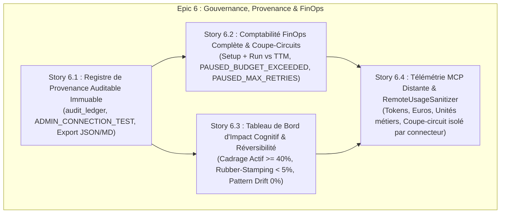
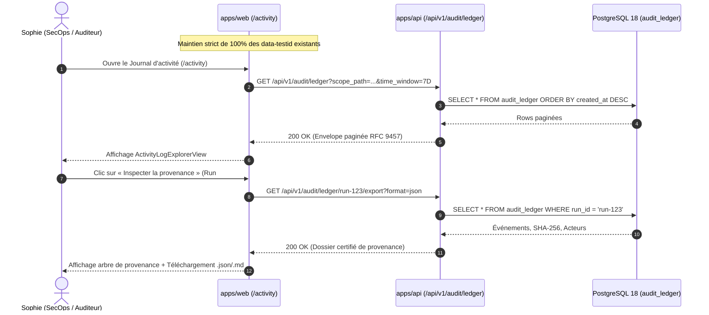

# Epic 6 Context: Gouvernance Exécutive, Provenance Auditable Immuable, FinOps Consolidé & Réversibilité Humaine

> **Document de Référence & Socle Compilé pour les Spécifications 6.1 à 6.4**
> **Auteurs conjoints** : Winston (`bmad-agent-architect` 🏗️, System Architect) & Sally (`bmad-agent-ux-designer` 🎨, UX Designer)
> **Branche Git** : `feat/epic-6-audit-ledger-finops-and-human-reversibility`
> **Statut** : Validé pour Phase 2 (Rédaction des spécifications de Stories)

---

## 1. Vision d'Ensemble & Cadre Métier de l'Epic 6

### 1.1 Contexte & Problématique Entreprise

L'introduction des architectures multi-agents, de l'orchestration de modèles de langage (LLM) et des outils externes (serveurs MCP, protocoles Agent-to-Agent A2A) engendre des défis critiques de gouvernance au sein des organisations :
1. **Opacité des coûts & dispersion multi-sources** : Un processus combine aujourd'hui des modèles internes hébergés (vLLM, Ollama), des API commerciales (LiteLLM, Azure, Anthropic) et des serveurs d'outils distants (MCP). Les serveurs distants facturent sous des métriques hétérogènes (tokens, euros directs, pages d'OCR, requêtes de recherche API, minutes de GPU). L'organisation a besoin d'une équation économique unifiée sans jamais « additionner des choux et des carottes ».
2. **Risque de boucle infinie & dérive budgétaire** : Une divergence d'agent ou un échec répété de validation de Gate peut déclencher des auto-relances incontrôlées, épuisant le budget en quelques minutes sans alerte précoce.
3. **Exigence réglementaire de conformité et de provenance auditable (AI Act, NIS 2, DORA)** : L'entreprise doit être capable de prouver de manière formelle et irrévocable quel expert humain, quel agent, quel modèle précis et quelles sources documentaires exactes (avec leur empreinte SHA-256 et version de contrat `run-lock.json`) ont produit et validé chaque décision ou livrable.
4. **Dérive cognitive et déresponsabilisation humaine (*Rubber-Stamping*)** : Face à des volumes massifs d'artefacts générés par l'IA, les relecteurs humains risquent de valider mécaniquement les livrables en moins de quelques secondes sans lecture critique, transformant le codebase ou la base documentaire en boîte noire ingouvernable.

### 1.2 Personas & Cas d'Usage Couverts

| Persona | Rôle & Besoins dans l'Epic 6 | Cas d'usage principal |
| :--- | :--- | :--- |
| **Claire (`UJ-8`)** | Directrice de BU / Sponsor Métier | Piloter dans **📊 FinOps** le coût complet des processus (*Setup + Run vs TTM*), vérifier la rentabilité des investissements IA et surveiller les plafonds budgétaires globaux. |
| **Sophie (`UJ-6`)** | Ingénieure SecOps / Auditeur Conformité | Auditer de manière irrévocable l'historique complet d'une exécution dans le **Registre de provenance** (`audit_ledger`), tracer les essais à chaud d'administrateurs (`ADMIN_CONNECTION_TEST`) et exporter un dossier de preuve légale scellé (`JSON`/`Markdown`). |
| **Marc (`UJ-5`)** | Tech Lead / Responsable d'Équipe | Surveiller les contre-métriques d'impact cognitif (*Rubber-Stamping*, *Pattern Drift*, *Cadrage Actif*), ajuster les politiques de Gates (passage en échantillonnage ou renforcement des ancres) et débloquer les exécutions suspendues par coupe-circuit. |
| **Karim (`UJ-9`)** | Administrateur Plateforme / SRE | Configurer les quotas et barèmes de télémétrie des connecteurs distants MCP/A2A, surveiller les alertes de coupe-circuit par connecteur (`CIRCUIT_OPEN`) sans impacter les LLM internes. |

### 1.3 Exigences & Décisions d'Architecture Liées

- **Exigences Fonctionnelles (PRD v2.0)** :
  - `FR-25` : Traçabilité et journal d'audit immuable de chaque action, étape, Gate et test d'administrateur.
  - `FR-26` : Comptabilité FinOps consolidée, attribution des coûts internes et externes, coupe-circuits budgétaires et anti-boucles.
  - `FR-27` : Tableau de bord d'impact cognitif, détection du rubber-stamping, suivi du pattern drift et réversibilité humaine.
- **Décisions d'Architecture (ARCHITECTURE-SPINE.md)** :
  - `AD-12` : Journal d'audit immuable, télémétrie FinOps unifiée, coupe-circuit par étape/déclencheur et enrichissement W3C OpenTelemetry TraceContext.
  - `AD-17` : Stratégie de test à 5 couches (couverture $\ge 90\%$, zéro mock SQLite, tests de contrat et red-team).
  - `AD-19` : Monolithe modulaire, isolation hexagonale sans dépendance circulaire (`import-linter`), découplage API/Domaine et bus Outbox transactionnel.
  - `AD-20` : Core agnostique de tout vocabulaire SDLC (`DEBT-ORCH-VOCAB-01`).
  - `AD-21` : Abstraction cognitive des modèles (`InferenceTier`), niveaux d'effort (`InferenceEffort`) et modèle d'habilitations hiérarchique à 6 verbes avec garde `enforce_scope_mutation_guard`.
  - `AD-23` : Observabilité 12-factor JSON unifiée sur `stdout` et corrélation distribuée via `trace_id`.
  - `NFR-SEC-3` : Immuabilité absolue du journal d'audit via trigger PostgreSQL 18 rejetant tout `UPDATE` ou `DELETE`.
  - `NFR-SEC-4` : Zéro secret en clair dans l'audit ou l'Outbox (`DEC-SEC-01`, `CanaryLeakAuditReport`).
- **Principes Ergonomiques Direction C** :
  - `Principe M.2` : Banc de test à chaud tracé sous `ADMIN_CONNECTION_TEST` isolé des runs de production.
  - `Principe M.3` : Télémétrie multi-métriques des services MCP (`_meta.usage` / `X-Orcia-Usage`), validateur `RemoteUsageSanitizer` et coupe-circuit isolé par connecteur.
  - `Principe C` : Gabarit unifié des écrans métiers, masquage des compteurs à vide (`total == 0`) et zéro jargon interne dans l'interface.

---

## 2. Note de Réconciliation Technique `CAP-ACT-3`

> **Historique et Constat du Codebase au 2026-11-08 (confirmé au 2026-11-16)** :
> 1. Aucune migration Alembic n'a créé la table `audit_ledger`.
> 2. Le dossier `packages/orcia-core/src/orcia_core/audit_finops/` ne contient que `errors.py` et `__init__.py`.
> 3. L'écran `/finops` (`apps/web/src/routes/finops.tsx`) n'est qu'une coquille générique `ModuleWorkspaceView` exploitant un store local en mémoire volatile (`orcia.finops.overview.v1`).
> 4. Le **Journal d'activité** (`/activity`, `CAP-065`), livré de manière ad-hoc le 2026-11-05, lit ses événements dans `platformSetupStore.auditEvents` alimenté par le snapshot d'accostage (`bootstrap_accostage.py`), sans registre persistant PostgreSQL.
>
> **Arbitrage de Rebasage et Alignement des Capacités** :
> - **Story 6.1** remplace la source de `/activity` par `GET /api/v1/audit/ledger`. Le composant `@orcia/ui` `ActivityLogExplorerView` et ses filtres sont conservés à 100 % (zéro `data-testid` supprimé), et enrichis d'un tiroir d'inspection de la provenance et d'export scellé (`JSON`/`Markdown`).
> - `capabilities.yaml` conserve `CAP-065` au statut `partial` jusqu'à la livraison de la Story 6.1, et `CAP-200` (`status: planned`) couvre l'ensemble des Stories 6.1 à 6.4.

---

## 3. Décomposition des 4 Stories de l'Epic 6



### 3.1 Story 6.1 — Registre de Provenance Auditable Immuable (`audit_ledger` Append-Only), Traçabilité des Tests à Chaud (`ADMIN_CONNECTION_TEST`) & Export de Conformité JSON/Markdown

#### Objectif Métier
Offrir aux auditeurs internes et ingénieurs SecOps (`Sophie UJ-6`, `Claire UJ-8`) la garantie mathématique et réglementaire qu'aucune action, qu'aucune ressource et qu'aucun test de connexion d'administrateur ne peut être altéré ou supprimé, tout en permettant d'exporter un dossier de preuve certifié pour chaque exécution.

#### Invariants & Règles Architecturales
1. **Trigger PostgreSQL 18 d'Immuabilité Absolue** :
   La table `audit_ledger` est protégée par un trigger `BEFORE UPDATE OR DELETE` levant une exception immédiate (`ERR_AUDIT_LEDGER_IMMUTABLE`). Aucune modification ni purge n'est possible, y compris par l'administrateur de base de données.
2. **Consommation Asynchrone Idempotente via Outbox** :
   Le domaine `audit_finops` consomme les événements de `domain_events_outbox` (`StepCompleted`, `GateEvaluated`, `ArtifactProduced`, `RunTerminated`, `SettingsChanged`, `AdminConnectionTested`). L'unicité de `source_event_id` garantit une écriture à zéro doublon (`ON CONFLICT (source_event_id) DO NOTHING`).
3. **Traçabilité des Tests à Chaud (`ADMIN_CONNECTION_TEST`)** :
   Lorsqu'un administrateur teste un connecteur ou un modèle IA depuis le banc de test (`Principe M.2`, `Story 19.3`), l'événement est journalisé avec `actor_type: ADMIN_CONNECTION_TEST`, `run_id: NULL` et `actor_id: user.id`. Il n'est jamais imputé au budget de production d'un Espace.
4. **Scellement Cryptographique & Empreintes** :
   Chaque entrée d'étape ou de Gate enregistre les condensats SHA-256 du contrat de workflow (`workflow_contract_sha256`), du pré-prompt système (`pre_prompt_sha256`), de l'état figé du run lock (`run_lock_sha256`), ainsi que les références CAS (`SeaweedFS`) des extraits injectés.
5. **Dossier de Provenance & Export Scellé** :
   L'endpoint `GET /api/v1/audit/ledger/{run_id}/export?format=json|md` assemble l'arbre chronologique complet du Run et atteste qu'aucune ressource absente de `run-lock.json` n'a été invoquée.

---

### 3.2 Story 6.2 — Comptabilité FinOps Complète (Coût de Setup + Coût de Run vs TTM) & Coupe-Circuits Budgétaires / Anti-Boucles

#### Objectif Métier
Permettre aux directeurs de BU et responsables d'équipe (`Claire UJ-8`, `Marc UJ-5`) de mesurer en continu le retour sur investissement réel de chaque processus (*réduction de $\ge 25\%$ du coût complet* selon l'objectif `SM-1`) tout en éliminant structurellement tout risque d'emballement budgétaire via des coupe-circuits automatiques.

#### Invariants & Règles Architecturales
1. **Équation Économique Complète à 3 Composantes** :
   $$\text{Coût Total d'Exécution} = \text{Amortissement Setup} + \text{Coût Run Consolidé} + \text{Temps Humain Valorisé}$$
   - *Amortissement Setup* : $\frac{\text{Temps de conception du workflow} \times \text{Taux horaire standard}}{\text{Nombre prévisionnel d'exécutions}}$.
   - *Coût Run Consolidé* : Tokens LLM internes vérifiés + Coûts externes déclarés MCP (en `numeric(12, 6)` USD convertis à l'affichage en `€`).
   - *Temps Humain Valorisé* : Somme des durées actives passées sur les ancres humaines, revues de Gates et arbitrages.
   - *Gain de TTM* : Différence temporelle entre le temps total écoulé du run et la baseline déclarée du processus manuel (`finops_workflow_baselines.manual_time_minutes`).
2. **Coupe-Circuit Budgétaire Hiérarchique à 4 Niveaux (`AD-21`)** :
   Avant chaque appel LLM coûteux et à chaque transition d'étape, le coupe-circuit vérifie le cumul des dépenses vis-à-vis du plafond du Run (`workflow_runs.budget_max_usd`) et des budgets de portée (`GLOBAL -> BU -> TEAM -> WORKSPACE`).
   - Si le seuil d'avertissement ($80\%$) est franchi : émission d'un événement Outbox de notification.
   - Si le plafond dur ($100\%$) est dépassé : suspension immédiate de l'étape en statut `PAUSED_BUDGET_EXCEEDED` et du Run en statut `PAUSED_BUDGET_EXCEEDED`.
3. **Protection Anti-Boucle Infinie d'Agents** :
   Le nombre de tentatives de correction par étape (escalades de routeur cognitif ou rejets successifs de Gate) est borné par `max_agent_retries` (défaut : `3`). Au-delà, l'étape et le Run basculent en `PAUSED_MAX_RETRIES`.
4. **Protocole de Reprise & Extension Budgétaire (`Budget Override`)** :
   La reprise d'un Run suspendu nécessite une action humaine explicite d'un responsable (`POST /api/v1/runs/{run_id}/budget-override`) précisant le montant de l'extension budgétaire et le motif. Cette action persiste une ligne dans `finops_budget_overrides`, émet `BudgetOverrideApproved` et réveille le workflow DBOS sans perte d'état.

---

### 3.3 Story 6.3 — Tableau de Bord Exécutif d'Impact Cognitif, Anti-Rubber-Stamping & Indice de Réversibilité Humaine

#### Objectif Métier
Empêcher que l'accélération par l'IA ne transforme les ingénieurs et experts en simples « tamponneurs passifs » (*rubber-stampers*) ou ne crée une dette technique cachée, en surveillant 3 contre-métriques objectives de maîtrise humaine et en fournissant des recommandations automatiques d'ajustement des politiques de validation.

#### Les 3 Indicateurs de Maîtrise Humaine (`FR-27`)
1. **Ratio de Cadrage Actif d'Expert (*Human-Led Think*, `SM-C2`)** :
   $$\text{Ratio} = \frac{\text{Temps passé sur Ancrages Humains Obligatoires} + \text{Arbitrages} + \text{Challenges}}{\text{Temps Humain Total de l'Exécution}}$$
   - *Cible d'excellence* : $\ge 40\%$.
   - *Comportement* : Si le ratio descend sous $40\%$, alerte ambre indiquant un déséquilibre vers la relecture passive plutôt que le cadrage des intentions.
2. **Taux de Validation Expéditive / Rubber-Stamping (`SM-C1`)** :
   Pourcentage d'approbations humaines aux Gates avec l'indicateur `fast_approval_warning: true` (approbation d'un artefact $> 1000$ mots en moins de 15 secondes) ou sans consultation du *Briefing de Revue*.
   - *Seuil de tolérance* : $< 5\%$.
   - *Comportement* : Si le taux dépasse $5\%$, alerte rouge pour le Tech Lead et la direction de BU.
3. **Indice de Dérive d'Architecture / Réversibilité Humaine (`SM-C3`)** :
   Taux d'écarts structurels constatés par rapport aux décisions verrouillées dans `ARCHITECTURE-SPINE.md` ou aux règles d'Ontologie Niveau 1/2.
   - *Cible absolue* : $0\%$ d'écart non couvert par une dérogation formelle signée (`workspace_exception_waivers`).

#### Moteur de Recommandations d'Ajustement des Gates
Lorsqu'un workflow affiche sur une période de 30 jours un taux de succès aux Gates Humaines $> 98\%$ avec un temps médian de revue inférieur au seuil minimal et `0` modification ou commentaire :
- Le système émet une recommandation actionnable :
  - *Option A* : Basculer la Gate de politique `mandatory_full` vers `risk_or_exception_based` ou `sampling` (20 % de tirage aléatoire) afin de réduire la fatigue humaine (*Gate Fatigue*).
  - *Option B* : Renforcer les *Ancrages Humains Obligatoires* en amont du workflow si l'étape est critique.

---

### 3.4 Story 6.4 — Télémétrie FinOps Multi-Métriques des Services MCP & Agents Distants (`_meta.usage` / `X-Orcia-Usage`), `RemoteUsageSanitizer`, Onglet `🌐 Services & Agents externes` & Coupe-Circuit Isolé par Connecteur (`AD-12`, Principe M.3)

#### Objectif Métier
Intégrer de façon transparente et hautement sécurisée les consommations issues de serveurs d'outils MCP tiers et d'agents distants (A2A), normaliser les différentes métriques de facturation sans confusion dans l'interface, et protéger le système contre toute donnée malveillante ou corrompue grâce au filtre `RemoteUsageSanitizer` et à un coupe-circuit étanche par connecteur.

#### Les 3 Formats de Métriques & Valorisation
1. **Format A — Tokens LLM distants** : `input_tokens`, `output_tokens`, `model_name`.
2. **Format B — Coût monétaire direct** : `cost_amount`, `currency` (`EUR`, `USD`).
3. **Format C — Unités / Crédits métiers** : `unit_count`, `unit_name` (ex. `pages_ocr`, `recherches_web`, `credits_api`, `secondes_gpu`).
4. **Trois Modes de Valorisation Configurables sur le Connecteur** :
   - `NATIVE_TELEMETRY` (par défaut) : Exploite les métadonnées déclarées dans `CallToolResult._meta.usage`, le corps de réponse A2A ou l'en-tête `X-Orcia-Usage`.
   - `FIXED_SCALE` (barème de référence) : Applique le barème configuré dans ORCIA (`coût fixe par appel` ou `coût fixe par unité`) en l'absence de coût direct retourné.
   - `VOLUMETRIC_ONLY` : Trace uniquement les volumes d'appels et d'unités sans imputation monétaire.

#### Garde-Fou `RemoteUsageSanitizer` (Défense en Profondeur)
Tout serveur MCP tiers étant considéré comme un composant d'infrastructure non fiable (`AD-19`) :
- Rejet immédiat de toute valeur négative ($< 0$), `NaN` ou infinie (`Infinity`).
- Plafond de sécurité par appel : **`max_reported_cost_per_call_eur`** (configurable, défaut : `5,00 €`). Si la valeur déclarée excède ce seuil, elle est automatiquement écrêtée à $5,00$ € et l'événement `RemoteUsageAnomalyCapped` est émis.
- Conversion unifiée vers le pivot USD `NUMERIC(12, 6)` en base selon le taux de change de référence.

#### Coupe-Circuit Isolé par Connecteur (`CIRCUIT_OPEN`, `AD-12`)
Chaque connecteur dispose de ses propres plafonds (ex. `max 50 € / mois` ou `500 appels / jour`).
- Si le connecteur dépasse son quota ou accumule des anomalies : seul son statut bascule à **`CIRCUIT_OPEN`** dans `ConnectorInvoker`.
- **Isolation garantie** : L'ouverture du coupe-circuit d'un connecteur MCP externe ne bloque **en aucun cas** les modèles LLM internes de l'Espace ni les autres connecteurs.

---

## 4. Architecture Système, Contrats Hexagonaux & Décisions Winston (🏗️)

### 4.1 Frontières Acycliques `import-linter` (`AD-19`)

Rappel des contrats formels définis dans `pyproject.toml` :
- **Contract 1** : `orcia_api | orcia_worker` $\rightarrow$ `orcia_connectors` $\rightarrow$ `orcia_core`.
- **Contract 2 (Hiérarchie interne `orcia_core`)** :
  ```
  Couche 1 : bootstrap | orchestration | packs
  Couche 2 : blackboard | ontology | rag | gates | audit_finops | workflows
  Couche 3 : catalog
  Couche 4 : permissions
  Couche 5 : domain | ports | config | observability | storage
  Couche 6 : kernel
  ```
- **Contract 3 (Noyau pur & zéro framework)** : Interdiction d'importer `fastapi`, `sqlalchemy`, `dramatiq`, `dbos`, `redis`, `litellm`, etc. dans `orcia_core.kernel`, `domain` et `ports`.

#### Contraintes d'Architecture Déduites :
1. `audit_finops` (Couche 2) **ne doit jamais importer** `orchestration`, `bootstrap` ou `packs` (Couche 1), ni ses pairs de Couche 2 (`gates`, `blackboard`).
2. `permissions` (Couche 4, où réside `ConnectorInvoker`) est **en dessous** de `audit_finops` : elle **ne doit jamais importer** `audit_finops`.
3. **Conception de `packages/orcia-core/src/orcia_core/ports/finops_telemetry.py`** :
   Pour permettre à `permissions` (`ConnectorInvoker`) d'invoquer le sanitizer et de vérifier les quotas sans importer `audit_finops`, toutes les interfaces et structures de données vivent dans `orcia_core.ports` (Couche 5).

### 4.2 Définition Formelle du Port `finops_telemetry.py`

```python
"""Hexagonal telemetry, audit and finops ports (`AD-12`, `AD-19`, `Story 6.4`).

Pure hexagonal contracts — zero framework dependencies, zero cross-domain cycles.
"""

from __future__ import annotations

from dataclasses import dataclass
from typing import Any, Literal, Protocol, runtime_checkable

ValuationMode = Literal["NATIVE_TELEMETRY", "FIXED_SCALE", "VOLUMETRIC_ONLY"]
CircuitBreakerState = Literal["CLOSED", "CIRCUIT_OPEN", "HALF_OPEN"]
CostSource = Literal["INTERNAL_VERIFIED", "EXTERNAL_REPORTED", "ESTIMATED_SCALE"]


@dataclass(frozen=True, slots=True)
class RemoteUsageRawPayload:
    """Raw telemetry payload extracted from MCP _meta.usage or X-Orcia-Usage header."""
    input_tokens: int | None = None
    output_tokens: int | None = None
    cost_amount: float | None = None
    currency: str | None = None
    unit_count: float | None = None
    unit_name: str | None = None
    model_name: str | None = None
    raw_metadata: dict[str, Any] | None = None


@dataclass(frozen=True, slots=True)
class SanitizedRemoteUsage:
    """Sanitized, currency-normalized and bounded telemetry record."""
    input_tokens: int
    output_tokens: int
    cost_usd: float
    cost_eur: float
    cost_source: CostSource
    native_metric_type: str | None
    native_metric_value: float | None
    native_currency: str | None
    reported_by_remote: bool
    is_anomaly_capped: bool
    original_reported_cost_eur: float | None = None


@dataclass(frozen=True, slots=True)
class FinopsCostLedgerEntry:
    """Immutable accounting entry ready for audit_ledger insertion."""
    run_id: str | None
    step_execution_id: str | None
    actor_type: str
    actor_id: str
    event_type: str
    summary: str
    model_id: str | None
    inference_tier: str | None
    effort: str | None
    input_tokens: int
    output_tokens: int
    cost_usd: float
    cost_source: CostSource
    native_metric_type: str | None
    native_metric_value: float | None
    native_currency: str | None
    reported_by_remote: bool
    latency_ms: int
    trace_id: str
    run_lock_sha256: str | None
    pre_prompt_sha256: str | None
    workflow_contract_sha256: str | None
    cas_references: list[str]
    metadata: dict[str, Any]


@dataclass(frozen=True, slots=True)
class CircuitBreakerDecision:
    """Evaluation result of a connector or workflow budget circuit breaker."""
    is_allowed: bool
    circuit_state: CircuitBreakerState
    reason: str
    remaining_budget_usd: float | None = None
    current_burn_usd: float | None = None


@runtime_checkable
class RemoteUsageSanitizerPort(Protocol):
    """Port for sanitizing external MCP and A2A consumption telemetry."""
    def sanitize(
        self,
        raw: RemoteUsageRawPayload,
        *,
        valuation_mode: ValuationMode,
        fixed_cost_per_call_eur: float,
        fixed_cost_per_unit_eur: float,
        max_reported_cost_per_call_eur: float,
    ) -> SanitizedRemoteUsage:
        ...


@runtime_checkable
class ConnectorQuotaGuardPort(Protocol):
    """Port for checking and updating isolated connector quotas."""
    async def evaluate_call_allowed(
        self,
        connector_id: str,
        scope_type: str,
        scope_id: str | None,
    ) -> CircuitBreakerDecision:
        ...

    async def record_call_usage(
        self,
        connector_id: str,
        usage: SanitizedRemoteUsage,
    ) -> None:
        ...


@runtime_checkable
class BudgetCircuitGuardPort(Protocol):
    """Port for evaluating hierarchical workflow run and scope budgets."""
    async def evaluate_budget_allowance(
        self,
        run_id: str,
        estimated_step_cost_usd: float,
    ) -> CircuitBreakerDecision:
        ...


@runtime_checkable
class AuditLedgerSinkPort(Protocol):
    """Port for recording immutable provenance entries."""
    async def record_entry(self, entry: FinopsCostLedgerEntry) -> str:
        ...
```

### 4.3 Câblage au Composition Root (`apps/api` & `apps/worker`)

Conformément à `AD-19` (Règle 4 : Zéro singleton à l'import, assemblage unique au démarrage) :
- Les implémentations concrètes résident dans `packages/orcia-core/src/orcia_core/audit_finops/` :
  - `RemoteUsageSanitizer` implémente `RemoteUsageSanitizerPort`.
  - `SqlConnectorQuotaGuardService` implémente `ConnectorQuotaGuardPort`.
  - `SqlBudgetCircuitGuardService` implémente `BudgetCircuitGuardPort`.
  - `SqlAuditLedgerService` implémente `AuditLedgerSinkPort`.
- L'instanciation s'effectue dans `apps/api/src/orcia_api/lifespan.py` (`app.state.finops_sanitizer`, `app.state.audit_ledger_service`, etc.) et est distribuée via FastAPI `Depends()`.
- Côté `apps/worker`, l'abonné Outbox (`apps/worker/src/orcia_worker/outbox_relay.py`) consomme les événements et invoque `SqlAuditLedgerService` via l'`AsyncSession` transactionnelle.

### 4.4 Schéma Relationnel & Migrations Alembic Détaillées

#### Chaîne Linéaire depuis `head = 20261115_2359`

1. **Migration 6.1 : `20261116_0601_story_6_1_audit_ledger_append_only.py`**
   - Création de `audit_ledger` avec toutes ses colonnes `UUIDv7`, types `NUMERIC(12, 6)`, index et trigger immuable `prevent_audit_ledger_mutation`.
   - Élargissement de la contrainte CHECK `domain_events_outbox_event_type_check` vers les 19 événements autorisés.
2. **Migration 6.2 : `20261116_0602_story_6_2_finops_budgets_baselines_and_pauses.py`**
   - Élargissement de `workflow_runs.status` avec `'PAUSED_MAX_RETRIES'`.
   - Élargissement de `step_executions.status` (`ck_step_executions_status`) avec `'PAUSED_BUDGET_EXCEEDED'` et `'PAUSED_MAX_RETRIES'`.
   - Création de `finops_scope_budgets`, `finops_workflow_baselines`, `finops_budget_overrides`.
3. **Migration 6.4 : `20261116_0604_story_6_4_remote_connector_quotas_and_telemetry.py`**
   - Création de `finops_connector_quotas` avec gestion des plafonds, modes de valorisation et états de coupe-circuit.

#### Script de Remise à Zéro Jour 0 (`infra/scripts/maintenance/09_reset_db_first_boot.py`)
- `audit_ledger` est **déjà sanctuarisé** dans `PROTECTED_TABLES` (ligne 42).
- Les 4 tables mutables créées par l'Epic 6 sont ajoutées en tête du tuple `ORDERED_MUTABLE_TABLES_TO_CLEAR` :
  ```python
  ORDERED_MUTABLE_TABLES_TO_CLEAR: tuple[str, ...] = (
      "finops_budget_overrides",
      "finops_workflow_baselines",
      "finops_scope_budgets",
      "finops_connector_quotas",
      "domain_events_outbox",
      ...
  )
  ```

---

## 5. Design d'Expérience Utilisateur & Direction C Sally (🎨)

### 5.1 Réconciliation `/activity` (`CAP-065`) vs `/finops` (`CAP-200`)



### 5.2 Écran `📊 FinOps` (`/finops`) — Direction C Standard

#### Grille en 3 Niveaux Direction C :
1. **En-tête Sobre & Contextualisé** :
   - Titre : `📊 FinOps & Gouvernance Économique`
   - Sous-titre (1 phrase) : *« Pilotez l'équation économique de vos processus, suivez la consommation des modèles et connecteurs distants, et maîtrisez la réversibilité humaine. »*
   - Bouton `ContextualInfoTriggerButton` : `<ContextualInfoTriggerButton sectionId="finops-overview" />` (`ⓘ`).
   - Sélecteur de portée en 3 pilules : `📍 Cet Espace` | `👥 Cette Équipe / BU` | `🌐 Plateforme entière`.
   - Bouton primaire : `+ Configurer un plafond` ouvrant une modale `OrciaDialog`.
2. **État Vide Jour 0 (`total == 0` après `pnpm db:reset`)** :
   - Conformément au `Principe C`, les compteurs `0/0/0/0` et les graphiques sont **masqués**.
   - Affichage d'une carte blanche épurée en une phrase : *« Aucune consommation n'a encore été enregistrée sur ce périmètre. Les coûts et métriques apparaîtront dès la première exécution d'un processus ou du banc de test. »*
3. **Quatre Compteurs KPI Sobres (dès que `total >= 1`)** :
   - **Carte 1 — `COÛT CONSOLIDÉ (€)`** :
     - Grand chiffre : ex. `142,50 €`
     - Sous-ligne bicolore sobre : `124,10 € interne vérifié` · `18,40 € déclaré (MCP)`
   - **Carte 2 — `TOKENS LLM (INTERNES & DISTANTS)`** :
     - Grand chiffre : ex. `3,42 M`
     - Sous-ligne : `3,10 M modèles internes` · `320 k agents distants`
   - **Carte 3 — `APPELS & UNITÉS EXTERNES (MCP)`** :
     - Grand chiffre : ex. `1 840 appels`
     - Sous-ligne : `450 pages OCR` · `120 requêtes API` · `0 choux mélangés`
   - **Carte 4 — `ÉCONOMIES CACHE & COUPE-CIRCUITS`** :
     - Grand chiffre : ex. `38,20 € économisés`
     - Badge d'état : `🟢 0 coupe-circuit actif` (ou `🟠 1 connecteur suspendu`)

#### Les 4 Onglets `OrciaTabBar` (`@radix-ui/react-tabs`)
- **Onglet 1 : `Vue d'ensemble & Processus`** :
  - Tableau ventilant chaque processus : *Nom du workflow*, *Exécutions*, *Coût de Setup amorti*, *Coût de Run consolidé*, *Temps humain valorisé*, *Écart de TTM vs Baseline* (ex. `-68 % de délai`), *Statut*.
  - Section prioritaire des **Exécutions en pause** (`PAUSED_BUDGET_EXCEEDED`, `PAUSED_MAX_RETRIES`) dotée du bouton direct **`Accorder une rallonge budgétaire →`**.
- **Onglet 2 : `Par Modèle & Niveau d'effort`** :
  - Tableau croisé des dépenses par Tier cognitif (`simple`, `medium`, `complex`, `auto`) et Effort (`fast`, `balanced`, `deep`).
  - Taux d'escalade en mode `auto` et volume de cache Redis économisé.
- **Onglet 3 : `🌐 Services & Agents externes`** :
  - Tableau exhaustif des serveurs MCP et agents A2A :
    - Colonnes : *Service / Agent*, *Type*, *Volume d'appels*, *Métrique native consommée*, *Mode de valorisation*, *Coût consolidé (€)*, *Statut coupe-circuit* (`🟢 Opérationnel` / `🔴 Suspendu`), *Action (`↻ Réarmer`)*.
- **Onglet 4 : `Maîtrise humaine & Qualité`** :
  - Visualisation des **3 contre-métriques de gouvernance** :
    - Jauge 1 : *Ratio Cadrage Actif* (Jauge verte si $\ge 40\%$, ambre si $< 40\%$).
    - Jauge 2 : *Taux de Validation Expéditive / Rubber-Stamping* (Verte si $< 5\%$, rouge si $\ge 5\%$).
    - Jauge 3 : *Indice de Dérive d'Architecture* (Verte si $0\%$, ambre si écart non acquitté).
  - Encadré de **Recommandations d'ajustement des Gates** proposant en 1 clic de basculer une Gate en échantillonnage ou d'ajouter une ancre obligatoire.

### 5.3 Glossaire Strict Anti-Jargon FR/EN

| Code / Concept Interne | Libellé Métier Français (`fr.ts`) | Libellé Métier Anglais (`en.ts`) | Règle d'usage |
| :--- | :--- | :--- | :--- |
| `Rubber-Stamping` | Validations expéditives | Quick-pass approvals | Interdiction absolue du terme anglais dans l'UI FR. |
| `Pattern Drift` | Écarts d'architecture | Architecture deviations | Jamais de terme brut dans les rapports ou badges. |
| `Human-Led Think` | Cadrage actif d'expert | Active expert framing | Libellé clair pour les décideurs métiers. |
| `CIRCUIT_OPEN` | Connecteur suspendu | Connector suspended | Badge ambre/rouge compréhensible. |
| `PAUSED_BUDGET_EXCEEDED` | En pause · Plafond atteint | Paused · Budget exceeded | Statut explicite sur l'exécution. |
| `PAUSED_MAX_RETRIES` | En pause · Tentatives max atteintes | Paused · Max retries reached | Diagnostic immédiat de l'arrêt. |
| `ADMIN_CONNECTION_TEST` | Test de connexion administrateur | Administrator connection test | Badge d'acteur dans l'audit. |
| `_meta.usage` | Télémétrie déclarée par le service | Service-reported telemetry | Évite le jargon de protocole JSON-RPC. |
| `audit_ledger` | Registre de provenance | Provenance ledger | Titre noble et réglementaire. |
| `INTERNAL_VERIFIED` | Coût interne vérifié | Verified internal cost | Clarté comptable absolue. |
| `EXTERNAL_REPORTED` | Coût externe déclaré | Reported external cost | Clarté comptable absolue. |
| `FIXED_SCALE` | Barème de référence | Reference rate scale | Règle de valorisation transparente. |

---

## 6. Contrats d'Interface API & Schémas

### 6.1 Spécification OpenAPI / Pydantic (`apps/api/src/orcia_api/schemas/`)

#### 1. Schémas `audit.py`
- `AuditLedgerEntryResponse` :
  `id: UUID`, `timestamp: datetime`, `actor_type: str`, `actor_name: str`, `actor_email: str | None`, `event_type: str`, `event_type_label: str`, `summary: str`, `scope_path: str`, `cost_usd: float`, `cost_source: str`, `model_id: str | None`, `latency_ms: int`, `trace_id: str`, `has_cas_artifacts: bool`.
- `AuditProvenanceExportResponse` :
  `run_id: UUID`, `workflow_title: str`, `exported_at: datetime`, `run_lock_sha256: str`, `pre_prompt_sha256: str`, `workflow_contract_sha256: str`, `compliance_status: "VERIFIED_COMPLIANT" | "DEVIATION_DETECTED"`, `steps: list[AuditStepProvenanceItem]`, `actors_involved: list[str]`, `markdown_attestation: str`.

#### 2. Schémas `finops.py`
- `FinopsOverviewResponse` :
  `total_cost_usd: float`, `total_cost_eur: float`, `verified_internal_cost_eur: float`, `reported_external_cost_eur: float`, `total_llm_tokens: int`, `internal_tokens: int`, `remote_tokens: int`, `total_external_calls: int`, `external_units_breakdown: dict[str, float]`, `cache_savings_eur: float`, `active_circuit_breakers_count: int`, `paused_runs_count: int`.
- `FinopsProcessItemResponse` :
  `workflow_id: UUID`, `workflow_title: str`, `runs_count: int`, `amortized_setup_cost_eur: float`, `run_cost_eur: float`, `human_time_cost_eur: float`, `baseline_manual_cost_eur: float`, `ttm_reduction_pct: float`, `active_budget_override: bool`.
- `FinopsConnectorTelemetryItemResponse` :
  `connector_id: UUID`, `connector_name: str`, `connector_type: str`, `total_calls: int`, `native_metric_consumed: str`, `valuation_mode: str`, `consolidated_cost_eur: float`, `quota_limit_eur: float`, `quota_used_pct: float`, `circuit_state: str`.
- `FinopsCognitiveGovernanceResponse` :
  `active_framing_ratio: float`, `active_framing_alert: bool`, `rubber_stamping_rate: float`, `rubber_stamping_alert: bool`, `pattern_drift_index: float`, `pattern_drift_alert: bool`, `recommendations: list[GateAdjustmentRecommendation]`.
- `FinopsBudgetOverrideRequest` :
  `override_amount_usd: float`, `reason: str`.

---

## 7. Matrice des Tests à 5 Couches `AD-17`

| Couche `AD-17` | Nature du Contrôle | Fichiers de Tests Dédiés | Invariants Testés & Critères de Succès |
| :--- | :--- | :--- | :--- |
| **Couche 1a** | Unitaires Python (`pytest` + `hypothesis`) | `tests/unit/test_story_6_1_audit_ledger_sink_and_immutability.py`<br>`tests/unit/test_story_6_2_finops_budget_guards_and_pauses.py`<br>`tests/unit/test_story_6_3_cognitive_governance_and_drift.py`<br>`tests/unit/test_story_6_4_remote_usage_sanitizer_and_quotas.py` | - Idempotence Outbox par `source_event_id`.<br>- Formules de coûts complets et calcul de TTM.<br>- Propriétés `hypothesis` sur `RemoteUsageSanitizer` (négatifs, `NaN`, overflow, conversion devise).<br>- Suspension `PAUSED_BUDGET_EXCEEDED` et `PAUSED_MAX_RETRIES`.<br>- Couverture $\ge 90\%$. |
| **Couche 1b** | Unitaires TypeScript (`Vitest`) | `apps/web/src/__tests__/story-6-1-activity-provenance-export-and-f5.test.tsx`<br>`apps/web/src/__tests__/story-6-2-finops-dashboard-kpis-and-modals.test.tsx`<br>`apps/web/src/__tests__/story-6-4-finops-connector-quotas-and-circuit.test.tsx` | - Masquage des 4 KPIs à vide (`total == 0`).<br>- Survie au F5 (`unmount()` + `render()`).<br>- Vérification stricte `zero-dead-buttons-and-silent-catches-audit.test.tsx`.<br>- Zéro couleur hexadécimale en dur hors `tokens.css`. |
| **Couche 2** | Intégration Verticale (`testcontainers` PG18) | `tests/integration/api/test_story_6_1_audit_ledger_postgres18.py`<br>`tests/integration/api/test_story_6_2_finops_budgets_and_overrides_postgres18.py`<br>`tests/integration/api/test_story_6_4_connector_telemetry_postgres18.py` | - Tentative d'`UPDATE` ou `DELETE` sur `audit_ledger` levant `ERR_AUDIT_LEDGER_IMMUTABLE`.<br>- Câblage réel `AsyncClient` $\rightarrow$ `SELECT` en base sur PostgreSQL 18.<br>- Reprise de workflow suspendu après appel `/budget-override`. |
| **Couche 3** | Contrats OpenAPI & Architecture | `openapi-typescript` 0-diff<br>`lint-imports` (`pyproject.toml`)<br>`lint_spine.py` | - Zéro divergence sur le schéma OpenAPI 3.1.<br>- 5 contrats `import-linter` validés (`0` violation).<br>- Respect absolu des 19 ADs de `ARCHITECTURE-SPINE.md`. |
| **Couche 4** | Evals IA Déterministes | `tests/evals/test_story_6_2_cognitive_escalation_finops.py` | - Validation à 0 $ des scénarios d'imputation de coûts lors des escalades cognitives automatiques. |
| **Sécurité** | Red-Team & Fuite | `tests/security/test_story_6_1_canary_leak_and_scope_guard.py` | - Rejet `HTTP 403 ERR_OBSERVER_MODE_READ_ONLY` par `enforce_scope_mutation_guard`.<br>- Absence totale de fuite du secret canari (`test_canary_secret_absence`). |
| **Couche 5** | E2E Playwright Bi-Serveur | `apps/web/e2e/12-finops-and-audit-provenance.spec.ts` | - Parcours complet : lancement d'étape $\rightarrow$ enregistrement audit $\rightarrow$ consultation FinOps $\rightarrow$ suspension $\rightarrow$ rallonge budgétaire $\rightarrow$ export Markdown. |

---

## 8. Conclusion & Prochaines Étapes (Lancement Phase 2)

Le présent document d'analyse préalable, conjointement élaboré par **Winston 🏗️** et **Sally 🎨**, verrouille l'intégralité des contraintes système, des contrats d'interface, des schémas relationnels et des exigences d'ergonomie Direction C de l'Epic 6.

La **Phase 2 (Rédaction des Spécifications de Stories)** a généré les 4 spécifications officielles prêtes pour le développement :
- `spec-6-1-registre-de-provenance-auditable-immuable-audit_ledger-appen.md` : Registre immuable, tests à chaud `ADMIN_CONNECTION_TEST`, export de provenance et refonte de `/activity`.
- `spec-6-2-comptabilité-finops-complète-coût-de-setup-coût-de-run-vs-tt.md` : Comptabilité FinOps, amortissement Setup/Run vs TTM, suspension de run et budget override.
- `spec-6-3-tableau-de-bord-exécutif-d-impact-cognitif-anti-rubber-stamp.md` : Les 3 contre-métriques, alertes et moteur de recommandation de Gates.
- `spec-6-4-télémétrie-finops-multi-métriques-mcp-agents-distants-remoteu.md` : Validateur `RemoteUsageSanitizer`, télémétrie multi-métriques et coupe-circuit isolé par connecteur.
