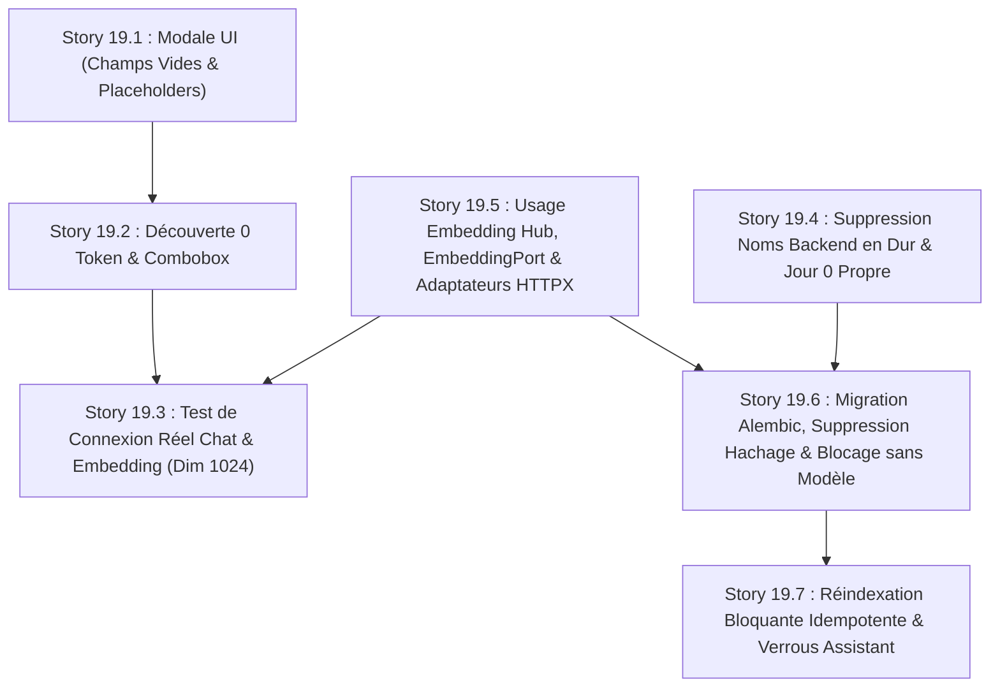

# Rapport Tech Lead & Architecture — Epic 19 : Hub Modèles IA Fiable, Découverte 0 Token, Test Réel & Embeddings Sémantiques

- **Date** : 2026-11-15
- **Story / Clé Sprint** : `epic-19` (`2026-11-15-epic-19-hub-modeles-ia-et-embeddings-semantiques`)
- **Capacité(s)** : `CAP-052`, `CAP-053`, `CAP-011`, `CAP-070`, `CAP-071`, `CAP-190` (création) — classification : `doc`
- **Auteur / Contexte** : Winston (System Architect — BMAD) / Planification & Architecture pour l'Epic 19 sur la branche `feat/epic-19-hub-modeles-ia-et-embeddings-semantiques`.
- **Commits associés** : `cadrage-planification` (géré par le coordinateur)

---

## 1. Analyse du Besoin & Étude d'Impact Tech Lead (Pré-Implémentation)

### 1.1 Contexte & Problématique

L'audit approfondi du codebase ORCIA a mis en évidence plusieurs dettes techniques et anomalies structurelles touchant le Hub des Modèles IA (`/settings/ai-models`), le test de connectivité des fournisseurs, et le sous-système de recherche vectorielle / RAG :
1. **Identifiants de modèles codés en dur & obsolètes (UI & Backend)** :
   - Dans `apps/web` (`settingsAiModelsPresets.ts`, `AiModelConfigModal.tsx`, `AiModelFormFields.tsx`, `platformSetupStore.tsx`), des identifiants arbitraires (`samplePrimaryModel: "gemini-argon"` qui n'existe pas, `claude-3-7-sonnet`, `gpt-4o`) sont pré-remplis dans les champs et proposés via des puces cliquables pré-configurées.
   - Côté backend, `orcia_core/orchestration/cognitive_router.py:L133-177` (`build_default_tier_mappings`) instancie des modèles par défaut en dur, `orcia_core/bootstrap/workflow_bootstrap_seeds.py:L80-96` (`DEFAULT_LLM_MODEL_ENDPOINT_SEEDS`) injecte des endpoints fictifs au Jour 0, et `apps/api` contient des références à des modèles par défaut (`model_name="gemini-argon"`).
2. **Test de connexion simulé avec latence factice (Violation Règle 4 GEMINI.md)** :
   - `apps/api/src/orcia_api/routers/_ai_models_helpers.py:L69-104` délègue à `evaluate_welcome_llm_connection_test` (`assistant_llm_gemini_adapter.py:L158-238`), qui effectue une validation purement syntaxique hors-ligne et retourne une latence artificielle codée en dur (`18 ms` pour localhost, `42 ms` pour les URLs distantes). Aucun appel réseau sortant réel n'est effectué vers le fournisseur pour valider la clé d'API et l'existence du modèle.
3. **Absence de découverte dynamique des modèles** :
   - L'administrateur doit deviner ou copier-coller manuellement les noms de modèles sans aucune assistance ni interrogation dynamique de l'API du fournisseur à coût token nul.
4. **Vecteurs d'embeddings non sémantiques (Hachage SHA-256 artificiel)** :
   - Le système RAG actuel (`packages/orcia-core/src/orcia_core/rag/vector_and_ast.py:L19-36`, `compute_deterministic_halfvec_1024`) calcule des vecteurs `halfvec(1024)` par découpage SHA-256 pseudo-aléatoire. Ce calcul n'a aucune valeur sémantique.
   - Les documents ingérés dans `kb_chunks.embedding` (migration `0008`) et les requêtes RAG (`ontology_and_rag.py:L221`, `two_speed_search.py:L264`) utilisent ce pseudo-vecteur, faussant la recherche par similarité cosinus (`<=>`) et le RRF.
   - Il n'existe aucun port d'embedding (`EmbeddingPort`), aucun adaptateur fournisseur pour les embeddings réels, et aucune gestion du cycle de vie lors d'un changement de modèle (incompatibilité entre espaces vectoriels).

**Principe directeur validé (Romain, 2026-11-15)** :
Ne PAS refondre les mécanismes fonctionnels en place (conserver `LlmProtocolMode`, les schémas existants, `httpx` sans aucun SDK vendeur tiers, dimension imposée 1024). Changer uniquement ce qui est nécessaire pour rendre le Hub fiable, souverain et adossé à de véritables modèles sémantiques.

---

### 1.2 Exploration, Analyse d'Impact GitNexus & Cartographie des Risques RAG (D12)

#### Analyse d'Impact GitNexus (`direction: "upstream"`, `repo: "ORCIA"`)

| Symbole Analysé | Type & Fichier | Appelants Directs (d=1) | Risque GitNexus | Synthèse d'Impact & Conduite de Changement |
| :--- | :--- | :---: | :---: | :--- |
| **`compute_deterministic_halfvec_1024`** | `Function` `orcia_core/rag/vector_and_ast.py` | **7 directs** (13 totaux, 3 processus) | **HIGH** | Appelé par `chunk_ast_symbol`, `search_hybrid_rrf`, `index_confluence_parent_child`, `index_db_ddl_schema_only`, `index_git_ast_and_code_graph`, `index_jira_reference_issue`, `TwoSpeedFederatedSearchService.execute_search`, et les routeurs `ontology_and_rag.py` / `portal_and_help.py`. **À supprimer intégralement du code de production (D10)** et à remplacer par `EmbeddingPort` (production) ou fake déterministe sous `tests/unit/fakes/` (CI). |
| **`DifferentiatedIncrementalIndexer`** | `Class` `orcia_core/rag/indexer_and_rrf.py` | 4 directs (9 totaux) | LOW | Utilisé par `rag_seeds.py`, `hybrid_rag_service.py`, `two_speed_search.py`, `docling_indexer.py`. Doit recevoir `EmbeddingPort` pour vectoriser les chunks réels et refuser l'ingestion sans modèle configuré (D7). |
| **`HybridRagService` (repli cosine)** | `Class` `orcia_core/rag/hybrid_rag_service.py` | 2 directs (5 totaux) | LOW | Gère le RRF mémoire et le tri cosine fallback. Doit abandonner l'appel à `compute_deterministic_halfvec_1024` et consommer l'`EmbeddingPort` injecté. |
| **`TwoSpeedFederatedSearchService`** | `Class` `orcia_core/rag/two_speed_search.py` | 1 direct (1 total) | LOW | Utilisé par `portal_and_help.py` (`GET /api/v1/search`). Pendant la réindexation bloquante, la recherche RAG est totalement bloquée avec HTTP 503 RFC 9457 `ERR_RAG_REINDEX_IN_PROGRESS` (aucun mode dégradé lexical Vitesse 1 toléré ; indisponibilité assumée signalée explicitement). En l'absence de modèle actif, renvoie `ERR_NO_ACTIVE_EMBEDDING_MODEL`. |
| **`build_default_tier_mappings`** | `Function` `orcia_core/orchestration/cognitive_router.py` | 1 direct | LOW | Appelé par `CognitiveModelRouterService.__init__`. Doit retourner un tuple vide `()` tant qu'aucun modèle n'a été configuré par l'administrateur (D4). |
| **`DEFAULT_LLM_MODEL_ENDPOINT_SEEDS`** | `Const` `orcia_core/bootstrap/workflow_bootstrap_seeds.py` | 0 direct (propriété module) | UNKNOWN | Doit être purgé (`()`) pour garantir qu'aucun endpoint fictif n'est seedé au Jour 0 (D4). |
| **`evaluate_welcome_llm_connection_test`** | `Function` `orcia_api/routers/assistant_llm_gemini_adapter.py` | 2 directs (3 totaux) | LOW | Appelé par `execute_model_connection_test` et `bootstrap_accostage.py`. Validation simulée avec latence 18/42 ms à supprimer complètement (D3). Remplacé par de véritables requêtes réseau via `app.state.http_client`. |
| **`execute_model_connection_test`** | `Function` `orcia_api/routers/_ai_models_helpers.py` | 1 direct | LOW | Appelé par `ai_models_hub.py:test_ai_model_connection`. Doit orchestrer le test chat (`max_tokens=1`) ou le test embedding (1 appel dim 1024) avec mesure du temps réseau réel en millisecondes. |
| **`AI_PROVIDER_PRESETS`** | `Const` `apps/web/src/routes/settingsAiModelsPresets.ts` | Composants UI | UNKNOWN | Consommé par `AiModelConfigModal.tsx`, `AiModelFormFields.tsx`, `platformSetupStore.tsx`. Puces supprimées, champs vidés par défaut, placeholders informatifs par fournisseur (D1). |

---

#### Cartographie Exhaustive des Consommateurs du RAG & Matrice des Risques (D12)

| Fonctionnalité Consommatrice | Surface & Points d'Entrée | Comportement Actuel | Impact & Risque Epic 19 | Stratégie d'Atténuation & Garde-Fou |
| :--- | :--- | :--- | :---: | :--- |
| **Mon Assistant (`/assistant`)** | `POST /api/v1/assistant/three-speed/turn` SSE `/turn-stream` `assistant_workspace.py` `assistant_llm_bridge.py` | Effectue une recherche documentaire et cite des sources `[S1]`, `[G1]`, `[O1]`. Vectorisation fictive de la requête. | **CRITIQUE** Hallucination ou crash si embeddings absents ou en réindexation. | **D7 & D9** : Mon Assistant est **totalement bloqué** tant qu'aucun modèle d'embedding n'est configuré (bannière explicite + lien vers `/settings/ai-models` + zone de saisie et bouton d'envoi désactivés, au Jour 0 et après suppression). Mon Assistant est **totalement bloqué** pendant la réindexation avec affichage du % d'avancement et saisie désactivée. Erreurs RFC 9457 harmonisées `ERR_NO_ACTIVE_EMBEDDING_MODEL` et `HTTP 503 ERR_RAG_REINDEX_IN_PROGRESS`. |
| **Recherche RAG Directe** | `POST /api/v1/ontology-rag/rag/search` `ontology_and_rag.py:L204-261` | Vectorise la requête via `compute_deterministic_halfvec_1024` et interroge `kb_chunks`. | **ÉLEVÉ** Requêtes incohérentes si espaces vectoriels mixtes. | Rejet immédiat avec l'erreur harmonisée `HTTP 422 ERR_NO_ACTIVE_EMBEDDING_MODEL` si aucun modèle d'embedding actif n'est configuré ; rejet immédiat en `HTTP 503 ERR_RAG_REINDEX_IN_PROGRESS` (avec progression %) pendant toute la réindexation, sans aucun repli dégradé lexical (indisponibilité assumée, signalée explicitement). Vectorisation réelle via `EmbeddingPort` en régime nominal. |
| **Recherche Fédérée `⌘K` (2 Vitesses)** | `GET /api/v1/search` `TwoSpeedFederatedSearchService` `portal_and_help.py` | V1 lexicale (tsvector) + V2 sémantique (halfvec 1024 SHA-256 + cosine). | **MOYEN** Risque d'incohérence vectorielle ou d'appels orphelins. | Pendant la réindexation, toute recherche sémantique RAG est bloquée avec HTTP 503 `ERR_RAG_REINDEX_IN_PROGRESS` avec % sans mode dégradé lexical V1 (indisponibilité assumée). En l'absence de modèle d'embedding actif, l'endpoint retourne formellement `ERR_NO_ACTIVE_EMBEDDING_MODEL`. |
| **Ingestion Documentaire & Chunks** | `DifferentiatedIncrementalIndexer` `worker-indexing` (`docling_indexer.py`) `POST /api/v1/ontology-rag/rag/index-db-ddl` | Génère des chunks Confluence, Jira, Markdown, PDF, DDL avec hash SHA-256. | **CRITIQUE** Corruption de l'index si ingestion sans modèle. | **D7 & D9** : Blocage total de l'ingestion documentaire en l'absence de modèle d'embedding actif : ni chunks vectoriels ni index lexical BM25 ne sont insérés dans PostgreSQL, et la source passe au statut `AWAITING_EMBEDDING_MODEL` (`ERR_NO_ACTIVE_EMBEDDING_MODEL`). Pendant la réindexation (D9), les nouvelles synchronisations et ingestions sont automatiquement suspendues et mises en file d'attente (`rag_reindexing_pending_ingestions`). |
| **Sources d'Espace & Moteur de Fraîcheur (Epic 18)** | `/workspaces/$wsId/sources` `workspace_datasources.py` `source_freshness_reconciler.py` | Déclenche des synchronisations `DatasourceSyncRequested` via l'Outbox. | **ÉLEVÉ** Boucles d'erreurs en worker si modèle absent. | Le réconciliateur vérifie la présence d'un modèle d'embedding actif avant d'émettre des événements de synchronisation pour les sources `DOCUMENT_KB` / `WORK_TRACKER`. |
| **Code Graph / GitNexus (Epic 18)** | `SOURCE_CODE` `codegraph_indexer.py` `codegraph-mcp` | Indexation AST déterministe et graphe GitNexus sans embeddings. | **CONTRÔLÉ (HORS PÉRIMÈTRE, D11)** | Le Code Graph n'est PAS bloqué. Ses chunks ont `embedding = NULL`, sont exclus de la branche vectorielle (`WHERE embedding IS NOT NULL`) et continuent de fonctionner pour l'exploration AST/CPG. |
| **Wizard Jour 0 & Amorçage** | `/bootstrap` `bootstrap_accostage.py` `durable_wizards.py` | Teste la réciprocité RAG avec simulation et seeds fictifs. | **ÉLEVÉ** Échec de boot si les vérifications s'attendent à des seeds. | Remplacement des seeds fictifs par une saisie réelle d'un modèle chat + un modèle embedding (D4), vérifiés par test réel (D3), avec validation après `pnpm db:reset`. |
| **Suites de Tests E2E & Unitaires Existantes** | `test_hybrid_rag_and_tripartite.py` `02-assistant-streaming-and-folders.spec.ts` | Supposent un RAG opérationnel avec hachage SHA-256 sans modèle. | **ÉLEVÉ** Casse des tests en CI lors du retrait de la fonction SHA-256. | Injection d'un `FakeDeterministicEmbeddingAdapter` sous `tests/unit/fakes/` (vecteurs déterministes enregistrés, `0 $` LLM) respectant strictement AD-17. |

---

### 1.3 Opportunités de Factorisation & Contrôle de Volumétrie

1. **Extraction de `EmbeddingPort` dans `packages/orcia-core/src/orcia_core/ports/embedding.py`** :
   - Interface pure `Protocol` : `async def embed_texts(self, texts: Sequence[str]) -> tuple[tuple[float, ...], ...]`, `async def embed_query(self, text: str) -> tuple[float, ...]`, `property dimension -> int (1024)`.
   - Zéro SDK vendeur tiers : utilisation exclusive de `httpx.AsyncClient` partagé (`app.state.http_client`).
2. **Adaptateurs Protocolaires Unifiés (`orcia_core/rag/adapters/`)** :
   - `OpenAiCompatibleEmbeddingAdapter` : gère OpenAI, Mistral, Ollama, vLLM, Text Embeddings Inference (TEI) sur `/v1/embeddings` avec payload standard `{"input": [...], "model": "..."}` et paramètre optionnel `"dimensions": 1024` lorsque supporté. Pour Ollama, privilégie `/v1/embeddings` ou `/api/embed` (l'ancien `/api/embeddings` déprécié étant formellement banni).
   - `GeminiNativeEmbeddingAdapter` : gère Google Gemini sur `:batchEmbedContents` avec payload `{"requests": [{"model": "...", "content": {"parts": [{"text": "..."}]}, "outputDimensionality": 1024}]}`.
   - Fournisseur Anthropic exclu : ne proposant pas d'API d'embeddings native, Anthropic n'est formellement pas proposé pour l'usage embedding.
3. **Contrôle de Volumétrie des Fichiers** :
   - `AiModelFormFields.tsx` (317 lignes) : la suppression des puces et des presets le ramènera sous 250 lignes.
   - `assistant_llm_gemini_adapter.py` : retrait de la simulation hors-ligne (`evaluate_welcome_llm_connection_test`) pour alléger le fichier.
   - Création de modules ciblés de moins de 300 lignes : `embedding_ports.py`, `embedding_adapters.py`, `ai_models_discovery.py`, `rag_reindexing_job.py`.

---

## 2. Plan d'Implémentation & Architecture

### 2.1 Schéma de Données & Migrations Alembic (`infra/migrations/versions/`)

- **Migration Alembic** : `infra/migrations/versions/20261115_2100_epic_19_embedding_model_id_and_reindex_state.py` (ou numérotation séquentielle horodatée).
  - Patron **Expand $\rightarrow$ Backfill SQL $\rightarrow$ Contract** :
    1. Ajout de la colonne `embedding_model_id` (`UUID`, nullable, foreign key vers `workspace_llm_tier_mappings.id` ON DELETE SET NULL) sur `kb_chunks`.
    2. Ajout de la colonne `usage` (`VARCHAR(32)`, défaut `'chat'`, valeurs `'chat'` ou `'embedding'`) sur `workspace_llm_tier_mappings`.
    3. Ajout de la table `rag_reindexing_jobs` (`id UUIDv7 PK`, `target_model_id UUID FK`, `status VARCHAR(32)` `IN_PROGRESS | COMPLETED | FAILED`, `total_chunks INT`, `processed_chunks INT`, `started_at TIMESTAMPTZ`, `completed_at TIMESTAMPTZ`, `error_message TEXT`).
    4. **Backfill SQL brut** : mise à `NULL` de tous les vecteurs `kb_chunks.embedding` existants (qui provenaient du hachage SHA-256 non sémantique) pour forcer le statut « en attente de réindexation sémantique ». Les chunks de code graph (Epic 18) conservent leur statut sans embedding.
  - Test unitaire systématique de réversibilité `upgrade()` et `downgrade()` dans `tests/unit/test_migration_epic_19.py`.

### 2.2 Noyau Métier Hexagonal, Orchestration & Workers (`packages/orcia-core/`, `apps/worker/`)

1. **Port d'Embedding (`packages/orcia-core/src/orcia_core/ports/embedding.py`)** :
   - Définition du contrat `EmbeddingPort(Protocol)`.
   - Modèles de données immuables : `EmbeddingResult`, `EmbeddingModelMetadata`.
2. **Adaptateurs HTTPX purs (`packages/orcia-core/src/orcia_core/rag/adapters/`)** :
   - `HttpOpenAiEmbeddingAdapter` (`/v1/embeddings`, Bearer token, header ou paramètre `dimensions: 1024` quand supporté ; gère aussi Ollama via `/v1/embeddings` ou `/api/embed`).
   - `HttpGeminiEmbeddingAdapter` (`:batchEmbedContents`, API key en paramètre ou header, `outputDimensionality: 1024`).
   - Fournisseur Anthropic exclu de l'usage embedding.
   - Rejet immédiat de toute réponse dont la dimension vectorielle est différente de 1024 (`ERR_EMBEDDING_DIMENSION_MISMATCH`).
3. **Suppression définitive du hachage SHA-256** :
   - Retrait de `compute_deterministic_halfvec_1024` dans `vector_and_ast.py`.
   - Mise à jour de `DifferentiatedIncrementalIndexer` et `HybridRagService` pour consommer `EmbeddingPort`.
4. **Job Dramatiq de Réindexation Bloquante (`apps/worker/src/orcia_worker/actors/rag_reindexer.py`)** :
   - Acteur `reindex_workspace_rag_corpus(target_model_id: str)` : idempotent, batched par lots de 50 chunks, persistant l'avancement dans `rag_reindexing_jobs`.
   - Mécanisme de reprise sur échec avec backoff.

### 2.3 Couche Backend API, Sécurité & Contrats (`apps/api/`, `packages/api-client/`)

1. **Découverte dynamique des modèles 0 token (`GET /api/v1/settings/ai-models/discover`)** :
   - Paramètres : `endpoint_uri`, `provider_slug`, `api_key` (ou référence de secret), `auth_mode`.
   - Appelle `GET /v1/models` (OpenAI, Mistral, vLLM, TEI), `GET /api/tags` (Ollama) ou `GET /v1beta/models` (Gemini avec filtre `supportedGenerationMethods`).
   - Renvoie une liste d'identifiants de modèles classés par type (chat vs embedding) sans jamais renvoyer de clé d'API.
   - Garde anti-SSRF `is_safe_llm_endpoint_url` stricte.
2. **Test de connexion réel (`POST /api/v1/settings/ai-models/mappings/{id}/test` et `POST /api/v1/settings/ai-models/test-direct`)** :
   - Mode `chat` : envoi d'une complétion ultra-courte (`max_tokens=1`, prompt `"ping"`). Valide l'authenticité de la clé et l'existence du modèle.
   - Mode `embedding` : envoi d'une requête d'embedding sur un texte court (`"test"`), vérification que `len(embedding) == 1024`.
   - Mesure du temps d'aller-retour réseau réel (`time.perf_counter()`).
   - Traduction déclarative des erreurs HTTP 401/403/404/429 du fournisseur en enveloppes RFC 9457 localisées.
3. **Garde-fous d'état RAG** :
   - Middleware ou dépendance `verify_rag_readiness` : lève `HTTP 422 ERR_NO_ACTIVE_EMBEDDING_MODEL` si aucun modèle d'embedding n'est configuré (y compris au Jour 0 après `pnpm db:reset`) ; lève `HTTP 503 ERR_RAG_REINDEX_IN_PROGRESS` avec progression `%` si un recalcul est en cours (sans aucun mode dégradé lexical).
4. **Suppression des valeurs en dur** :
   - `build_default_tier_mappings` vidé par défaut.
   - `DEFAULT_LLM_MODEL_ENDPOINT_SEEDS` vidé par défaut.
   - `model_name` requis sans valeur par défaut magique.

### 2.4 Interface Utilisateur & Expérience (`apps/web/`, `packages/ui/`)

1. **Modale de Configuration (`AiModelConfigModal.tsx` & `AiModelFormFields.tsx`)** :
   - Champs `primaryModel` et `fallbackModel` initialisés à chaîne vide `""`.
   - Placeholders contextuels selon le fournisseur :
     - Mistral : `ex. : mistral-large-latest` / `ex. : mistral-embed`
     - Ollama / vLLM : `ex. : llama3.2` / `ex. : bge-m3`
     - OpenAI / Gemini / Anthropic : `Identifiant exact publié par le fournisseur`
   - Puces rapides supprimées.
   - Bouton de rafraîchissement / combobox de découverte dynamique 0 token : liste déroulante filtrable des modèles retournés par l'API du fournisseur, avec possibilité permanente de saisie manuelle libre.
   - Sélecteur de type d'usage : `Usage : Chat & Raisonnement` ou `Usage : Embeddings Sémantiques (RAG)`.
2. **Table Maîtresse des Modèles (`AiModelsMasterTable.tsx`)** :
   - Colonne « Usage » (`Chat` vs `Embedding 1024-dim`).
   - Badge d'avertissement si aucun modèle d'embedding n'est actif sur la plateforme.
3. **Mon Assistant (`InboxFeaturePanel.tsx` / `AssistantSpeedSelectorAndStreamView.tsx`)** :
   - Si aucun modèle d'embedding actif configuré : Mon Assistant est **totalement bloqué** (bannière persistante avec lien direct vers `/settings/ai-models` + désactivation matérielle de la zone de saisie et du bouton d'envoi de prompt). Le parcours d'onboarding Jour 0 guide également l'administrateur vers cette configuration.
   - Si réindexation en cours : Mon Assistant est **totalement bloqué** (bannière avec barre de progression et pourcentage dynamique + désactivation matérielle de la saisie et de l'envoi de prompt jusqu'à achèvement du recalcul).

---

### 2.5 Découpage des 7 User Stories de l'Epic 19 & Matrice des Dépendances

Afin de minimiser tout conflit et de permettre un développement incrémental sans régression :
- **Story 19.1** : Indépendante, purement frontend (champs vides, placeholders, suppression des puces en dur).
- **Story 19.2** : Découverte 0 token côté API et combobox côté UI (dépend de 19.1).
- **Story 19.5** : Définition de l'attribut `usage`, du port `EmbeddingPort` et des adaptateurs HTTPX (requis pour le test embedding et la migration).
- **Story 19.3** : Test de connectivité réel chat (`max_tokens=1`) et embedding (dim 1024) (dépend de 19.5 pour la branche embedding).
- **Story 19.4** : Suppression des noms de modèles en dur backend + tier mappings vides + Jour 0 (indépendante ou après 19.3).
- **Story 19.6** : Migration Alembic, suppression complète du hachage SHA-256 en prod, blocages sans modèle D7/D10/D11 (dépend de 19.5).
- **Story 19.7** : Réindexation bloquante complète, progression persistée et verrous Assistant/recherche (dépend de 19.6).

---

## 3. Bilan des Modifications & Résultats (Post-Planification)

### 3.1 Fichiers Modifiés & Créés pour le Cadrage de l'Epic 19

| Fichier | Nature | Description Synthétique |
| :--- | :---: | :--- |
| `docs/implementation-artifacts/tech-lead-reports/2026-11-15-epic-19-hub-modeles-ia-et-embeddings-semantiques-tech-lead-report.md` | Création | Rapport Tech Lead pérenne d'architecture et d'analyse d'impact (le présent document). |
| `docs/planning-artifacts/architecture/architecture-ORCIA-2026-10-24/ARCHITECTURE-SPINE.md` | Modification | Ajout de la décision d'architecture **AD-24** (Hub fiable, découverte 0 token, test réel, `EmbeddingPort`, suppression hachage, réindexation) ; amendement de **AD-8** (embeddings réels) et **AD-16** (invariants Jour 0 réels). |
| `docs/planning-artifacts/architecture/architecture-ORCIA-2026-10-24/architecture.md` | Modification | Mise à jour de la § 3.4.2 (RAG & embeddings) et § 3.6 / § 2 (passerelle modèles et Hub) référençant formellement AD-24. |
| `docs/planning-artifacts/epics.md` | Modification | Ajout de la section `## Epic 19` détaillant les 7 User Stories (19.1 à 19.7) avec critères d'acceptation 5 couches AD-17 et mise à jour de la FR Coverage Map. |
| `docs/implementation-artifacts/sprint-status.yaml` | Modification | Déclaration de `epic-19: backlog` et des clés `19-1` à `19-7` au statut `backlog`. |
| `docs/product/capabilities.yaml` | Modification | Ajout de la capacité **`CAP-190`** (`status: planned`, `origin: epic`, `origin_ref: epic-19`). |
| `docs/implementation-artifacts/tech-lead-reports/README.md` | Modification | Enregistrement de l'entrée du rapport dans l'index officiel. |
| `apps/web/src/generated/orciaSiteManifest.ts` | Synchronisation | Manifeste synchronisé reflétant AD-24 et le nouveau rapport Tech Lead. |
| `docs/site-catalog/index.html` & `dist/orcia-site/index.html` | Synchronisation | Site statique autonome synchronisé. |

---

### 3.2 Résultats des Garde-Fous de Planification

- **Vérification de la décision d'architecture (`lint_spine.py`)** :
  - AD-24 inséré avec respect absolu des champs obligatoires `binds`, `prevents`, `rule`.
  - Monotonicité parfaite des identifiants (`AD-1` à `AD-24`).
  - Zéro placeholder (`TODO`, `TBD`, `FIXME`, `{token}`).
  - Résultat mécanique : `{"total_findings": 0, "findings": []}`.
- **Vérification du registre des capacités (`capabilities_registry.py` / `site:check`)** :
  - `CAP-190` déclaré avec champs requis complets (`id`, `title`, `origin: epic`, `origin_ref`, `status: planned`).
  - Couverture des routes et routeurs 100 % maintenue (`0` erreur).
- **Contrôle de conformité de branche Git** :
  - Branche active vérifiée : `feat/epic-19-hub-modeles-ia-et-embeddings-semantiques` (aucune bascule sur main).
  - Zéro commit sauvage réalisé par le subagent architecte.
