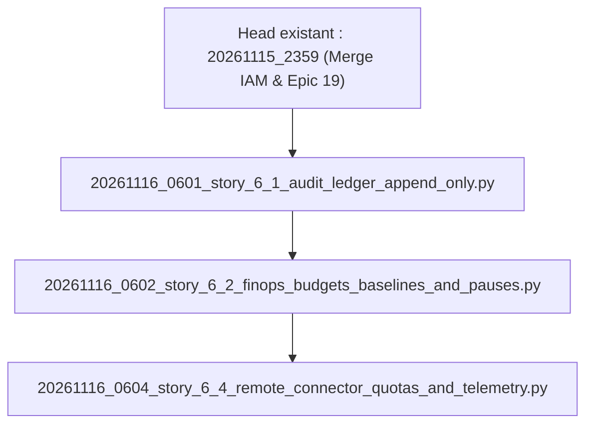
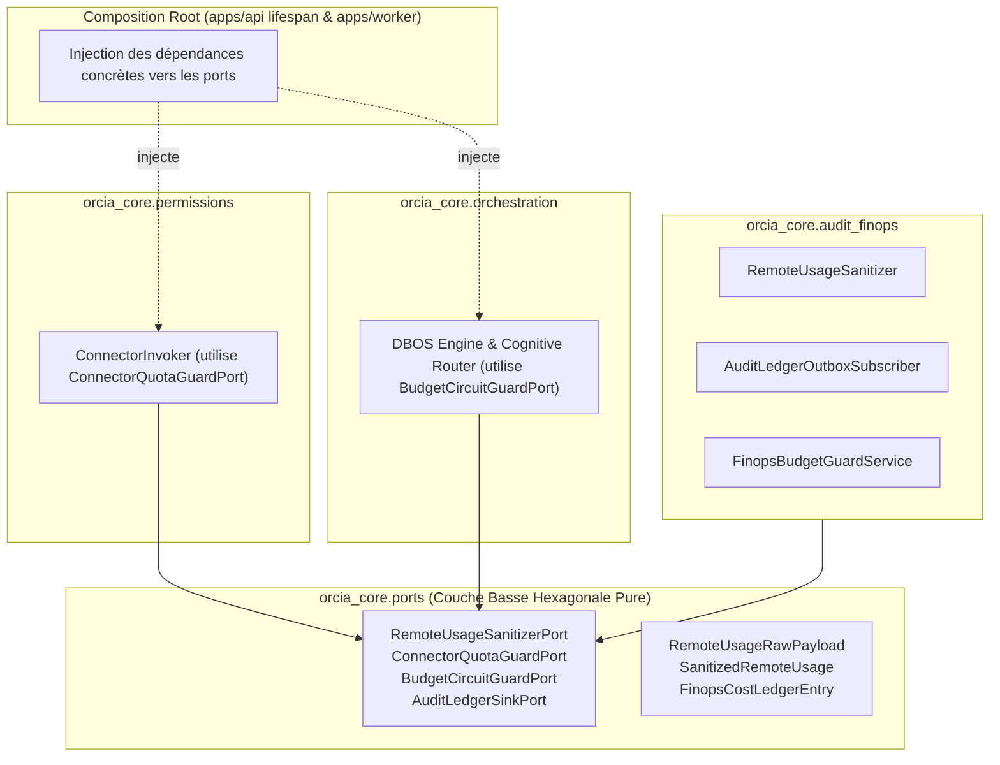

# 2026-11-16 — Analyse Préalable d'Architecture et d'UX de l'Epic 6 (Winston 🏗️ & Sally 🎨)

- **Date** : 2026-11-16
- **Story / Clé Sprint** : `2026-11-16-epic-6-analyse-architecture-et-ux-winston-sally` (Epic 6 / Analyse Préalable Transverse Phase 1)
- **Capacité(s)** : `CAP-065` (mise à jour source registre immuable), `CAP-200` (spécification complète socle) — classification : `doc` (voir `AGENTS.md` §5 et `capabilities.yaml`)
- **Auteur / Contexte** : Winston (`bmad-agent-architect` 🏗️, System Architect) & Sally (`bmad-agent-ux-designer` 🎨, UX Designer). Mission conjointe d'analyse approfondie d'architecture système et de design d'expérience utilisateur pour l'Epic 6 (*Gouvernance Exécutive, Provenance Auditable Immuable, FinOps Consolidé & Réversibilité Humaine*), avant toute rédaction de spécification de Story (`spec-6-*.md`). Couvre `FR-25`, `FR-26`, `FR-27`, `AD-12`, `AD-17`, `AD-19`, `AD-20`, `AD-21`, `AD-23`, `NFR-SEC-3`, `NFR-SEC-4`, `UX-DR1` à `UX-DR16` et les Principes Direction C (`Principe M`, `CAP-ACT-3`).
- **Commits associés** : Branched on `feat/epic-6-audit-ledger-finops-and-human-reversibility` (base `HEAD` = `20261115_2359`)

---

## 1. Analyse du Besoin & Étude d'Impact Tech Lead (Pré-Implémentation)

### 1.1 Contexte & Problématique

L'Epic 6 constitue la clé de voûte de la gouvernance d'entreprise au sein d'ORCIA. Elle doit permettre aux Directeurs de BU, Responsables Produit, Ingénieurs SecOps et Auditeurs Internes (`Claire UJ-8`, `Sophie UJ-6`, `Karim UJ-9`, `Marc UJ-5`) :
1. De piloter l'équation économique consolidée de leurs processus d'ingénierie et d'affaires (*Coût de Setup + Coût de Run interne vérifié + Coût externe déclaré MCP/A2A vs gain de TTM*) dans l'écran **📊 FinOps** ;
2. De protéger l'organisation contre toute dérive budgétaire ou boucle infinie d'agents via des coupe-circuits déterministes hiérarchiques (`PAUSED_BUDGET_EXCEEDED`, `PAUSED_MAX_RETRIES`) et des coupe-circuits isolés par connecteur distant (`CIRCUIT_OPEN`, `AD-12`, `Principe M.3`) ;
3. De garantir l'intégrité de la télémétrie externe via un validateur d'infrastructure non fiable (**`RemoteUsageSanitizer`**) bornant les montants déclarés (`max_reported_cost_per_call_eur`) et interdisant les valeurs négatives, `NaN` ou infinies ;
4. D'inspecter et d'exporter la **Provenance Auditable** immuable de chaque étape, Gate et test de connectivité à chaud (`audit_ledger` append-only, `actor_type: ADMIN_CONNECTION_TEST`, `AD-12`, `AD-19`, `NFR-SEC-3`) ;
5. De suivre les 3 contre-métriques de gouvernance cognitive (*Ratio Cadrage Actif $\ge 40\%$*, *Taux de Validation Expéditive / Rubber-Stamping $< 5\%$*, *Indice de Pattern Drift / Réversibilité Humaine $0\%$*) avec des recommandations actionnables d'ajustement des Gates.

#### État des Lieux et Réconciliation Technique (`CAP-ACT-3`)
L'audit du codebase réalisé le 2026-11-08 et complété ce 2026-11-16 révèle une situation d'accostage asymétrique :
- **Absence de registre immuable** : Aucune migration Alembic ne crée actuellement `audit_ledger`. Le sous-domaine `packages/orcia-core/src/orcia_core/audit_finops/` ne contient que `__init__.py` et `errors.py`.
- **Coquille vide sur `/finops`** : La route `apps/web/src/routes/finops.tsx` monte actuellement un `ModuleWorkspaceView` générique avec des cartes éphémères de démonstration (`orcia.finops.overview.v1`), sans persistance SQL ni câblage API vertical.
- **Dette sur le Journal d'activité (`/activity`, `CAP-065`)** : Livré de manière ad-hoc le 2026-11-05, le composant `ActivityLogExplorerView` lit les événements depuis `platformSetupStore.auditEvents` (issu du snapshot d'accostage `bootstrap_accostage.py`), sans s'appuyer sur un registre append-only PostgreSQL.
- **Réconciliation `CAP-ACT-3` actée** :
  - La Story 6.1 remplacera proprement la source de données de `/activity` par `GET /api/v1/audit/ledger`, en réutilisant l'intégralité du composant `@orcia/ui` `ActivityLogExplorerView` et en lui adjoignant l'inspection et l'export JSON/Markdown de la provenance par `run_id`.
  - La route `/finops` (`CAP-200`) sera intégralement développée selon le standard Direction C (`FinopsGovernanceDashboardView`).

---

### 1.2 Exploration, Analyse d'Impact GitNexus, Factorisation & Dette Technique

#### Analyse d'Impact GitNexus (`repo: "/home/romain/Documents/Projects/ORCIA"`)
Sept symboles cruciaux du socle ont été scannés en profondeur via GitNexus (`impact({direction: "upstream"})`, `context` et `query`) :

| Symbole cible | Type & Emplacement | Impacted Count | Risque | Appelants directs ($d=1$) & Processus impactés |
| :--- | :--- | :--- | :--- | :--- |
| **`OutboxEventBus`** | `Class` (`apps/worker/src/orcia_worker/outbox_relay.py`) | **1** | LOW | `apps/worker/src/orcia_worker/__init__.py`. Reçoit les 5 nouveaux types d'événements outbox (`AdminConnectionTested`, `BudgetCircuitTripped`, `BudgetOverrideApproved`, `RemoteUsageAnomalyCapped`, `ConnectorCircuitTripped`). |
| **`ConnectorInvoker`** | `Class` (`packages/orcia-core/src/orcia_core/permissions/connector_invoker.py`) | **9** | LOW | `litellm_adapter.py`, `orchestration/connector_invoker.py`, `step_executors.py`, `dbos_engine.py`, `assistant_agent.py`, `engine.py`. Doit intégrer `RemoteUsageSanitizerPort` et `ConnectorQuotaGuardPort` sans violation `import-linter`. |
| **`ActivityLogExplorerView`** | `Function` (`packages/ui/src/primitives/ActivityLogExplorerView.tsx`) | **3** | LOW | `apps/web/src/routes/activity.tsx:ActivityLogRouteView` $\rightarrow$ `router.tsx`. Préservation absolue de 100 % des `data-testid` existants lors du découpage volumétrique. |
| **`CognitiveModelRouterService`** | `Class` (`packages/orcia-core/src/orcia_core/orchestration/cognitive_router.py`) | **2** | LOW | `orchestration/__init__.py`, `studio_and_packs.py`. Appel du garde budgétaire hiérarchique avant chaque escalade ou tentative LLM. |
| **`AdaptiveHumanGateService`** | `Class` (`packages/orcia-core/src/orcia_core/gates/human.py`) | **11** | LOW | `gates/__init__.py`, `gates/deterministic.py`, `step_executors.py`, `engine.py`, `dbos_engine.py`. Fournit les métriques de revue (`review_duration_ms`, `fast_approval_warning`) exploitées par la Story 6.3. |
| **`ControlCenterOverviewService`** | `Class` (`packages/orcia-core/src/orcia_core/orchestration/control_center.py`) | **1** | LOW | `orchestration/__init__.py`. Agrégation des alertes budgétaires et coupe-circuits sur le Cockpit. |
| **`enforce_scope_mutation_guard`** | `Method` (`packages/orcia-core/src/orcia_core/permissions/evaluator.py`) | **29** (+ 8 bounds) | **CRITICAL** | `resolve_human_arbitration`, `assistant_save_and_launch_workflow`, routeurs API. **Doit impérativement garder 100 % des routes de mutation FinOps** (mise à jour budget, approbation override, suspension/réarmement de connecteur). |

#### Exploration & Volumétries Constatées
- **Base de données Jour 0** : Suite à `pnpm db:reset`, la table `audit_ledger` (inscrite dans `PROTECTED_TABLES` dans `09_reset_db_first_boot.py`) démarrera strictement vide (`0` ligne) avec son trigger PostgreSQL `BEFORE UPDATE OR DELETE RAISE EXCEPTION`.
- **Nombre de types d'événements Outbox** : La contrainte `CHECK` actuelle sur `domain_events_outbox.event_type` compte 14 types d'événements (mis à jour dans la migration `20261115_2307`). L'élargissement linéaire Story 6.1 portera ce total à **19 types d'événements** sans rupture d'historique.
- **Précision monétaire** : Conforme à `AD-12`, toutes les colonnes monétaires utilisent `NUMERIC(12, 6)` avec pivot USD en base et conversion dynamique à l'affichage en devise d'organisation (`EUR €` par défaut).

#### Plan de Découpage Volumétrique & Résorption de Dette Technique
Pour respecter le seuil strict de **`< 300–350` lignes par fichier** et anticiper les refactorings nécessaires avant implémentation :
1. **`packages/orcia-core/src/orcia_core/kernel/events.py` (626 lignes)** :
   - *Diagnostic* : Contient déjà 14 événements avec sérialiseurs verbeux. L'ajout des 5 événements FinOps/Audit ferait exploser le fichier à $> 750$ lignes.
   - *Action* : Extraire les événements d'audit et de télémétrie dans `packages/orcia-core/src/orcia_core/kernel/_finops_audit_events.py` et les réexporter dans `events.py`.
2. **`packages/ui/src/primitives/ActivityLogExplorerView.tsx` (525 lignes)** :
   - *Diagnostic* : Cumule la barre de filtrage, le tableau d'audit, la pagination et les badges de statut.
   - *Action* : Extraire `ActivityLogFiltersBar.tsx` (~160 lignes) et `ActivityLogProvenanceExportBar.tsx` (~120 lignes), réduisant la vue principale à ~250 lignes tout en conservant 100 % des `data-testid` existants.
3. **`packages/orcia-core/src/orcia_core/orchestration/cognitive_router.py` (511 lignes)** :
   - *Diagnostic* : Combine la résolution de modèle LiteLLM, l'escalade d'effort et la logique de vérification de budget.
   - *Action* : Extraire `_cognitive_budget_guard.py` (~150 lignes) pour isoler les contrôles de plafonds avant appel LLM.
4. **Discipline Hygiène `DEBT-ORCH-VOCAB-01` / `TEST-HYG-01`** :
   - Vérifier formellement l'absence totale de vocabulaire SDLC (`jira`, `confluence`, `git://`) et de fonctions de test simulées (`simulated_*`) dans `orcia_core/orchestration` et `orcia_core/kernel`.

---

## 2. Plan d'Implémentation

### 2.1 Schéma de Données & Migrations Alembic Linéaires

La chaîne de migrations s'accroche strictement sur le `head` actuel `20261115_2359` (`infra/migrations/versions/20261115_2359_merge_iam_multi_lead_and_epic_19_heads.py`) :



#### 1. Migration Story 6.1 : `20261116_0601_story_6_1_audit_ledger_append_only.py`
- **Revises** : `"20261115_2359"`
- **Table `audit_ledger` (Append-Only)** :
  - `id UUID PRIMARY KEY` (généré via `uuid-utils` UUIDv7).
  - `source_event_id UUID UNIQUE NOT NULL` (idempotence absolue Outbox).
  - `run_id UUID NULL REFERENCES workflow_runs(id) ON DELETE SET NULL` (nullable pour isoler `ADMIN_CONNECTION_TEST`, `SettingsChanged` ou `EmbeddingReindexStarted`).
  - `root_run_id UUID NULL REFERENCES workflow_runs(id) ON DELETE SET NULL`.
  - `step_execution_id UUID NULL REFERENCES step_executions(id) ON DELETE SET NULL`.
  - `actor_type VARCHAR(64) NOT NULL` (`USER`, `SERVICE_PRINCIPAL`, `ADMIN_CONNECTION_TEST`, `AGENT_A2A`, `MCP_CLIENT`).
  - `actor_id VARCHAR(128) NOT NULL`, `actor_display_name VARCHAR(256) NULL`, `actor_email VARCHAR(256) NULL`.
  - `event_type VARCHAR(64) NOT NULL` (`StepCompleted`, `GateEvaluated`, `AdminConnectionTested`, `ArtifactProduced`, `RunTerminated`, `SettingsChanged`).
  - `summary TEXT NOT NULL`.
  - `model_id VARCHAR(128) NULL`, `inference_tier VARCHAR(32) NULL`, `effort VARCHAR(32) NULL`.
  - `input_tokens INTEGER NOT NULL DEFAULT 0`, `output_tokens INTEGER NOT NULL DEFAULT 0`.
  - `cost_usd NUMERIC(12, 6) NOT NULL DEFAULT 0.000000`.
  - `cost_source VARCHAR(32) NOT NULL DEFAULT 'INTERNAL_VERIFIED'` (`INTERNAL_VERIFIED`, `EXTERNAL_REPORTED`, `ESTIMATED_SCALE`).
  - `native_metric_type VARCHAR(64) NULL` (`tokens`, `eur`, `usd`, `pages_ocr`, `api_calls`, `gpu_seconds`).
  - `native_metric_value NUMERIC(16, 6) NULL`, `native_currency VARCHAR(8) NULL`.
  - `reported_by_remote BOOLEAN NOT NULL DEFAULT FALSE`.
  - `latency_ms INTEGER NOT NULL DEFAULT 0`.
  - `trace_id VARCHAR(64) NOT NULL`.
  - `run_lock_sha256 VARCHAR(64) NULL`, `pre_prompt_sha256 VARCHAR(64) NULL`, `workflow_contract_sha256 VARCHAR(64) NULL`.
  - `cas_references_jsonb JSONB NOT NULL DEFAULT '[]'::jsonb`.
  - `metadata_jsonb JSONB NOT NULL DEFAULT '{}'::jsonb`.
  - `created_at TIMESTAMPTZ NOT NULL DEFAULT NOW()`.
- **Index B-Tree & Partiels** :
  - `idx_audit_ledger_run_id ON audit_ledger(run_id) WHERE run_id IS NOT NULL;`
  - `idx_audit_ledger_root_run_id ON audit_ledger(root_run_id) WHERE root_run_id IS NOT NULL;`
  - `idx_audit_ledger_actor ON audit_ledger(actor_type, actor_id);`
  - `idx_audit_ledger_created_at ON audit_ledger(created_at DESC);`
  - `idx_audit_ledger_trace_id ON audit_ledger(trace_id);`
- **Trigger d'Immuabilité Absolue (PostgreSQL 18)** :
  ```sql
  CREATE OR REPLACE FUNCTION fn_prevent_audit_ledger_mutation()
  RETURNS trigger AS $$
  BEGIN
      RAISE EXCEPTION 'ERR_AUDIT_LEDGER_IMMUTABLE: Updates and deletes are prohibited on audit_ledger.';
  END;
  $$ LANGUAGE plpgsql;

  CREATE TRIGGER prevent_audit_ledger_mutation
  BEFORE UPDATE OR DELETE ON audit_ledger
  FOR EACH ROW EXECUTE FUNCTION fn_prevent_audit_ledger_mutation();
  ```
- **Élargissement `domain_events_outbox_event_type_check`** :
  Conserve les 14 existants et ajoute `'AdminConnectionTested'`, `'BudgetCircuitTripped'`, `'BudgetOverrideApproved'`, `'RemoteUsageAnomalyCapped'`, `'ConnectorCircuitTripped'` (19 types au total).

#### 2. Migration Story 6.2 : `20261116_0602_story_6_2_finops_budgets_baselines_and_pauses.py`
- **Revises** : `"20261116_0601"`
- **Élargissement des statuts de Run et Step** :
  - `workflow_runs.status` : ajout de `'PAUSED_MAX_RETRIES'` (rappel : la colonne existante sur `workflow_runs` est `budget_max_usd`).
  - `step_executions.status` (`ck_step_executions_status`) : ajout de `'PAUSED_BUDGET_EXCEEDED'` et `'PAUSED_MAX_RETRIES'`.
- **Table `finops_scope_budgets`** :
  - `id UUID PRIMARY KEY`, `scope_type VARCHAR(32) NOT NULL CHECK (scope_type IN ('GLOBAL', 'BU', 'TEAM', 'WORKSPACE'))`, `scope_id UUID NULL`, `monthly_budget_usd NUMERIC(12, 6) NOT NULL`, `warning_threshold_pct INTEGER NOT NULL DEFAULT 80`, `hard_stop_pct INTEGER NOT NULL DEFAULT 100`, `created_at TIMESTAMPTZ NOT NULL DEFAULT NOW()`, `updated_at TIMESTAMPTZ NOT NULL DEFAULT NOW()`.
  - Contrainte `UNIQUE (scope_type, scope_id)`.
- **Table `finops_workflow_baselines`** :
  - `id UUID PRIMARY KEY`, `workflow_definition_id UUID NOT NULL REFERENCES workflow_definitions(id) ON DELETE CASCADE`, `scope_id UUID NULL REFERENCES workspaces(id) ON DELETE CASCADE`, `manual_time_minutes INTEGER NOT NULL`, `manual_cost_usd NUMERIC(12, 6) NOT NULL`, `target_ttm_reduction_pct INTEGER NOT NULL DEFAULT 25`, `created_at TIMESTAMPTZ NOT NULL DEFAULT NOW()`.
- **Table `finops_budget_overrides`** :
  - `id UUID PRIMARY KEY`, `run_id UUID NOT NULL REFERENCES workflow_runs(id) ON DELETE CASCADE`, `requested_by UUID NOT NULL REFERENCES users(id) ON DELETE CASCADE`, `approved_by UUID NOT NULL REFERENCES users(id) ON DELETE CASCADE`, `override_amount_usd NUMERIC(12, 6) NOT NULL`, `reason TEXT NOT NULL`, `created_at TIMESTAMPTZ NOT NULL DEFAULT NOW()`.

#### 3. Migration Story 6.4 : `20261116_0604_story_6_4_remote_connector_quotas_and_telemetry.py`
- **Revises** : `"20261116_0602"`
- **Table `finops_connector_quotas`** :
  - `id UUID PRIMARY KEY`, `connector_id UUID NOT NULL REFERENCES enterprise_connectors(id) ON DELETE CASCADE`, `scope_type VARCHAR(32) NOT NULL DEFAULT 'WORKSPACE'`, `scope_id UUID NULL`, `max_reported_cost_per_call_eur NUMERIC(12, 6) NOT NULL DEFAULT 5.000000`, `monthly_cost_ceiling_eur NUMERIC(12, 6) NOT NULL DEFAULT 50.000000`, `daily_calls_ceiling INTEGER NOT NULL DEFAULT 500`, `valuation_mode VARCHAR(32) NOT NULL DEFAULT 'NATIVE_TELEMETRY' CHECK (valuation_mode IN ('NATIVE_TELEMETRY', 'FIXED_SCALE', 'VOLUMETRIC_ONLY'))`, `fixed_cost_per_call_eur NUMERIC(12, 6) NOT NULL DEFAULT 0.000000`, `fixed_cost_per_unit_eur NUMERIC(12, 6) NOT NULL DEFAULT 0.000000`, `unit_name VARCHAR(64) NULL`, `circuit_state VARCHAR(32) NOT NULL DEFAULT 'CLOSED' CHECK (circuit_state IN ('CLOSED', 'OPEN', 'HALF_OPEN'))`, `consecutive_anomalies INTEGER NOT NULL DEFAULT 0`, `last_tripped_at TIMESTAMPTZ NULL`, `created_at TIMESTAMPTZ NOT NULL DEFAULT NOW()`, `updated_at TIMESTAMPTZ NOT NULL DEFAULT NOW()`.

#### 4. Maintenance & Reset Jour 0 (`09_reset_db_first_boot.py`)
- `audit_ledger` est **déjà inscrit** dans `PROTECTED_TABLES` (ligne 42).
- Mettre à jour `ORDERED_MUTABLE_TABLES_TO_CLEAR` en ajoutant **tout en haut** (avant `workflow_runs`, `workspaces`, `org_units`) :
  - `"finops_budget_overrides"`,
  - `"finops_workflow_baselines"`,
  - `"finops_scope_budgets"`,
  - `"finops_connector_quotas"`.

---

### 2.2 Noyau Métier Hexagonal, Orchestration & Workers

#### Frontières Strictes `import-linter` (`AD-19 Contract 2 & 3`)
- `audit_finops` réside dans la couche `blackboard | ontology | rag | gates | audit_finops | workflows`.
- **Règle absolue** : `audit_finops` ne doit **jamais** importer `orchestration`, `bootstrap`, `packs`, ni les domaines pairs (`gates`, `blackboard`).
- `permissions` (`ConnectorInvoker`) réside dans une couche inférieure à `audit_finops` et ne peut **jamais** importer `audit_finops`.
- **Solution d'Architecture Winston (🏗️)** : Création de `packages/orcia-core/src/orcia_core/ports/finops_telemetry.py` au sein du module socle `ports` (niveau 5, purement hexagonal, 0 dépendance framework) :
  - DTO immuables : `RemoteUsageRawPayload`, `SanitizedRemoteUsage`, `FinopsCostLedgerEntry`, `QuotaCheckResult`, `CircuitBreakerDecision`.
  - Protocoles purs : `RemoteUsageSanitizerPort`, `ConnectorQuotaGuardPort`, `BudgetCircuitGuardPort`, `AuditLedgerSinkPort`.



#### Agrégation SQL Directe Haute Performance
Toutes les requêtes de reporting FinOps, de calcul de TTM et d'audit de réversibilité s'exécutent en SQL pur asynchrone (`sa.text(...)`) dans `packages/orcia-core/src/orcia_core/audit_finops/_internal/sql_*.py` :
- `sql_audit_ledger.py` : insertion idempotente depuis l'Outbox (`ON CONFLICT (source_event_id) DO NOTHING`), recherche paginée multi-critères, export de provenance JSON/Markdown.
- `sql_finops_dashboard.py` : agrégation par Step, Tier cognitif, niveau d'effort, Run, Workflow et Équipe/BU (coûts internes vérifiés vs déclarés, tokens réels vs unités MCP).
- `sql_governance_reversibility.py` : calcul des 3 ratios (`Cadrage Actif`, `Rubber-Stamping`, `Pattern Drift`) sur fenêtres glissantes (`7j`, `30j`, `90j`).

---

### 2.3 Couche Backend API, Sécurité & Contrats

#### Endpoints FastAPI (`apps/api/src/orcia_api/routers/`)
- `routers/audit_ledger.py` :
  - `GET /api/v1/audit/ledger` : Journal d'audit paginé (remplace l'ancienne source de `/activity`).
  - `GET /api/v1/audit/ledger/{run_id}/export?format=json|md` : Export de conformité et de provenance attestant de l'alignement sur `run-lock.json`.
- `routers/finops_governance.py` :
  - `GET /api/v1/finops/overview` : 4 KPIs consolidés + état vide explicite à vide.
  - `GET /api/v1/finops/breakdown/processes` : Ventilation par processus, setup/run vs baseline TTM.
  - `GET /api/v1/finops/breakdown/models` : Ventilation par Tier cognitif et niveau d'effort.
  - `GET /api/v1/finops/breakdown/connectors` : Tableau détaillé des services MCP / agents distants.
  - `GET /api/v1/finops/governance/cognitive-impact` : Les 3 contre-métriques et recommandations d'ajustement de Gates.
  - `POST /api/v1/finops/budgets` : Configuration/ajustement de plafond (gardé par `enforce_scope_mutation_guard`).
  - `POST /api/v1/runs/{run_id}/budget-override` : Approbation d'une extension budgétaire (gardé par `enforce_scope_mutation_guard`).
  - `POST /api/v1/finops/connectors/{connector_id}/reset-circuit` : Réarmement d'un coupe-circuit MCP (gardé par `enforce_scope_mutation_guard`).

#### Sécurité, Liste Blanche & Anti-Fuite (`DEC-SEC-01`, `NFR-SEC-4`)
- **Liste blanche stricte** : Nettoyage systématique des métadonnées avant insertion dans `audit_ledger` et `domain_events_outbox`. Aucune clé sensible (`api_key`, `secret`, `password`, `token`, `bearer`) n'est écrite en clair.
- **Test du Secret Canari** : Vérification dans la suite de sécurité (`test_canary_secret_absence`) qu'aucun canari injecté dans une requête ne fuite dans `audit_ledger`.
- **Protection RBAC/ABAC** : Rejet `HTTP 403 ERR_OBSERVER_MODE_READ_ONLY` systématique sur toutes les mutations pour les utilisateurs en rôle observateur.

---

### 2.4 Interface Utilisateur & Expérience Direction C (Sally 🎨)

#### 1. Réconciliation `/activity` (`CAP-065`) vs `/finops` (`CAP-200`)
- **Sur `/activity`** : Le composant `ActivityLogExplorerView` est préservé à 100 % (zéro `data-testid` supprimé). Il se branche désormais sur le nouveau SDK client typé `apiClient.audit.getAuditLedger()`. Un panneau dépliable permet d'inspecter l'arbre complet de provenance d'une exécution et d'en télécharger l'attestation (`JSON` / `Markdown`).
- **Sur `/finops`** : Remplacement de `ModuleWorkspaceView` par le tableau de bord complet `FinopsGovernanceDashboardView`.

#### 2. Architecture de `📊 FinOps` (`/finops`)
Conforme à `DESIGN.md:L101`, `EXPERIENCE.md` et `Principe M.3` :
- **En-tête Sobre & Contextualisé** :
  - Titre `📊 FinOps & Gouvernance Économique` + 1 phrase d'intention claire.
  - Déclencheur d'aide contextuelle `<ContextualInfoTriggerButton sectionId="finops-overview" />` (`ⓘ`).
  - Barre de portée en 3 pilules cliquables : `📍 Cet Espace` | `👥 Cette Équipe / BU` | `🌐 Plateforme entière` (filtrée selon les habilitations).
  - Bouton d'action primaire : `+ Configurer un plafond` ouvrant une modale `OrciaDialog` dédiée.
- **État Vide Jour 0 (`total == 0` après `pnpm db:reset`)** :
  - **Règle anti-surcharge à vide** : Les 4 compteurs KPIs et les tableaux sont masqués.
  - Affichage d'un message pédagogique sobre en une phrase indiquant qu'aucune consommation n'a encore été enregistrée sur le périmètre.
- **4 Compteurs KPI Sobres (affichés dès que `total >= 1`)** :
  1. **`COÛT CONSOLIDÉ (€)`** : Montant global unifié en euros avec sous-titre distinct : *« X € interne vérifié · Y € externe déclaré (MCP) »*.
  2. **`TOKENS LLM (INTERNES & DISTANTS)`** : Addition exclusive de vrais tokens LLM.
  3. **`APPELS & UNITÉS EXTERNES (MCP)`** : Nombre d'appels et unités métiers (`pages OCR`, `requêtes API`, `crédits`) sans mélange artificiel avec les tokens.
  4. **`ÉCONOMIES & COUPE-CIRCUITS`** : Économies de cache et badge d'état (`🟢 Opérationnel` ou `🟠 N en pause`).
- **4 Onglets `OrciaTabBar` (`@radix-ui/react-tabs`)** :
  1. `Vue d'ensemble & Processus` : Synthèse Setup + Run vs gain de TTM, exécutions en pause avec bouton de déblocage/rallonge.
  2. `Par Modèle & Niveau d'effort` : Répartition par Tier cognitif (`simple`, `medium`, `complex`) et Effort (`fast`, `balanced`, `deep`).
  3. `Services & Agents externes` : Tableau détaillé des serveurs MCP et agents A2A avec statut du coupe-circuit (`CLOSED` / `OPEN`), métriques consommées, mode de valorisation (`🟢 Télémétrie native` vs `🔵 Barème fixe`) et jauges de quota.
  4. `Maîtrise humaine & Qualité` : Les 3 contre-métriques de gouvernance cognitive avec alertes visuelles et recommandations automatiques d'ajustement des Gates.
- **Conformité Design System & RGAA** :
  - Tokens CSS purs issus de `tokens.css` (zéro couleur hexadécimale en dur).
  - Réservation exclusive du Violet `#6D28D9` pour les ancres humaines.
  - Modales conformes RGAA (`role="dialog"`, fermeture `Escape`, focus trap).
  - Tous les inputs dotés des attributs anti-LastPass (`data-lpignore="true"`, `autoComplete="off"`).
  - Zéro bouton muet et zéro `.catch(() => undefined)`.

#### 3. Glossaire Strict Anti-Jargon FR/EN

| Concept Interne / Code (Interdit dans l'UI) | Libellé Métier Français (`fr.ts`) | Libellé Métier Anglais (`en.ts`) | Emplacement / Contexte UI |
| :--- | :--- | :--- | :--- |
| `Rubber-Stamping` | Validations expéditives | Quick-pass approvals | Onglet Maîtrise humaine & alertes |
| `Pattern Drift` | Écarts d'architecture | Architecture deviations | Onglet Maîtrise humaine & KPI qualité |
| `Human-Led Think` | Cadrage actif d'expert | Active expert framing | KPI ratio de cadrage humain |
| `CIRCUIT_OPEN` | Connecteur suspendu | Connector suspended | Badge statut coupe-circuit connecteur |
| `PAUSED_BUDGET_EXCEEDED` | En pause · Plafond atteint | Paused · Budget exceeded | Badge d'état de l'exécution |
| `PAUSED_MAX_RETRIES` | En pause · Tentatives max atteintes | Paused · Max retries reached | Badge d'état de l'exécution |
| `ADMIN_CONNECTION_TEST` | Test de connexion administrateur | Administrator connection test | Badge d'acteur dans l'audit |
| `_meta.usage` / `X-Orcia-Usage` | Télémétrie déclarée par le service | Service-reported telemetry | Badge de valorisation connecteur |
| `audit_ledger` | Registre de provenance | Provenance ledger | Titre et filtres du journal d'activité |
| `INTERNAL_VERIFIED` | Coût interne vérifié | Verified internal cost | Sous-ligne du KPI Coût consolidé |
| `EXTERNAL_REPORTED` | Coût externe déclaré | Reported external cost | Sous-ligne du KPI Coût consolidé |
| `FIXED_SCALE` | Barème de référence | Reference rate scale | Badge de valorisation connecteur |

---

### 2.5 Analyse d'Impact sur la Pyramide des Tests (`AD-17`)

- **Couche 1a (Unitaires Python `tests/unit/`)** :
  - `tests/unit/test_story_6_1_audit_ledger_sink_and_immutability.py` : consommation Outbox, idempotence par `source_event_id`, génération de rapport de provenance JSON/Markdown.
  - `tests/unit/test_story_6_2_finops_budget_guards_and_pauses.py` : calculs de coûts (`hypothesis` sur dépassements de seuils, retries).
  - `tests/unit/test_story_6_3_cognitive_governance_and_drift.py` : calcul des 3 ratios et moteurs de recommandation de Gates.
  - `tests/unit/test_story_6_4_remote_usage_sanitizer_and_quotas.py` : validation `RemoteUsageSanitizer` avec `hypothesis` (valeurs négatives, `NaN`, overflow, conversion devise, coupure de circuit).
- **Couche 1b (Unitaires TS `apps/web/src/__tests__/`)** :
  - `story-6-1-activity-provenance-export-and-f5.test.tsx` : navigation, filtres, export JSON/Markdown, survie au F5.
  - `story-6-2-finops-dashboard-kpis-and-modals.test.tsx` : affichage des 4 KPIs, masquage à vide, modale de configuration de budget.
  - `story-6-4-finops-connector-quotas-and-circuit.test.tsx` : affichage de l'onglet connecteurs, réarmement de coupe-circuit, conformité `zero-dead-buttons-and-silent-catches-audit.test.tsx`.
- **Couche 2 (Intégration Verticale `HTTP ➔ PostgreSQL 18` `tests/integration/`)** :
  - `tests/integration/api/test_story_6_1_audit_ledger_postgres18.py` : déclenchement du trigger PostgreSQL immuable (tentative de `UPDATE`/`DELETE` levant l'exception).
  - `tests/integration/api/test_story_6_2_finops_budgets_and_overrides_postgres18.py` : suspension de run et validation de `POST /budget-override`.
  - `tests/integration/api/test_story_6_4_connector_telemetry_postgres18.py` : persistance des quotas et mise en circuit ouvert.
- **Couche 3 (Contrats OpenAPI 3.1 & Architecture)** :
  - `openapi-typescript` : vérification `0-diff` sur les schémas d'audit et FinOps.
  - `lint-imports` : validation stricte des 5 contrats sans aucun contournement.
  - `lint_spine.py` : validation de l'alignement sur `ARCHITECTURE-SPINE.md`.
- **Couche 4 (Evals IA `tests/evals/`)** :
  - Vérification de l'absence de régression sur les cassettes déterministes d'arbitrage et d'escalade cognitive.
- **Couche Sécurité / Red-Team (`tests/security/`)** :
  - `test_finops_scope_guard_read_only_rejection` : rejet `HTTP 403 ERR_OBSERVER_MODE_READ_ONLY`.
  - `test_canary_secret_absence` : vérification d'absence de fuite de tokens dans `audit_ledger`.
- **Couche 5 (E2E Playwright `apps/web/e2e/`)** :
  - `apps/web/e2e/12-finops-and-audit-provenance.spec.ts` : scénario complet d'export d'audit, de consultation FinOps et de réinitialisation Jour 0 (`pnpm db:reset`).

---

## 3. Bilan des Modifications & Résultats (Phase 1 — Analyse Préalable Winston & Sally)

### 3.1 Fichiers Produits (Documentation Structurante)

| Fichier | Nature | Description synthétique |
| :--- | :--- | :--- |
| `docs/implementation-artifacts/tech-lead-reports/2026-11-16-epic-6-analyse-architecture-et-ux-winston-sally-tech-lead-report.md` | Création | Rapport Tech Lead officiel de cadrage d'architecture système et UX de l'Epic 6. |
| `docs/implementation-artifacts/epic-6-context.md` | Création | Document de contexte socle compilé exhaustif pour la rédaction ultérieure des spécifications `6.1` à `6.4`. |

### 3.2 Résultats Statiques & Conformité Documentaire
- **Code applicatif** : Aucune ligne de code applicatif n'a été modifiée au cours de cette Phase 1 (respect strict de la consigne d'isolation).
- **Conformité aux décisions d'architecture** : Respect total de `AD-12`, `AD-17`, `AD-19`, `AD-20`, `AD-21`, `AD-23`, `CAP-ACT-3` et des Principes Direction C.
- **Préparation de la Phase 2** : Le socle architectural et ergonomique est entièrement verrouillé pour permettre la rédaction unitaire et ordonnée des 4 spécifications techniques de Story (`spec-6-1-audit-ledger.md` à `spec-6-4-remote-telemetry.md`).
