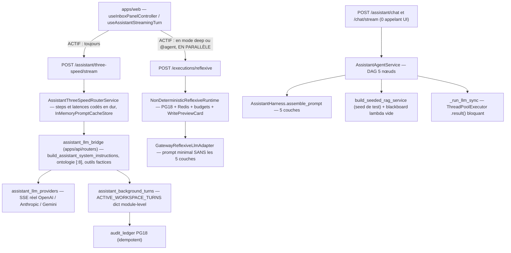
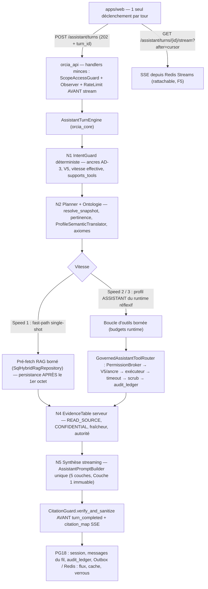
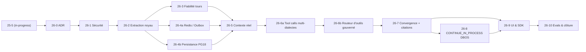

# 2026-11-21 — Audit Approfondi du Harnais « Mon Assistant » & Plan de Remédiation de la Dette (Epic 26 proposé)

- **Date** : 2026-11-21
- **Story / Clé Sprint** : `2026-11-21-audit-harnais-assistant-et-plan-remediation` (`Ajustement Transverse` — audit + plan, **aucune modification de code applicatif**)
- **Branche** : `chore/assistant-harness-debt-remediation`
- **Capacité(s)** : `CAP-022` (DAG assistant), `CAP-069` (télémétrie), `CAP-070` (gouvernance 4 niveaux), `CAP-071` (3 vitesses), `CAP-072` (citations / V5), `CAP-073` (dossiers), `CAP-074` (bridge LLM), `CAP-075` (tours en arrière-plan), `CAP-076` (Gemini), `CAP-160` (runtime réflexif), `CAP-190` (RAG / embedding) — classification : `hygiène` (dette + sécurité + architecture). Les statuts `live` de `CAP-022`, `CAP-070` et `CAP-072` sont **surévalués** au regard du câblage réel constaté (voir §1.2.2).
- **Auteur / Contexte** : audit Tech Lead demandé par l'utilisateur (« le harnais de l'assistant est-il adapté à un usage tel qu'ORCIA ? forces ? faiblesses ? »), puis analyse approfondie et plan de remédiation. Exigences concernées : `FR-4` (refus constitutionnel), `AD-1`, `AD-2`, `AD-3`, `AD-8`, `AD-10`, `AD-12`, `AD-15`, `AD-16`, `AD-17`, `AD-19`, `AD-21`, `AD-24`, `NFR` TTFT Speed 1 `< 1,2 s`.
- **Commits associés** : aucun (rapport d'audit ; la remédiation sera portée par les stories `26-x` proposées en §2).

> [!IMPORTANT]
> **Méthode et limites.**
> 1. Cinq analyses statiques indépendantes et parallèles : topologie & Composition Root, boucle agentique & gates, ingénierie de contexte, robustesse runtime & sécurité, tests & gouvernance.
> 2. Consolidation et dédoublonnage.
> 3. **Revue critique `VALIDATE`** (`bmad-architect-worker`) qui a re-vérifié dans le code les 14 constats P0, `H-30` et 5 constats P1 : **13 P0 confirmés, 1 partiel (`H-13`, nuancé ci-dessous)**, P1 contrôlés confirmés. Les numéros de ligne cités sans `~` ont été vérifiés.
>
> L'index GitNexus est en retard de 6 commits sur `HEAD`, et plusieurs symboles `assistant_*` y ont un `filePath` vide ; les appelants ont été vérifiés par `cypher` + lecture directe. Chaque story `26-x` doit relancer `npx gitnexus analyze` puis `gitnexus_impact` avant de coder.

---

## Synthèse Exécutive

**Verdict : le harnais n'est pas adapté en l'état à un usage ORCIA en production. Ses briques, elles, le sont presque toutes.**

ORCIA promet une IA **gouvernée** : ancres humaines inviolables, écriture SI uniquement via Gate, citations déterministes, ontologie métier, souveraineté, traçabilité FinOps, multi-utilisateurs et survie au F5. Or le chemin réellement emprunté par l'UI (`/three-speed/stream`) est un **pipeline parallèle, minimal et en mémoire** :
- il contourne `AssistantHarness`, le fan-out RAG/Blackboard, la vérification des citations et le refus des ancres humaines ;
- il présente une boucle d'outils factice ;
- ses contrôles d'accès sont incomplets ;
- son état critique vit en RAM.

Les composants matures (`NonDeterministicReflexiveRuntime`, `PermissionBrokerService`, `SurgicalContextExplorer`, Verrou V5, `SqlHybridRagRepository`, sandbox Tier 1/2, exposition MCP gouvernée) existent mais sont **débranchés du chemin Assistant**.

| Axe | Note | Résumé |
| :--- | :---: | :--- |
| Streaming & multi-provider | 🟢 | Vrai SSE `aiter_lines()`, séparation `reasoning`/`content`, 3 familles de providers, tâche découplée. |
| Gouvernance déterministe (V5, `READ_SOURCE`) | 🟡 | Solide **dans le noyau**, mais absente du chemin UI. |
| Architecture / topologie | 🔴 | 3 chemins, 2 constructeurs de prompt, double exécution LLM, ~2 100 L de logique métier dans `routers/`. |
| Boucle d'outils & gates | 🔴 | Outils factices (non-stream) ou cassés (stream) ; `save_and_launch_workflow` contourne `AD-3`. |
| Ingénierie de contexte | 🔴 | Ontologie vide `[:8]`, RAG seedé de test sur le DAG, aucun RAG sur le chemin UI, Blackboard `lambda: ()`, historique non borné. |
| Sécurité | 🔴 | Contrôle `OBSERVER` après le `200`, absence de `ScopeAccessGuard` (IDOR), droits `READ_SOURCE` fournis par le client, Couche 1 surchargeable. |
| Robustesse & scalabilité | 🔴 | État RAM (tours, cache, gouvernance, verrous), collision de tours, blocage de l'event loop, rien de multi-worker. |
| Observabilité & FinOps | 🟡 | `audit_ledger` idempotent, mais erreurs masquées, perte FinOps sur `/stop`, zéro Outbox, zéro audit par outil. |
| Tests | 🟡 | 5 couches présentes ; court-circuits `testclient` dans le code de prod ; aucun eval de boucle d'outils. |

---

## 1. Analyse du Besoin & Étude d'Impact Tech Lead (Pré-Implémentation)

### 1.1 Contexte & Problématique

#### 1.1.1 Fonctionnement actuel : 3 chemins concurrents

- **Chemin 1 (UI réelle)** : `stream_three_speed_turn_endpoint` (`assistant_workspace.py:249-311`) exécute `stream_three_speed_turn_sse`, qui produit des étapes et un texte de remplacement, puis **écrase** le texte par `stream_configured_llm_for_assistant_turn`. Le service de routage 3 vitesses ne sert donc qu'à produire des libellés d'étapes et des latences synthétiques.
- **Chemin 2 (DAG `AD-15`)** : seul chemin qui exécute `AssistantHarness.assemble_prompt` (`assistant_agent.py:310`, unique appelant hors tests), mais **aucun appelant UI**.
- **Chemin 3 (runtime réflexif Epic 16)** : le plus abouti techniquement. En mode `deep` ou `@agent`, il est déclenché **en parallèle** du chemin 1 (`useInboxPanelController.ts:239-264` : `startExecution` L245 + `sendTurn` L264) : **2 exécutions LLM indépendantes** pour un seul tour utilisateur, l'une produisant la trace UI et l'autre le texte.

#### 1.1.2 Comportement attendu (vision ORCIA) vs constaté

| Promesse ORCIA | Attendu | Constaté sur le chemin UI |
| :--- | :--- | :--- |
| `AD-15` Harnais 5 couches | Couche 1 immuable, ontologie, profil, contexte fédéré, intention | Constructeur parallèle `build_assistant_system_instructions`, Couche 4 RAG absente, Couche 1 surchargeable (`system_instructions_override`). |
| `AD-3` Ancres humaines | Refus déterministe de rédiger un livrable `human_authored_required` | Heuristique de 5 phrases dans `classify_intent`, jamais appelée sur `/three-speed/*`. |
| `AD-15` Verrou V5 | Aucune écriture SI hors Gate | Appliqué seulement sur `/artifacts/action` (0 appelant UI) ; absent de toute boucle d'outils. |
| Citations déterministes `[S1]/[G1]/[O1]` | `EvidenceTable` serveur + vérification avant `turn_completed` | `verify-turn` a **0 appelant** ; citations **fabriquées côté client** (`authorityTier="REFERENCE"`, `freshness="FRESH"` en dur). |
| `AD-8` RAG hybride | `halfvec(1024)` + `tsvector` RRF | `SqlHybridRagRepository` absent du pipeline Assistant (utilisé uniquement sur `POST /rag/search`) ; seed de test sur le DAG ; aucun RAG sur le chemin 1. |
| Agents outillés (Speed 2/3) | Boucle bornée, gouvernée, auditée | Résultat d'outil fabriqué (non-stream), `tool_calls` jetés (stream) → `stream_error`. |
| Multi-utilisateurs, F5, scale-out | État PG18/Redis | Tours, cache, gouvernance, citations, verrous, feedback **en RAM** ; Redis inutilisé par le harnais. |
| `RunAccessGuard` / `ScopeAccessGuard` / Observateur | Garde **avant** toute mutation | Garde absente sur la majorité de `/assistant/*` ; contrôle Observateur après les en-têtes `200`. |

### 1.2 Exploration, Analyse d'Impact GitNexus, Factorisation & Dette Technique

#### 1.2.1 Analyse d'impact GitNexus (`repo: "ORCIA"`)

| Symbole | `impactedCount` (index) | Appelants réels hors tests | Risque de refonte |
| :--- | :---: | :--- | :--- |
| `stream_configured_llm_for_assistant_turn` | absent (index en retard) | `assistant_workspace.py:~L278` | **CRITIQUE** : seul streamer LLM live de l'UI. |
| `AssistantThreeSpeedRouterService.stream_three_speed_turn_sse` | 179 (ambigu) | `assistant_workspace.py:~L254` | **HAUT** : porte le flux UI. |
| `NonDeterministicReflexiveRuntime` | 2 (`LOW` dans l'index) | `process_dispatcher.py:~L53,134,223`, `executions_trace.py`, `reflexive_execution.py:~L90` | **HAUT réel** : partagé entre Processus et Assistant. |
| `AssistantFourLevelGovernanceService` | 179 (ambigu) | `assistant_workspace_governance.py:~L42`, `assistant_three_speed_router.py:~L186`, `portal_and_assistant.py:~L146` | **MOYEN** |
| `assistant_llm_bridge` (+ `system_instructions_override`) | — | `agents_and_skills.py:13,169,317` (consommateur hors assistant) | **MOYEN** : à migrer avant toute suppression. |
| `AssistantHarness.assemble_prompt` | 179 (ambigu) | `assistant_agent.py:310` (unique) | **FAIBLE** techniquement, **CRITIQUE** pour le contrat `AD-15`. |
| `AssistantAgentService.run_conversation_turn` | 249 (ambigu) | `assistant.py:~L129-138`, `assistant_agent.py:~L439` | **FAIBLE** (route sans appelant UI). |
| `AssistantCitationAndV5GuardService.verify_and_sanitize_citations` | 179 (ambigu) | `assistant_workspace_citations.py:~L86` | **FAIBLE** (route sans appelant UI). |

#### 1.2.2 Inventaire des endpoints `/api/v1/assistant/*` et apparentés

| Endpoint | Appelant UI | Statut |
| :--- | :--- | :--- |
| `POST /three-speed/stream` | `useAssistantStreamingTurn.ts:~L257` | **ACTIF** (chemin 1) |
| `GET /three-speed/active-turn`, `POST /three-speed/stop` | `useAssistantStreamingTurn.ts` | **ACTIF** (dict RAM) |
| `POST /three-speed/feedback` | `inboxTurnSyncHelpers.ts:~L154` | **ACTIF** (dict RAM, non PG18) |
| `POST /folders`, `/threads`, `/folders/{id}/share`, `GET /workspaces/{id}/overview` | `useServerAssistantFolders.ts` | **ACTIF** (PG18) |
| `POST /executions/reflexive` (+ `trace-stream`, `synthesize-now`, `cancel`, `approve-write`) | `useReflexiveExecutionController.ts` | **ACTIF** (chemin 3, PG18 + Redis) |
| `POST /chat`, `POST /chat/stream`, `POST /workflows/save-and-launch` | aucun | **MORT UI** (chemin 2) |
| `POST /three-speed/turn`, `POST /three-speed/invalidate-cache` | aucun | **MORT UI** |
| `GET /governance`, `PUT /governance/mode-a/{user,workspace}`, `POST /governance/mode-b/{save,reset}` | aucun (UI en `localStorage`) | **MORT UI** |
| `POST /citations/verify-turn`, `POST /artifacts/action` | aucun | **MORT UI** |
| `POST /folders/{id}/launch-process`, `POST /threads/{id}/turns` | aucun (stub dans `inbox/index.tsx`) | **MORT UI** |
| `POST /mcp/spaces/{ws}/invoke` (`assistant.ask`) | externe | **PARTIEL** (`governed_mcp_exposure.py:~L251` stubé) |

**Bilan : 13 endpoints assistant sur 22 n'ont aucun appelant UI.** Plusieurs capacités `live` du registre ne sont donc vérifiées que par API et non par l'usage réel.

#### 1.2.3 Constats détaillés (dédoublonnés, identifiants `H-xx`)

##### Axe A — Topologie & frontières (`AD-1`, `AD-15`, `AD-19`)

| ID | Sév. | Constat | Preuve | Story |
| :--- | :---: | :--- | :--- | :---: |
| H-01 | **P0** | Le chemin UI contourne le harnais réel : ni `AssistantHarness`, ni fan-out RAG/Blackboard, ni vérification des citations, ni refus d'ancre humaine. | `assistant_workspace.py:249-311`, `assistant_llm_prompts.py:172-268`, `assistant_agent.py:310` | 26-7 |
| H-02 | **P0** | Double exécution LLM parallèle (chemin 1 + chemin 3) en mode `deep`/`@agent` : coût ×2, réponses potentiellement incohérentes entre la trace et le texte. | `useInboxPanelController.ts:239-264` | 26-7 |
| H-25 | **P1** | ~2 100 L de logique métier LLM/prompt/SSRF/télémétrie dans `apps/api/routers/` (`assistant_llm_{bridge,prompts,providers,resolver,gemini_adapter}.py`, `assistant_background_turns.py`, `_assistant_usage_telemetry.py`, `_assistant_workspace_context.py`), import inter-routeur (`agents_and_skills.py:13`), imports `_internal` depuis `orcia_api` (`assistant_llm_resolver.py:87`, `dependencies/portal_and_assistant.py:20`) et import de `testing.cassette_llm` dans le noyau (`assistant_agent.py:40`). | voir fichiers cités | 26-2 |
| H-26 | **P1** | UI déconnectée des endpoints de gouvernance, citations, fils et lancement de processus (`localStorage` seul, `assembledLayers={[]}`, `studioNodes={[]}`). | `InboxAuxiliaryPanels.tsx:~L85-147,204`, `inbox/index.tsx` | 26-9 |

##### Axe B — Boucle d'outils, permissions & gates (`AD-2`, `AD-3`, `AD-15` V5, `AD-12`)

| ID | Sév. | Constat | Preuve | Story |
| :--- | :---: | :--- | :--- | :---: |
| H-03 | **P0** | **Boucle d'outils factice.** En non-stream, un faux message `user` (« Workspace context verified ») remplace l'exécution, puis le provider est rappelé avec `tools=None`. Si `content` et `tool_calls` coexistent, les `tool_calls` sont ignorés. En stream, les deltas `tool_calls` / `input_json_delta` / `functionCall` sont jetés, `emitted_tokens=False` et le tour finit en `stream_error` « aucun jeton ». | `assistant_llm_bridge.py:202-218`, `assistant_llm_providers.py:235-254`, `assistant_llm_gemini_adapter.py:142-155`, `assistant_background_turns.py:242-263` | 26-6a / 26-6b |
| H-04 | **P0** | Aucune borne d'itérations, de budget de tokens ni de durée murale sur le bridge (alors que le runtime réflexif borne déjà : `STANDARD` 4 tours / 8k, `APPROFONDI` 25 tours / 48k). | `assistant_llm_bridge.py:78,191-221`, `assistant_llm_providers.py:269-352`, `reflexive_schemas.py:36-39` | 26-6a |
| H-05 | **P0** | `save_and_launch_workflow` exécute toutes les étapes (`commit_immediately=True`) sans `require_human_anchor`. Une étape `human_authored_required: true` est donc exécutée **sans signature humaine** (violation `AD-3`). L'exécution passe par le `WorkflowEngineService` en mémoire et non par DBOS + PG18 (`AD-2`) : rien n'est persisté (`workflow_runs`, `step_executions`, `blackboard_snapshots`, `domain_events_outbox`). | `assistant_agent.py:488-531`, `engine.py:87`, `human_anchors_and_arbitration.py:258-270`, `assistant.py:189-215` | 26-8 |
| H-27 | **P1** | Catalogue d'outils statique : 1 outil codé en dur + ≤ 10 skills RAM au schéma figé `{input_text}`. `enabled_in_workspace`, `input_parameters`, `mcp_tool_permissions` et RBAC sont ignorés. Le fallback OpenAI 404 omet `tools`, et les `tool_calls` au format Ollama natif sont ignorés. | `assistant_llm_prompts.py:~L320-356`, `assistant_llm_providers.py:~L163-167,203-209` | 26-6a / 26-6b |
| H-28 | **P1** | Refus d'ancre humaine purement lexical (5 phrases FR/EN). `HumanArbitrationRequested` n'est poussé qu'en RAM (`self._outbox_events`) hors de la route Blackboard. | `assistant_agent.py:~L137-147`, `human_anchors_and_arbitration.py:~L417-425` | 26-6b |
| H-29 | **P1** | Garde-fou critique pour la convergence (D1) : `ConnectorReflexiveWriteGateAdapter` exécute `connector.execute_write` après `WritePreviewCard`. Branché tel quel sur Mon Assistant, il **violerait V5**. Le profil Assistant doit interdire ce chemin. | `orcia_connectors/reflexive_write_gate.py:93-130` | 26-6b |
| H-22 | **P1** | Aucun événement `domain_events_outbox` émis par le harnais (`outbox_event_id` factice en mémoire). Aucune ligne `audit_ledger` par appel d'outil (seul `ASSISTANT_TURN_COMPLETED` avec `invoked_targets[0]`). | `assistant_three_speed_router.py:~L288`, `_assistant_usage_telemetry.py:~L93-152` | 26-4a / 26-6b |

##### Axe C — Ingénierie de contexte (`AD-8`, `AD-15`, ontologie)

| ID | Sév. | Constat | Preuve | Story |
| :--- | :---: | :--- | :--- | :---: |
| H-12 | **P0** | **Ontologie débranchée.** `list(ont_svc.concepts)[:8]` sur un bundle runtime **vide** (`build_empty_ontology_service()`) : pas de scope, pas de pertinence, pas d'axiomes, pas de `ProfileSemanticTranslator`. `OntologyGovernanceService.resolve_snapshot` n'est jamais appelé par le harnais. La Couche 2 de la gouvernance est un texte statique. | `assistant_llm_prompts.py:300-310`, `_core_providers.py:167-182`, `ontology/__init__.py:56-58`, `assistant_governance.py:513-516` | 26-5 |
| H-13 | **P0** | *(vérifié partiel)* Le DAG assistant est câblé sur un RAG **seedé de test** (`build_seeded_rag_service`) et un provider de snapshots Blackboard vide. Le chemin UI n'interroge aucun RAG. `SqlHybridRagRepository.search_hybrid_rrf` (`halfvec` + `ts_rank_cd` RRF k=60) est opérationnel mais n'a **aucun appelant dans le pipeline Assistant** : seul `POST /rag/search` l'appelle. | `core_and_lifespan.py:384-391`, `ontology_and_rag.py:251`, `rag/_internal/sql_repository.py:49-174` | 26-5 |
| H-14 | **P0** | Vérification des citations : 0 appelant (UI, SDK, bridge, DAG). Les sources sont devinées côté client par correspondance de sous-chaînes (`filterUsedRagSourcesForTurn`) puis enrichies de métadonnées inventées : **risque de citations fantômes**, contraire à la promesse produit. | `assistant_workspace_citations.py:41-138`, `assistantAutocompleteHelpers.ts:20-54`, `inboxCitationHelpers.ts:41-54` | 26-7 / 26-9 |
| H-18 | **P1** | Historique **non borné** : tout le `localStorage` est envoyé à chaque tour, sans fenêtre ni budget. `thread_id` n'est jamais envoyé. Le fallback API re-découpe `thread_summary` sur `" \| "` avec `role="user"`. `max_tokens_budget` de `workspace_llm_tier_mappings` est ignoré. | `assistantBackgroundStreamStore.ts:~L185-197`, `assistantTurnPayloadHelper.ts:~L50-73`, `_assistant_workspace_context.py:~L37-53`, `assistant_llm_prompts.py:~L359-379` | 26-5 / 26-9 |
| H-19 | **P1** | Cache de prompt `InMemoryPromptCacheStore` (TTL 300 s) au lieu de Redis. Invalidation par `outbox_event_id` forgé, non déclenchée par `GLOSSARY_PROMOTED` / `SETTINGS_CHANGED`. | `portal_and_assistant.py:~L157-168`, `assistant_three_speed_router.py:~L76-102,187,270-291` | 26-4a |
| H-31 | **P2** | Fuites FR dans le prompt quand `locale="en"` (`Ton attendu`, `Registre`, `Profil adaptatif`, `CONSTITUTIONAL_LAYER_1_TEXT`, `PROFILE_ADAPTATION_MAP`, `step_label`, `[Pièces jointes…]`). | `assistant_llm_prompts.py:~L160-164,244-245,264-265`, `assistant_harness.py:~L45-141` | 26-2 |

##### Axe D — Robustesse runtime & scalabilité

| ID | Sév. | Constat | Preuve | Story |
| :--- | :---: | :--- | :--- | :---: |
| H-09 | **P0** | **État critique en RAM**, perdu au redémarrage et incompatible avec plusieurs workers : gouvernance 4 niveaux (`_user_prefs`, `_workspace_settings`, `_team_*`, `_studio_graphs`, `_overrides`), citations (`_phantom_audit_log`, `_saved_drafts`), `_folder_meta` (pièces jointes, `evidence_tags` : les dossiers ne sont que partiellement en PG18), `_active_proposals`, `_turn_locks`, `PROMPT_TELEMETRY_LOG`, cache de prompt. Redis (`app.state.redis_client`) n'est **pas utilisé** par le harnais, alors que la table `workspace_customization_overrides` existe depuis la migration `0003`. | `assistant_governance.py:263-270`, `assistant_citations_and_v5_guard.py:179-181`, `assistant_folders_and_sharing.py:55-59`, `_sql_assistant_folders_queries.py:24-45`, `assistant_agent.py:127`, `assistant_background_turns.py:48-49` | 26-4a / 26-4b |
| H-10 | **P0** | `ACTIVE_WORKSPACE_TURNS` est indexé par `workspace_id` seul. Un second onglet ou utilisateur écrase l'état sans annuler l'ancienne tâche : handle perdu, risque de GC de la `Task`, consommation LLM fantôme. Les buffers d'événements ne sont jamais purgés (fuite mémoire). | `assistant_background_turns.py:43-49,167,325` | 26-3 |
| H-11 | **P0** | Blocage de l'event loop sur le chemin DAG (`ThreadPoolExecutor(max_workers=1).result()` dans une route `async`), générateurs SSE synchrones, et embedding sauté silencieusement si la boucle tourne (`if loop.is_running(): pass` → `NoActiveEmbeddingModelError`). | `step_executors.py:33-48`, `assistant_agent.py:412`, `assistant.py:129,160,174`, `assistant_three_speed_router.py:511`, `context_adapters.py:59-61`, `hybrid_rag_service.py:141-158` | 26-3 |
| H-21 | **P1** | `/stop` : `task.cancel()` sans attente ni événement terminal. `_finalize()` est sauté, d'où une **perte FinOps** des tokens déjà streamés. Aucune route SSE de rattachement par `turn_id` (polling JSON seulement). | `assistant_background_turns.py:~L67-78,314-316`, `assistant_workspace.py:~L187` | 26-3 |
| H-32 | **P2** | DDL (`ensure_ai_model_mappings_schema_on_postgres18` : `CREATE/ALTER/INDEX`) exécuté à **chaque tour**. `httpx.AsyncClient()` éphémère sans `aclose()` (y compris dans le garde introduit par `25-5`). | `assistant_llm_resolver.py:93`, `dependencies/_rag_availability_guards.py:76,85` | 26-4a |
| H-33 | **P2** | Ni retry ni backoff sur `429/502/503` avant le premier octet, pas de timeout d'inactivité entre chunks (seul `Timeout(300, connect=10)`). | `assistant_llm_bridge.py:~L77`, `core_and_lifespan.py:~L407` | 26-3 |
| H-35 | **P2** | `app.state.platform_setup_snapshot` : cache infini sans TTL ni invalidation après modification du Hub Modèles IA. | `assistant_llm_resolver.py:~L72,112` | 26-4a |

##### Axe E — Sécurité (`AD-6`, `AD-10`, `AD-21`, RBAC)

| ID | Sév. | Constat | Preuve | Story |
| :--- | :---: | :--- | :--- | :---: |
| H-06 | **P0** | Le contrôle `READ_ONLY_OBSERVER` sur `/three-speed/stream` s'exécute **dans le générateur**, après l'envoi des en-têtes `200` : crash ASGI au milieu du flux au lieu d'un `403`. L'en-tête `X-Orcia-Access-Mode` n'est pas vérifié sur `/three-speed/*`, `/chat*`, `/governance*`, `/citations/*`, `/artifacts/action`, `/threads*`, `/folders/{id}/share`, `/folders/{id}/launch-process`. | `assistant_workspace.py:241-311`, `assistant_three_speed_router.py:308-309`, `_auth_token_issuer.py:30-41`, `assistant_workspace_folders.py:87-98` | 26-1 |
| H-07 | **P0** | **IDOR** : aucun `resolve_workspace_access` / `ScopeAccessGuard` sur `assistant_workspace.py`, `assistant_workspace_governance.py`, `assistant_workspace_citations.py` ni sur 4 des 6 routes de dossiers. `_enforce_workspace_guard` saute le contrôle si `workspace_id` est un slug ou inconnu, alors que `evaluator.py:93-98` sait résoudre les slugs. Tout `ARCHITECT\|TECH_LEAD\|EXECUTIVE\|SECOPS` peut éditer la gouvernance de n'importe quel espace. Un `scope_id` UUID est codé en dur dans la résolution du modèle LLM (casse aussi le multi-espace). | `assistant_workspace_folders.py:93,124,151,189,213`, `assistant_workspace_governance.py:104-225`, `assistant_workspace_citations.py:41-165`, `assistant_governance.py:771-775`, `assistant_llm_resolver.py:97` | 26-1 |
| H-08 | **P0** | Aucun masquage `CONFIDENTIAL_RESTRICTED` ni filtrage `READ_SOURCE` serveur avant envoi au LLM. `reader_allowed_source_uris` est **fourni par le client** sur `verify-turn`. | `assistant_workspace_citations.py:80-85`, `schemas/assistant_citations_and_folders.py:102`, `assistant_llm_prompts.py:271-317`, `assistant_agent.py:223-241` | 26-1 |
| H-15 | **P1** | Contournement de la Couche 1 constitutionnelle par `system_instructions_override`. `role: "tool"` arbitraire accepté depuis l'historique client. Instructions d'espace / personnelles / notes épinglées non assainies contre les balises `[LAYER_*]` / `[CONSTITUTIONAL_*]`. **Attention** : `agents_and_skills.py:169,317` utilise légitimement `system_instructions_override`, à migrer sans régression. | `assistant_llm_prompts.py:146-168,189-190,371` | 26-1 |
| H-16 | **P1** | SSRF partielle : pas de validation DNS (rebinding vers `169.254.169.254`) et pas de re-validation de `rec.endpoint_uri` lu en PG18 par le resolver. *Nuance* : bloquer en bloc loopback / RFC 1918 casserait les LLM on-prem légitimes (Ollama, vLLM). Il faut une **politique configurable** (D3) plutôt qu'un blocage global. | `assistant_llm_providers.py:73-93`, `assistant_llm_resolver.py:102-109` | 26-1 |
| H-17 | **P1** | Fuites de secrets : `apiKey` en clair dans `platform_setup_snapshot`, `_REGISTERED_SECRET_VALUES` non borné, `str(exc)` non passé au scrubber. **À confirmer en priorité** : `GET /bootstrap/platform-setup-state` (`bootstrap_accostage.py:502`) est non authentifié ; vérifier qu'il ne renvoie aucun secret (sinon reclasser P0). | `assistant_llm_resolver.py:29-30`, `bootstrap_accostage.py:483,502,552,575`, `ecs_formatter.py:61,110-133`, `assistant_background_turns.py:320` | 26-1 |
| H-23 | **P1** | Aucune limite de débit ni de concurrence par utilisateur ou espace sur `/assistant/*` (risque de coût et de déni de service). | — | 26-3 |

##### Axe F — Erreurs, observabilité & tests

| ID | Sév. | Constat | Preuve | Story |
| :--- | :---: | :--- | :--- | :---: |
| H-20 | **P1** | Erreurs avalées ou masquées : `except Exception: pass` sur `resolve_mapping`, erreur HTTP provider transformée en « aucun jeton », `status="ERROR"` sans événement `stream_error`. Pas d'enveloppe RFC 9457 ni de `trace_id` dans les erreurs SSE. | `assistant_agent.py:~L389-390`, `step_executors.py:~L96-97`, `assistant_llm_providers.py:~L349-352`, `assistant_background_turns.py:~L254-262,317-320` | 26-3 |
| H-24 | **P1** | Branches de test dans le code de prod : `client_host == "testclient"` court-circuite l'appel LLM, masque l'erreur « aucun jeton » et injecte des `thinking_delta` synthétiques. `"pytest" in sys.modules` est testé dans `core_and_lifespan.py`. | `assistant_llm_bridge.py:~L142-144,268-275`, `assistant_background_turns.py:~L253-263`, `assistant_workspace.py:~L264-274`, `core_and_lifespan.py:~L115,131` | 26-2 |
| H-30 | **P1/P2** | Valeurs en dur. P1 : `assert det_ms < 80.0` en prod (lève `AssertionError`, ou disparaît en `-O`). P2 : latences synthétiques (`14.5`, `380`, `520`, `640`, `820`, `1460` ms, `min(…, 4.2)`), casquettes par défaut incohérentes (`PLATFORM_ADMIN`, un rôle RBAC, vs `PM` vs `ARCHITECT`), `pack_key="orcia-pack-sdlc"`, URI pilote figée. | `assistant_three_speed_router.py:325` (assert) + `41,57,200,207,324-487`, `assistant_workspace.py:98,251`, `assistant_agent.py:175`, `assistant_citations_and_v5_guard.py:254` | 26-1 (assert) / 26-2 |
| H-34 | **P2** | 13 fichiers au-delà du seuil de 300 à 400 L : `assistant_governance.py` (775), `assistant_three_speed_router.py` (576), `assistant_agent.py` (531), `assistant_citations_and_v5_guard.py` (421), `schemas/assistant.py` (388), `assistant_llm_prompts.py` (379), `assistant_folders_and_sharing.py` (376), `assistant_llm_providers.py` (352), `useAssistantStreamingTurn.ts` (349), `assistant_llm_bridge.py` (348), `assistant_background_turns.py` (347), `reflexive_runtime.py` (343), `assistant_workspace.py` (334). | `wc -l` | 26-2 (+ chaque story) |
| H-36 | **P2** | Trous de tests : `dependency_overrides` dans `test_story_3_3_*` (`~L274-275`), audit `require_rag_available` à liste codée en dur (impacté par `25-5`), evals limités (7 citations + 7 assistant/ontologie), **aucun eval** de boucle d'outils, d'injection via résultat d'outil, d'IDOR ou de comportement multi-worker. | `tests/unit/…`, `tests/evals/…` | 26-10 |
| H-37 | **P3** | Planification partiellement soldée : `BUG-E2E-01b` garde les pièces jointes / tags `_folder_meta` en RAM et un `test.fixme` dans `e2e/02` ; `AUTH-01` garde les notifications PG18 et la purge des personas hors tests à solder (seul `orcia_env` est dynamisé, `dependencies/portal_and_assistant.py:56-75`). | `sprint-status.yaml:1115-1149` | 26-4b / 26-10 |
| H-38 | **P3** | Index GitNexus en retard de 6 commits ; symboles `assistant_*` sans `filePath`. | GitNexus | 26-0 |

#### 1.2.4 Forces à préserver (non négociables lors de la remédiation)

1. **Streaming réel multi-provider** (`assistant_llm_providers.py`, `assistant_llm_gemini_adapter.py`) : `aiter_lines()`, `httpx.AsyncClient` partagé, séparation stricte `reasoning`/`content` (règle 2 de `GEMINI.md`). À **déplacer** dans le noyau, pas à réécrire.
2. **Tâche de fond découplée du SSE** (le tour survit à une coupure réseau) : le concept est bon. Il faut le reporter sur Redis et le borner.
3. **`audit_ledger` idempotent** par `turn_id` (`uuid5` + `ON CONFLICT (source_event_id) DO NOTHING`).
4. **`NonDeterministicReflexiveRuntime`** : seul moteur asynchrone de bout en bout, persistant (PG18 `reflexive_execution_sessions`), diffusé par Redis, avec budgets, `cancel` sans appel LLM, `synthesize_now`, `WritePreviewCard` résistant au F5 et un test d'intégration sur le Composition Root réel (`test_story_16_2_*`).
5. **Briques de gouvernance matures** : `PermissionBrokerService` (PG18, anti-Confused-Deputy), Verrou V5, `SurgicalContextExplorer` (4 primitives `#Lstart-end`, masquage), sandbox Tier 1/2, MCP gouverné (7 verrous + `QuotaGuard`), `ConnectorInvoker` (`idempotency_key`), `SqlHybridRagRepository` (opérationnel sur `/rag/search`).
6. **Garde-fous automatiques sans exception assistant** : `import-linter` (5 contrats), `TID251`, audit des anti-patterns, audit des adaptateurs SQL orphelins.
7. **Couverture des 5 couches `AD-17`** déjà présente (unitaires, PG18 réel, evals à 0 \$, sécurité, Playwright `02`, `12`, `16`, `21`).
8. **Acquis `25-5`** à préserver strictement : `get_optional_embedding_port`, `ensure_active_chat_model_if_live` (`usage='chat'`), split de `inbox/index.tsx` (261 L), pas de réintroduction de `require_rag_available`.

#### 1.2.5 Adéquation à ORCIA : réponse argumentée

- **Le modèle conceptuel est adapté.** Prompt constitutionnel en couches, casquettes, ontologie L1–L4, 3 vitesses, citations à niveau d'autorité, V5 et ancres humaines : c'est exactement le différenciateur d'ORCIA face à un chat généraliste.
- **L'implémentation du chemin servi ne l'est pas.** Le système vérifié par les tests (DAG, citations, gouvernance) n'est pas celui qu'exécute l'utilisateur (`three-speed` + bridge). C'est le risque majeur : une **illusion de conformité**. Plusieurs capacités sont `live` au registre, mais leurs garanties ne s'appliquent pas au parcours réel.
- **Le chemin le plus prometteur existe déjà** (runtime réflexif). La remédiation est donc avant tout un travail de **convergence et de câblage**, pas de réinvention.

#### 1.2.6 Opportunités de factorisation & dette technique

- **Un seul constructeur de prompt** : fusionner `AssistantHarness.assemble_prompt`, `build_assistant_system_instructions` et `assemble_five_layers_preview` en un `AssistantPromptBuilder` noyau unique, localisé `fr`/`en`, alimenté par PG18.
- **Un seul moteur de tour** : généraliser `NonDeterministicReflexiveRuntime` par **profil d'exécution** (`ASSISTANT` vs `PROCESS`) plutôt que dupliquer une boucle d'outils dans le bridge, avec un **fast-path Speed 1** hors runtime.
- **Une seule résolution de casquette** (`active_hat`) : source = profil utilisateur (`human_profile_archetype`), jamais un rôle RBAC.
- **Un seul streamer multi-provider** avec deltas d'outils unifiés (OpenAI `delta.tool_calls`, Anthropic `tool_use`/`input_json_delta`, Gemini `functionCall`, Ollama `message.tool_calls`).
- **Tickets** : l'ampleur dépasse largement 20 % d'une story. **L'Epic 26 est enregistrée (2026-11-21)** dans [`epics.md`](../../planning-artifacts/epics.md) (13 stories avec critères d'acceptation) et dans [`sprint-status.yaml`](../sprint-status.yaml) (`epic-26: backlog`, stories `ready-for-dev`, **non lancée**). Son plan directeur est [`sprint-change-proposal-2026-11-21-epic-26-harnais-assistant-remediation-plan.md`](../../planning-artifacts/sprint-change-proposal-2026-11-21-epic-26-harnais-assistant-remediation-plan.md) (8 lots).

---

## 2. Plan d'Implémentation (Remédiation)

### 2.0 Architecture cible, décisions à arbitrer & découpage

#### 2.0.1 Architecture cible : un moteur de tour unique et gouverné

Principes directeurs :
1. **Étrangleur (*strangler fig*)** : `/three-speed/stream` devient une façade qui **relaie le flux Redis** du nouveau moteur (`26-7`), avant le basculement UI (`26-9`), afin de ne pas casser les specs Playwright `02`, `12`, `16` et `21`. Les routes mortes (`/chat`, `/chat/stream`, `/three-speed/turn`, `/invalidate-cache`) sont dépréciées puis supprimées une fois le SDK régénéré.
2. **Speed 1 = fast-path single-shot sans outil**, hors runtime réflexif, pour tenir le TTFT `< 1,2 s`. Pré-fetch RAG borné (`< 50 ms` hybride, dégradé en `[STALE_WARNING]`), stream direct, persistance de session **après** le premier octet. Créer `reflexive_execution_sessions` avant le premier token pénaliserait le TTFT.
3. **Aucune écriture SI depuis l'Assistant** : tout outil de mutation est rejeté par V5 ou transformé en `approval_required` → `CONTINUE_IN_PROCESS` (`WorkflowRun` DBOS + Gate humaine). `ConnectorReflexiveWriteGateAdapter` est interdit dans le profil `ASSISTANT`.
4. **État zéro RAM** : PG18 pour ce qui est durable (session, messages, gouvernance, brouillons, feedback, audit), Redis pour l'éphémère partagé (flux d'événements, cache de prompt, verrous de tour, limite de débit).
5. **`AD-19`** : `httpx` reste confiné aux adaptateurs (`adapters/`), zéro import SDK dans `domain/` / `ports/`.

#### 2.0.2 Décisions à arbitrer avant implémentation (ADR — `bmad-architect-worker`)

| # | Décision | Recommandation | Impact spine |
| :---: | :--- | :--- | :--- |
| D1 | Moteur unique : DAG 5 nœuds (`AD-15` littéral) **ou** runtime réflexif à profils, dont les 5 nœuds deviennent des phases | **Runtime réflexif à profils pour Speed 2/3** + **fast-path single-shot pour Speed 1**. L'amendement doit aussi formaliser la façon dont le Studio Mode B (`@xyflow/react`, 5 nœuds / sous-couches) paramètre les phases du profil `ASSISTANT`. | **Amendement `AD-15`** (+ `lint_spine` à 0) |
| D2 | Protocole et hébergement du tour : `asyncio.Task` dans l'API (perdue au redémarrage du pod) **ou** acteur Dramatiq (`apps/worker`) avec relais Redis Streams | **202 + SSE rattachable** (Redis Streams, curseur) ; tâche bornée + arrêt gracieux pour Speed 1 ; **acteur Dramatiq idempotent (`turn_id`) pour Speed 2/3** | Contrat OpenAPI v2 + SDK ; cohérence `AD-2` |
| D3 | Politique SSRF pour les LLM on-prem | Liste d'autorisation administrée (hôtes / CIDR) ; blocage permanent métadonnées / link-local ; `.local` / `.internal` autorisés (règle 4 de `GEMINI.md`) ; **validation DNS au moment de la connexion** (*pinning* de `getaddrinfo`) ; authentification de `GET /bootstrap/platform-setup-state` | Amendement `AD-21` / `AD-24` |
| D4 | Persistance des messages de fil | Nouvelle table `assistant_thread_messages` (vs JSONB dans `assistant_threads`) | ERD `architecture.md` |
| D5 | Modèles sans function calling natif (certains modèles locaux) | Drapeau de capacité `supports_tools` découvert par le Hub IA (`AD-24`, 0 token) ; **repli UI** explicite (Speed 2/3 désactivées avec message localisé) | `AD-24` |
| D6 | Sort de `save_and_launch_workflow` (0 appelant UI, moteur en mémoire) | Corriger `execute_step` ne suffit pas : **raccorder `CONTINUE_IN_PROCESS` à l'exécution DBOS + PG18 réelle (`AD-2`)** avec `WAITING_FOR_HUMAN_ANCHOR` (`AD-3`), **ou déprécier** `/assistant/workflows/save-and-launch` | `AD-2`, `AD-3` |

#### 2.0.3 Epic 26 proposé : « Harnais Assistant Unifié, Gouverné & Persistant »

L'ordre de numérotation suit l'ordre d'exécution. Les trois stories les plus denses ont été scindées à l'issue de la revue `VALIDATE`.

| Story (clé proposée) | Objet | Constats couverts | Taille | Dépend de |
| :--- | :--- | :--- | :---: | :--- |
| `26-0-adr-moteur-de-tour-unique-et-contrat-sse-v2` | ADR D1–D6 ; amendements `AD-15` / `AD-21` / `AD-24` ; contrat SSE v2 (`thinking_delta`, `tool_call`, `tool_result`, `approval_required`, `token_delta`, `citation_map`, `turn_completed`, `turn_stopped`, `stream_error` RFC 9457) ; `npx gitnexus analyze` | H-38, prérequis | S | `25-5` clôturée |
| `26-1-durcissement-securite-immediat-assistant` | Gardes **avant** `StreamingResponse` ; `ScopeAccessGuard` + Observateur sur **toutes** les mutations `/assistant/*` (résolution slug + UUID via `evaluator`) ; `scope_id` réel ; `READ_SOURCE` + masquage `CONFIDENTIAL_RESTRICTED` côté serveur (suppression de `reader_allowed_source_uris` client) ; Couche 1 non surchargeable (sans casser `agents_and_skills`) ; historique limité à `user\|assistant` + assainissement des balises ; SSRF DNS + re-validation au resolver (D3) ; authentification de `GET /bootstrap/platform-setup-state` ; `apiKey` hors snapshot ; scrubber sur `str(exc)` ; suppression de l'`assert` prod | H-06, H-07, H-08, H-15, H-16, H-17, H-30 (assert) | M | `26-0` (D3) |
| `26-2-extraction-noyau-llm-et-prompt-builder-unique` | **Étape 0 de la convergence** : déplacer providers, bridge, prompts et télémétrie de `routers/` vers `orcia_core` (ports `LlmStreamingPort` + adaptateurs `httpx` sur le modèle de `embedding_httpx.py`) ; migrer le consommateur `agents_and_skills.py` ; `AssistantPromptBuilder` unique localisé `fr`/`en` ; casquette depuis le profil ; suppression des branches `testclient` / `pytest in sys.modules` par injection de `LLMPort` au Composition Root ; zéro `_internal` dans `orcia_api` ; découpage de tous les fichiers `> 300 L` | H-24, H-25, H-30 (P2), H-31, H-34 | L | `26-1` |
| `26-3-fiabilite-des-tours-redis-et-event-loop` | Registre de tours Redis indexé par `(workspace, user, turn_id)` + `set` des tâches + `add_done_callback` + TTL ; `/stop` avec événement terminal et FinOps partiel en `finally` ; SSE rattachable par curseur ; hébergement du tour selon D2 ; `stream_error` RFC 9457 + `trace_id` partout ; retry borné avant le premier octet + timeout d'inactivité ; limite de débit en fenêtre glissante + sémaphore de tours par utilisateur ; `LLMPort` / RAG `async` natifs (fin du `ThreadPoolExecutor.result()` et du `loop.is_running(): pass`) | H-10, H-11, H-20, H-21, H-23, H-33 | M | `26-2` |
| `26-4a-redis-cache-verrous-outbox-assistant` | `RedisPromptCacheStore` + invalidation consommée depuis `domain_events_outbox` (`GLOSSARY_PROMOTED`, `SETTINGS_CHANGED`) ; `RedisThreadTurnLock` (`SET NX EX`) ; émission Outbox du harnais ; TTL + invalidation de `platform_setup_snapshot` ; retrait du DDL par requête (`assistant_llm_resolver.py:93`, `_rag_availability_guards.py:85`) au profit d'Alembic ; client HTTP partagé | H-09 (partiel), H-19, H-22 (Outbox), H-32, H-35 | M | `26-2` (parallélisable avec `26-3`) |
| `26-4b-persistance-pg18-gouvernance-citations-feedback` | Alembic + repos SQL : gouvernance Mode A sur `workspace_customization_overrides` (migration `0003`), Mode B `assistant_studio_graphs` ; `assistant_citation_drafts` ; `assistant_turn_feedback` ; pièces jointes / tags de `assistant_folders` (solde `BUG-E2E-01b`) | H-09 (solde), H-37 (partiel) | M | `26-2` |
| `26-5-contexte-reel-ontologie-rag-blackboard-budget` | Ontologie hydratée depuis PG18 + `resolve_snapshot(workspace_scope_id)` + pertinence lexicale / vectorielle + `ProfileSemanticTranslator` + axiomes ; `SqlHybridRagRepository` asynchrone branché dans le pipeline Assistant (embedding optionnel selon `25-5`) ; provider SQL des snapshots Blackboard actifs ; `EvidenceTable` serveur (N4) ; trimmer par budget de tokens (`max_tokens_budget`, fenêtre du modèle, résumé PG18) ; suppression du RAG seedé en prod | H-12, H-13, H-18 (serveur) | L | `26-4a`, `26-4b` |
| `26-6a-llm-streaming-port-tool-calls-multi-dialectes` | Deltas `tool_calls` sur 4 dialectes (OpenAI, Anthropic, Gemini, Ollama natif) dans `LlmStreamingPort` ; arrêt sur `finish_reason=tool_calls` / `stop_reason=tool_use` ; drapeau `supports_tools` (D5) ; budgets d'itérations / tokens / durée murale ; cassettes `DeterministicCassetteLLM` étendues aux `tool_calls` | H-03 (transport), H-04, H-27 (dialectes) | M | `26-5` |
| `26-6b-governed-assistant-tool-router` | `AssistantToolExecutorPort` + `GovernedAssistantToolRouter` ; catalogue dynamique (skills PG18 `enabled_in_workspace` + RBAC + exposition MCP + 4 primitives chirurgicales + `kb.search` + recherche ontologique) ; chaîne PermissionBroker → V5/ancre (garde déterministe par outil) → exécuteur (sandbox pour les skills) → `asyncio.wait_for` → `scrub_connector_secrets` → `audit_ledger` `ASSISTANT_TOOL_INVOKED/DENIED` + Outbox ; idempotence `idem:{turn}:{iter}:{tool_call_id}` ; isolation des sorties d'outils (anti-injection) ; `HumanArbitrationRequested` via Outbox ; profil `ASSISTANT` sans `ConnectorReflexiveWriteGateAdapter` | H-03 (exécution), H-22 (outils), H-27 (catalogue), H-28, H-29 | M | `26-6a` |
| `26-7-convergence-moteur-unique-et-citations-serveur` | `AssistantTurnEngine` (fast-path Speed 1, Speed 2/3 réflexif) ; `CitationGuard` avant `turn_completed` + `citation_map` SSE ; un seul déclenchement LLM par tour ; façade `/three-speed/stream` relayant Redis Streams ; raccordement de `assistant.ask` (MCP `POST /mcp/spaces/{ws}/invoke`) au moteur unique, ou dépréciation ; dépréciation de `/chat*`, `/three-speed/turn`, `/invalidate-cache` | H-01, H-02, H-14 (serveur) | L | `26-6b` |
| `26-8-continue-in-process-dbos-et-ancres-humaines` | D6 : raccordement de `CONTINUE_IN_PROCESS` / `approval_required` à l'exécution DBOS + PG18 (`AD-2`), étapes `human_authored_required` en `WAITING_FOR_HUMAN_ANCHOR` (`AD-3`), arrêt au premier `WAITING_*`, persistance (`workflow_runs`, `step_executions`, Outbox) ; ou dépréciation de `/assistant/workflows/save-and-launch` | H-05 | M | `26-7` |
| `26-9-cablage-ui-sdk-gouvernance-citations-fils` | Panneau de gouvernance sur l'API (fin du `localStorage`) ; citations issues de `citation_map` (fin de la fabrication client) ; historique et `thread_id` depuis PG18 ; `threads/{id}/turns`, `launch-process` ; trace `tool_call` / `tool_result` et cartes `approval_required` ; repli `supports_tools=false` ; survie au F5 et zéro bouton muet ; SDK régénéré (`0-diff`) | H-14 (UI), H-18 (UI), H-26 | M | `26-7` (et `26-8` pour les cartes d'approbation) |
| `26-10-evals-red-team-et-cloture-epic-26` | Evals golden : boucle d'outils, ancres, V5, injection via résultat d'outil, citations fantômes ; sécurité : IDOR, Observateur avant `200`, SSRF DNS ; test multi-worker (2 instances + Redis) ; nouveaux audits AST (aucun dict mutable module-level dans le harnais, garde déclarée sur chaque route `/assistant`, aucun `testclient` dans `src/`) ; solde de `AUTH-01` / `BUG-E2E-01b` ; `capabilities.yaml` (statuts réels) ; `pnpm site:sync` | H-36, H-37 | M | `26-9` |

> [!NOTE]
> **`25-5` est clôturée** (`9517eb2`, `epic-25: done`). Ses acquis (§1.2.4, point 8) sont des invariants de non-régression pour tout l'Epic 26. Les numéros de ligne de cet audit ont été relevés sur l'état de travail de `25-5` ; la Story `26.0` les revalide après `npx gitnexus analyze`.
>
> **Clés définitives des stories** : voir `sprint-status.yaml` et `epics.md` (par exemple `26-0-adr-moteur-de-tour-unique-contrat-sse-v2-et-politique-ssrf`). Les clés de ce tableau sont indicatives.

**Quick wins (moins d'une journée chacun, à placer en tête de `26-1`)** :
1. Vérifier le contenu de `GET /bootstrap/platform-setup-state` (non authentifié).
2. Supprimer l'`assert` prod.
3. Placer les gardes avant `StreamingResponse`.
4. Utiliser le `scope_id` réel.
5. Supprimer `system_instructions_override` sur la Couche 1 de l'Assistant.
6. Filtrer les rôles de l'historique.
7. Indexer les tours par `(workspace, user, turn_id)` + `set` des tâches.
8. Supprimer le DDL exécuté par requête.
9. Réutiliser `app.state.http_client`.

### 2.1 Schéma de Données & Migrations Alembic (`infra/migrations/versions/…`)

Toutes les migrations sont incrémentales, en SQL brut (`op.execute(sa.text(...))`), en `UUIDv7`, avec `upgrade()` / `downgrade()` testés, selon le schéma *Expand → Backfill → Contract* :
- `26-4a` : migration Alembic du DDL aujourd'hui exécuté à la volée par `ensure_ai_model_mappings_schema_on_postgres18` (et par le garde de disponibilité RAG).
- `26-4b` : réutiliser `workspace_customization_overrides` (migration `0003`) pour les niveaux Espace / Équipe / Utilisateur de la gouvernance Mode A. Nouvelles tables `assistant_studio_graphs` (Mode B, versionnée), `assistant_citation_drafts` (brouillons + audit fantôme) et `assistant_turn_feedback`. Colonnes `working_attachments_uris JSONB` et `evidence_tags TEXT[]` sur `assistant_folders`.
- `26-5` (selon D4) : `assistant_thread_messages` (`id`, `thread_id` FK, `turn_id`, `role CHECK IN ('user','assistant')`, `content`, `citation_map JSONB`, `token_count`, `created_at`), index `(thread_id, created_at)`.
- `26-6b` / `26-7` : extension de `reflexive_execution_sessions` avec `execution_profile` (`ASSISTANT | PROCESS`, défaut `PROCESS` pour la rétrocompatibilité), `speed_mode` et `thread_id`.
- Aucun trigger append-only (`audit_ledger`, `blackboard_snapshots`) n'est modifié.

### 2.2 Noyau Métier Hexagonal, Orchestration & Workers (`packages/orcia-core/`, `apps/worker/`)

- **Ports** (zéro import SDK) : `LlmStreamingPort` (messages, `ToolDefinition`, deltas `ContentDelta | ReasoningDelta | ToolCallDelta | Usage | Finish`), `AssistantToolExecutorPort`, `AssembledPromptCachePort` (existant, implémentation Redis), `TurnEventStreamPort` (Redis Streams), `TurnRegistryPort`, `AssistantGovernanceRepositoryPort`, `CitationDraftRepositoryPort`.
- **Orchestration** :
  - `AssistantTurnEngine` : fast-path Speed 1 + composition de `NonDeterministicReflexiveRuntime` avec le profil `ASSISTANT` pour Speed 2/3 (aucun fork). Les non-régressions de `process_dispatcher` sont protégées par `test_non_deterministic_reflexive_runtime.py` et `test_story_16_2_*`.
  - `AssistantPromptBuilder` unique : Couche 1 immuable et localisée ; Couches 2 à 5 depuis PG18 ; blocs utilisateur délimités et assainis.
- **Outils** : `GovernedAssistantToolRouter` dans `orcia_core/agents/`, qui réutilise `PermissionBrokerService`, `AssistantCitationAndV5GuardService`, `SurgicalContextExplorer`, `SqlHybridRagRepository`, `OntologyGovernanceService`, `AgentsAndSkillsManagementService` + sandbox Tier 1/2, et `ConnectorInvoker` (lecture seule).
- **Domaines** : erreurs dans `orchestration/errors.py` (`ToolExecutionDeniedError`, `TurnBudgetExceededError`, `TurnAlreadyActiveError`), héritant de `OrciaDomainError`. Aucune nouvelle dépendance circulaire (`lint-imports` 5/5).
- **Worker** (selon D2) : acteur Dramatiq idempotent (`turn_id` = clé d'idempotence) pour les tours Speed 2/3, l'API ne faisant que relayer le flux Redis.

### 2.3 Couche Backend API, Sécurité & Contrats (`apps/api/`, `packages/api-client/`)

- **Handlers minces** : `orcia_api/routers/assistant_turns.py` (`POST /assistant/turns`, `GET /assistant/turns/{id}/stream`, `POST /assistant/turns/{id}/{stop,approve,synthesize-now}`). Les dépendances `Depends(enforce_assistant_scope(require_write=True))`, `Depends(reject_read_only_observer)` et `Depends(assistant_rate_limit)` sont résolues **avant** toute ouverture de flux.
- **Schémas** : `schemas/assistant.py` (388 L) découpé en `schemas/assistant_turns.py`, `schemas/assistant_governance.py` et `schemas/assistant_citations.py`.
- **Erreurs** : RFC 9457 + `trace_id`, y compris dans l'événement SSE `stream_error` ; catalogue localisé (`Accept-Language`) avec `error_code` invariant.
- **SDK** : régénération du SDK OpenAPI 3.1 sharded (`0-diff`) à chaque story qui modifie le contrat, puis suppression des fonctions SDK des routes dépréciées.

### 2.4 Interface Utilisateur & Expérience (`apps/web/`, `packages/ui/`)

- `useInboxPanelController` : **un seul** déclenchement par tour (fin du double appel `three-speed` + `reflexive`).
- `useAssistantStreamingTurn` (349 L) découpé : transport SSE rattachable (curseur), store de tour réhydraté via `GET`, rendu.
- Citations : rendu exclusif de `citation_map` serveur ; suppression de `filterUsedRagSourcesForTurn` et de la fabrication `[Sn]` client.
- Gouvernance Mode A/B : `@orcia/api-client` en lecture et en écriture, fin du `localStorage` métier.
- Composants `@orcia/ui` : `AssistantToolCallTrace`, `AssistantApprovalRequiredCard` (routage vers la Gate de processus) et état « outils indisponibles pour ce modèle » (`supports_tools=false`). Microcopy dans `i18n/locales/{fr,en}.ts`, zéro hexadécimal hors `tokens.css`.

### 2.5 Analyse d'Impact sur la Pyramide des Tests (`AD-17`)

- **Couche 1a** : moteur de tour (fast-path, profils, budgets, arrêt, idempotence), routeur d'outils (refus Broker / V5 / ancre, timeout, scrub), parser de deltas d'outils sur 4 dialectes, prompt builder (Couche 1 immuable, locale `en` sans FR, assainissement), trimmer de budget. Suppression des `dependency_overrides` de `test_story_3_3_*`. Couverture `>= 90 %`.
- **Couche 1b** : Vitest `RouterProvider` réel ; survie au F5 du tour actif (rattachement SSE) ; citations depuis `citation_map` ; gouvernance réhydratée depuis l'API.
- **Couche 2** : `create_app()` réel sans override (PG18 + Redis + SeaweedFS) : tour Speed 1 / 2 / 3 → `SELECT` sur `assistant_thread_messages`, `audit_ledger` (`ASSISTANT_TOOL_INVOKED`) et `domain_events_outbox` ; relecture à froid après éviction des caches ; **test multi-worker** (2 apps sur le même Redis : `stop` et rattachement croisés) ; mesure p95 du TTFT Speed 1.
- **Couche 3** : OpenAPI `0-diff`, Schemathesis sur `/assistant/turns*`, `lint-imports` 5/5, `lint_spine` à 0 après les amendements.
- **Couche 4** : nouveaux jeux dorés `tests/evals/golden/assistant_tool_loop.jsonl` (appel d'outil → résultat → citation), `assistant_anchor_and_v5.jsonl`, `assistant_tool_output_injection.jsonl`, avec `DeterministicCassetteLLM` étendu aux `tool_calls`.
- **Sécurité** : IDOR inter-espaces (slug + UUID) ; `403` Observateur **avant** le premier octet ; SSRF DNS rebinding ; non-fuite de `apiKey` (logs, erreurs, snapshot, `GET /bootstrap/platform-setup-state`) ; masquage `CONFIDENTIAL_RESTRICTED` dans le prompt envoyé.
- **Couche 5** : mise à jour des specs Playwright `02` (dont le `test.fixme`), `12`, `16` et `21` ; nouvelle spec `22-assistant-tool-loop-approval-and-reattach.spec.ts` (outil visible, carte d'approbation → Gate, F5 en cours de tour avec rattachement).

### 2.6 Critères de sortie de l'Epic 26 (Definition of Done mesurable)

| Indicateur | Cible |
| :--- | :--- |
| Chemins d'exécution LLM pour un tour utilisateur | **1** |
| Constructeurs de prompt | **1** (Couche 1 immuable, testée) |
| Routes `/assistant/*` mutantes sans garde de portée et Observateur déclarée | **0** (audit AST) |
| État métier mutable module-level ou `InMemory*` dans le code de prod du harnais | **0** (audit AST) |
| Branches `testclient` / `pytest in sys.modules` dans `src/` | **0** |
| Endpoints assistant sans appelant UI ni consommateur documenté | **0** |
| Appels d'outils audités dans `audit_ledger` | **100 %** |
| Citations émises sans entrée dans l'`EvidenceTable` serveur | **0** (eval golden) |
| TTFT p95 Speed 1 (cassette, PG18 réel) | `< 1,2 s` |
| Tour survivant à `stop` / rattachement sur un autre worker | ✅ |
| Fichiers du harnais `> 300 L` | **0** |
| Couverture unitaire | `>= 90 %` |

### 2.7 Risques & mitigations

| Risque | Mitigation |
| :--- | :--- |
| Régression des Processus (runtime réflexif partagé, risque HAUT) | Composition par profil, aucune modification du comportement `PROCESS` par défaut, tests `16-2` et `process_dispatcher` en garde. |
| Dégradation du TTFT Speed 1 | Fast-path hors runtime, pré-fetch borné (`< 50 ms`), persistance après le premier octet, mesure p95 en Couche 2. |
| Perte du tour au redémarrage d'un pod API | D2 : acteur Dramatiq idempotent pour Speed 2/3, arrêt gracieux pour Speed 1. |
| Régression de `agents_and_skills` (consommateur du bridge et de `system_instructions_override`) | Migration explicite en `26-2`, avant toute suppression ; tests existants en garde. |
| Hétérogénéité du function calling selon les providers | Drapeau `supports_tools` (D5) + repli UI ; cassettes par dialecte (`26-6a`). |
| Big-bang de convergence et casse des specs E2E | Étrangleur : façade `/three-speed/stream` relayant Redis Streams jusqu'à `26-9`, suppressions en `26-10` seulement. |
| Conflit ou régression avec `25-5` | Démarrage de l'Epic 26 conditionné à la clôture de `25-5` ; ses acquis deviennent des invariants de non-régression. |
| Capacités `live` surévaluées dans le registre | Requalification honnête en `26-10` (`verification: runtime` seulement après E2E sur le chemin réel). |

---

## 3. Bilan des Modifications & Résultats (Post-Implémentation)

> Rapport d'audit et de planification : **aucune modification de code applicatif**. Cette section sera complétée story par story via les rapports `26-x-*-tech-lead-report.md`.

### 3.1 Fichiers Développés & Modifiés
| Fichier | Nature | Description synthétique |
| :--- | :--- | :--- |
| `docs/implementation-artifacts/tech-lead-reports/2026-11-21-audit-harnais-assistant-et-plan-remediation-tech-lead-report.md` | Création | Audit approfondi en 6 axes (38 constats `H-xx`, dont 14 P0 re-vérifiés en revue `VALIDATE`) + plan de remédiation Epic 26 (13 stories). |
| `docs/implementation-artifacts/tech-lead-reports/README.md` | Modification | Enregistrement du rapport. |
| `docs/planning-artifacts/sprint-change-proposal-2026-11-21-epic-26-harnais-assistant-remediation-plan.md` | Création | Plan directeur de l'Epic 26 : 8 lots, défauts D1–D6, Definition of Ready, protocole de lancement, invariants, critères de sortie. |
| `docs/planning-artifacts/epics.md` | Modification | Ajout de l'Epic 26 et de ses 13 stories (`26.0` à `26.10`, dont `26.4a/b` et `26.6a/b`) avec critères d'acceptation. |
| `docs/implementation-artifacts/sprint-status.yaml` | Modification | `epic-26: backlog`, 13 stories `ready-for-dev`, `epic-26-retrospective: optional`. |

### 3.2 Résultats Chiffrés, Métriques & Qualité
- Constats consolidés : **38** (P0 : 14, dont 13 confirmés et 1 partiel ; P1 : 16 ; P2 : 6 ; P3 : 2).
- Endpoints assistant : **22**, dont **13 sans appelant UI**.
- Logique métier dans `apps/api/routers/` : **~2 100 L** ; fichiers `> 300 L` : **13**.
- Couverture, performances, `ruff` / `mypy` / `lint-imports` : non applicables (aucun code modifié).

### 3.3 Validation & Procédure de Test
- Revue critique `VALIDATE` (`bmad-architect-worker`) : vérification des constats P0, de `H-30` et de 5 constats P1 dans le code ; corrections de lignes et de sévérité appliquées ; plan re-découpé (`26-4`, `26-6` et `26-7` scindées ; `assistant.ask` MCP rattaché à `26-7`).
- Les procédures de validation par couche sont définies en §2.5 et seront exécutées dans chaque story `26-x`.
