# Epic 30: how long coding and testing took, and how to cut test time

**Scope:** Stories 30.1–30.6, commits `6cfdba8..cf36f3c`, from 2026-11-25 22:22 to 2026-11-26 11:58 (local time).
**Sources:**
- The 16 Epic 30 worker transcripts. Every `run_command` was timed from its `Created At`/`Completed At` stamps, and background tasks from their completion messages. Scripts: [analyze_epic30.py](local transcript-analysis data, not versioned), [aggregate_epic30.py](local transcript-analysis data, not versioned).
- A fresh profiling run at `HEAD`: [profiling_report.md](local transcript-analysis data, not versioned).
- A file-by-file audit of the tests Epic 30 added.

> [!NOTE]
> "Active" time leaves out pauses longer than 10 minutes. The biggest one was a stall of about 6.5 hours overnight during Story 30.3 (23:43 → 06:14 UTC), when all three of its workers were idle at once.

---

## 1. Coding vs testing time

| Story | Coding agent active (min) | …of which running tests | Testing verifier active (min) | …of which running tests | Architect (min) | Commit-to-commit |
|---|---:|---:|---:|---:|---:|---:|
| 30.1 | 7.7 | 3.1 | 22.3 | 20.9 | – | 53 min |
| 30.2 | 24.9 | 3.9 | 28.0 | 28.9 | – | 42 min |
| 30.3 | 131.3 (3 workers) | 42.9 | 73.4 | 47.1 | – | 8 h 06 (includes stall) |
| 30.4 | 50.3 | 10.3 | 41.7 | 24.9 | – | 60 min |
| 30.5 | 80.6 | 24.1 | 42.4 | 29.1 | 21.5 | 96 min |
| 30.6 | 38.6 | 11.2 | 44.9 | 34.7 | 20.7 | 78 min |
| **Total** | **333 min** | **96 min** | **253 min** | **186 min** | **42 min** | |

```mermaid
xychart-beta
    title "Epic 30 active agent minutes per story"
    x-axis ["30.1", "30.2", "30.3", "30.4", "30.5", "30.6"]
    y-axis "minutes" 0 --> 140
    bar [8, 25, 131, 50, 81, 39]
    bar [22, 28, 73, 42, 42, 45]
```

*First bar series: coding agent. Second: testing verifier.*

**Takeaways**
- Agents were active for about 628 minutes in total. Running tests took about 282 of those minutes (**about 45 %**), split between coding agents (96 min) and verifiers (186 min). Writing code, excluding test runs, took about 238 minutes (**about 38 %**). Architecture review took about 7 %.
- **Testing took longer than coding in 4 of 6 stories** (30.1, 30.2, 30.4, 30.6).
- Each verifier pass ran about 15–20 minutes of commands. When a story was bounced back to the coding agent, this doubled to 30–47 minutes.

## 2. Where the testing time went

| Waste pattern | Evidence | Cost |
|---|---|---:|
| **Full `tests/unit` run 15 times** (about 5–5.7 min each, single process) | Every verifier ran it, and ran it again after every bounce (30.3 three times; 30.4, 30.5 and 30.6 twice each) | **≈ 61 min** |
| **The whole gate sequence restarted from step 1 after each bounce** | The failure was usually in a late gate (turbo, Playwright, PG18), after 8–10 min of pytest had already passed | ≈ 35–45 min |
| **Identical test commands re-run** | 30.3 coding: 11 coverage reruns (14 min) and 20 PG18 reruns (6 min). 30.6 coding: the same E2E spec 7 times (6 min). 30.2 testing: 3 Playwright reruns | **≈ 92 min total** |
| **Commands killed by their timeout** | 30.1: `pytest tests/unit tests/evals tests/security tests/contract` killed at 300 s, then split and re-run. 30.2 and 30.3: `coverage run --branch` killed repeatedly | ≈ 15 min |
| **Coverage gate struggles** | `concurrency=["greenlet","thread"]` with no `--source` limit turns off Python 3.12's faster coverage tracing (`sys.monitoring`), so runs are 40 % slower or worse | ≈ 30 min (mostly 30.3) |
| **Gates run one after another** | Unit, evals/security, turbo and PG18 don't depend on each other but never ran in parallel | – |
| **`gitnexus analyze` run 2–3 times per verifier** | 1–2.8 min per verifier | ≈ 8 min |

## 3. Why each suite is slow (profiled at HEAD)

| Suite | Tests | Wall time | Main cause |
|---|---:|---:|---|
| `tests/unit` | 1,154 | **322 s** | 118 `create_app()`/`TestClient` boots (129 s); 26 audit files that each re-scan the whole repo and re-parse the code (73 s); **6 real PG18 container tests inside `tests/unit`** (46 s); real DNS/OTLP/`pytest`/`ruff` subprocess timeouts (29 s); subprocesses that pay the 6 s `import orcia_api.main` cost (23 s) |
| evals + security + contract | 193 | 128 s | `test_openapi_contract.py` alone takes 57 s (Schemathesis fuzzing: 46 s) |
| Vitest `@orcia/web` | 369 | 58 s | 1.99 MB `openapi.json` parsed again in each of 95 jsdom setups (67 % of CPU time) |
| `turbo lint typecheck test` | – | 55–85 s | `lint` and `typecheck` both run `tsc --noEmit`; any `@orcia/ui` edit invalidates all 6 UI and Web tasks |
| PG18 integration (per file) | – | ~27 s | No shared `tests/integration/conftest.py`; each file starts its own container and runs Alembic itself (48+ Alembic runs in total) |

`pytest-xdist` is **not installed**, so everything runs in a single process.

## 4. Are all Epic 30 tests useful?

Estimated split of the **5,145 lines of test code Epic 30 added**:
- **~60 %** protect real behaviour or acceptance criteria.
- **~21 %** are **coverage padding**: about half of the new Python unit-test lines, mainly there to reach the 90 % coverage threshold.
- **~18 %** are static source-text checks or duplicate another test layer.

| Recommendation | Files |
|---|---|
| **Drop or merge** (padding or full duplicates) | `test_story_30_3_sql_stores_and_llm_coverage.py` (585 lines; tests `_FakeSession` and private helpers). `test_story_30_3_workflows_and_bridge_coverage.py` (mocks; repeats the PG18 test; 7.5 s). `test_story_30_6_lifecycle_and_modal_guards_audit.py` (100 % duplicated; brittle checks on TSX source strings). `tests/security/test_story_30_6_prompt_leak_and_draft_redteam.py` (repeats 30.2, 30.5 and the golden eval) |
| **Slim down** | `test_story_30_1/30_2/30_3_processes_live/30_5`: remove the unnecessary `create_app()`/`TestClient` boots and keep pure-function tests. `test_story_30_4_workflows_helpers_coverage.py`: keep only the VSM alias test. `epic-30-ux-hardening-audit.test.ts`: keep only the Banner CTA matrix; the rest copies `story-30-5-agent-lifecycle-and-errors.test.tsx`. `e2e/30-epic-30-…spec.ts`: the full 410-line journey runs twice (FR and EN) and re-tests `e2e/08`, `e2e/12` and `e2e/22`. Keep one full locale plus a short smoke test of the other |
| **Keep** | Both PG18 integration tests, the golden eval, every story's Vitest file, both `@orcia/ui` tests, `e2e/12` and `e2e/08` |

**Most extreme duplicate:** blocking a `DRAFT` agent with HTTP 422 is tested **five times** (unit 30.5, unit 30.6 audit, security red-team twice, PG18, and E2E twice).

## 5. Ways to cut test time

### A. Change how agents run the gates (no code changes; biggest effect on the next epic)
1. **Run the cheap, likely-to-fail gates first:** static checks, then the touched tests, then turbo/Vitest, then impacted PG18 tests, then impacted E2E. Run full `tests/unit` **last and only once**.
2. **After a bounce, re-run only the gate that failed plus the tests the fix affects.** Run the full sequence once at the end, not after every fix.
3. **Run independent gates in parallel as background tasks:** unit, evals/security/contract, turbo and PG18 at the same time.
4. **Run `gitnexus analyze` once per verifier.** Use `--lf` / `-g` when iterating on E2E.
5. **Measure coverage on the changed lines** (diff-coverage) instead of scoped `coverage run` loops. This removes the incentive to write padding tests. Adding `diff-cover` would need an update to the architecture spine.

### B. Make the suites faster (from profiling; estimated savings)
| # | Lever | Saving |
|---|---|---:|
| 1 | Move the 6 PG18 container tests from `tests/unit` to `tests/integration` | −45 s |
| 2 | Share one `create_app()`/`TestClient` per session, or boot only the routers a test needs | −80 to −100 s |
| 3 | One shared session-scoped index of file contents and parsed code for the 26 repo-audit tests | −45 to −55 s |
| 4 | Mock the DNS lookup (19_5), the OTLP export (7_0b) and the `pytest`/`ruff` subprocess (4_1a); do import checks in-process | −45 s |
| 5 | `pytest-xdist -n auto` with coverage `parallel = true` (needs a spine update) | −60 to −75 % wall time |
| 6 | Move Schemathesis fuzzing to a separate slow gate, or lower `max_examples` | −30 to −45 s |
| 7 | Coverage: limit `--source` and drop `greenlet` concurrency, so the faster Python 3.12 tracing is used | 2–4× faster coverage |
| 8 | Vitest: load and cache `openapi.json` once; remove the duplicate `tsc` from `lint` | −25 to −35 s |
| 9 | One session-scoped PG18 + Redis container with a template database in `tests/integration/conftest.py` | −350 to −500 s across the full integration suite |

**Expected result:** `tests/unit` drops from about 322 s to about 60–90 s, and evals/security/contract from 128 s to about 40 s. Combined with section A, one verifier pass would take about **6–8 minutes instead of 15–20**. Replayed on Epic 30, test time would fall from about **282 minutes to about 90–120 minutes (−55 to −65 %)**, with no loss of protection for any acceptance criterion.

> [!IMPORTANT]
> Section A changes the agent rules (`GEMINI.md`, `.agents/rules/bmad-model-routing.md`), which today require full `tests/unit` on every story. B5 and A5 add third-party dependencies, which needs an `ARCHITECTURE-SPINE.md` update. Both need your approval.
