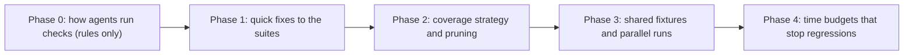

# Epic 31 vs Epic 30: test duration, test usefulness, and a revised optimization plan

Follows on from [epic30_test_duration_analysis.md](01-epic30-test-duration-analysis.md). The method is the same: commands were timed from the agent transcripts, the suites were profiled again at the end of Epic 31 (commit `720b07f`), and the new tests were audited file by file.
Raw data: [profiling_report_epic31.md](local transcript-analysis data, not versioned), [compare_epics.py](local transcript-analysis data, not versioned).

---

## 1. Side-by-side

| Metric | Epic 30 (6 stories) | Epic 31 (7 stories) | Trend |
|---|---:|---:|---|
| Active agent minutes | 628 | **1,043** | +66 % |
| Coding agents active (excluding test runs) | 333 (238) | 570 (409) | about 39 % of total in both |
| **Time spent running tests** | 281 min (45 %) | **414 min (40 %)** | +47 % |
| Testing verifiers active | 253 | 347 | 9 verifier passes vs 6 |
| Architect reviewers active | 42 | **126** | ×3 (3 story reviews plus a closure review and its fix round) |
| Failed check runs seen by verifiers | 16 | **25** | each one restarts the whole check sequence |
| Full `tests/unit` runs | 15 (61 min) | **29 (108 min)** | ×1.8 |
| Identical re-runs of the same command | 92 min | **139 min** | |
| Time spent on coverage runs | 49 min | **98 min** | **×2: now the second-biggest cost** |
| Time spent on PG18 integration tests | 29 min | **67 min** | ×2.3 |
| Playwright E2E | 49 min | 53 min | 31.7: same spec re-run 12 times (21 min) |
| Input tokens | 405 M | 623 M | |
| Test lines added | +5.8 k | **+15.1 k** | |
| **New test lines that are coverage padding** | 21 % | **37.5 %** | |
| New test lines that duplicate another layer | 18 % | 11 % | |
| New test lines that protect behaviour | 60 % | 51 % | |

Average test-run time per story went from **47 to 59 minutes**.

### How the suites grew between the two end-of-epic commits

| Suite | End of Epic 30 | End of Epic 31 | Change |
|---|---:|---:|---|
| `tests/unit` | 1,154 tests, 322 s | 1,295 tests, **392 s** | **+12 % tests → +21 % time** (seconds per test 0.279 → 0.302) |
| evals + security + contract | 193 tests, 128 s | 199 tests, 137 s | +7 % |
| `tests/integration` | 84 files | 91 files (74 start their own containers) | the 6 new files take **132 s**; 39 % of that is container start/stop |
| Number of `create_app()` calls in `tests/unit` | 118 | 129 (89 files) | each boot also got heavier as routes were added |
| `import orcia_api.main` | 6.0 s | **7.7 s** | +28 %; every subprocess and every xdist worker pays this |
| Vitest web / ui | 58 s / 14 s | 57 s / 15 s | flat |

> [!WARNING]
> **The unit suite gets slower faster than it gets bigger.** Projection: about 480 s by Epic 33 and about 600 s by Epic 35, multiplied by every run in every story. Both the time per test and the startup cost keep rising.

## 2. What is new in Epic 31

1. **Coverage padding became structural.** 19 of the 37 new files in `tests/unit/packs/` test **a hand-written fake SQL engine** (`_fake_sql_engine.py` and inline `_FakeEngine` copies). They dispatch on SQL strings and imitate PG18 triggers, CTEs and locks instead of exercising real PostgreSQL. The cause is the rules: coverage is measured on **unit tests only**, so SQL adapters already covered by real PG18 integration tests still have to be covered a second time through fakes to reach 90 %. Coding agents spent about 52 minutes inside coverage loops.
2. **Guards are tested many times over:**

   | Guard | Files asserting it |
   |---|---:|
   | Missing slot binding → `422 ERR_PACK_SLOT_UNBOUND` | 9 |
   | Anti-hostage unlink → `409` + `unlink_from_draft_packs` | 8 |
   | Scrubbed export / zip-slip → `422` | 9 |
   | Permission checks → `403` | 17+ |

3. **Overlapping PG18 integration pairs:** `31_4_activation_slots` and `31_4_hardening_guards` cover the same scenario, and so do `31_5_composer_and_export` and `31_5_rbac_and_roundtrip`. Each file costs 15–29 s, of which about 7 s is starting its own container.
4. **Red-team security tests run against the fake SQL engine** (`_packs_red_team_fixtures.py`, which boots `create_app()` five times). They re-test guards that the unit and PG18 layers already prove.
5. **A late closure review triggered a second full round.** In 31.7, the closure architect's must-fix (P0/P1) findings meant a fix pass and then a second verifier pass with **six more `tests/unit` runs**.
6. **E2E fix loops:** the 31.7 coding agent re-ran the full roundtrip spec 12 times.

**Pruning proposal for Epic 31 tests:** go from 36 unit files to about 12, 7 PG18 files to 5, and 3 security files to 1. In detail: drop the 19 fake-SQL padding files, put the router tests into 3 files that boot a small `FastAPI()` app instead of `create_app()`, merge the two overlapping PG18 pairs, and drop the red-team test that runs on the fake SQL engine. No acceptance criterion would lose coverage, because each removed check is still asserted elsewhere, mostly by PG18 or Vitest. Together with the Epic 30 list (4 files to drop, 6 to slim), this removes about **9 k lines** of test code.

## 3. Revised plan

What changed compared with the Epic 30 plan:
- **Changing how coverage is measured moves to the top**, because coverage cost doubled and it now drives the padding.
- **A shared PG18 container moves up**, because integration time grew ×2.3.
- **A test-time budget check is new**, to stop the suite getting slower with each epic.
- **Running the closure architecture review earlier is new.**

### Phase 0: how agents run checks (changes to `GEMINI.md` and `bmad-model-routing.md`; no code)
| # | Change | Evidence |
|---|---|---|
| 0.1 | **Run checks in a fixed order and stop at the first failure:** static checks → the touched tests → turbo/Vitest → impacted PG18 tests → impacted E2E → full `tests/unit` once at the end | 41 failed check runs over the two epics, mostly in late checks |
| 0.2 | **After a bounce, re-verify only the failed check plus the tests the fix affects.** Run the full sequence once per story | 29 full unit runs in Epic 31; 6 of them in 31.7 alone |
| 0.3 | **Run independent checks in parallel** (unit, evals/security, turbo, PG18) | They always ran one after another |
| 0.4 | **E2E fix loops:** use `--last-failed` or `-g <test>` and Playwright traces; run the whole spec only for the final check | 12 re-runs in 31.7, 7 in 30.6 |
| 0.5 | **Hold the epic-closure architecture review at the start of the last story, not after it.** Then the fix round is part of that story | The 31.7 closure review caused a second full verifier pass |
| 0.6 | **Run `gitnexus analyze` once per verifier**; skip `site:sync` until the final check | 2–3 runs per verifier |

### Phase 1: quick fixes to the suites (one hygiene story, low risk)
- Move the 6 PG18 container tests from `tests/unit` to `tests/integration` (**−54 s**).
- Mock the real DNS lookup (`19_5`), OTLP export (`7_0b`) and `pytest`/`ruff` subprocesses (`4_1a`); run the import check in `test_platform_auth_policy…` in-process (**−55 s**).
- Coverage config: limit `--source` and drop `greenlet` from `concurrency` so Python 3.12's faster tracing is used (**2–4× faster coverage**).
- Move Schemathesis fuzzing out of the main contract check into a separate slow check (**−37 s**).
- Vitest: parse `openapi.json` once and cache it; remove the duplicate `tsc --noEmit` from `lint`.
- Lazy-load the heavy assistant tool modules to cut the 7.7 s `import orcia_api.main`.

### Phase 2: coverage strategy and pruning (highest leverage; needs your decision)
- **2.1 Count PG18 integration runs toward coverage.** Combine the `coverage run` data from unit and integration, so SQL adapters are covered by real PostgreSQL instead of fakes. This removes the reason fake SQL engines exist.
- **2.2 Require ≥ 90 % coverage on the changed lines only** (`diff-cover`; needs a spine update), plus a global floor that is not allowed to drop. This replaces the scoped `coverage run` loops.
- **2.3 Ban fake SQL engines in unit tests:** add an automated check that fails on `_fake_sql_engine`, `_FakeEngine` or SQL-string dispatch under `tests/unit/`.
- **2.4 One owning layer per guard:** each guard is proven by one layer (pure unit test, or PG18 for SQL and trigger behaviour) plus at most one E2E journey. Security tests cover only attack inputs that aren't tested elsewhere.
- **2.5 Prune:** remove the Epic 31 files listed in section 2 and the Epic 30 list (4 to drop, 6 to slim). Merge the 2 PG18 pairs. Run the E2E journey in full in one language only, plus a short check of the other.

### Phase 3: shared fixtures and parallel runs
- **One shared app per test session:** a session-scoped `create_app()`/`TestClient`, or a small `FastAPI()` factory that mounts only the routers a test needs. Currently 129 boots take 160 s.
- **One shared repo index for audit tests:** a session-scoped cache of file contents and parsed code for the 31 audit files (82 s today).
- **`tests/integration/conftest.py`:** one session-scoped PG18 + Redis container with a template database (`CREATE DATABASE … TEMPLATE`), instead of 74 files each starting their own container and running Alembic.
- **`pytest-xdist -n auto`** for unit, evals, security and contract (needs a spine update), with coverage `parallel = true`.

### Phase 4: time budgets that stop regressions
- CI check: `tests/unit` must finish in ≤ 120 s, evals/security/contract in ≤ 45 s, and no single unit test may take > 1 s unless it is on an allowlist.
- Each story records its test-suite time change in Tech Lead report §3. A story that adds more than 10 s to the unit suite needs a written justification.

## 4. Expected savings (Epic 31 replayed with the new plan)

| Item | Epic 31 actual | After the plan |
|---|---:|---:|
| Full `tests/unit` runs | 29 × about 6 min = 108 min | 7–10 × about 1.5 min ≈ 15 min |
| Coverage runs | 98 min | about 20 min (changed lines only; integration counted) |
| PG18 integration | 67 min | about 30 min (shared container, merged pairs) |
| E2E | 53 min | about 35 min |
| evals + security + contract | 35 min | about 12 min |
| Other checks | about 53 min | about 35 min |
| **Total time running tests** | **414 min** | **about 145 min (−65 %)** |

Further savings that aren't in the table:
- No time spent writing about 5 k lines of padding tests per epic. That is roughly 50 minutes of coding-agent coverage loops, plus tokens.
- Fewer verifier passes and less architect rework.

> [!IMPORTANT]
> **Decisions needed:**
> 1. Phase 0 relaxes the current rule that every story runs the full `tests/unit` as soon as the verifier starts: it becomes once per story, last in the sequence, and only the failed check is re-run after a bounce.
> 2. Phase 2.1/2.2 changes how coverage is measured: unit plus integration, and changed lines only. This touches `AD-17` and `docs/testing-strategy.md`.
> 3. `pytest-xdist` and `diff-cover` are new third-party packages and need an `ARCHITECTURE-SPINE.md` update.
>
> Suggested backlog: **`Story 31.8`** (Phases 0 + 1 + 2.3–2.5 pruning) and **`Story 31.9`** (Phase 2.1/2.2, Phase 3 and Phase 4), each with its own Tech Lead report.
