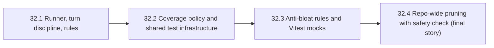

# Review of your test-optimization decisions, with token data

Nothing has been changed in the repository (see the note at the end). This review is based on measured token data from all Epic 30 and Epic 31 worker transcripts: 3,301 coding turns, 957 verifier turns and 438 architect turns.

## 1. Where the tokens actually go

| Measure | Epic 30 | Epic 31 |
|---|---:|---:|
| Input tokens billed (coding + verifier) | 379 M | 548 M |
| …of which **re-sent cached context** | 94 % | 97 % |
| Average context per **coding** turn | **263 k** | **245 k** |
| Average context per verifier turn | 83 k | 108 k |
| **Turns related to testing** (run/poll checks, read/write tests) | **43 % (163 M)** | **39 % (213 M)** |
| Context compactions | 8 | 14 |

**Billed input tokens by activity (Epic 31):**

| Activity | Share |
|---|---:|
| Reading source files | 19 % |
| **Running checks** | **17 %** |
| Writing source files | 13 % |
| Turns with no tool call | 12 % |
| Shell exploration | 11 % |
| **Reading tests** | **10 %** |
| **Writing tests** | **10 %** |
| Polling background tasks | 2 % (Epic 30: **9.5 %**) |

**Where the context bytes come from:**

| Source | Share |
|---|---:|
| `read_file` output | **64–65 %** |
| Background-task notifications (these carry test output) | 7–8 % |
| Arguments of `write_file` / `edit_file` calls | 11–15 % |
| **Test command output itself** | **3 %** |

Read patterns: **38 % of `read_file` calls re-read a file already read**, 6 % of read bytes were generated SDK files or `openapi.json`, and 20 % were planning documents. The always-loaded prompt (system prompt + `GEMINI.md` at 36 KB + rules + brief) is about **20 k tokens**, re-sent on every turn. `AGENTS.md` is an identical 36 KB copy of `GEMINI.md`, which may be loaded as well.

> [!IMPORTANT]
> **Cost ≈ number of turns × context size.** Each test turn in a coding agent costs about **250 k tokens**, whatever the test prints. "Silent on success" is still worth doing, but **it is not the main lever**. The main levers are **fewer turns** and **smaller context in the agent that runs and fixes tests**.

## 2. Challenge of each decision

| Your decision | Verdict | Amendment |
|---|---|---|
| **Combined coverage (unit + PG18) with `diff-cover` ≥ 90 % once at the end** | ✅ Keep, but there are 3 risks | (a) Today's rule forbids `pytest --cov` with testcontainers, so use `coverage run` with `parallel=true` + `combine`. (b) **Removing `greenlet` from `concurrency` may under-count async SQLAlchemy code** run via `greenlet_spawn`/`run_sync`, exactly the code PG18 runs will now cover. Measure PG18 coverage with and without `greenlet` before deciding; split the config by suite if needed. (c) "Once at the end" can still cause a late loop. Show a **non-blocking** diff-coverage estimate in Stage 2: no threshold, so no loop |
| **Ban fake SQL "via `lint_spine.py`"** | ⚠️ Wrong tool | `lint_spine.py` checks the **architecture spine documents**, not code. Put the test rules in a fast Stage 1 linter, `scripts/lint_tests.py` (AST-based), plus `ruff` TID251 for banned imports. Keep `lint_spine` for the spine update (new dependencies) |
| **Add `pytest-xdist` + `diff-cover`** | ✅ | Cap at `-n 4 --dist loadfile`. `-n auto` competes for CPU with Vitest and Playwright when checks run in parallel. Each worker pays the 7.7 s import cost, so do the lazy-import work first |
| **OpenAPI-generated Vitest mocks** | ✅, with care | Build them **in-house** from `openapi.json` with deterministic example data and **no new dependency** (randomised data makes tests flaky). Keep hand-written overrides only for stateful flows |
| **Architect review at the start of the final story** | ⚠️ Gap | That review covers stories 1…N-1, but **the final story's own diff goes unreviewed**. Add a short diff-only review of the final story, keep the final story small by design, and **keep per-story reviews on security-heavy stories** (9 bugs that no automated layer caught came from architect reviews) |
| **Silent on success, `--maxfail=3`, first 3 tracebacks** | ⚠️ May add bounces | In Epic 31, verifiers found **12 existing-test failures in one batch**. With `--maxfail=3` that becomes about 4 fix cycles of 250 k-token turns. Instead: **print every failing test ID (one line each)** plus 3 compact tracebacks, and write the full log to a file the agent reads by line range if needed. Use `maxfail` only for the coding agent's inner loops, **never in Stage 3** |
| **Silent `ruff format` / `--fix` before checks** | ✅, with care | Limit it to touched files and never use `--unsafe-fixes`. The runner must **print the list of auto-fixed files**: otherwise the agent's next `edit_file` targets text that no longer exists, which costs extra turns |
| **Bounce rule ("only `apps/` or `packages/` changed")** | ⚠️ Incomplete | Treat **any change outside `docs/`** as production-affecting: `infra/migrations`, `pyproject.toml`, `turbo.json`, OpenAPI, and **test files** too (if a test changed, re-run it plus its impact set) |
| **Impact selection "via import graph / GitNexus"** | ⚠️ Blind spots | (a) HTTP tests import `create_app`, so the import graph selects everything. Use the route→handler map instead. (b) Repo-wide audit tests import nothing, so always run them (fast once cached). (c) Vitest goes through mocks, so map `features/*` to test folders. (d) The GitNexus index goes stale and takes about 1 minute to refresh, so use a **deterministic import graph built inside the runner**. (e) **Before relying on it**, check it would have picked the tests behind the 39 recorded regressions (A2) and outdated tests (B) |
| **No more story-numbered test files** | ✅, but check traceability | Some audits and docs map stories to tests through file names (e.g. `test_story_26_10` scans `tests/**/test_story_26_*`). Replace that with a **`@pytest.mark.story("32.1")` marker / Vitest tag** so traceability survives in domain-owned files. Existing files are migrated by pruning, not renamed in bulk |
| **Test-to-code ratio flag at 1.2×** | ⚠️ Crude | It would push against thorough tests on security code. Make it a **flag recorded in the Tech Lead report, not a blocking check**. Exclude shared fixtures, and count new test lines per newly covered changed branch |
| **No weakening of E2E/integration assertions** | ✅, needs one exception | Story-level pruning deliberately deletes tests. Allow deletions **only when listed in the redundancy-audit report with its coverage proof**. The diff check flags removed `assert`/`expect` lines in existing tests unless they're listed |
| **Pruning safety check "no branch loses coverage"** | ⚠️ Necessary, not sufficient | Two tests can cover the same branch with different assertions, e.g. a status code vs a payload. Add: (a) **tests with a recorded real-bug catch are protected** (the A/A2 list from the failure analysis); (b) a **one-off mutation run** on the pruned modules; (c) per-test coverage contexts via `coverage run` with `dynamic_context = test_function`, not `pytest --cov` |
| **Template database per xdist worker** | ✅, wider scope | DBOS also needs its **own system database per worker**, plus a Redis database index and a SeaweedFS bucket prefix per worker |

## 3. Further token levers (ranked by estimated effect)

| # | Lever | Evidence | Est. saving on billed tokens |
|---|---|---|---:|
| T1 | **Fix tests in a fresh, small-context agent.** After a failure, hand a digest (failing IDs, tracebacks, touched files) to a fresh fixer agent with about 60–80 k of context, instead of looping inside the 250 k coding context | Test turns cost about 250 k each in coding vs 83–108 k in the verifier | **−15 to −20 %** |
| T2 | **Turn discipline:** one runner call per stage, which means **one notification**; polling `manage_task` banned; verifiers report a digest of 20 lines or fewer, and the coordinator relays only failing IDs | Epic 30 spent 119 polling turns (36 M tokens); 12 % of turns had no tool call | −8 to −10 % |
| T3 | **Lighter always-loaded prompt:** split `GEMINI.md` (36 KB) into a short core plus role-specific rule files; check whether `AGENTS.md` duplicates it in context | About 20 k tokens × about 2,900 turns per epic ≈ **58 M tokens per epic** | −5 to −8 % |
| T4 | **Read discipline:** line-range reads, never read generated SDK files or `openapi.json`, re-read only after your own edit, use GitNexus `context` instead of reading whole files | 38 % re-reads; 6 % of read bytes generated; 20 % planning docs | −8 to −12 % |
| T5 | **Write less test code** (anti-bloat rules, domain-owned files, canonical fixtures) | Reading + writing tests = 17–20 % of tokens | −6 to −8 % |
| T6 | **Commit-hash attestation:** the runner records `.agent_check/attest-<tree-sha>.json`; the verifier skips deterministic stages already green on the **exact same tree** and spends its time on independent checks (impacted E2E, PG18, security) plus a random spot-check | No identical command was re-run after the last edit, but the verifier re-runs whole layers | −4 to −6 % (plus wall time) |
| T7 | **Index of canonical fixtures** (`tests/README.md`: helpers, seeds, mock factories) so agents don't go hunting | 11–15 % of tokens go to shell exploration | −3 to −5 % |
| T8 | **Model tiering:** lint fixes and mechanical test fixes go to a lighter model; architect stays on `pro` | – | Cost, not token count |
| T9 | **Token metric per story:** an `agent_token_report` tool records turns, billed tokens and a breakdown by activity in Tech Lead report §3, with a budget per story | Makes tokens a first-class metric | Enables tracking |
| T10 | **Prompt-ready failure digests:** stable failure IDs plus a "known flakes" baseline so the same failure isn't diagnosed twice | 24 flakes across the two epics | −1 to −2 % |

**Combined estimate:** about **−45 to −55 % billed tokens per epic**. T1 + T2 + T4 carry most of it, on top of the time savings already estimated (about −65 % test-run time).

## 4. Proposed epic (for your validation)

**Epic 32: test pyramid, token economy and anti-bloat tech debt**

| Story | Scope |
|---|---|
| **32.1 Token-first runner and agent protocol** | `scripts/agent_check.py`: 3 stages; full list of failing IDs plus 3 tracebacks; log file; auto-fix that reports changed files; bounce rule; tree-hash attestation (T6). Agent rules: no chained commands, no polling, 20-line digests, fresh fixer agent (T1), read discipline (T4), role-split `GEMINI.md` (T3), fixture index (T7), token report (T9), flake log. Quick fixes: move the 6 PG18 tests out of unit; mock DNS/OTLP/CLI; Schemathesis in a separate slow check; parse `openapi.json` once in Vitest; remove the duplicate `tsc`; environment fixes |
| **32.2 Coverage policy and shared test infrastructure** | Spine update (`pytest-xdist`, `diff-cover`) and AD-17 / `testing-strategy.md`. `coverage run` unit + PG18 with `combine` and the greenlet experiment; `diff-cover` as Stage 3. Canonical seeded app, `run_with_lifespan`, typed PG18 seeds; session-scoped app; cached repo index; session PG18 + template database per worker (DBOS, Redis, S3 isolation); `-n 4`; lazy imports (target 7.7 s → ≤ 4 s); impact selection with its recall validated against the A2/B replay |
| **32.3 Anti-bloat rules and Vitest mocks** | `scripts/lint_tests.py` (Stage 1): no fake SQL, no new `test_story_*` files (replaced by a `story` marker), check for removed assertions, test-to-code ratio flag, `ScopeAccessGuard` route rule (O9). In-house OpenAPI-generated Vitest mocks; split `i18n-and-shell.test.tsx`; budgets (unit ≤ 120 s; startup) |
| **32.4 Repo-wide pyramid pruning** *(final story: epic architect review at its start, plus a diff-only review at its end)* | Per-test coverage audit (unit + PG18); pruning across all 5 layers; table-driven guard suites; PG18 files merged by domain aggregate; E2E push-down. **Safety check:** combined branch coverage before and after, protected tests with recorded catches, mutation sample, and a report on test lines, wall time and tokens |

> [!NOTE]
> **Already done before your "don't modify" message:**
> - The worktree branch `epic30_test_duration_optimization` was fast-forwarded to `main` (`4f0c208`, which includes Epic 31). No files were edited; only the branch pointer moved.
> - I created a docs folder with copies of the analyses; it has been deleted again.
>
> The working tree is clean.
