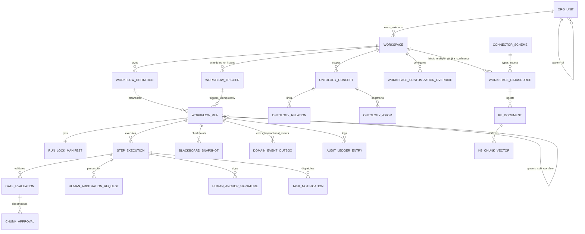

# Architecture Spine — ORCIA Platform MVP

> Binding invariants; verbatim ADs in [adr/](adr/00-spine-context.md).

## Design Paradigm

Hexagonal Modular Monolith + PG18 DBOS ([context](adr/00-spine-context.md)):

- **UI / Core**: `apps/web` SPA (nginx:alpine, no Node/DB), `@orcia/ui`, `api-client`, SSE; acyclic `uv` DAG (`orcia-kernel`<-8 domains<-`apps/{api,worker}`)+`entry_points` packs (`AD-19`, `AD-20`).
- **Runtime**: PG18 DBOS (`SUB_WORKFLOW<=3`), `domain_events_outbox`, 5 runtime roles (`AD-19`).

## Invariants & Rules

### AD-1 — Monorepo, SPA & uv DAG [ADOPTED]

- **Binds:** `all`
- **Prevents:** Schema drift, DTO leaks, or singletons.
- **Rule:**
  - HTTP/SSE schemas: orcia_api/schemas/ (->api-client); apps/web SPA (nginx:alpine, proxy_buffering off SSE, no Node/RSC/DB); import-linter bans SDKs in kernel/domain/ports, cycles, core->api/worker; no build_default_*() singletons (AD-19).
- **Detail:** [adr/AD-01-monorepo-hybride-typescript-python-spa-pure.md](adr/AD-01-monorepo-hybride-typescript-python-spa-pure.md)

### AD-2 — DBOS & Blackboard [ADOPTED]

- **Binds:** `FR-1`, `FR-4`, `FR-5`, `FR-6`, `FR-26`, `FR-30`
- **Prevents:** State loss, draft leaks, bad replays.
- **Rule:**
  - PG18 DBOS (@DBOS.workflow/@DBOS.step, DBOS.recv) public API only (no _/globals); orcia.step_executors.
  - Drafts: draft_artifact_jsonb/step_memlog_jsonb; COMMITTED->blackboard_snapshots (trigger)+run_lock_sha256; SUB_WORKFLOW<=3; fork_workflow ACTIVE.
- **Detail:** [adr/AD-02-orchestration-durable-transactionnelle-checkpoints-immuables-du.md](adr/AD-02-orchestration-durable-transactionnelle-checkpoints-immuables-du.md)

### AD-3 — Human Anchors & Arbitration [ADOPTED]

- **Binds:** `FR-2`, `FR-3`, `FR-5`, `FR-29`
- **Prevents:** Overwrites or silent tie-breaks.
- **Rule:**
  - blackboard blocks (422 ERR_HUMAN_ANCHOR_REQUIRED) agent writes on human_authored_required (1..2) without human_anchor_signatures (+amended_content, HUMAN_AMENDED_EXTERNAL, AD-5).
  - AUTONOMOUS_CONTRACT needs autonomy_contracts; ties->request_human_arbitration (PAUSE_AND_ESCALATE/ONTOLOGY_AXIOM_FIRST/DEFER_AND_CONTINUE_WITH_ASSUMPTION [ASSUMPTION]).
- **Detail:** [adr/AD-03-garantie-d-ancrage-humain-contrat-d.md](adr/AD-03-garantie-d-ancrage-humain-contrat-d.md)

### AD-4 — Presence Lock, SSE & Leases [ADOPTED]

- **Binds:** `FR-7`, `FR-8`, `FR-9`
- **Prevents:** Edit races or observer writes.
- **Rule:**
  - Redis `SET lock:step:<step_execution_id> <user_id> NX EX 900`->`channel:workspace:<ws_id>` SSE <500ms.
  - Require CONTRIBUTOR_ACTION_REQUIRED+lock O(1) (403 READ_ONLY_OBSERVER); shared writes->PG resource_leases (ResourceLeasePort, fencing token, URI order).
- **Detail:** [adr/AD-04-verrou-de-presence-atomique-unifie-par.md](adr/AD-04-verrou-de-presence-atomique-unifie-par.md)

### AD-5 — URI Federation, Jira & CAS [ADOPTED]

- **Binds:** `FR-10`, `FR-11`, `FR-20`, `FR-22`, `FR-23`, `FR-24`, `FR-27`, `FR-29`, `FR-30`
- **Prevents:** Drift, AGPL, or external overwrites.
- **Rule:**
  - workspace_datasources (N git/jira/confluence/db/nexus); FederatedUriResolver SHA-256->ObjectStoragePort (SeaweedFS, cas/<sha256>)+run-lock.json (<=3).
  - Jira stages draft_artifact_jsonb pre-Gate; artifacts `orcia://runs/<id>/steps/<key>/artifacts/<key>`; schemes via connector_schemes (ConnectorPort).
  - Published git/confluence = truth; ExternalEditRebaser->HUMAN_AMENDED_EXTERNAL (AD-3)+[SUPERSEDED_BY_HUMAN_COMMIT].
- **Detail:** [adr/AD-05-federation-pure-d-uri-multi-sources.md](adr/AD-05-federation-pure-d-uri-multi-sources.md)

### AD-6 — Auth, Scoped Identity & Secrets [ADOPTED]

- **Binds:** `FR-10`, `FR-11`, `FR-21`, `FR-22`, `FR-24`, `FR-27`, `FR-28`, `FR-29`
- **Prevents:** Confused deputy, 403 gaps, leaks.
- **Rule:**
  - OIDC/OAuth 2.1 or Argon2id+TOTP (15m JWT+Redis HttpOnly/Secure/SameSite=Strict); AuthorizationEnginePort; 3LO/PAT (AES-256-GCM) connectors/MCP; service_principal read-only (Actions<=Signer & SERVICE_PRINCIPAL).
  - PermissionBroker->WAITING_FOR_PERMISSION (AccessRequestChannelPort); SecretRef (SecretProviderPort, no defaults)+canary scrub (outbox/audit_ledger/dbos.*, NFR-SEC-4).
- **Detail:** [adr/AD-06-authentification-primaire-bi-mode-identite-deleguee.md](adr/AD-06-authentification-primaire-bi-mode-identite-deleguee.md)

### AD-7 — 4-Level Ontology & DNA [ADOPTED]

- **Binds:** `FR-7`, `FR-8`, `FR-9`, `FR-10`, `FR-12`, `FR-13`, `FR-14`, `FR-15`
- **Prevents:** Neo4j, opaque alerts, L4 leaks.
- **Rule:**
  - ontology_* 1_ENTERPRISE..4_RUN_EPHEMERAL; dna_stereotype links OPERATIONALIZES_DIRECTIVE (inviolable)+IMPLEMENTS_NORM (CTE depth<=2, <3ms).
  - 4_RUN_EPHEMERAL delta-only on ACTIVE (SUPERSEDED/>30d purged); ONTOLOGY_CONFLICT blocks promo; CANDIDATE<=15 FIFO (Top-3>=0.85).
- **Detail:** [adr/AD-07-modelisation-relationnelle-graphe-de-l-ontologie.md](adr/AD-07-modelisation-relationnelle-graphe-de-l-ontologie.md)

### AD-8 — Incremental RAG & Stale [ADOPTED]

- **Binds:** `FR-6`, `FR-16`, `FR-17`, `FR-20`, `FR-23`, `UJ-10`
- **Prevents:** Bad chunks, AGPL, fake vectors.
- **Rule:**
  - PG18 halfvec(1024) HNSW+tsvector (GIN, ts_rank_cd A/B)+RRF (k=60, kb_snapshot_hash, depth<=2): Docs (Docling 256-512->1024-2048), AST (tree-sitter 150-800, 0$ push), db:// DDL.
  - Stale->[STALE_WARNING]; Ontology(N1-N3)>Intent>AST>Docs; EmbeddingPort (AD-24, orcia.indexers).
- **Detail:** [adr/AD-08-indexation-differenciee-incrementale-multi-sources-vecteurs.md](adr/AD-08-indexation-differenciee-incrementale-multi-sources-vecteurs.md)

### AD-9 — 2-Tier Sandbox & Starlark [ADOPTED]

- **Binds:** `FR-18`, `FR-20`, `FR-29`
- **Prevents:** Code exec, egress, ReDoS, 5s kills.
- **Rule:**
  - T1a (wasmtime-py <5s, 256MB, 0 net/FS): Core validators; T1b (starlark-pyo3+google-re2 8MB, <2ms, 100k steps, 64MB, 0$ LLM): orcia_sys+re_fullmatch/re_search+emit_effect; TextToStarlarkCompiler (<5ms).
  - T2 (gVisor/Podman --network=none, <60s, 1024MB, /tmp 256MB): sandbox-runner on CAS.
- **Detail:** [adr/AD-09-sandbox-d-execution-sans-reseau-a.md](adr/AD-09-sandbox-d-execution-sans-reseau-a.md)

### AD-10 — Orthogonality & Lens DAG [ADOPTED]

- **Binds:** `FR-18`, `FR-19`, `FR-20`, `FR-25`, `NFR-SEC-2`
- **Prevents:** Self-bias, C2/C3 leaks, hallucinations.
- **Rule:**
  - ModelRouterService (LiteLLM): evaluator!=executor family, purge CoT, PiiReversibleScrubber (Redis run_id) pre-cloud.
  - Orthogonality>=SovereigntyTier (C0..C3; C2/C3 local/on-prem, no downgrade); 4 blind lenses (fact_verification)->Synthesis (lens_findings_jsonb).
- **Detail:** [adr/AD-10-orthogonalite-stricte-des-modeles-confinee-par.md](adr/AD-10-orthogonalite-stricte-des-modeles-confinee-par.md)

### AD-11 — Adaptive Gates & Waivers [ADOPTED]

- **Binds:** `FR-4`, `FR-21`, `FR-22`, `FR-29`
- **Prevents:** Rubber-stamping or directive bypass.
- **Rule:**
  - 4-block Briefing+>1500w chunk_approvals; >1000w <15s->fast_approval_warning; workspace_exception_waivers waives local norms until sha256 change (NEVER 1_ENTERPRISE, 403 ERR_ENTERPRISE_DIRECTIVE_WAIVER_FORBIDDEN).
  - mandatory_full (human_authored_required, publish, HIGH_CRITICAL), risk_or_exception_based (PASS & >=0.85 & 0 conflicts/stale; >=0.90 UJ-12), sampling (20%/10%).
- **Detail:** [adr/AD-11-politique-des-gates-humaines-adaptatives-registre.md](adr/AD-11-politique-des-gates-humaines-adaptatives-registre.md)

### AD-12 — Audit, OTel & Breakers [ADOPTED]

- **Binds:** `FR-23`, `FR-24`, `FR-29`, `FR-30`
- **Prevents:** Runaways, lost traces, bad retries.
- **Rule:**
  - W3C traceparent->OTel/structlog/RFC 9457/append-only audit_ledger (PG trigger; OutboxRelayPort); root_run_id/step/trigger caps (retries=3, failures=3)->PAUSED_*/CIRCUIT_OPEN.
  - OrciaDomainError: transient (Transient/RateLimited/UpstreamTimeout) vs non-retryable (Functional/PolicyDenied/Permanent); ConnectorInvoker retries transient (idempotency_key).
- **Detail:** [adr/AD-12-journal-d-audit-immuable-telemetrie-finops.md](adr/AD-12-journal-d-audit-immuable-telemetrie-finops.md)

### AD-13 — JIT Hydration & Regimes [ADOPTED]

- **Binds:** `FR-1`, `FR-2`, `FR-3`, `FR-4`, `FR-5`, `FR-6`, `FR-11`, `FR-13`, `FR-23`, `FR-29`
- **Prevents:** Context rot or mid-run pauses.
- **Rule:**
  - @DBOS.step: step k+orcia:///ContextSourcePort only (no k+1..N/MD)->orcia.step_executors; step_memlog_jsonb.
  - INTERACTIVE_COACHING (DBOS.recv), BACKGROUND_FAST_PATH ([ASSUMPTION]+pack markers), AUTONOMOUS_CONTRACT (LOW/STANDARD, >=0.85, tie_break_policy).
- **Detail:** [adr/AD-13-hydratation-just-in-time-par-etape.md](adr/AD-13-hydratation-just-in-time-par-etape.md)

### AD-14 — OrgUnit/Workspace & Overrides [ADOPTED]

- **Binds:** `FR-1`, `FR-3`, `FR-10`, `FR-11`, `FR-20`, `FR-21`, `FR-25`
- **Prevents:** Org/workspace conflation or BMAD coupling.
- **Rule:**
  - org_units decouples workspaces (owner_org_unit_id, workspace_datasources); BU_DIRECTOR=READ_ONLY_OBSERVER; CONFIDENTIAL_RESTRICTED masks admins.
  - workspace_customization_overrides Base->TEAM->WORKSPACE->USER (run-lock.json SHA-256); Core=ORCIA only (BmadSkillPackAdapter in orcia-pack-sdlc).
- **Detail:** [adr/AD-14-decouplage-arbre-d-equipes-espace-solution.md](adr/AD-14-decouplage-arbre-d-equipes-espace-solution.md)

### AD-15 — Assistant Harness & V5 [ADOPTED]

- **Binds:** `FR-1`, `FR-2`, `FR-3`, `FR-11`, `FR-15`, `FR-16`, `FR-17`, `FR-26`, `FR-27`
- **Prevents:** Layer 1 overrides or chat SI writes.
- **Rule:**
  - AssistantTurnEngine/Harness: passthrough (N1..N5 sealed, AD-25), 5-layer prompt (Layer 1/N1/V5/CitationGuard non-overridable).
  - V5: chat SI writes->422 ERR_DIRECT_SI_WRITE_REQUIRES_PROCESS_GATE->CONTINUE_IN_PROCESS->DBOS WAITING_FOR_HUMAN_ANCHOR (422 ERR_HUMAN_ANCHOR_REQUIRED).
- **Detail:** [adr/AD-15-architecture-en-workflow-de-nuds-harness.md](adr/AD-15-architecture-en-workflow-de-nuds-harness.md)

### AD-16 — Bootstrap & Private Space [ADOPTED]

- **Binds:** `FR-10`, `FR-12`, `FR-16`, `FR-17`, `FR-19`, `FR-21`, `FR-25`, `FR-27`, `FR-28`
- **Prevents:** Cold-start deadlocks or missing models.
- **Rule:**
  - 6 orcia://system/bootstrap/* workflows (init-organization: live >=2 chat+1 dim-1024 embed, no Day-0 seeds; workspace/datasource+TTL/existing-project/skill --network=none/user).
  - 1st admin/IAM/login->PRIVATE_USER (CONFIDENTIAL_RESTRICTED); db:reset=0 spaces; >=1 chat unlocks Assistant/Processes.
- **Detail:** [adr/AD-16-amorcage-gouverne-par-workflows-systeme-onboarding.md](adr/AD-16-amorcage-gouverne-par-workflows-systeme-onboarding.md)

### AD-17 — 5-Layer Tests & >=90% Cov [ADOPTED]

- **Binds:** `all`
- **Prevents:** Fake mocks, LLM cost, or regressions.
- **Rule:**
  - Unit (pytest -n 4, hypothesis, Vitest)+PG18 cov (coverage run/combine, NEVER pytest --cov+testcontainers)->diff-cover >=90%+import-linter+lint_tests.py.
  - Integration (testcontainers): PG18+pgvector, Redis 7 (SET NX), SeaweedFS, sandbox (no SQLite/Redis mocks); OpenAPI 0-diff+Schemathesis; DeterministicCassetteLLM (0$)+orcia-evals; Playwright (1440x900/390x844, SSE <500ms, 403).
- **Detail:** [adr/AD-17-strategie-de-tests-a-5-couches.md](adr/AD-17-strategie-de-tests-a-5-couches.md)

### AD-18 — Autonomy, Triggers & Sub-WF [ADOPTED]

- **Binds:** `FR-5`, `FR-11`, `FR-13`, `FR-14`, `FR-15`, `FR-16`, `FR-19`, `FR-22`, `FR-24`, `FR-26`, `FR-27`, `FR-29`, `FR-30`
- **Prevents:** Critical auto-runs, storms, or loops.
- **Rule:**
  - HIGH_CRITICAL forbids autonomy (422 ERR_CRITICAL_WORKFLOW_REQUIRES_HUMAN_GATE); autonomy_contracts (AD-6); SOURCE_CODE read-only; POST_ACTION_VERIFICATION (LogSinkQueryPort)->CIRCUIT_OPEN; SUB_WORKFLOW<=3 (acyclic, ERR_SUB_WORKFLOW_MAX_DEPTH_EXCEEDED).
  - Triggers: HMAC-SHA256, UNIQUE(trigger_id, trigger_idempotency_key), SetWorkflowID, Redis NX EX 86400, Self-Trigger Guard (service_principal/x-orcia-origin-run-id); help opt-in off.
- **Detail:** [adr/AD-18-gouvernance-de-l-autonomie-sous-contrat.md](adr/AD-18-gouvernance-de-l-autonomie-sous-contrat.md)

### AD-19 — Modular Monolith DAG & Roles [ADOPTED]

- **Binds:** `all`
- **Prevents:** Cycles, DTO coupling, or singletons.
- **Rule:**
  - import-linter (0): apps->orchestration/bootstrap->domains->orcia-kernel; Core NEVER imports orcia_pack_*; __init__.py public (_internal/ private).
  - DTOs: orcia_api/schemas/; OrciaDomainError: <domain>/errors.py (RFC 9457 apps/api); Composition Root (lifespan/Depends, on_startup; InMemory* tests/unit/fakes/ only).
  - domain_events_outbox+OutboxRelayPort; entry_points & MCP; 5 roles (api, worker-orchestration, worker-indexing, trigger-dispatcher, sandbox-runner).
- **Detail:** [adr/AD-19-architecture-en-monolithe-modulaire-graphe-acyclique.md](adr/AD-19-architecture-en-monolithe-modulaire-graphe-acyclique.md)

### AD-20 — Agnostic Core & Packs [ADOPTED]

- **Binds:** `all`, `FR-13`, `NFR-EXT-1`, `NFR-ISO-1`
- **Prevents:** SDLC in Core, lock-in, or clashes.
- **Rule:**
  - orcia_kernel/orcia_core: 0 SDLC terms (writes_code|BUG_CODE|DOC_OBSOLETE|brownfield|confluence|git://|jira); orcia-pack-sdlc->Core (core-without-sdlc CI, NFR-ISO-1).
  - entry_points (orcia.connectors/step_executors/workflow_policies/indexers)+BmadSkillPackAdapter; <namespace>.<marker>; ConnectorPort <150 lines; no seed demos.
- **Detail:** [adr/AD-20-core-agnostique-et-packs-metier-registres.md](adr/AD-20-core-agnostique-et-packs-metier-registres.md)

### AD-21 — Post-Day-0 Config, RBAC & SSRF [ADOPTED]

- **Binds:** `all`, `FR-1`, `FR-5`, `FR-10`, `FR-11`, `FR-16`, `FR-18`, `FR-19`, `FR-23`, `FR-24`, `FR-26`, `FR-27`, `FR-28`, `FR-29`, `FR-30`, `NFR-SEC-3`, `NFR-SEC-4`
- **Prevents:** Secret leaks, lockout, drift, or SSRF.
- **Rule:**
  - platform_settings: If-Match (412/428)+SettingsChanged outbox+secret_ref; SOPS+age; @DBOS.workflow NEVER reads mutable config outside @DBOS.step (409 pinned; PUBLISHED immutable).
  - 6-verb RBAC (create|read|update|delete|execute|grant, delegated<=held, 422 ERR_ADMIN_LOCKOUT_PREVENTED); SecretInput/SecretStatus (no prefill); inference_tier (workspace_llm_tier_mappings).
  - DNS-pinned SSRF (getaddrinfo) blocks 169.254.0.0/16, fe80::/10, 100.100.100.200, metadata.*, 5432/6379/S3; private hosts via ORCIA_LLM_ALLOWED_PRIVATE_HOSTS (localhost local/test); platform-setup-state=is_initialized+step.
- **Detail:** [adr/AD-21-gouvernance-post-jour-0-modele-d.md](adr/AD-21-gouvernance-post-jour-0-modele-d.md)

### AD-22 — @orcia/ui Radix & RGAA [ADOPTED]

- **Binds:** `all`
- **Prevents:** ARIA drift, raw hex, or autofill.
- **Rule:**
  - apps/web NEVER imports @radix-ui/*; primitives wrap shadcn/ui+Radix in packages/ui/src/primitives/.
  - tokens.css (.orcia-ds-*, no #hex outside, #6D28D9 HumanLedAnchorCard); tabs #2563EB/#FFFFFF vs #DBEAFE/#1E3A8A; non-/login inputs block pwd managers+.orcia-masked-secret-input+unsaved guard.
- **Detail:** [adr/AD-22-socle-design-system-open-source-separation.md](adr/AD-22-socle-design-system-open-source-separation.md)

### AD-23 — JSON stdout, LogSink & OTLP [ADOPTED]

- **Binds:** `all`, `FR-23`, `FR-24`, `FR-29`, `NFR-SEC-4`, `NFR-OBS-1`
- **Prevents:** Multiline logs, lock-in, or leaks.
- **Rule:**
  - 1 JSON line/event stdout (structlog, LOG_LEVEL, no stderr, /health|/ready filtered)+ECS+secret scrub (NFR-SEC-4).
  - Sink-agnostic (LOG_SINK_BACKEND, LOG_COLLECTOR), readOnlyRootFilesystem:true (ClusterLogForwarder), W3C OTLP (no OTel Logs); LogSinkQueryPort (ES/Loki)+error_fingerprint_sha256/cooldown.
- **Detail:** [adr/AD-23-journalisation-12-factor-unifiee-puits-de.md](adr/AD-23-journalisation-12-factor-unifiee-puits-de.md)

### AD-24 — AI Hub, Probes & Embeddings [ADOPTED]

- **Binds:** `FR-14`, `FR-23`, `FR-28`, `FR-31`, `FR-33`, `NFR-SEC-1`, `NFR-PERF-3`, `NFR-TEST-1`
- **Prevents:** Fake RAG, hardcoded models, or drift.
- **Rule:**
  - No hardcoded models/Day-0 seeds; /settings/ai-models/discover 0-token probe (SSRF AD-21); real max_tokens=1/dim-1024 probes; 1 GLOBAL embed (dim 1024; Anthropic/Ollama /api/embeddings banned) via EmbeddingPort (HTTPX, no SDKs); SHA-256 banned.
  - No embed->422 ERR_NO_ACTIVE_EMBEDDING_MODEL on non-SOURCE_CODE RAG (SOURCE_CODE NULL & chat up); swaps->rag_reindexing_jobs (503); tool_calls=openai_compatible/anthropic only (422 ERR_MODEL_TOOLS_UNSUPPORTED).
- **Detail:** [adr/AD-24-hub-des-modeles-ia-fiable-decouverte.md](adr/AD-24-hub-des-modeles-ia-fiable-decouverte.md)

### AD-25 — AssistantTurnEngine & N1-N5 [ADOPTED]

- **Binds:** `FR-1`, `FR-2`, `FR-3`, `FR-4`, `FR-5`, `FR-15`, `FR-23`, `FR-24`, `FR-26`, `FR-27`, `FR-33` (`CAP-022`, `CAP-069..076`, `CAP-260`)
- **Prevents:** Split paths, F5 loss, or SSE IDOR.
- **Rule:**
  - AssistantTurnEngine: Speed 1 (<50ms RAG, TTFT <1.2s)+2/3 in apps/api asyncio.Task (no Dramatiq, Redis Streams cursor, NX lock, ERR_ASSISTANT_TURN_INTERRUPTED).
  - N1..N5 sealed->CitationGuard (Mode A); pre-stream ScopeAccessGuard, READ_ONLY_OBSERVER (403 ERR_OBSERVER_MODE_READ_ONLY), server READ_SOURCE/CONFIDENTIAL_RESTRICTED.
  - GovernedAssistantToolRouter->audit_ledger+outbox; ConnectorReflexiveWriteGateAdapter banned; MCP assistant.ask read-only; no /three-speed/* or prompt cache.
- **Detail:** [adr/AD-25-unified-assistant-turn-engine-single-process.md](adr/AD-25-unified-assistant-turn-engine-single-process.md)

## Consistency Conventions

- **Naming**: Py snake/Pascal/UPPER_SNAKE; TS Pascal/use*/`use<Domain>Store.ts`; DB plural snake+UUIDv7 PKs; SSE `<domain>.<entity>.<past_verb>`.
- **Formats/Errors**: UTC ISO-8601; numeric(12,6) USD; `sha256:<64-hex>`; RFC 9457 (+error_code/trace_id/permission_broker_hint).
- **UI/Ops/Tests**: TanStack Query v5 (SSE)+Zustand v5; OTel (traceparent/OTLP)+JSON stdout (structlog, LogSinkQueryPort); AD-17 unit>=90%/import-linter/testcontainers/schemathesis/Playwright.

## Stack

| Name | Version |
| --- | --- |
| **Python** | `3.12.9` |
| **uv (Python Package & Workspace Manager)** | `0.13.5` |
| **import-linter (Hexagonal & Modular Monolith Boundary Enforcer)** | `2.3.0` |
| **FastAPI** | `0.162.0` |
| **Pydantic / pydantic-core** | `2.14.1` |
| **orjson (Fast JSON Serialization)** | `3.13.0` |
| **uuid-utils (UUIDv7 Generation Python)** | `1.1.0` |
| **structlog (Structured JSON Logging Python)** | `26.1.0` |
| **opentelemetry-sdk + opentelemetry-exporter-otlp-proto-http** | `1.45.2 / 1.45.2` |
| **opentelemetry-instrumentation-fastapi + sqlalchemy + httpx** | `0.66b2 / 0.66b2 / 0.66b2` |
| **elasticsearch-py / opensearch-py (Log Sink Client & OpenSearch Compatibility)** | `8.17.1 / 2.8.0` |
| **Grafana / Loki / OpenTelemetry Collector (Dev Observability Stack & Profiles)** | `11.5.1 / 3.4.1 / 0.120.0` |
| **OpenShift Logging / ClusterLogForwarder (Target Prod Platform Sink)** | `5.9+ / 6.0` |
| **SQLAlchemy (Asyncio) + asyncpg + Alembic** | `2.1.6 / 0.30.0 / 1.20.1` |
| **DBOS Transact (PostgreSQL-Native Durable Workflow Engine)** | `2.14.0` |
| **Dramatiq (Redis Heavy-Worker Queue for Docling)** | `2.2.1` |
| **LiteLLM (Multi-Model Router & Orthogonality)** | `1.106.2` |
| **Docling (Document & Confluence Parsing & Chunking)** | `2.142.1` |
| **tree-sitter (AST Code Chunking & Call Graph Extraction)** | `0.24.0` |
| **Wasmtime-py (Tier-1a WASM Deterministic Structural Sandbox < 5s)** | `27.0.0` |
| **starlark-pyo3 + google-re2 (Tier-1b Deterministic Starlark Rule Engine < 2ms & O(n) Regex)** | `0.3.2 / 1.1.20240702` |
| **gVisor runsc / Podman Rootless (Tier-2 Isolated Container Sandbox < 60s)** | `20250217.0 / 5.4.0` |
| **pytest + pytest-asyncio + pytest-xdist (Python Unit, Parallel & Async Testing)** | `9.1.1 / 1.4.0 / 3.8.0` |
| **diff-cover (Changed-Lines Combined Coverage Gate)** | `11.0.4` |
| **hypothesis (Property-Based Testing Python)** | `6.170.9` |
| **testcontainers-python (Real PG18/Redis/SeaweedFS Integration Tests)** | `4.15.0` |
| **schemathesis (OpenAPI 3.1 Property & Fuzz Testing)** | `4.32.4` |
| **Node.js (Active LTS)** | `24.0.0` |
| **pnpm + Turborepo** | `10.6.0 / 2.11.10` |
| **TypeScript** | `5.9.3` |
| **Vite + @vitejs/plugin-react (Pure SPA Build & Dev Server)** | `6.3.5 / 4.5.2` |
| **TanStack Router + @tanstack/router-plugin (Type-Safe SPA Routing)** | `1.120.4` |
| **React** | `19.1.0` |
| **Tailwind CSS** | `4.3.0` |
| **shadcn CLI + Radix UI Primitives** | `2.4.0 / 1.1.2` |
| **@xyflow/react (Visual Node Workflow Editor / Graph)** | `12.12.0` |
| **TanStack Query** | `5.69.0` |
| **Zustand** | `5.0.3` |
| **openapi-typescript + openapi-fetch** | `7.6.1 / 0.13.4` |
| **Vitest + React Testing Library (Frontend Unit Tests)** | `3.2.7 / 16.2.0` |
| **@playwright/test (Multi-Actor Desktop & Mobile E2E Tests)** | `1.64.1` |
| **PostgreSQL** | `18.0` |
| **pgvector** | `0.8.7` |
| **Redis** | `7.4.2` |
| **SeaweedFS (Apache-2.0 S3-Compatible CAS Storage)** | `3.85` |

## Structural Seed

### Diagramme Entité-Relation du Noyau (Core ERD)



### Monorepo Layout

```text
orcia/
  apps/{web,api,worker}/ # Vite SPA | FastAPI+SSE | DBOS+Outbox
  packages/{ui,api-client}/ # @orcia/ui | OpenAPI 3.1 SDK
  packages/orcia-{kernel,core,pack-sdlc}/ # Kernel | 8 domains | SDLC
  infra/{docker,sandbox}/ # 5-role Compose & sandbox
```

Full tree: [adr/00-spine-context.md](adr/00-spine-context.md).

## Capability → Architecture Map

|Capability / FR|ADs|Primary Module|
|---|---|---|
|FR-1..3, FR-5, FR-26 Workflows|AD-1..3, AD-5, AD-11, AD-13, AD-14, AD-19|orchestration, blackboard, ui|
|FR-4, FR-18..22 Gates/Sandbox|AD-9..13, AD-19|gates, sandbox, ui|
|FR-6..11, FR-16, FR-17, FR-25..28 RAG/URI/RBAC|AD-2, AD-4..6, AD-8..10, AD-12, AD-14..16, AD-19|rag, sse, catalog, permissions, bootstrap|
|FR-12..15, FR-23, FR-24, NFR-SEC-4/OBS-1 Ontology/Audit|AD-2, AD-6, AD-7, AD-12, AD-19, AD-23|ontology, audit_finops, observability|
|FR-29, FR-30, PRD FR-13, NFR-EXT-1/ISO-1 Autonomy/Packs|AD-2, AD-3, AD-5, AD-6, AD-11..13, AD-18..20, AD-23|orchestration, triggers, pack-sdlc|
|CAP-190, FR-33, CAP-070..076, CAP-260 Hub/Assistant|AD-2, AD-3, AD-8, AD-15, AD-16, AD-19, AD-21, AD-24, AD-25|rag, agents, ai_models_hub, assistant*|

## Deferred

- Multi-region K8s HA: post-MVP (5 roles).
- ServiceNow/Jira IAM (OQ-2): V1.1 (Broker KB).
- Neo4j/Memgraph: >1M nodes (PG18 CTEs <15ms).
- CRDT/Yjs: out of MVP (AD-4+AD-11).
- ParadeDB pg_search: >5M chunks (tsvector+halfvec).
- Module profiles (M10): Phase F (lite/standard/full).
- Rust (orcia-sandbox-runner, jsonschema-rs, cedarpy): action item (wasmtime-py MVP).
- Mode B Studio (ACTION_ITEM-26.1): post-Epic 26 (Mode A).
- /three-speed/* facade (ACTION_ITEM-26.2): omitted (/api/v1/assistant/turns*).
- Redis prompt cache (ACTION_ITEM-26.3, FR-33): if SQL p95 > 50 ms.
- Gemini/non-/v1 Ollama tools (ACTION_ITEM-26.4, CAP-076): supports_tools=false.
- PG18/UI SSRF allowlist (ACTION_ITEM-26.5): ORCIA_LLM_ALLOWED_PRIVATE_HOSTS (AD-21).
