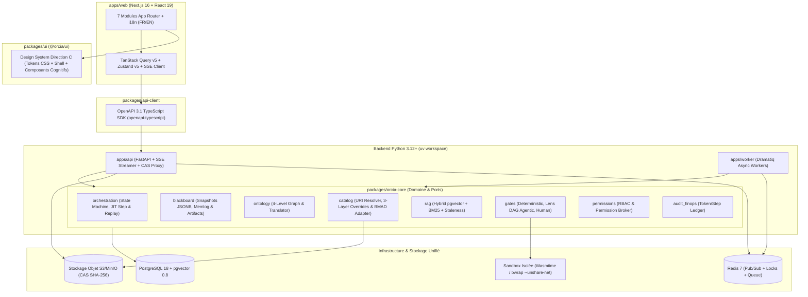
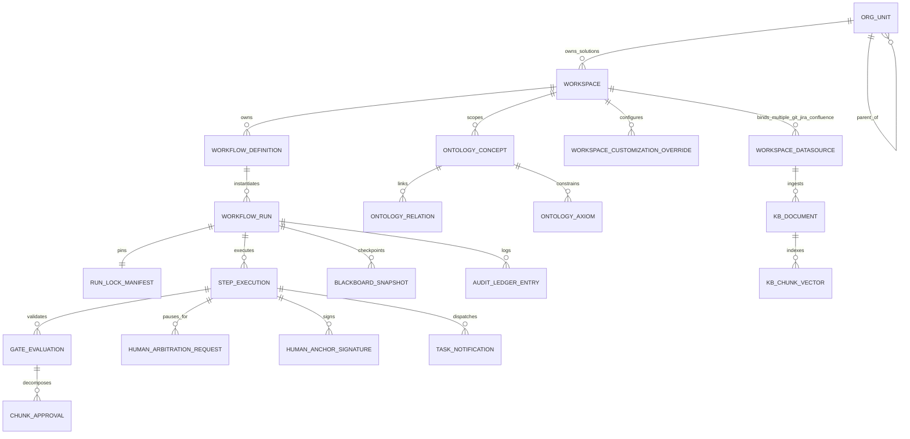

# Architecture Spine — ORCIA Platform MVP

## Design Paradigm

ORCIA adopte un paradigme **Monolithe Modulaire Hexagonal (Ports & Adapters) couplé à un Moteur d'Orchestration Durable Checkpointé par Événements**, structuré dans un **Monorepo Hybride TypeScript + Python** :

1. **Frontière de Présentation (`apps/web` + `packages/ui`)** : Application **Next.js (App Router, TypeScript)** (`apps/web`) assemblant les routes, l'`i18n` et les états sur la librairie Design System isolée **`packages/ui` (`@orcia/ui`)** qui héberge exclusivement les tokens CSS sémantiques et l'ensemble des composants UX/UI **Direction C** (*Executive Slate Sidebar* `#0F172A` à 7 modules RBAC + *Crisp Light Workspace* `#F8FAFC` + *Agent Assistant Dock*). `apps/web` consomme exclusivement `@orcia/ui`, le client typé `packages/api-client` généré depuis le schéma OpenAPI 3.1 du backend et un flux unifié Server-Sent Events (SSE) ; `packages/ui` reste pur (zéro appel réseau, zéro dépendance à `next/*` ou `@orcia/api-client`).
2. **Noyau Applicatif & Domaine (`apps/api` & `apps/worker` partageant `packages/orcia-core`)** : Backend **Python 3.12+ (FastAPI + Pydantic v2)** structuré en 8 domaines bornés (*Bounded Contexts*) : `orchestration`, `blackboard`, `catalog`, `ontology`, `rag`, `gates`, `permissions`, `audit_finops`. Chaque domaine expose ses *Ports* (interfaces Protocol Python) et isole ses *Adapters* (PostgreSQL, Redis, LiteLLM, S3/CAS, Sandbox, Connecteurs URI).
3. **Exécution Asynchrone & Durable (`apps/worker`)** : Workers **Dramatiq sur Redis** exécutant les transitions d'étapes, les appels d'agents IA, l'indexation RAG/Docling et les *Gates*, sans jamais bloquer la boucle d'événements HTTP/SSE de `apps/api`.



## Invariants & Rules

### AD-1 — Monorepo Hybride TypeScript + Python à Contrat OpenAPI Strict [ADOPTED]

- **Binds:** `all`
- **Prevents:** Dérive de schémas entre les composants React (`apps/web`) et les modèles Pydantic (`apps/api`), ou duplication manuelle des types d'entités du *Blackboard*, des *Gates* et des événements SSE.
- **Rule:** Tous les modèles d'échange HTTP et d'événements SSE sont déclarés en **Pydantic v2** dans `packages/orcia-core/schemas`. Le schéma OpenAPI 3.1 généré par FastAPI compile automatiquement `packages/api-client` via `openapi-typescript`. Il est interdit d'écrire des types d'API manuels ou des appels `fetch` non typés dans `apps/web`.

### AD-2 — Orchestration Durable par Checkpoints Immuables du Blackboard et Séparation Brouillon / Snapshot [ADOPTED]

- **Binds:** `FR-1`, `FR-4`, `FR-5`, `FR-6`, `FR-26`
- **Prevents:** Perte d'état lors des pauses longues (`WAITING_FOR_HUMAN_ARBITRATION`, `WAITING_FOR_PERMISSION`, `WAITING_FOR_UPSTREAM_RESOLUTION`), pollution des snapshots validés par des brouillons en cours de revue, ou corruption de l'historique lors d'un retour arrière (*Rewind / Replay*).
- **Rule:** Pendant l'exécution (`EXECUTING_AGENT`) et le passage des *Gates* (`EVALUATING_GATES`), l'artefact candidat en cours de validation est stocké de manière transitoire dans `step_executions.draft_artifact_jsonb` (et son éventuel binaire dans `step_executions.draft_cas_key`). Ce n'est qu'à la validation finale de l'étape (`COMMITTED`) qu'une ligne immuable (append-only) est persistée dans `blackboard_snapshots` contenant l'état JSONB consolidé (incluant les amendements de `chunk_approvals.amended_content`), le `parent_snapshot_id`, le `step_execution_id` et l'empreinte `run_lock_sha256`. Un *Replay* à partir de l'étape $N$ ne mute jamais les snapshots existants : il crée une nouvelle branche de snapshots enfants `ACTIVE` à partir du snapshot validé de l'étape $N-1$ et marque les snapshots postérieurs supplantés comme `SUPERSEDED`.

### AD-3 — Garantie d'Ancrage Humain et d'Arbitrage Explicite au Niveau API [ADOPTED]

- **Binds:** `FR-2`, `FR-3`, `FR-5`
- **Prevents:** Contournement côté serveur des sections `human_authored_required: true` par un agent exécuteur, perte de traçabilité d'un amendement humain de section, ou prise de décision implicite par un LLM face à plusieurs options équivalentes.
- **Rule:** Le moteur de validation de `blackboard` rejette (`HTTP 422 ERR_HUMAN_ANCHOR_REQUIRED`) toute écriture provenant d'une identité d'agent sur un champ de gabarit marqué `human_authored_required: true` tant qu'une signature d'auteur humain (`authored_by_user_id` dans `human_anchor_signatures`) n'y est pas attachée. De même, tout amendement humain d'un tronçon (`chunk_approvals.amended_content`) génère une signature dans `human_anchor_signatures`. Tout agent exécuteur dispose d'un outil système obligatoire `request_human_arbitration(options_matrix)` qui bascule atomiquement l'étape en statut `WAITING_FOR_HUMAN_ARBITRATION`.

### AD-4 — Verrou de Présence Atomique Unifié par Étape et Diffusion Temps Réel par SSE (< 500ms) [ADOPTED]

- **Binds:** `FR-7`, `FR-8`, `FR-9`
- **Prevents:** Conflits d'édition ou double traitement d'une tâche d'équipe entre la *Boîte de Notifications Unifiée* et le *Cockpit*, requêtes SQL coûteuses en middleware pour corréler notification et étape, ou tentative d'action par un utilisateur en mode `READ_ONLY_OBSERVER`.
- **Rule:** La clé canonique de verrouillage temps réel dans Redis est unifiée sur l'exécution d'étape : `SET lock:step:<step_execution_id> <user_id> NX EX 900`. Toute notification d'équipe (`task_notifications`) référence son `step_execution_id`, et les routes `POST /api/v1/tasks/<task_id>/claim` comme `POST /api/v1/runs/<run_id>/steps/<step_id>/claim` acquièrent ce même verrou atomique Redis, le persistent en base et publient l'événement `task.claim.locked` sur Redis Pub/Sub `channel:workspace:<ws_id>`, relayé aux clients par FastAPI `/api/v1/events/stream` (SSE) en moins de `500ms`. Tout endpoint de mutation d'étape vérifie en $O(1)$ que l'appelant dispose du rôle `CONTRIBUTOR_ACTION_REQUIRED` et détient `lock:step:<step_execution_id>`.

### AD-5 — Fédération Pure d'URI Multi-Sources (`N × git://`, `N × jira://`, `N × confluence://`, `db://`, `nexus://`), Actions Jira Staged aux Gates, Schéma Interne `orcia://` et Cache CAS SHA-256 (`run-lock.json`) [ADOPTED]

- **Binds:** `FR-10`, `FR-11`, `FR-20`, `FR-22`, `FR-23`, `FR-24`, `FR-27`
- **Prevents:** Non-reproductibilité des *Runs* causée par la mutation d'une ressource externe (`db://`, `git://`, `nexus://`, `confluence://`, `jira://`), limitation artificielle à un seul dépôt Git ou un seul projet Jira par solution logicielle, mutations ou transitions Jira sauvages par un agent avant validation de la *Gate*, ou divergence d'accès aux livrables produits par les étapes antérieures d'un même *Run*.
- **Rule:** Aucun actif externe n'est copié en aveugle dans le catalogue de définition : seules les URI canoniques sont enregistrées, et un même *Workspace* (solution logicielle) peut rattacher **plusieurs dépôts `git://` dédiés, plusieurs projets/filtres `jira://` dédiés et plusieurs espaces/arborescences `confluence://` dédiés** (via `workspace_datasources` qualifiés par un `alias` logique et un `role`). Lors de l'instanciation ou d'une résolution à la volée, le `FederatedUriResolver` télécharge chaque ressource via le connecteur dédié (`db://`, `git://`, `nexus://`, `confluence://<space_key>/<page_id>@v<N>`, `jira://<project_key>/<issue_key>`), calcule son `SHA-256`, stocke le binaire/texte immuable dans le stockage CAS sous la clé `cas/<sha256>` (servi aux clients autorisés via `/api/v1/cas/<sha256>`), et inscrit le vecteur complet des triplets `(alias, uri, resolved_version, sha256)` de toutes les sources du *Workspace* dans `run-lock.json`. Les mutations et transitions de workflows Jira initiées par un agent (`create_issue`, `update_issue`, `add_comment`, `transition_issue` en ciblant le `project_key` approprié parmi les projets Jira du *Workspace* et après interrogation préalable de `GET /rest/api/3/issue/<key>/transitions` pour vérifier les transitions légales et les champs obligatoires) sont préparées comme **Actions Staged** dans `step_executions.draft_artifact_jsonb` (révisables via la *Validation par Découpage* `FR-6`) et ne sont exécutées sur Jira qu'au passage effectif de la *Gate* (`AD-11`), en inscrivant le lien de provenance `run-lock.json` dans le ticket Jira. Les Webhooks entrants (`jira:issue_updated`) de tous les projets Jira liés peuvent déclencher un *Run* ou réveiller une étape en pause (`UJ-3`). Les artefacts produits par une étape amont d'un *Run* sont adressés via le schéma interne canonique `orcia://runs/<run_id>/steps/<step_key>/artifacts/<artifact_key>`, résolu exclusivement depuis la branche `ACTIVE` de `blackboard_snapshots`.

### AD-6 — Authentification Primaire Bi-Mode (OIDC & Locale), Identité Déléguée Passthrough, Permission Broker et Serveur MCP Gouverné (Résolution OQ-1 & OQ-2) [ADOPTED]

- **Binds:** `FR-10`, `FR-11`, `FR-21`, `FR-22`, `FR-24`, `FR-27`, `FR-28`
- **Prevents:** Blocage du déploiement d'une équipe pilote en attente d'intégration DSI centrale, élévation de privilèges involontaire (*Confused Deputy*) où un agent exécuteur ou un IDE externe accède à des dépôts `git://`, espaces `confluence://`, projets ou transitions `jira://`, bases `db://` ou artefacts auxquels l'utilisateur déclencheur n'a pas droit, ou échec silencieux sur erreur `401/403`.
- **Rule:** L'identification primaire sur ORCIA supporte deux modes natifs en MVP : (1) **SSO d'Entreprise `OIDC / OAuth 2.1`** (Keycloak, Entra ID, Okta, Google Workspace) avec synchronisation des claims JWT (`BU`, `Team`, groupes), et (2) **Authentification Locale autonome (`Email + Argon2id + MFA TOTP optionnel`)** avec liens d'invitation signés pour un usage individuel ou un démarrage immédiat d'équipe, émettant des jetons JWT courts (`15 min`) et un Refresh Token `HttpOnly / Secure / SameSite=Strict` révocable instantanément dans Redis. Par défaut (`execution_identity: passthrough`), les connecteurs `db://`, `git://`, `nexus://`, `confluence://` (incluant la vérification des restrictions de lecture de pages Confluence), `jira://` (droits de lecture projet, création/édition et transitions de workflow Jira), les clients MCP sortants **et le Serveur MCP entrant d'ORCIA (`/api/v1/mcp` exposé aux IDE externes : VS Code, Cursor, Claude Code, Antigravity)** utilisent le jeton OAuth 2.0 (3LO) délégué de l'utilisateur courant ou son secret personnel (`PAT`) stocké dans son coffre d'identité utilisateur chiffré en **AES-256-GCM** avec clé dérivée par utilisateur. Le mode `service_principal` n'est autorisé que sur les étapes explicitement approuvées par un Administrateur dans le catalogue. En cas de refus d'accès (`401/403`, y compris un rôle Jira manquant pour effectuer une transition de statut) ou d'absence de permission ORCIA (`EXECUTE`, `READ_SOURCE`), le `PermissionBrokerService` intercepte l'exception, interroge la Base de Connaissance d'Habilitations (fichiers Markdown à frontmatter YAML standardisé `uri_pattern`, `required_role`, `approver_team`, `request_url_template`, `sla_hours`), met l'étape en pause `WAITING_FOR_PERMISSION` et retourne la procédure exacte à l'utilisateur. Tout appel via `/api/v1/mcp` respecte en outre l'interdiction absolue d'écrire sur les sections `human_authored_required: true` (`AD-3`).

### AD-7 — Modélisation Relationnelle-Graphe de l'Ontologie à 4 Niveaux (Arbre d'Équipes `3_TEAM` & Solution `3_WORKSPACE`), Isolation de Branche L4 et Simulation d'Impact (*What-If*) [ADOPTED]

- **Binds:** `FR-7`, `FR-8`, `FR-9`, `FR-10`, `FR-12`, `FR-13`, `FR-14`, `FR-15`
- **Prevents:** Introduction prématurée d'un SGBD graphe externe (Neo4j), confusion entre le vocabulaire métier/technique commun à toute une équipe et les concepts propres à une seule de ses solutions logicielles (`Workspace`), écrasement sauvage de l'ontologie d'entreprise par un *Run*, pollution d'un *Replay* par des concepts éphémères (Niveau 4) extraits dans une branche supplantée (`SUPERSEDED`), ou modification aveugle d'une règle amont sans connaître les étapes aval impactées.
- **Rule:** Les 4 niveaux d'ontologie (`1_ENTERPRISE`, `2_DOMAIN`, `3_TEAM` le long de l'arbre hiérarchique `org_units` `Équipe Parente -> Sous-Équipe` et `3_WORKSPACE` propre à une solution logicielle, `4_RUN_EPHEMERAL`) sont stockés dans PostgreSQL via les tables `ontology_concepts`, `ontology_relations` et `ontology_axioms` avec clé de portée `(level, scope_id)`. Tout concept `4_RUN_EPHEMERAL` référence `introduced_in_snapshot_id` ; la CTE récursive de résolution (`4_RUN_EPHEMERAL -> 3_WORKSPACE -> 3_TEAM [Sous-Équipe -> Équipe Parente] -> 2_DOMAIN -> 1_ENTERPRISE`) n'inclut que les concepts L4 rattachés à la lignée de snapshots `ACTIVE` de l'étape courante. Toute contradiction axiomatique entre un niveau inférieur et un niveau supérieur lève un drapeau `ONTOLOGY_CONFLICT` bloquant la promotion tant qu'un Steward ne l'a pas arbitrée. De plus, avant l'application d'un *Challenge Amont* (`FR-7`) ou d'une promotion/modification d'ontologie (`FR-9`), le `ImpactSimulatorService` exécute une traversée de graphe (CTE sur `ontology_relations` et graphe de dépendances `orcia://` de `blackboard_snapshots`) pour prévisualiser la liste exacte des *Steps*, *Artefacts* et *Workflows* impactés.

### AD-8 — Indexation Différenciée Incrémentale Multi-Sources (N × Confluence *Parent-Child*, N × Jira Hybride + Graphe Tripartite Unifié, N × Code *AST + Code Graph*, Schéma DB), Vecteurs `halfvec(1024)` et Détection de Staleness [ADOPTED]

- **Binds:** `FR-6`, `FR-16`, `FR-17`, `FR-20`, `FR-23`, `UJ-10`
- **Prevents:** Découpage naïf uniforme cassant les fonctions de code ou les règles métiers, ingestion aveugle de pages Confluence brouillons/archivées (« syndrome du cimetière wiki ») ou de tickets Jira bruités, cloisonnement artificiel empêchant de relier plusieurs dépôts Git, plusieurs projets Jira et plusieurs espaces Confluence d'une même solution logicielle, ré-indexation complète coûteuse à chaque commit, et aveuglement face aux documents obsolètes.
- **Rule:** Le moteur `packages/orcia-core/rag` applique une indexation incrémentale (par delta d'arbre `SHA-256` sur chaque dépôt Git, `page.version.number` sur chaque espace Confluence ou `updated` timestamp sur chaque projet Jira rattaché au *Workspace*) selon **3 régimes adaptés**, stockée en vecteurs normalisés **`halfvec(1024)` (FP16)** dans `pgvector` HNSW couplés à l'index lexical `tsvector` BM25 (fusion RRF filtrée sur `kb_snapshot_hash` et isolée par `workspace_id`) :
  1. **Documentation, Multi-Espaces Confluence & Multi-Projets Jira de Référence (`1..N confluence://`, `1..N jira://`, Markdown, PDF, OpenAPI via `Docling`)** : Ingestion Confluence sélective sur chacun des espaces dédiés du *Workspace* gouvernée par `space_key`, page racine et labels d'inclusion/exclusion (`orcia-kb`, exclusion de `draft`/`archived`), et **indexation hybride sur chacun des projets Jira du *Workspace*** (seuls les tickets porteurs de connaissance durable — *Epics, User Stories, Bugs résolus avec Root Cause, Post-mortems* filtrés par JQL dans `init-datasource` — sont vectorisés en **1 chunk unifié (`256-1024` tokens)** préfixé par son *Contextual Header* `[Projet > Epic > Clé | Type | Statut | Composants | Versions]`, tandis que le suivi opérationnel temps réel multi-projets est interrogé en direct via l'API JQL). Découpage hiérarchique *Parent-Child* pour les documents longs (**chunk enfant `256-512` tokens** portant le vecteur `halfvec(1024)` $\rightarrow$ **chunk parent `1024-2048` tokens** injecté à l'agent).
  2. **Multi-Codebases (`1..N git://` via `tree-sitter`) & Graphe Tripartite Multi-Sources (`Confluence ↔ Jira ↔ Git`)** : Découpage syntaxique strict par symbole AST (**`150-800` tokens** par fonction/classe/modèle Pydantic) sur l'ensemble des dépôts `git://` du *Workspace*, doublé d'un *Code Property Graph* inter-dépôts (`DEFINES`, `CALLS`, `IMPORTS`, `IMPLEMENTS_CONCEPT`, `TESTED_BY`) et de l'extraction automatique des clés de tous les projets Jira liés (`[A-Z][A-Z0-9]+-[0-9]+`) dans les commits/PR, les pages de tous les espaces Confluence et les liens d'issues pour alimenter un **Graphe Tripartite de Traçabilité unifié à l'échelle du Workspace (`DOCUMENTS`, `SPECIFIES`, `FIXES`, `IMPLEMENTS_ISSUE`, `BLOCKS`, `AFFECTS_CONCEPT`)**.
  3. **Bases Transactionnelles (`db://`)** : Indexation **exclusive du schéma DDL et de son mapping Ontologique** (zéro ligne transactionnelle indexée dans le RAG).
  Tout chunk issu d'un document, d'un ticket Jira ancien ou d'une page Confluence dépassant son `freshness_ttl_days` ou contredit par le code/réel (vérifiable aussi via la brique `data-freshness`) injecte automatiquement `[STALE_WARNING]`.

### AD-9 — Sandbox Déterministe Sans Réseau à Budget Strict (< 5s, 256 Mo) [ADOPTED]

- **Binds:** `FR-18`, `FR-20`
- **Prevents:** Exécution de code arbitraire malveillant ou lent par un validateur de *Gate Déterministe* ou un *Skill*, ou fuite de données vers l'extérieur.
- **Rule:** Les validateurs structurels (JSON Schema, YAML, sections Markdown obligatoires, axiomes d'ontologie, contrôle statique de *Pattern Drift*) s'exécutent dans un worker isolé sans accès réseau (`bubblewrap --unshare-net --ro-bind` sous Linux ou runtime WebAssembly **Wasmtime**), avec un timeout matériel de `5000ms`, un plafond mémoire de `256MB` et un système de fichiers éphémère en lecture seule (hors `/tmp` mémoire de `64MB`).

### AD-10 — Orthogonalité Stricte des Modèles, Pseudonymisation PII Réversible et DAG de Lentilles (incluant `fact_verification`) aux Gates Agentiques [ADOPTED]

- **Binds:** `FR-18`, `FR-19`, `FR-20`, `FR-25`, `NFR-SEC-2`
- **Prevents:** Biais d'auto-complaisance où le même modèle LLM (ou la même famille de modèles) génère puis valide un artefact, fuite de données personnelles/sensibles vers un LLM Cloud, hallucinations factuelles non détectées, ou dérive silencieuse vis-à-vis du PRD/Architecture de l'étape 1.
- **Rule:** Le `ModelRouterService` (basé sur **LiteLLM**) impose par construction lors de toute *Gate Agentique* que `evaluator_model_family != executor_model_family`, purge intégralement la chaîne de pensée (*Chain-of-Thought*) de l'exécuteur, et applique à la volée un filtre `PiiReversibleScrubber` (`anonymize_pii_reversible: true`, table de correspondance éphémère en Redis liée au `run_id`) avant tout envoi vers un fournisseur LLM Cloud externe. En s'inspirant de `bmad-review` et des meilleures pratiques d'audit factuel, chaque *Gate Agentique* exécute un **DAG de Lentilles d'Évaluation** :
  1. **Lentilles Indépendantes Parallèles** (sans visibilité sur les résultats des autres lentilles) : *Lentille 1 : Alignement Transverse Étape 1 (PRD/Archi)*, *Lentille 2 : Vérification Atomique de Faits (`fact_verification` — décomposition en assertions individuelles confrontées à l'Ontologie et aux KB épinglées avec score de confiance `0..1`)*, *Lentille 3 : Attaque Adversariale & Edge-Cases*, et *Lentille 4 : Conformité Métier/Sécurité*.
  2. **Lentille Dépendante (`after`)** : *Lentille 5 : Synthèse & Structure* qui consolide les trouvailles (`lens_findings_jsonb`) et rédige le **Briefing de Revue en 4 blocs**.

### AD-11 — Politique des Gates Humaines Adaptatives et Garde-Fou Anti-Rubber-Stamping (Résolution OQ-3) [ADOPTED]

- **Binds:** `FR-4`, `FR-21`, `FR-22`
- **Prevents:** Validation mécanique à l'aveugle (*Rubber-Stamping*) des artefacts longs, ou engorgement humain sur des étapes à faible risque parfaitement conformes.
- **Rule:** Toute étape soumise à une *Gate Humaine* génère obligatoirement un **Briefing de Revue** structuré en 4 blocs (`summary`, `key_elements`, `decisions_taken`, `assumptions_retained`) et découpe les artefacts $> 1500$ mots en unités de **Validation par Découpage** (`chunk_approvals`). Le moteur applique 3 politiques configurables :
  1. `mandatory_full` : Revue humaine à 100 % (obligatoire dès qu'une section possède `human_authored_required: true`).
  2. `risk_or_exception_based` : Passage automatique uniquement si `deterministic_status == PASS` **ET** `agentic_score >= 0.85` **ET** `ontology_conflicts == 0` **ET** `stale_warnings == 0` ; escalade humaine immédiate sinon.
  3. `sampling` : Tirage aléatoire stratifié de **20 %** des exécutions conformes vers une revue humaine d'audit.
  En outre, toute approbation humaine d'un artefact $> 1000$ mots soumise en moins de `15 secondes` de temps de lecture actif déclenche un contrôle de confirmation explicite et est journalisée avec le flag `fast_approval_warning: true`.

### AD-12 — Journal d'Audit Immuable, Télémétrie FinOps et Coupe-Circuit par Étape [ADOPTED]

- **Binds:** `FR-23`, `FR-24`
- **Prevents:** Dérive budgétaire des boucles d'agents et impossibilité de prouver réglementairement qui (humain ou agent, avec quel modèle et quelle version de KB) a validé une étape.
- **Rule:** Chaque appel LLM, exécution de *Skill*, passage de *Gate* et action humaine écrit de manière synchrone dans la table append-only `audit_ledger` (protégée contre `UPDATE`/`DELETE` par trigger PostgreSQL) les métriques `input_tokens`, `output_tokens`, `estimated_cost_usd`, `latency_ms`, `actor_type`, `actor_id`, `model_id` et `run_lock_sha256`. Chaque *Run* et chaque *Étape* possède un plafond `max_cost_usd` et `max_agent_retries` (défaut : `3`) au-delà duquel le circuit-breaker suspend l'étape en `PAUSED_BUDGET_EXCEEDED` ou `PAUSED_MAX_RETRIES`, exigeant une action explicite d'arbitrage humain ou d'extension budgétaire (`POST /api/v1/runs/<run_id>/budget-override`) pour reprendre.

### AD-13 — Hydratation Just-In-Time par Étape, Memlog Structuré et Exécution Bimodale (Coaching vs Fast-Path / Tâche de Fond) [ADOPTED]

- **Binds:** `FR-1`, `FR-2`, `FR-3`, `FR-4`, `FR-5`, `FR-6`, `FR-11`, `FR-13`, `FR-23`
- **Prevents:** Dilution d'attention du LLM (*Context Rot*) causée par le chargement des instructions des étapes futures, perte du fil de raisonnement lors d'une reprise d'étape, ou blocage intempestif à mi-parcours d'un audit en tâche de fond (`UJ-10`).
- **Rule:** Inspiré de l'architecture `step-file` et `.memlog.md` de BMAD :
  1. **Hydratation Just-In-Time** : Le worker d'étape n'injecte dans le contexte de l'*Agent Exécuteur* que les instructions de l'étape courante $k$ et ses entrées déclarées (`orcia://...`), jamais les instructions des étapes futures $k+1 \dots N$.
  2. **Memlog d'Étape (`step_executions.step_memlog_jsonb`)** : Chaque étape maintient un journal append-only structuré (hypothèses écartées, décisions intermédiaires, arbitrages) distinct du livrable propre, qui alimente la génération du *Briefing de Revue*.
  3. **Exécution Bimodale et Arbitrage Accumulé en Tâche de Fond (`UJ-10`)** : Une fois les *Ancres Humaines* initiales signées, l'exécution opère soit en **Mode Coaching** (passes interactives courtes et pause immédiate en `WAITING_FOR_HUMAN_ARBITRATION` sur chaque ambiguïté), soit en **Mode Fast-Path / Tâche de Fond (`BACKGROUND_AUDIT`)** (les workers Dramatiq enchaînent les étapes en arrière-plan sans bloquer sur les ambiguïtés intermédiaires : chaque choix ouvert ou écart de conformité Doc/Code est balisé par un marqueur structuré `[ASSUMPTION]`, `[BUG_CODE_SUSPECTED]` ou `[DOC_OBSOLETE_SUSPECTED]` dans `step_memlog_jsonb`, puis consolidé dans le rapport final en unités de **Validation par Découpage** et d'**Arbitrage Humain (`FR-5`)** avec notification SSE temps réel `< 500ms` à la complétion).

### AD-14 — Découplage Arbre d'Équipes (`OrgUnit`) / Espace Solution Multi-Sources (`Workspace`), Centre de Pilotage Unifié Multi-Niveaux, Surcharge Déclarative à 4 Niveaux (`Base → Team → Workspace → User`) et Adaptateur BMAD [ADOPTED]

- **Binds:** `FR-1`, `FR-3`, `FR-10`, `FR-11`, `FR-20`, `FR-21`, `FR-25`
- **Prevents:** Confusion entre l'organisation humaine (une équipe ou sous-équipe) et la solution logicielle sur laquelle elle travaille (`Workspace`), dispersion des sources, agents, workflows et *Runs* sur plusieurs écrans disjoints, impossibilité pour un même Workspace d'agréger plusieurs dépôts Git, plusieurs projets Jira et plusieurs espaces Confluence dédiés, duplication de configuration lorsqu'une même équipe maintient plusieurs solutions logicielles, et incompatibilité avec l'écosystème de skills BMAD existant.
- **Rule:** La plateforme sépare l'**Arbre Hiérarchique d'Unités Organisationnelles (`org_units` à auto-référence `parent_id` : `Entreprise -> BU -> Tribu/Équipe Parente -> Sous-Équipe`)** des **Espaces Solutions (`workspaces`, rattachés à une équipe propriétaire `owner_org_unit_id` et regroupant via `workspace_datasources` les `1..N` dépôts `git://`, les `1..N` projets `jira://`, les `1..N` espaces `confluence://`, les schémas `db://`, le contrat `ARCHITECTURE-SPINE.md`, les *Workflow Runs* et les *Artefacts* dédiés à une solution logicielle donnée)**. L'interface expose un **Sélecteur de Périmètre Hiérarchique (`⌘W` : `🌐 Plateforme Globale → 🏢 BU / Tribu → 👥 Équipe → 🗂️ Workspace Solution`)** et un **Centre de Pilotage Unifié des Workspaces (`/workspaces` et `/workspaces/[workspaceId]`, adossé à `/api/v1/workspaces/*` et `/api/v1/org-units/*`)** à **4 onglets consolidés** (*1. Instances de `Workflow Runs` & Artefacts*, *2. Sources dédiées & partagées*, *3. Workflows, Agents & Surcharges*, *4. Équipes, Membres & Gouvernance*) qui opère de manière fractale : un `PLATFORM_ADMIN` consulte et gère 100 % des éléments globalement (en masquant le contenu métier des Workspaces `CONFIDENTIAL_RESTRICTED` sauf habilitation explicite), un `BU_DIRECTOR` ou Lead d'équipe parente bénéficie d'une consolidation ascendante (*Roll-up* en `READ_ONLY_OBSERVER` + FinOps + gestion des actifs `SHARED_BU`/`SHARED_TEAM`) sur toute son organisation, et un `TEAM_LEAD` pilote l'ensemble des Workspaces solutions de son équipe. Tout *Workflow* ou *Agent* supporte une résolution de surcharge déterministe à **4 niveaux** dans `workspace_customization_overrides` : **`1. Définition de Base (URI Catalogue) → 2. Standards d'Équipe (TEAM, hérités le long de l'arbre d'équipes) → 3. Configuration de la Solution (WORKSPACE : mapping des N dépôts git://, N projets jira://, N espaces confluence:// et linters dédiés) → 4. Préférences Profil Utilisateur (USER)`** (où les scalaires surchargent, les tableaux de règles/faits persistants s'ajoutent et les lentilles fusionnent par `code`). Le manifeste `run-lock.json` épingle conjointement le hash `SHA-256` de la définition de base et celui de la surcharge résolue. De plus, `packages/orcia-core/catalog` inclut un `BmadSkillPackAdapter` capable d'importer et d'exécuter nativement tout pack BMAD (`SKILL.md` + `customize.toml` + `steps/*.md`) référencé via `git://` ou `nexus://`.

### AD-15 — Architecture en Workflow de Nœuds (Type n8n), Harness de Sécurité et Prompt à 5 Couches de l'Agent Assistant [ADOPTED]

- **Binds:** `FR-1`, `FR-2`, `FR-3`, `FR-11`, `FR-15`, `FR-16`, `FR-17`, `FR-26`, `FR-27`
- **Prevents:** Monolithisme opaque d'un prompt unique pour l'*Agent Assistant*, réponses superficielles sans décomposition de recherche, ou désactivation accidentelle des garde-fous de sécurité lors d'une personnalisation de l'Assistant.
- **Rule:** L'*Agent Assistant* est implémenté comme un **Workflow Système de Nœuds orientés (DAG type n8n)** enregistré dans le *Catalogue Fédéré* (`orcia://system/workflows/assistant-agent`) et éditable visuellement via `@xyflow/react` ou en YAML (`Nœud 1: Routeur d'Intention → Nœud 2: Query Planner & Expansion Ontologique → Nœud 3: Fan-Out Parallèle [RAG Hybride, Catalogue, Blackboard, Permission Broker] → Nœud 4: Tri Critique & Vérification d'Axiomes → Nœud 5: Synthétiseur Adaptatif au Profil Humain`). Il expose également l'action de composition/ajustement conversationnel de manifestes **Workflow-as-Code** à partir des briques du Catalogue et de lancement en tâche de fond (`UJ-10`). Il s'exécute exclusivement à l'intérieur du `AssistantHarness` Python qui :
  1. Injecte de façon déterministe le contexte UI actif (`active_module`, `workspace_id`, `run_id`, `step_id`, `access_mode`, `human_profile`) et impose l'identité `passthrough` de l'utilisateur courant.
  2. Assemble le prompt de chaque nœud selon **5 couches strictes** : **Couche 1 (Constitution Immuable du Harness — non modifiable par surcharge)**, **Couche 2 (Directive & Schéma Pydantic du Nœud)**, **Couche 3 (Surcharges `Base → Team → Workspace → User`)**, **Couche 4 (Profil Humain & Ontologie Active N1..N4)**, et **Couche 5 (Contexte Éphémère du Cockpit & Résultats Amont)**.
  3. Bloque matériellement en sortie toute écriture directe sur une *Ancre Humaine* (`human_authored_required: true`) ou toute approbation de *Gate* à la place de l'humain.

### AD-16 — Amorçage Gouverné par Workflows Système (`orcia://system/bootstrap/*`), Onboarding Autonome d'Équipe & Multi-Workspaces Multi-Sources (`TEAM_LEAD`) et Invariants d'Activation [ADOPTED]

- **Binds:** `FR-10`, `FR-12`, `FR-16`, `FR-17`, `FR-19`, `FR-21`, `FR-25`, `FR-27`, `FR-28`
- **Prevents:** Syndrome de la « coquille vide » au Jour 0 (*Cold-Start*), goulot d'étranglement sur les Administrateurs Plateforme pour embarquer chaque nouvelle équipe ou chaque nouvelle solution logicielle d'une équipe, activation d'une source de données fédérée dépourvue de procédure dans le *Permission Broker* ou de TTL de fraîcheur, ou démarrage d'une organisation sans modèles orthogonaux configurés.
- **Rule:** L'initialisation de la plateforme et l'onboarding des équipes et de leurs solutions logicielles s'exécutent via **6 Workflows Système pré-embarqués (`orcia://system/bootstrap/*`)** soumis à des *Gates Déterministes* bloquantes :
  1. `init-organization` : Requiert par Gate la connectivité d'au moins **2 familles de modèles distinctes** dans LiteLLM (garantissant `AD-10`), la configuration de l'authentification bi-mode (SSO OIDC / Auth locale Argon2id) et l'amorçage de l'*Ontologie* Niveau 1.
  2. `init-workspace` : Exécutable en autonomie par un **Chef d'Équipe (`TEAM_LEAD` / `Workspace Admin`)** pour configurer son équipe (et d'éventuelles sous-équipes dans `org_units`), inviter ses membres (via recherche OIDC ou lien d'invitation signé) en leur pré-assignant leur *Profil Humain* (`PM/Métier`, `Architecte`, `Tech Lead`, `Développeur`, `SecOps`, `Direction`) et leurs rôles d'exécution (`CONTRIBUTOR`, `GATE_REVIEWER`, `ONTOLOGY_STEWARD_L3`, `OBSERVER`), définir les standards `TEAM` et l'*Ontologie* `3_TEAM`, puis créer un ou plusieurs **Workspaces (solutions logicielles)** rattachés à son équipe avec leur surcharge `WORKSPACE` (`AD-14`), leur boîte de notifications et leur *Ontologie* `3_WORKSPACE` (sans conflit avec N1/N2/3_TEAM).
  3. `init-datasource` : Exécutable à plusieurs reprises par un Admin ou par le **Chef d'Équipe** (au sein d'un *Workspace* solution ou en portée `SHARED_TEAM`) pour rattacher **plusieurs dépôts `git://`, plusieurs projets `jira://`, plusieurs espaces `confluence://`**, des schémas `db://` et des registres `nexus://` dédiés au *Workspace* (qualifiés par alias/rôle logique) ; bloque l'activation de toute source tant que (a) sa fiche YAML/Markdown dans le *Permission Broker* (`AD-6`) n'est pas signée comme *Ancre Humaine* et (b) sa politique `freshness_ttl_days` (`AD-8`) n'est pas définie.
  4. `init-existing-project` : Scanne l'ensemble des dépôts `git://` existants (*Brownfield*) rattachés à un *Workspace* pour générer son `ARCHITECTURE-SPINE.md` initial (`[ADOPTED]`) servant de référence anti-*Pattern Drift* (`FR-17`).
  5. `init-skill` : Certifie tout nouveau *Skill* en sandbox isolée (`AD-9`, `< 5000ms`, `--unshare-net`) avant publication au catalogue.
  6. `init-user` : Déclenché automatiquement au premier login d'un membre invité pour confirmer le *Profil Humain* pré-assigné par son Chef d'Équipe (`FR-1`, `FR-28`) et lier ses identités déléguées *Passthrough* (OAuth 2.0 3LO / PAT chiffré AES-256-GCM pour Jira, Confluence et Git).

### AD-17 — Stratégie de Tests à 5 Couches et Couverture Unitaire de la Plateforme [ADOPTED]

- **Binds:** `all`
- **Prevents:** Régressions silencieuses dans les 8 modules du noyau d'ORCIA, faux positifs liés au mock de SQLite/Redis en mémoire, appels LLM non-déterministes et coûteux en CI, ou collisions temps réel non détectées entre utilisateurs.
- **Rule:** Toute Story de développement de la plateforme ORCIA doit livrer ses tests automatisés selon 5 couches obligatoires :
  1. **Tests Unitaires de la Plateforme (`pytest` + `hypothesis` côté Python ; `Vitest` + `Testing Library` côté TypeScript)** : Couverture minimale exigée de **90 %** sur `packages/orcia-core` (machines à états `orchestration`, gestionnaire `blackboard`, fusionneur 4 niveaux `catalog`, résolveur et traducteur `ontology`, calculateur RRF `rag`, règles `gates`, `PermissionBrokerService`, coupe-circuit `audit_finops`, et `AssistantHarness`), ainsi que tests unitaires isolés de chaque middleware FastAPI, acteur Dramatiq, store Zustand et composant UI cognitif (`< 5s` d'exécution totale, zéro réseau).
  2. **Tests d'Intégration sur Infrastructure Réelle (`testcontainers-python`)** : Interdiction d'utiliser SQLite ou un mock Redis en mémoire pour valider la persistance. Les tests d'intégration s'exécutent contre de vrais conteneurs éphémères **PostgreSQL 18 + `pgvector`**, **Redis 7** et **MinIO** (vérification des CTE récursives L4, du verrou atomique `SET NX`, du trigger append-only `audit_ledger` et de l'isolation `--unshare-net` de la sandbox).
  3. **Tests de Contrat OpenAPI 3.1 (`openapi-typescript` 0-diff + `Schemathesis`)** : La CI échoue si le client TypeScript généré diverge du schéma FastAPI ou si un endpoint viole le format d'erreur **RFC 9457**.
  4. **Tests d'Orchestration IA par Cassettes Déterministes (CI) & Evals (Release)** : En CI, un adaptateur `DeterministicCassetteLLM` rejoue instantanément (`0 $`, `100 %` reproductible) les scénarios d'ambiguïté (`WAITING_FOR_HUMAN_ARBITRATION`), de balises `[ASSUMPTION]` en *Fast-Path*, de blocage `403` et d'orthogonalité des modèles. Une suite d'évaluation (`orcia-evals`) sur *Golden Dataset* valide la pertinence sémantique du workflow Assistant et des Gates Agentiques.
  5. **Tests E2E Multi-Acteurs & Multi-Device (`@playwright/test`)** : Scénarios ouvrant 2 contextes navigateur simultanés (vérifiant le *Claim / Lock* SSE en `< 500ms` et le blocage d'action en mode `READ_ONLY_OBSERVER`) sur viewports **Desktop (`1440x900`)** et **Mobile Companion (`390x844`)**.

## Consistency Conventions

| Concern | Convention |
| --- | --- |
| **Naming (Python Backend)** | Modules, fichiers et fonctions en `snake_case` ; classes Pydantic/SQLAlchemy et Protocols en `PascalCase` ; constantes en `UPPER_SNAKE_CASE`. |
| **Naming (TypeScript Frontend)** | Composants React en `PascalCase` (`BriefingCard.tsx`) ; hooks en `camelCase` préfixés par `use` (`useRunStream.ts`) ; stores Zustand en `use<Domain>Store.ts`. |
| **Naming (Base de données)** | Tables au pluriel en `snake_case` (`workflow_runs`, `blackboard_snapshots`, `ontology_concepts`) ; clés primaires `id` au format **UUIDv7** générées côté applicatif (`uuid-utils` en Python / `uuidv7` en TypeScript) et stockées en colonne `uuid` native PostgreSQL 18. |
| **Naming (Événements SSE)** | Format `<domaine>.<entite>.<verbe_passe>` en minuscules : `run.step.paused`, `task.claim.locked`, `gate.agentic.completed`, `ontology.term.extracted`. |
| **Formats de données & Dates** | Toutes les dates en UTC ISO-8601 (`YYYY-MM-DDTHH:mm:ss.sssZ`) ; montants FinOps en `numeric(12, 6)` USD ; empreintes de contenu en hexadécimal `sha256:<64-hex>`. |
| **Enveloppe d'Erreur API** | Format **RFC 9457 Problem Details** (`type`, `title`, `status`, `detail`, `instance`, `error_code`, `trace_id`, `permission_broker_hint`). |
| **Gestion d'état & Mutations** | État serveur géré exclusivement par **TanStack Query v5** (invalidé en temps réel par les événements SSE) ; état d'interface du Cockpit (panneaux ouverts, mode `READ_ONLY_OBSERVER` vs `CONTRIBUTOR_ACTION_REQUIRED`, onglet mobile) dans **Zustand v5**. |
| **Observabilité & Logs** | Logs structurés JSON (**Structlog** côté Python, **Pino** côté Next.js) corrélés par `trace_id` (OpenTelemetry), `workspace_id`, `run_id` et `step_id`. |
| **Tests & Vérification (`AD-17`)** | Tests unitaires colocalisés ou sous `tests/unit/` ($\ge 90\%$ couverture sur `orcia-core`), intégration sous `tests/integration/` (`testcontainers`), contrats sous `tests/contract/` (`schemathesis`), et E2E sous `apps/web/e2e/` (`Playwright`). |

## Stack

| Name | Version |
| --- | --- |
| **Python** | `3.12.9` |
| **uv (Python Package & Workspace Manager)** | `0.13.5` |
| **FastAPI** | `0.143.0` |
| **Pydantic / pydantic-core** | `2.14.1` |
| **orjson (Fast JSON Serialization)** | `3.10.15` |
| **uuid-utils (UUIDv7 Generation Python)** | `0.10.0` |
| **structlog (Structured JSON Logging Python)** | `25.1.0` |
| **SQLAlchemy (Asyncio) + Alembic** | `2.1.3 / 1.15.1` |
| **Dramatiq (Redis Async Task Queue)** | `2.2.1` |
| **LiteLLM (Multi-Model Router & Orthogonality)** | `1.106.2` |
| **Docling (Document & Confluence Parsing & Chunking)** | `2.142.1` |
| **tree-sitter (AST Code Chunking & Call Graph Extraction)** | `0.24.0` |
| **Wasmtime-py (WASM Deterministic Sandbox)** | `27.0.0` |
| **bubblewrap (Linux Unshare Sandbox)** | `0.10.0` |
| **pytest + pytest-asyncio (Python Unit & Async Testing)** | `9.1.1 / 0.25.3` |
| **hypothesis (Property-Based Testing Python)** | `6.170.9` |
| **testcontainers-python (Real PG/Redis/MinIO Integration Tests)** | `4.15.0` |
| **schemathesis (OpenAPI 3.1 Property & Fuzz Testing)** | `4.32.0` |
| **Node.js (Active LTS)** | `24.0.0` |
| **pnpm + Turborepo** | `10.6.0 / 2.4.4` |
| **TypeScript** | `5.8.2` |
| **Next.js (App Router)** | `16.4.0` |
| **React** | `19.1.0` |
| **Tailwind CSS** | `4.3.0` |
| **shadcn CLI + Radix UI Primitives** | `2.4.0 / 1.1.2` |
| **@xyflow/react (Visual Node Workflow Editor / Graph)** | `12.12.0` |
| **TanStack Query** | `5.69.0` |
| **Zustand** | `5.0.3` |
| **openapi-typescript + openapi-fetch** | `7.6.1 / 0.13.4` |
| **pino (Structured Logging Node.js)** | `9.6.0` |
| **Vitest + React Testing Library (Frontend Unit Tests)** | `5.0.5 / 16.2.0` |
| **@playwright/test (Multi-Actor Desktop & Mobile E2E Tests)** | `1.64.1` |
| **PostgreSQL** | `18.0` |
| **pgvector** | `0.8.7` |
| **Redis** | `7.4.2` |
| **MinIO (S3-Compatible CAS Storage)** | `RELEASE.2025-02-28T09-55-16Z` |

## Structural Seed

### Diagramme Entité-Relation du Noyau (Core ERD)



### Arborescence du Monorepo Hybride (`orcia/`)

```text
orcia/
  apps/
    web/                          # Next.js 16 (App Router) — Assemblage, Routage, i18n (FR/EN) & État
      src/
        app/                      # Routes des 7 modules (cockpit, inbox/workspaces, catalog, ontology, gates, finops, admin)
        i18n/                     # Dictionnaire typé zero-debt (locales/fr.ts, locales/en.ts, I18nProvider)
        hooks/                    # useSseStream, useClaimLock, useAdaptiveGate
        stores/                   # Stores Zustand (cockpitStore, presenceStore, scopeStore)
    api/                          # FastAPI HTTP + Server-Sent Events (/api/v1/events/stream)
      src/orcia_api/
        routers/                  # Endpoints REST par domaine + proxy CAS + export OpenAPI 3.1
        middleware/               # Auth OIDC, RBAC Guard, Presence Lock Guard, RFC 9457 Error Handler
        sse/                      # Broker SSE branché sur Redis Pub/Sub
    worker/                       # Workers asynchrones Dramatiq (exécutions longues hors boucle HTTP)
      src/orcia_worker/
        actors/                   # step_runner, agent_executor, gate_evaluator, docling_indexer
  packages/
    ui/                           # Design System dédié (@orcia/ui) — Tokens CSS Direction C & Composants UX/UI purs
      src/
        styles/                   # tokens.css (Tokens sémantiques Direction C exclusifs)
        primitives/               # Primitives accessibles (StatusBadge, HumanLedAnchorCard, boutons, panneaux)
        shell/                    # Coquille Direction C (AppShell, GlobalSidebar, ScopeSwitcher ⌘W, AssistantDock)
        cockpit/                  # Tri-pane Cockpit, Blackboard Canvas
        cognitive/                # BriefingCard (4 blocs), ChunkedArtifactReviewer, TieBreakMatrixModal
        inbox/                    # UnifiedNotificationInbox, PresenceLockBadge (< 500ms)
        workspaces/               # WorkspaceControlCenter (4 onglets: Runs, Sources, Workflows/Agents, Équipe)
        ontology/                 # OntologyGraphViewer (4 niveaux), TermPromotionDrawer
    orcia-core/                   # Bibliothèque Python partagée (Domaine, Ports, Adapters, Modèles)
      src/orcia_core/
        orchestration/            # Machine à états des Runs, JIT Step Hydrator, Bimodal Coaching/FastPath, Replay
        blackboard/               # Gestionnaire de snapshots JSONB immuables, Step Memlog & ancres humaines
        catalog/                  # Résolveur URI (db://, git://, nexus://, orcia://), 3-Layer Overrides, BmadSkillPackAdapter
        ontology/                 # Moteur 4 niveaux (CTE récursives, extracteur, traducteur de profil)
        rag/                      # Recherche hybride pgvector + BM25 (RRF) & détecteur [STALE_WARNING]
        gates/                    # Sandbox déterministe, DAG de Lentilles Orthogonales LiteLLM, gates humaines
        permissions/              # RBAC granulaire & Permission Broker (KB YAML/Markdown)
        audit_finops/             # Ledger append-only, calcul de coûts tokens, circuit-breaker
        db/                       # Modèles SQLAlchemy 2.1 async & migrations Alembic
        schemas/                  # Contrats Pydantic v2 (source unique de vérité pour OpenAPI 3.1)
    api-client/                   # Package TypeScript généré automatiquement depuis OpenAPI 3.1
  infra/
    docker/                       # Docker Compose dev (PostgreSQL 18 + pgvector, Redis 7, MinIO, Sandbox)
    sandbox/                      # Profils bubblewrap / Wasmtime sans réseau pour Gates déterministes
  docs/                           # Documentation BMAD (Brief, PRD, UX, Architecture Spine, Architecture Doc)
  pyproject.toml                  # Workspace Python géré par uv
  pnpm-workspace.yaml             # Workspace TypeScript géré par pnpm + Turborepo
  turbo.json
```

## Capability → Architecture Map

| Capability / Area | Lives in | Governed by |
| --- | --- | --- |
| **FR-1** — Instanciation et exécution de Workflows dynamiques (JIT & Bimodal) | `packages/orcia-core/orchestration` + `apps/worker` | `AD-2`, `AD-5`, `AD-13`, `AD-14` |
| **FR-2** — Saisie humaine préalable obligatoire (*Ancres Humaines*) | `packages/orcia-core/blackboard` + `apps/web/src/components/cockpit` | `AD-1`, `AD-3` |
| **FR-3** — Interdiction des choix arbitraires silencieux & *Arbitrage Humain* | `packages/orcia-core/orchestration` + `TieBreakMatrixModal` | `AD-2`, `AD-3`, `AD-13` |
| **FR-4** — *Briefing de Revue* obligatoire en 4 parties (alimenté par Step Memlog) | `packages/orcia-core/gates` + `BriefingCard` | `AD-10`, `AD-11`, `AD-13` |
| **FR-5** — *Validation par Découpage* et co-édition granulaire | `packages/orcia-core/blackboard` + `ChunkedArtifactReviewer` | `AD-2`, `AD-3`, `AD-11` |
| **FR-6** — *Contestation Amont*, arbitrage tripartite et *Replay* ciblé | `packages/orcia-core/orchestration` + `packages/orcia-core/blackboard` | `AD-2`, `AD-8` |
| **FR-7** — *Boîte de Notifications Unifiée* et verrouillage (*Claim*) `< 500ms` | `apps/api/src/orcia_api/sse` + `apps/web/src/components/inbox` | `AD-4` |
| **FR-8** — Séparation stricte `READ_ONLY_OBSERVER` vs `CONTRIBUTOR_ACTION_REQUIRED` | `apps/api/src/orcia_api/middleware` + `packages/orcia-core/permissions` | `AD-4`, `AD-6` |
| **FR-9** — Routage des questions inter-rôles et inter-agents | `packages/orcia-core/orchestration` + `apps/api/src/orcia_api/sse` | `AD-2`, `AD-4` |
| **FR-10** — Résolution d'URI fédérées (`db://`, `git://`, `nexus://`, `orcia://`) & Packs BMAD | `packages/orcia-core/catalog` | `AD-5`, `AD-6`, `AD-14` |
| **FR-11** — Épinglage de versions (`run-lock.json`), Surcharges 3 niveaux et cache CAS `SHA-256` | `packages/orcia-core/catalog` | `AD-5`, `AD-14` |
| **FR-12** — Hiérarchie d'*Ontologie* à 4 niveaux et détection de conflits | `packages/orcia-core/ontology` | `AD-7` |
| **FR-13** — Extraction ontologique au fil de l'eau et gouvernance de promotion | `packages/orcia-core/ontology` + `apps/web/src/components/ontology` | `AD-7` |
| **FR-14** — Typage du *Blackboard* et des *Gabarits d'Artefact* par l'Ontologie | `packages/orcia-core/blackboard` + `packages/orcia-core/ontology` | `AD-2`, `AD-7` |
| **FR-15** — Traduction sémantique de profil (*Profil Humain*) | `packages/orcia-core/ontology` + `apps/web/src/components/cockpit` | `AD-7` |
| **FR-16** — Interrogation RAG multi-sources avec traçabilité de version | `packages/orcia-core/rag` | `AD-5`, `AD-8` |
| **FR-17** — Détection d'obsolescence documentaire (`[STALE_WARNING]`) | `packages/orcia-core/rag` + `apps/worker` | `AD-8` |
| **FR-18** — *Gates Déterministes* en sandbox isolée (`< 5s`) | `packages/orcia-core/gates` + `infra/sandbox` | `AD-9` |
| **FR-19** — *Gates Agentiques* avec *Orthogonalité des Modèles* et DAG de Lentilles | `packages/orcia-core/gates` (via LiteLLM) | `AD-10` |
| **FR-20** — Contrôle d'alignement transverse (Étape $N$ vs Étape 1) et *Pattern Drift* | `packages/orcia-core/gates` | `AD-9`, `AD-10` |
| **FR-21** — *Gates Humaines* à politiques adaptatives (`mandatory`, `risk`, `sampling`) | `packages/orcia-core/gates` | `AD-11` |
| **FR-22** — Garde-fou anti-approbation mécanique (*Rubber-Stamping* `< 15s`) | `packages/orcia-core/gates` + `apps/web/src/components/cognitive` | `AD-11`, `AD-12` |
| **FR-23** — Journal d'audit immuable de bout en bout | `packages/orcia-core/audit_finops` | `AD-12` |
| **FR-24** — Tableau de bord *FinOps* et coupe-circuit budgétaire | `packages/orcia-core/audit_finops` + `apps/web/src/app/finops` | `AD-12` |
| **FR-25** — Découverte et invocation contrôlée des *Skills*, *MCP* et Packs BMAD | `packages/orcia-core/catalog` + `packages/orcia-core/gates` | `AD-5`, `AD-9`, `AD-10`, `AD-14` |
| **FR-26** — Assistant conversationnel de création de workflow | `packages/orcia-core/orchestration` + `apps/web/src/components/cockpit` | `AD-1`, `AD-2` |
| **FR-27** — RBAC granulaire du catalogue et *Permission Broker* | `packages/orcia-core/permissions` + `apps/web/src/app/gates` | `AD-6`, `AD-12`, `AD-15` |
| **FR-28** — Workflows Système d'Initialisation et d'Auto-Amorçage Gouverné (`orcia://system/bootstrap/*`) | `packages/orcia-core/orchestration` + `packages/orcia-core/catalog` | `AD-6`, `AD-8`, `AD-9`, `AD-10`, `AD-16` |

## Deferred

1. **Topologie Kubernetes Multi-Région & Haute Disponibilité Active-Active** : Repoussé post-MVP. Le MVP cible un déploiement conteneurisé standard (Docker Compose / cluster Kubernetes mono-région avec instances stateless `api`, workers `dramatiq`, PostgreSQL managé et Redis).
2. **Connecteurs API bidirectionnels natifs vers ServiceNow / Jira IAM (`OQ-2`)** : Repoussé en V1.1. Au MVP, le *Permission Broker* s'appuie sur la Base de Connaissance d'Habilitations déclarative (Markdown + Frontmatter YAML) et génère des liens pré-remplis et instructions traçables.
3. **Moteur de Graphe Dédié Externe (Neo4j / Memgraph)** : Repoussé tant que la volumétrie de l'Ontologie ne dépasse pas `1 000 000` concepts/relations, les CTE récursives PostgreSQL 18 indexées offrant une latence `< 15ms` sans surcharge opérationnelle.
4. **Édition Collaborative Temps Réel Caractère par Caractère (CRDT / Yjs)** : Non requis au MVP (cf. PRD §5 Non-Goals). Le verrouillage atomique par tâche/section (`AD-4`) et la *Validation par Découpage* (`AD-11`) suffisent et garantissent une attribution d'auteur sans ambiguïté pour l'audit.
