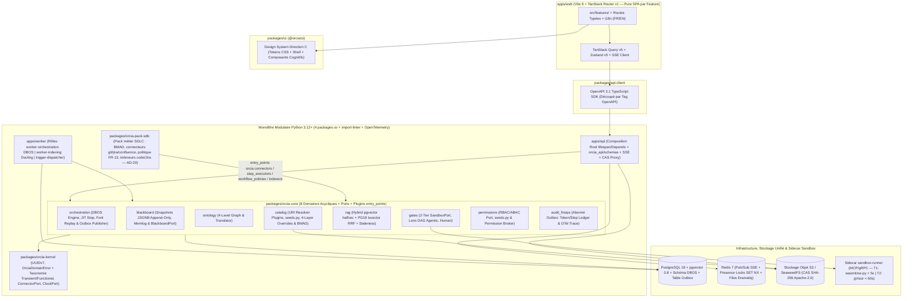
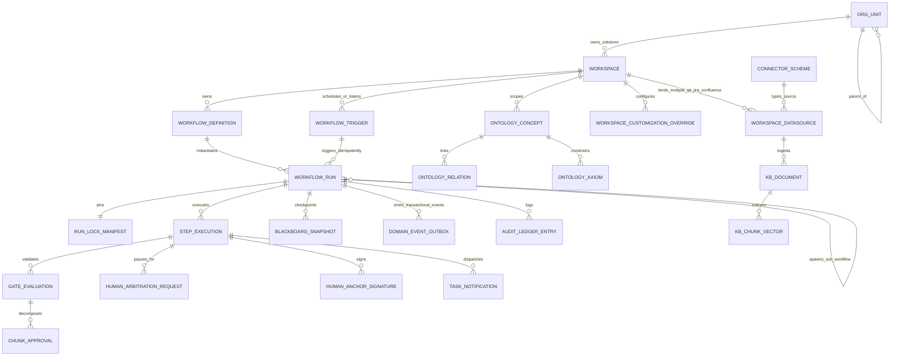

# Architecture Spine — ORCIA Platform MVP

## Design Paradigm

ORCIA adopte un paradigme **Monolithe Modulaire Hexagonal (Ports & Adapters) couplé à un Moteur d'Orchestration Durable Transactionnel sur PostgreSQL 18 (`DBOS Transact`)**, structuré dans un **Monorepo Hybride TypeScript + Python** :

1. **Frontière de Présentation (`apps/web` + `packages/ui`)** : Application **SPA pure `Vite 6 + TanStack Router v1` (TypeScript, React 19)** (`apps/web`) strictement cantonnée à un rôle d'**interface cliente réactive statique (servie par `nginx:alpine` en production, zéro serveur Node.js/RSC/BFF, zéro accès DB direct)** et organisée par **fonctionnalité (`apps/web/src/features/<domaine>/` : `cockpit`, `inbox`, `workspaces`, `catalog`, `ontology`, `gates`, `finops`, `admin`, `M11`)** assemblant les routes typées (`validateSearch` Zod + `QueryClient` loaders), l'`i18n` et les états sur la librairie Design System isolée **`packages/ui` (`@orcia/ui`)** qui héberge exclusivement les tokens CSS sémantiques et l'ensemble des composants UX/UI **Direction C** (*Executive Slate Sidebar* `#0F172A` à 7 modules RBAC + *Crisp Light Workspace* `#F8FAFC` + *Agent Assistant Dock*). `apps/web` consomme exclusivement `@orcia/ui`, le client typé `packages/api-client` (découpé par tag OpenAPI) généré depuis le schéma OpenAPI 3.1 de `apps/api` et un flux unifié Server-Sent Events (SSE) ; `packages/ui` reste pur (zéro appel réseau, zéro dépendance à `@tanstack/react-router` ou `@orcia/api-client`).
2. **Noyau Applicatif & Monolithe Modulaire (`packages/orcia-kernel`, `packages/orcia-core`, `apps/api` & `apps/worker` en workspace `uv` à 4 packages)** : Backend **Python 3.12+ (FastAPI + Pydantic v2 + SQLAlchemy 2.1 Asyncio)** structuré en graphe strictement acyclique (`AD-19`) : `orcia-kernel` (identifiants UUIDv7, `OrciaDomainError`, primitives FinOps, horloge) $\leftarrow$ 8 domaines bornés dans `orcia-core` (`permissions`, `catalog`, `ontology`, `rag`, `blackboard`, `gates`, `audit_finops`, `orchestration`, chacun doté de son propre `errors.py` et `seeds.py`, sans aucun cycle) $\leftarrow$ `apps/api` (qui détient seul les schémas HTTP/OpenAPI `orcia_api/schemas/` et la table de correspondance RFC 9457) et `apps/worker`. Les frontières sont contrôlées en CI par **`import-linter`**. Un **seul point d'assemblage (*Composition Root*)** instancie les services (`lifespan` $\rightarrow$ `app.state` $\rightarrow$ `Depends()` dans `apps/api` ; `on_startup` dans `apps/worker` — zéro singleton créé au chargement des modules).
3. **Exécution Durable Transactionnelle, Outbox Événementielle & Déploiement par Rôles (`DBOS Transact` + `apps/worker`)** : Le moteur d'orchestration durable s'appuie sur **DBOS Transact (`dbos` sur PostgreSQL 18)** pour persister transactionnellement chaque transition d'étape (`@DBOS.workflow`, `@DBOS.step`), gérer les pauses humaines de plusieurs semaines (`DBOS.recv`), les réveils par webhooks, le *Replay* non-destructif à partir de l'étape $N$ (`DBOS.fork_workflow`), les déclencheurs planifiés (`@DBOS.scheduled`) et les sous-workflows (`SUB_WORKFLOW <= 3`). Les effets secondaires inter-domaines (`audit_finops`, extraction `ontology`, notifications SSE, sous-workflows) transitent par une **table Outbox transactionnelle PostgreSQL** (`AD-19`), et une image unique est déployée selon **5 rôles de processus** (`api`, `worker-orchestration`, `worker-indexing` dédié à `Docling`, `trigger-dispatcher`, et `sandbox-runner` hors processus via MCP/gRPC).



## Invariants & Rules

### AD-1 — Monorepo Hybride TypeScript + Python, SPA Pure (`Vite 6 + TanStack Router v1`), Workspace `uv` à 4 Packages, Injection `lifespan`/`Depends` et Garde-Fou Hexagonal (`import-linter`) [ADOPTED]

- **Binds:** `all`
- **Prevents:** Dérive de schémas entre React (`apps/web`) et Pydantic (`apps/api`), pollution du noyau métier par les DTO HTTP/OpenAPI (`schemas/`), exposition d'une surface d'attaque serveur Node.js/RSC/Middleware inutile en production, erreurs d'hydratation SSR sur `@xyflow/react` v12, buffering des flux SSE, couplage furtif de `domain/` et `ports/` avec des frameworks d'infrastructure (`fastapi`, `sqlalchemy`, `dbos`, `dramatiq`, `redis`, `litellm`), ou perte d'état liée à des singletons en mémoire instanciés à l'import des modules Python.
- **Rule:**
  1. **Contrat OpenAPI 3.1 logé dans `apps/api` & SPA Pure `Vite 6 + TanStack Router v1`** : Tous les modèles d'échange HTTP et d'événements SSE sont déclarés en **Pydantic v2** exclusivement dans `apps/api/src/orcia_api/schemas/` (le noyau `orcia-core` ne connaît aucun format HTTP/OpenAPI). Le schéma OpenAPI 3.1 généré par FastAPI compile automatiquement `packages/api-client` (découpé par tag de domaine) via `openapi-typescript` et `openapi-fetch`. `apps/web` est compilée par **Vite 6**, routée par **TanStack Router v1** (`validateSearch` typé à la compilation + contexte `QueryClient`) et structurée par fonctionnalité (`apps/web/src/features/<domaine>/`) en tant que **SPA statique pure** (servie par `nginx:alpine` en production avec `proxy_buffering off` sur `/api/v1/events/stream`, sans serveur Node.js/RSC ni BFF ni accès direct à PostgreSQL/Redis).
  2. **Workspace `uv` à 4 Packages & Contrats `import-linter`** : Le dépôt Python est structuré en workspace `uv` (`uv.lock` avec versions minimales alignées sur la Spine) séparant initialement **4 packages** : `packages/orcia-kernel`, `packages/orcia-core`, `apps/api` et `apps/worker` (cf. `AD-19`). En CI, **`import-linter` (`lint-imports`)** bloque tout build si `orcia_kernel`, `orcia_core.*.domain` ou `orcia_core.ports` importe `fastapi`, `sqlalchemy`, `asyncpg`, `dbos`, `dramatiq`, `redis`, `litellm`, `docling` ou `boto3`, si un cycle existe entre domaines de `orcia_core`, ou si `orcia_core` importe `orcia_api`/`orcia_worker`.
  3. **Point Unique d'Assemblage (`lifespan` + `Depends`) & Zéro Singleton d'Import** : Aucun appel `build_default_*()` n'est autorisé au chargement d'un module. L'état applicatif est persisté dans PostgreSQL 18 via SQLAlchemy 2.1 `AsyncSession` (`asyncpg`). Les services métier sont assemblés une seule fois au démarrage (`lifespan` $\rightarrow$ `app.state` $\rightarrow$ `fastapi.Depends` dans `apps/api`, et `on_startup` dans `apps/worker`) selon la configuration active ; les adaptateurs en mémoire (`InMemory*`) et `DeterministicCassetteLLM` sont sélectionnés par configuration pour le développement local ou les tests unitaires rapides (`AD-17` Couche 1).

### AD-2 — Orchestration Durable Transactionnelle (`DBOS Transact` sur PostgreSQL 18), Checkpoints Immuables du Blackboard et Séparation Brouillon / Snapshot [ADOPTED]

- **Binds:** `FR-1`, `FR-4`, `FR-5`, `FR-6`, `FR-26`, `FR-30`
- **Prevents:** Perte d'état ou réimplémentation manuelle fragile lors des pauses longues de plusieurs jours/semaines (`WAITING_FOR_HUMAN_ARBITRATION`, `WAITING_FOR_PERMISSION`, `WAITING_FOR_UPSTREAM_RESOLUTION`), déploiement d'un cluster d'orchestration externe lourd, pollution des snapshots validés par des brouillons en cours de revue, fuite de contexte entre un *Workflow Parent* et ses *Sous-Workflows* (`SUB_WORKFLOW`), ou corruption de l'historique lors d'un retour arrière (*Rewind / Replay*).
- **Rule:** Le moteur d'orchestration durable d'ORCIA s'appuie sur **DBOS Transact (`dbos` Python, licence MIT)** adossé directement à l'instance **PostgreSQL 18** existante (zéro démon d'infrastructure additionnel ; **intégration DBOS conditionnée au verdict du spike `3.2s`**). Chaque exécution de workflow est orchestrée par `@DBOS.workflow()` et chaque étape par `@DBOS.step()` :
  1. **Séparation Brouillon / Snapshot dans la même transaction PostgreSQL** : Pendant l'exécution (`EXECUTING_AGENT`) et le passage des *Gates* (`EVALUATING_GATES`), l'artefact candidat et son journal de raisonnement sont écrits dans `step_executions.draft_artifact_jsonb` et `step_executions.step_memlog_jsonb`. Les pauses humaines ou externes de longue durée suspendent durablement le workflow via `DBOS.recv(topic, timeout_seconds)` sans consommer de worker actif. Ce n'est qu'à la validation finale de l'étape (`COMMITTED`) qu'une ligne immuable (append-only, protégée par trigger PostgreSQL `BEFORE UPDATE OR DELETE RAISE EXCEPTION`) est persistée dans `blackboard_snapshots` contenant l'état JSONB consolidé (incluant `chunk_approvals.amended_content`), le `parent_snapshot_id`, le `step_execution_id` et l'empreinte `run_lock_sha256`.
  2. **Sous-Workflows Isolés (`SUB_WORKFLOW <= 3`) & Replay Non-Destructif (`DBOS.fork_workflow`)** : Lorsqu'une étape est de type `SUB_WORKFLOW` (`FR-30`), elle invoque un workflow enfant DBOS relié par `parent_run_id`, `parent_step_execution_id` et `root_run_id` (`nesting_depth <= 3`), disposant de son propre *Blackboard* isolé (`input_mapping` $\rightarrow$ exécution $\rightarrow$ `output_mapping`). Un *Replay* à partir de l'étape $N$ (`FR-16`, y compris un *Replay* ciblé à l'intérieur d'un sous-workflow enfant) invoque `DBOS.fork_workflow(workflow_id, start_step=N)` et ne mute jamais les snapshots existants : il crée une nouvelle branche de snapshots enfants `ACTIVE` à partir du snapshot validé de l'étape $N-1$ et marque les snapshots postérieurs supplantés comme `SUPERSEDED`.
  3. **Exécution Réelle des Étapes, Zéro État Global & API Publique DBOS uniquement (Amendement A2 du 28/10/2026)** : Le corps de chaque `@DBOS.step()` d'étape résout et appelle un exécuteur enregistré dans le registre `orcia.step_executors` (`AGENT`, `SKILL`, `SUB_WORKFLOW`, `HUMAN_TASK`, `HTTP_ACTION`, extensible par pack — `AD-20`) ; aucun moteur ne produit de livrable simulé ou figé, et il n'existe **qu'un seul moteur d'exécution** branché par le *Composition Root* (`lifespan` dans `apps/api`, `on_startup` dans `apps/worker`). Le moteur est injecté explicitement (aucune variable de module globale du type `_ACTIVE_ENGINE`) et n'utilise que l'API publique de DBOS (`DBOS.launch()`, `DBOS.recv/send`, `DBOS.fork_workflow`, `SetWorkflowID`) — tout appel à une méthode préfixée `_` de `dbos` est interdit et vérifié en CI. Toute story touchant le moteur prouve un run réel de bout en bout via l'API (`PROC-01`).

### AD-3 — Garantie d'Ancrage Humain, Contrat d'Autonomie et Arbitrage Explicite au Niveau API [ADOPTED]

- **Binds:** `FR-2`, `FR-3`, `FR-5`, `FR-29`
- **Prevents:** Contournement côté serveur des sections `human_authored_required: true` par un agent exécuteur, perte de traçabilité d'un amendement humain de section (ou écrasement par l'agent d'une modification humaine réalisée directement dans Git/Confluence après publication), activation d'un workflow autonome sans contrat gouverné, ou prise de décision implicite par un LLM face à plusieurs options équivalentes.
- **Rule:** Le moteur de validation de `blackboard` rejette (`HTTP 422 ERR_HUMAN_ANCHOR_REQUIRED`) toute écriture provenant d'une identité d'agent sur un champ de gabarit marqué `human_authored_required: true` tant qu'une signature d'auteur humain (`authored_by_user_id` dans `human_anchor_signatures`) n'y est pas attachée (plafond ergonomique de `1 à 2` Ancrages Humains maximum par gabarit de workflow, concentrés sur l'intention et les contraintes amont). De même, tout amendement humain d'un tronçon (`chunk_approvals.amended_content`), toute section modifiée hors d'ORCIA dans Git/Confluence après publication et ré-importée par diff structurel (`chunk_approvals.status = HUMAN_AMENDED_EXTERNAL` via `ExternalEditRebaser`, `AD-5` Verrou V2 — inviolable par l'agent aval au même titre que `human_authored_required: true`), et tout **Contrat d'Autonomie** (`execution_regime: AUTONOMOUS_CONTRACT` ou `workflow_triggers` signé par le `TEAM_LEAD` et, pour `service_principal`, par un `SECOPS`) génèrent une signature dans `human_anchor_signatures`. Tout agent exécuteur dispose d'un outil système obligatoire `request_human_arbitration(options_matrix)` qui applique de manière déterministe la politique `tie_break_policy` déclarée sur l'étape ou le workflow (`PAUSE_AND_ESCALATE` vers `WAITING_FOR_HUMAN_ARBITRATION` par défaut, `ONTOLOGY_AXIOM_FIRST` si un axiome départage formellement les options, ou `DEFER_AND_CONTINUE_WITH_ASSUMPTION` en inscrivant `[ASSUMPTION]` dans `step_memlog_jsonb` pour les régimes `BACKGROUND_FAST_PATH` et `AUTONOMOUS_CONTRACT` de criticité `LOW_NON_CRITICAL`).

### AD-4 — Verrou de Présence Atomique Unifié par Étape et Diffusion Temps Réel par SSE (< 500ms) [ADOPTED]

- **Binds:** `FR-7`, `FR-8`, `FR-9`
- **Prevents:** Conflits d'édition ou double traitement d'une tâche d'équipe entre la *Boîte de Notifications Unifiée* et le *Cockpit*, requêtes SQL coûteuses en middleware pour corréler notification et étape, ou tentative d'action par un utilisateur en mode `READ_ONLY_OBSERVER`.
- **Rule:** La clé canonique de verrouillage temps réel dans Redis est unifiée sur l'exécution d'étape : `SET lock:step:<step_execution_id> <user_id> NX EX 900`. Toute notification d'équipe (`task_notifications`) référence son `step_execution_id`, et les routes `POST /api/v1/tasks/<task_id>/claim` comme `POST /api/v1/runs/<run_id>/steps/<step_id>/claim` acquièrent ce même verrou atomique Redis, le persistent en base et publient l'événement `task.claim.locked` sur Redis Pub/Sub `channel:workspace:<ws_id>`, relayé aux clients par FastAPI `/api/v1/events/stream` (SSE) en moins de `500ms`. Tout endpoint de mutation d'étape vérifie en $O(1)$ que l'appelant dispose du rôle `CONTRIBUTOR_ACTION_REQUIRED` et détient `lock:step:<step_execution_id>`. **Amendement A2 (28/10/2026) — Baux de ressources partagées** : le verrou de présence humain (Redis) ne protège pas les ressources externes ou internes partagées par plusieurs *Runs* (dépôt, ticket, document, enregistrement ERP). Toute étape écrivant sur une ressource partagée acquiert un bail via `ResourceLeasePort` (bail PostgreSQL `resource_leases` à expiration + **jeton de fencing** monotone transmis à `ConnectorPort.invoke` et rejeté s'il est périmé), selon un **ordre d'acquisition canonique** (tri par `resource_uri`), avec délai d'expiration et détection des attentes cycliques parent-enfant (`SUB_WORKFLOW`) ; la sérialisation par classe de ressource s'appuie sur des files DBOS dédiées (`DEC-CONC-01`).

### AD-5 — Fédération Pure d'URI Multi-Sources (`N × git://`, `N × jira://`, `N × confluence://`, `db://`, `nexus://`), Actions Jira Staged aux Gates, Schéma Interne `orcia://` et Stockage CAS S3 (`ObjectStoragePort` / SeaweedFS Apache-2.0) [ADOPTED]

- **Binds:** `FR-10`, `FR-11`, `FR-20`, `FR-22`, `FR-23`, `FR-24`, `FR-27`, `FR-29`, `FR-30`
- **Prevents:** Non-reproductibilité des *Runs* causée par la mutation d'une ressource externe (`db://`, `git://`, `nexus://`, `confluence://`, `jira://`), dépendance à MinIO (dépôt communautaire archivé en 2026 et licence AGPL-3.0), limitation artificielle à un seul dépôt Git ou un seul projet Jira par solution logicielle, mutations Jira sauvages avant validation de la *Gate*, dérive de version d'un *Sous-Workflow* imbriqué, conflits de fusion bidirectionnels entre ORCIA et Git/Confluence après publication, ou divergence d'accès aux livrables produits par les étapes antérieures d'un même *Run*.
- **Rule:** Aucun actif externe n'est copié en aveugle dans le catalogue de définition : seules les URI canoniques sont enregistrées, et un même *Workspace* (solution logicielle) peut rattacher **plusieurs dépôts `git://` dédiés, plusieurs projets/filtres `jira://` dédiés et plusieurs espaces/arborescences `confluence://` dédiés** (via `workspace_datasources` qualifiés par un `alias` logique et un `role`). Lors de l'instanciation ou d'une résolution à la volée, le `FederatedUriResolver` télécharge chaque ressource via le connecteur dédié (`db://`, `git://`, `nexus://`, `confluence://<space_key>/<page_id>@v<N>`, `jira://<project_key>/<issue_key>`), calcule son `SHA-256`, stocke le binaire/texte immuable via le port `ObjectStoragePort` (API S3 v4 standard implémentée par **SeaweedFS S3 `Apache-2.0`** en dev/CI/self-hosted ou S3 managé en cloud) sous la clé `cas/<sha256>` (servi aux clients autorisés via `/api/v1/cas/<sha256>`), et inscrit de manière récursive le vecteur complet des triplets `(alias, uri, resolved_version, sha256)` de toutes les sources du *Workspace* et de l'arbre complet des *Sous-Workflows* (`sub_workflow_locks`, profondeur $\le 3$, `FR-30`) dans `run-lock.json`. Les mutations et transitions de workflows Jira initiées par un agent (`create_issue`, `update_issue`, `add_comment`, `transition_issue` en ciblant le `project_key` approprié parmi les projets Jira du *Workspace* et après interrogation préalable de `GET /rest/api/3/issue/<key>/transitions` pour vérifier les transitions légales et les champs obligatoires) sont préparées comme **Actions Staged** dans `step_executions.draft_artifact_jsonb` (révisables via la *Validation par Découpage* `FR-6`) et ne sont exécutées sur Jira qu'au passage effectif de la *Gate* (`AD-11`, `AD-18`), en inscrivant le lien de provenance `run-lock.json` dans le ticket Jira. Les Webhooks entrants (`jira:issue_updated`, Git, Confluence, génériques ou alertes de puits de logs `LOG_SINK_ALERT`) peuvent soit réveiller une étape en pause (`UJ-3` via `DBOS.send`), soit instancier de manière idempotente un *Workflow Run* autonome (`UJ-12`, `FR-29`, `AD-18`). Les artefacts produits par une étape amont d'un *Run* sont adressés via le schéma interne canonique `orcia://runs/<run_id>/steps/<step_key>/artifacts/<artifact_key>`, résolu exclusivement depuis la branche `ACTIVE` de `blackboard_snapshots`. **Amendement A2 (28/10/2026) — Types de source ouverts** : la liste des schémas d'URI n'est **jamais** codée en dur (ni `ALLOWED_SCHEMES`, ni `Literal`, ni contrainte `CHECK`) : la **seule source de vérité** est la table `connector_schemes` (clé étrangère depuis `workspace_datasources`, `user_passthrough_credentials`, `permission_broker_policies`, `permission_broker_tickets` ; migration *Expand* `0013` puis *Contract* `0014`), alimentée par les connecteurs enregistrés dans le registre `orcia.connectors`. Chaque connecteur implémente `orcia_kernel.ports.ConnectorPort` (`capabilities()`, `fetch(uri)`, `invoke(action, payload, idempotency_key)`, `health()`, `map_error(exc)`), est branché sur `FederatedUriResolver` sans modifier sa signature publique, et passe le kit de conformité commun ; `git`, `jira`, `confluence` et `nexus` sont des connecteurs du pack SDLC (`AD-20`), `db` et `orcia` restent dans le Core. **Verrou V2 (31/10/2026) — Souveraineté Unidirectionnelle par Phase & `ExternalEditRebaser`** : ORCIA est maître du brouillon pendant le Run et conserve l'archive d'audit immuable dans `cas/<sha256>` (`orcia://workspaces/<ws>/artifacts/<type>/<slug>@v<N>`), mais dès qu'un artefact est publié vers `git://` ou `confluence://`, la cible externe redevient la seule source de vérité vivante. Lors d'un Run ou Replay ultérieur, si le `SHA-256` / `version` externe a divergé du dernier `@vN` publié par ORCIA, `ExternalEditRebaser` exécute un diff structurel par section Markdown/AST, importe la version externe `@v(N+1)` sans jamais l'écraser, marque automatiquement les sections modifiées par un humain hors d'ORCIA en **`chunk_approvals.status = HUMAN_AMENDED_EXTERNAL`** (inviolables par l'agent aval, `AD-3`) et invalide dans `step_memlog_jsonb` (`[SUPERSEDED_BY_HUMAN_COMMIT]`) toute hypothèse antérieure contredisant ce diff humain.

### AD-6 — Authentification Primaire Bi-Mode (OIDC & Locale), Identité Déléguée Passthrough vs Service Principal Scopé, Port d'Autorisation (`AuthorizationEnginePort`), Permission Broker et Serveur MCP Gouverné (Résolution OQ-1 & OQ-2) [ADOPTED]

- **Binds:** `FR-10`, `FR-11`, `FR-21`, `FR-22`, `FR-24`, `FR-27`, `FR-28`, `FR-29`
- **Prevents:** Blocage du déploiement d'une équipe pilote en attente d'intégration DSI centrale, élévation de privilèges involontaire (*Confused Deputy*) où un agent exécuteur, un trigger autonome ou un IDE externe accède à des dépôts `git://`, espaces `confluence://`, projets ou transitions `jira://`, bases `db://` ou artefacts auxquels l'appelant n'a pas droit, ou échec silencieux sur erreur `401/403`.
- **Rule:** L'identification primaire sur ORCIA supporte deux modes natifs en MVP : (1) **SSO d'Entreprise `OIDC / OAuth 2.1`** (Keycloak, Entra ID, Okta, Google Workspace) avec synchronisation des claims JWT (`BU`, `Team`, groupes), et (2) **Authentification Locale autonome (`Email + Argon2id + MFA TOTP optionnel`)** avec liens d'invitation signés pour un usage individuel ou un démarrage immédiat d'équipe, émettant des jetons JWT courts (`15 min`) et un Refresh Token `HttpOnly / Secure / SameSite=Strict` révocable instantanément dans Redis. L'évaluation matricielle RBAC/ABAC (`permissions/evaluator.py`) est abstraite derrière `AuthorizationEnginePort`. Par défaut (`execution_identity: passthrough`), les connecteurs `db://`, `git://`, `nexus://`, `confluence://` (incluant la vérification des restrictions de lecture de pages Confluence), `jira://` (droits de lecture projet, création/édition et transitions de workflow Jira), les clients MCP sortants **et le Serveur MCP entrant d'ORCIA (`/api/v1/mcp` exposé aux IDE externes : VS Code, Cursor, Claude Code, Antigravity)** utilisent le jeton OAuth 2.0 (3LO) délégué de l'utilisateur courant ou son secret personnel (`PAT`) stocké dans son coffre d'identité utilisateur chiffré en **AES-256-GCM** avec clé dérivée par utilisateur. Le mode `service_principal` (requis pour les déclencheurs événementiels et planifiés `WEBHOOK`, `LOG_SINK_ALERT`, `CRON` sans session utilisateur interactive, `FR-29`) utilise une identité de service dédiée au *Workspace*, à privilèges minimaux (**lecture seule par défaut**, écritures/déploiements limités aux seules *Actions Staged* explicitement déclarées dans le *Contrat d'Autonomie* signé par un `TEAM_LEAD` et un `SECOPS`, `AD-18`). En cas de refus d'accès (`401/403`, y compris un rôle Jira manquant pour effectuer une transition de statut) ou d'absence de permission ORCIA (`EXECUTE`, `READ_SOURCE`), le `PermissionBrokerService` intercepte l'exception, interroge la Base de Connaissance d'Habilitations (fichiers Markdown à frontmatter YAML standardisé `uri_pattern`, `required_role`, `approver_team`, `request_url_template`, `sla_hours`), met l'étape en pause `WAITING_FOR_PERMISSION` et retourne la procédure exacte à l'utilisateur ou au propriétaire du trigger. Tout appel via `/api/v1/mcp` respecte en outre l'interdiction absolue d'écrire sur les sections `human_authored_required: true` (`AD-3`). **Amendement A2 (28/10/2026) — Secrets & canal de demande d'accès** : (1) les secrets ne circulent dans le domaine que sous forme de `SecretRef` (référence opaque **non sérialisable** : `__reduce__`, `model_dump` et `json` lèvent une erreur) résolue au dernier moment par `SecretProviderPort` (adaptateur Vault / Infisical / KMS via `SEC-03`) ; (2) un processeur structlog masque toute valeur de secret, et seuls les champs d'une **liste blanche** sont sérialisés dans `domain_events_outbox`, `audit_ledger`, `step_executions` et les entrées/sorties d'étapes DBOS (`dbos.*`) ; (3) un **test du secret témoin** injecte un secret canari et vérifie son absence dans toutes ces tables et dans les logs (`NFR-SEC-4`) ; aucune valeur par défaut de secret n'est écrite en dur ; (4) la procédure de demande d'accès du `PermissionBrokerService` passe par `AccessRequestChannelPort` (Jira = un adaptateur parmi d'autres : ServiceNow, e-mail) et la colonne générique `request_url` remplace `jira_request_url` (*Expand → Contract*, `DEC-ACC-01`).

### AD-7 — Modélisation Relationnelle-Graphe de l'Ontologie à 4 Niveaux (Arbre d'Équipes `3_TEAM` & Solution `3_WORKSPACE`), Isolation de Branche L4 et Simulation d'Impact (*What-If*) [ADOPTED]

- **Binds:** `FR-7`, `FR-8`, `FR-9`, `FR-10`, `FR-12`, `FR-13`, `FR-14`, `FR-15`
- **Prevents:** Introduction prématurée d'un SGBD graphe externe (Neo4j), confusion entre le vocabulaire métier/technique commun à toute une équipe et les concepts propres à une seule de ses solutions logicielles (`Workspace`), écrasement sauvage de l'ontologie d'entreprise par un *Run*, pollution d'un *Replay* par des concepts éphémères (Niveau 4) extraits dans une branche supplantée (`SUPERSEDED`), inflation non bornée de la base et des coûts FinOps sur les branches L4, ou engorgement de la file de validation du Glossaire (`✨ À valider`).
- **Rule:** Les 4 niveaux d'ontologie (`1_ENTERPRISE`, `2_DOMAIN`, `3_TEAM` le long de l'arbre hiérarchique `org_units` `Équipe Parente -> Sous-Équipe` et `3_WORKSPACE` propre à une solution logicielle, `4_RUN_EPHEMERAL`) sont stockés dans PostgreSQL via les tables `ontology_concepts`, `ontology_relations` et `ontology_axioms` avec clé de portée `(level, scope_id)`. Tout concept `4_RUN_EPHEMERAL` est stocké en **différentiel pur (*Delta-Only*)** référençant `introduced_in_snapshot_id` ; la CTE récursive de résolution (`4_RUN_EPHEMERAL -> 3_WORKSPACE -> 3_TEAM [Sous-Équipe -> Équipe Parente] -> 2_DOMAIN -> 1_ENTERPRISE`) n'inclut que les concepts L4 rattachés à la lignée de snapshots `ACTIVE` de l'étape courante, et toute entrée L4 d'une branche `SUPERSEDED` ou d'un Run clos depuis `> 30 jours` sans promotion est purgée/archivée par TTL. Toute contradiction axiomatique entre un niveau inférieur et un niveau supérieur lève un drapeau `ONTOLOGY_CONFLICT` bloquant la promotion tant qu'un Steward ne l'a pas arbitrée. De plus, avant l'application d'un *Challenge Amont* (`FR-7`) ou d'une promotion/modification d'ontologie (`FR-9`), le `ImpactSimulatorService` exécute une traversée de graphe (CTE sur `ontology_relations` et graphe de dépendances `orcia://` de `blackboard_snapshots`) pour prévisualiser la liste exacte des *Steps*, *Artefacts* et *Workflows* impactés. **Verrou V4 (31/10/2026) — Gouvernance *Zero-Corvée* du Glossaire (`In-Flow Promotion` & Plafond FIFO `max 15`)** : (1) la file `✨ À valider` (`status = CANDIDATE` en `3_WORKSPACE`) est bornée à un **plafond strict de `15` candidats actifs maximum par Espace** (remplacement par score de confiance/fréquence au-delà de 15 afin d'éviter toute dette d'administration) ; (2) à chaque *Gate Humaine* de fin de workflow, le **Briefing de Revue en 4 blocs (`AD-11`)** intègre directement jusqu'aux **`Top-3` termes/règles `4_RUN_EPHEMERAL` à haute confiance ($\ge 0.85$)** sous forme de cases pré-cochées (`[✓] Promouvoir au Glossaire de l'Espace`), permettant leur promotion en `3_WORKSPACE` en **0 clic supplémentaire** lors de l'approbation du livrable.

### AD-8 — Indexation Différenciée Incrémentale Multi-Sources (N × Confluence *Parent-Child*, N × Jira Hybride + Graphe Tripartite Unifié, N × Code *AST + Code Graph*, Schéma DB), Vecteurs `halfvec(1024)`, Recherche Lexicale Native `tsvector` + RRF et Détection de Staleness [ADOPTED]

- **Binds:** `FR-6`, `FR-16`, `FR-17`, `FR-20`, `FR-23`, `UJ-10`
- **Prevents:** Découpage naïf uniforme cassant les fonctions de code ou les règles métiers, dépendance à une extension PostgreSQL sous licence AGPL-3.0 ou image custom (ParadeDB `pg_search`) dès le MVP, ingestion aveugle de pages Confluence brouillons/archivées (« syndrome du cimetière wiki ») ou de tickets Jira bruités, cloisonnement artificiel empêchant de relier plusieurs dépôts Git, plusieurs projets Jira et plusieurs espaces Confluence d'une même solution logicielle, ré-indexation complète ou appels LLM coûteux à chaque `git push`, et arbitrage silencieux face aux contradictions entre Confluence, Jira et Git.
- **Rule:** Le moteur `packages/orcia-core/rag` applique une indexation incrémentale (par delta d'arbre `SHA-256` sur chaque dépôt Git, `page.version.number` sur chaque espace Confluence ou `updated` timestamp sur chaque projet Jira rattaché au *Workspace*) selon **3 régimes adaptés**, stockée en vecteurs normalisés **`halfvec(1024)` (FP16)** dans `pgvector` HNSW couplés à l'index lexical natif PostgreSQL 18 **`tsvector` (`GIN` + `ts_rank_cd` pondéré `setweight` `A` pour titres/identifiants Jira/symboles AST et `B` pour le corps)**, fusionnés par **Reciprocal Rank Fusion (`RRF`, $k=60$)** filtrée sur `kb_snapshot_hash` et isolée par `workspace_id` (l'absence d'IDF global inter-documents de `ts_rank_cd` étant assumée au MVP pour conserver l'image PostgreSQL 18 standard sans licence AGPL-3.0, avec traversée CTE du graphe tripartite bornée à `depth <= 2`) :
  1. **Documentation, Multi-Espaces Confluence & Multi-Projets Jira de Référence (`1..N confluence://`, `1..N jira://`, Markdown, PDF, OpenAPI via `Docling` sur rôle et file dédiés `worker-indexing`)** : Ingestion Confluence sélective sur chacun des espaces dédiés du *Workspace* gouvernée par `space_key`, page racine et labels d'inclusion/exclusion (`orcia-kb`, exclusion de `draft`/`archived`), et **indexation hybride sur chacun des projets Jira du *Workspace*** (seuls les tickets porteurs de connaissance durable — *Epics, User Stories, Bugs résolus avec Root Cause, Post-mortems* filtrés par JQL dans `init-datasource` — sont vectorisés en **1 chunk unifié (`256-1024` tokens)** préfixé par son *Contextual Header* `[Projet > Epic > Clé | Type | Statut | Composants | Versions]`, tandis que le suivi opérationnel temps réel multi-projets est interrogé en direct via l'API JQL). Découpage hiérarchique *Parent-Child* pour les documents longs (**chunk enfant `256-512` tokens** portant le vecteur `halfvec(1024)` $\rightarrow$ **chunk parent `1024-2048` tokens** injecté à l'agent).
  2. **Multi-Codebases (`1..N git://` via `tree-sitter`) & Graphe Tripartite Multi-Sources (`Confluence ↔ Jira ↔ Git`)** : Découpage syntaxique strict par symbole AST (**`150-800` tokens** par fonction/classe/modèle Pydantic) sur l'ensemble des dépôts `git://` du *Workspace*, doublé d'un *Code Property Graph* inter-dépôts (`DEFINES`, `CALLS`, `IMPORTS`, `IMPLEMENTS_CONCEPT`, `TESTED_BY`) et de l'extraction automatique des clés de tous les projets Jira liés (`[A-Z][A-Z0-9]+-[0-9]+`) dans les commits/PR, les pages de tous les espaces Confluence et les liens d'issues pour alimenter un **Graphe Tripartite de Traçabilité unifié à l'échelle du Workspace (`DOCUMENTS`, `SPECIFIES`, `FIXES`, `IMPLEMENTS_ISSUE`, `BLOCKS`, `AFFECTS_CONCEPT`)**. **Garde-fou FinOps Git (`0 $` LLM sur `git push`)** : un simple `git push` sur une branche de travail exécute uniquement la Passe 1 déterministe `tree-sitter` sur le delta `SHA-256` (`0` appel LLM) ; la Passe 2 LLM de consolidation ontologique (`Top-15` batch en tier `simple`) n'est déclenchée que sur ouverture/fusion de Merge Request / Pull Request, synchronisation manuelle d'une source ou passage d'une Gate de fin d'étape.
  3. **Bases Transactionnelles (`db://`)** : Indexation **exclusive du schéma DDL et de son mapping Ontologique** (zéro ligne transactionnelle indexée dans le RAG).
  Tout chunk issu d'un document, d'un ticket Jira ancien ou d'une page Confluence dépassant son `freshness_ttl_days` ou contredit par le code/réel (vérifiable aussi via la brique `data-freshness`) injecte automatiquement `[STALE_WARNING]`. En cas de contradiction entre sources dans le Graphe Tripartite, l'ordre de préséance déterministe est : **`1. Axiomes Ontologie Actifs (N1–N3) > 2. Intention Courante du Run (Ticket Jira / Ancrage Humain) > 3. Réalité Exécutable (Code Git AST) > 4. Documentation Descriptive (Confluence)`**, avec escalade vers `request_human_arbitration` (`AD-3`) si l'ambiguïté touche une règle critique non acquittée.
  **Amendement A2 (28/10/2026)** : les régimes d'indexation sont des plugins du registre `orcia.indexers` derrière `VectorStorePort` et `ContextSourcePort` (`DEC-CTX-01`) ; le Core `rag` ne conserve que la recherche hybride générique (RRF, `halfvec`, `tsvector`, `[STALE_WARNING]`) et le régime documentaire générique, tandis que les régimes code AST, Jira et le graphe tripartite (`Confluence ↔ Jira ↔ Git`) sont fournis par le pack SDLC (`AD-20`).

### AD-9 — Sandbox d'Exécution Sans Réseau à Deux Paliers de Budget (Palier 1 `Wasmtime < 5s` & Palier 2 `Conteneur Isolé gVisor / Podman Rootless < 60s`) et Isolation Hors Processus (`sandbox-runner`) [ADOPTED]

- **Binds:** `FR-18`, `FR-20`, `FR-29`
- **Prevents:** Exécution de code arbitraire malveillant dans le processus principal du worker, fuite de données vers l'extérieur, échec des pods Kubernetes où les `user namespaces` Linux (`bubblewrap --unshare-net`) sont désactivés, dette de maintenance liée au portage d'outils tiers complexes en WebAssembly, ou échec par timeout irréaliste (`5s`) lors de l'exécution de compilateurs, linters et suites de tests unitaires (`UJ-12`).
- **Rule:** L'isolation d'exécution sans réseau (`SandboxRuntimePort`) est déportée dans un rôle séparé **`sandbox-runner`** invoqué hors processus (via protocole **MCP** ou sous-processus isolé, `AD-19` `M8`/`M9`) et scindée en **2 paliers de budget** selon la nature du contrôle :
  1. **Palier 1 — Validateurs Déterministes & Règles Pures (`wasmtime-py`, `< 5000ms`, `256MB` RAM, `0` réseau, `0` accès FS hôte)** : Exécution via le runtime WebAssembly **Wasmtime** (avec fuel/epoch interruption stricte) **strictement réservée aux validateurs statiques internes** (JSON Schema, YAML Workflow-as-Code, sections Markdown obligatoires, `validate_help_article` et axiomes d'ontologie). Il est formellement interdit de compiler ou maintenir des linters/outils tiers externes en WASI.
  2. **Palier 2 — Linters, Compilateurs, Outils de Packs & Tests Unitaires d'Auto-Remédiation `UJ-12` (`Conteneur Éphémère Isolé gVisor runsc / Podman Rootless --network=none`, `< 60000ms`, `1024MB` RAM, `/tmp` `256MB`)** : Exécution dans un conteneur éphémère sans interface réseau monté en lecture seule sur le snapshot CAS du dépôt cible, compatible avec les clusters Kubernetes standards (`RuntimeClassName: gvisor`) sans requérir de `user namespaces` privilégiés sur l'hôte, accueillant 100 % des linters, compilateurs et outils de l'écosystème standard.

### AD-10 — Orthogonalité Stricte des Modèles Confinée par Palier de Souveraineté (`SovereigntyTier`), Pseudonymisation PII Réversible et DAG de Lentilles (incluant `fact_verification`) aux Gates Agentiques [ADOPTED]

- **Binds:** `FR-18`, `FR-19`, `FR-20`, `FR-25`, `NFR-SEC-2`
- **Prevents:** Biais d'auto-complaisance où le même modèle LLM (ou la même famille de modèles) génère puis valide un artefact, fuite de données personnelles/sensibles ou de **propriété intellectuelle / logique métier propriétaire (AST, seuils de fraude, algorithmes, failles d'architecture blanchis par l'Ontologie)** vers un LLM Cloud externe sous prétexte que les PII ont été pseudonymisées, hallucinations factuelles non détectées, ou dérive silencieuse vis-à-vis du PRD/Architecture de l'étape 1.
- **Rule:** Le `ModelRouterService` (basé sur **LiteLLM**) impose par construction lors de toute *Gate Agentique* que `evaluator_model_family != executor_model_family`, purge intégralement la chaîne de pensée (*Chain-of-Thought*) de l'exécuteur, et applique à la volée un filtre `PiiReversibleScrubber` (`anonymize_pii_reversible: true`, table de correspondance éphémère en Redis liée au `run_id`, blanchissant les symboles AST et termes d'Ontologie pour préserver le raisonnement métier) avant tout envoi vers un fournisseur LLM Cloud externe autorisé. **Verrou V3 (31/10/2026) — Confinement Strict d'Orthogonalité par Palier de Souveraineté (`SovereigntyTier` : `C0/Public`, `C1/Interne`, `C2/Confidentiel Projet`, `C3/Secret Stratégique & ANSSI`)** : l'orthogonalité des modèles s'opère **exclusivement à l'intérieur d'un palier de souveraineté supérieur ou égal à la classification de l'Espace ou de la source** (ex. pour `C2/SENSITIVE` et `C3/RESTRICTED`, bascule orthogonale entre deux familles de modèles souverains locaux/on-premise distincts tels que `local/ollama-qwen2.5-coder-32b` $\leftrightarrow$ `local/vllm-mistral-small-24b`). L'activation de `PiiReversibleScrubber` est une défense en profondeur sur `C0/C1` et **n'autorise jamais à déclasser un flux `C2/C3` vers une API Cloud externe**. En s'inspirant de `bmad-review` et des meilleures pratiques d'audit factuel, chaque *Gate Agentique* exécute un **DAG de Lentilles d'Évaluation** :
  1. **Lentilles Indépendantes Parallèles** (sans visibilité sur les résultats des autres lentilles) : *Lentille 1 : Alignement Transverse Étape 1 (PRD/Archi)*, *Lentille 2 : Vérification Atomique de Faits (`fact_verification` — décomposition en assertions individuelles confrontées à l'Ontologie et aux KB épinglées avec score de confiance `0..1`)*, *Lentille 3 : Attaque Adversariale & Edge-Cases*, et *Lentille 4 : Conformité Métier/Sécurité*.
  2. **Lentille Dépendante (`after`)** : *Lentille 5 : Synthèse & Structure* qui consolide les trouvailles (`lens_findings_jsonb`) et rédige le **Briefing de Revue en 4 blocs**.

### AD-11 — Politique des Gates Humaines Adaptatives, Registre des Exceptions Acquittées (`workspace_exception_waivers`) et Garde-Fou Anti-Rubber-Stamping (Résolution OQ-3) [ADOPTED]

- **Binds:** `FR-4`, `FR-21`, `FR-22`, `FR-29`
- **Prevents:** Validation mécanique à l'aveugle (*Rubber-Stamping*) des artefacts longs, engorgement humain (*Gate Fatigue* $> 3\text{--}5$ sollicitations/jour) causé par le redéclenchement perpétuel d'exceptions sur des écarts documentaires Confluence/Git déjà connus et arbitrés, ou dérive silencieuse des exécutions autonomes sans revue par échantillonnage.
- **Rule:** Toute étape soumise à une *Gate Humaine* génère obligatoirement un **Briefing de Revue** structuré en 4 blocs (`summary`, `key_elements`, `decisions_taken`, `assumptions_retained` + jusqu'aux `Top-3` termes L4 pré-cochés pour promotion *In-Flow* au Glossaire, `AD-7` Verrou V4) et découpe les artefacts $> 1500$ mots en unités de **Validation par Découpage** (`chunk_approvals`). Le moteur applique 3 politiques configurables (avec `risk_or_exception_based` comme politique par défaut des étapes intermédiaires) :
  1. `mandatory_full` : Revue humaine à 100 % (obligatoire dès qu'une section possède `human_authored_required: true`, qu'il s'agit de la Gate finale de publication vers le SI externe, ou que `criticality == HIGH_CRITICAL`).
  2. `risk_or_exception_based` : Passage automatique uniquement si `deterministic_status == PASS` **ET** `agentic_score >= 0.85` **ET** **`unacknowledged_ontology_conflicts == 0`** **ET** **`unacknowledged_stale_warnings == 0`** (et, pour les workflows d'auto-remédiation `UJ-12`, `root_cause_confidence >= 0.90` + reproduction/correction TDD validée en Sandbox + test staging conforme) ; escalade humaine immédiate sinon. **Verrou V1 (31/10/2026) — Registre des Exceptions Acquittées (`workspace_exception_waivers`)** : lorsqu'un Tech Lead ou Steward arbitre un `[STALE_WARNING]` ou un écart documentaire connu entre une source `A` et une cible `B`, il peut cocher **`[✓] Acquitter cet écart tant que la source ne change pas`**, ce qui persiste une entrée `(workspace_id, source_uri, source_sha256, target_uri, conflict_rule_id, expires_at)` dans `workspace_exception_waivers`. Tant que l'empreinte `source_sha256` reste identique et que le bail d'acquittement n'est pas expiré, cet écart est comptabilisé comme acquitté et ne bloque plus le passage automatique `risk_or_exception_based` ; dès que la source externe évolue (`@v(N+1)` $\rightarrow$ nouveau `sha256`), l'acquittement est automatiquement invalidé.
  3. `sampling` : Tirage aléatoire stratifié de **20 %** des exécutions conformes (et d'une fraction configurable `post_hoc_sampling_rate`, défaut `10 %`, des *Runs* autonomes terminés en `COMMITTED_AUTONOMOUS` via la file `POST_HOC_AUDIT_SAMPLE`, `FR-29`) vers une revue humaine d'audit. Lorsqu'un workflow en `mandatory_full` atteint $\ge 95\%$ de succès sur $N \ge 20$ exécutions sans amendement humain (`FR-27`), le tableau de bord recommande au `TEAM_LEAD` sa bascule en 1 clic vers `risk_or_exception_based`.
  En outre, toute approbation humaine d'un artefact $> 1000$ mots soumise en moins de `15 secondes` de temps de lecture actif déclenche un contrôle de confirmation explicite et est journalisée avec le flag `fast_approval_warning: true`.

### AD-12 — Journal d'Audit Immuable, Télémétrie FinOps, Instrumentation OpenTelemetry W3C TraceContext et Coupe-Circuit par Étape / Déclencheur / Arbre de Runs [ADOPTED]

- **Binds:** `FR-23`, `FR-24`, `FR-29`, `FR-30`
- **Prevents:** Dérive budgétaire des boucles d'agents, tempêtes de webhooks/logs en mode autonome, explosion de coût par récursion de sous-workflows, perte de corrélation distribuée entre `apps/api`, DBOS/workers et PostgreSQL, et impossibilité de prouver réglementairement qui (humain, agent ou trigger, avec quel modèle et quelle version de KB) a validé une étape.
- **Rule:** L'application instrumente `apps/api` et `apps/worker` avec **OpenTelemetry (`opentelemetry-sdk`, `opentelemetry-instrumentation-fastapi`, `opentelemetry-instrumentation-sqlalchemy`)** et propage l'en-tête W3C `traceparent` (`trace_id` 128 bits, `span_id`) dans chaque log Structlog, chaque enveloppe d'erreur **RFC 9457** et chaque ligne d'audit. Chaque appel LLM, exécution de *Skill*, passage de *Gate*, déclenchement automatique (`trigger_id`, `trigger_idempotency_key`), vérification post-action et action humaine écrit dans la table append-only `audit_ledger` (protégée contre `UPDATE`/`DELETE` par trigger PostgreSQL, alimentée de manière transactionnelle ou via l'Outbox dont le relais est abstrait derrière le port `OutboxRelayPort`, indépendant du moteur d'orchestration) les métriques `input_tokens`, `output_tokens`, `estimated_cost_usd`, `latency_ms`, `actor_type`, `actor_id`, `model_id`, `trace_id` et `run_lock_sha256`. Chaque *Run* (mutualisé sur `root_run_id` à travers tous ses *Sous-Workflows* enfants `SUB_WORKFLOW`, `FR-30`) et chaque *Étape* possède un plafond `max_cost_usd` et `max_agent_retries` (défaut : `3`), et chaque *Déclencheur* (`workflow_triggers`) possède ses plafonds `max_runs_per_hour`, `max_daily_cost_usd` et `max_consecutive_failures` (défaut : `3`) au-delà desquels le circuit-breaker suspend l'étape en `PAUSED_BUDGET_EXCEEDED` / `PAUSED_MAX_RETRIES` ou bascule le déclencheur en `CIRCUIT_OPEN`, exigeant une action explicite d'arbitrage humain ou d'extension budgétaire (`POST /api/v1/runs/<run_id>/budget-override`) pour reprendre. **Amendement A2 (28/10/2026) — Taxonomie d'erreurs & relances** : `orcia_kernel.errors` définit, sous `OrciaDomainError`, deux familles exclusives : **passagères** (`TransientInfraError(retry_after_s)`, `RateLimitedError`, `UpstreamTimeoutError`) et **non relançables** (`FunctionalConnectorError`, `PolicyDeniedError`, `PermanentInfraError`). Chaque `ConnectorPort.map_error` traduit les exceptions natives dans cette taxonomie. Tout appel sortant d'une étape passe par le **`ConnectorInvoker`**, exécuté comme étape durable DBOS, qui : relance **uniquement** les erreurs passagères (backoff exponentiel avec gigue, respect de `Retry-After`), transmet l'`idempotency_key` à chaque tentative, maintient un **coupe-circuit par connecteur** (ouvert après N échecs consécutifs, semi-ouvert après délai), impute chaque tentative au budget `max_agent_retries` / `max_cost_usd` de l'étape et du `root_run_id`, et bascule toute erreur fonctionnelle vers `WAITING_FOR_HUMAN_ARBITRATION` sans relance.

### AD-13 — Hydratation Just-In-Time par Étape, Memlog Structuré et Exécution Tri-Modale (Coaching Interactif, Fast-Path Tâche de Fond & Autonome sous Contrat) [ADOPTED]

- **Binds:** `FR-1`, `FR-2`, `FR-3`, `FR-4`, `FR-5`, `FR-6`, `FR-11`, `FR-13`, `FR-23`, `FR-29`
- **Prevents:** Dilution d'attention du LLM (*Context Rot*) causée par le chargement des instructions des étapes futures, perte du fil de raisonnement lors d'une reprise d'étape, ou blocage intempestif à mi-parcours d'un audit en tâche de fond (`UJ-10`) ou d'un run autonome sous contrat (`UJ-11`, `UJ-12`).
- **Rule:** Inspiré de l'architecture `step-file` et `.memlog.md` de BMAD (avec intégration DBOS conditionnée au verdict du spike `3.2s`) :
  1. **Hydratation Just-In-Time** : Le `@DBOS.step` d'étape n'injecte dans le contexte de l'*Agent Exécuteur* que les instructions de l'étape courante $k$ et ses entrées déclarées (`orcia://...`), jamais les instructions des étapes futures $k+1 \dots N$.
  2. **Memlog d'Étape (`step_executions.step_memlog_jsonb`)** : Chaque étape maintient un journal append-only structuré (hypothèses écartées, décisions intermédiaires, arbitrages) distinct du livrable propre, qui alimente la génération du *Briefing de Revue*.
  3. **Exécution Tri-Modale (`execution_regime`)** :
     - **`INTERACTIVE_COACHING` (Mode Coaching)** : passes interactives courtes et suspension durable en `WAITING_FOR_HUMAN_ARBITRATION` (`DBOS.recv`) sur chaque ambiguïté.
     - **`BACKGROUND_FAST_PATH` (Mode Tâche de Fond `UJ-10`)** : le workflow durable DBOS enchaîne les étapes en arrière-plan sans bloquer sur les ambiguïtés intermédiaires ; chaque choix ouvert est balisé par `[ASSUMPTION]` (marqueur du Core) et chaque constat métier par un marqueur à espace de noms fourni par un pack (ex. `sdlc.bug_code_suspected`, `sdlc.doc_obsolete_suspected` pour les écarts Doc/Code — Amendement A2, `AD-20`) dans `step_memlog_jsonb`, puis consolidé dans le rapport final pour arbitrage groupé (`FR-5`).
     - **`AUTONOMOUS_CONTRACT` (Mode Autonome sous Contrat `UJ-11`, `UJ-12`, `FR-29`)** : réservé aux workflows ou étapes de criticité `LOW_NON_CRITICAL` ou `STANDARD` dotés d'un *Contrat d'Autonomie* signé ; exécute les étapes de bout en bout (et l'éventuelle étape de `POST_ACTION_VERIFICATION`) tant que toutes les *Gates* déterministes et agentiques ($\ge 0.85$) passent, en appliquant la `tie_break_policy` déclarée (`ONTOLOGY_AXIOM_FIRST`, `DEFER_AND_CONTINUE_WITH_ASSUMPTION` ou `PAUSE_AND_ESCALATE`).
  4. **Exécuteurs d'Étape Réels (Amendement A2 du 28/10/2026)** : l'hydratation JIT alimente l'exécuteur résolu dans `orcia.step_executors` (`AD-2` règle 3) ; le contexte injecté provient de `ContextSourcePort` (JSON, CAS, document) et non de fichiers Markdown locaux (`DEC-CTX-01`).

### AD-14 — Découplage Arbre d'Équipes (`OrgUnit`) / Espace Solution Multi-Sources (`Workspace`), Centre de Pilotage Unifié Multi-Niveaux, Surcharge Déclarative à 4 Niveaux (`Base → Team → Workspace → User`) et Adaptateur BMAD [ADOPTED]

- **Binds:** `FR-1`, `FR-3`, `FR-10`, `FR-11`, `FR-20`, `FR-21`, `FR-25`
- **Prevents:** Confusion entre l'organisation humaine (une équipe ou sous-équipe) et la solution logicielle sur laquelle elle travaille (`Workspace`), dispersion des sources, agents, workflows et *Runs* sur plusieurs écrans disjoints, impossibilité pour un même Workspace d'agréger plusieurs dépôts Git, plusieurs projets Jira et plusieurs espaces Confluence dédiés, duplication de configuration lorsqu'une même équipe maintient plusieurs solutions logicielles, et incompatibilité avec l'écosystème de skills BMAD existant.
- **Rule:** La plateforme sépare l'**Arbre Hiérarchique d'Unités Organisationnelles (`org_units` à auto-référence `parent_id` : `Entreprise -> BU -> Tribu/Équipe Parente -> Sous-Équipe`)** des **Espaces Solutions (`workspaces`, rattachés à une équipe propriétaire `owner_org_unit_id` et regroupant via `workspace_datasources` les `1..N` dépôts `git://`, les `1..N` projets `jira://`, les `1..N` espaces `confluence://`, les schémas `db://`, le contrat `ARCHITECTURE-SPINE.md`, les *Workflow Runs* et les *Artefacts* dédiés à une solution logicielle donnée)**. L'interface expose un **Sélecteur de Périmètre Hiérarchique (`⌘W` : `🌐 Plateforme Globale → 🏢 BU / Tribu → 👥 Équipe → 🗂️ Workspace Solution`)** et un **Centre de Pilotage Unifié des Workspaces (`/workspaces` et `/workspaces/[workspaceId]`, adossé à `/api/v1/workspaces/*` et `/api/v1/org-units/*`)** à **4 onglets consolidés** (*1. Instances de `Workflow Runs` & Artefacts*, *2. Sources dédiées & partagées*, *3. Workflows, Agents & Surcharges*, *4. Équipes, Membres & Gouvernance*) qui opère de manière fractale : un `PLATFORM_ADMIN` consulte et gère 100 % des éléments globalement (en masquant le contenu métier des Workspaces `CONFIDENTIAL_RESTRICTED` sauf habilitation explicite), un `BU_DIRECTOR` ou Lead d'équipe parente bénéficie d'une consolidation ascendante (*Roll-up* en `READ_ONLY_OBSERVER` + FinOps + gestion des actifs `SHARED_BU`/`SHARED_TEAM`) sur toute son organisation, et un `TEAM_LEAD` pilote l'ensemble des Workspaces solutions de son équipe. Tout *Workflow* ou *Agent* supporte une résolution de surcharge déterministe à **4 niveaux** dans `workspace_customization_overrides` : **`1. Définition de Base (URI Catalogue) → 2. Standards d'Équipe (TEAM, hérités le long de l'arbre d'équipes) → 3. Configuration de la Solution (WORKSPACE : mapping des N dépôts git://, N projets jira://, N espaces confluence:// et linters dédiés) → 4. Préférences Profil Utilisateur (USER)`** (où les scalaires surchargent, les tableaux de règles/faits persistants s'ajoutent et les lentilles fusionnent par `code`). Le manifeste `run-lock.json` épingle conjointement le hash `SHA-256` de la définition de base et celui de la surcharge résolue. De plus, `packages/orcia-core/catalog` inclut un `BmadSkillPackAdapter` capable d'importer et d'exécuter nativement tout pack BMAD (`SKILL.md` + `customize.toml` + `steps/*.md`) référencé via `git://` ou `nexus://`. **Amendement A2 (28/10/2026)** : le `BmadSkillPackAdapter` et le format `BMAD_PACK` sont déplacés dans `packages/orcia-pack-sdlc` et enregistrés comme format de catalogue par le pack ; le catalogue du Core ne connaît que le format natif `ORCIA` (`AD-20`).

### AD-15 — Architecture en Workflow de Nœuds (Type n8n), Harness de Sécurité, Prompt à 5 Couches de l'Agent Assistant et Frontière Matérielle Exploration vs Écriture SI [ADOPTED]

- **Binds:** `FR-1`, `FR-2`, `FR-3`, `FR-11`, `FR-15`, `FR-16`, `FR-17`, `FR-26`, `FR-27`
- **Prevents:** Monolithisme opaque d'un prompt unique pour l'*Agent Assistant*, réponses superficielles sans décomposition de recherche, désactivation accidentelle des garde-fous de sécurité lors d'une personnalisation de l'Assistant, ou **contournement de la gouvernance des Processus (`Gates`) par publication directe de livrables non validés depuis le chat rapide de `Mon Assistant`**.
- **Rule:** L'*Agent Assistant* est implémenté comme un **Workflow Système de Nœuds orientés (DAG type n8n)** enregistré dans le *Catalogue Fédéré* (`orcia://system/workflows/assistant-agent`) et éditable visuellement via `@xyflow/react` ou en YAML (`Nœud 1: Routeur d'Intention → Nœud 2: Query Planner & Expansion Ontologique → Nœud 3: Fan-Out Parallèle [RAG Hybride, Catalogue, Blackboard, Permission Broker] → Nœud 4: Tri Critique & Vérification d'Axiomes → Nœud 5: Synthétiseur Adaptatif au Profil Humain`). Il expose également l'action de composition/ajustement conversationnel de manifestes **Workflow-as-Code** à partir des briques du Catalogue et de lancement en tâche de fond (`UJ-10`). Il s'exécute exclusivement à l'intérieur du `AssistantHarness` Python qui :
  1. Injecte de façon déterministe le contexte UI actif (`active_module`, `workspace_id`, `run_id`, `step_id`, `access_mode`, `human_profile`) et impose l'identité `passthrough` de l'utilisateur courant.
  2. Assemble le prompt de chaque nœud selon **5 couches strictes** : **Couche 1 (Constitution Immuable du Harness — non modifiable par surcharge)**, **Couche 2 (Directive & Schéma Pydantic du Nœud)**, **Couche 3 (Surcharges `Base → Team → Workspace → User`)**, **Couche 4 (Profil Humain & Ontologie Active N1..N4)**, et **Couche 5 (Contexte Éphémère du Cockpit & Résultats Amont)**.
  3. Bloque matériellement en sortie toute écriture directe sur une *Ancre Humaine* (`human_authored_required: true`) ou toute approbation de *Gate* à la place de l'humain.
  4. **Verrou V5 (31/10/2026) — Frontière Matérielle « Exploration Libre dans `Mon Assistant`, Écriture SI Exclusivement par Gate de Processus »** : en Vitesse 1/2 (`TTFT < 1,2 s`), `Mon Assistant` autorise sans friction l'exploration, les citations (`[S1]`, `[G1]`, `[O1]`), les notes épinglées dans un `📁 Dossier` et le téléchargement local d'un brouillon (`status = DRAFT_UNVALIDATED`). En revanche, **toute action engageante d'écriture dans le SI de l'entreprise** (publication vers `git://`, `confluence://`, création/transition `jira://`, modification d'une source `RÉFÉRENCE` ou officialisation `@v1` au Catalogue `orcia://workspaces/<ws>/artifacts/...`) est matériellement interdite en direct depuis le chat (`HTTP 422 ERR_DIRECT_SI_WRITE_REQUIRES_PROCESS_GATE`) et déclenche obligatoirement le passage par la **Gate de Validation & Publication d'un Processus** (Sandbox Déterministe $\rightarrow$ Juge Orthogonal $\rightarrow$ Validation Humaine / Action Staged sous bail `ResourceLeasePort`).

### AD-16 — Amorçage Gouverné par Workflows Système (`orcia://system/bootstrap/*`), Onboarding Autonome d'Équipe & Multi-Workspaces Multi-Sources (`TEAM_LEAD`) et Invariants d'Activation [ADOPTED]

- **Binds:** `FR-10`, `FR-12`, `FR-16`, `FR-17`, `FR-19`, `FR-21`, `FR-25`, `FR-27`, `FR-28`
- **Prevents:** Syndrome de la « coquille vide » au Jour 0 (*Cold-Start*), goulot d'étranglement sur les Administrateurs Plateforme pour embarquer chaque nouvelle équipe ou chaque nouvelle solution logicielle d'une équipe, activation d'une source de données fédérée dépourvue de procédure dans le *Permission Broker* ou de TTL de fraîcheur, ou démarrage d'une organisation sans modèles orthogonaux configurés.
- **Rule:** L'initialisation de la plateforme et l'onboarding des équipes et de leurs solutions logicielles s'exécutent via **6 Workflows Système pré-embarqués (`orcia://system/bootstrap/*`)** soumis à des *Gates Déterministes* bloquantes :
  1. `init-organization` : Requiert par Gate la connectivité d'au moins **2 familles de modèles distinctes** dans LiteLLM (garantissant `AD-10`), la configuration de l'authentification bi-mode (SSO OIDC / Auth locale Argon2id) et l'amorçage de l'*Ontologie* Niveau 1.
  2. `init-workspace` : Exécutable en autonomie par un **Chef d'Équipe (`TEAM_LEAD` / `Workspace Admin`)** pour configurer son équipe (et d'éventuelles sous-équipes dans `org_units`), inviter ses membres (via recherche OIDC ou lien d'invitation signé) en leur pré-assignant leur *Profil Humain* (`PM/Métier`, `Architecte`, `Tech Lead`, `Développeur`, `SecOps`, `Direction`) et leurs rôles d'exécution (`CONTRIBUTOR`, `GATE_REVIEWER`, `ONTOLOGY_STEWARD_L3`, `OBSERVER`), définir les standards `TEAM` et l'*Ontologie* `3_TEAM`, puis créer un ou plusieurs **Workspaces (solutions logicielles)** rattachés à son équipe avec leur surcharge `WORKSPACE` (`AD-14`), leur boîte de notifications et leur *Ontologie* `3_WORKSPACE` (sans conflit avec N1/N2/3_TEAM).
  3. `init-datasource` : Exécutable à plusieurs reprises par un Admin ou par le **Chef d'Équipe** (au sein d'un *Workspace* solution ou en portée `SHARED_TEAM`) pour rattacher **plusieurs dépôts `git://`, plusieurs projets `jira://`, plusieurs espaces `confluence://`**, des schémas `db://` et des registres `nexus://` dédiés au *Workspace* (qualifiés par alias/rôle logique) ; bloque l'activation de toute source tant que (a) sa fiche YAML/Markdown dans le *Permission Broker* (`AD-6`) n'est pas signée comme *Ancre Humaine* et (b) sa politique `freshness_ttl_days` (`AD-8`) n'est pas définie.
  4. `init-existing-project` : Scanne l'ensemble des dépôts `git://` existants (*Brownfield*) rattachés à un *Workspace* pour générer son `ARCHITECTURE-SPINE.md` initial (`[ADOPTED]`) servant de référence anti-*Pattern Drift* (`FR-17`).
  5. `init-skill` : Certifie tout nouveau *Skill* en sandbox isolée (`AD-9`, Palier 1 `< 5000ms` ou Palier 2 `< 60000ms`, `--network=none`) avant publication au catalogue.
  6. `init-user` : Déclenché automatiquement au premier login d'un membre invité pour confirmer le *Profil Humain* pré-assigné par son Chef d'Équipe (`FR-1`, `FR-28`) et lier ses identités déléguées *Passthrough* (OAuth 2.0 3LO / PAT chiffré AES-256-GCM pour Jira, Confluence et Git).

### AD-17 — Stratégie de Tests à 5 Couches et Couverture Unitaire de la Plateforme [ADOPTED]

- **Binds:** `all`
- **Prevents:** Régressions silencieuses dans les 8 modules du noyau d'ORCIA, faux positifs liés au mock de SQLite/Redis en mémoire, appels LLM non-déterministes et coûteux en CI, ou collisions temps réel non détectées entre utilisateurs.
- **Rule:** Toute Story de développement de la plateforme ORCIA doit livrer ses tests automatisés selon 5 couches obligatoires :
  1. **Tests Unitaires de la Plateforme (`pytest` + `hypothesis` côté Python ; `Vitest` + `Testing Library` côté TypeScript)** : Couverture minimale exigée de **90 %** sur `packages/orcia-core` (machines à états `orchestration`, gestionnaire `blackboard`, fusionneur 4 niveaux `catalog`, résolveur et traducteur `ontology`, calculateur RRF `rag`, règles `gates`, `PermissionBrokerService`, coupe-circuit `audit_finops`, et `AssistantHarness`), ainsi que tests unitaires isolés de chaque middleware FastAPI, étape durable DBOS/worker, store Zustand et composant UI cognitif (`< 5s` d'exécution totale, zéro réseau), complétés par `import-linter` pour vérifier l'isolation hexagonale.
  2. **Tests d'Intégration sur Infrastructure Réelle (`testcontainers-python`)** : Interdiction d'utiliser SQLite ou un mock Redis en mémoire pour valider la persistance. Les tests d'intégration s'exécutent contre de vrais conteneurs éphémères **PostgreSQL 18 + `pgvector`** (incluant la reprise de workflows durables DBOS après redémarrage), **Redis 7** et **SeaweedFS S3** (vérification des CTE récursives L4, du verrou atomique `SET NX`, des triggers append-only `audit_ledger` et `blackboard_snapshots`, et de l'isolation de la sandbox).
  3. **Tests de Contrat OpenAPI 3.1 (`openapi-typescript` 0-diff + `Schemathesis`)** : La CI échoue si le client TypeScript généré diverge du schéma FastAPI ou si un endpoint viole le format d'erreur **RFC 9457**.
  4. **Tests d'Orchestration IA par Cassettes Déterministes (CI) & Evals (Release)** : En CI, un adaptateur `DeterministicCassetteLLM` rejoue instantanément (`0 $`, `100 %` reproductible) les scénarios d'ambiguïté (`WAITING_FOR_HUMAN_ARBITRATION`), de balises `[ASSUMPTION]` en *Fast-Path*, de blocage `403` et d'orthogonalité des modèles. Une suite d'évaluation (`orcia-evals`) sur *Golden Dataset* valide la pertinence sémantique du workflow Assistant et des Gates Agentiques.
  5. **Tests E2E Multi-Acteurs & Multi-Device (`@playwright/test`)** : Scénarios ouvrant 2 contextes navigateur simultanés (vérifiant le *Claim / Lock* SSE en `< 500ms` et le blocage d'action en mode `READ_ONLY_OBSERVER`) sur viewports **Desktop (`1440x900`)** et **Mobile Companion (`390x844`)**.

### AD-18 — Gouvernance de l'Autonomie sous Contrat, Déclencheurs Événementiels Idempotents (`SetWorkflowID`, Webhooks, Puits de Logs, Cron), Boucle Fermée Post-Action et Imbrication Bornée des Sous-Workflows (`<= 3`) [ADOPTED]

- **Binds:** `FR-5`, `FR-11`, `FR-13`, `FR-14`, `FR-15`, `FR-16`, `FR-19`, `FR-22`, `FR-24`, `FR-26`, `FR-27`, `FR-29`, `FR-30`
- **Prevents:** Exécution autonome sur des processus critiques sans validation humaine préalable du contrat, duplication de `Workflow Runs` lors des ré-essais de webhooks ou de workers, boucles infinies d'auto-déclenchement (*Self-Trigger Storm*) lorsqu'un agent modifie un ticket Jira ou pousse un commit Git, application d'un correctif auto-remédié (`UJ-12`) sans reproduction unitaire (`Red -> Green`) ni vérification post-déploiement dans les logs, ou récursion non bornée de sous-workflows consommant un budget infini.
- **Rule:**
  1. **Classification de Criticité & Contrat d'Autonomie** : Tout *Workflow* déclare `criticality: LOW_NON_CRITICAL | STANDARD | HIGH_CRITICAL` et `execution_regime: INTERACTIVE_COACHING | BACKGROUND_FAST_PATH | AUTONOMOUS_CONTRACT`. Tout workflow `HIGH_CRITICAL` est interdit d'exécution autonome de bout en bout (`HTTP 422 ERR_CRITICAL_WORKFLOW_REQUIRES_HUMAN_GATE`). Tout passage en `AUTONOMOUS_CONTRACT` ou activation d'un `workflow_trigger` exige un **Contrat d'Autonomie** signé dans `human_anchor_signatures`.
  2. **Déclencheurs Événementiels Idempotents (`workflow_triggers` + `DBOS SetWorkflowID`) & Protection Anti-Boucle** : Les déclencheurs (`MANUAL_AUTONOMOUS | WEBHOOK | LOG_SINK_ALERT | CRON` via `@DBOS.scheduled`, avec intégration DBOS conditionnée au verdict du spike `3.2s`) valident l'authenticité entrante (HMAC-SHA256) et imposent une idempotence transactionnelle stricte via la contrainte PostgreSQL `UNIQUE (trigger_id, trigger_idempotency_key)` combinée à `DBOS SetWorkflowID("<trigger_id>:<idempotency_key>")` et au verrou Redis (`SET lock:trigger:<trigger_id>:<idempotency_key> NX EX 86400` ; pour `LOG_SINK_ALERT`, déduplication par `error_fingerprint_sha256` et fenêtre `cooldown_window_seconds`). Un filtre **Self-Trigger Guard** ignore systématiquement tout événement externe dont l'acteur est le `service_principal` d'ORCIA ou qui porte le marqueur `x-orcia-origin-run-id`.
  3. **Boucle Fermée d'Auto-Remédiation (`UJ-12`) & Vérification Post-Action (`POST_ACTION_VERIFICATION`)** : Tout workflow autonome modifiant du code ou de l'infrastructure (`Intention de Remédiation -> Correctif`) exige un score `root_cause_confidence >= 0.90`, la reproduction de l'erreur par un test unitaire qui échoue avant correctif et passe après en Sandbox Palier 2 (`AD-9`, `< 60s`), la validation en environnement *staging / prod-like*, et une étape finale obligatoire `POST_ACTION_VERIFICATION` observant le puits de logs/métriques pendant `verification_window_seconds` après déploiement. Si l'erreur persiste ou qu'une régression apparaît, le moteur déclenche automatiquement le workflow de **Rollback**, ouvre le coupe-circuit (`CIRCUIT_OPEN`) et alerte l'astreinte en `< 500 ms`.
  4. **Imbrication Fractale Bornée (`SUB_WORKFLOW`, profondeur $\le 3$)** : Une étape `step_type: SUB_WORKFLOW` invoque un workflow cible en créant un `workflow_run` enfant DBOS lié par `parent_run_id`, `parent_step_execution_id` et `root_run_id`. Le validateur statique et le runtime bloquent tout cycle dans le graphe d'appels et toute profondeur `nesting_depth > 3` (`ERR_SUB_WORKFLOW_MAX_DEPTH_EXCEEDED`). Le `run-lock.json` du parent épingle récursivement l'arbre des sous-workflows, le *Blackboard* enfant est lexicalement isolé (`input_mapping` / `output_mapping`), et le plafond `max_cost_usd` du `root_run_id` est partagé atomiquement sur toute la hiérarchie.

### AD-19 — Architecture en Monolithe Modulaire, Graphe Acyclique de Packages `uv` (`kernel`, `core`, `api`, `worker`), Point Unique d'Assemblage, Découplage API/Domaine (`schemas` & `errors`), Événements Outbox, Plugins (`entry_points` / Sidecars MCP) et Déploiement Multi-Rôles [ADOPTED]

- **Binds:** `all`
- **Prevents:** Dépendances circulaires entre domaines (`blackboard ↔ orchestration`, `catalog ↔ bootstrap`, `permissions ↔ bootstrap`), couplage du noyau métier aux DTO HTTP/OpenAPI (`2 060` lignes de `schemas/` dans `orcia-core`), fichier monolithique d'exceptions (`domain/exceptions.py` à `377` lignes et rayon d'impact critique de `59` dépendants), singletons en mémoire instanciés à l'import dans les routeurs FastAPI (`_DEFAULT_*_SERVICE`), contournement des couches internes par import direct de fichiers privés, blocage du chemin critique d'exécution d'étape par des effets secondaires synchrones (audit FinOps, extraction ontologique, notifications SSE), ou éclatement prématuré en microservices distribués multi-bases.
- **Rule:**
  1. **Graphe de Dépendances Acyclique & Sens Unique (`M1`, `M3`, `P4`)** : Les dépendances suivent strictement l'ordre unidirectionnel `apps (api, worker) -> orchestration / bootstrap -> domaines (blackboard, catalog, ontology, rag, gates, permissions, audit_finops) -> orcia-kernel (identifiants UUIDv7, enums partagés WorkflowExecutionRegime/WorkflowStepType, classe de base OrciaDomainError, ports Protocol)`. Les 3 cycles historiques sont interdits : `orchestration` dépend uniquement de `BlackboardPort` (et `blackboard` n'importe jamais `orchestration`), tandis que les données de référence (`seeds.py`) résident dans leurs domaines propriétaires (`catalog/seeds.py`, `permissions/seeds.py`) et sont agrégées par `bootstrap`. Ce graphe est vérifié à chaque commit et en CI par `import-linter` (`lint-imports` dans `pyproject.toml`, **0 violation tolérée**). **Amendement A2 (28/10/2026)** : un contrat `import-linter` supplémentaire interdit à `orcia_kernel` et `orcia_core` d'importer `orcia_pack_sdlc` (ou tout autre `orcia_pack_*`) ; les packs dépendent du Core, jamais l'inverse (`AD-20`).
  2. **Découpage Progressif en Packages `uv` & Encapsulation Publique/Privée (`M2`, `P3`)** : Le workspace `uv` démarre avec **4 packages** (`packages/orcia-kernel`, `packages/orcia-core`, `apps/api`, `apps/worker`) pour éviter l'inflation de configuration tout en isolant physiquement le socle pur (`orcia-kernel`). Chaque sous-domaine de `orcia-core` expose exclusivement sa façade publique dans son `__init__.py` (ports, commandes/requêtes, événements, erreurs) et place ses modèles SQLAlchemy, dépôts et adaptateurs dans un sous-dossier `_internal/` interdit d'import externe par `import-linter`. Tout domaine appelé à être extrait en service autonome pourra devenir un package `uv` dédié sans toucher à ses appelants.
  3. **Séparation des Contrats HTTP (`schemas`) et Décentralisation des Erreurs (`M4`)** : Aucun schéma HTTP/OpenAPI ne réside dans `orcia-core` ; les contrats de requête/réponse Pydantic v2 vivent exclusivement dans `apps/api/src/orcia_api/schemas/<domaine>.py`. Le fichier monolithique `domain/exceptions.py` est remplacé par la seule classe de base `OrciaDomainError` dans `orcia-kernel`, chaque domaine déclarant ses propres erreurs métier dans `<domaine>/errors.py` et `apps/api` assurant la traduction déclarative `error_code -> HTTP Status + RFC 9457 Problem Details`.
  4. **Point Unique d'Assemblage (*Composition Root*) & Zéro Singleton à l'Import (`M5`, `P1`)** : Aucune fabrique `build_default_*()` ni adaptateur `InMemory*` n'est instancié au chargement des modules applicatifs. L'assemblage des ports et adaptateurs réels (SQLAlchemy 2.1 Asyncio, Redis, SeaweedFS, LiteLLM, DBOS) s'effectue en un point unique au démarrage (`lifespan` FastAPI vers `app.state` + `Depends()` dans `apps/api`, et hook `on_startup` dans `apps/worker`). Les adaptateurs `InMemory*` sont réservés aux tests unitaires (`tests/unit/fakes/`).
  5. **Bus d'Événements de Domaine & Table Outbox Transactionnelle (`M6`, `OutboxRelayPort` indépendant du moteur)** : Les effets secondaires transverses non bloquants (journalisation et coûts `audit_finops`, extraction de termes `ontology`, diffusion SSE, réveil de déclencheurs et sous-workflows) sont découplés de l'orchestrateur via des événements immuables (`StepCompleted`, `ArtifactProduced`, `GateEvaluated`, `RunTerminated`) persistés dans une table PostgreSQL **Outbox** (`domain_events_outbox`) au sein de la même transaction SQL que le changement d'état du Run, puis relayés de façon idempotente via le port **`OutboxRelayPort`** (l'outbox est indépendante du moteur d'orchestration : le relais peut être implémenté avec Dramatiq ou avec DBOS). Les *Gates* de sécurité et l'arbitrage humain qui conditionnent la transition d'état restent des appels synchrones explicites via leurs ports.
  6. **Points d'Extension Hybrides : Plugins Python `entry_points` & Sidecars MCP (`M7`, `M8`, `P5`)** : Les extensions internes de confiance suivent la *Règle de Trois* via les `entry_points` standard de `pyproject.toml` (en commençant par `orcia.uri_resolvers` pour `db://`, `git://`, `nexus://`, `orcia://` et `orcia.llm_gateways` ; **Amendement A2** : `orcia.uri_resolvers` est absorbé par le registre `orcia.connectors`, complété par `orcia.step_executors`, `orcia.workflow_policies` et `orcia.indexers` — `AD-20`). Les outils tiers non fiables et l'exécution de code isolée (`sandbox-runner` : Palier 1 `wasmtime-py` `< 5s` et Palier 2 `gVisor/Podman` `< 60s`) passent par des processus séparés via le protocole **MCP** ou sous-processus isolé.
  7. **Image Conteneur Unique Déployée selon 5 Rôles Opérationnels, Isolation des Pools PostgreSQL 18 & Frontend par Fonctionnalité (`M9`, `M11`)** : Sans jamais éclater le système en microservices par domaine ni créer une base PostgreSQL par domaine (la base PostgreSQL 18 reste unique avec un schéma `public` unifié pour préserver les transactions ACID, le verrouillage `run-lock` et l'Outbox), l'image Docker backend unique se déploie selon 5 rôles (`api`, `worker-orchestration`, `worker-indexing` isolant la consommation CPU/RAM de Docling, `trigger-dispatcher`, et `sandbox-runner`) avec **séparation des pools de connexions PostgreSQL** entre le chemin transactionnel chaud (`api` + `worker-orchestration` DBOS, SLA `< 50 ms`) et le chemin d'indexation/analyse (`worker-indexing`, routable vers un *Read Replica* au-delà de 50 Runs simultanés). Côté frontend (`apps/web`), le code applicatif est organisé par fonctionnalité métier (`apps/web/src/features/<domaine>/`) tandis que `apps/web/src/routes/` ne contient que le câblage TanStack Router v1.

### AD-20 — Core Agnostique et Packs Métier (`orcia-pack-*`), Registres d'Extension `entry_points`, Espace de Noms des Marqueurs et Workflow Pilote Semaine 1 (`sdlc/ticket-to-tech-spec`) (Avenant A2 du 28/10/2026 & Arbitrage Pilote du 31/10/2026) [ADOPTED]

- **Binds:** `all`, `FR-13`, `NFR-EXT-1`, `NFR-ISO-1`
- **Prevents:** Inscription d'un vocabulaire métier (SDLC : code, documentation, Jira, Confluence, Git, BMAD) dans le kernel, le modèle de workflow, le validateur ou le moteur ; impossibilité d'exécuter un vertical hors IT (Finance, Juridique, MCO) sans modifier le Core ; ajout d'un connecteur exigeant de toucher 15 fichiers et 4 migrations ; collisions de marqueurs entre deux packs ; règle métier (FR-13) appliquée à des workflows qui ne la concernent pas ; lancement pilote sans workflow de référence à ROI mesurable dès la Semaine 1.
- **Rule:**
  1. **Frontière Core / Pack** : `orcia_kernel` et `orcia_core` (en particulier `orchestration`, `blackboard`, `catalog`, `permissions`) ne contiennent **aucun vocabulaire métier** : `grep -rnIiE "writes_code|BUG_CODE|DOC_OBSOLETE|brownfield|confluence|git://|jira" packages/orcia-kernel packages/orcia-core/src/orcia_core/orchestration` doit retourner 0 ligne. Le SDLC est le **premier pack**, `packages/orcia-pack-sdlc` (5ᵉ package du workspace `uv`), qui dépend du Core et jamais l'inverse (contrat `import-linter`, `AD-19`). Le Core s'exécute pack SDLC désinstallé (job CI `core-without-sdlc`, `NFR-ISO-1`).
  2. **Quatre registres d'extension uniques (`entry_points`, `Q3 = 3A`)** : `orcia.connectors` (implémentations de `ConnectorPort`, `AD-5`), `orcia.step_executors` (exécuteurs d'étape, `AD-2`), `orcia.workflow_policies` (règles de validation et d'exécution de workflow déclenchées par `tags`/`policies` d'étape — ex. FR-13 « intention → code » du pack SDLC), `orcia.indexers` (régimes d'indexation RAG, `AD-8`). Un pack n'étend le Core **que** par ces registres ; les outils non fiables restent hors processus (MCP, `AD-19` règle 6).
  3. **Modèle d'étape générique** : `WorkflowStepSpec` porte des `tags: list[str]` et `policies: list[str]` à espace de noms (`sdlc.writes_code`, `sdlc.declares_intention`, `sdlc.mode.brownfield_bootstrap`…) au lieu d'attributs métier typés ; le Core rejette une politique référencée mais non enregistrée (`ERR_UNKNOWN_WORKFLOW_POLICY`).
  4. **Espace de noms des marqueurs** : les marqueurs de memlog sont des chaînes `<namespace>.<marker>` validées par un registre ; le Core ne fournit que des marqueurs génériques (`ASSUMPTION`, `STALE_WARNING`), chaque pack enregistre les siens (`sdlc.*`).
  5. **Données de démonstration & Workflow Pilote Semaine 1 (`orcia://pack-sdlc/workflows/ticket-to-tech-spec`)** : aucune donnée de démonstration dans les packages de domaine (`__init__.py`, `seeds.py`) ; les données de référence vont dans `bootstrap/seeder.py` (upserts idempotents) et les jeux de démonstration dans `tests/fixtures/` ou dans un pack. Le pack `packages/orcia-pack-sdlc` embarque comme **Workflow Pilote de Semaine 1** le processus en 3 étapes **`sdlc/ticket-to-tech-spec` (*« Du Ticket Jira au Dossier de Cadrage Technique & Analyse d'Impact Prêt-à-Coder »*)** : (Étape 1) Ingestion `jira://` + `1` `✍️ Ancrage Humain` de contraintes + traversée du Graphe Tripartite (`Jira ↔ Confluence ↔ AST Git tree-sitter`) avec détection des contradictions et `ArbitrationTieBreakCard` ; (Étape 2) Génération du plan d'implémentation et d'impact (*What-If*) avec citations exactes `[S1]`/`[G1]` + Gate Déterministe Palier 1 + Gate Agentique Orthogonale `fact_verification` (vérifiant l'existence AST de 100 % des fichiers/symboles cités) ; (Étape 3) Revue `Briefing 4 blocs` (avec promotion *In-Flow* des `Top-3` termes L4 au Glossaire) et publication `Action Staged` vers Jira et Git sous bail `ResourceLeasePort`.
  6. **Critère d'extensibilité** : un nouveau connecteur s'ajoute sans modifier aucun fichier du Core, en moins de 150 lignes hors tests, et passe le kit de conformité `ConnectorPort` (`NFR-EXT-1`).

### AD-21 — Gouvernance Post-Jour 0, Modèle d'Habilitations Hiérarchique à 6 Verbes (`create|read|update|delete|execute|grant`), Routage Cognitif Abstrait par Tiers/Effort (`simple|medium|complex|auto`), Contrat Secret Write-Only (`SecretInput`/`SecretStatus`), Propagation Déterministe DBOS et Studio/Shell Enrichis [ADOPTED]

- **Binds:** `all`, `FR-1`, `FR-5`, `FR-10`, `FR-11`, `FR-16`, `FR-18`, `FR-19`, `FR-23`, `FR-24`, `FR-26`, `FR-27`, `FR-28`, `FR-29`, `FR-30`, `NFR-SEC-3`, `NFR-SEC-4`
- **Prevents:** Impossibilité d'administrer la plateforme après le Jour 0 sans redéploiement ; écrasement accidentel d'un secret par renvoi du masque visuel (`••••••••`) ; fuite de secrets dans les réponses API, les logs ou les tables DBOS/Outbox ; escalade de privilèges lors d'une délégation locale ; non-déterminisme du rejeu DBOS en lisant un paramètre mutable hors d'un `@DBOS.step` ; couplage en dur des définitions de workflows à des noms commerciaux de modèles LLM (`gpt-4o`, `claude-3-7-sonnet`) ; modification directe d'une version publiée de workflow cassant la reproductibilité de `run-lock.json` ; verrouillage administratif (*admin lockout* en désactivant le dernier IdP ou le dernier `PLATFORM_ADMIN`).
- **Rule:**
  1. **Séparation en 3 Niveaux de Stockage & Concurrence Optimiste (`ETag` / `If-Match` `412`)** : (a) La topologie d'infrastructure et les clés maîtres (`ORCIA_PASSTHROUGH_MASTER_KEYS`, `ORCIA_JWT_SIGNING_SECRETS`) restent en variables d'environnement chiffrées (`SOPS + age`) ; (b) Les paramètres fonctionnels post-Jour 0 vivent dans la table relationnelle versionnée `platform_settings` scopée par `GLOBAL | BU | TEAM | WORKSPACE`, protégée par concurrence optimiste (`version`, en-tête `If-Match` obligatoire, rejet `HTTP 412 ERR_SETTINGS_VERSION_CONFLICT` ou `HTTP 428 ERR_PRECONDITION_REQUIRED`) et traçabilité transactionnelle via l'événement Outbox `SettingsChanged` (hash avant/après, clés modifiées, zéro valeur secrète) ; (c) Les secrets ne sont jamais stockés dans `platform_settings`, qui ne référence qu'un `secret_ref` (`UUIDv7`) résolu par `SecretProviderPort` (`AD-6`).
  2. **Modèle d'Habilitations Hiérarchique RBAC/ABAC à 6 Verbes & Confinement de Délégation (`grant`)** : Tout contrôle d'accès dans `packages/orcia-core/permissions` et `<PermissionGuard />` évalue 6 verbes atomiques — `create`, `read`, `update`, `delete`, **`execute`** (invoquer un connecteur, un modèle IA, un MCP ou un workflow sans jamais pouvoir lire sa configuration secrète) et **`grant`** (déléguer localement un sous-ensemble de ses droits sur son périmètre sous l'invariant strict $\text{Droits délégués} \subseteq \text{Droits détenus}$, journalisé dans `audit_ledger`) — sur l'arbre `Organisation -> BU -> Équipe -> Workspace -> Pack -> Ressource -> Action` (`scope_path`). Par défaut, une ressource sans droit `read`/`execute` reste visible en **découverte passive** (`🔒 Non habilité` + demande d'accès `AccessRequested` via Outbox), sauf si `hidden_when_unauthorized: true` (`HTTP 404`). Des invariants transactionnels anti-verrouillage interdisent de supprimer/désactiver le dernier `PLATFORM_ADMIN` actif ou la dernière méthode d'authentification (`HTTP 422 ERR_ADMIN_LOCKOUT_PREVENTED`).
  3. **Contrat Secret Write-Only (`SecretInput` / `SecretStatus`)** : En écriture, toute mutation de secret utilise l'union discriminée `SecretInput` (`action: "keep" | "set" | "clear"`) dans `apps/api/src/orcia_api/schemas/` ; en lecture, l'API ne retourne que `SecretStatus` (`configured: bool`, `fingerprint: "sha256:<8-hex salé par resource_id>"`, `updated_at`, `updated_by`). Le composant `@orcia/ui` `<SecretField />` ne pré-remplit jamais de valeur masquée afin d'éliminer structurellement tout écrasement par aller-retour du masque.
  4. **Abstraction Cognitive des Modèles LLM (`InferenceTier`), Niveaux d'Effort & Escalade `auto` Déterministe** : Aucun workflow ni agent ne référence un modèle physique en dur ; chaque étape déclare un `inference_tier: simple | medium | complex | auto` (défaut : `medium`) et un niveau d'effort `effort: default | fast | balanced | deep`. La table `workspace_llm_tier_mappings` associe chaque tier aux fournisseurs/modèles physiques (`LiteLLM`), budgets de tokens et ordre de repli. En mode `auto`, l'exécution démarre sur `simple` et escalade vers `medium` puis `complex` uniquement sur échec d'une Gate Déterministe (JSON/Pydantic/Sandbox), chaque tentative étant persistée comme `@DBOS.step` idempotent dans `inference_attempts` pour un rejeu déterministe et une imputation FinOps exacte.
  5. **Sémantique de Propagation vers les Runs DBOS Actifs & Garde d'Épinglage (`409`)** : Aucun paramètre mutable n'est jamais lu dans le corps d'un `@DBOS.workflow` hors d'un `@DBOS.step`. Les paramètres se divisent en 3 classes : (a) **Épinglés au démarrage** dans `run-lock.json` (version de workflow, contrat, pré-prompt `SHA-256`, pack, mapping de modèle) — toute tentative de suppression d'une ressource épinglée par un run actif retourne `HTTP 409 ERR_RESOURCE_PINNED_BY_ACTIVE_RUNS` avec options *Drainer* ou *Forcer* ; (b) **Vérifiés à chaque frontière de step** (révocation de Service Principal, désactivation de connecteur/pack, kill-switch) ; (c) **Vérifiés à chaque appel LLM coûteux** (quotas et plafonds budgétaires hiérarchiques `GLOBAL -> BU -> TEAM -> WORKSPACE`).
  6. **Gouvernance du Studio Visuel (`Contrat`, `Pré-prompt`, `COUCHES · N`, Immutabilité SemVer) & Garde-fous d'Ingestion Documentaire** : Toute version de workflow à l'état `PUBLISHED` est immuable (cliquer sur *Modifier* crée automatiquement un brouillon `vX.Y.Z-draft`). Le Studio formalise en barre supérieure le **Pré-prompt IA** (`SHA-256`), le **Contrat du workflow** (paramètres d'entrée typés `p_1..p_n` + sections Markdown obligatoires du livrable vérifiées par Gate Déterministe), les **Déclencheurs**, le **Bac à sable `▷ Tester`** et l'inspecteur **`COUCHES · N`** sur les macro-étapes (`SUB_WORKFLOW`, permettant de basculer une sous-couche en `enabled: false -> SKIPPED`). L'ingestion documentaire impose la classification `C0–C2` vs `C3`, la détection automatique de PII avec arbitrage humain (*Pseudonymiser* via `PiiReversibleScrubber` / *Indexer* / *Annuler*), le rejet fail-fast des PDF scannés vides (`0 char`) et un **Test de Réciprocité RAG** avec citation obligatoire.

## Consistency Conventions

| Concern | Convention |
| --- | --- |
| **Naming (Python Backend)** | Modules, fichiers et fonctions en `snake_case` ; classes Pydantic/SQLAlchemy et Protocols en `PascalCase` ; constantes en `UPPER_SNAKE_CASE`. |
| **Naming (TypeScript Frontend)** | Composants React en `PascalCase` (`BriefingCard.tsx`) ; hooks en `camelCase` préfixés par `use` (`useRunStream.ts`) ; stores Zustand en `use<Domain>Store.ts`. |
| **Naming (Base de données)** | Tables au pluriel en `snake_case` (`workflow_runs`, `blackboard_snapshots`, `ontology_concepts`) ; clés primaires `id` au format **UUIDv7** générées côté applicatif (`uuid-utils` en Python / `uuidv7` en TypeScript) et stockées en colonne `uuid` native PostgreSQL 18. |
| **Naming (Événements SSE)** | Format `<domaine>.<entite>.<verbe_passe>` en minuscules : `run.step.paused`, `task.claim.locked`, `gate.agentic.completed`, `ontology.term.extracted`. |
| **Formats de données & Dates** | Toutes les dates en UTC ISO-8601 (`YYYY-MM-DDTHH:mm:ss.sssZ`) ; montants FinOps en `numeric(12, 6)` USD ; empreintes de contenu en hexadécimal `sha256:<64-hex>`. |
| **Enveloppe d'Erreur API** | Format **RFC 9457 Problem Details** (`type`, `title`, `status`, `detail`, `instance`, `error_code`, `trace_id`, `permission_broker_hint`). |
| **Gestion d'état & Mutations** | État serveur géré exclusivement par **TanStack Query v5** (invalidé en temps réel par les événements SSE) ; état d'interface du Cockpit (panneaux ouverts, mode `READ_ONLY_OBSERVER` vs `CONTRIBUTOR_ACTION_REQUIRED`, onglet mobile) dans **Zustand v5**. |
| **Observabilité & Logs** | Traces distribuées **OpenTelemetry** (`W3C TraceContext traceparent`) et logs structurés JSON (**Structlog** côté Python, console/télémétrie structurée côté SPA) corrélés par `trace_id`, `span_id`, `workspace_id`, `run_id` et `step_id`. |
| **Tests & Vérification (`AD-17`)** | Tests unitaires sous `tests/unit/` ($\ge 90\%$ couverture sur `orcia-kernel` et `orcia-core`), garde-fou hexagonal `import-linter`, intégration sous `tests/integration/` (`testcontainers` PG18/Redis/SeaweedFS), contrats sous `tests/contract/` (`schemathesis`), et E2E sous `apps/web/e2e/` (`Playwright`). |

## Stack

| Name | Version |
| --- | --- |
| **Python** | `3.12.9` |
| **uv (Python Package & Workspace Manager)** | `0.13.5` |
| **import-linter (Hexagonal & Modular Monolith Boundary Enforcer)** | `2.3.0` |
| **FastAPI** | `0.162.0` |
| **Pydantic / pydantic-core** | `2.14.1` |
| **orjson (Fast JSON Serialization)** | `3.13.0` |
| **uuid-utils (UUIDv7 Generation Python)** | `1.1.0` |
| **structlog (Structured JSON Logging Python)** | `26.1.0` |
| **opentelemetry-sdk + opentelemetry-instrumentation-fastapi** | `1.31.0 / 0.52b0` |
| **SQLAlchemy (Asyncio) + asyncpg + Alembic** | `2.1.6 / 0.30.0 / 1.20.1` |
| **DBOS Transact (PostgreSQL-Native Durable Workflow Engine)** | `2.14.0` |
| **Dramatiq (Redis Heavy-Worker Queue for Docling)** | `2.2.1` |
| **LiteLLM (Multi-Model Router & Orthogonality)** | `1.106.2` |
| **Docling (Document & Confluence Parsing & Chunking)** | `2.142.1` |
| **tree-sitter (AST Code Chunking & Call Graph Extraction)** | `0.24.0` |
| **Wasmtime-py (Tier-1 WASM Deterministic Sandbox < 5s)** | `27.0.0` |
| **gVisor runsc / Podman Rootless (Tier-2 Isolated Container Sandbox < 60s)** | `20250217.0 / 5.4.0` |
| **pytest + pytest-asyncio (Python Unit & Async Testing)** | `9.1.1 / 1.4.0` |
| **hypothesis (Property-Based Testing Python)** | `6.170.9` |
| **testcontainers-python (Real PG18/Redis/SeaweedFS Integration Tests)** | `4.15.0` |
| **schemathesis (OpenAPI 3.1 Property & Fuzz Testing)** | `4.32.4` |
| **Node.js (Active LTS)** | `24.0.0` |
| **pnpm + Turborepo** | `10.6.0 / 2.11.10` |
| **TypeScript** | `5.9.3` |
| **Vite + @vitejs/plugin-react (Pure SPA Build & Dev Server)** | `6.3.5 / 4.5.2` |
| **TanStack Router + @tanstack/router-plugin (Type-Safe SPA Routing)** | `1.120.4` |
| **React** | `19.1.0` |
| **Tailwind CSS** | `4.3.0` |
| **shadcn CLI + Radix UI Primitives** | `2.4.0 / 1.1.2` |
| **@xyflow/react (Visual Node Workflow Editor / Graph)** | `12.12.0` |
| **TanStack Query** | `5.69.0` |
| **Zustand** | `5.0.3` |
| **openapi-typescript + openapi-fetch** | `7.6.1 / 0.13.4` |
| **Vitest + React Testing Library (Frontend Unit Tests)** | `3.2.7 / 16.2.0` |
| **@playwright/test (Multi-Actor Desktop & Mobile E2E Tests)** | `1.64.1` |
| **PostgreSQL** | `18.0` |
| **pgvector** | `0.8.7` |
| **Redis** | `7.4.2` |
| **SeaweedFS (Apache-2.0 S3-Compatible CAS Storage)** | `3.85` |

## Structural Seed

### Diagramme Entité-Relation du Noyau (Core ERD)



### Arborescence du Monorepo Hybride (`orcia/`)

```text
orcia/
  apps/
    web/                          # Vite 6 + TanStack Router v1 (SPA pure) — Assemblage, Routage typé, Features, i18n (FR/EN) & État
      src/
        routes/                   # Câblage léger des routes typées (__root.tsx, cockpit, inbox, workspaces, catalog, ontology, gates, finops, admin)
        features/                 # Modules métier autonomes (cockpit/, inbox/, workspaces/, catalog/, ontology/, gates/, finops/, admin/)
        i18n/                     # Dictionnaire typé zero-debt (locales/fr.ts, locales/en.ts, I18nProvider)
        hooks/                    # useSseStream, useClaimLock, useAdaptiveGate
        stores/                   # Stores Zustand globaux (presenceStore, scopeStore)
    api/                          # Package uv #3 : FastAPI HTTP (lifespan + Depends) + Server-Sent Events (/api/v1/events/stream)
      src/orcia_api/
        main.py                   # Point d'assemblage unique (lifespan -> app.state, zéro singleton à l'import)
        schemas/                  # Contrats HTTP/OpenAPI Pydantic v2 par domaine (déplacés hors de orcia-core)
        routers/                  # Endpoints REST par domaine + proxy CAS + export OpenAPI 3.1
        middleware/               # Auth OIDC, RBAC Guard, Presence Lock Guard, OpenTelemetry & registre RFC 9457
        sse/                      # Broker SSE branché sur Redis Pub/Sub
    worker/                       # Package uv #4 : Workflows durables DBOS, Relais Outbox & Workers lourds Docling
      src/orcia_worker/
        main.py                   # Point d'assemblage unique worker (rôles: worker-orchestration, worker-indexing, trigger-dispatcher)
        actors/                   # step_runner, agent_executor, gate_evaluator, outbox_relay, docling_indexer, trigger_dispatcher
  packages/
    ui/                           # Design System dédié (@orcia/ui) — Tokens CSS Direction C & Composants UX/UI purs
      src/
        styles/                   # tokens.css (Tokens sémantiques Direction C exclusifs)
        primitives/               # Primitives accessibles (StatusBadge, HumanLedAnchorCard, AutonomousExecutionBadge, boutons, panneaux)
        shell/                    # Coquille Direction C (AppShell, GlobalSidebar, ScopeSwitcher ⌘W, AssistantDock)
        cockpit/                  # Tri-pane Cockpit, Blackboard Canvas
        cognitive/                # BriefingCard (4 blocs), ChunkedArtifactReviewer, TieBreakMatrixModal
        inbox/                    # UnifiedNotificationInbox, PresenceLockBadge (< 500ms)
        workspaces/               # WorkspaceControlCenter (4 onglets: Runs, Sources, Workflows/Agents, Équipe)
        ontology/                 # OntologyGraphViewer (4 niveaux), TermPromotionDrawer
    orcia-kernel/                 # Package uv #1 : Noyau fondamental pur (0 dépendance externe, vérifié par import-linter)
      src/orcia_kernel/
        ids.py                    # Primitives UUIDv7, ScopeLevel, empreintes SHA-256
        enums.py                  # Enums partagés (WorkflowExecutionRegime, WorkflowStepType, WorkflowCriticality)
        errors.py                 # Classe de base OrciaDomainError (sans sous-classes couplées aux domaines)
        events.py                 # Enveloppe DomainEvent & contrat TransactionalOutboxPort
        ports.py                  # Interfaces Protocol transverses (BlackboardPort, LLMPort, ObjectStoragePort, SandboxPort, ClockPort, ConnectorPort, SecretProviderPort, ResourceLeasePort, ContextSourcePort)
    orcia-core/                   # Package uv #2 : Domaines métier encapsulés (__init__.py public + _internal/ privé) & Adaptateurs
      src/orcia_core/
        orchestration/            # Machine à états des Runs (DBOS), JIT Step Hydrator, Tri-Modal, Sub-Workflows, Fork Replay, errors.py
        blackboard/               # Snapshots JSONB immuables, Step Memlog, ancres humaines, errors.py
        catalog/                  # Résolveur URI via entry_points (db://, git://, nexus://, orcia://), 4-Layer Overrides, seeds.py, errors.py
        ontology/                 # Moteur 4 niveaux (CTE récursives, extracteur sur événement Outbox, traducteur de profil), errors.py
        rag/                      # Recherche hybride pgvector halfvec(1024) + PG18 tsvector (RRF) & détecteur [STALE_WARNING], errors.py
        gates/                    # Client Sandbox 2-Tiers (MCP/subprocess), DAG de Lentilles Orthogonales LiteLLM, gates humaines, errors.py
        permissions/              # RBAC/ABAC granulaire & Permission Broker (KB YAML/Markdown), seeds.py, errors.py
        audit_finops/             # Abonné Outbox Ledger append-only, calcul de coûts tokens, circuit-breaker & OpenTelemetry, errors.py
        bootstrap/                # Orchestrateur d'amorçage gouverné agrégeant catalog/seeds.py et permissions/seeds.py
        db/                       # Session SQLAlchemy 2.1 async (asyncpg), table domain_events_outbox & repositories partagés
    orcia-pack-sdlc/              # Package uv #5 (AD-20) : Pack métier SDLC — connecteurs git/jira/confluence/nexus, BmadSkillPackAdapter, politique FR-13, marqueurs sdlc.*, indexeurs code/Jira, graphe tripartite
    api-client/                   # Package TypeScript généré automatiquement depuis OpenAPI 3.1 (apps/api/src/orcia_api/schemas)
  infra/
    docker/                       # Docker Compose dev (PostgreSQL 18 + pgvector, Redis 7, SeaweedFS S3, 5 rôles de conteneurs)
    sandbox/                      # Sandbox-runner Python (Palier 1 Wasmtime-py < 5s & Palier 2 gVisor/Podman < 60s)
  docs/                           # Documentation BMAD (Brief, PRD, UX, Architecture Spine, Architecture Doc)
  pyproject.toml                  # Workspace Python multi-packages uv (orcia-kernel, orcia-core, orcia-api, orcia-worker) + import-linter
  pnpm-workspace.yaml             # Workspace TypeScript géré par pnpm + Turborepo
  turbo.json
```

## Capability → Architecture Map

| Capability / Area | Lives in | Governed by |
| --- | --- | --- |
| **FR-1** — Instanciation et exécution de Workflows dynamiques (JIT & Bimodal) | `packages/orcia-core/orchestration` + `apps/worker` | `AD-2`, `AD-5`, `AD-13`, `AD-14`, `AD-19` |
| **FR-2** — Saisie humaine préalable obligatoire (*Ancres Humaines*) | `packages/orcia-core/blackboard` + `packages/ui/src/cockpit` | `AD-1`, `AD-3`, `AD-19` |
| **FR-3** — Interdiction des choix arbitraires silencieux & *Arbitrage Humain* | `packages/orcia-core/orchestration` + `TieBreakMatrixModal` | `AD-2`, `AD-3`, `AD-13` |
| **FR-4** — *Briefing de Revue* obligatoire en 4 parties (alimenté par Step Memlog) | `packages/orcia-core/gates` + `BriefingCard` | `AD-10`, `AD-11`, `AD-13` |
| **FR-5** — *Validation par Découpage* et co-édition granulaire | `packages/orcia-core/blackboard` + `ChunkedArtifactReviewer` | `AD-2`, `AD-3`, `AD-11` |
| **FR-6** — *Contestation Amont*, arbitrage tripartite et *Replay* ciblé | `packages/orcia-core/orchestration` + `packages/orcia-core/blackboard` | `AD-2`, `AD-8`, `AD-19` |
| **FR-7** — *Boîte de Notifications Unifiée* et verrouillage (*Claim*) `< 500ms` | `apps/api/src/orcia_api/sse` + `packages/ui/src/inbox` | `AD-4`, `AD-19` |
| **FR-8** — Séparation stricte `READ_ONLY_OBSERVER` vs `CONTRIBUTOR_ACTION_REQUIRED` | `apps/api/src/orcia_api/middleware` + `packages/orcia-core/permissions` | `AD-4`, `AD-6`, `AD-19` |
| **FR-9** — Routage des questions inter-rôles et inter-agents | `packages/orcia-core/orchestration` + `apps/api/src/orcia_api/sse` | `AD-2`, `AD-4`, `AD-19` |
| **FR-10** — Résolution d'URI fédérées (`db://`, `git://`, `nexus://`, `orcia://`) & Packs BMAD | `packages/orcia-core/catalog` | `AD-5`, `AD-6`, `AD-14`, `AD-19` |
| **FR-11** — Épinglage de versions (`run-lock.json`), Surcharges 4 niveaux et cache CAS `SHA-256` | `packages/orcia-core/catalog` | `AD-5`, `AD-14`, `AD-19` |
| **FR-12** — Hiérarchie d'*Ontologie* à 4 niveaux et détection de conflits | `packages/orcia-core/ontology` | `AD-7`, `AD-19` |
| **FR-13** — Extraction ontologique au fil de l'eau et gouvernance de promotion | `packages/orcia-core/ontology` + `packages/ui/src/ontology` | `AD-7`, `AD-19` |
| **FR-14** — Typage du *Blackboard* et des *Gabarits d'Artefact* par l'Ontologie | `packages/orcia-core/blackboard` + `packages/orcia-core/ontology` | `AD-2`, `AD-7`, `AD-19` |
| **FR-15** — Traduction sémantique de profil (*Profil Humain*) | `packages/orcia-core/ontology` + `packages/ui/src/cockpit` | `AD-7`, `AD-19` |
| **FR-16** — Interrogation RAG multi-sources avec traçabilité de version | `packages/orcia-core/rag` | `AD-5`, `AD-8`, `AD-19` |
| **FR-17** — Détection d'obsolescence documentaire (`[STALE_WARNING]`) | `packages/orcia-core/rag` + `apps/worker` | `AD-8`, `AD-19` |
| **FR-18** — *Gates Déterministes* en sandbox isolée à 2 paliers (`< 5s` / `< 60s`) | `packages/orcia-core/gates` + `infra/sandbox` | `AD-9`, `AD-19` |
| **FR-19** — *Gates Agentiques* avec *Orthogonalité des Modèles* et DAG de Lentilles | `packages/orcia-core/gates` (via LiteLLM) | `AD-10`, `AD-19` |
| **FR-20** — Contrôle d'alignement transverse (Étape $N$ vs Étape 1) et *Pattern Drift* | `packages/orcia-core/gates` | `AD-9`, `AD-10`, `AD-19` |
| **FR-21** — *Gates Humaines* à politiques adaptatives (`mandatory`, `risk`, `sampling`) | `packages/orcia-core/gates` | `AD-11`, `AD-19` |
| **FR-22** — Garde-fou anti-approbation mécanique (*Rubber-Stamping* `< 15s`) | `packages/orcia-core/gates` + `packages/ui/src/cognitive` | `AD-11`, `AD-12`, `AD-19` |
| **FR-23** — Journal d'audit immuable de bout en bout & OpenTelemetry | `packages/orcia-core/audit_finops` | `AD-12`, `AD-19` |
| **FR-24** — Tableau de bord *FinOps* et coupe-circuit budgétaire | `packages/orcia-core/audit_finops` + `apps/web/src/features/finops` | `AD-12`, `AD-19` |
| **FR-25** — Découverte et invocation contrôlée des *Skills*, *MCP* et Packs BMAD | `packages/orcia-core/catalog` + `packages/orcia-core/gates` | `AD-5`, `AD-9`, `AD-10`, `AD-14`, `AD-19` |
| **FR-26** — Assistant conversationnel de création de workflow | `packages/orcia-core/orchestration` + `packages/ui/src/cockpit` | `AD-1`, `AD-2`, `AD-19` |
| **FR-27** — RBAC granulaire du catalogue et *Permission Broker* | `packages/orcia-core/permissions` + `apps/web/src/features/gates` | `AD-6`, `AD-12`, `AD-15`, `AD-19` |
| **FR-28** — Workflows Système d'Initialisation et d'Auto-Amorçage Gouverné (`orcia://system/bootstrap/*`) | `packages/orcia-core/bootstrap` + `packages/orcia-core/orchestration` + `packages/orcia-core/catalog` | `AD-6`, `AD-8`, `AD-9`, `AD-10`, `AD-16`, `AD-19` |
| **FR-29** — Exécution Autonome sous Contrat, Déclencheurs Événementiels Idempotents (`SetWorkflowID`, Webhooks, Puits de Logs, Cron), Boucle Fermée Post-Action & Audit Post-Hoc | `packages/orcia-core/orchestration` + `apps/api/src/orcia_api/routers/triggers` + `apps/worker` | `AD-3`, `AD-5`, `AD-6`, `AD-11`, `AD-12`, `AD-13`, `AD-18`, `AD-19` |
| **FR-30** — Imbrication Fractale de Workflows (`Sub-Workflows` & `Workflow-as-Agent`, profondeur $\le 3$) | `packages/orcia-core/orchestration` + `packages/orcia-core/blackboard` + `packages/orcia-core/catalog` | `AD-2`, `AD-5`, `AD-12`, `AD-18`, `AD-19` |
| **PRD FR-13** — Discipline `Intention -> Code` (pack SDLC, plugin `orcia.workflow_policies`) | `packages/orcia-pack-sdlc` | `AD-18`, `AD-19`, `AD-20` |
| **NFR-EXT-1 / NFR-ISO-1** — Connecteur ajouté sans modifier le Core ; Core exécutable sans pack SDLC | `packages/orcia-kernel` (`ConnectorPort`) + registres `entry_points` + job CI `core-without-sdlc` | `AD-5`, `AD-19`, `AD-20` |
| **NFR-SEC-4** — Aucun secret dans les tables ni les logs (secret témoin) | `packages/orcia-kernel` (`SecretRef`, `SecretProviderPort`) + `orcia_core/observability` | `AD-6`, `AD-12` |

## Deferred

1. **Topologie Kubernetes Multi-Région & Haute Disponibilité Active-Active** : Repoussé post-MVP. Le MVP cible un déploiement conteneurisé standard (Docker Compose / cluster Kubernetes mono-région avec 5 rôles de conteneurs `api`, `worker-orchestration`, `worker-indexing`, `trigger-dispatcher`, `sandbox-runner` sur PostgreSQL 18 managé, Redis 7 et SeaweedFS).
2. **Connecteurs API bidirectionnels natifs vers ServiceNow / Jira IAM (`OQ-2`)** : Repoussé en V1.1. Au MVP, le *Permission Broker* s'appuie sur la Base de Connaissance d'Habilitations déclarative (Markdown + Frontmatter YAML) et génère des liens pré-remplis et instructions traçables.
3. **Moteur de Graphe Dédié Externe (Neo4j / Memgraph)** : Repoussé tant que la volumétrie de l'Ontologie ne dépasse pas `1 000 000` concepts/relations, les CTE récursives PostgreSQL 18 indexées offrant une latence `< 15ms` sans surcharge opérationnelle.
4. **Édition Collaborative Temps Réel Caractère par Caractère (CRDT / Yjs)** : Non requis au MVP (cf. PRD §5 Non-Goals). Le verrouillage atomique par tâche/section (`AD-4`) et la *Validation par Découpage* (`AD-11`) suffisent et garantissent une attribution d'auteur sans ambiguïté pour l'audit.
5. **Extension ParadeDB `pg_search` (BM25 Tantivy à IDF global)** : Repoussé tant que le corpus RAG d'un Workspace ne dépasse pas `5 000 000` chunks avec dégradation mesurée du Recall@10 lexical ; au MVP, PostgreSQL 18 natif (`tsvector` pondéré `setweight` A/B/C/D + index `GIN` + `ts_rank_cd`) fusionné par RRF (`k=60`) avec `pgvector` `halfvec(1024)` évite la licence AGPL-3.0, les restrictions sur réplicas de lecture physiques et la maintenance d'une image PostgreSQL custom.
6. **Profils d'Activation Dynamique de Modules (`M10` : `lite`, `standard`, `full`)** : Repoussé en Phase F (post-MVP) tant qu'aucun besoin d'édition allégée ou d'offre commerciale segmentée n'est avéré ; la séparation en événements Outbox (`M6`) et plugins (`M7`) prépare cette évolution sans alourdir la matrice de tests CI du MVP.
7. **Briques d'Accélération et d'Isolation en Rust (`orcia-sandbox-runner`, `jsonschema-rs`, `cedarpy`)** : Repoussé et inscrit en `action_item` pour évaluation ultérieure ; au MVP, la sandbox Palier 1 s'appuie sur `wasmtime-py` et les validateurs/évaluateurs RBAC restent en Python pur derrière leurs ports respectifs (`SandboxPort`, `AuthorizationEnginePort`).
