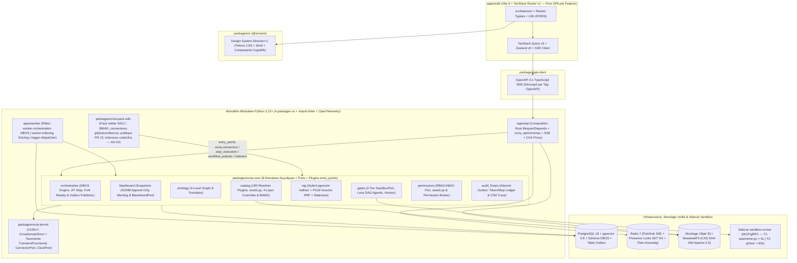

# Spine Context — Verbatim Sections

> Verbatim detail moved from `ARCHITECTURE-SPINE.md` on 2026-11-27 (baseline `bf44884`). The condensed binding form lives in the spine; this file is the full rationale.

## Design Paradigm

ORCIA adopte un paradigme **Monolithe Modulaire Hexagonal (Ports & Adapters) couplé à un Moteur d'Orchestration Durable Transactionnel sur PostgreSQL 18 (`DBOS Transact`)**, structuré dans un **Monorepo Hybride TypeScript + Python** :

1. **Frontière de Présentation (`apps/web` + `packages/ui`)** : Application **SPA pure `Vite 6 + TanStack Router v1` (TypeScript, React 19)** (`apps/web`) strictement cantonnée à un rôle d'**interface cliente réactive statique (servie par `nginx:alpine` en production, zéro serveur Node.js/RSC/BFF, zéro accès DB direct)** et organisée par **fonctionnalité (`apps/web/src/features/<domaine>/` : `cockpit`, `inbox`, `workspaces`, `catalog`, `ontology`, `gates`, `finops`, `admin`, `M11`)** assemblant les routes typées (`validateSearch` Zod + `QueryClient` loaders), l'`i18n` et les états sur la librairie Design System isolée **`packages/ui` (`@orcia/ui`)** qui héberge exclusivement les tokens CSS sémantiques et l'ensemble des composants UX/UI **Direction C** (*Executive Slate Sidebar* `#0F172A` à 7 modules RBAC + *Crisp Light Workspace* `#F8FAFC` + *Agent Assistant Dock*). `apps/web` consomme exclusivement `@orcia/ui`, le client typé `packages/api-client` (découpé par tag OpenAPI) généré depuis le schéma OpenAPI 3.1 de `apps/api` et un flux unifié Server-Sent Events (SSE) ; `packages/ui` reste pur (zéro appel réseau, zéro dépendance à `@tanstack/react-router` ou `@orcia/api-client`).
2. **Noyau Applicatif & Monolithe Modulaire (`packages/orcia-kernel`, `packages/orcia-core`, `apps/api` & `apps/worker` en workspace `uv` à 4 packages)** : Backend **Python 3.12+ (FastAPI + Pydantic v2 + SQLAlchemy 2.1 Asyncio)** structuré en graphe strictement acyclique (`AD-19`) : `orcia-kernel` (identifiants UUIDv7, `OrciaDomainError`, primitives FinOps, horloge) $\leftarrow$ 8 domaines bornés dans `orcia-core` (`permissions`, `catalog`, `ontology`, `rag`, `blackboard`, `gates`, `audit_finops`, `orchestration`, chacun doté de son propre `errors.py` et `seeds.py`, sans aucun cycle) $\leftarrow$ `apps/api` (qui détient seul les schémas HTTP/OpenAPI `orcia_api/schemas/` et la table de correspondance RFC 9457) et `apps/worker`. Les frontières sont contrôlées en CI par **`import-linter`**. Un **seul point d'assemblage (*Composition Root*)** instancie les services (`lifespan` $\rightarrow$ `app.state` $\rightarrow$ `Depends()` dans `apps/api` ; `on_startup` dans `apps/worker` — zéro singleton créé au chargement des modules).
3. **Exécution Durable Transactionnelle, Outbox Événementielle & Déploiement par Rôles (`DBOS Transact` + `apps/worker`)** : Le moteur d'orchestration durable s'appuie sur **DBOS Transact (`dbos` sur PostgreSQL 18)** pour persister transactionnellement chaque transition d'étape (`@DBOS.workflow`, `@DBOS.step`), gérer les pauses humaines de plusieurs semaines (`DBOS.recv`), les réveils par webhooks, le *Replay* non-destructif à partir de l'étape $N$ (`DBOS.fork_workflow`), les déclencheurs planifiés (`@DBOS.scheduled`) et les sous-workflows (`SUB_WORKFLOW <= 3`). Les effets secondaires inter-domaines (`audit_finops`, extraction `ontology`, notifications SSE, sous-workflows) transitent par une **table Outbox transactionnelle PostgreSQL** (`AD-19`), et une image unique est déployée selon **5 rôles de processus** (`api`, `worker-orchestration`, `worker-indexing` dédié à `Docling`, `trigger-dispatcher`, et `sandbox-runner` hors processus via MCP/gRPC).



## Consistency Conventions

| Concern | Convention |
| --- | --- |
| **Naming (Python Backend)** | Modules, fichiers et fonctions en `snake_case` ; classes Pydantic/SQLAlchemy et Protocols en `PascalCase` ; constantes en `UPPER_SNAKE_CASE`. |
| **Naming (TypeScript Frontend)** | Composants React en `PascalCase` (`BriefingCard.tsx`) ; hooks en `camelCase` préfixés par `use` (`useRunStream.ts`) ; stores Zustand en `use<Domain>Store.ts`. |
| **Naming (Base de données)** | Tables au pluriel en `snake_case` (`workflow_runs`, `blackboard_snapshots`, `ontology_concepts`) ; clés primaires `id` au format **UUIDv7** générées côté applicatif (`uuid-utils` en Python / `uuidv7` en TypeScript) et stockées en colonne `uuid` native PostgreSQL 18. |
| **Naming (Événements SSE)** | Format `<domaine>.<entite>.<verbe_passe>` en minuscules : `run.step.paused`, `task.claim.locked`, `gate.agentic.completed`, `ontology.term.extracted`. |
| **Formats de données & Dates** | Toutes les dates en UTC ISO-8601 (`YYYY-MM-DDTHH:mm:ss.sssZ`) ; montants FinOps en `numeric(12, 6)` USD ; empreintes de contenu en hexadécimal `sha256:<64-hex>`. |
| **Enveloppe d'Erreur API** | Format **RFC 9457 Problem Details** (`type`, `title`, `status`, `detail`, `instance`, `error_code`, `trace_id`, `permission_broker_hint`). |
| **Gestion d'état & Mutations** | État serveur géré exclusivement par **TanStack Query v5** (invalidé en temps réel par les événements SSE) ; état d'interface du Cockpit (panneaux ouverts, mode `READ_ONLY_OBSERVER` vs `CONTRIBUTOR_ACTION_REQUIRED`, onglet mobile) dans **Zustand v5**. |
| **Observabilité & Logs** | Traces distribuées **OpenTelemetry** (`W3C TraceContext traceparent` via exportateur OTLP) et journalisation 12-factor JSON unifiée sur `stdout` (**Structlog** unifiant la stdlib via `ProcessorFormatter`), corrélées par `trace_id`, `span_id`, `workspace_id`, `run_id` et `step_id`, interrogeables via `LogSinkQueryPort` (`AD-12`, `AD-23`). |
| **Tests & Vérification (`AD-17`)** | Tests unitaires sous `tests/unit/` ($\ge 90\%$ couverture sur `orcia-kernel` et `orcia-core`), garde-fou hexagonal `import-linter`, intégration sous `tests/integration/` (`testcontainers` PG18/Redis/SeaweedFS), contrats sous `tests/contract/` (`schemathesis`), et E2E sous `apps/web/e2e/` (`Playwright`). |

## Arborescence du Monorepo Hybride (`orcia/`)

```text
orcia/
  apps/
    web/                          # Vite 6 + TanStack Router v1 (SPA pure) — Assemblage, Routage typé, Features, i18n (FR/EN) & État
      src/
        routes/                   # Câblage léger des routes typées (__root.tsx, cockpit, inbox, workspaces, catalog, ontology, gates, finops, admin)
        features/                 # Modules métier autonomes (cockpit/, inbox/, workspaces/, catalog/, ontology/, gates/, finops/, admin/)
        i18n/                     # Dictionnaire typé zero-debt (locales/fr.ts, locales/en.ts, I18nProvider)
        hooks/                    # useSseStream, useClaimLock, useAdaptiveGate
        stores/                   # Stores Zustand globaux (presenceStore, scopeStore)
    api/                          # Package uv #3 : FastAPI HTTP (lifespan + Depends) + Server-Sent Events (/api/v1/events/stream)
      src/orcia_api/
        main.py                   # Point d'assemblage unique (lifespan -> app.state, zéro singleton à l'import)
        schemas/                  # Contrats HTTP/OpenAPI Pydantic v2 par domaine (déplacés hors de orcia-core)
        routers/                  # Endpoints REST par domaine + proxy CAS + export OpenAPI 3.1
        middleware/               # Auth OIDC, RBAC Guard, Presence Lock Guard, OpenTelemetry & registre RFC 9457
        sse/                      # Broker SSE branché sur Redis Pub/Sub
    worker/                       # Package uv #4 : Workflows durables DBOS, Relais Outbox & Workers lourds Docling
      src/orcia_worker/
        main.py                   # Point d'assemblage unique worker (rôles: worker-orchestration, worker-indexing, trigger-dispatcher)
        actors/                   # step_runner, agent_executor, gate_evaluator, outbox_relay, docling_indexer, trigger_dispatcher
  packages/
    ui/                           # Design System dédié (@orcia/ui) — Tokens CSS Direction C & Composants UX/UI purs
      src/
        styles/                   # tokens.css (Tokens sémantiques Direction C exclusifs)
        primitives/               # Primitives accessibles (StatusBadge, HumanLedAnchorCard, AutonomousExecutionBadge, boutons, panneaux)
        shell/                    # Coquille Direction C (AppShell, GlobalSidebar, ScopeSwitcher ⌘W, AssistantDock)
        cockpit/                  # Tri-pane Cockpit, Blackboard Canvas
        cognitive/                # BriefingCard (4 blocs), ChunkedArtifactReviewer, TieBreakMatrixModal
        inbox/                    # UnifiedNotificationInbox, PresenceLockBadge (< 500ms)
        workspaces/               # WorkspaceControlCenter (4 onglets: Runs, Sources, Workflows/Agents, Équipe)
        ontology/                 # OntologyGraphViewer (4 niveaux), TermPromotionDrawer
    orcia-kernel/                 # Package uv #1 : Noyau fondamental pur (0 dépendance externe, vérifié par import-linter)
      src/orcia_kernel/
        ids.py                    # Primitives UUIDv7, ScopeLevel, empreintes SHA-256
        enums.py                  # Enums partagés (WorkflowExecutionRegime, WorkflowStepType, WorkflowCriticality)
        errors.py                 # Classe de base OrciaDomainError (sans sous-classes couplées aux domaines)
        events.py                 # Enveloppe DomainEvent & contrat TransactionalOutboxPort
        ports.py                  # Interfaces Protocol transverses (BlackboardPort, LLMPort, ObjectStoragePort, SandboxPort, ClockPort, ConnectorPort, SecretProviderPort, ResourceLeasePort, ContextSourcePort)
    orcia-core/                   # Package uv #2 : Domaines métier encapsulés (__init__.py public + _internal/ privé) & Adaptateurs
      src/orcia_core/
        orchestration/            # Machine à états des Runs (DBOS), JIT Step Hydrator, Tri-Modal, Sub-Workflows, Fork Replay, errors.py
        blackboard/               # Snapshots JSONB immuables, Step Memlog, ancres humaines, errors.py
        catalog/                  # Résolveur URI via entry_points (db://, git://, nexus://, orcia://), 4-Layer Overrides, seeds.py, errors.py
        ontology/                 # Moteur 4 niveaux (CTE récursives, extracteur sur événement Outbox, traducteur de profil), errors.py
        rag/                      # Recherche hybride pgvector halfvec(1024) + PG18 tsvector (RRF) & détecteur [STALE_WARNING], errors.py
        gates/                    # Client Sandbox 2-Tiers (MCP/subprocess), DAG de Lentilles Orthogonales LiteLLM, gates humaines, errors.py
        permissions/              # RBAC/ABAC granulaire & Permission Broker (KB YAML/Markdown), seeds.py, errors.py
        audit_finops/             # Abonné Outbox Ledger append-only, calcul de coûts tokens, circuit-breaker & OpenTelemetry, errors.py
        bootstrap/                # Orchestrateur d'amorçage gouverné agrégeant catalog/seeds.py et permissions/seeds.py
        db/                       # Session SQLAlchemy 2.1 async (asyncpg), table domain_events_outbox & repositories partagés
    orcia-pack-sdlc/              # Package uv #5 (AD-20) : Pack métier SDLC — connecteurs git/jira/confluence/nexus, BmadSkillPackAdapter, politique FR-13, marqueurs sdlc.*, indexeurs code/Jira, graphe tripartite
    api-client/                   # Package TypeScript généré automatiquement depuis OpenAPI 3.1 (apps/api/src/orcia_api/schemas)
  infra/
    docker/                       # Docker Compose dev (PostgreSQL 18 + pgvector, Redis 7, SeaweedFS S3, 5 rôles de conteneurs)
    sandbox/                      # Sandbox-runner Python (Palier 1 Wasmtime-py < 5s & Palier 2 gVisor/Podman < 60s)
  docs/                           # Documentation BMAD (Brief, PRD, UX, Architecture Spine, Architecture Doc)
  pyproject.toml                  # Workspace Python multi-packages uv (orcia-kernel, orcia-core, orcia-api, orcia-worker) + import-linter
  pnpm-workspace.yaml             # Workspace TypeScript géré par pnpm + Turborepo
  turbo.json
```

## Capability → Architecture Map

| Capability / Area | Lives in | Governed by |
| --- | --- | --- |
| **FR-1** — Instanciation et exécution de Workflows dynamiques (JIT & Bimodal) | `packages/orcia-core/orchestration` + `apps/worker` | `AD-2`, `AD-5`, `AD-13`, `AD-14`, `AD-19` |
| **FR-2** — Saisie humaine préalable obligatoire (*Ancres Humaines*) | `packages/orcia-core/blackboard` + `packages/ui/src/cockpit` | `AD-1`, `AD-3`, `AD-19` |
| **FR-3** — Interdiction des choix arbitraires silencieux & *Arbitrage Humain* | `packages/orcia-core/orchestration` + `TieBreakMatrixModal` | `AD-2`, `AD-3`, `AD-13` |
| **FR-4** — *Briefing de Revue* obligatoire en 4 parties (alimenté par Step Memlog) | `packages/orcia-core/gates` + `BriefingCard` | `AD-10`, `AD-11`, `AD-13` |
| **FR-5** — *Validation par Découpage* et co-édition granulaire | `packages/orcia-core/blackboard` + `ChunkedArtifactReviewer` | `AD-2`, `AD-3`, `AD-11` |
| **FR-6** — *Contestation Amont*, arbitrage tripartite et *Replay* ciblé | `packages/orcia-core/orchestration` + `packages/orcia-core/blackboard` | `AD-2`, `AD-8`, `AD-19` |
| **FR-7** — *Boîte de Notifications Unifiée* et verrouillage (*Claim*) `< 500ms` | `apps/api/src/orcia_api/sse` + `packages/ui/src/inbox` | `AD-4`, `AD-19` |
| **FR-8** — Séparation stricte `READ_ONLY_OBSERVER` vs `CONTRIBUTOR_ACTION_REQUIRED` | `apps/api/src/orcia_api/middleware` + `packages/orcia-core/permissions` | `AD-4`, `AD-6`, `AD-19` |
| **FR-9** — Routage des questions inter-rôles et inter-agents | `packages/orcia-core/orchestration` + `apps/api/src/orcia_api/sse` | `AD-2`, `AD-4`, `AD-19` |
| **FR-10** — Résolution d'URI fédérées (`db://`, `git://`, `nexus://`, `orcia://`) & Packs BMAD | `packages/orcia-core/catalog` | `AD-5`, `AD-6`, `AD-14`, `AD-19` |
| **FR-11** — Épinglage de versions (`run-lock.json`), Surcharges 4 niveaux et cache CAS `SHA-256` | `packages/orcia-core/catalog` | `AD-5`, `AD-14`, `AD-19` |
| **FR-12** — Hiérarchie d'*Ontologie* à 4 niveaux et détection de conflits | `packages/orcia-core/ontology` | `AD-7`, `AD-19` |
| **FR-13** — Extraction ontologique au fil de l'eau et gouvernance de promotion | `packages/orcia-core/ontology` + `packages/ui/src/ontology` | `AD-7`, `AD-19` |
| **FR-14** — Typage du *Blackboard* et des *Gabarits d'Artefact* par l'Ontologie | `packages/orcia-core/blackboard` + `packages/orcia-core/ontology` | `AD-2`, `AD-7`, `AD-19` |
| **FR-15** — Traduction sémantique de profil (*Profil Humain*) | `packages/orcia-core/ontology` + `packages/ui/src/cockpit` | `AD-7`, `AD-19` |
| **FR-16** — Interrogation RAG multi-sources avec traçabilité de version | `packages/orcia-core/rag` | `AD-5`, `AD-8`, `AD-19` |
| **FR-17** — Détection d'obsolescence documentaire (`[STALE_WARNING]`) | `packages/orcia-core/rag` + `apps/worker` | `AD-8`, `AD-19` |
| **FR-18** — *Gates Déterministes* en sandbox isolée à 2 paliers (`< 5s` / `< 60s`) | `packages/orcia-core/gates` + `infra/sandbox` | `AD-9`, `AD-19` |
| **FR-19** — *Gates Agentiques* avec *Orthogonalité des Modèles* et DAG de Lentilles | `packages/orcia-core/gates` (via LiteLLM) | `AD-10`, `AD-19` |
| **FR-20** — Contrôle d'alignement transverse (Étape $N$ vs Étape 1) et *Pattern Drift* | `packages/orcia-core/gates` | `AD-9`, `AD-10`, `AD-19` |
| **FR-21** — *Gates Humaines* à politiques adaptatives (`mandatory`, `risk`, `sampling`) | `packages/orcia-core/gates` | `AD-11`, `AD-19` |
| **FR-22** — Garde-fou anti-approbation mécanique (*Rubber-Stamping* `< 15s`) | `packages/orcia-core/gates` + `packages/ui/src/cognitive` | `AD-11`, `AD-12`, `AD-19` |
| **FR-23** — Journal d'audit immuable de bout en bout & OpenTelemetry | `packages/orcia-core/audit_finops` | `AD-12`, `AD-19`, `AD-23` |
| **FR-24** — Tableau de bord *FinOps* et coupe-circuit budgétaire | `packages/orcia-core/audit_finops` + `apps/web/src/features/finops` | `AD-12`, `AD-19` |
| **FR-25** — Découverte et invocation contrôlée des *Skills*, *MCP* et Packs BMAD | `packages/orcia-core/catalog` + `packages/orcia-core/gates` | `AD-5`, `AD-9`, `AD-10`, `AD-14`, `AD-19` |
| **FR-26** — Assistant conversationnel de création de workflow | `packages/orcia-core/orchestration` + `packages/ui/src/cockpit` | `AD-1`, `AD-2`, `AD-19` |
| **FR-27** — RBAC granulaire du catalogue et *Permission Broker* | `packages/orcia-core/permissions` + `apps/web/src/features/gates` | `AD-6`, `AD-12`, `AD-15`, `AD-19` |
| **FR-28** — Workflows Système d'Initialisation et d'Auto-Amorçage Gouverné (`orcia://system/bootstrap/*`) | `packages/orcia-core/bootstrap` + `packages/orcia-core/orchestration` + `packages/orcia-core/catalog` | `AD-6`, `AD-8`, `AD-9`, `AD-10`, `AD-16`, `AD-19` |
| **FR-29** — Exécution Autonome sous Contrat, Déclencheurs Événementiels Idempotents (`SetWorkflowID`, Webhooks, Puits de Logs, Cron), Boucle Fermée Post-Action & Audit Post-Hoc | `packages/orcia-core/orchestration` + `apps/api/src/orcia_api/routers/triggers` + `apps/worker` | `AD-3`, `AD-5`, `AD-6`, `AD-11`, `AD-12`, `AD-13`, `AD-18`, `AD-19`, `AD-23` |
| **FR-30** — Imbrication Fractale de Workflows (`Sub-Workflows` & `Workflow-as-Agent`, profondeur $\le 3$) | `packages/orcia-core/orchestration` + `packages/orcia-core/blackboard` + `packages/orcia-core/catalog` | `AD-2`, `AD-5`, `AD-12`, `AD-18`, `AD-19` |
| **PRD FR-13** — Discipline `Intention -> Code` (pack SDLC, plugin `orcia.workflow_policies`) | `packages/orcia-pack-sdlc` | `AD-18`, `AD-19`, `AD-20` |
| **NFR-EXT-1 / NFR-ISO-1** — Connecteur ajouté sans modifier le Core ; Core exécutable sans pack SDLC | `packages/orcia-kernel` (`ConnectorPort`) + registres `entry_points` + job CI `core-without-sdlc` | `AD-5`, `AD-19`, `AD-20` |
| **NFR-SEC-4** — Aucun secret dans les tables ni les logs (secret témoin) | `packages/orcia-kernel` (`SecretRef`, `SecretProviderPort`) + `orcia_core/observability` | `AD-6`, `AD-12`, `AD-23` |
| **NFR-OBS-1** — Journalisation 12-factor JSON stdout, puits de logs paramétrable et traces OTel OTLP | `packages/orcia-core/observability` + `apps/api` + `apps/worker` | `AD-12`, `AD-23` |
| **CAP-190** — Hub Modèles IA fiable, découverte 0 token, test réel et embeddings réels (`EmbeddingPort`) | `packages/orcia-core/rag` + `apps/api/src/orcia_api/routers/ai_models_hub.py` + `apps/web/src/features/admin/ai-models` | `AD-8`, `AD-16`, `AD-21`, `AD-24` |
| **FR-33 / CAP-070..076, CAP-260** — Unified `"Mon Assistant"` Turn Engine (`AssistantTurnEngine`), fixed `N1–N5` phases, single-process Redis Streams turn hosting, 2-dialect governed tool loop, Mode A 3-level governance, server `EvidenceTable`/`CitationGuard`, `assistant.ask` MCP & DNS-pinned SSRF | `packages/orcia-core/orchestration` + `packages/orcia-core/agents` + `packages/orcia-core/ports` + `apps/api/src/orcia_api/routers/assistant*` + `apps/web/src/features/inbox` | `AD-2`, `AD-3`, `AD-15`, `AD-19`, `AD-21`, `AD-24`, `AD-25` |

## Deferred

1. **Topologie Kubernetes Multi-Région & Haute Disponibilité Active-Active** : Repoussé post-MVP. Le MVP cible un déploiement conteneurisé standard (Docker Compose / cluster Kubernetes mono-région avec 5 rôles de conteneurs `api`, `worker-orchestration`, `worker-indexing`, `trigger-dispatcher`, `sandbox-runner` sur PostgreSQL 18 managé, Redis 7 et SeaweedFS).
2. **Connecteurs API bidirectionnels natifs vers ServiceNow / Jira IAM (`OQ-2`)** : Repoussé en V1.1. Au MVP, le *Permission Broker* s'appuie sur la Base de Connaissance d'Habilitations déclarative (Markdown + Frontmatter YAML) et génère des liens pré-remplis et instructions traçables.
3. **Moteur de Graphe Dédié Externe (Neo4j / Memgraph)** : Repoussé tant que la volumétrie de l'Ontologie ne dépasse pas `1 000 000` concepts/relations, les CTE récursives PostgreSQL 18 indexées offrant une latence `< 15ms` sans surcharge opérationnelle.
4. **Édition Collaborative Temps Réel Caractère par Caractère (CRDT / Yjs)** : Non requis au MVP (cf. PRD §5 Non-Goals). Le verrouillage atomique par tâche/section (`AD-4`) et la *Validation par Découpage* (`AD-11`) suffisent et garantissent une attribution d'auteur sans ambiguïté pour l'audit.
5. **Extension ParadeDB `pg_search` (BM25 Tantivy à IDF global)** : Repoussé tant que le corpus RAG d'un Workspace ne dépasse pas `5 000 000` chunks avec dégradation mesurée du Recall@10 lexical ; au MVP, PostgreSQL 18 natif (`tsvector` pondéré `setweight` A/B/C/D + index `GIN` + `ts_rank_cd`) fusionné par RRF (`k=60`) avec `pgvector` `halfvec(1024)` évite la licence AGPL-3.0, les restrictions sur réplicas de lecture physiques et la maintenance d'une image PostgreSQL custom.
6. **Profils d'Activation Dynamique de Modules (`M10` : `lite`, `standard`, `full`)** : Repoussé en Phase F (post-MVP) tant qu'aucun besoin d'édition allégée ou d'offre commerciale segmentée n'est avéré ; la séparation en événements Outbox (`M6`) et plugins (`M7`) prépare cette évolution sans alourdir la matrice de tests CI du MVP.
7. **Briques d'Accélération et d'Isolation en Rust (`orcia-sandbox-runner`, `jsonschema-rs`, `cedarpy`)** : Repoussé et inscrit en `action_item` pour évaluation ultérieure ; au MVP, la sandbox Palier 1 s'appuie sur `wasmtime-py` et les validateurs/évaluateurs RBAC restent en Python pur derrière leurs ports respectifs (`SandboxPort`, `AuthorizationEnginePort`).
8. **Graphical Mode B Studio for `"Mon Assistant"` (`ACTION_ITEM-26.1`, `R2`):** Deferred outside Epic 26. Mode A 3-level declarative text overrides (`TEAM -> WORKSPACE -> USER`) govern `N2–N5` within the fixed `N1–N5` constitutional topology; a graphical `@xyflow/react` editor with dedicated persistence may be revisited if demand is confirmed (amending `FR-33` / `UJ-17` via `bmad-correct-course`).
9. **Legacy `/three-speed/*` Compatibility Strangler Facade (`ACTION_ITEM-26.2`, `R4`):** Deferred unless an external non-SPA consumer emerges. `apps/web` is the sole consumer and cuts over atomically to `/api/v1/assistant/turns*` in Story `26.7` while obsolete routes are deleted directly per story.
10. **Redis Assembled-Prompt Cache & Outbox Invalidation Consumer (`ACTION_ITEM-26.3`, `R6`):** Deferred under the measure-first policy (`FR-33` / Story `10.2` amendment). SQL prompt-assembly `p95` and Speed 1 `TTFT p95 < 1.2 s` are measured directly first; Redis prompt caching is restored only if measured SQL assembly `p95 > 50 ms`.
11. **Native Gemini REST `functionCall` & Non-`/v1` Ollama Tool-Calling Parsers (`ACTION_ITEM-26.4`, `R7`):** Deferred outside Epic 26. All 3 text/reasoning streaming adapters remain active (`CAP-076`), while native tool calling covers `openai_compatible` (`/v1`) and `anthropic`; native Gemini REST and non-`/v1` Ollama default to `supports_tools=false`.
12. **PG18 & Admin UI Dynamic SSRF Allowlist Management (`ACTION_ITEM-26.5`, `R8`):** Deferred outside Epic 26. Private/on-prem LLM host allowlisting relies on ops-managed environment variable `ORCIA_LLM_ALLOWED_PRIVATE_HOSTS` plus DNS resolution pinning (`AD-21` Rule 7).
