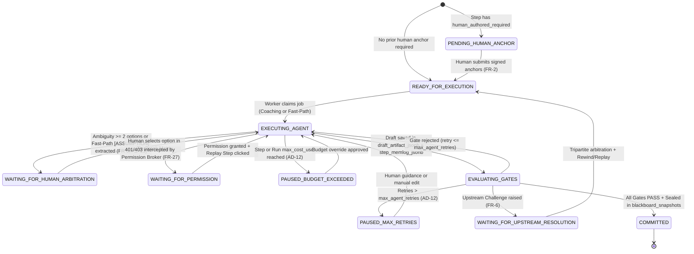
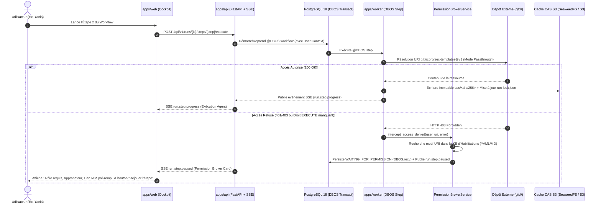

# Document d'Architecture Système — ORCIA (MVP)

## 1. Vue d'Ensemble & Principes Directeurs

**ORCIA** (*Orchestration of Processes, Context, and Intelligent Agents*) est une plateforme d'exécution de processus complexes assistés par agents IA qui applique le paradigme **« Human-Led, Agent-Accelerated »**.

L'architecture système d'ORCIA est conçue pour garantir simultanément :
1. **La souveraineté cognitive de l'humain** : Application stricte côté serveur des *Ancres Humaines* (`human_authored_required: true`), de l'*Arbitrage Humain* face à toute ambiguïté (`WAITING_FOR_HUMAN_ARBITRATION`), de l'exécution bimodale (*Coaching* interactif ou *Fast-Path* avec conversion automatique des `[ASSUMPTION]` en arbitrages humains), du *Briefing de Revue* en 4 blocs et de la *Validation par Découpage* (`AD-3`, `AD-11`, `AD-13`).
2. **La reproductibilité déterministe et l'auditabilité** : Fédération pure d'URI (`db://`, `git://`, `nexus://`, URI internes `orcia://` et import natif de packs BMAD) avec surcharge déclarative à 3 niveaux (`Base → Workspace → Utilisateur`), épinglage cryptographique dans `run-lock.json`, cache local *Content-Addressable* (`CAS SHA-256`), séparation entre brouillon d'étape (`step_executions.draft_artifact_jsonb`), mémoire de décision structurée (`step_memlog_jsonb`) et snapshots `JSONB` immuables du *Blackboard* (`blackboard_snapshots`) permettant un *Replay* ciblé sans perte d'historique, et journal d'audit append-only (`AD-2`, `AD-5`, `AD-12`, `AD-14`).
3. **La rigueur épistémique et sémantique** : *Ontologie* dynamique à 4 niveaux résolue dans PostgreSQL (avec isolation des termes éphémères L4 par lignée de snapshots actifs), RAG hybride (`pgvector` + BM25) filtré par empreinte de version avec détection d'obsolescence `[STALE_WARNING]`, et *Orthogonalité des Modèles* + *DAG de Lentilles d'Évaluation* aux *Gates Agentiques* (`AD-7`, `AD-8`, `AD-10`).
4. **La réactivité multi-utilisateurs temps réel (`< 500ms`)** : *Boîte de Notifications Unifiée* (personnelle et d'équipe), verrous atomiques unifiés par exécution d'étape (`lock:step:<step_execution_id>`) via Redis et Server-Sent Events (SSE), et séparation stricte entre *Consultation seule* (`READ_ONLY_OBSERVER`) et *Contributeur* (`CONTRIBUTOR_ACTION_REQUIRED`) (`AD-4`).

---

## 2. Paradigme Architectural & Topologie C4

### 2.1. Monolithe Modulaire Hexagonal dans un Monorepo Hybride (`AD-1`, `AD-19`)

Pour combiner l'excellence ergonomique de l'écosystème React moderne avec la puissance native de l'écosystème IA/Data Python, ORCIA repose sur un **Monorepo Hybride TypeScript + Python** gouverné par un workspace **`uv 0.13.5`** à **4 packages** (`packages/orcia-kernel`, `packages/orcia-core`, `apps/api`, `apps/worker`) et un graphe de dépendances acyclique (`apps -> orchestration -> domaines -> kernel`) vérifié en CI par **`import-linter 2.3.0`** :

- **Frontend SPA Pure (`apps/web`)** : **Vite 6.3.5 + TanStack Router 1.120.4 (SPA pure servie par `nginx:alpine`, React 19.1.0, TypeScript 5.9.3)** + **Tailwind CSS 4.3.0** + **shadcn/ui (Radix 1.1.2)** + **TanStack Query 5.69.0** + **Zustand 5.0.3** + **`@xyflow/react` 12.12.0**, organisé par fonctionnalité métier (`apps/web/src/features/<domaine>/` — `M11`). Aucun serveur Node.js/RSC/Middleware n'est exposé en production : `apps/web` agit exclusivement comme bundle statique de rendu et de routage typé (`validateSearch` Zod + loaders `QueryClient`) consommant `apps/api`. Implémente la Direction C (*Executive Slate Sidebar* `#0F172A` à 7 modules RBAC + *Crisp Light Workspace* `#F8FAFC` + *Agent Assistant Dock*) sur Desktop et le compagnon Mobile restreint.
- **Contrat d'Interface (`packages/api-client`)** : Généré automatiquement à partir du schéma **OpenAPI 3.1** exposé par `apps/api/src/orcia_api/schemas/` via `openapi-typescript` (`7.6.1`) et consommé avec `openapi-fetch` (`0.13.4`). Aucune définition manuelle de DTO n'est tolérée côté frontend (`0-diff` gate en CI).
- **Backend Synchrone & Temps Réel (`apps/api` — Package `uv` #3)** : **FastAPI 0.162.0 (Python 3.12.9, Pydantic 2.14.1, SQLAlchemy 2.1.6 + `asyncpg` 0.30.0, orjson 3.13.0)** avec point d'assemblage unique (*Composition Root* dans `lifespan` $\rightarrow$ `app.state` + `Depends()`, zéro singleton en mémoire créé au chargement des modules — `M5`), contrats HTTP dans `orcia_api/schemas/` (`M4`) et registre déclaratif `error_code -> HTTP RFC 9457`. Gère les requêtes REST, l'authentification OIDC/Locale, le contrôle RBAC/ABAC, l'accès sécurisé en streaming aux objets du cache CAS (`/api/v1/cas/<sha256>`), les verrous de présence atomiques et le flux **Server-Sent Events (SSE)** `/api/v1/events/stream`, instrumentés par **OpenTelemetry 1.31.0**.
- **Orchestration Durable Transactionnelle, Relais Outbox & Workers Asynchrones (`apps/worker` — Package `uv` #4)** :
  - **DBOS Transact (`dbos 2.14.0`, licence MIT)** adossé nativement à **PostgreSQL 18** (`@DBOS.workflow()`, `@DBOS.step()`, `DBOS.recv()`, `DBOS.sleep()`, `@DBOS.scheduled()`, `DBOS.fork_workflow()`, `SetWorkflowID`) pour l'exécution durable, les attentes d'arbitrage humain de plusieurs semaines, la déduplication transactionnelle des déclencheurs, les sous-workflows imbriqués (`nesting_depth <= 3`) et le *Replay* déterministe à partir de l'étape $N$.
  - **Dramatiq (`2.2.1`)** adossé à **Redis 7.4.2** pour le délestage asynchrone lourd hors chemin critique (`Docling 2.142.1` dans le rôle `worker-indexing`, indexation RAG en masse).
- **Socle Fondamental Pur (`packages/orcia-kernel` — Package `uv` #1) & Domaines Métier Encapsulés (`packages/orcia-core` — Package `uv` #2)** :
  - `packages/orcia-kernel` contient les identifiants UUIDv7 (`uuid-utils 1.1.0`), les énumérations partagées (`WorkflowExecutionRegime`, `WorkflowStepType`), la classe de base `OrciaDomainError`, l'enveloppe `DomainEvent` et les ports `Protocol` transverses (`BlackboardPort`, `LLMPort`, `ObjectStoragePort`, `SandboxPort`), avec **zéro dépendance externe**.
  - `packages/orcia-core` regroupe les domaines métier (`orchestration`, `blackboard`, `catalog` avec plugins `entry_points`, `ontology`, `rag`, `gates`, `permissions`, `audit_finops`, `bootstrap`). Chaque domaine expose uniquement sa façade publique dans `__init__.py`, déclare ses erreurs dans `<domaine>/errors.py` et isole son implémentation dans `_internal/`, sous le contrôle strict d'**`import-linter 2.3.0`** (`AD-19`).

### 2.2. Diagramme C4 des Conteneurs (5 Rôles Opérationnels — `AD-19`)

```mermaid
flowchart TB
    subgraph Clients["Clients Utilisateurs"]
        Desktop["Navigateur Desktop (Cockpit Complet 7 Modules)"]
        Mobile["Navigateur Mobile Companion (Triage, Briefing, Arbitrage)"]
    end

    subgraph Monorepo["ORCIA Platform (Monorepo Hybride — uv 4 packages + pnpm)"]
        Web["apps/web\nVite 6.3 + TanStack Router 1.120 SPA + React 19.1 + Tailwind 4.3"]
        API["apps/api (Rôle 1: api)\nFastAPI + lifespan/Depends + orcia_api/schemas + SSE + OTel\n(Python 3.12.9)"]
        WorkerOrch["apps/worker (Rôles 2 & 4: worker-orchestration & trigger-dispatcher)\nDBOS Transact 2.14 (Workflows Durables PG18) + Outbox Relay"]
        WorkerIdx["apps/worker (Rôle 3: worker-indexing)\nDramatiq 2.2 + Docling 2.142 + tree-sitter 0.24 (CPU/RAM isolés)"]
        Sandbox["infra/sandbox (Rôle 5: sandbox-runner — AD-9 & AD-19)\nProcessus isolé MCP : Palier 1 Wasmtime-py 27.0 (< 5s / 256MB)\nPalier 2 gVisor runsc / Podman Rootless (< 60s / 1024MB, --network=none)"]
    end

    subgraph DataStores["Couche de Persistance Unifiée (Schéma public unique)"]
        PG[("PostgreSQL 18.0 + pgvector 0.8.7\nRelationnel + Checkpoints DBOS + Outbox + JSONB + CTE Ontologie\n+ HNSW halfvec(1024) + BM25 tsvector GIN + Audit")]
        Redis[("Redis 7.4.2\nVerrous SET NX (< 500ms)\n+ Pub/Sub SSE + Files Dramatiq")]
        CAS[("Stockage Objet S3 v4 (ObjectStoragePort)\nSeaweedFS 3.85 (Apache-2.0) / S3 Managé\nCache CAS Immuable (cas/<sha256>)")]
    end

    subgraph External["Systèmes Fédérés & Fournisseurs LLM"]
        Git["Dépôts git:// (GitLab / GitHub / Packs BMAD)"]
        Nexus["Registres nexus:// (Artefacts / Skills)"]
        ExtDB["Bases db:// (Schémas & Vues Métier)"]
        LLMs["Passerelle LiteLLM 1.106.2\n(Familles Modèles A, B, C orthogonales)"]
        IdP["Fournisseur d'Identité OIDC / SSO"]
    end

    Desktop -->|HTTPS + SSE| Web
    Mobile -->|HTTPS + SSE| Web
    Web -->|REST OpenAPI 3.1 + SSE| API
    API -->|Auth OIDC| IdP
    API -->|SQLAlchemy Async + DBOS Client| PG
    API -->|Streaming sécurisé /api/v1/cas/*| CAS
    API -->|SET NX Locks + Pub/Sub + Enqueue| Redis
    Redis -->|Dequeue Heavy Indexing Jobs| WorkerIdx
    PG <-->|Checkpoints DBOS & Outbox| WorkerOrch
    PG <-->|Chunks & Vecteurs RAG| WorkerIdx
    WorkerOrch -->|Publie événements SSE| Redis
    WorkerOrch -->|Lecture/Écriture CAS S3 v4| CAS
    WorkerOrch -->|MCP / gRPC Local| Sandbox
    WorkerOrch -->|Résolution Fédérée (entry_points)| Git
    WorkerOrch -->|Résolution Fédérée (entry_points)| Nexus
    WorkerOrch -->|Résolution Fédérée (entry_points)| ExtDB
    WorkerOrch -->|Exécuteur ≠ Évaluateur| LLMs
```

---

## 3. Conception Détaillée des 8 Domaines (`packages/orcia-core`)

### 3.1. Moteur d'Orchestration Durable Transactionnel (`DBOS Transact`), Hydratation JIT, Exécution Bimodale & *Replay* (`orchestration` & `blackboard` — `AD-2`, `AD-3`, `AD-13`)

ORCIA écarte à la fois la lourdeur opérationnelle d'un cluster externe dédié (Temporal) et la fragilité d'un moteur de workflow réimplémenté manuellement au-dessus de Dramatiq au profit de **DBOS Transact (`dbos 2.18.0`, licence MIT)** adossé nativement à **PostgreSQL 18**, complété par **Dramatiq** pour les travaux d'arrière-plan hors chemin critique :

1. **Exécution Durable Transactionnelle sur PostgreSQL 18 (`DBOS Transact`, `AD-2`)** :
   - Chaque *Workflow Run* est exécuté comme un workflow durable `@DBOS.workflow()` et chaque étape comme une transaction journalisée `@DBOS.step()`.
   - Les pauses d'arbitrage humain (`WAITING_FOR_HUMAN_ARBITRATION`), d'ancre humaine (`PENDING_HUMAN_ANCHOR`) ou d'habilitation (`WAITING_FOR_PERMISSION`) utilisent `DBOS.recv(topic, timeout_seconds)` sans consommer de thread ni de worker actif, même sur plusieurs semaines.
   - Les déclencheurs planifiés utilisent `@DBOS.scheduled()`, l'idempotence des déclencheurs s'appuie sur `SetWorkflowID("<trigger_id>:<idempotency_key>")`, et le *Rewind / Replay* (`FR-16`) exploite `DBOS.fork_workflow(workflow_id, start_step)` couplé au marquage `SUPERSEDED` des `blackboard_snapshots` avals.

2. **Hydratation *Just-In-Time* par Étape et *Step Memlog* (`AD-13`)** :
   - **Isolation contre le *Context Rot*** : Lors de l'exécution d'une étape $k$, le `JitStepHydrator` ne fournit à l'*Agent Exécuteur* que le contrat d'instructions de l'étape $k$ et les artefacts amont explicitement déclarés (`orcia://...`), jamais les instructions des étapes futures $k+1 \dots N$.
   - **Séparation Livrable / Mémoire de Décision (`step_memlog_jsonb`)** : Chaque étape maintient un journal structuré append-only (hypothèses écartées, compromis étudiés, arbitrages retenus) séparé du livrable propre (`draft_artifact_jsonb`). Ce *Step Memlog* permet de reprendre une étape interrompue sans perte de contexte et alimente directement la génération du **Briefing de Revue en 4 blocs** (`FR-4`).

3. **Exécution Bimodale (*Coaching Path* vs *Fast-Path / Tâche de Fond*) (`AD-13`, `UJ-10`)** :
   - Une fois les sections `human_authored_required: true` initiales signées (`PENDING_HUMAN_ANCHOR` $\rightarrow$ `READY_FOR_EXECUTION`), le contributeur choisit le mode d'exécution :
     - **Mode Coaching (Interactif)** : L'agent progresse par passes courtes et suspend immédiatement l'étape en `WAITING_FOR_HUMAN_ARBITRATION` (`DBOS.recv`) dès qu'une décision ouverte ($\ge 2$ options) se présente.
     - **Mode Fast-Path / Tâche de Fond (`BACKGROUND_AUDIT`)** : Idéal pour les audits lourds en arrière-plan (comme la comparaison Documentation vs Codebase d'Arthur dans `UJ-10`). Les étapes durables DBOS s'enchaînent sans bloquer sur les ambiguïtés intermédiaires : chaque choix non tranché ou écart détecté est consigné dans `step_memlog_jsonb` avec une balise structurée (`[ASSUMPTION]`, `[BUG_CODE_SUSPECTED]`, `[DOC_OBSOLETE_SUSPECTED]`). En fin de *Run*, tous ces points sont consolidés dans le rapport final en unités de **Validation par Découpage** et d'**Arbitrage Humain (`FR-5`)**, et l'utilisateur reçoit une notification SSE temps réel (`< 500ms`) pour trancher.

4. **Arbre de Snapshots Immuables et *Replay* Ciblé (`FR-6`, `AD-2`)** :
   - Tant qu'une étape est en cours, le brouillon vit dans `step_executions.draft_artifact_jsonb`. Ce n'est qu'au statut `COMMITTED` qu'un nouveau `BlackboardSnapshot` immuable est scellé dans `blackboard_snapshots`.
   - Lors d'un retour arrière (*Rewind*) de l'Étape 3 vers l'Étape 1 suivi d'un *Replay* (`DBOS.fork_workflow`), les snapshots `#101`, `#102`, `#103` passent au statut `SUPERSEDED` (conservés intégralement pour la piste d'audit `FR-23`), et une nouvelle branche `ACTIVE` `#104 -> #105 -> #106` est créée avec calcul de différentiel (*diff*) pour ne re-valider aux étapes intermédiaires que les sections impactées.



---

### 3.2. Temps Réel (`< 500ms`), Boîte Unifiée & Verrous de Présence Unifiés (`sse` & `inbox` — `AD-4`)

Pour répondre au parcours `UJ-4` (Nadia et son équipe gérant de multiples workflows simultanés), ORCIA implémente une architecture temps réel légère et résiliente aux proxys d'entreprise :

1. **Verrouillage Atomique Unifié sur `step_execution_id` (*Claim / Lock*)** :
   - La clé canonique de verrouillage dans Redis est `lock:step:{step_execution_id}`.
   - Lorsqu'un membre d'une équipe clique sur **« Prendre en charge »** dans la *Boîte de Notifications Unifiée* (`POST /api/v1/tasks/{task_id}/claim`) ou ouvre directement l'étape dans le *Cockpit* (`POST /api/v1/runs/{run_id}/steps/{step_id}/claim`), FastAPI exécute atomiquement `SET lock:step:{step_execution_id} {user_id} NX EX 900`, met à jour `claimed_by_user_id` dans PostgreSQL et publie immédiatement l'événement `task.claim.locked` sur Redis Pub/Sub (`channel:workspace:{ws_id}`).
   - Tous les clients connectés au flux SSE `/api/v1/events/stream` reçoivent l'événement en `< 100ms` (budget NFR `< 500ms`), mettant à jour le badge `🔒 En cours : Nadia K.` sans rechargement.
   - Le middleware `RunAccessGuard` vérifie en $O(1)$ la détention de `lock:step:{step_execution_id}` sans jointure SQL supplémentaire.

2. **Séparation Stricte `READ_ONLY_OBSERVER` vs `CONTRIBUTOR_ACTION_REQUIRED` (`FR-8`)** :
   - Le middleware FastAPI `RunAccessGuard` calcule les droits effectifs `(user_id, run_id, step_execution_id)`.
   - Si le mode est `READ_ONLY_OBSERVER`, tout appel `POST/PUT/PATCH/DELETE` de mutation sur l'étape ou l'artefact est rejeté avec `HTTP 403 ERR_OBSERVER_MODE_READ_ONLY`, et l'interface web désactive les contrôles d'édition et de *Gate* tout en affichant le bandeau ambre d'observation.

---

### 3.3. Catalogue Fédéré, Connecteurs (`confluence://`, `jira://`), Surcharge 3 Niveaux, Adaptateur BMAD & *Permission Broker* (`catalog` & `permissions` — `AD-5`, `AD-6`, `AD-14`)

#### 3.3.1. Résolution d'URI Externe/Interne, Actions Jira Gouvernées, Surcharge Déclarative et Épinglage `run-lock.json`
ORCIA ne duplique jamais les sources tierces dans sa base de définition : il agit comme un **plan de contrôle fédéré**.
- **Ressources externes (`db://`, `git://`, `nexus://`, `confluence://`, `jira://`) & Port `ObjectStoragePort` (`AD-5`)** : Au démarrage d'un *Run*, le `FederatedUriResolver` résout la référence symbolique (ex. `@v2.1.0`, la révision `page.version.number` d'une page Confluence `confluence://<space_key>/<page_id>`, ou l'état courant d'un ticket/filtre Jira `jira://<project_key>/<issue_key>`) vers sa révision immuable, télécharge le contenu, calcule son empreinte `SHA-256`, et le stocke via le port hexagonal `ObjectStoragePort` (compatible S3 v4, adossé par défaut à **SeaweedFS 4.17 `Apache-2.0`** en dev/CI/on-prem et à AWS S3 / GCS / Scaleway S3 en cloud managé, en remplacement de MinIO AGPL-3.0 archivé en 2026) sous la clé immuable `cas/<sha256>`.
- **Actions et Transitions de Workflows Jira Staged aux Gates (`AD-5`, `AD-6`)** : Les agents exécuteurs peuvent créer des tickets (`create_issue`), les mettre à jour (`update_issue`), les commenter (`add_comment`) et faire avancer les workflows Jira (`transition_issue` après interrogation préalable de `GET /rest/api/3/issue/{key}/transitions` pour valider les transitions autorisées et les champs obligatoires de l'écran de transition). Afin d'éviter toute pollution du backlog Jira par des hallucinations, ces mutations sont préparées sous forme d'**Actions Staged** dans `step_executions.draft_artifact_jsonb` (révisables unitairement via la *Validation par Découpage* `FR-6`) et ne sont exécutées sur Jira qu'une fois la *Gate* de l'étape validée (`AD-11`), en inscrivant le lien de provenance `run-lock.json` dans le ticket Jira. En sens inverse, les **Webhooks Jira (`jira:issue_updated`)** peuvent déclencher un *Run* ou réveiller une étape en pause (`UJ-3`).
- **Surcharge Déclarative à 3 Niveaux (`AD-14`)** : Inspiré du `customize.toml` de BMAD, tout workflow ou agent du catalogue est résolu en fusionnant **`1. Base (URI Catalogue) → 2. Surcharge Workspace/Équipe → 3. Préférences Profil Utilisateur`** sans jamais dupliquer le workflow de base.
- **Adaptateur Natif de Packs BMAD (`BmadSkillPackAdapter`, `AD-14`)** : ORCIA peut importer directement un répertoire de skills BMAD (`SKILL.md` + `customize.toml` + `steps/*.md`) depuis `git://` ou `nexus://` et l'exécuter comme un workflow ORCIA natif doté des *Gates*, de l'*Ontologie* et du *Blackboard*.
- **Protocole MCP Bidirectionnel — Client & Serveur IDE Gouverné (`/api/v1/mcp`, `FR-24`, `AD-6`)** : Outre le client MCP permettant aux workers d'invoquer des serveurs MCP externes, ORCIA expose un **Serveur MCP gouverné (`/api/v1/mcp`)** pour les IDE (VS Code, Cursor, Claude Code, Antigravity). Les développeurs et architectes peuvent ainsi interroger l'*Ontologie active (N1..N4)*, la *Base de Connaissances*, le *Catalogue Fédéré* et le *Blackboard du Run courant* depuis leur éditeur en mode *Passthrough*, sous le contrôle du *Permission Broker* et avec blocage matériel de toute écriture IA sur les *Ancrages Humains* (`AD-3`).
- **Ressources internes inter-étapes (`orcia://`)** : Lorsqu'une étape $N$ consomme un livrable produit par une étape amont $M < N$, elle le référence via l'URI canonique `orcia://runs/{run_id}/steps/{step_key}/artifacts/{artifact_key}`, résolue de manière déterministe depuis la branche `ACTIVE` de `blackboard_snapshots`.

#### 3.3.2. Résolution de `OQ-1` (Authentification Passthrough vs Service Principal) et `OQ-2` (*Permission Broker*)



---

### 3.4. Ontologie Dynamique à 4 Niveaux, Simulation d'Impact (*What-If*) & RAG Hybride (`ontology` & `rag` — `AD-7`, `AD-8`)

#### 3.4.1. Modèle Relationnel-Graphe à 4 Niveaux et Simulation d'Impact (`ImpactSimulatorService`) dans PostgreSQL 18
Les concepts (`ontology_concepts`), relations typées (`ontology_relations`) et axiomes formels (`ontology_axioms`) sont stockés dans PostgreSQL avec 4 niveaux de visibilité (`1_ENTERPRISE`, `2_DOMAIN`, `3_WORKSPACE`, `4_RUN_EPHEMERAL`).
- La résolution de l'ontologie active d'un *Run* utilise une requête CTE SQL prenant par priorité `4 -> 3 -> 2 -> 1`, en filtrant les concepts `4_RUN_EPHEMERAL` pour n'inclure que ceux appartenant à la lignée de snapshots `ACTIVE` de l'étape courante (`introduced_in_snapshot_id`).
- Lors d'un **Challenge Amont (`FR-7`)** ou d'une promotion/modification d'un concept d'ontologie (`FR-9`), le `ImpactSimulatorService` exécute une traversée de graphe (CTE sur `ontology_relations` et dépendances `orcia://` de `blackboard_snapshots`) pour afficher un **Aperçu de Simulation d'Impact (*What-If Impact Preview*)** listant exactement les *Steps*, *Artefacts* et *Workflows* impactés avant validation.

#### 3.4.2. Indexation Différenciée Incrémentale Multi-Sources, Vecteurs `halfvec(1024)` + Recherche Lexicale Native PostgreSQL 18 (`tsvector` + `GIN` + `ts_rank_cd` + RRF `k=60`) & Alerte `[STALE_WARNING]` (`FR-23`, `AD-8`)
Pour garantir des réponses en `< 50ms` sans dupliquer l'intégralité du SI, sans dépendance AGPL-3.0 ni restriction sur les réplicas de lecture (l'extension ParadeDB `pg_search` étant explicitement écartée pour le MVP au profit du moteur natif PostgreSQL 18), `packages/orcia-core/rag` applique **3 régimes d'indexation incrémentale** stockés en **`halfvec(1024)` (FP16)** dans `pgvector 0.8.7` HNSW et fusionnés par *Reciprocal Rank Fusion (`RRF`, `k=60`)* avec l'index lexical natif PostgreSQL 18 **`tsvector` + index `GIN` + `ts_rank_cd` pondéré (`A`: titre/identifiant/clé Jira/symbole AST, `B`: en-tête contextuel, `C`: corps, `D`: métadonnées)** complété par `pg_trgm` :
1. **Documentation, Multi-Espaces Confluence & Multi-Projets Jira de Référence (`1..N confluence://`, `1..N jira://`, Markdown, PDF, OpenAPI via `Docling`)** : Ingestion Confluence sélective sur chacun des espaces dédiés du *Workspace* gouvernée par `space_key`, page racine et labels (`orcia-kb`, exclusion des pages `draft`/`archived`), et **indexation hybride sur chacun des projets Jira du *Workspace*** (seuls les tickets porteurs de connaissance durable — *Epics, User Stories, Bugs résolus avec Root Cause, Post-mortems* filtrés par JQL dans `init-datasource` — sont vectorisés en **1 chunk unifié (`256-1024` tokens)** préfixé par son *Contextual Header* `[Projet > Epic > Clé | Type | Statut | Composants | Versions]`, tandis que le suivi opérationnel temps réel multi-projets est interrogé en direct via l'API JQL en mode *Passthrough*). Découpage hiérarchique *Parent-Child* pour les documents longs (**chunk enfant `256-512` tokens** portant le vecteur `halfvec(1024)` $\rightarrow$ **chunk parent `1024-2048` tokens** injecté à l'agent).
2. **Multi-Codebases (`1..N git://` via `tree-sitter 0.24.0`) & Graphe Tripartite Multi-Sources (`Confluence ↔ Jira ↔ Git`)** : Découpage syntaxique strict par symbole AST (**`150-800` tokens** par fonction/classe/modèle Pydantic) sur l'ensemble des dépôts `git://` dédiés au *Workspace*, couplé à l'extraction d'un *Code Property Graph* inter-dépôts (`DEFINES`, `CALLS`, `IMPORTS`, `IMPLEMENTS_CONCEPT`, `TESTED_BY`) et à la détection automatique des clés de tous les projets Jira liés (`[A-Z][A-Z0-9]+-[0-9]+`) dans les commits/PR, les pages de tous les espaces Confluence et les liens d'issues pour alimenter un **Graphe Tripartite de Traçabilité unifié à l'échelle du Workspace (`DOCUMENTS`, `SPECIFIES`, `FIXES`, `IMPLEMENTS_ISSUE`, `BLOCKS`, `AFFECTS_CONCEPT`)** avec traversée CTE bornée (`depth <= 2`).
3. **Bases de Données (`db://`)** : Indexation **exclusive du schéma DDL et de son mapping Ontologique** (zéro ligne transactionnelle dans le RAG).
Chaque requête est filtrée sur le `kb_snapshot_hash` de `run-lock.json`, avec brique explicite `data-freshness` et injection automatique de `[STALE_WARNING]` en cas de dépassement de `freshness_ttl_days` ou de contradiction avec le code.

---

### 3.5. Pipeline Tri-Modal des Gates, Sandbox Bimodale à 2 Paliers (`AD-9`), Pseudonymisation PII Réversible, Orthogonalité & DAG de Lentilles (`gates` — `AD-9`, `AD-10`, `AD-11`)

1. **Sandbox Déterministe Bimodale à 2 Paliers de Budget (`AD-9`)** :
   - **Palier 1 — Validation Rapide de Schémas & Règles Pures (`Wasmtime 27.0.0`, `< 5s`, `256 Mo RAM`, zéro réseau)** : Exécute les validateurs JSON Schema, OpenAPI, axiomes d'ontologie et règles de *Pattern Drift* compilables en WASM sans dépendre des *user namespaces* Linux de l'hôte Kubernetes.
   - **Palier 2 — Analyse Statique, Linters, Compilateurs & Tests Unitaires d'Auto-Remédiation (`gVisor runsc` en Kubernetes / Conteneur Rootless éphémère `Podman/Docker --network=none --read-only`, `< 60s`, `1024 Mo RAM`)** : Exécute les outils natifs (`ruff`, `mypy`, `tsc`, `eslint`, `pytest`, `vitest`) et la boucle TDD `Red -> Green` de `UJ-12` dans un conteneur éphémère isolé monté uniquement sur le snapshot CAS en lecture seule et un `/tmp` en `tmpfs`.

2. **Pseudonymisation PII Réversible, Orthogonalité & DAG de Lentilles (`AD-10`, `AD-11`)** :
   - **Pseudonymisation PII Réversible (`PiiReversibleScrubber`, `NFR-SEC-2`)** : Avant tout appel vers un fournisseur LLM Cloud externe, les données personnelles ou secrets métiers identifiés sont remplacés par des jetons déterministes réversibles (stockés en Redis sur la durée du `run_id`) et ré-hydratés localement au retour.
   - **Orthogonalité & DAG de Lentilles d'Évaluation** (via **LiteLLM** sur une famille de modèle distincte de l'exécuteur et sans sa *Chain-of-Thought*) :
     1. **Lentilles Indépendantes Parallèles** :
        - *Lentille 1 — Alignement Transverse Étape 1* (vérifie la conformité directe vis-à-vis du PRD / Architecture de fondation).
        - *Lentille 2 — Vérification Atomique de Faits (`fact_verification`)* : décompose l'artefact en assertions factuelles atomiques et les confronte à l'*Ontologie (N1..N4)* et aux *Bases de Connaissances* épinglées avec un score de confiance (`0..1`) par assertion.
        - *Lentille 3 — Attaque Adversariale & Edge-Cases* (recherche les contradictions d'interfaces et cas limites omis).
        - *Lentille 4 — Conformité Domaine & Sécurité* (vérifie les règles métier et RGPD).
     2. **Lentille Dépendante (`after`)** :
        - *Lentille 5 — Synthèse & Briefing* : consolide les trouvailles des lentilles parallèles (`lens_findings_jsonb`), intègre le `step_memlog_jsonb`, calcule le score global `agentic_score` et structure le **Briefing de Revue en 4 blocs** pour la *Gate Humaine Adaptative* (`AD-11`).

---

### 3.6. Architecture de l'Agent Assistant : Workflow de Nœuds type n8n, `AssistantHarness` & Prompt à 5 Couches (`AD-15`)

L'*Agent Assistant* est conçu comme un **Workflow Système de Nœuds orientés (DAG type n8n)** enregistré dans le *Catalogue Fédéré* (`orcia://system/workflows/assistant-agent`) et éditable visuellement dans l'UI via **`@xyflow/react` (`12.12.0`)** ou en manifeste YAML :

1. **Graphe de Nœuds de l'Assistant (Exécution visible en temps réel via SSE)** :
   - **Nœud 1 — Routeur d'Intention & Désambiguïsation** : Analyse la question de l'humain et l'Ontologie active (Niveaux 1 à 4). Si l'intention est ambiguë, sollicite une clarification immédiate ; sinon, achemine vers le planificateur.
   - **Nœud 2 — Planificateur de Recherche (`Query Planner & Ontology Expander`)** : Décompose la question en sous-requêtes typées et enrichit les termes via les synonymes de l'Ontologie.
   - **Nœud 3 — Fan-Out Parallèle de Recherche** : Exécute simultanément les branches pertinentes : (3A) *RAG Hybride + vérification `[STALE_WARNING]`*, (3B) *Catalogue Fédéré filtré RBAC*, (3C) *Inspection du Blackboard & Step Memlog du Run actif*, et (3D) *Permission Broker*.
   - **Nœud 4 — Tri Critique & Vérification d'Axiomes** : Écarte les résultats hors-sujet, vérifie la cohérence avec les axiomes de l'Ontologie et prépare les preuves citées.
   - **Nœud 5 — Synthétiseur Adaptatif au *Profil Humain* & Compositeur de Workflow** : Formate la réponse selon le profil de l'utilisateur (`FR-15`), génère les cartes d'action interactives du Dock, et permet d'assembler ou d'ajuster conversationnellement un manifeste **Workflow-as-Code** à partir des briques du *Catalogue Fédéré* puis de l'enregistrer et le lancer en tâche de fond (`UJ-10`, `FR-11`).

2. **Encapsulation par le `AssistantHarness` et Prompt Modulaire à 5 Couches** :
   - Le `AssistantHarness` injecte de manière déterministe le contexte de l'écran actif (`active_module`, `run_id`, `step_id`, `access_mode`, `human_profile`), impose l'identité `passthrough` de l'utilisateur et bloque matériellement toute tentative d'écriture directe sur une *Ancre Humaine* (`human_authored_required: true`).
   - Pour chaque nœud, le Harness compile un prompt structuré en **5 couches** :
     1. **Couche 1 — Constitution Immuable du Harness** *(verrouillée en code Python, non modifiable par surcharge)* : philosophie *Human-Led*, interdiction de pré-remplir les *Ancres Humaines*, obligation de signaler `[STALE_WARNING]`, respect du mode `READ_ONLY_OBSERVER`.
     2. **Couche 2 — Directive & Contrat Pydantic du Nœud Actif**.
     3. **Couche 3 — Surcharges Déclaratives (`Base → Team → Workspace → User`, `AD-14`)**.
     4. **Couche 4 — Profil Humain (`FR-15`) & Ontologie Active (`AD-7`)**.
     5. **Couche 5 — Contexte Éphémère du Cockpit & Résultats des Nœuds Amont**.

---

### 3.7. Processus d'Initialisation & Auto-Amorçage Gouverné (`orcia://system/bootstrap/*` — `AD-16`, `FR-28`)

Pour éliminer le problème du démarrage à froid (*Cold-Start* au Jour 0) et empêcher toute configuration incomplète en production, ORCIA s'initialise lui-même à travers **6 Workflows Système pré-embarqués (`orcia://system/bootstrap/*`)** exécutés sous le contrôle de *Gates Déterministes* :

1. **`init-organization` (Initialisation d'une Organisation / Tenant — Jour 0)** :
   - Configure l'authentification primaire bi-mode (**SSO d'Entreprise `OIDC / OAuth 2.1`** et/ou **Authentification Locale autonome `Argon2id + TOTP`**) et le mapping des groupes vers les rôles RBAC.
   - **Gate Déterministe d'Orthogonalité (`AD-10`)** : Refuse de valider l'initialisation tant qu'au moins **2 familles de modèles distinctes** ne sont pas opérationnelles dans LiteLLM (condition sine qua non pour `FR-18`).
   - Amorce l'*Ontologie* Niveau 1 (Entreprise) par extraction assistée sur les documents fondateurs et validation par découpage du Steward, puis charge le catalogue socle (Agent Assistant + pack BMAD).
2. **`init-workspace` (Initialisation & Onboarding Autonome d'une Équipe et de ses Workspaces Solutions par le Chef d'Équipe `TEAM_LEAD`)** :
   - Exécutable en autonomie par un **Chef d'Équipe (`TEAM_LEAD` / `Workspace Admin`)** sans solliciter un Administrateur Plateforme.
   - Permet de structurer l'équipe (et d'éventuelles sous-équipes dans l'arbre `org_units`), d'inviter ou d'affecter ses membres (par recherche OIDC ou lien d'invitation signé en mode local), de pré-assigner à chaque membre son **Profil Humain** (`PM/Métier`, `Architecte`, `Tech Lead`, `Développeur`, `SecOps`, `Direction`) et ses rôles d'exécution (`CONTRIBUTOR`, `GATE_REVIEWER`, `ONTOLOGY_STEWARD_L3`, `OBSERVER`), de définir les standards d'équipe (`TEAM`) et l'*Ontologie* `3_TEAM`, puis de créer **un ou plusieurs `Workspaces` (solutions logicielles)** rattachés à l'équipe avec leur surcharge `WORKSPACE` (`AD-14`), leur *Boîte de Notifications* (`FR-2`) et leur *Ontologie* `3_WORKSPACE`.
3. **`init-datasource` (Enrôlement Multi-Sources `N × git://`, `N × jira://`, `N × confluence://`, `db://`, `nexus://` ou KB)** :
   - Exécutable à plusieurs reprises par un Administrateur Plateforme ou par le **Chef d'Équipe (`TEAM_LEAD`)** au sein d'un `Workspace` solution (ou en portée `SHARED_TEAM`) pour connecter **plusieurs dépôts `git://`, plusieurs projets/filtres `jira://` et plusieurs espaces/arborescences `confluence://`** dédiés à la solution logicielle (chacun qualifié par un `alias` et un `role` logique, ex. `git:backend`, `git:frontend`, `jira:product`, `jira:secops`, `confluence:specs`, `confluence:adr`).
   - Teste la résolution d'URI et le hachage `SHA-256` dans le cache CAS (`ObjectStoragePort`).
   - **Gate Déterministe du *Permission Broker* (`AD-6`) & de Fraîcheur (`AD-8`)** : Bloque la publication de chaque source dans le catalogue tant que le propriétaire n'a pas signé comme *Ancre Humaine* sa fiche d'habilitation YAML/Markdown (groupe IAM ou rôle Jira requis, approbateur, lien de demande, SLA) et défini son `freshness_ttl_days`.
4. **`init-existing-project` (Adoption d'un Projet Existant — *Brownfield Onboarding*)** :
   - Analyse l'ensemble des dépôts `git://` existants rattachés à un `Workspace` pour extraire la stack, les conventions et l'architecture implicite afin de générer un `ARCHITECTURE-SPINE.md` initial (`[ADOPTED]`) servant de référence aux contrôles de *Pattern Drift* (`FR-17`).
5. **`init-skill` (Enrôlement & Certification d'un Nouveau *Skill* ou MCP)** :
   - Exécute le *Skill* candidat dans la sandbox isolée (`AD-9`, Palier 1 `< 5s / 256MB` ou Palier 2 `< 60s / 1024MB`, `--network=none`) sur un jeu de test avant de l'épingler au catalogue.
6. **`init-user` (Onboarding Express d'un Nouvel Utilisateur au 1er Login)** :
   - Déclenché automatiquement à la première connexion d'un membre invité par son **Chef d'Équipe (`TEAM_LEAD`)** : confirme ou affine le *Profil Humain* pré-assigné (`FR-1`), lie ses comptes externes (**Atlassian Jira/Confluence** et **GitLab/GitHub** via OAuth 2.0 `3LO` ou `PAT` chiffré AES-256-GCM) pour le mode *Passthrough*, vérifie ses accès et l'abonne aux Workspaces et flux de son équipe.

---

### 3.8. Exécution Autonome sous Contrat, Déclencheurs Événementiels Idempotents, Boucle Fermée d'Auto-Remédiation & Imbrication Fractale (`AD-18`, `FR-29`, `FR-30`, `UJ-11`, `UJ-12`)

1. **Régime Autonome sous Contrat (`AUTONOMOUS_CONTRACT`) & Classification de Criticité** :
   - Chaque *Workflow* déclare sa criticité (`LOW_NON_CRITICAL | STANDARD | HIGH_CRITICAL`), son régime d'exécution (`INTERACTIVE_COACHING | BACKGROUND_FAST_PATH | AUTONOMOUS_CONTRACT`) et sa politique de départage sans humain (`tie_break_policy: ONTOLOGY_AXIOM_FIRST | DEFER_AND_CONTINUE_WITH_ASSUMPTION | PAUSE_AND_ESCALATE`).
   - Les workflows `HIGH_CRITICAL` sont formellement interdits d'exécution autonome de bout en bout (`HTTP 422 ERR_CRITICAL_WORKFLOW_REQUIRES_HUMAN_GATE`).
   - Tout passage en `AUTONOMOUS_CONTRACT` exige un **Contrat d'Autonomie** signé dans `human_anchor_signatures` par le `TEAM_LEAD` (et par un `SECOPS` en cas d'utilisation d'un `service_principal`).

2. **Déclencheurs Événementiels Idempotents (`workflow_triggers` + `DBOS SetWorkflowID`) & Protection Anti-Boucle (*Self-Trigger Guard*)** :
   - Les *Workflow Runs* autonomes peuvent être instanciés par un humain en mode *Fire-and-Forget* (`MANUAL_AUTONOMOUS`), par un **Webhook entrant** (`WEBHOOK` : Jira, Git, Confluence ou générique signé HMAC-SHA256), par une **Alerte de Puits de Logs** (`LOG_SINK_ALERT`, `UJ-12`), ou par une **Tâche Planifiée** (`CRON` via `@DBOS.scheduled`, `UJ-11`).
   - La contrainte PostgreSQL `UNIQUE (trigger_id, trigger_idempotency_key)` combinée à `DBOS SetWorkflowID("<trigger_id>:<idempotency_key>")` et au verrou Redis `SET lock:trigger:{trigger_id}:{idempotency_key} NX EX 86400` garantit qu'un même événement (ou un *retry*) ne crée jamais deux *Runs* concurrents.
   - Le filtre **Self-Trigger Guard** ignore tout événement émis par le `service_principal` d'ORCIA ou portant l'en-tête `x-orcia-origin-run-id`.

3. **Boucle Fermée d'Auto-Remédiation (`UJ-12`) & Vérification Post-Action (`POST_ACTION_VERIFICATION`)** :
   - Lorsqu'un workflow autonome corrige une anomalie applicative ou d'infrastructure suite à une alerte de logs (`LOG_SINK_ALERT`), le moteur impose : (a) un diagnostic avec `root_cause_confidence >= 0.90` (sinon escalade en ticket Jira), (b) la génération préalable d'une *Intention de Remédiation* (`FR-13`), (c) la reproduction du bug par un test unitaire qui échoue avant correctif et passe après en Sandbox Palier 2 (`AD-9`, `< 60s`), (d) un test de non-régression en environnement *staging / prod-like*, et (e) une étape finale `POST_ACTION_VERIFICATION` observant le puits de logs pendant `verification_window_seconds` après déploiement. En cas de persistance de l'erreur, ORCIA déclenche automatiquement le **Rollback**, ouvre le coupe-circuit (`CIRCUIT_OPEN`) et alerte l'astreinte en `< 500 ms`.

4. **Imbrication Fractale de Workflows (`SUB_WORKFLOW` & `Workflow-as-Agent`, profondeur $\le 3$, `FR-30`)** :
   - Une étape `step_type: SUB_WORKFLOW` invoque un workflow cible en instanciant un `workflow_run` enfant DBOS lié par `parent_run_id`, `parent_step_execution_id` et `root_run_id` (`nesting_depth <= 3`, sans cycle).
   - Le `run-lock.json` du parent épingle récursivement l'arbre des sous-workflows (`sub_workflow_locks`), chaque sous-workflow possède un *Blackboard* lexicalement isolé (`input_mapping` / `output_mapping`), et le budget `max_cost_usd` du `root_run_id` est partagé atomiquement sur toute la hiérarchie.

---

### 3.9. Architecture en Monolithe Modulaire, Graphe Acyclique de Packages `uv`, Point Unique d'Assemblage, Outbox Transactionnelle, Plugins & 5 Rôles Opérationnels (`AD-19`)

1. **Sens Unique des Dépendances & Suppression des 3 Cycles (`M1`, `M3`, `P4`)** :
   - Ordre strict imposé par `import-linter 2.3.0` (`lint-imports`) : `apps (api, worker) -> orchestration / bootstrap -> domaines (blackboard, catalog, ontology, rag, gates, permissions, audit_finops) -> orcia-kernel`.
   - Rupture des cycles : `WorkflowExecutionRegime` et `WorkflowStepType` sont déplacés dans `orcia_kernel.enums` et `BlackboardPort` dans `orcia_kernel.ports` (`blackboard` n'importe jamais `orchestration`) ; les données de référence résident dans `catalog/seeds.py` et `permissions/seeds.py` et sont agrégées par `bootstrap`.
2. **4 Packages `uv`, Façade Publique `__init__.py` & Implémentation Privée `_internal/` (`M2`, `P3`)** :
   - Workspace `uv 0.13.5` découpé en 4 packages : `packages/orcia-kernel` (0 dépendance externe), `packages/orcia-core` (domaines métier), `apps/api`, `apps/worker`.
   - Chaque domaine de `orcia-core` expose uniquement ses contrats publics dans `__init__.py` et place ses modèles SQLAlchemy, dépôts et adaptateurs dans `_internal/` (protégé par `import-linter`).
3. **Séparation des Schémas HTTP (`orcia_api/schemas/`) & Décentralisation des Erreurs (`<domaine>/errors.py`) (`M4`)** :
   - Les `2 060` lignes de DTO HTTP/OpenAPI quittent `orcia-core` pour `apps/api/src/orcia_api/schemas/<domaine>.py`.
   - `domain/exceptions.py` (`377` lignes, rayon d'impact critique de `59` dépendants) est scindé : seule la classe de base `OrciaDomainError` vit dans `orcia_kernel.errors`, chaque domaine déclare ses exceptions dans `<domaine>/errors.py`, et `apps/api` les traduit en enveloppes **RFC 9457**.
4. **Point Unique d'Assemblage (*Composition Root*) & Zéro Singleton à l'Import (`M5`, `P1`)** :
   - Suppression des singletons `_DEFAULT_*_SERVICE = build_default_*()` exécutés à l'import dans `routers/auth.py`, `routers/catalog.py` et `routers/orchestration.py`.
   - Assemblage unique dans `lifespan` (`apps/api/src/orcia_api/main.py` $\rightarrow$ `app.state` + `Depends()`) et `on_startup` (`apps/worker/src/orcia_worker/main.py`). Les adaptateurs `InMemory*` sont déplacés dans `tests/unit/fakes/`.
5. **Événements de Domaine & Table Outbox Transactionnelle (`domain_events_outbox`, `M6`)** :
   - Les effets secondaires transverses non bloquants (`audit_finops`, extraction `ontology`, notifications SSE, réveil de déclencheurs) sont publiés sous forme d'événements immuables (`StepCompleted`, `ArtifactProduced`, `GateEvaluated`, `RunTerminated`) insérés dans `domain_events_outbox` au sein de la même transaction SQL que le changement d'état du Run, puis relayés de manière idempotente. Les *Gates* et l'arbitrage humain restent synchrones.
6. **Plugins `entry_points` & Sidecar MCP (`sandbox-runner`, `M7`, `M8`, `P5`)** :
   - Plugins Python `entry_points` (`pyproject.toml`) appliqués selon la *Règle de Trois* aux résolveurs d'URI (`orcia.uri_resolvers`) et passerelles LLM (`orcia.llm_gateways`).
   - Exécution hors processus via MCP/subprocess pour les outils tiers et le rôle **`sandbox-runner`** (`wasmtime-py 27.0.0` Palier 1 `< 5s` et `gVisor/Podman` Palier 2 `< 60s`).
7. **Image Conteneur Unique Déployée en 5 Rôles & Frontend par Fonctionnalité (`M9`, `M11`)** :
   - Base PostgreSQL 18 unique (schéma `public` unique garantissant les clés étrangères et transactions ACID inter-tables).
   - 5 rôles opérationnels : `api`, `worker-orchestration`, `worker-indexing` (isolant Docling), `trigger-dispatcher`, `sandbox-runner`.
   - Organisation frontend par fonctionnalité métier dans `apps/web/src/features/<domaine>/`.

### 3.10. Core Agnostique, Pack SDLC, Interface de Connecteur Unique, Exécution Réelle & Taxonomie d'Erreurs (`AD-20`, Avenant A2 du 28/10/2026)

1. **Frontière Core / Packs** : `orcia_kernel` et `orcia_core` sont exempts de vocabulaire métier. Le SDLC est livré dans `packages/orcia-pack-sdlc` (connecteurs `git`, `jira`, `confluence`, `nexus` ; `BmadSkillPackAdapter` ; politique FR-13 ; marqueurs `sdlc.*` ; indexeurs code AST et Jira ; graphe tripartite). Contrat `import-linter` : `orcia_kernel` / `orcia_core` ↛ `orcia_pack_*`. Job CI `core-without-sdlc` (workflow Finance « Rapprochement de factures » + connecteur ERP factice, pack désinstallé).
2. **Registres `entry_points`** : `orcia.connectors`, `orcia.step_executors`, `orcia.workflow_policies`, `orcia.indexers` (absorbe `orcia.uri_resolvers`).
3. **`ConnectorPort`** (`orcia_kernel.ports`) : `capabilities()`, `fetch(uri)`, `invoke(action, payload, idempotency_key)`, `health()`, `map_error(exc)` ; kit de conformité commun ; `FederatedUriResolver` délègue au registre sans changer la signature de `parse_federated_uri` (risque GitNexus CRITICAL, 7 flux).
4. **Exécution réelle** : un seul moteur DBOS injecté par le *Composition Root* ; chaque `@DBOS.step()` appelle l'exécuteur résolu (`AGENT`, `SKILL`, `SUB_WORKFLOW`, `HUMAN_TASK`, `HTTP_ACTION`) ; suppression du moteur simulé en mémoire, de `_ACTIVE_ENGINE` et de tout appel à une API privée `dbos._*`.
5. **Taxonomie d'erreurs & `ConnectorInvoker`** : `TransientInfraError(retry_after_s)`, `RateLimitedError`, `UpstreamTimeoutError` (relançables) ; `FunctionalConnectorError`, `PolicyDeniedError`, `PermanentInfraError` (non relançables → arbitrage humain) ; relances bornées par le budget `AD-12`, `Retry-After`, coupe-circuit par connecteur, `idempotency_key`.
6. **Secrets** : `SecretRef` non sérialisable + `SecretProviderPort` ; masquage structlog ; liste blanche de sérialisation pour outbox, audit, `step_executions` et `dbos.*` ; test du secret témoin (`NFR-SEC-4`).
7. **Concurrence** : `ResourceLeasePort` (bail PostgreSQL + jeton de fencing), ordre d'acquisition canonique, files DBOS par classe de ressource.

---

## 4. Schéma de Données Principal (PostgreSQL 18 + `pgvector`)

| Table | Rôle Principal | Colonnes Clés & Index |
| --- | --- | --- |
| `workspaces` (et `org_units`, `workspace_datasources`) | Découplage entre l'arbre hiérarchique d'équipes (`org_units` avec `parent_id`), les espaces solutions (`workspaces`) et leurs multiples sources dédiées (`workspace_datasources` : `N × git://`, `N × jira://`, `N × confluence://`) | `id (uuid PK)`, `slug`, `owner_org_unit_id`, `visibility_mode (STANDARD\|CONFIDENTIAL_RESTRICTED)`, `settings_jsonb` |
| `workflow_definitions` | Définitions de workflows du catalogue (natifs ou packs BMAD) | `id`, `workspace_id`, `uri`, `version`, `source_format (ORCIA\|BMAD_PACK)`, `criticality`, `execution_regime`, `tie_break_policy`, `steps_schema_jsonb`, `adaptive_gate_policy` |
| `workflow_triggers` | Déclencheurs autonomes gouvernés (`WEBHOOK`, `LOG_SINK_ALERT`, `CRON`, `MANUAL_AUTONOMOUS`, `AD-18`, `FR-29`) | `id`, `workspace_id`, `workflow_def_id`, `trigger_type`, `cron_expr`, `webhook_secret_vault_ref`, `event_filter_jsonb`, `cooldown_window_seconds`, `service_principal_id`, `max_runs_per_hour`, `max_daily_cost_usd`, `max_consecutive_failures`, `post_hoc_sampling_rate`, `contract_signature_id`, `status (ACTIVE\|PAUSED\|CIRCUIT_OPEN)` |
| `workspace_customization_overrides` | Surcharges déclaratives à 4 niveaux (`Base -> Team -> Workspace -> User`, `AD-14`) | `id`, `org_unit_id (nullable)`, `workspace_id (nullable)`, `target_uri`, `user_id (nullable)`, `override_layer (TEAM\|WORKSPACE\|USER)`, `override_manifest_jsonb`, `sha256` |
| `workflow_runs` | Instances d'exécution (*Runs* et *Sub-Workflows* imbriqués) isolées par *Workspace* (`AD-2`, `AD-18`, `FR-29`, `FR-30`) | `id`, `workspace_id`, `workflow_def_id`, `parent_run_id (nullable)`, `parent_step_execution_id (nullable)`, `root_run_id`, `nesting_depth (int <= 3)`, `execution_regime`, `criticality`, `trigger_id (nullable)`, `trigger_idempotency_key (nullable)`, `status`, `initiated_by_user_id`, `execution_identity_mode`, `budget_max_usd` (`UNIQUE (trigger_id, trigger_idempotency_key)`) |
| `run_lock_manifests` | Épinglage immuable `run-lock.json` incluant `sub_workflow_locks` récursifs (`AD-5`, `AD-14`, `AD-18`) | `run_id (PK/FK)`, `manifest_jsonb`, `overrides_sha256`, `manifest_sha256`, `locked_at` |
| `step_executions` | État d'exécution, brouillon et memlog de chaque étape (`AD-2`, `AD-13`) | `id`, `run_id`, `step_key`, `step_type (AGENT\|SKILL\|SUB_WORKFLOW\|POST_ACTION_VERIFICATION)`, `execution_mode (COACHING\|FAST_PATH\|AUTONOMOUS_CONTRACT)`, `status`, `draft_artifact_jsonb`, `draft_cas_key`, `step_memlog_jsonb`, `executor_model_id`, `evaluator_model_id`, `retry_count`, `claimed_by_user_id` |
| `blackboard_snapshots` | Historique append-only des états validés du *Blackboard* (`AD-2`) | `id`, `run_id`, `parent_snapshot_id`, `step_execution_id`, `branch_status (ACTIVE\|SUPERSEDED)`, `state_jsonb`, `sha256` |
| `domain_events_outbox` | Table Outbox transactionnelle garantissant la publication idempotente des effets secondaires (`AD-19`, `M6`) | `id (uuid PK)`, `event_type`, `aggregate_type`, `aggregate_id`, `run_id (nullable)`, `step_execution_id (nullable)`, `payload_jsonb`, `trace_id`, `status (PENDING\|PUBLISHED\|FAILED)`, `attempts`, `created_at`, `published_at` |
| `human_anchor_signatures` | Preuves cryptographiques de saisie humaine, d'amendement ou de *Contrat d'Autonomie* (`AD-3`, `AD-18`) | `id`, `step_execution_id`, `section_key`, `authored_by_user_id`, `content_sha256`, `signed_at` |
| `gate_evaluations` | Résultats des *Gates* et du DAG de lentilles (`AD-9..11`) | `id`, `step_execution_id`, `gate_type`, `status`, `score`, `lens_findings_jsonb`, `briefing_4blocks_jsonb`, `evaluator_model_id`, `review_duration_ms`, `fast_approval_warning` |
| `chunk_approvals` | État et co-édition de la *Validation par Découpage* (`FR-5`) | `id`, `gate_evaluation_id`, `chunk_index`, `section_title`, `status (APPROVED\|AMENDED\|CHALLENGED)`, `amended_content (text nullable)`, `reviewer_user_id` |
| `task_notifications` | Boîte de notifications unifiée personnelle, d'équipe & d'audit post-hoc (`FR-2`, `FR-29`) | `id`, `workspace_id`, `target_team_id`, `target_user_id`, `run_id`, `step_execution_id`, `type`, `claimed_by_user_id`, `claimed_at` |
| `ontology_concepts` | Concepts des 4 niveaux d'*Ontologie* (`1_ENTERPRISE`, `2_DOMAIN`, `3_TEAM`, `3_WORKSPACE`, `4_RUN_EPHEMERAL`, `AD-7`) | `id`, `level`, `scope_id`, `introduced_in_snapshot_id (nullable)`, `canonical_term`, `definition`, `synonyms_array`, `profile_translations_jsonb` |
| `ontology_relations` | Relations orientées et typées entre concepts (`AD-7`) | `id`, `source_concept_id`, `target_concept_id`, `relation_type`, `cardinality`, `level` |
| `ontology_axioms` | Règles d'intégrité sémantique et invariants (`AD-7`) | `id`, `concept_id`, `axiom_expression_jsonb`, `immutable (bool)`, `level` |
| `kb_documents` & `kb_chunks` | Index RAG hybride & fraîcheur documentaire isolé par *Workspace* et par `datasource_id` (`AD-8`) | `id`, `workspace_id`, `datasource_id`, `kb_id`, `kb_snapshot_hash`, `embedding halfvec(1024)` (Index HNSW), `search_tsv tsvector` (Index GIN), `freshness_ttl_days`, `last_verified_at` |
| `audit_ledger` | Journal d'audit et de télémétrie FinOps append-only (`AD-12`) | `id`, `run_id`, `step_execution_id`, `actor_type`, `actor_id`, `event_type`, `model_id`, `input_tokens`, `output_tokens`, `cost_usd`, `created_at` (Trigger `BEFORE UPDATE OR DELETE RAISE EXCEPTION`) |
| `connector_schemes` | Source de vérité unique des types de source (Avenant A2, `AD-5`, `AD-20`) — remplace les 4 contraintes `CHECK` (migrations `0013` Expand / `0014` Contract) | `id (uuid PK UUIDv7)`, `scheme (varchar UNIQUE)`, `provided_by_package`, `capabilities_jsonb`, `enabled`, `registered_at` ; FK vers `connector_schemes(scheme)` depuis `workspace_datasources.scheme`, `user_passthrough_credentials.connector_scheme`, `permission_broker_policies.connector_scheme`, `permission_broker_tickets.connector_scheme` |
| `resource_leases` | Baux de ressources partagées avec fencing (Avenant A2, `AD-4`, `DEC-CONC-01`) | `id (uuid PK UUIDv7)`, `resource_uri (UNIQUE)`, `holder_run_id`, `holder_step_execution_id`, `fencing_token (bigint monotone)`, `expires_at` |

---

## 5. Cartographie des 7 Modules du Menu Global vers l'API Backend

| Module du Menu Global (UX Direction C + Sélecteur `⌘W`) | Routes (`apps/web/src/routes`) & Features (`apps/web/src/features`) | Routeur FastAPI & Schémas (`apps/api/src/orcia_api`) | Domaine Principal (`orcia-core`) |
| --- | --- | --- | --- |
| **1. Cockpit & Chat** | `/cockpit`, `/runs/$runId` (`features/cockpit/`) | `/api/v1/runs/*`, `/api/v1/chat/*`, `/api/v1/cas/*` (`schemas/orchestration.py`, `schemas/blackboard.py`) | `orchestration`, `blackboard` |
| **2. Boîte, Runs & Workspaces (Centre de Pilotage 4 Onglets)** | `/inbox`, `/runs`, `/workspaces`, `/workspaces/$workspaceId` (`features/inbox/`, `features/workspaces/`) | `/api/v1/inbox/*`, `/api/v1/tasks/*/claim`, `/api/v1/workspaces/*`, `/api/v1/org-units/*`, `/api/v1/events/stream` | `orchestration`, `catalog`, `rag`, `permissions`, `sse` |
| **3. Catalogue Fédéré** | `/catalog/$type` (`features/catalog/`) | `/api/v1/catalog/*`, `/api/v1/resolver/*`, `/api/v1/overrides/*` (`schemas/catalog.py`) | `catalog` |
| **4. Ontologie & KB** | `/ontology`, `/kb` (`features/ontology/`) | `/api/v1/ontology/*`, `/api/v1/kb/*` (`schemas/ontology.py`, `schemas/rag.py`) | `ontology`, `rag` |
| **5. Gates & Habilitations** | `/gates`, `/permissions` (`features/gates/`) | `/api/v1/gates/*`, `/api/v1/permissions/broker/*` (`schemas/gates.py`, `schemas/permissions.py`) | `gates`, `permissions` |
| **6. FinOps & Audit** | `/finops`, `/audit` (`features/finops/`) | `/api/v1/finops/*`, `/api/v1/audit/ledger/*` (`schemas/audit_finops.py`) | `audit_finops` |
| **7. Administration** | `/admin/*` (`features/admin/`) | `/api/v1/admin/*`, `/api/v1/org-units/*`, `/api/v1/workspaces/*` (`schemas/auth.py`, `schemas/bootstrap.py`) | `permissions`, `gates`, `catalog`, `bootstrap` |

---

## 6. Sécurité, Résilience & Observabilité

1. **Authentification Primaire Bi-Mode, Hiérarchie d'Équipes vs Workspaces Multi-Sources, Centre de Pilotage Multi-Niveaux, Rôle `TEAM_LEAD` & Autorisation Matricielle (`AD-6`, `AD-14`, `FR-3`, `FR-21`)** :
   - **Mode 1 — SSO d'Entreprise (`OIDC / OAuth 2.1`)** : Fédération native avec Keycloak, Microsoft Entra ID, Okta ou Google Workspace, récupérant les claims JWT (`sub`, `email`, `groups`, `bu`, `team`).
   - **Mode 2 — Authentification Locale Autonome (`Argon2id + TOTP`)** : Permet un déploiement personnel ou le lancement immédiat d'une équipe pilote sans dépendre de la DSI centrale, avec hachage `Argon2id`, MFA TOTP optionnel et liens d'invitation signés à durée de vie limitée.
   - **Sessions & Révocation** : Jetons JWT d'accès courts (`15 min`) + Refresh Tokens en cookie `HttpOnly / Secure / SameSite=Strict` révocables instantanément dans Redis.
   - **Découplage Arbre d'Équipes (`org_units`) & Espaces Solutions Multi-Sources (`workspaces` + `workspace_datasources`)** : Une équipe (ou sous-équipe dans un arbre hiérarchique $N$-niveaux) peut maintenir **plusieurs `Workspaces`** correspondant à ses différentes solutions logicielles, et **chaque `Workspace` peut rattacher plusieurs dépôts `git://`, plusieurs projets `jira://` et plusieurs espaces `confluence://` dédiés** (ainsi que ses *Runs* et ses *Artefacts*).
   - **Centre de Pilotage Unifié Multi-Niveaux (`/workspaces` & Sélecteur `⌘W`)** : Rassemble sur un même écran à **4 onglets** (*1. Instances de `Workflow Runs` & Artefacts*, *2. Sources Dédiées & Partagées*, *3. Workflows, Agents & Surcharges*, *4. Équipes, Membres & Gouvernance*) toute la gestion d'un périmètre selon une logique fractale (*Roll-up* / *Drill-down*) :
     - **Niveau Global (`PLATFORM_ADMIN`)** : consultation et administration de 100 % des BU, équipes, Workspaces, sources, agents, workflows et *Runs* de la plateforme (les métadonnées techniques/FinOps des Workspaces `CONFIDENTIAL_RESTRICTED` sont visibles pour l'exploitation mais leur contenu métier reste masqué sauf habilitation explicite).
     - **Niveau BU / Organisation (`BU_DIRECTOR` / Lead d'équipe parente)** : vue consolidée (*Roll-up*) de toutes les équipes, sous-équipes et Workspaces de son organisation (supervision des *Runs* en `READ_ONLY_OBSERVER` hors `CONFIDENTIAL_RESTRICTED`, suivi des sources et `[STALE_WARNING]`, gestion des actifs `SHARED_BU` / `SHARED_TEAM` et des surcharges d'équipe).
     - **Niveau Équipe (`TEAM_LEAD`) & Niveau Solution (`Workspace`)** : pilotage opérationnel complet par le Chef d'Équipe et ses contributeurs (`init-workspace`, invitations `init-user`, enrôlement multi-sources `init-datasource`, surcharges `WORKSPACE` et exécution des *Runs*).
   - **Autorisation Matricielle (`AuthorizationEnginePort`)** : Combine la position dans l'arbre `org_units`, le rôle sur le *Workspace*, les 5 permissions dissociées sur le *Catalogue Fédéré* (`DISCOVER`, `EXECUTE`, `READ_SOURCE`, `EDIT`, `ADMIN`) et le mode d'accès sur chaque *Run* (`CONTRIBUTOR_ACTION_REQUIRED` vs `READ_ONLY_OBSERVER`).
2. **Coffre d'Identité Déléguée (*Passthrough Identity Vault* — `NFR-SEC-4`)** :
   - Les jetons OAuth 2.0 (`3LO`) ou jetons personnels (`PAT`) enregistrés par un utilisateur lors de `init-user` pour le mode *Passthrough* sur `git://`, `nexus://`, `confluence://` et `jira://` sont chiffrés au repos par **AES-256-GCM** avec une clé dérivée par utilisateur (KMS / Vault) et déchiffrés uniquement en mémoire dans le worker le temps de la résolution d'URI.
3. **Observabilité OpenTelemetry de bout en bout (`AD-12`)** :
   - Chaque requête HTTP, événement SSE, workflow/step DBOS, relais Outbox, job Dramatiq, requête SQLAlchemy, appel LiteLLM et exécution de sandbox propage un `trace_id` W3C OpenTelemetry commun (`opentelemetry-sdk 1.31.0`, `opentelemetry-instrumentation-fastapi 0.52b0`, `structlog 26.1.0` côté Python), systématiquement inclus dans les enveloppes d'erreur **RFC 9457**.

---

## 7. Stratégie de Tests à 5 Couches & Couverture Unitaire de la Plateforme (`AD-17`)

Chaque Epic et chaque User Story du développement d'ORCIA est soumis à une stratégie de vérification en **5 couches**, avec un accent prioritaire sur les **tests unitaires de la plateforme elle-même** et les **tests d'intégration sur conteneurs réels** :

### 7.1. Couche 1 — Tests Unitaires de la Plateforme (`pytest 9.1.1` + `hypothesis 6.170.9` & `Vitest 3.2.7` — Exécution `< 5s`)
Exigence de couverture minimale de **90 %** sur le code de la plateforme (`packages/orcia-kernel`, `packages/orcia-core`, `apps/api`, `apps/worker`, `apps/web`), exécutée sans accès réseau ni base de données, complétée par **`import-linter 2.3.0`** vérifiant l'isolation hexagonale et le graphe acyclique du monolithe modulaire (`AD-19`) :
- **Noyau Domaine Python (`packages/orcia-kernel/tests/unit/`, `packages/orcia-core/tests/unit/`)** :
  - `orchestration` : Tests unitaires et *Property-Based Testing* (`hypothesis`) de toutes les transitions de la machine à états des *Runs*, de l'`JitStepHydrator`, de l'extraction automatique des `[ASSUMPTION]` en mode *Fast-Path* (`AD-13`) et du calcul de branche lors d'un *Rewind / Replay* (`AD-2`).
  - `blackboard` : Vérification du rejet systématique (`ERR_HUMAN_ANCHOR_REQUIRED`) de toute écriture IA sur une section `human_authored_required: true` non signée (`AD-3`) et fusion des `chunk_approvals.amended_content`.
  - `catalog` : Tests unitaires du parseur d'URI et des plugins `entry_points` (`db://`, `git://`, `nexus://`, `orcia://`), de l'algorithme de fusion déterministe à 4 niveaux (`Base → Team → Workspace → Utilisateur`) et du `BmadSkillPackAdapter` (`AD-14`).
  - `ontology` : Tests unitaires de la détection d'`ONTOLOGY_CONFLICT` et du traducteur sémantique par *Profil Humain* (`FR-15`).
  - `rag` : Tests unitaires de l'algorithme *Reciprocal Rank Fusion (RRF, `k=60`)* et des règles d'expiration `freshness_ttl_days` (`[STALE_WARNING]`).
  - `gates` : Tests unitaires du `ModelRouterService` vérifiant qu'aucun couple `(executor_model, evaluator_model)` de même famille n'est accepté (`AD-10`), de la fonction pure de purge de la *Chain-of-Thought*, du moteur de politiques adaptatives (`mandatory_full`, `risk >= 0.85`, `sampling 20%`) et du détecteur de *Rubber-Stamping* `< 15s` (`AD-11`).
  - `permissions` : Tests unitaires de la matrice RBAC/ABAC (`AuthorizationEnginePort`) et du matcher de motifs d'URI du `PermissionBrokerService` (`AD-6`).
  - `audit_finops` : Tests unitaires du calculateur de coûts tokens, de l'abonné Outbox et du déclenchement des coupe-circuits `PAUSED_BUDGET_EXCEEDED` / `PAUSED_MAX_RETRIES` (`AD-12`).
  - `AssistantHarness` : Tests unitaires de l'assemblage des **5 couches de prompt** et de l'inviolabilité de la Couche 1 (`AD-15`).
- **API & Workers (`apps/api/tests/unit/`, `apps/worker/tests/unit/`)** : Tests unitaires des middlewares (`RunAccessGuard` bloquant le mode `READ_ONLY_OBSERVER`, registre déclaratif d'erreurs **RFC 9457**) et de l'idempotence des étapes DBOS, du relais Outbox et des acteurs Dramatiq.
- **Frontend Web (`apps/web/src/features/**/__tests__/`)** : Tests unitaires **Vitest + React Testing Library** des composants cognitifs (`BriefingCard`, `ChunkedArtifactReviewer`, `TieBreakMatrixModal`, `PresenceLockBadge`), des hooks (`useSseStream`, `useClaimLock`) et des stores Zustand.

### 7.2. Couche 2 — Tests d'Intégration sur Infrastructure Réelle (`testcontainers-python 4.15.0`)
- **Zéro Mock SQLite/Redis** : Lancement automatique de conteneurs éphémères **PostgreSQL 18 + `pgvector`**, **Redis 7.4.2** et **SeaweedFS 3.85 S3** pour tester les repositories `SQLAlchemy 2.1.6 Async`, la reprise sur crash des workflows durables **DBOS Transact 2.14.0**, la table transactionnelle `domain_events_outbox`, les CTE récursives d'ontologie (et l'exclusion des concepts L4 des branches `SUPERSEDED`), l'atomicité réelle de `SET lock:step:<id> NX` sous forte concurrence, les triggers PostgreSQL interdisant `UPDATE/DELETE` sur `audit_ledger` et `blackboard_snapshots`, et les tests d'isolation de la sandbox bimodale (`AD-9` Palier 1 `Wasmtime` & Palier 2 conteneur isolé `--network=none`).

### 7.3. Couche 3 — Tests de Contrat API & Fuzzing (`openapi-typescript 7.6.1` + `Schemathesis 4.32.4`)
- Vérification en CI qu'aucune dérive n'existe entre le schéma OpenAPI 3.1 de `apps/api/src/orcia_api/schemas/` et `packages/api-client`, complétée par un fuzzing automatique `Schemathesis` sur toutes les routes REST.

### 7.4. Couche 4 — Tests d'Orchestration IA : Cassettes Déterministes (CI) & Suite d'Evals (`orcia-evals`)
- En CI à chaque commit, `DeterministicCassetteLLM` rejoue de manière instantanée et déterministe (`0 $`) les réponses d'agents (incluant appels d'arbitrage, erreurs `403`, rejets de gates).
- En pré-release, `orcia-evals` évalue sur un *Golden Dataset* la qualité du workflow de l'Agent Assistant (`AD-15`) et des lentilles d'évaluation (`AD-10`).

### 7.5. Couche 5 — Tests End-to-End Multi-Utilisateurs & Multi-Device (`@playwright/test 1.64.1`)
- Exécution de parcours complets ouvrant simultanément deux sessions navigateur (ex. Nadia en *Contributeur* et un coéquipier en *Observateur* dans `UJ-4`) pour valider la latence SSE `< 500ms` des verrous de présence, tant sur **Desktop (`1440x900`)** que sur **Mobile Companion (`390x844`)**.
