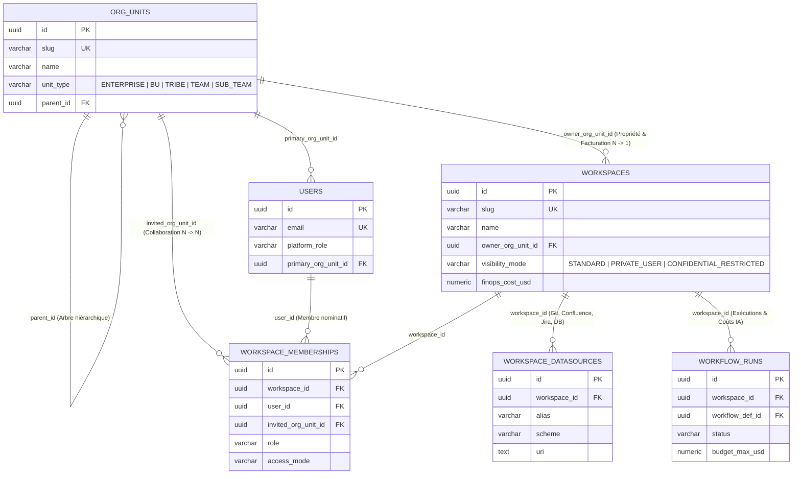

# FAQ Architecture & Modèle Métier — ORCIA (Winston)

Ce document de référence centralise les réponses architecturales et de modélisation métier d'ORCIA rédigées par **Winston (Architecte Système)**.

---

## Q1. Quel est le lien entre l'objet Espace de Travail (quel est son terme interne dans ORCIA) et les entités de l'organisation ?

### 1. Termes internes dans ORCIA (Modèle de données & Domaine)

Dans ORCIA, les **Entités de l'Organisation** et l'**Espace de Travail** sont modélisés par deux objets distincts afin de découpler l'organigramme de l'entreprise des environnements opérationnels de livraison :

| Concept Métier (UI FR) | Terme Interne Domaine (`orcia_core`) | Table PostgreSQL 18 | Granularité & Niveaux | Rôle Fondamental |
| :--- | :--- | :--- | :--- | :--- |
| **Entité de l'Organisation** *(Entreprise, Direction / BU, Tribu, Équipe, Sous-Équipe)* | **`OrgUnit`** | `org_units` | `unit_type IN ('ENTERPRISE', 'BU', 'TRIBE', 'TEAM', 'SUB_TEAM')` (arbre hiérarchique via `parent_id`) | **« Qui nous sommes »** *(l'organigramme de l'entreprise)* : structure à laquelle sont rattachés les utilisateurs (`users.primary_org_unit_id`, rattachements multi-équipes `memberTeamIds` / `workspace_memberships`) et l'imputation budgétaire FinOps. |
| **Espace de Travail** *(Projet collectif, Produit, Chantier ou Espace privé personnel)* | **`Workspace`** | `workspaces` | Unité opérationnelle (`visibility_mode IN ('STANDARD', 'PRIVATE_USER', 'CONFIDENTIAL_RESTRICTED')`) | **« Sur quoi nous travaillons »** *(l'environnement opérationnel de travail)* : conteneur où l'on connecte les sources documentaires (`workspace_datasources` : Git, Confluence, Jira, DB), où s'exécutent les processus (`workflow_runs`), où s'accumule le contexte (`kb_documents`, `blackboard_snapshots`) et où sont imputés les coûts IA (`finops_cost_usd`). |

---

### 2. Les deux liens relationnels entre `Workspace` et `OrgUnit` ([`0002_story_1_2_auth_org_workspaces_permissions.py`](file:///home/romain/Documents/Projects/ORCIA/infra/migrations/versions/0002_story_1_2_auth_org_workspaces_permissions.py))

1. **A. Lien de Propriété / Rattachement de facturation principal (`owner_org_unit_id` : `N ➔ 1`)** :
   - Chaque `Workspace` (qu'il soit collectif `STANDARD`, isolé `CONFIDENTIAL_RESTRICTED` ou privé personnel `PRIVATE_USER`) appartient obligatoirement à une `OrgUnit` propriétaire (une Équipe `TEAM` ou une Direction `BU`) via `owner_org_unit_id UUID NOT NULL REFERENCES org_units(id) ON DELETE RESTRICT`.
   - Une même Équipe (`TEAM`) peut posséder `0, 1` ou plusieurs Espaces de Travail (`Workspace`).
   - La contrainte `ON DELETE RESTRICT` empêche la suppression d'une Direction ou d'une Équipe tant qu'un Espace de Travail lui est rattaché.

2. **B. Lien de Collaboration / Invitation inter-équipes (`workspace_memberships` : `N ➔ N`)** :
   - Permet d'inviter dans un `Workspace` soit des utilisateurs nominatifs (`user_id`), soit toute une autre Équipe de l'organisation (`invited_org_unit_id REFERENCES org_units(id)`), avec une contrainte d'exclusivité `CHECK (num_nonnulls(user_id, invited_org_unit_id) = 1)`.

---

### 3. Diagramme ER Mermaid (`ORG_UNITS`, `USERS`, `WORKSPACES`, `WORKSPACE_MEMBERSHIPS`, `WORKSPACE_DATASOURCES`, `WORKFLOW_RUNS`)

---

### 4. Cascade d'héritage de gouvernance à 4 niveaux et les 3 modes de visibilité (`STANDARD`, `PRIVATE_USER`, `CONFIDENTIAL_RESTRICTED`)

$$\text{GLOBAL (Plateforme)} \longrightarrow \text{BU (Direction)} \longrightarrow \text{TEAM (Équipe)} \longrightarrow \text{WORKSPACE (Espace de Travail)}$$

- **Les 3 premiers niveaux (`GLOBAL ➔ BU ➔ TEAM`)** constituent l'**Organisation (`org_units`)**.
- **Le 4ᵉ niveau (`WORKSPACE`)** est l'**Espace de Travail (`workspaces`)**, qui se décline en **3 régimes de visibilité** :
  1. **`STANDARD` (Collectif d'équipe)** : hérite automatiquement des règles, du glossaire, des surcharges et des habilitations de son Équipe (`TEAM`) et de sa Direction (`BU`).
  2. **`PRIVATE_USER` (Privé personnel — Facturé à l'équipe, Option 2 FinOps)** : espace de travail personnel (bac à sable d'idéation, brouillons, expérimentations d'agents) dont le contenu est strictement privé à son utilisateur créateur (`ownerUserId`), mais **obligatoirement rattaché à une Équipe de facturation (`owner_org_unit_id`)** afin qu'aucune consommation de jetons IA ne soit orpheline sur le plan budgétaire.
  3. **`CONFIDENTIAL_RESTRICTED` (Confidentiel / Isolé)** : coupe l'héritage d'observation descendant (`INHERITANCE_BLOCK`) afin que seuls les membres explicitement invités dans l'Espace de Travail puissent accéder aux contenus métiers et aux exécutions.

---

## Q2. Un utilisateur peut-il appartenir à plusieurs Équipes (`Multi-Équipes`), une Équipe peut-elle gérer plusieurs Espaces (`Multi-Espaces`), et comment fonctionnent les Espaces Privés (`Option 2 FinOps`) ?

Oui, le modèle relationnel d'ORCIA supporte nativement ces trois dimensions :

1. **Multi-Équipes par Utilisateur (`1 Utilisateur ➔ N Équipes`)** :
   - Au-delà de son rattachement RH principal (`users.primary_org_unit_id`), tout utilisateur (y compris le 1er Administrateur) peut être rattaché à **plusieurs Équipes (`TEAM`)** simultanément (`memberTeamIds` dans l'état applicatif et `workspace_memberships` / `rbac_grants` en base).
   - Cela permet à un architecte transverse, un Tech Lead ou un administrateur d'intervenir et d'imputer ses travaux sur plusieurs équipes métiers.
2. **Multi-Espaces de Travail par Équipe (`1 Équipe ➔ N Espaces de Travail`)** :
   - Une même Équipe (`TEAM`) peut posséder autant d'Espaces de Travail (`workspaces.owner_org_unit_id = team.id`) que nécessaire : plusieurs produits, chantiers collectifs (`STANDARD`), projets sensibles (`CONFIDENTIAL_RESTRICTED`) ou espaces personnels de ses membres (`PRIVATE_USER`).
3. **Espaces Privés rattachés à une Équipe de facturation (`Option 2 FinOps — PRIVATE_USER`)** :
   - Dans ORCIA, un **Espace Privé (`PRIVATE_USER`)** n'est jamais un « compte flottant hors budget ». Lorsqu'un utilisateur crée un Espace Privé, il sélectionne l'**Équipe de facturation (`TEAM`)** à laquelle cet espace est rattaché (`owner_org_unit_id`).
   - **Confidentialité du contenu** : seul le créateur de l'espace privé accède aux documents, brouillons et sessions de travail.
   - **Traçabilité FinOps** : chaque exécution ou appel LLM déclenché dans cet espace privé est imputé au plafond budgétaire de l'Équipe de facturation parente (`owner_org_unit_id`), garantissant **zéro coût IA orphelin**.

---

## Q3. Pourquoi le 1er Administrateur (Jour 0) est-il créé en 2 étapes (`Option 1`) et quelle est la chaîne de verrouillage des appels LLM ?

### 1. Parcours Jour 0 du 1er Administrateur en 2 étapes (`Option 1`)
Au tout premier démarrage d'une instance ORCIA vierge (`0` utilisateur, `0` unité d'organisation, `0` espace de travail) :
- **Étape A — Création du compte Administrateur (`first-boot-admin-setup-modal`)** : la modale d'amorçage ne demande que l'identité de l'administrateur (**Nom complet, Adresse e-mail, Mot de passe**). Elle ne force pas la création artificielle d'une équipe dans le même écran et initialise le compte avec `0` équipe de facturation rattachée (`memberTeamIds: []`).
- **Étape B — Création de l'organigramme et rattachement en 1 clic (`/settings` ➔ `Organisation & Habilitations`)** :
  - Tant que l'administrateur n'est rattaché à aucune Équipe (`TEAM`), un badge d'alerte (`admin-team-membership-summary-badge`) et une notification dédiée (`setup-billing-team-missing`) l'informent qu'aucun appel LLM ne peut être facturé sans équipe.
  - Lorsqu'il crée une unité d'organisation de niveau **`Équipe (Team)`**, la case **« Rattacher mon compte à cette équipe (facturation & accès) »** (`org-unit-attach-admin-checkbox`) est cochée par défaut. Il peut également se rattacher ou se détacher à tout moment de n'importe quelle équipe existante en 1 clic (`toggle-team-membership-btn-{id}`).

### 2. Chaîne stricte de verrouillage FinOps (« Zéro appel LLM sans Équipe de facturation + Espace de Travail + Modèle IA »)
ORCIA applique un invariant de gouvernance absolu : **aucun appel LLM ni aucune exécution de processus ne peut être lancé tant que les 3 maillons suivants ne sont pas réunis** :

$$\text{1. Équipe de facturation (TEAM)} \;\longrightarrow\; \text{2. Espace de Travail (STANDARD | PRIVATE\_USER | CONFIDENTIAL)} \;\longrightarrow\; \text{3. Modèle IA actif}$$

Si l'un de ces trois prérequis manque, les entrées d'exécution du menu latéral (*Exécutions & Sessions*, *Agents IA*, *Processus*) restent verrouillées avec une infobulle explicative précise et une entrée actionnable dans le Centre de Notifications (`🔔`).

---

## Q4. Comment fonctionne le Sélecteur de Contexte (`TopHeaderBar`) structuré en 3 groupes ?

Le sélecteur de contexte situé dans la barre supérieure (`topbar-workspace-selector-btn` / `topbar-workspace-dropdown-menu`) permet à l'utilisateur de basculer instantanément son périmètre de travail et d'observation (`activeScopeId`). Ses options sont organisées en **3 groupes explicites** :

| Groupe du Sélecteur (`TopHeaderBar`) | Éléments affichés | Comportement au clic (`activeScopeId`) |
| :--- | :--- | :--- |
| **1. `🔒 Mes Espaces Privés`** | Tous les Espaces de Travail en mode `PRIVATE_USER` de l'utilisateur, avec rappel de leur équipe de facturation (`{Nom Espace} · {Nom Équipe}`). | Cible directement l'espace privé sélectionné dans *Exécutions & Sessions* (`/cockpit`), *Mes Espaces* (`/workspaces`), *Processus* (`/processes`) et *Journal d'Activité* (`/activity`). |
| **2. `👥 Mes Équipes & Espaces`** | Les Équipes (`TEAM`) auxquelles l'utilisateur est rattaché ainsi que leurs Espaces de Travail collectifs (`STANDARD` et `CONFIDENTIAL_RESTRICTED`). | Si une **Équipe (`TEAM`)** est sélectionnée, filtre les écrans sur l'ensemble des espaces et exécutions de cette équipe. Si un **Espace** est sélectionné, cible cet espace. |
| **3. `🏢 Supervision Organisation`** | Les Directions (`BU`), les autres équipes de l'organigramme et la **Plateforme Globale ORCIA** (`scope-global`). | Active la vue de supervision consolidée multi-équipes / multi-espaces sur le périmètre hiérarchique choisi. |
