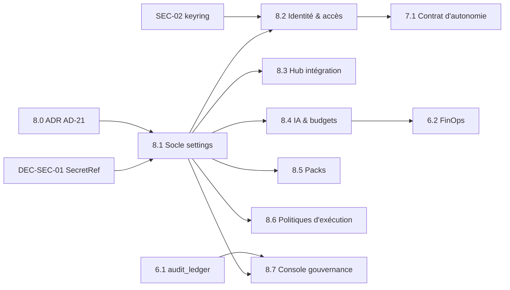

# Audit de Préparation des Spécifications — Hub de Configuration & Paramétrage

## 0. Synthèse

- Le **Core** est bien spécifié (auth bi-mode, catalogue fédéré, broker de permissions, outbox, `ConnectorPort`, moteur DBOS).
- La **couche d'administration *après le Jour 0*** n'est spécifiée nulle part : le paramétrage passe aujourd'hui uniquement par les workflows d'amorçage (`init-organization`, `init-workspace`, `init-datasource`, `init-user` — Story 1.5 / `AD-16`), et aucune spec ne couvre la **modification**, la **rotation** ou la **révocation** ultérieures.
- Quatre décisions d'architecture bloquent la rédaction des specs. Il faut les trancher dans un ADR (`AD-21`) avant toute story :
  1. **Modèle d'autorisation admin** : le code s'appuie sur des rôles (`PLATFORM_ADMIN`, `TEAM_LEAD`…), 5 permissions dissociées et `ScopeAccessGuard`. **Il n'existe aucun scope de type `admin:settings:*`.**
  2. **Contrat des secrets en écriture seule** : il doit réutiliser `DEC-SEC-01` (`SecretRef`, `SecretProviderPort`) et non inventer un mécanisme parallèle.
  3. **Sémantique de propagation** d'un changement de paramètre vers les runs DBOS en cours (déterminisme du rejeu).
  4. **Sens de l'« activation » d'un pack** : les packs sont découverts via `entry_points` (`AD-20`) au démarrage du processus. Un rechargement à chaud du *code* est donc impossible par construction ; seuls l'*activation par périmètre* et la *configuration* peuvent l'être.
- Recommandation : créer une **Epic 8 dédiée** (« Administration, Hub de Configuration & Cycle de Vie des Extensions »). Ses frontières doivent être explicites pour ne pas dupliquer les stories 3.3, 6.1, 6.2 et 7.1.

> [!NOTE]
> Base de la revue : `spec-1-1` à `spec-3-2f`, `epics.md`, `sprint-status.yaml` (y compris les `action_items` SEC-01..03, DEC-*), `ARCHITECTURE-SPINE.md` (`AD-16`, `AD-19`, `AD-20`), et le code (`permissions/crypto.py`, `orchestration/engine.py`, `apps/web/src/features/admin/`, migrations `0013`/`0014`).
> Pour les specs `2-x`, `3-2b..3-2f`, seuls l'en-tête et l'énoncé de `epics.md` ont été relus, pas le détail de chaque matrice I/O.

---

## 1. Matrice de couverture

| Domaine | Existant exploitable | Manquant | Risque architectural |
|---|---|---|---|
| **1. Plateforme, Sécurité & Accès** | `spec-1-2` : OIDC + locale Argon2id, TOTP, `JwtSessionManager`, `OrgUnit`, `TEAM_LEAD`, 5 permissions. `spec-1-4` : Passthrough / Service Principal, `PassthroughVaultCipher` (AES-256-GCM). `spec-1-5` : config initiale via `init-organization`. Story 7.1 (backlog) : identité Service Principal scopée. | CRUD post-Jour 0 des fournisseurs OIDC (édition, désactivation, test de connexion). Cycle de vie des Service Principals (création, rotation, révocation) hors 7.1. Politique d'auth locale. Rotation des clés (`SEC-02` ouvert). Catalogue formel des capacités admin. | **Élevé**. Risque de verrouillage (désactiver le seul IdP alors que l'auth locale est off, ou retirer le dernier `PLATFORM_ADMIN`). Risque d'escalade de périmètre (un `TEAM_LEAD` qui modifie un paramètre de portée ORG). |
| **2. Hub d'Intégration** | `spec-1-3` : catalogue fédéré, résolveur d'URI, CAS. `spec-3-2e` : `ConnectorPort`, registre `orcia.connectors`, table `connector_schemes`. `spec-2-3` : indexation incrémentale différentielle. `workspace_datasources` (ERD), `init-datasource`. | API d'administration des **instances** de datasources (credentials, URL, projet/espace). Endpoint `test-connection`. Planification et état de la synchro (dernier succès, erreur, prochain passage). Contrat de masquage des credentials connecteur. | **Moyen**. Credentials périmés silencieux, puis `[STALE_WARNING]` non diagnosticable. Rotation d'un token pendant un appel `ConnectorInvoker` en vol. |
| **3. Fournisseurs IA & Politiques** | `LiteLLMAdapter` (3.2b). Invariant « 2 familles de modèles » à `init-organization` (`AD-16` / `AD-10`). `budget_max_usd` par run racine (`engine.py:L123`). Story 6.2 (backlog) : FinOps et coupe-circuits. Story 4.2 (backlog) : orthogonalité des modèles. | Registre persistant des modèles et fournisseurs (alias, famille, endpoint, `SecretRef`). Budgets **hiérarchiques** ORG → TEAM → WORKSPACE. Règles de garde (modèles autorisés par périmètre). Écran d'administration. | **Élevé**. Le budget est un **instantané par run** : baisser un quota n'affecte pas les runs en cours. Retirer un modèle épinglé dans `run-lock.json` casse la reprise. |
| **4. Registre des Packs Métier** | `AD-20` : packs `orcia-pack-*` comme packages `uv`, 4 registres `entry_points`, job CI `core-without-sdlc`. `spec-3-2e` : séparation Core / pack SDLC. | Distinction **installé** (découvert par `entry_points`) / **activé par périmètre** (ORG / TEAM / WORKSPACE). Schéma de configuration exposé par chaque pack (JSON Schema). Contrôle de compatibilité de version Core ↔ pack. Comportement à la désactivation. | **Moyen**. Désactiver un pack utilisé par des runs actifs mène à un échec de reprise DBOS. Une promesse de « rechargement à chaud » du code est irréalisable (`entry_points` sont lus au démarrage). |
| **5. Studio d'Orchestration** | `spec-3-1` : workflow-as-code, gabarits, `run-lock.json`, `SUB_WORKFLOW <= 3`. `spec-3-2f` : `ConnectorInvoker` (relances, `Retry-After`, coupe-circuit), taxonomie d'erreurs. Story 3.3 (backlog) : composition conversationnelle `@xyflow/react`. Cycle de promotion du catalogue (`spec-1-3`). | Politiques d'exécution (relances, timeouts, coupe-circuit) en tant qu'**objets versionnés et éditables**. Aujourd'hui elles vivent dans le code. Lien éditeur ↔ promotion catalogue. | **Élevé** s'il est spécifié en doublon. Un CRUD « studio » parallèle au catalogue créerait deux sources de vérité pour les définitions de workflow. L'éditeur visuel doit rester dans 3.3. |
| **6. Gouvernance, Audit & Outbox** | `spec-3-2c` : `domain_events_outbox`, `OutboxRelayPort`. Triggers append-only (`audit_ledger`, `blackboard_snapshots`). Story 6.1 (backlog) : registre de provenance et export. | Journal d'audit des **changements de configuration** (qui, quoi, avant/après sous forme de hash). Console outbox : backlog, DLQ, rejeu ciblé et borné. Politique de rétention. | **Moyen**. Un rejeu outbox mal borné duplique des effets de bord si un consommateur n'est pas idempotent. Fuite de secret dans les payloads outbox ou audit (cf. `DEC-SEC-01`). |

### Impacts frontend non traités (transverses)

- **Routes** : seul `apps/web/src/features/admin/index.tsx` existe, et `apps/web/src/routes/` n'a pas de route `admin`. Il faut une route layout `/admin` avec enfants typés (`/admin/acces`, `/admin/integrations`, `/admin/ia`, `/admin/packs`, `/admin/politiques`, `/admin/gouvernance`), gardée par un `beforeLoad` sur les capacités. Ce garde reste du confort UX : **l'autorité est le backend**.
- **Formulaires** : validation synchrone dérivée des types OpenAPI générés (`openapi-fetch`). La validation « asynchrone » se limite à des actions explicites (`test-connection`, `dry-run`), jamais à chaque frappe. L'ajout d'une lib de schéma client (Zod) **n'est pas dans le spine** : à trancher dans `AD-21` (et `lint_spine.py`) ou à écarter.
- **Champs secrets** : composant `@orcia/ui` dédié (`SecretField` : état « configuré / non configuré », empreinte, actions *Remplacer* / *Effacer*). Il ne doit jamais pré-remplir de valeur.
- **Concurrence** : `ETag` / `If-Match`. En cas de `412`, un écran de conflit affiche la version serveur.
- **i18n** : toutes les chaînes vont dans `locales/{fr,en}.ts`, et les codes d'erreur RFC 9457 sont localisés.

---

## 2. Modèle de données & étanchéité de sécurité

### 2.1 Où résident les paramètres : 3 niveaux, chacun exclusif

| Niveau | Contenu | Mutabilité | Référence existante |
|---|---|---|---|
| **Env / infra** | URL DB/Redis/S3, clés maîtres (`ORCIA_PASSTHROUGH_MASTER_KEYS`, `ORCIA_JWT_SIGNING_SECRETS`) | Redéploiement uniquement | `SEC-01` (SOPS + age), `SEC-02` (keyring) |
| **Tables système relationnelles** | Paramètres fonctionnels versionnés par périmètre (`GLOBAL / BU / TEAM / WORKSPACE`) : IdP, datasources, modèles, budgets, activation des packs, politiques | API admin, versionnée, auditée | À créer (`Story 8.1`) |
| **Secrets** | Tokens Git/Jira/Confluence, clés LLM, secrets clients OIDC, credentials des Service Principals | Écriture seule via API | Aujourd'hui `PassthroughVaultCipher` (colonne chiffrée). Cible : `SecretRef` + `SecretProviderPort` (`DEC-SEC-01`) puis enveloppe DEK/KEK (`SEC-03`) |

Règle : une table de paramètres ne stocke **jamais** de valeur secrète, seulement un `secret_ref` (UUIDv7) qui pointe vers le stockage de secrets. Cela isole la rotation et la future migration vers Vault/KMS.

### 2.2 Vérification formelle des autorisations

- **Constat** : il n'existe aucun modèle de scopes texte (`admin:settings:*`, `admin:packs:*`). L'autorisation repose sur des rôles hiérarchiques, des permissions dissociées et `ScopeAccessGuard` / `RunAccessGuard`.
- **Recommandation** (à acter dans `AD-21`) : ne pas introduire un second système de scopes. Définir à la place un enum typé `AdminCapability` dans `orcia_core.permissions`, résolu à partir du rôle et du périmètre :

| Capacité | `PLATFORM_ADMIN` | `BU_DIRECTOR` | `TEAM_LEAD` | `READ_ONLY_OBSERVER` |
|---|---|---|---|---|
| `IDENTITY_MANAGE` (IdP, auth locale) | GLOBAL | — | — | lecture → mutation `403 ERR_OBSERVER_MODE_READ_ONLY` |
| `PRINCIPAL_MANAGE` (Service Principals) | GLOBAL | BU | TEAM (ses SP) | idem |
| `DATASOURCE_MANAGE` | GLOBAL | BU | TEAM / WORKSPACE | idem |
| `AI_PROVIDER_MANAGE` / `BUDGET_MANAGE` | GLOBAL | BU (budget) | WORKSPACE (budget ≤ plafond parent) | idem |
| `PACK_ENABLE` | GLOBAL | BU | WORKSPACE (si activé au-dessus) | idem |
| `OUTBOX_REPLAY` | GLOBAL uniquement | — | — | — |

- **Point d'application** : chaque endpoint de mutation appelle `ScopeAccessGuard.require(capability, scope)` **dans le service de domaine** (pas seulement dans le router). Un appel programmatique ne contourne donc pas le contrôle.
- **Invariants anti-verrouillage**, vérifiés dans la même transaction :
  - au moins un `PLATFORM_ADMIN` actif ;
  - au moins une méthode d'authentification active ;
  - le budget d'un enfant ne dépasse pas le plafond du parent.
- **Traçabilité** : chaque mutation écrit, **dans la même transaction**, un événement `SettingsChanged` dans `domain_events_outbox`. Il contient la liste des clés modifiées, le hash avant/après et l'acteur, **jamais de valeur**. L'audit (`audit_ledger`, 6.1) consomme cet événement.

### 2.3 Prise en compte « instantanée » par les workflows DBOS en cours

Contrainte de fond : un workflow DBOS est **rejoué de façon déterministe** à la reprise. Lire un paramètre mutable dans le corps du workflow (hors step) rend le rejeu non déterministe. Il faut donc classer chaque paramètre :

| Classe | Exemples | Sémantique | Mécanisme |
|---|---|---|---|
| **Épinglé au run** | Modèle / alias, version de pack, définition de workflow, politique de relance | Figé au démarrage, stable pendant tout le run (reproductibilité) | `run-lock.json` (existant, `spec-3-1`). Un changement ne vaut **que pour les nouveaux runs**. |
| **Contrôlé à chaque frontière de step** | Révocation de Service Principal, désactivation de datasource, désactivation de pack, kill-switch | Effet au **prochain step**, jamais au milieu d'un appel en vol | Vérification synchrone par le Permission Broker au début de chaque step (déjà conforme à la règle « permissions = appel synchrone »). L'échec est enregistré comme résultat de step, donc rejouable. |
| **Contrôlé à chaque appel coûteux** | Quotas et budgets LLM | Effet au **prochain appel LLM** | Remplacer l'instantané `root_run.budget_max_usd` (`engine.py:L123`) par une vérification contre un registre de consommation hiérarchique, à l'intérieur du step qui fait l'appel. À coordonner avec 6.2. |

- **Invalidation de cache** : compteur `settings_version` par périmètre. La lecture se fait dans le step et passe par un cache en mémoire validé par une requête de version peu coûteuse. Aucune nouvelle dépendance. Redis pub/sub, déjà dans la stack, reste une optimisation ultérieure.
- **SLA à écrire dans la spec** : « instantané » signifie *au plus tard à la prochaine frontière de step ou au prochain appel LLM du run*. Un appel déjà émis n'est pas interrompu, sauf via le kill-switch de 7.4.
- **Retrait d'un objet épinglé** (modèle, pack) : refus avec `409 ERR_RESOURCE_PINNED_BY_ACTIVE_RUNS`. L'erreur renvoie la liste des runs actifs et propose *Drainer* (bloquer les nouveaux runs, attendre la fin des actifs) ou *Forcer* (`PLATFORM_ADMIN` seulement, runs passés en `FAILED` avec motif audité).

---

## 3. Organisation & découpage des spécifications

### 3.1 Epic dédiée ou ventilation ?

**Epic dédiée : `Epic 8 — Administration, Hub de Configuration & Cycle de Vie des Extensions`.** Raisons :
- les 6 domaines partagent un socle commun (settings versionnés, contrat secret, `AdminCapability`, layout `/admin`, événement `SettingsChanged`). Les ventiler dupliquerait ce socle ou créerait des dépendances croisées entre epics ;
- l'administration post-Jour 0 est un livrable cohérent, démontrable et priorisable seul.

**Frontières, pour éviter les doublons :**

| Reste dans l'epic existante | Epic 8 fournit |
|---|---|
| 3.3 : éditeur visuel / composition de workflows | Politiques d'exécution versionnées que l'éditeur référence |
| 6.1 : `audit_ledger` et export de conformité | Événements `SettingsChanged` + vue « changements de configuration » |
| 6.2 : comptabilité FinOps et coupe-circuits | Configuration des budgets hiérarchiques ; 6.2 consomme et applique |
| 7.1 : contrat d'autonomie et identité SP pour les runs autonomes | Cycle de vie générique des SP (création, rotation, révocation) réutilisé par 7.1 |

### 3.2 Fiches de specs à rédiger

On garde la convention plate actuelle `docs/implementation-artifacts/spec-{story-key}.md` (pas de sous-dossiers), un rapport Tech Lead par story, et la numérotation `8.x` pour éviter les collisions avec `spec-3-1`.

| Story | Fiche (préfixe) | Périmètre |
|---|---|---|
| **8.0** | `spec-8-0-adr-modèle-de-configuration-autorisation-admin-…` | ADR `AD-21` + mise à jour du spine : 3 niveaux de stockage, `AdminCapability`, contrat `SecretInput` / `SecretStatus`, classes de propagation (§2.3), sens de l'« activation » d'un pack, décision Zod. **Doc + spike court, pas de feature.** |
| **8.1** | `spec-8-1-socle-settings-versionnés-secretfield-layout-admin-…` | Migration `platform_settings` (UUIDv7, scope, `version`, `etag`, `secret_ref`). Service et port. `SettingsChanged` via outbox. Router `/api/v1/admin/*` (schémas dans `apps/api/schemas/admin_*.py`). Layout `/admin` TanStack. Composant `@orcia/ui` `SecretField`. Test du secret témoin. |
| **8.2** | `spec-8-2-administration-identité-accès-oidc-service-principals-…` | CRUD IdP + `test-connection`. Politique d'auth locale. Cycle de vie SP (création, rotation, révocation effective au prochain step). Invariants anti-verrouillage. Dépend de `SEC-02`. |
| **8.3** | `spec-8-3-hub-d-intégration-instances-datasources-synchro-…` | CRUD des instances `workspace_datasources` au-dessus de `connector_schemes`. Formulaire piloté par le schéma de config que déclare chaque connecteur. `test-connection`. Planification et état de synchro. Rotation des credentials. |
| **8.4** | `spec-8-4-fournisseurs-ia-registre-de-modèles-budgets-hiérarchiques-…` | Registre modèles / fournisseurs (LiteLLM). Invariant 2 familles maintenu. Budgets ORG → TEAM → WORKSPACE. Application au prochain appel LLM. Garde `409` sur modèle épinglé. **Soumis à `PROC-01`** (touche le moteur). |
| **8.5** | `spec-8-5-registre-des-packs-activation-par-périmètre-config-…` | Inventaire installé (`entry_points`) vs activé par périmètre. JSON Schema de config fourni par le pack. Compatibilité de version. Drainer / Forcer à la désactivation. |
| **8.6** | `spec-8-6-politiques-d-exécution-versionnées-relances-timeouts-…` | Politiques relance / timeout / coupe-circuit comme éléments du catalogue (cycle de promotion existant), référencées par les workflows et épinglées dans `run-lock.json`. Lues par `ConnectorInvoker`. **Soumis à `PROC-01`.** |
| **8.7** | `spec-8-7-console-gouvernance-changements-config-outbox-dlq-rejeu-…` | Vue des changements de config (sur 6.1). Supervision outbox (backlog, DLQ). Rejeu ciblé, borné, idempotent (`OUTBOX_REPLAY`). Rétention. |

### 3.3 Ordonnancement & dépendances



**DoR (toutes stories 8.x)**
- `AD-21` accepté, spine mis à jour, `lint_spine.py` à `0 findings`.
- Section 1 du rapport Tech Lead rédigée, impact GitNexus (`repo: "ORCIA"`) réalisé.
- Matrice I/O & edge cases de la spec qui couvre au minimum les cas du §3.4 applicables.

**DoD (toutes stories 8.x)**
- 5 couches `AD-17`, couverture ≥ 90 %, SDK `0-diff`, RFC 9457 localisé `fr` / `en`.
- `READ_ONLY_OBSERVER` → `403` testé sur chaque mutation.
- **Test du secret témoin** : la valeur n'apparaît dans aucune réponse API, log, `domain_events_outbox`, `audit_ledger`, `step_executions`, `dbos.*`.
- `If-Match` obligatoire, `412` testé.
- `SettingsChanged` émis exactement une fois par mutation (idempotence au rejeu).
- `PROC-01` pour 8.4 et 8.6.
- Section 3 du rapport Tech Lead et `gitnexus_detect_changes()`.

### 3.4 Edge cases imposés aux specs

1. **Aller-retour du masque** : le client renvoie la valeur masquée et écrase le secret. Le contrat `SecretInput` (§4.2) l'interdit structurellement.
2. Deux admins éditent en parallèle : `412 ERR_SETTINGS_VERSION_CONFLICT`.
3. Désactivation du dernier IdP ou du dernier `PLATFORM_ADMIN` : `422 ERR_ADMIN_LOCKOUT_PREVENTED`.
4. `TEAM_LEAD` qui écrit une portée GLOBAL / BU : `403 ERR_SCOPE_ACCESS_DENIED`.
5. Budget abaissé sous la consommation courante : runs bloqués au prochain appel LLM, notification, pas d'échec rétroactif.
6. Retrait d'un modèle ou pack épinglé par des runs actifs : `409` + Drainer / Forcer.
7. Rotation de credential pendant un appel connecteur en vol : l'appel en cours garde l'ancienne version, le suivant prend la nouvelle (keyring `SEC-02`).
8. Rejeu outbox sur un consommateur non idempotent : rejeu refusé si le consommateur n'est pas déclaré idempotent ; lots bornés.
9. Lecture de paramètre dans le corps d'un workflow DBOS (hors step) : interdit, avec un test de garde.
10. Pack désinstallé (absent des `entry_points`) mais encore activé en base : statut `ORPHANED` affiché, aucun crash au démarrage.

---

## 4. Contrats critiques

### 4.1 Enveloppe type d'une ressource d'administration (réponse)

```json
{
  "resource_id": "0192f3a1-7c2b-7d6e-a1ff-b9d6c8e5f9ab",
  "kind": "datasource",
  "scope": { "level": "WORKSPACE", "id": "0192f3a0-…" },
  "version": 7,
  "etag": "W/\"sha256:3f1c…\"",
  "updated_at": "2026-10-28T22:58:12Z",
  "updated_by": { "user_id": "0192…", "display_name": "Marc D." },
  "data": {
    "connector_scheme": "jira",
    "base_url": "https://acme.atlassian.net",
    "project_keys": ["PAY", "RISK"],
    "sync": { "mode": "INCREMENTAL", "cron": "*/15 * * * *", "enabled": true }
  },
  "secrets": {
    "api_token": {
      "configured": true,
      "fingerprint": "sha256:9a41e0c2",
      "updated_at": "2026-10-20T08:00:00Z",
      "updated_by": "0192…"
    }
  },
  "status": { "health": "OK", "last_sync_at": "2026-10-28T22:45:00Z", "last_error_code": null }
}
```

- `data` ne contient **aucun** secret : les secrets sont isolés dans `secrets`, que le backend sérialise exclusivement en `SecretStatus`.
- `fingerprint` = 8 premiers hex du SHA-256 de la valeur, **salé par `resource_id`**, pour empêcher la corrélation entre ressources. On n'expose pas les 4 derniers caractères (trop révélateurs sur des clés courtes).

### 4.2 Mutation (requête) : secret en écriture seule

```http
PATCH /api/v1/admin/datasources/0192f3a1-…
If-Match: W/"sha256:3f1c…"
Content-Type: application/json
```

```json
{
  "data": { "project_keys": ["PAY", "RISK", "OPS"] },
  "secrets": {
    "api_token": { "action": "keep" }
  }
}
```

`SecretInput` est une union discriminée, sans valeur par défaut implicite :

| `action` | Champs | Effet |
|---|---|---|
| `keep` | — | Aucun changement (valeur par défaut si la clé est absente) |
| `set` | `value: SecretStr` | Chiffre, crée une nouvelle version du `secret_ref`, journalise la rotation |
| `clear` | — | Supprime ; refusé si le secret est requis par une ressource active |

Esquisse Pydantic v2 (dans `apps/api/src/orcia_api/schemas/admin_common.py`, jamais dans `orcia-core`) :

```python
class SecretKeep(BaseModel):
    action: Literal["keep"] = "keep"


class SecretSet(BaseModel):
    action: Literal["set"]
    value: SecretStr = Field(min_length=1, max_length=8192)


class SecretClear(BaseModel):
    action: Literal["clear"]


SecretInput = Annotated[SecretKeep | SecretSet | SecretClear, Field(discriminator="action")]


class SecretStatus(BaseModel):  # réponse uniquement
    configured: bool
    fingerprint: str | None
    updated_at: datetime | None
    updated_by: UUID | None
```

Erreurs (RFC 9457, `error_code` invariant) :

| Statut | `error_code` |
|---|---|
| `403` | `ERR_OBSERVER_MODE_READ_ONLY`, `ERR_SCOPE_ACCESS_DENIED` |
| `409` | `ERR_RESOURCE_PINNED_BY_ACTIVE_RUNS` |
| `412` | `ERR_SETTINGS_VERSION_CONFLICT` |
| `422` | `ERR_VALIDATION_FAILED`, `ERR_ADMIN_LOCKOUT_PREVENTED` |
| `428` | `ERR_PRECONDITION_REQUIRED` (`If-Match` absent) |

### 4.3 Masquage : surfaces couvertes

| Surface | Règle |
|---|---|
| Réponses API | `SecretStatus` uniquement ; test de contrat Schemathesis : aucun champ `value` en sortie |
| Logs `structlog` / attributs OTel | Processeur de masquage `SecretStr` / `SecretRef` (`DEC-SEC-01`) |
| `domain_events_outbox`, `audit_ledger` | Liste blanche de champs ; uniquement noms de clés + empreintes |
| `step_executions`, `dbos.*` | Le step reçoit un `SecretRef`, résolu au dernier moment et jamais retourné comme résultat de step |
| Frontend | `SecretField` ne garde jamais la valeur après envoi ; pas de `localStorage`, pas de cache TanStack Query pour les mutations secrètes |

### 4.4 Rejeu outbox (8.7)

```json
POST /api/v1/admin/outbox/replays
{ "event_ids": ["0192…", "0192…"], "consumer": "audit_finops.settings_projection", "dry_run": true }
```

- Rejeu **par liste d'IDs ou par filtre borné** (max 500 événements). `dry_run` vaut `true` par défaut, ce qui suit la convention `--dry-run` des scripts de maintenance.
- Le rejeu cible un **consommateur précis**, déclaré idempotent dans son registre. Sinon : `422`.
- La demande de rejeu elle-même est un événement audité.

---

## 5. Plan d'action priorisé

> [!IMPORTANT]
> Aucune estimation en semaines ici : le chiffrage relève du `bmad-sprint-planning` une fois `AD-21` accepté.

| Phase | Stories | Objectif | Prérequis |
|---|---|---|---|
| **P0 — Décision** | 8.0 | Trancher les 4 décisions bloquantes (§0) ; spine à jour | — |
| **MVP** | 8.1 → 8.2 (révocation SP, édition IdP) → 8.3 → 8.4 | Administrer après le Jour 0 sans redéploiement : accès, intégrations, modèles et budgets, propagation garantie au prochain step | `DEC-SEC-01`, `SEC-02` |
| **V2** | 8.5, 8.6, 8.7 | Activation des packs par périmètre, politiques d'exécution versionnées, console gouvernance / outbox | 6.1 pour 8.7 ; 3.3 pour exploiter 8.6 dans l'éditeur |
| **V3 / hors Epic 8** | `SEC-03` (Vault/KMS) | Enveloppe DEK/KEK ; remplace l'adaptateur de 8.1 sans changer le contrat API | 8.1 (contrat stable) |

### Prochaines étapes

1. Valider cet audit (PO / Architecte).
2. Rédiger `AD-21` via `bmad-architecture` (mode update du spine).
3. Ajouter l'Epic 8 et ses stories dans `epics.md` via `bmad-create-epics-and-stories`, puis `development_status` dans `sprint-status.yaml` via `bmad-sprint-planning`.
4. Clore l'action item `EPIC-08-CONFIG-HUB` quand ces étapes sont faites.
