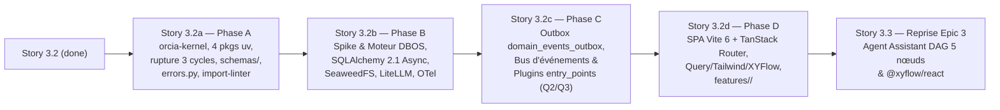

# Proposition de Modification de Sprint (Sprint Change Proposal — Correct Course)

- **Projet** : ORCIA (*Orchestration of Processes, Context, and Intelligent Agents*)
- **Date** : 2026-10-27
- **Auteur** : Winston (Architecte Système) & John (Product Manager) — Workflow `bmad-correct-course`
- **Périmètre** : Intégration de la revue de stack (`stack-review-2026-10-27.md` — `E1..E8`, `P1..P9`), de l'analyse de modularité (`modularity-analysis-2026-10-27.md` — `M1..M11`, Phases `A..F`), du Deep Recon Frontend (`OQ-02`) et des arbitrages utilisateur (`OQ-01..03`, `Q1..Q5`) dans le plan d'exécution ORCIA
- **Statut** : **EN ATTENTE DE VALIDATION UTILISATEUR (Gate Étape 2)**

---

## 1. Résumé du Problème & Déclencheur (`Checklist §1`)

Après la livraison de **16 stories sur 31** (Epics 1 et 2 complets : `1.1..1.5`, `2.1..2.4` ; début de l'Epic 3 : `3.1` et `3.2` marquées `done`), une revue approfondie du code réel par rapport à l'`ARCHITECTURE-SPINE.md` et une analyse de modularité assistée par **GitNexus (`repo: "ORCIA"`)** ont mis en évidence deux familles d'écarts structurels qui doivent être résolus **avant** de poursuivre l'implémentation à partir de la `Story 3.3` :

### 1.1 Écarts entre la Spine et le code (`E1..E8` — `stack-review-2026-10-27.md`)
1. **`E1` — Aucun adaptateur d'infrastructure réel branché** : aucun import actif de `sqlalchemy`, `asyncpg`, `litellm`, `docling`, `wasmtime` ni `opentelemetry` dans `packages/` et `apps/`.
2. **`E2` — Persistance 100 % en mémoire & singletons d'import** : **39 stockages `InMemory*` / dictionnaires** dans `packages/orcia-core/src/orcia_core/` et **3 singletons instanciés au chargement des modules** dans `apps/api/src/orcia_api/routers/auth.py:L25` (`_DEFAULT_AUTH_SERVICE`), `catalog.py:L27` (`_DEFAULT_CATALOG_SERVICE`) et `orchestration.py:L39` (`_DEFAULT_ORCHESTRATION_SERVICE`). Tout redémarrage de processus efface l'état.
3. **`E3` — Schéma SQL non relié au domaine** : les 11 migrations Alembic (`infra/migrations/versions/0001..0011`, 17 tables SQL) existent mais aucune couche repository SQLAlchemy Asyncio ne les consomme.
4. **`E4` — Dérive des versions et du packaging Python** : un seul `pyproject.toml` racine setuptools au lieu d'un workspace `uv` multi-packages, versions minimales lâches, et absence d'`import-linter` en CI pour faire respecter la frontière hexagonale.
5. **`E5` — Dépendances frontend manquantes & inadéquation de Next.js App Router** : `apps/web/package.json` utilise Next.js `^15.2.0` en mode `100 % "use client"` sans `@tanstack/react-query`, `tailwindcss`, `@xyflow/react` ni `openapi-fetch`. Le Deep Recon (`OQ-02`) a démontré la supériorité de **`Vite 6 + TanStack Router v1` (SPA pure, score pondéré `4,70 / 5` contre `2,65 / 5` pour Next.js Client-First)**.
6. **`E6` — Moteur d'exécution durable maison sur Dramatiq** : réimplémenter manuellement les attentes de plusieurs semaines, les minuteries/cron, l'idempotence des webhooks, les sous-workflows (`<= 3`) et le Replay à partir du Step $N$ sur Dramatiq est fragile. Arbitrage `OQ-01` : adoption de **`DBOS Transact` (`dbos 2.14.0`, MIT)** sur PostgreSQL 18 (avec conservation de Dramatiq pour le délestage asynchrone lourd d'indexation).
7. **`E7` — Stockage objet MinIO archivé (`AGPL-3.0`) & recherche BM25** : remplacement de MinIO par **`SeaweedFS` (`Apache-2.0`)** derrière `ObjectStoragePort` (`OQ-03`, `P6`) et confirmation de PostgreSQL 18 `tsvector` + GIN + `ts_rank_cd` pondéré + RRF (`k=60`) sans extension AGPL (`P7`).
8. **`E8` — Absence d'instrumentation OpenTelemetry réelle** : les `trace_id` sont générés localement par `uuid4` au lieu de propager le contexte W3C OpenTelemetry entre FastAPI, SQLAlchemy et les workers (`P9`).

### 1.2 Diagnostic de couplage & analyse d'impact GitNexus (`M1..M11` — `modularity-analysis-2026-10-27.md`)
L'analyse GitNexus (`gitnexus_context` + `gitnexus_impact({direction: "upstream"})` sur `repo: "ORCIA"`) exécutée en Étape 1 a révélé :
- **🔴 Risque `CRITICAL` sur `OrciaDomainError`** (`packages/orcia-core/src/orcia_core/domain/exceptions.py`, `377` lignes) : **59 symboles dépendants directs (`d=1`)** à travers tous les domaines (`auth`, `catalog`, `permissions`, `bootstrap`, `ontology`, `rag`, `orchestration`, `blackboard`) et les routeurs FastAPI. Chaque nouveau domaine modifie ce fichier central.
- **🟠 Risque `HIGH` sur `packages/orcia-core/src/orcia_core/domain/exceptions.py`** : **35 fichiers dépendants directs**.
- **3 cycles de dépendances entre domaines métier** dans `packages/orcia-core/src/orcia_core/` :
  1. `blackboard` $\leftrightarrow$ `orchestration` : `blackboard/models.py:L15` importe `StepExecutionState` depuis `orchestration/models.py`, tandis qu'`orchestration/engine.py:L17-26` importe `BlackboardSnapshotService` et `StepExecutionDraftStore` depuis `blackboard/`.
  2. `catalog` $\leftrightarrow$ `bootstrap` : `catalog/service.py:L14` importe `SYSTEM_BOOTSTRAP_WORKFLOW_MANIFESTS` depuis `bootstrap/workflows.py`, tandis que `bootstrap/workflows.py:L21` importe `FederatedCatalogService` depuis `catalog/service.py`.
  3. `permissions` $\leftrightarrow$ `bootstrap` : `permissions/broker.py:L14` importe `INIT_USER_WORKFLOW_URI` depuis `bootstrap/workflows.py`, tandis que `bootstrap/workflows.py:L29` importe `PermissionBrokerService` depuis `permissions/broker.py`.
- **Couplage des schémas HTTP à l'intérieur du noyau métier** : `packages/orcia-core/src/orcia_core/schemas/` contient **10 fichiers (`2 060` lignes)** de DTOs HTTP/OpenAPI importés par `apps/api`, couplant le domaine au contrat REST.
- **Moteur d'orchestration centralisant les effets secondaires** : `orchestration/engine.py` (`447` lignes) devra, dans les Epics 4 à 7, notifier la comptabilité FinOps, l'audit, l'extraction ontologique, les notifications SSE et les déclencheurs sans devenir un « God Object ».

### 1.3 Rappel des Arbitrages Utilisateur Verrouillés (`OQ-01..03` & `Q1..Q5`)
| Réf. | Sujet | Décision Utilisateur Verrouillée |
|---|---|---|
| **`OQ-01`** | Moteur d'exécution durable (`AD-2`, `AD-13`, `AD-18`) | **`DBOS Transact` (`dbos 2.14.0`, MIT)** sur PostgreSQL 18 + Dramatiq conservé pour le délestage lourd |
| **`OQ-02`** | Framework Frontend (`AD-1`) | **`Vite 6 + TanStack Router v1` (SPA pure)** remplaçant Next.js App Router |
| **`OQ-03`** | Stockage objet CAS S3 v4 (`AD-5`) | **`SeaweedFS` (`Apache-2.0`)** derrière `ObjectStoragePort` remplaçant MinIO |
| **`Q1`** | Découpage du workspace `uv` (`M1`, `AD-19`) | **Option `1A` : 4 packages `uv`** (`packages/orcia-kernel`, `packages/orcia-core`, `apps/api`, `apps/worker`) + `import-linter` |
| **`Q2`** | Bus d'événements & Outbox (`M6`, `AD-19`) | **Option `2A` dans une story supplémentaire dédiée (`Story 3.2c`)** : table `domain_events_outbox` PostgreSQL transactionnelle |
| **`Q3`** | Modèle d'extension / plugins (`M7`, `M8`, `AD-19`) | **Option `3A` : Hybride** (`entry_points` Python en processus pour `UriResolverPlugin`/`LlmGatewayPort` + MCP/sous-processus hors processus pour `sandbox-runner` et outils tiers) |
| **`Q4`** | Isolation des tables SQL (`AD-19`) | **Option `4A` : Schéma PostgreSQL `public` unique** avec préfixes de domaine et `import-linter` interdisant les imports croisés de `_internal/` |
| **`Q5`** | Briques Rust (`P5`, `AD-9`) | **Pas de Rust dans le MVP actif** (`wasmtime-py` + `gVisor/Podman` conservés) ; **déplacé en `action_item` (`ARCH-RUST-DEFERRED`) pour plus tard** |

---

## 2. Analyse d'Impact Complète (`Checklist §2 & §3`)

### 2.1 Impact sur les 16 Stories Déjà Terminées (`1.1..1.5`, `2.1..2.4`, `3.1`, `3.2`)
- **Politique retenue : Ne PAS rouvrir ni invalider les 16 stories marquées `done`**.
  - Leur logique de domaine pure, leurs machines à états, leurs validateurs Pydantic, leurs 11 migrations Alembic (`0001..0011`), leurs composants `@orcia/ui` et leurs tests unitaires ($\ge 90\%$ de couverture) constituent une base fonctionnelle saine.
  - Les stores `InMemory*` écrits lors des stories `1.1..3.2` ne sont pas jetés : ils sont déplacés proprement dans `tests/unit/fakes/` pour continuer à faire tourner les tests unitaires du domaine en quelques millisecondes, tandis que les nouvelles stories intercalaires (`3.2a..3.2d`) branchent la modularité (`orcia-kernel`), la persistance SQLAlchemy Asyncio réelle, `DBOS Transact`, l'Outbox transactionnelle et la SPA `Vite 6 + TanStack Router v1`.
- **Re-numérotation propre après `Story 3.2` (`done`)** :
  - Dans l'état précédent de `epics.md` et `sprint-status.yaml`, une story intercalaire `3.1a` (`backlog`) avait été insérée *entre* `3.1` (`done`) et `3.2` (`done`), ce qui créait une anomalie chronologique (`done → backlog → done → backlog`).
  - Nous fusionnons et réordonnons toutes les fondations d'infrastructure et de modularité **immédiatement après `Story 3.2` (`done`) et avant `Story 3.3` (`backlog`)** sous la séquence **`3.2a → 3.2b → 3.2c → 3.2d`**, suivie de la reprise normale à `3.3`.

### 2.2 Impact par Epic (`Epics 1 à 7`)
| Epic | Statut Actuel | Impact du Changement | Action Requise |
|---|---|---|---|
| **Epic 1** (`1.1..1.5`) | `done` | Les services `auth`, `catalog`, `permissions`, `bootstrap` voient leurs cycles `catalog ↔ bootstrap` et `permissions ↔ bootstrap` rompus en `3.2a` et leurs repositories SQLAlchemy branchés en `3.2b`. | Aucune réouverture d'Epic 1 ; traité par `3.2a` et `3.2b`. |
| **Epic 2** (`2.1..2.4`) | `done` | Le service `rag` voit sa recherche hybride `halfvec(1024)` + `tsvector` GIN (`ts_rank_cd` pondéré A/B/C/D + RRF `k=60`) et la traversée CTE bornée (`depth <= 2`) branchées en SQL réel en `3.2b`. | Précision documentaire dans `Story 2.4` + implémentation SQL en `3.2b`. |
| **Epic 3** (`3.1..3.5`) | `in-progress` (`3.1`, `3.2` `done`) | Insertion des **4 stories séquentielles de fondation** (`3.2a` Modularité Phase A, `3.2b` Persistance/DBOS/SeaweedFS/OTel Phase B, `3.2c` Outbox/Events/Plugins Phase C, `3.2d` SPA Vite+TanStack Router Phase D) avant `3.3`. | Remplacer `3.1a` + ancien `3.2a` par `3.2a`, `3.2b`, `3.2c`, `3.2d` ; amender `3.3..3.5` avec les garde-fous `AD-19`. |
| **Epic 4** (`4.1..4.4`) | `backlog` | Isolation hors processus du `sandbox-runner` (MCP/sous-processus `Q3: 3A`), sandbox bimodale sans Rust (`Q5` : Palier 1 `wasmtime-py < 5 s` en `4.1` et Palier 2 `gVisor/Podman < 60 s` + 5 rôles de déploiement en `4.1a`). | Mettre à jour `Story 4.1` et `Story 4.1a` (Phase E). |
| **Epic 5** (`5.1..5.3`) | `backlog` | Le broker SSE (`5.1`) consomme les événements de domaine via la table Outbox (`3.2c`) et le frontend utilise `Vite 6 + TanStack Router v1` (`features/notifications/`, `features/control_center/`). | Mettre à jour les ACs techniques de `5.1` et `5.2`. |
| **Epic 6** (`6.1..6.3`) | `backlog` | `audit_finops` (`6.1`, `6.2`) s'abonne aux événements Outbox (`StepCompleted`, `GateEvaluated`, `RunTerminated`) dans la même transaction ou via le relais Outbox idempotent sans coupler `orchestration/engine.py`. | Mettre à jour les ACs techniques de `6.1` et `6.2`. |
| **Epic 7** (`7.1..7.4`) | `backlog` | Les déclencheurs événementiels (`7.2`) s'exécutent dans le rôle `trigger-dispatcher` avec déduplication `SetWorkflowID` DBOS + contrainte SQL `UNIQUE`, et la boucle d'auto-remédiation (`7.3`) cible le Palier 2 (`TIER_2_CONTAINER < 60 s`) de `sandbox-runner`. | Déjà aligné avec `AD-9`, `AD-18` et `AD-19`. |

### 2.3 Impact sur les Artefacts de Planification (`Checklist §3`)
- **PRD (`prd.md`)** : **Aucun conflit fonctionnel**. Les 33 FRs, 13 NFRs et 12 UJs sont intégralement préservés. L'architecture modulaire (`AD-19`), `DBOS Transact`, `SeaweedFS` et `Vite 6 + TanStack Router v1` renforcent directement `NFR-REL-1` (reprise sur crash), `NFR-SEC-1` (isolation sandbox et suppression de la surface serveur Node.js/RSC) et `NFR-PERF-1` (`< 1 s` de bascule de Run).
- **Architecture (`ARCHITECTURE-SPINE.md` & `architecture.md`)** : **Déjà mis à jour et validés à `0 finding`** lors de l'Étape 1 (`AD-1`, `AD-2`, `AD-5`, `AD-6`, `AD-8`, `AD-9`, `AD-12`, `AD-13`, `AD-18`, et nouvel **`AD-19`**).
- **UX/UI (`DESIGN.md` & `EXPERIENCE.md`)** : **100 % préservés**. La bibliothèque `@orcia/ui` (`packages/ui`) reste strictement isolée de tout routeur (`next/*` comme `@tanstack/react-router`), la Direction C et les 11 règles fondamentales UX/UI restent inchangées.

---

## 3. Évaluation des Options & Approche Recommandée (`Checklist §4`)

Trois options de trajectoire ont été évaluées :
1. **Option 1 — Ajustement Direct par Stories Intercalaires Séquentielles (`3.2a → 3.2b → 3.2c → 3.2d` puis `3.3`, + `4.1a`)** *(Recommandée)* :
   - Préserve 100 % du travail validé sur les 16 stories terminées (`1.1..3.2`).
   - Découpe la remédiation technique en **4 incréments verticaux testables indépendamment** avant de reprendre les fonctionnalités métier à `Story 3.3` :
     1. **`3.2a` (Phase A — Modularité pure, `0` changement d'infra)** : `orcia-kernel`, workspace `uv` 4 packages, rupture des 3 cycles, déplacement de `schemas/` et `<domaine>/errors.py`, suppression des 3 singletons d'import, `import-linter` en CI.
     2. **`3.2b` (Phase B — Persistance & Moteur Durable)** : spike `DBOS Transact` + intégration PostgreSQL 18, repositories `SQLAlchemy 2.1 Asyncio` sur les 11 migrations Alembic, `SeaweedFS` (`ObjectStoragePort`), `LiteLLMAdapter`, `OpenTelemetry` W3C `trace_id`.
     3. **`3.2c` (Phase C — Outbox Transactionnelle & Plugins, selon `Q2` & `Q3`)** : migration `0012_domain_events_outbox`, bus d'événements de domaine, abonnés découplés (`audit_finops`, `ontology`, `sse`) et plugins `entry_points`.
     4. **`3.2d` (Phase D — Frontend SPA Pure Vite 6 + TanStack Router v1)** : migration de `apps/web`, installation de TanStack Query / Tailwind / XYFlow / openapi-fetch, découpage `features/<domaine>/` et génération du client OpenAPI par domaine.
2. **Option 2 — Rollback des Stories `3.1` et `3.2` et réécriture complète depuis `1.1`** *(Écartée)* :
   - Détruirait inutilement des modèles de domaine, validateurs et tests unitaires valides qui ont déjà plus de 90 % de couverture.
3. **Option 3 — Big-Bang dans une seule méga-story `3.2a`** *(Écartée)* :
   - Mélangerait dans un seul PR la restructuration du graphe d'imports (`CRITICAL` 59 dépendants sur `OrciaDomainError`), SQLAlchemy + DBOS, l'Outbox et la migration Next.js $\rightarrow$ Vite, rendant les revues et le diagnostic de régressions beaucoup trop risqués (et contraire à l'arbitrage utilisateur `Q2` demandant une story dédiée pour l'Outbox).

**Verdict** : Nous retenons l'**Option 1 (Ajustement Direct Séquentiel `3.2a → 3.2b → 3.2c → 3.2d → 3.3` + `4.1a` + `action_items` pour `M10` et Rust `Q5`)**.



---

## 4. Propositions Détaillées de Modifications (`OLD → NEW`) (`Checklist §4`)

### 4.1 Modifications dans `docs/planning-artifacts/epics.md`

#### Changement E-1 : Suppression de `Story 3.1a` (mal placée entre `3.1` `done` et `3.2` `done`) et remplacement de l'ancien `Story 3.2a` par la séquence `Story 3.2a`, `Story 3.2b`, `Story 3.2c`, `Story 3.2d` juste après `Story 3.2`

- **OLD (`docs/planning-artifacts/epics.md`, L359–L412)** :
  - `Story 3.1a: Squelette Hexagonal Persistant de Bout en Bout...` (placée avant `Story 3.2`)
  - `Story 3.2: Moteur d'Orchestration Durable...` (`done`)
  - `Story 3.2a: Intégration du Moteur d'Exécution Durable Transactionnel DBOS Transact... & Migration SPA Vite 6...`

- **NEW (`docs/planning-artifacts/epics.md`, immédiatement après `Story 3.2`)** :

  1. **`### Story 3.2a: Phase A — Socle du Monolithe Modulaire (packages/orcia-kernel), Workspace uv à 4 Packages, Rupture des 3 Cycles, Découplage schemas/ & <domaine>/errors.py, Point d'Assemblage Unique & Garde-Fou import-linter`**
     - **En tant que** Architecte Système ou Tech Lead (`Winston`, `Marc UJ-5`),
     - **Je veux** extraire un noyau partagé minimal `packages/orcia-kernel` (`0` dépendance métier), structurer le dépôt Python en un workspace `uv` à 4 packages (`orcia-kernel`, `orcia-core`, `api`, `worker`), rompre les 3 cycles de dépendances (`blackboard ↔ orchestration`, `catalog ↔ bootstrap`, `permissions ↔ bootstrap`), déplacer `orcia_core/schemas/` (`2 060` lignes) vers `apps/api/src/orcia_api/schemas/`, éclater `domain/exceptions.py` (`377` lignes, 59 dépendants) en `<domaine>/errors.py`, supprimer les 3 singletons d'import `_DEFAULT_*_SERVICE` au profit d'un point d'assemblage unique (`lifespan` + `Depends`), et verrouiller le graphe d'imports avec `import-linter` en CI,
     - **Afin que** chaque domaine métier de `packages/orcia-core` évolue et soit testé de manière isolée sans cycle ni fuite de contrat HTTP (`AD-1`, `AD-17`, `AD-19`, `M1..M5`, `P3`, `P4`, `Q1: 1A`, `Q4: 4A`).
     - **Critères d'Acceptation clés** :
       - Création de `packages/orcia-kernel/src/orcia_kernel/` (`ids.py` UUIDv7, `enums.py`, `errors.py` avec `OrciaDomainError`, `events.py`, `ports.py` avec `BlackboardPort`, `LLMPort`, `ObjectStoragePort`, `SandboxPort`, `ClockPort`).
       - Configuration du workspace `uv` à 4 membres (`packages/orcia-kernel`, `packages/orcia-core`, `apps/api`, `apps/worker`) + `uv.lock` et alignement des bornes minimales de versions (`P3`).
       - Rupture des 3 cycles : `blackboard` dépend uniquement de `orcia_kernel` (`StepExecutionState` dans `orcia_kernel.enums`, `BlackboardPort` dans `orcia_kernel.ports`) ; les constantes de seeds système sont placées dans `catalog/seeds.py` et `permissions/seeds.py` et consommées à sens unique par `bootstrap`.
       - Déplacement des 10 fichiers de `packages/orcia-core/src/orcia_core/schemas/` vers `apps/api/src/orcia_api/schemas/<domaine>.py` (`0` fichier dans `orcia_core/schemas/`).
       - Découpage de `domain/exceptions.py` en `<domaine>/errors.py` héritant de `orcia_kernel.errors.OrciaDomainError` + table de correspondance HTTP RFC 9457 centralisée dans `apps/api/src/orcia_api/errors/registry.py`.
       - Suppression des 3 singletons `_DEFAULT_AUTH_SERVICE`, `_DEFAULT_CATALOG_SERVICE`, `_DEFAULT_ORCHESTRATION_SERVICE` dans `apps/api/src/orcia_api/routers/{auth,catalog,orchestration}.py` ; câblage exclusif dans `apps/api/src/orcia_api/dependencies.py` et `main.py` (`lifespan` $\rightarrow$ `app.state` + `Depends()`).
       - Déplacement des classes `InMemory*` vers `tests/unit/fakes/` (réexportées uniquement pour les tests unitaires en attendant `3.2b`).
       - Contrat `import-linter 2.7` (`lint-imports`) bloquant en CI : `0` violation sur les couches (`orcia_kernel` $\leftarrow$ `orcia_core` $\leftarrow$ `orcia_api`/`orcia_worker`), l'indépendance des domaines pairs, l'encapsulation de `_internal/` (`Q4: 4A`) et l'absence de `fastapi`/`sqlalchemy`/`dramatiq`/`dbos`/`redis`/`litellm` dans les modèles et ports.

  2. **`### Story 3.2b: Phase B — Persistance Réelle SQLAlchemy 2.1 Asyncio (asyncpg), Spike & Moteur Durable DBOS Transact sur PostgreSQL 18, Stockage CAS SeaweedFS (ObjectStoragePort), LiteLLMAdapter & Instrumentation OpenTelemetry`**
     - **En tant que** Architecte Système ou Ingénieur Plateforme (`Winston`, `Karim UJ-9`),
     - **Je veux** valider par un spike court puis intégrer `DBOS Transact` (`dbos 2.14.0`, MIT) sur PostgreSQL 18, implémenter les repositories `SQLAlchemy 2.1 Asyncio` (`asyncpg`) dans le sous-package `_internal/` de chaque domaine sur les migrations Alembic `0001..0011` (incluant la recherche hybride SQL `halfvec` + `tsvector` GIN `ts_rank_cd` RRF `P7`), brancher `SeaweedFS` (`Apache-2.0`) derrière `ObjectStoragePort`, implémenter `LiteLLMAdapter` derrière `LLMPort`, et instrumenter la chaîne avec `OpenTelemetry`,
     - **Afin que** tout `Workflow Run` et toute entité d'ORCIA soient réellement persistés dans PostgreSQL 18 et SeaweedFS, survivent à tout redémarrage de processus avec reprise transactionnelle ACID (`DBOS.recv`, `DBOS.fork_workflow`, `SetWorkflowID`), et propagent un `trace_id` W3C réel de bout en bout (`AD-2`, `AD-5`, `AD-8`, `AD-10`, `AD-12`, `AD-13`, `AD-18`, `P1`, `P2`, `P6`, `P7`, `P9`, `OQ-01`, `OQ-03`).
     - **Critères d'Acceptation clés** :
       - Spike automatisé `DBOS Transact` validant : (a) pause `DBOS.recv` + redémarrage complet du processus + reprise exacte sur `DBOS.send`, (b) `DBOS.fork_workflow` (Replay à partir du Step $N$ sans ré-exécuter `1..N-1`), (c) `@DBOS.scheduled` (cron) et `SetWorkflowID("<trigger_id>:<idempotency_key>")` (idempotence native).
       - Implémentation des repositories `SQLAlchemy 2.1 Asyncio` (`asyncpg`) dans `<domaine>/_internal/repository.py` (schéma PostgreSQL `public` unique `Q4: 4A`) couvrant les 11 migrations Alembic (`0001..0011`), y compris la requête SQL hybride `pgvector halfvec(1024)` + `tsvector` GIN `ts_rank_cd` pondéré A/B/C/D fusionnée par RRF (`k=60`) et la CTE du graphe tripartite bornée à `depth <= 2` (`P7`).
       - Implémentation de l'adaptateur S3 v4 `SeaweedFS` derrière `orcia_kernel.ports.ObjectStoragePort` (`cas/<sha256>`) et remplacement de MinIO par `chrislusf/seaweedfs` dans `docker-compose.yml` (`OQ-03`, `P6`).
       - Implémentation de `LiteLLMAdapter` (avec bascule vers `DeterministicCassetteLLM` à `0 $` en CI) et instrumentation `opentelemetry-sdk` + `opentelemetry-instrumentation-fastapi` + `opentelemetry-instrumentation-sqlalchemy` injectant le `trace_id` W3C réel dans `structlog`, `audit_ledger` et les erreurs RFC 9457 (`P1`, `P9`).
       - Tests d'intégration sur conteneurs éphémères réels `testcontainers-python` (PostgreSQL 18 + `pgvector`, Redis 7, SeaweedFS) démontrant la persistance et la reprise après extinction/redémarrage des processus API et Worker ($\ge 90\%$ de couverture).

  3. **`### Story 3.2c: Phase C — Bus d'Événements de Domaine, Table Outbox Transactionnelle (domain_events_outbox) & Plugins entry_points`** *(Nouvelle story dédiée selon l'arbitrage `Q2` et `Q3`)*
     - **En tant que** Architecte Système ou Tech Lead (`Winston`, `Marc UJ-5`),
     - **Je veux** créer la table Outbox transactionnelle `domain_events_outbox` (migration Alembic `0012`), publier dans la même transaction SQL que le changement d'état du Run/Step les événements immuables du domaine (`StepCompleted`, `ArtifactProduced`, `GateEvaluated`, `RunTerminated`), relayer ces événements de manière idempotente vers les abonnés découplés (`audit_finops`, `ontology`, `sse`, réveil de déclencheurs), et charger les extensions internes via les `entry_points` Python (`orcia.uri_resolvers`, `orcia.llm_gateways`),
     - **Afin que** le moteur d'orchestration (`orchestration/engine.py`) reste compact et fermé à la modification (principe Open/Closed) lorsque les Epics 4 à 7 ajoutent de nouveaux effets secondaires ou connecteurs, sans jamais perdre un événement d'audit ou de notification en cas de crash entre l'écriture SQL et le traitement aval (`AD-12`, `AD-19`, `M6`, `M7`, `Q2: 2A`, `Q3: 3A`).
     - **Critères d'Acceptation clés** :
       - Migration Alembic immuable `0012_domain_events_outbox` créant la table `domain_events_outbox` (`event_id UUIDv7 PK`, `event_type`, `aggregate_type`, `aggregate_id`, `run_id`, `workspace_id`, `payload_jsonb`, `trace_id`, `status PENDING | PUBLISHED | FAILED`, `attempts`, `created_at`, `published_at`) avec index partiel sur `status = 'PENDING'` et test complet `upgrade()` / `downgrade()`.
       - Publication transactionnelle des événements typés de `orcia_kernel.events` (`StepCompleted`, `ArtifactProduced`, `GateEvaluated`, `RunTerminated`, `HumanArbitrationRequested`) dans la même `AsyncSession` SQLAlchemy que les transitions de `workflow_runs`, `step_executions` et `blackboard_snapshots`.
       - Maintien d'appels directs synchrones uniquement pour les décisions bloquantes du flux d'exécution (verrouillage des permissions `permissions`, passage des Gates `gates` et arbitrage humain), tandis que la comptabilité FinOps/audit (`audit_finops`), l'extraction ontologique asynchrone (`ontology`), la diffusion temps réel (`sse`) et les notifications s'abonnent au bus d'événements Outbox sans être importés par `orchestration/engine.py`.
       - Relais Outbox idempotent dans `apps/worker` (`SELECT ... FOR UPDATE SKIP LOCKED` par lots) garantissant une livraison *at-least-once* avec déduplication par `event_id` chez chaque abonné (`0` doublon dans `audit_ledger`).
       - Chargement dynamique par `importlib.metadata.entry_points` des groupes `orcia.uri_resolvers` (`git://`, `jira://`, `confluence://`, `db://`, `nexus://`) et `orcia.llm_gateways` déclaré dans `packages/orcia-core/pyproject.toml` (en limitant la création de nouveaux ports à la Règle de Trois, `M7`, `Q3: 3A`).
       - Tests unitaires et d'intégration (`testcontainers` PG18 + Redis) vérifiant qu'un crash simulé après le `COMMIT` SQL mais avant le relais Outbox livre 100 % des événements au redémarrage sans doublon ($\ge 90\%$ de couverture).

  4. **`### Story 3.2d: Phase D — Migration Frontend SPA Pure Vite 6 + TanStack Router v1, Intégration TanStack Query v5 / Tailwind v4 / @xyflow/react v12 / openapi-fetch & Découpage par Fonctionnalité features/<domaine>/`**
     - **En tant que** Architecte Frontend ou UX Designer (`Sally`, `Amelia`),
     - **Je veux** migrer `apps/web` de Next.js App Router vers une SPA pure `Vite 6 + TanStack Router v1`, installer et configurer `@tanstack/react-query 5.90`, `tailwindcss 4.3`, `@xyflow/react 12.12` et `openapi-fetch 0.17`, générer le client OpenAPI découpé par domaine à partir de `apps/api/src/orcia_api/schemas/`, et organiser `apps/web/src/` en routes minces (`src/routes/`) et modules fonctionnels isolés (`src/features/<domaine>/`),
     - **Afin que** le frontend élimine 100 % de la surface d'attaque serveur Node.js/RSC, divise par 8 son empreinte mémoire en production (`nginx:alpine` statique), supprime les erreurs d'hydratation SSR sur `@xyflow/react` et le buffering SSE, et permette de développer les Epics 3 à 7 dans des modules frontend découplés (`AD-1`, `AD-15`, `AD-19`, `P8`, `M11`, `OQ-02`).
     - **Critères d'Acceptation clés** :
       - Remplacement de Next.js dans `apps/web/package.json` par `vite ^6.4.1`, `@vitejs/plugin-react ^4.5.2`, `@tanstack/react-router ^1.166.2`, `@tanstack/router-plugin ^1.166.2`, `@tanstack/react-query ^5.90.0`, `tailwindcss ^4.3.0`, `@xyflow/react ^12.12.0` et `openapi-fetch ^0.17.0`.
       - Conversion des 10 fichiers de routes (`75` lignes dans `apps/web/src/app/`) vers `apps/web/src/routes/` avec `createRootRouteWithContext<{ queryClient: QueryClient }>()` et validation typée des paramètres d'URL (`validateSearch`).
       - Restructuration de `apps/web/src/` en `src/features/<domaine>/` (`cockpit`, `inbox`, `catalog`, `ontology`, `gates`, `finops`, `admin`, `workspaces`), où chaque `src/routes/*.tsx` se limite à assembler la feature correspondante, et configuration d'ESLint (`eslint-plugin-boundaries` / `no-restricted-imports`) interdisant les imports croisés entre `features/<domaine_A>/` et `features/<domaine_B>/` (`M11`, `AD-19`).
       - Vérification d'étanchéité de `@orcia/ui` (`packages/ui`) : `0` import de `next/*`, `@tanstack/react-router` ou `@orcia/api-client`.
       - Génération automatique sans diff (`0-diff` gate) du SDK `packages/api-client/src/generated/` à partir des schémas `apps/api/src/orcia_api/schemas/`.
       - Validation complète `pnpm turbo run lint typecheck test` (`Vitest` + `@testing-library/react`) et suite E2E `Playwright` sur le bundle `Vite` avec couverture $\ge 90\%$.

#### Changement E-2 : Mise à jour de `Story 4.1` et `Story 4.1a` (Phase E — Sandbox hors processus & 5 Rôles de Déploiement, sans Rust selon `Q5`)
- **Dans `Story 4.1`** : préciser que le runner Palier 1 (`wasmtime-py 27.0.0`, `< 5 000 ms`, `256 MB`, `0` réseau) est invoqué via `orcia_kernel.ports.SandboxPort` par délégation hors processus au service `sandbox-runner` (protocole MCP/sous-processus isolé, `Q3: 3A`, `M8`, `AD-9`, `AD-19`), sans dépendance Rust dans le MVP (`Q5`).
- **Dans `Story 4.1a` (Phase E)** : enrichir la story pour couvrir à la fois :
  1. Le **Palier 2 de la Sandbox (`TIER_2_CONTAINER`)** exécuté par le rôle hors processus `sandbox-runner` (`gVisor runsc` / `Podman rootless --network=none --read-only --pids-limit=64 --memory=1024m`, `< 60 000 ms`) pour les linters, compilateurs et tests TDD (`UJ-12`).
  2. La **séparation des 5 rôles d'exécution (`M9`, `AD-19`)** construits depuis la même image conteneur du monorepo : `api`, `worker-orchestration` (DBOS), `worker-indexing` (Dramatiq + extra optionnel `orcia-worker[indexing]` isolant `Docling 2.91` et ses dépendances système lourdes du serveur API et du worker d'orchestration), `trigger-dispatcher` et `sandbox-runner`.

#### Changement E-3 : Amendements transverses aux critères d'acceptation des Stories `3.3..3.5` et `5.1..7.4`
- Toute nouvelle story respecte les garde-fous `AD-19` : DTOs HTTP dans `apps/api/src/orcia_api/schemas/<domaine>.py`, erreurs métier dans `<domaine>/errors.py`, modèles SQLAlchemy dans `<domaine>/_internal/`, effets secondaires inter-domaines non bloquants via `domain_events_outbox`, UI dans `apps/web/src/features/<domaine>/` + composants purs dans `@orcia/ui`, et tests d'intégration sur `testcontainers-python` (PG18 + Redis + SeaweedFS) avec `lint-imports` vert.

---

### 4.2 Modifications dans `docs/implementation-artifacts/sprint-status.yaml`

#### Changement S-1 : Réalignement de `development_status` sous `epic-3` et `epic-4`
- **OLD (`sprint-status.yaml`, L53–L69)** :
```yaml
  epic-3: in-progress
  3-1-workflow-as-code-yaml-json-gabarits-d-artefact-multi-audienc: done
  3-1a-squelette-hexagonal-persistant-de-bout-en-bout-workspace-uv: backlog
  3-2-moteur-d-orchestration-durable-checkpoints-immuables-du-blac: done
  3-2a-intégration-du-moteur-d-exécution-durable-transactionnel-dbo: backlog
  3-3-agent-assistant-dag-5-nœuds-type-n8n-assistantharness-5-couc: backlog
```
- **NEW (`sprint-status.yaml`, L53–L71)** :
```yaml
  epic-3: in-progress
  3-1-workflow-as-code-yaml-json-gabarits-d-artefact-multi-audienc: done
  3-2-moteur-d-orchestration-durable-checkpoints-immuables-du-blac: done
  3-2a-phase-a-socle-du-monolithe-modulaire-orcia-kernel-workspace: ready-for-dev
  3-2b-phase-b-persistance-réelle-sqlalchemy-2-1-asyncio-moteur-db: backlog
  3-2c-phase-c-bus-d-événements-de-domaine-table-outbox-transactio: backlog
  3-2d-phase-d-migration-frontend-spa-pure-vite-6-tanstack-router: backlog
  3-3-agent-assistant-dag-5-nœuds-type-n8n-assistantharness-5-couc: backlog
```

#### Changement S-2 : Mise à jour des `action_items` (`ARCH-P1..P9`, `ARCH-M1..M11` et ajout de `ARCH-RUST-DEFERRED` & `ARCH-M10`)
- Rattacher `ARCH-P3`, `ARCH-P4` et `ARCH-M1..M5` (`orcia-kernel`, rupture des 3 cycles, `orcia_api/schemas/`, `<domaine>/errors.py`, suppression des 3 singletons) à `3-2a-phase-a-socle-du-monolithe-modulaire-orcia-kernel-workspace`.
- Rattacher `ARCH-01`, `ARCH-P1`, `ARCH-P2`, `ARCH-P6`, `ARCH-P7`, `ARCH-P9` à `3-2b-phase-b-persistance-réelle-sqlalchemy-2-1-asyncio-moteur-db`.
- Créer `ARCH-M6` (Outbox transactionnelle `domain_events_outbox` + bus d'événements) et `ARCH-M7` (plugins `entry_points`) rattachés à `3-2c-phase-c-bus-d-événements-de-domaine-table-outbox-transactio`.
- Rattacher `ARCH-P8` et `ARCH-M11` (SPA Vite 6 + TanStack Router v1 + `features/<domaine>/`) à `3-2d-phase-d-migration-frontend-spa-pure-vite-6-tanstack-router`.
- Rattacher `ARCH-P5`, `ARCH-M8` et `ARCH-M9` (Sandbox hors processus 2 paliers + 5 rôles de déploiement + isolation de `Docling`) à `4-1a-sandbox-bimodale-palier-2-conteneur-isolé-gvisor-rootless-60`.
- Ajouter **2 `action_items` différés (Phase F / Post-MVP)** conformément à `Q5` et `M10` :
  1. **`ARCH-RUST-DEFERRED`** (*priorité `P3`, statut `open`*) : « Évaluation post-MVP des briques Rust optionnelles (`orcia-sandbox-runner` binaire CLI, `jsonschema-rs`, `cedarpy` PyO3) uniquement si les métriques OpenTelemetry de production démontrent un goulot d'étranglement CPU/latence mesuré (`Q5`, `Deferred #7`). »
  2. **`ARCH-M10`** (*priorité `P3`, statut `open`*) : « Extraction optionnelle post-MVP (Phase F) de `packages/orcia-rag` ou `packages/orcia-sandbox` en packages `uv` autonomes si et seulement si leur cadence de release diverge du reste de `packages/orcia-core`. »

---

## 5. Plan de Passation (Handoff) & Gate de Validation (`Checklist §5 & §6`)

Dès votre validation de cette **Proposition de Modification de Sprint (Étape 2)**, nous enchaînerons séquentiellement :
1. **Étape 3 (`bmad-create-epics-and-stories`)** : Mise à jour de `docs/planning-artifacts/epics.md` avec les stories `3.2a`, `3.2b`, `3.2c`, `3.2d`, la mise à jour de `4.1` / `4.1a`, et l'enrichissement des critères d'acceptation des stories `3.3+`.
2. **Étape 4 (`bmad-sprint-planning`)** : Mise à jour de `docs/implementation-artifacts/sprint-status.yaml` (ordre exact des stories, `3.2a` en `ready-for-dev`, `action_items` mis à jour incluant `ARCH-RUST-DEFERRED` et `ARCH-M10`) et validation automatique via `.venv/bin/python .agent/skills/bmad-sprint-planning/scripts/sprint_plan.py validate --file docs/implementation-artifacts/sprint-status.yaml`.
3. **Étape 5 (`bmad-project-context`)** : Rafraîchissement du bloc `<!-- bmad:context -->` dans `AGENTS.md` et `GEMINI.md` avec les règles de l'`AD-19` et la référence explicite aux 3 cycles et aux 3 singletons d'import à éliminer en `Story 3.2a`.
