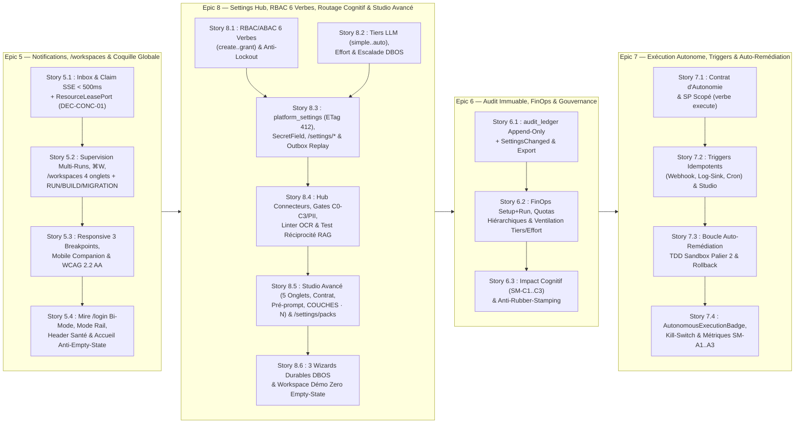

# Plan Complémentaire d'Architecture, de Refonte UX/UI & d'Ajustement Multi-Epics (Epics 5 à 8)

## 1. Résumé Exécutif & Alignement Stratégique

À l'issue de la livraison complète des **Epics 1 à 4** (socle du monolithe modulaire `AD-19`, séparation Core/Pack `AD-20`, moteur durable `DBOS Transact` sur PostgreSQL 18, bus transactionnel `domain_events_outbox`, sandbox bimodale `Wasmtime`/`gVisor`, Gates Agentiques/Humaines et connecteur Jira Staged/MCP), trois études complémentaires ont mis en évidence des besoins structurants pour la suite du plan de livraison :

1. **Analyse comparative KORE (`rework-from-exemple-2026-10-30.md` — 20 écrans de référence)** :
   - **Coquille Globale & Accueil Anti-Empty-State (Écrans 1, 2, 20)** : mire `/login` hybride bi-mode (SSO OIDC primaire + repli local admin), Header unifié (sélecteur Workspace/Pack couplé au Sprint/PI actif, pastilles de santé `DBOS`/`PG18`/`Outbox`), Sidebar gauche repliable en **Mode Rail (`68px`)**, page d'accueil guidée par un **Prompt scopé aux sources RAG autorisées** et un **Widget Sprint Actif** avec CTA d'audit IA en 1 clic, et cartes **Produits / Espaces** qualifiées par cycle de vie (`RUN`, `BUILD`, `MIGRATION`).
   - **Sources & Garde-fous d'Ingestion Documentaire (Écrans 3, 4)** : panneau latéral méthodologique `<GuidanceDrawer />` en 5 étapes, classification de sécurité `C0–C2` vs `C3`, détection automatique de PII avec modale d'arbitrage humain (*Pseudonymiser* via `PiiReversibleScrubber` / *Indexer tel quel* / *Annuler*), linter anti-PDF scanné vide (`0 char` fail-fast) et **Test de Réciprocité RAG en 1 clic** (*« Vérifier qu'il répond »* avec citation obligatoire).
   - **Studio Visuel de Workflows & Gouvernance du Cycle de Vie (Écrans 5 à 19)** :
     - **5 onglets de cycle de vie** (`Publiés`, `Brouillons`, `Corbeille`, `Exécutions actives`, `Suspendus en arbitrage`) et immutabilité des versions publiées (`Modifier` sur `v1.0.0` crée automatiquement une branche `v1.1.0-draft`).
     - **Barre Supérieure de Gouvernance du Studio** : `Bibliothèque`, `Pré-prompt IA` (System Prompt versionné `SHA-256`), `Contrat du workflow` (paramètres d'entrée typés `{pi}` liés à l'Ontologie + sections Markdown obligatoires du livrable vérifiées par Gate Déterministe), `Déclencheurs` (intervalles durables `DBOS` + événements `domain_events_outbox`), `▷ Tester` (bac à sable *What-If* générant dynamiquement le formulaire d'entrée depuis le Contrat) et `Publier`.
     - **Ergonomie Bimodale des Nœuds & Inspecteur de Couches (`COUCHES · N`)** : distinction visuelle immédiate entre étape déterministe (`Program Executor`) et étape agentique (`Agent Executor` avec sélection du Tier LLM + niveau d'**Effort** `Par défaut | Rapide | Équilibré | Approfondi`), icônes de Gates inter-étapes sur les arêtes, **Inspecteur de Couches (`COUCHES · N`)** sur les macro-étapes (`SUB_WORKFLOW`) avec activation/désactivation à la volée (`👁️ enabled: false -> SKIPPED`), suppression, réordonnancement et regroupement en 3 zones (*Entrées*, *Capacités*, *Livrables*), et moindre privilège des connecteurs par étape (`Lire` vs `Écrire`).

2. **Étude de Cadrage de l'Epic 8 (`epic-8-settings-hub-study.md`)** :
   - **Modèle d'Habilitations Hiérarchique RBAC/ABAC à 6 Verbes (`Story 8.1`)** : `create`, `read`, `update`, `delete`, **`execute`** (utiliser un connecteur/modèle/workflow sans lire ses secrets) et **`grant`** (délégation locale bornée aux droits détenus, tracée dans `audit_ledger`), évalués sur l'arbre `Organisation -> BU -> Équipe -> Workspace -> Pack -> Ressource -> Action` avec découverte passive par défaut (`🔒 Non habilité` + demande d'accès Outbox) et colonnes réservées pour `ACTION_ITEM-8.1..8.3`.
   - **Abstraction Cognitive des Modèles LLM, Niveau d'Effort & Routage `auto` (`Story 8.2`)** : découplage total entre les workflows (qui référencent `inference_tier: simple | medium | complex | auto` et `effort: default | fast | balanced | deep`) et les modèles physiques configurés dans `/settings/ai-models`, avec escalade déterministe rejouable sous DBOS (`inference_attempts`).
   - **Coquille `/settings/*`, `<PermissionGuard>` & `<SecretField>` (`Story 8.3`)**, **Hub des Connecteurs (`Story 8.4`)**, **Studio Visuel Enrichi & Registre des Packs (`Story 8.5`)** et **Wizards d'Initialisation Durables Anti-Page-Blanche (`Story 8.6`)**.

3. **Audit de Préparation des Spécifications du Hub de Configuration (`config-hub-spec-readiness-audit-2026-10-28.md` — `EPIC-08-CONFIG-HUB`)** :
   - Formalisation de **`AD-21`** dans `ARCHITECTURE-SPINE.md` : séparation stricte en 3 niveaux de stockage (*Env/Infra*, *Tables relationnelles versionnées `platform_settings` avec `ETag`/`If-Match` `412`*, *Secrets write-only via `SecretRef` + `SecretInput`/`SecretStatus`*), sémantique de propagation déterministe vers les runs DBOS en cours (*Épinglé au `run-lock.json`*, *Contrôlé à chaque frontière de step*, *Contrôlé à chaque appel LLM coûteux*), protection `409 ERR_RESOURCE_PINNED_BY_ACTIVE_RUNS` (*Drainer* vs *Forcer*), invariants anti-verrouillage (`ERR_ADMIN_LOCKOUT_PREVENTED`) et rejeu Outbox borné avec `dry_run: true` par défaut.

---

## 2. Architecture de l'Information, Arbre de Routes TanStack Router v1 & Wireframes ASCII

### 2.1 Arbre Formel des Routes (`apps/web/src/routes/`) & Guards `beforeLoad`

```text
apps/web/src/routes/
├── __root.tsx                              # ErrorBoundary RFC 9457 (trace_id), I18nProvider (FR/EN), ThemeProvider, SSE Provider
├── login.tsx                               # /login — Mire d'authentification hybride bi-mode (SSO OIDC primaire + repli Admin local Argon2id/TOTP)
└── _authenticated.tsx                      # Guard session active + AppShell Direction C (TopHeaderBar + CollapsibleAppRail + AssistantDock + GuidanceDrawer)
    ├── index.tsx                           # / — Accueil Anti-Empty-State (Hero Greeting, SprintContextWidget + CTA Audit 1-clic, ScopedPromptBox, Runs actifs)
    ├── cockpit.tsx                         # /cockpit — Split-View Chat Agent Assistant + Canvas Dynamique (Ancrages Violets, Briefing 4 blocs, Découpage)
    ├── inbox.tsx                           # /inbox — 🔔 Boîte de Notifications Unifiée (Individuel & Équipe, Claim < 500ms, Filtre Runs Autonomes)
    ├── workspaces/
    │   ├── index.tsx                       # /workspaces — Centre de Pilotage Unifié Multi-Niveaux (⌘W) & Grille Produits (RUN | BUILD | MIGRATION)
    │   └── $workspaceId.tsx                # /workspaces/$workspaceId — 4 Onglets fractals (1. Runs, 2. Sources + GuidanceDrawer, 3. Workflows/Agents, 4. Équipes)
    ├── studio/
    │   ├── index.tsx                       # /studio — Hub des Workflows à 5 onglets (Publiés, Brouillons, Corbeille, Exécutions actives, Suspendus)
    │   └── $workflowId.tsx                 # /studio/$workflowId — Éditeur Visuel @xyflow/react + TopGovernanceBar (Pré-prompt, Contrat, Déclencheurs, Tester, Publier) + Inspecteur COUCHES
    ├── catalog.tsx                         # /catalog — 📦 Catalogue Fédéré (db://, git://, nexus://, confluence://, jira://)
    ├── ontology.tsx                        # /ontology — 🧬 Ontologie 4 Niveaux & Graphe Tripartite (Confluence ↔ Jira ↔ Git)
    ├── gates.tsx                           # /gates — 🛡️ Politiques de Gates Adaptatives & Portail Permission Broker
    ├── finops.tsx                          # /finops — 📊 FinOps (Setup + Run vs TTM, ventilation par Tier/Effort LLM) & Gouvernance Cognitive (SM-C1..C3, SM-A1..A3)
    ├── wizards/
    │   └── $wizardType.tsx                 # /wizards/$wizardType — 🪄 Wizards d'Initialisation Durables DBOS (sdlc-tech-lead | ops-manager | secops-admin)
    └── settings.tsx                        # /settings — Layout Hub de Paramétrage (Guard: au moins read sur 1 sous-domaine settings)
        ├── iam.tsx                         # /settings/iam — Matrice RBAC/ABAC 6 verbes (create, read, update, delete, execute, grant), IdP OIDC, Service Principals, Délégations
        ├── connectors.tsx                  # /settings/connectors — Instances de connecteurs par scope, SecretField write-only, Test-Connection DBOS, Classification C0-C3 & PII
        ├── ai-models.tsx                   # /settings/ai-models — Mapping abstrait Tiers (simple €/medium €€/complex €€€/auto) & Effort -> Providers LiteLLM, Quotas hiérarchiques
        ├── packs.tsx                       # /settings/packs — Registre des Packs installés (entry_points) vs activés par scope, JSON Schema config, Drain/Force
        ├── workflows.tsx                   # /settings/workflows — Politiques d'exécution versionnées (relances, timeouts, coupe-circuits) & gouvernance globale Studio
        └── audit.tsx                       # /settings/audit — Journal des changements de config (SettingsChanged), Console Outbox/DLQ & Rejeu borné (--dry-run)
```

### 2.2 Wireframes Structurels ASCII des Surfaces Clés

#### A. Mire `/login` Hybride Bi-Mode (KORE Écran 1)
```text
+--------------------------------------------------------------------------------------------------+
|  [Logo ORCIA]  ORCIA — Orchestration Human-Led, Agent-Accelerated          [🌐 FR/EN] [🌙 Thème] |
+--------------------------------------------------------------------------------------------------+
|                                                                                                  |
|                        +------------------------------------------------+                        |
|                        |           Connexion à votre espace             |                        |
|                        |   Gouvernance & Orchestration Multi-Agents IA   |                        |
|                        |                                                |                        |
|                        |  [ 🔐 Se connecter avec le SSO d'Entreprise ]  |  <-- CTA Primaire OIDC |
|                        |       (Keycloak / Entra ID / Okta — PKCE)      |                        |
|                        |                                                |                        |
|                        |  ────────────── ou accès local ──────────────  |                        |
|                        |  ▸ Connexion locale / Administrateur de secours|  <-- Accordéon replié  |
|                        |    Email : [ admin@orcia.local              ]  |                        |
|                        |    Mot de passe : [ •••••••••••••••• ] [👁️]    |                        |
|                        |    Code TOTP 2FA : [ 123 456 ]                 |                        |
|                        |    [ Se connecter en mode local ]              |                        |
|                        |                                                |                        |
|                        |  🛡️ Session protégée par cookie HttpOnly       |                        |
|                        +------------------------------------------------+                        |
+--------------------------------------------------------------------------------------------------+
```

#### B. Coquille Globale Direction C Enrichie & Accueil Anti-Empty-State (KORE Écrans 2 & 20)
```text
+--------------------------------------------------------------------------------------------------+
| [ORCIA] | 🗂️ Périmètre (⌘W): [BU Paiement ▾] > [WS Core-Ledger (BUILD) ▾] | 🏃 Sprint 42 (J-4)   |
|         | 🟢 DBOS PG18  🟢 Outbox (0 DLQ)  [PROD]      [🔍 ⌘K] [💬 IA] [🔔 3] [🌐 FR] [🟢 Marc ▾]|
+---------+----------------------------------------------------------------------------------------+
| [« Rail]|  Bonjour, Marc ! 👋                                  [🪄 Lancer un Wizard d'Amorçage]  |
|         |  +----------------------------------------------+  +----------------------------------+ |
| 💬 Cock.|  | 🏃 CONTEXTE SPRINT ACTIF : Sprint 42 (BUILD) |  | 📊 SANTÉ & GOUVERNANCE DU LOT    | |
| 🔔 Boîte|  | 14 US (8 Done, 4 In Progress, 2 Blocked)     |  | • 2 Runs en attente d'Ancrage ✍️ | |
| 📦 Cat. |  | Source : jira://PAY-SPRINT-42 • git://main   |  | • 1 Arbitrage IA en pause ⚖️     | |
| 🧬 Onto.|  | [⚡ Auditer les risques du sprint avec l'IA] |  | • Budget FinOps : 42,10 $ / 200 $| |
| 🛡️ Gates|  +----------------------------------------------+  +----------------------------------+ |
| 📊 FinOp|                                                                                        |
| ⚙️ Sett.|  +----------------------------------------------------------------------------------+  |
| ─────── |  | 💬 Que souhaitez-vous orchestrer ou analyser aujourd'hui ?                       |  |
| 📦 Pack |  | [ Ex: Vérifier la conformité du PRD FX avec l'API partenaire v3...             ] |  |
|  SDLC   |  | 🔌 Sources RAG : [ Toutes les sources autorisées (4) ▾ ]  [🧠 Tier: Auto ▾] [➤] |  |
|  v1.2   |  +----------------------------------------------------------------------------------+  |
+---------+----------------------------------------------------------------------------------------+
```

#### C. Studio Visuel de Workflows : Top Governance Bar & Inspecteur `COUCHES · N` (KORE Écrans 5 à 19)
```text
+--------------------------------------------------------------------------------------------------+
| ← Studio Workflows / Conception & Validation Technique (v1.2.0-draft)  [Badge: BROUILLON ÉDITABLE]|
| [📚 Bibliothèque] [🧠 Pré-prompt IA] [📜 Contrat ({p1}..{p5})] [⚡ Déclencheurs] [▷ Tester] [Publier]|
+--------------------------------------------------------------------------------------------------+
|                           CANVAS @xyflow/react (Grille Direction C)                              |
|                                                                                                  |
|   +-----------------------------------+              +---------------------------------------+   |
|   | [1] Cadrage & Intention Métier    |              | [2] Analyse Architecture & Sécurité   |   |
|   | ✍️ Ancrage Humain Obligatoire     | ──[🛡️ Gate]─►| 🤖 Agent Exécuteur • [COUCHES · 9 ▾]  |   |
|   | 🧠 Tier: Medium (€€) • Équilibré  |   Déterm.+   | 🧠 Tier: Complex (€€€) • Approfondi   |   |
|   | 🔌 git:// (Lire) • jira:// (Lire) |   Humaine    | 🔌 confluence:// (Lire) • jira://(Écr)|   |
|   +-----------------------------------+              +---------------------------------------+   |
|                                                                  │                               |
|                                       +--------------------------▼---------------------------+   |
|                                       | INSPECTEUR DE COUCHES (SUB_WORKFLOW : 9 couches)     |   |
|                                       | ── 1. Entrées & Contexte ─────────────────────────── |   |
|                                       |  ⠿ [1] Collecte PRD & Chunks KB          [👁️] [🗑️]  |   |
|                                       |  ⠿ [2] Résolution Ontologie N1..N3       [👁️] [🗑️]  |   |
|                                       | ── 2. Capacités & Raisonnement ───────────────────── |   |
|                                       |  ⠿ [3] Analyse d'impact API OpenAPI      [👁️] [🗑️]  |   |
|                                       |  ⠿ [4] Scan CVE & Dépendances (SKIPPED)  [🚫] [🗑️]  |   |
|                                       | ── 3. Livrables & Pré-Gates ──────────────────────── |   |
|                                       |  ⠿ [9] Synthèse Briefing 4 Blocs         [👁️] [🗑️]  |   |
|                                       | [+ Ajouter une couche]                               |   |
|                                       +------------------------------------------------------+   |
+--------------------------------------------------------------------------------------------------+
```

---

## 3. Nouveaux Composants & Primitives du Design System `@orcia/ui` (`packages/ui`)

Conformément aux règles d'isolation d'`@orcia/ui` (zéro import de routeur ou de client HTTP, styles via `tokens.css` Direction C uniquement, `i18n` FR/EN injecté par props, maximum 2 typographies `Inter`/`Geist Sans` + `JetBrains Mono`), les composants suivants sont normalisés :

| Composant `@orcia/ui` | Sous-package | Responsabilité & Invariants UX/UI |
| :--- | :--- | :--- |
| **`<PermissionGuard />`** | `packages/ui/src/primitives/` | Enveloppe déclarative acceptant `verb: "create" \| "read" \| "update" \| "delete" \| "execute" \| "grant"`, `fallbackMode: "passive-lock" \| "disabled" \| "hidden"`. En mode `"passive-lock"` (défaut), affiche le badge `🔒 Non habilité` et déclenche la modale de demande d'accès (`AccessRequested` Outbox) sans jamais exposer le secret sous-jacent. |
| **`<SecretField />`** | `packages/ui/src/primitives/` | Champ de saisie write-only adossé au contrat `SecretInput` (`keep \| set \| clear`) et `SecretStatus` (`configured`, `fingerprint: "sha256:8-hex"`, `updated_at`). Ne pré-remplit **jamais** la valeur ni un masque factice soumis par erreur ; affiche l'empreinte monospace et les boutons explicites *Remplacer le secret* / *Effacer*. |
| **`<CollapsibleAppRail />`** | `packages/ui/src/shell/` | Évolution de `GlobalSidebar` supportant le **Mode Rail (`68px`, raccourci `[`)** persisté par utilisateur, affichant en pied le badge du **Pack Métier actif** (`orcia-pack-sdlc`) et les pastilles temps réel (compteur ambre d'actions requises, point de santé Outbox). |
| **`<GuidanceDrawer />`** | `packages/ui/src/shell/` | Panneau latéral méthodologique repliable en **5 étapes numérotées** (*1. À quoi sert cet écran, 2. Prérequis, 3. Étapes recommandées, 4. Garde-fous de sécurité, 5. Vérification*) accompagnant les écrans de configuration (Sources, Connecteurs, Studio, IAM). |
| **`<ScopedPromptBox />` & `<SprintContextWidget />`** | `packages/ui/src/cockpit/` | Briques d'accueil Anti-Empty-State : zone de prompt avec sélecteur explicite du périmètre documentaire RAG + sélecteur rapide de Tier LLM, et carte du Sprint/Lot actif avec bouton d'audit IA en 1 clic. |
| **`<ProductLifecycleCard />`** | `packages/ui/src/workspaces/` | Carte d'espace/produit affichant le badge sémantique de phase **`RUN`** (émeraude), **`BUILD`** (cobalt) ou **`MIGRATION`** (ambre), les sources rattachées et les workflows recommandés. |
| **`<WorkflowTopGovernanceBar />`** | `packages/ui/src/studio/` | Barre d'outils supérieure du Studio regroupant `Bibliothèque`, `Pré-prompt IA` (avec badge `sha256`), `Contrat du workflow` (`{pi}` + sections attendues), `Déclencheurs`, `▷ Tester` (dry-run *What-If*) et `Publier` (fork immuable `vX.Y.Z-draft`). |
| **`<LayersInspectorPopover />`** | `packages/ui/src/studio/` | Popover `COUCHES · N` sur les nœuds composites (`SUB_WORKFLOW`), organisant les sous-étapes en 3 zones (*Entrées*, *Capacités*, *Livrables*) avec switch de visibilité `👁️` (`enabled: false -> SKIPPED`), suppression et réordonnancement. |
| **`<InferenceTierBadge />` & `<EffortSelector />`** | `packages/ui/src/primitives/` | Sélecteurs et badges standardisés pour les tiers cognitifs (`Simple €`, `Medium €€`, `Complex €€€`, `Auto ⚡`) et les niveaux d'effort (`Par défaut`, `Rapide`, `Équilibré`, `Approfondi`). |

---

## 4. Stratégie d'Ajustement Multi-Epics (Epics 5, 6, 7 & Epic 8)

Plutôt que de rouvrir les **Epics 1 à 4** déjà terminées et validées (`done`), les évolutions issues de l'analyse KORE et de l'audit Config Hub sont réparties proprement entre les **Epics 5, 6 et 7** (encore en `backlog`) et la nouvelle **Epic 8** :

### 4.1 Ajustements dans l'Epic 5 (Notifications, Supervision Multi-Runs, `/workspaces` & Coquille Globale)
- **`Story 5.2` (enrichie)** :
  - Intègre dans `/workspaces` la qualification des Workspaces/Produits par phase de cycle de vie (**`RUN | BUILD | MIGRATION`** via `<ProductLifecycleCard />`, KORE Écran 20) et le panneau méthodologique **`<GuidanceDrawer />`** en 5 étapes sur l'onglet *2. Sources Dédiées & Partagées* (KORE Écrans 3–4).
- **Nouvelle `Story 5.4` : Coquille Globale Direction C Enrichie (Mire `/login` Bi-Mode, Mode Rail Collapsible, Header Santé DBOS/Outbox & Accueil Anti-Empty-State Scopé)** :
  - Livre la route dédiée **`/login`** (SSO OIDC primaire + accordéon replié d'administration locale Argon2id/TOTP, états d'erreur typés RFC 9457, KORE Écran 1).
  - Livre le **Mode Rail (`68px`, `<CollapsibleAppRail />`)** de la Sidebar gauche avec badge du Pack actif, ainsi que les indicateurs de santé système temps réel dans la Top Bar (`DBOS/PG18`, `Outbox DLQ`, environnement `PROD/STAGING`).
  - Livre la page d'accueil **Anti-Empty-State (`/`)** combinant le **`<SprintContextWidget />`** (avec CTA 1-clic *"Auditer les risques du sprint / lot"*) et la **`<ScopedPromptBox />`** (sélecteur explicite de sources RAG filtré par le Permission Broker, KORE Écran 2).

### 4.2 Ajustements dans l'Epic 6 (Audit Immuable, FinOps & Gouvernance Exécutive)
- **`Story 6.1` (enrichie)** :
  - L'abonné `audit_ledger` consomme également l'événement transactionnel **`SettingsChanged`** (hash avant/après, clés modifiées, zéro valeur secrète) et archive l'empreinte `SHA-256` du **Pré-prompt IA** et du **Contrat du workflow** dans la provenance de chaque Run.
- **`Story 6.2` (enrichie)** :
  - Le moteur FinOps applique les **plafonds budgétaires hiérarchiques (`GLOBAL -> BU -> TEAM -> WORKSPACE`)** à chaque appel LLM coûteux et ventile les coûts par **`InferenceTier` (`simple | medium | complex | auto`)**, par **niveau d'Effort (`default | fast | balanced | deep`)** et par escalade du routeur `auto` (`inference_attempts`).

### 4.3 Ajustements dans l'Epic 7 (Exécution Autonome, Déclencheurs & Auto-Remédiation)
- **`Story 7.1` (enrichie)** :
  - Les identités `service_principal` des Contrats d'Autonomie s'appuient sur le verbe **`execute`** du modèle à 6 verbes (`Story 8.1`) et appliquent le **moindre privilège des connecteurs par étape (`Lire` vs `Écrire`)** défini dans le Studio (`Story 8.5`).
- **`Story 7.2` (enrichie)** :
  - Le bouton **`⚡ Déclencheurs`** de la barre supérieure du Studio (`Story 8.5`) configure directement les entrées `workflow_triggers` (`CRON` via `@DBOS.scheduled`, `WEBHOOK`, `LOG_SINK_ALERT` et écouteurs `domain_events_outbox`) gérées par `Story 7.2`.

### 4.4 Structuration Finale de l'Epic 8 (`Stories 8.1` à `8.6`)

L'**Epic 8** fusionne de manière sans couture les 6 stories de `epic-8-settings-hub-study.md`, les exigences d'architecture `AD-21` de `config-hub-spec-readiness-audit-2026-10-28.md` (`EPIC-08-CONFIG-HUB`) et les 20 écrans de `rework-from-exemple-2026-10-30.md` :

| Story | Titre & Périmètre | Couverture KORE & Audit Config Hub (`AD-21`) |
| :--- | :--- | :--- |
| **`Story 8.1`** | **Modèle d'Habilitations Hiérarchique RBAC/ABAC à 6 Verbes (`create, read, update, delete, execute, grant`), Délégation Bornée & Invariants Anti-Verrouillage** | Arbre `Org -> BU -> Team -> Workspace -> Pack -> Resource -> Action` ; confinement de délégation (`grant`) ; découverte passive (`🔒 Non habilité` + `AccessRequested`) ; colonnes préparatoires `ACTION_ITEM-8.1..8.3` ; invariants anti-lockout (`ERR_ADMIN_LOCKOUT_PREVENTED`). |
| **`Story 8.2`** | **Abstraction Cognitive des Modèles LLM (`simple, medium, complex, auto`), Niveaux d'Effort (`default, fast, balanced, deep`), Budgets Hiérarchiques & Escalade Déterministe DBOS** | Écran `/settings/ai-models` ; mapping par Workspace ; routeur `auto` à escalade sur échec de Gate Déterministe tracé dans `inference_attempts` ; garde `409 ERR_RESOURCE_PINNED_BY_ACTIVE_RUNS` (Drainer/Forcer) ; soumis à `PROC-01`. |
| **`Story 8.3`** | **Socle Settings Versionnés (`platform_settings`, `ETag`/`If-Match` `412`), Contrat Secret Write-Only (`SecretInput`/`SecretStatus`), Coquille `/settings/*` & Primitives `<PermissionGuard>` / `<SecretField>`** | Table `platform_settings` ; événement `SettingsChanged` ; 6 sous-routes `/settings/{iam,connectors,ai-models,packs,workflows,audit}` ; test du secret témoin (`0` fuite) ; console `/settings/audit` avec rejeu Outbox borné (`dry_run: true`). |
| **`Story 8.4`** | **Hub des Connecteurs (`/settings/connectors`), Test de Connexion Fail-Fast DBOS, Garde-fous d'Ingestion (Classification `C0–C3`, Arbitrage PII, Linter OCR `0 char`) & Test de Réciprocité RAG** | KORE Écrans 3 & 4 : CRUD instances `workspace_datasources` ; `SecretField` ; classification `C0-C2` vs `C3` ; détection PII + modale d'arbitrage (`Pseudonymiser` / `Indexer` / `Annuler`) ; rejet PDF scanné vide ; bouton *"Vérifier qu'il répond"* avec citation obligatoire. |
| **`Story 8.5`** | **Studio Visuel de Workflows Enrichi (5 Onglets de Cycle de Vie, Barre de Gouvernance `Pré-prompt`/`Contrat`/`Déclencheurs`/`Tester`, Inspecteur `COUCHES · N`, Moindre Privilège Connecteur) & Registre des Packs (`/settings/packs`)** | KORE Écrans 5 à 19 : 5 onglets Studio ; fork immuable `vX.Y.Z-draft` ; Contrat typé `{pi}` + sections Markdown vérifiées par Gate ; inspecteur `COUCHES · N` (`enabled: false -> SKIPPED`) ; token connecteur `Lire` vs `Écrire` par étape ; activation des Packs par scope + JSON Schema. |
| **`Story 8.6`** | **Parcours d'Initialisation Guidés par Profil (3 Wizards Durables DBOS `wizard_sessions`), Espace Démo Pré-rempli (*Zero Empty-State*) & Validation Bout-en-Bout** | 3 Wizards adaptés au Profil Humain (*Tech Lead SDLC*, *Business/Ops Manager*, *Platform/SecOps Admin*) persistés dans `wizard_sessions` ; bouton de test fail-fast à chaque étape ; Workspace de démonstration pré-câblé. |

---

## 5. Séquence d'Exécution Recommandée



> [!TIP]
> **Pourquoi exécuter l'Epic 8 juste après l'Epic 5 (ou ses briques fondatrices `8.1`–`8.3` avant les Epics 6 et 7) ?**
> - **L'Epic 6 (`6.1`, `6.2`)** bénéficie directement des événements `SettingsChanged` (`8.3`), des budgets hiérarchiques et de la table `inference_attempts` des Tiers/Effort LLM (`8.2`).
> - **L'Epic 7 (`7.1`, `7.2`)** réutilise directement le verbe `execute` et le cycle de vie des `Service Principals` (`8.1`/`8.3`) ainsi que la modale `⚡ Déclencheurs` du Studio (`8.5`).
