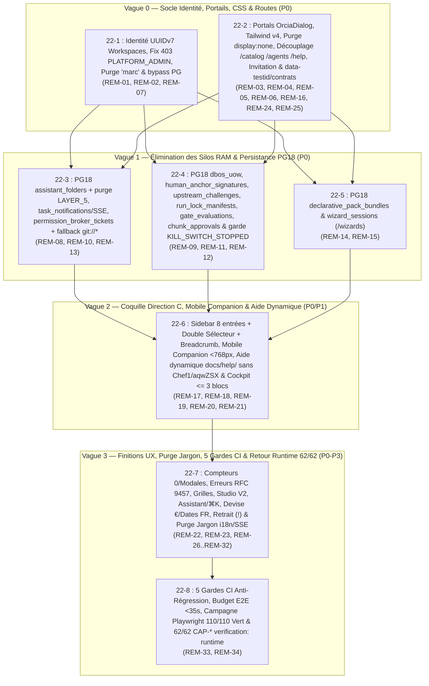

# Plan Directeur de Remédiation — Epic 22 (Traçabilité Totale Epic 21 → Epic 22)

## 1. Synthèse Exécutive & Critères de Sortie

La campagne End-to-End intégrale de l'**Epic 21 (`Story 21.8`, commit `575cf4a`)** sur pile réelle PostgreSQL 18 + `pgvector` (`orcia_e2e`) et Redis 7.4 (`--retries=0 --max-failures=0 --timeout=35000`) a produit `110 / 110` captures PNG et objectivé **47 scénarios `unexpected`** (`36` `failed` + `11` `timedOut`) répartis sur **`14 / 24` specs**, **`51 / 62` capacités `feature`** en statut `verification: failed_e2e`, ainsi que des non-conformités UX/UI sur plusieurs écrans `PASSED` (faux positifs mobiles, sidebar `11` entrées vs `8`, aide contextuelle figée sur `@1.1.0`, fuites de jargon technique).

L'**Epic 22** regroupe sans aucun recouvrement **100 % des `34` chantiers (`REM-01` .. `REM-34`)**, **100 % des `14` specs (`47` échecs/timeouts)** et **100 % des `51` capacités `failed_e2e`** en **`8` Stories ordonnées (`22.1` .. `22.8`)**.

### Critères de Sortie Bloquants de l'Epic 22
1. **Campagne Playwright E2E `100 %` verte** : `0` `failed`, `0` `timedOut`, `0` `flaky` sur l'ensemble des `24` specs (`110` scénarios planifiés, `--retries=0 --max-failures=0 --timeout=35000`) avec assertions `SELECT` PostgreSQL 18 réelles et survie au `F5`.
2. **Registre des capacités (`docs/product/capabilities.yaml`)** : **`62 / 62` capacités `feature`** + **`3 / 3` capacités `foundation`** à **`verification: runtime`** (`0` `failed_e2e`, `0` `e2e_remediation_ref` résiduel), validé par `pnpm site:sync && pnpm site:check`.
3. **5 Gardes CI Anti-Régression Actives** : anti-jargon UI/i18n/SSE, interdiction totale de `display: none` sur panneaux métier, intégrité CSS Tailwind v4 / `tokens.css`, interdiction `[LAYER_5_*]` & `ORCIA_DISABLE_PG_BOOTSTRAP_SYNC`, et assertions géométriques Playwright `rect.right <= innerWidth` + `elementFromPoint` sur modales.
4. **Pyramide `AD-17` complète** : couverture unitaire `>= 90 %` sur `orcia-kernel` et `orcia-core`, `ruff`/`mypy --strict`/`pnpm typecheck` à `0` erreur, `lint-imports` (`5 contracts kept, 0 broken`), `lint_spine.py` (`0 findings`), `openapi-typescript` `0-diff`.

---

## 2. Stratégie par Vagues & Ordonnancement Topologique (`22.1 → 22.8`)

### Justification de l'Ordonnancement
- **Vague 0 (`22.1`, `22.2`)** : supprime d'abord les causes transverses bloquantes (`"ws-1"` qui cassait sources/ADN/permissions, les faux `403` admin, les modales écrasées par Zone 4 sans Portal/Tailwind v4, les `4` wrappers `display: none` et le routage `/catalog` vs `/agents` vs `/help`). `22.1` et `22.2` peuvent être exécutées séquentiellement ou sur branches disjointes (`backend/store` vs `ui/vite/routes`).
- **Vague 1 (`22.3`, `22.4`, `22.5`)** : raccorde tous les silos RAM restants sur PostgreSQL 18 une fois que les UUIDs `workspaces` et le `PLATFORM_ADMIN` sont sains (`assistant_folders`, `task_notifications`, `permission_broker_tickets`, `dbos_uow` + `human_anchor_signatures`/`upstream_challenges`/`run_lock_manifests`, `gate_evaluations`/`chunk_approvals`, garde `KILL_SWITCH_STOPPED`, `declarative_pack_bundles`, `wizard_sessions`).
- **Vague 2 (`22.6`)** : aligne la coquille globale Direction C (`8` entrées, Double Sélecteur + Breadcrumb), câble `MobileCompanionView` (`< 768 px`), peuple le catalogue `docs/help/{fr,en}/*.md` dynamique par route et simplifie le Cockpit (`<= 3` blocs, Accostage réel PG18).
- **Vague 3 (`22.7`, `22.8`)** : applique les finitions UX/ergonomie et la purge intégrale du jargon (`REM-22..32`), puis active les `5` gardes CI bloquantes et rejoue la campagne complète jusqu'à `62/62` `verification: runtime`.

---

## 3. Table de Traçabilité 1 — Specs E2E en Échec (`14/24`, `47` cas) → `REM-*` → `Story 22.k` → `Rapport 22-k`

| # | Spec E2E en échec (`apps/web/e2e/...`) | Cas en échec / timeout (`47`) | Chantiers `REM-*` associés | Story / Clé(s) Sprint `22-*` | Rapport(s) Tech Lead associé(s) |
| ---: | --- | ---: | --- | --- | --- |
| 1 | `02-assistant-streaming-and-folders.spec.ts` | `4` (`failed: 4`, `timedOut: 0`) | `REM-08`, `REM-18`, `REM-19`, `REM-30` | `22-3-persistance-pg18-assistant-notifications-sse-et-permission-broker`, `22-6-coquille-direction-c-8-entrees-mobile-companion-aide-dynamique-et-cockpit`, `22-7-finitions-ux-ui-erreurs-rfc9457-grilles-devise-euro-et-purge-jargon` | `22-3-persistance-pg18-assistant-notifications-sse-et-permission-broker-tech-lead-report.md`, `22-6-coquille-direction-c-8-entrees-mobile-companion-aide-dynamique-et-cockpit-tech-lead-report.md`, `22-7-finitions-ux-ui-erreurs-rfc9457-grilles-devise-euro-et-purge-jargon-tech-lead-report.md` |
| 2 | `03-human-led-anchor-and-arbitration.spec.ts` | `2` (`failed: 2`, `timedOut: 0`) | `REM-09`, `REM-21` | `22-4-persistance-pg18-orchestration-gates-et-garde-kill-switch`, `22-6-coquille-direction-c-8-entrees-mobile-companion-aide-dynamique-et-cockpit` | `22-4-persistance-pg18-orchestration-gates-et-garde-kill-switch-tech-lead-report.md`, `22-6-coquille-direction-c-8-entrees-mobile-companion-aide-dynamique-et-cockpit-tech-lead-report.md` |
| 3 | `04-multi-actor-claim-sse.spec.ts` | `1` (`failed: 1`, `timedOut: 0`) | `REM-10` | `22-3-persistance-pg18-assistant-notifications-sse-et-permission-broker` | `22-3-persistance-pg18-assistant-notifications-sse-et-permission-broker-tech-lead-report.md` |
| 4 | `06-gates-review-and-anti-rubber-stamping.spec.ts` | `1` (`failed: 1`, `timedOut: 0`) | `REM-11`, `REM-22` | `22-4-persistance-pg18-orchestration-gates-et-garde-kill-switch`, `22-7-finitions-ux-ui-erreurs-rfc9457-grilles-devise-euro-et-purge-jargon` | `22-4-persistance-pg18-orchestration-gates-et-garde-kill-switch-tech-lead-report.md`, `22-7-finitions-ux-ui-erreurs-rfc9457-grilles-devise-euro-et-purge-jargon-tech-lead-report.md` |
| 5 | `07-spaces-org-and-workspace-persistence.spec.ts` | `1` (`failed: 1`, `timedOut: 0`) | `REM-01`, `REM-22`, `REM-27`, `REM-32` | `22-1-socle-identite-uuid-workspaces-permissions-admin-et-fin-bypass-pg`, `22-7-finitions-ux-ui-erreurs-rfc9457-grilles-devise-euro-et-purge-jargon` | `22-1-socle-identite-uuid-workspaces-permissions-admin-et-fin-bypass-pg-tech-lead-report.md`, `22-7-finitions-ux-ui-erreurs-rfc9457-grilles-devise-euro-et-purge-jargon-tech-lead-report.md` |
| 6 | `13-epic-7-autonomous-governance-and-supervision.spec.ts` | `1` (`failed: 1`, `timedOut: 0`) | `REM-12`, `REM-28` | `22-4-persistance-pg18-orchestration-gates-et-garde-kill-switch`, `22-7-finitions-ux-ui-erreurs-rfc9457-grilles-devise-euro-et-purge-jargon` | `22-4-persistance-pg18-orchestration-gates-et-garde-kill-switch-tech-lead-report.md`, `22-7-finitions-ux-ui-erreurs-rfc9457-grilles-devise-euro-et-purge-jargon-tech-lead-report.md` |
| 7 | `14-auth-2fa-account-and-profile.spec.ts` | `4` (`failed: 0`, `timedOut: 4`) | `REM-03`, `REM-16`, `REM-19`, `REM-33` | `22-2-portals-orciadialog-tailwind-purge-display-none-decouplage-routes-et-contrats`, `22-6-coquille-direction-c-8-entrees-mobile-companion-aide-dynamique-et-cockpit`, `22-8-gardes-ci-anti-regression-campagne-e2e-110-vert-et-62-capacites-runtime` | `22-2-portals-orciadialog-tailwind-purge-display-none-decouplage-routes-et-contrats-tech-lead-report.md`, `22-6-coquille-direction-c-8-entrees-mobile-companion-aide-dynamique-et-cockpit-tech-lead-report.md`, `22-8-gardes-ci-anti-regression-campagne-e2e-110-vert-et-62-capacites-runtime-tech-lead-report.md` |
| 8 | `15-organization-iam-secops-inbox-and-observer.spec.ts` | `4` (`failed: 2`, `timedOut: 2`) | `REM-10`, `REM-16`, `REM-19`, `REM-31`, `REM-32` | `22-2-portals-orciadialog-tailwind-purge-display-none-decouplage-routes-et-contrats`, `22-3-persistance-pg18-assistant-notifications-sse-et-permission-broker`, `22-6-coquille-direction-c-8-entrees-mobile-companion-aide-dynamique-et-cockpit`, `22-7-finitions-ux-ui-erreurs-rfc9457-grilles-devise-euro-et-purge-jargon` | `22-2-portals-orciadialog-tailwind-purge-display-none-decouplage-routes-et-contrats-tech-lead-report.md`, `22-3-persistance-pg18-assistant-notifications-sse-et-permission-broker-tech-lead-report.md`, `22-6-coquille-direction-c-8-entrees-mobile-companion-aide-dynamique-et-cockpit-tech-lead-report.md`, `22-7-finitions-ux-ui-erreurs-rfc9457-grilles-devise-euro-et-purge-jargon-tech-lead-report.md` |
| 9 | `16-ai-models-reindex-connectors-and-broker.spec.ts` | `5` (`failed: 2`, `timedOut: 3`) | `REM-03`, `REM-13`, `REM-23`, `REM-24`, `REM-26`, `REM-33` | `22-2-portals-orciadialog-tailwind-purge-display-none-decouplage-routes-et-contrats`, `22-3-persistance-pg18-assistant-notifications-sse-et-permission-broker`, `22-7-finitions-ux-ui-erreurs-rfc9457-grilles-devise-euro-et-purge-jargon`, `22-8-gardes-ci-anti-regression-campagne-e2e-110-vert-et-62-capacites-runtime` | `22-2-portals-orciadialog-tailwind-purge-display-none-decouplage-routes-et-contrats-tech-lead-report.md`, `22-3-persistance-pg18-assistant-notifications-sse-et-permission-broker-tech-lead-report.md`, `22-7-finitions-ux-ui-erreurs-rfc9457-grilles-devise-euro-et-purge-jargon-tech-lead-report.md`, `22-8-gardes-ci-anti-regression-campagne-e2e-110-vert-et-62-capacites-runtime-tech-lead-report.md` |
| 10 | `17-workspace-sources-codegraph-dna-and-ontology.spec.ts` | `4` (`failed: 4`, `timedOut: 0`) | `REM-01`, `REM-04`, `REM-23`, `REM-26`, `REM-28`, `REM-31` | `22-1-socle-identite-uuid-workspaces-permissions-admin-et-fin-bypass-pg`, `22-2-portals-orciadialog-tailwind-purge-display-none-decouplage-routes-et-contrats`, `22-7-finitions-ux-ui-erreurs-rfc9457-grilles-devise-euro-et-purge-jargon` | `22-1-socle-identite-uuid-workspaces-permissions-admin-et-fin-bypass-pg-tech-lead-report.md`, `22-2-portals-orciadialog-tailwind-purge-display-none-decouplage-routes-et-contrats-tech-lead-report.md`, `22-7-finitions-ux-ui-erreurs-rfc9457-grilles-devise-euro-et-purge-jargon-tech-lead-report.md` |
| 11 | `18-catalog-packs-wizards-and-mcp-bench.spec.ts` | `8` (`failed: 8`, `timedOut: 0`) | `REM-05`, `REM-14`, `REM-15`, `REM-26`, `REM-29`, `REM-32` | `22-2-portals-orciadialog-tailwind-purge-display-none-decouplage-routes-et-contrats`, `22-5-persistance-pg18-packs-declaratifs-et-wizards-durables`, `22-7-finitions-ux-ui-erreurs-rfc9457-grilles-devise-euro-et-purge-jargon` | `22-2-portals-orciadialog-tailwind-purge-display-none-decouplage-routes-et-contrats-tech-lead-report.md`, `22-5-persistance-pg18-packs-declaratifs-et-wizards-durables-tech-lead-report.md`, `22-7-finitions-ux-ui-erreurs-rfc9457-grilles-devise-euro-et-purge-jargon-tech-lead-report.md` |
| 12 | `19-orchestration-whatif-replay-and-gates.spec.ts` | `4` (`failed: 4`, `timedOut: 0`) | `REM-02`, `REM-09`, `REM-11`, `REM-23`, `REM-26`, `REM-27` | `22-1-socle-identite-uuid-workspaces-permissions-admin-et-fin-bypass-pg`, `22-4-persistance-pg18-orchestration-gates-et-garde-kill-switch`, `22-7-finitions-ux-ui-erreurs-rfc9457-grilles-devise-euro-et-purge-jargon` | `22-1-socle-identite-uuid-workspaces-permissions-admin-et-fin-bypass-pg-tech-lead-report.md`, `22-4-persistance-pg18-orchestration-gates-et-garde-kill-switch-tech-lead-report.md`, `22-7-finitions-ux-ui-erreurs-rfc9457-grilles-devise-euro-et-purge-jargon-tech-lead-report.md` |
| 13 | `20-process-studio-v2-finops-and-log-sink.spec.ts` | `4` (`failed: 2`, `timedOut: 2`) | `REM-23`, `REM-24`, `REM-25`, `REM-26`, `REM-29` | `22-2-portals-orciadialog-tailwind-purge-display-none-decouplage-routes-et-contrats`, `22-7-finitions-ux-ui-erreurs-rfc9457-grilles-devise-euro-et-purge-jargon` | `22-2-portals-orciadialog-tailwind-purge-display-none-decouplage-routes-et-contrats-tech-lead-report.md`, `22-7-finitions-ux-ui-erreurs-rfc9457-grilles-devise-euro-et-purge-jargon-tech-lead-report.md` |
| 14 | `21-assistant-citations-v5-audit-help-showcase.spec.ts` | `4` (`failed: 4`, `timedOut: 0`) | `REM-02`, `REM-06`, `REM-08`, `REM-19`, `REM-20`, `REM-30` | `22-1-socle-identite-uuid-workspaces-permissions-admin-et-fin-bypass-pg`, `22-2-portals-orciadialog-tailwind-purge-display-none-decouplage-routes-et-contrats`, `22-3-persistance-pg18-assistant-notifications-sse-et-permission-broker`, `22-6-coquille-direction-c-8-entrees-mobile-companion-aide-dynamique-et-cockpit`, `22-7-finitions-ux-ui-erreurs-rfc9457-grilles-devise-euro-et-purge-jargon` | `22-1-socle-identite-uuid-workspaces-permissions-admin-et-fin-bypass-pg-tech-lead-report.md`, `22-2-portals-orciadialog-tailwind-purge-display-none-decouplage-routes-et-contrats-tech-lead-report.md`, `22-3-persistance-pg18-assistant-notifications-sse-et-permission-broker-tech-lead-report.md`, `22-6-coquille-direction-c-8-entrees-mobile-companion-aide-dynamique-et-cockpit-tech-lead-report.md`, `22-7-finitions-ux-ui-erreurs-rfc9457-grilles-devise-euro-et-purge-jargon-tech-lead-report.md` |

---

## 4. Table de Traçabilité 2 — Chantiers `REM-01..REM-34` → `Story 22.k` → `Rapport 22-k`

| `REM-*` | Sévérité | Vague | Intitulé synthétique du chantier | Story / Clé Sprint `22-*` | Rapport Tech Lead associé |
| :--- | :--- | :--- | --- | --- | --- |
| `REM-01` | `P0` | Vague 0 | Unification UUID Workspace, propagation exacte du `slug` & suppression de `"ws-1"` | `22-1-socle-identite-uuid-workspaces-permissions-admin-et-fin-bypass-pg` | `22-1-socle-identite-uuid-workspaces-permissions-admin-et-fin-bypass-pg-tech-lead-report.md` |
| `REM-02` | `P0` | Vague 0 | Fix `HTTP 403 ERR_OBSERVER_MODE_READ_ONLY` pour `PLATFORM_ADMIN` sur nouveaux espaces | `22-1-socle-identite-uuid-workspaces-permissions-admin-et-fin-bypass-pg` | `22-1-socle-identite-uuid-workspaces-permissions-admin-et-fin-bypass-pg-tech-lead-report.md` |
| `REM-03` | `P0` | Vague 0 | Portals `OrciaDialog`, activation Tailwind CSS v4 & layout Sticky Footer des modales | `22-2-portals-orciadialog-tailwind-purge-display-none-decouplage-routes-et-contrats` | `22-2-portals-orciadialog-tailwind-purge-display-none-decouplage-routes-et-contrats-tech-lead-report.md` |
| `REM-04` | `P0` | Vague 0 | Purge intégrale des `4` wrappers `style={{ display: "none" }}` & montage visible | `22-2-portals-orciadialog-tailwind-purge-display-none-decouplage-routes-et-contrats` | `22-2-portals-orciadialog-tailwind-purge-display-none-decouplage-routes-et-contrats-tech-lead-report.md` |
| `REM-05` | `P0` | Vague 0 | Découplage `/catalog` vs `/agents` & suppression du doublon `remote-service-test-bench` | `22-2-portals-orciadialog-tailwind-purge-display-none-decouplage-routes-et-contrats` | `22-2-portals-orciadialog-tailwind-purge-display-none-decouplage-routes-et-contrats-tech-lead-report.md` |
| `REM-06` | `P0` | Vague 0 | Suppression du double montage `contextual-help-hybrid-panel` sur `/help` & accordéon mobile | `22-2-portals-orciadialog-tailwind-purge-display-none-decouplage-routes-et-contrats` | `22-2-portals-orciadialog-tailwind-purge-display-none-decouplage-routes-et-contrats-tech-lead-report.md` |
| `REM-07` | `P1` | Vague 0 | Purge identité `"marc"` hardcodée, lecture config `get_accostage_service` & fin `ORCIA_DISABLE_PG_BOOTSTRAP_SYNC` | `22-1-socle-identite-uuid-workspaces-permissions-admin-et-fin-bypass-pg` | `22-1-socle-identite-uuid-workspaces-permissions-admin-et-fin-bypass-pg-tech-lead-report.md` |
| `REM-08` | `P0` | Vague 1 | Câblage PG18 de `AssistantFoldersAndSharingService` & suppression fuite `[LAYER_5_FOLDER_CONTINUITY ...]` | `22-3-persistance-pg18-assistant-notifications-sse-et-permission-broker` | `22-3-persistance-pg18-assistant-notifications-sse-et-permission-broker-tech-lead-report.md` |
| `REM-09` | `P0` | Vague 1 | Initialisation `dbos_uow` / SQL pour Ancres, Blackboard, Replay & montage `UpstreamChallengeRewindModal` | `22-4-persistance-pg18-orchestration-gates-et-garde-kill-switch` | `22-4-persistance-pg18-orchestration-gates-et-garde-kill-switch-tech-lead-report.md` |
| `REM-10` | `P0` | Vague 1 | Persistance PG18 de `task_notifications` & `resource_leases` (`UnifiedNotificationAndClaimService`) | `22-3-persistance-pg18-assistant-notifications-sse-et-permission-broker` | `22-3-persistance-pg18-assistant-notifications-sse-et-permission-broker-tech-lead-report.md` |
| `REM-11` | `P0` | Vague 1 | Persistance PG18 des Gates (`gate_evaluations` & `chunk_approvals`) + séparation vue `/gates` vs `/processes` | `22-4-persistance-pg18-orchestration-gates-et-garde-kill-switch` | `22-4-persistance-pg18-orchestration-gates-et-garde-kill-switch-tech-lead-report.md` |
| `REM-12` | `P0` | Vague 1 | Protection machine à états `workflow_runs` : ne pas écraser `KILL_SWITCH_STOPPED` au rollback post-hoc | `22-4-persistance-pg18-orchestration-gates-et-garde-kill-switch` | `22-4-persistance-pg18-orchestration-gates-et-garde-kill-switch-tech-lead-report.md` |
| `REM-13` | `P0` | Vague 1 | Persistance PG18 de `permission_broker_tickets` & politique fallback `git://*` sans `404` | `22-3-persistance-pg18-assistant-notifications-sse-et-permission-broker` | `22-3-persistance-pg18-assistant-notifications-sse-et-permission-broker-tech-lead-report.md` |
| `REM-14` | `P0` | Vague 1 | Persistance PG18 de `declarative_pack_bundles` au démarrage & à l'export (`packs.py`) | `22-5-persistance-pg18-packs-declaratifs-et-wizards-durables` | `22-5-persistance-pg18-packs-declaratifs-et-wizards-durables-tech-lead-report.md` |
| `REM-15` | `P0` | Vague 1 | Câblage API & PG18 de `/wizards` (`wizard_sessions`) + suppression triple numérotation UX | `22-5-persistance-pg18-packs-declaratifs-et-wizards-durables` | `22-5-persistance-pg18-packs-declaratifs-et-wizards-durables-tech-lead-report.md` |
| `REM-16` | `P0` | Vague 0 | Action d'invitation explicite sur `/organization` (`open-invite-org-user-modal-btn`) | `22-2-portals-orciadialog-tailwind-purge-display-none-decouplage-routes-et-contrats` | `22-2-portals-orciadialog-tailwind-purge-display-none-decouplage-routes-et-contrats-tech-lead-report.md` |
| `REM-17` | `P0` | Vague 2 | Refonte Mobile Companion (`< 768 px`) : barre basse 3 onglets, TopHeader 1 ligne & bannière Desktop-only | `22-6-coquille-direction-c-8-entrees-mobile-companion-aide-dynamique-et-cockpit` | `22-6-coquille-direction-c-8-entrees-mobile-companion-aide-dynamique-et-cockpit-tech-lead-report.md` |
| `REM-18` | `P0` | Vague 2 | Visibilité réponse SSE & ergonomie saisie `/assistant` sur Mobile (`390×844`) | `22-6-coquille-direction-c-8-entrees-mobile-companion-aide-dynamique-et-cockpit` | `22-6-coquille-direction-c-8-entrees-mobile-companion-aide-dynamique-et-cockpit-tech-lead-report.md` |
| `REM-19` | `P0` | Vague 2 | Aide Contextuelle dynamique par route (`ⓘ`), catalogue `docs/help/` & purge `Chef1` / `aqwZSX` | `22-6-coquille-direction-c-8-entrees-mobile-companion-aide-dynamique-et-cockpit` | `22-6-coquille-direction-c-8-entrees-mobile-companion-aide-dynamique-et-cockpit-tech-lead-report.md` |
| `REM-20` | `P1` | Vague 2 | Alignement Sidebar `8` entrées (`DESIGN.md`), Double Sélecteur, Breadcrumb & état actif routes secondaires | `22-6-coquille-direction-c-8-entrees-mobile-companion-aide-dynamique-et-cockpit` | `22-6-coquille-direction-c-8-entrees-mobile-companion-aide-dynamique-et-cockpit-tech-lead-report.md` |
| `REM-21` | `P1` | Vague 2 | Cockpit Loi de Hick (`<= 3` blocs), bug `Accostage` post-admin & suppression `"LOCK TABLE users IN EXCLUSIVE MODE"` | `22-6-coquille-direction-c-8-entrees-mobile-companion-aide-dynamique-et-cockpit` | `22-6-coquille-direction-c-8-entrees-mobile-companion-aide-dynamique-et-cockpit-tech-lead-report.md` |
| `REM-22` | `P1` | Vague 3 | Masquage des compteurs `0` (`total == 0`) & conversion des formulaires permanents en Modales `+ Nouveau...` | `22-7-finitions-ux-ui-erreurs-rfc9457-grilles-devise-euro-et-purge-jargon` | `22-7-finitions-ux-ui-erreurs-rfc9457-grilles-devise-euro-et-purge-jargon-tech-lead-report.md` |
| `REM-23` | `P1` | Vague 3 | Traduction actionnable de toutes les erreurs HTTP (`403`/`404`/`422`) & suppression bannières silencieuses | `22-7-finitions-ux-ui-erreurs-rfc9457-grilles-devise-euro-et-purge-jargon` | `22-7-finitions-ux-ui-erreurs-rfc9457-grilles-devise-euro-et-purge-jargon-tech-lead-report.md` |
| `REM-24` | `P0` | Vague 0 | Alignement `data-testid` Modèles IA (`llm-provider-preset-ollama`) & mode Studio `What-If` (`studio-view-mode-whatif`) | `22-2-portals-orciadialog-tailwind-purge-display-none-decouplage-routes-et-contrats` | `22-2-portals-orciadialog-tailwind-purge-display-none-decouplage-routes-et-contrats-tech-lead-report.md` |
| `REM-25` | `P0` | Vague 0 | Alignement contrat `SecretInputPayload.plaintext_value` dans `20-process-studio.spec.ts` & SDK typé | `22-2-portals-orciadialog-tailwind-purge-display-none-decouplage-routes-et-contrats` | `22-2-portals-orciadialog-tailwind-purge-display-none-decouplage-routes-et-contrats-tech-lead-report.md` |
| `REM-26` | `P1` | Vague 3 | Purge exhaustive du jargon technique & anglicismes dans `i18n`, `packs/` et flux UI/SSE | `22-7-finitions-ux-ui-erreurs-rfc9457-grilles-devise-euro-et-purge-jargon` | `22-7-finitions-ux-ui-erreurs-rfc9457-grilles-devise-euro-et-purge-jargon-tech-lead-report.md` |
| `REM-27` | `P1` | Vague 3 | Unification monétaire (`€` uniquement) & formatage localisé des dates (`jj/mm/aaaa`) | `22-7-finitions-ux-ui-erreurs-rfc9457-grilles-devise-euro-et-purge-jargon` | `22-7-finitions-ux-ui-erreurs-rfc9457-grilles-devise-euro-et-purge-jargon-tech-lead-report.md` |
| `REM-28` | `P2` | Vague 3 | Correction des grilles asymétriques `/finops` (`4` cols), `/profile` (`2×2`) & `/ontology` (`2×2`) | `22-7-finitions-ux-ui-erreurs-rfc9457-grilles-devise-euro-et-purge-jargon` | `22-7-finitions-ux-ui-erreurs-rfc9457-grilles-devise-euro-et-purge-jargon-tech-lead-report.md` |
| `REM-29` | `P2` | Vague 3 | Correction mise en page Studio V2 (bouton `Demander` & doublon `v1.0.1`) et `/agents` MCP (`vide gauche`) | `22-7-finitions-ux-ui-erreurs-rfc9457-grilles-devise-euro-et-purge-jargon` | `22-7-finitions-ux-ui-erreurs-rfc9457-grilles-devise-euro-et-purge-jargon-tech-lead-report.md` |
| `REM-30` | `P2` | Vague 3 | Ergonomie `/assistant` (`+ Nouvelle conversation`, retrait pavé central) & palette `⌘K` (sections vides) | `22-7-finitions-ux-ui-erreurs-rfc9457-grilles-devise-euro-et-purge-jargon` | `22-7-finitions-ux-ui-erreurs-rfc9457-grilles-devise-euro-et-purge-jargon-tech-lead-report.md` |
| `REM-31` | `P2` | Vague 3 | Suppression des numérotations de titres (`/settings?tab=iam`, `/ontology`) & nettoyage `12-epic16` | `22-7-finitions-ux-ui-erreurs-rfc9457-grilles-devise-euro-et-purge-jargon` | `22-7-finitions-ux-ui-erreurs-rfc9457-grilles-devise-euro-et-purge-jargon-tech-lead-report.md` |
| `REM-32` | `P3` | Vague 3 | Retrait des pastilles rouges `(!)` dans les boutons bleus & sidebar + correction troncatures RGAA | `22-7-finitions-ux-ui-erreurs-rfc9457-grilles-devise-euro-et-purge-jargon` | `22-7-finitions-ux-ui-erreurs-rfc9457-grilles-devise-euro-et-purge-jargon-tech-lead-report.md` |
| `REM-33` | `P1` | Vague 3 | Budget temps E2E & fluidité parcours multi-étapes (`14-auth` #2, `16-ai-models` #2) sous `< 35 s` | `22-8-gardes-ci-anti-regression-campagne-e2e-110-vert-et-62-capacites-runtime` | `22-8-gardes-ci-anti-regression-campagne-e2e-110-vert-et-62-capacites-runtime-tech-lead-report.md` |
| `REM-34` | `P0` | Vague 3 | Activation des 5 Gardes CI anti-régression & re-jeu intégral Playwright (`110/110` vert, `62/62` `runtime`) | `22-8-gardes-ci-anti-regression-campagne-e2e-110-vert-et-62-capacites-runtime` | `22-8-gardes-ci-anti-regression-campagne-e2e-110-vert-et-62-capacites-runtime-tech-lead-report.md` |

---

## 5. Table de Traçabilité 3 — `51 CAP-*` en `failed_e2e` → `Story 22.k` (`e2e_remediation_ref`)

| `CAP-*` | Statut actuel | Échec bloquant principal (`bilan` / `REM-*`) | Clé exacte `e2e_remediation_ref` (`sprint-status.yaml`) | Rapport Tech Lead associé |
| :--- | :--- | --- | --- | --- |
| `CAP-001` | `failed_e2e` | `14-auth` #1 (`REM-16`) & #2 (`REM-03` `UserSettingsModalDialog`) | `22-2-portals-orciadialog-tailwind-purge-display-none-decouplage-routes-et-contrats` | `22-2-portals-orciadialog-tailwind-purge-display-none-decouplage-routes-et-contrats-tech-lead-report.md` |
| `CAP-002` | `failed_e2e` | `18-catalog` #1 (`catalog-explorer-panel` `hidden`, `/catalog` vs `/agents` `REM-04`, `REM-05`) | `22-2-portals-orciadialog-tailwind-purge-display-none-decouplage-routes-et-contrats` | `22-2-portals-orciadialog-tailwind-purge-display-none-decouplage-routes-et-contrats-tech-lead-report.md` |
| `CAP-003` | `failed_e2e` | `16-ai-models` #3 (`permission_broker_tickets` RAM + `404` `git://*` `REM-13`) | `22-3-persistance-pg18-assistant-notifications-sse-et-permission-broker` | `22-3-persistance-pg18-assistant-notifications-sse-et-permission-broker-tech-lead-report.md` |
| `CAP-010` | `failed_e2e` | `17-workspace` #3 (`dna-starlark-glossary-view` `hidden` `REM-04`) | `22-2-portals-orciadialog-tailwind-purge-display-none-decouplage-routes-et-contrats` | `22-2-portals-orciadialog-tailwind-purge-display-none-decouplage-routes-et-contrats-tech-lead-report.md` |
| `CAP-011` | `failed_e2e` | `17-workspace` #1 (`workspace_datasources` `"ws-1"` `404` `REM-01`) | `22-1-socle-identite-uuid-workspaces-permissions-admin-et-fin-bypass-pg` | `22-1-socle-identite-uuid-workspaces-permissions-admin-et-fin-bypass-pg-tech-lead-report.md` |
| `CAP-020` | `failed_e2e` | `19-orchestration` #1 (`run_lock_manifests` / `workflow_runs` PG18 `REM-09`) | `22-4-persistance-pg18-orchestration-gates-et-garde-kill-switch` | `22-4-persistance-pg18-orchestration-gates-et-garde-kill-switch-tech-lead-report.md` |
| `CAP-021` | `failed_e2e` | `19-orchestration` #1 (`dbos_uow = None`, `sql_repository.py` `REM-09`) | `22-4-persistance-pg18-orchestration-gates-et-garde-kill-switch` | `22-4-persistance-pg18-orchestration-gates-et-garde-kill-switch-tech-lead-report.md` |
| `CAP-022` | `failed_e2e` | `21-assistant` #1 (`POST /api/v1/executions/reflexive` `403` `PLATFORM_ADMIN` `REM-02`) | `22-1-socle-identite-uuid-workspaces-permissions-admin-et-fin-bypass-pg` | `22-1-socle-identite-uuid-workspaces-permissions-admin-et-fin-bypass-pg-tech-lead-report.md` |
| `CAP-023` | `failed_e2e` | `03-human-led` (`human_anchor_signatures` = 0 ligne PG18 `REM-09`) | `22-4-persistance-pg18-orchestration-gates-et-garde-kill-switch` | `22-4-persistance-pg18-orchestration-gates-et-garde-kill-switch-tech-lead-report.md` |
| `CAP-024` | `failed_e2e` | `19-orchestration` #1 (`UpstreamChallengeRewindModal` non monté & `upstream_challenges` PG18 `REM-09`) | `22-4-persistance-pg18-orchestration-gates-et-garde-kill-switch` | `22-4-persistance-pg18-orchestration-gates-et-garde-kill-switch-tech-lead-report.md` |
| `CAP-030` | `failed_e2e` | `19-orchestration` #2 (`gate_evaluations` PG18 `REM-11` + `403` `REM-02`) | `22-4-persistance-pg18-orchestration-gates-et-garde-kill-switch` | `22-4-persistance-pg18-orchestration-gates-et-garde-kill-switch-tech-lead-report.md` |
| `CAP-031` | `failed_e2e` | `19-orchestration` #2 (`gate_evaluations` PG18 `REM-11` + `403` `REM-02`) | `22-4-persistance-pg18-orchestration-gates-et-garde-kill-switch` | `22-4-persistance-pg18-orchestration-gates-et-garde-kill-switch-tech-lead-report.md` |
| `CAP-032` | `failed_e2e` | `06-gates` (`gate_evaluations` & `chunk_approvals` = 0 ligne PG18 `REM-11`) | `22-4-persistance-pg18-orchestration-gates-et-garde-kill-switch` | `22-4-persistance-pg18-orchestration-gates-et-garde-kill-switch-tech-lead-report.md` |
| `CAP-033` | `failed_e2e` | `06-gates` & `19-orchestration` #2 (`gate_evaluations` PG18 `REM-11`) | `22-4-persistance-pg18-orchestration-gates-et-garde-kill-switch` | `22-4-persistance-pg18-orchestration-gates-et-garde-kill-switch-tech-lead-report.md` |
| `CAP-040` | `failed_e2e` | `04-multi-actor` & `15-org` #4 (`task_notifications` RAM `REM-10`) | `22-3-persistance-pg18-assistant-notifications-sse-et-permission-broker` | `22-3-persistance-pg18-assistant-notifications-sse-et-permission-broker-tech-lead-report.md` |
| `CAP-041` | `failed_e2e` | `15-org` #3 (observateur via `open-invite-org-user-modal-btn` `REM-16`) | `22-2-portals-orciadialog-tailwind-purge-display-none-decouplage-routes-et-contrats` | `22-2-portals-orciadialog-tailwind-purge-display-none-decouplage-routes-et-contrats-tech-lead-report.md` |
| `CAP-043` | `failed_e2e` | `15-org` #4 (`task_notifications` d'équipe RAM `REM-10`) | `22-3-persistance-pg18-assistant-notifications-sse-et-permission-broker` | `22-3-persistance-pg18-assistant-notifications-sse-et-permission-broker-tech-lead-report.md` |
| `CAP-050` | `failed_e2e` | `07-spaces` (`workspaces` `slug` & `"ws-1"` `REM-01` / `REM-02`) | `22-1-socle-identite-uuid-workspaces-permissions-admin-et-fin-bypass-pg` | `22-1-socle-identite-uuid-workspaces-permissions-admin-et-fin-bypass-pg-tech-lead-report.md` |
| `CAP-051` | `failed_e2e` | `15-org` #3 (`open-invite-org-user-modal-btn` absent sur `/organization` `REM-16`) | `22-2-portals-orciadialog-tailwind-purge-display-none-decouplage-routes-et-contrats` | `22-2-portals-orciadialog-tailwind-purge-display-none-decouplage-routes-et-contrats-tech-lead-report.md` |
| `CAP-052` | `failed_e2e` | `16-ai-models` #1 (`llm-provider-preset-ollama` `REM-24` + `AiModelConfigModal` `REM-03`) | `22-2-portals-orciadialog-tailwind-purge-display-none-decouplage-routes-et-contrats` | `22-2-portals-orciadialog-tailwind-purge-display-none-decouplage-routes-et-contrats-tech-lead-report.md` |
| `CAP-053` | `failed_e2e` | `16-ai-models` #1 (`AiModelConfigModal` footer coupé `REM-03` + `REM-24`) | `22-2-portals-orciadialog-tailwind-purge-display-none-decouplage-routes-et-contrats` | `22-2-portals-orciadialog-tailwind-purge-display-none-decouplage-routes-et-contrats-tech-lead-report.md` |
| `CAP-054` | `failed_e2e` | `16-ai-models` #2 (`UserSettingsModalDialog` Portal/Zone 4 `REM-03`) | `22-2-portals-orciadialog-tailwind-purge-display-none-decouplage-routes-et-contrats` | `22-2-portals-orciadialog-tailwind-purge-display-none-decouplage-routes-et-contrats-tech-lead-report.md` |
| `CAP-055` | `failed_e2e` | `18-catalog` #3 (`declarative_pack_bundles` = 0 ligne PG18 `REM-14`) | `22-5-persistance-pg18-packs-declaratifs-et-wizards-durables` | `22-5-persistance-pg18-packs-declaratifs-et-wizards-durables-tech-lead-report.md` |
| `CAP-056` | `failed_e2e` | `18-catalog` #3 (`declarative_pack_bundles` = 0 ligne PG18 `REM-14`) | `22-5-persistance-pg18-packs-declaratifs-et-wizards-durables` | `22-5-persistance-pg18-packs-declaratifs-et-wizards-durables-tech-lead-report.md` |
| `CAP-057` | `failed_e2e` | `18-catalog` #4 (`wizard_sessions` `useState` & sans PG18 `REM-15`) | `22-5-persistance-pg18-packs-declaratifs-et-wizards-durables` | `22-5-persistance-pg18-packs-declaratifs-et-wizards-durables-tech-lead-report.md` |
| `CAP-058` | `failed_e2e` | `14-auth` #1/#2 (`REM-03` Portal + `REM-16` invitation `/organization`) | `22-2-portals-orciadialog-tailwind-purge-display-none-decouplage-routes-et-contrats` | `22-2-portals-orciadialog-tailwind-purge-display-none-decouplage-routes-et-contrats-tech-lead-report.md` |
| `CAP-063` | `failed_e2e` | `14-auth` #2 (`UserSettingsModalDialog` Portal/Tailwind v4 `REM-03`) | `22-2-portals-orciadialog-tailwind-purge-display-none-decouplage-routes-et-contrats` | `22-2-portals-orciadialog-tailwind-purge-display-none-decouplage-routes-et-contrats-tech-lead-report.md` |
| `CAP-064` | `failed_e2e` | `21-assistant` #2 (double montage `/help` & accordéon mobile `REM-06`) | `22-2-portals-orciadialog-tailwind-purge-display-none-decouplage-routes-et-contrats` | `22-2-portals-orciadialog-tailwind-purge-display-none-decouplage-routes-et-contrats-tech-lead-report.md` |
| `CAP-066` | `failed_e2e` | `21-assistant` #2 (bloqué dans le même scénario `/help` + `/showcase` `REM-06`) | `22-2-portals-orciadialog-tailwind-purge-display-none-decouplage-routes-et-contrats` | `22-2-portals-orciadialog-tailwind-purge-display-none-decouplage-routes-et-contrats-tech-lead-report.md` |
| `CAP-067` | `failed_e2e` | `07-spaces` (`workspaces` `slug` exact & `"ws-1"` `REM-01`) | `22-1-socle-identite-uuid-workspaces-permissions-admin-et-fin-bypass-pg` | `22-1-socle-identite-uuid-workspaces-permissions-admin-et-fin-bypass-pg-tech-lead-report.md` |
| `CAP-068` | `failed_e2e` | `21-assistant` #2 (`docs/help/` dynamique par route sans `Chef1`/`aqwZSX` `REM-19`) | `22-6-coquille-direction-c-8-entrees-mobile-companion-aide-dynamique-et-cockpit` | `22-6-coquille-direction-c-8-entrees-mobile-companion-aide-dynamique-et-cockpit-tech-lead-report.md` |
| `CAP-069` | `failed_e2e` | `14-auth` #2 (accès `/profile` via modale `UserSettingsModalDialog` `REM-03`) | `22-2-portals-orciadialog-tailwind-purge-display-none-decouplage-routes-et-contrats` | `22-2-portals-orciadialog-tailwind-purge-display-none-decouplage-routes-et-contrats-tech-lead-report.md` |
| `CAP-070` | `failed_e2e` | `02-assistant` (`AssistantFoldersAndSharingService` RAM `REM-08`) | `22-3-persistance-pg18-assistant-notifications-sse-et-permission-broker` | `22-3-persistance-pg18-assistant-notifications-sse-et-permission-broker-tech-lead-report.md` |
| `CAP-071` | `failed_e2e` | `02-assistant` (`assistant_folders` RAM `REM-08` + SSE mobile `REM-18`) | `22-3-persistance-pg18-assistant-notifications-sse-et-permission-broker` | `22-3-persistance-pg18-assistant-notifications-sse-et-permission-broker-tech-lead-report.md` |
| `CAP-072` | `failed_e2e` | `21-assistant` #1 (`403 ERR_OBSERVER_MODE_READ_ONLY` `PLATFORM_ADMIN` `REM-02`) | `22-1-socle-identite-uuid-workspaces-permissions-admin-et-fin-bypass-pg` | `22-1-socle-identite-uuid-workspaces-permissions-admin-et-fin-bypass-pg-tech-lead-report.md` |
| `CAP-073` | `failed_e2e` | `02-assistant` (`assistant_folders` PG18 & purge `[LAYER_5_*]` `REM-08`) | `22-3-persistance-pg18-assistant-notifications-sse-et-permission-broker` | `22-3-persistance-pg18-assistant-notifications-sse-et-permission-broker-tech-lead-report.md` |
| `CAP-074` | `failed_e2e` | `02-assistant` (`assistant_folders` PG18 `REM-08` + mobile `REM-18`) | `22-3-persistance-pg18-assistant-notifications-sse-et-permission-broker` | `22-3-persistance-pg18-assistant-notifications-sse-et-permission-broker-tech-lead-report.md` |
| `CAP-075` | `failed_e2e` | `02-assistant` (`assistant_folders` PG18 `REM-08` + mobile `REM-18` + `REM-30`) | `22-3-persistance-pg18-assistant-notifications-sse-et-permission-broker` | `22-3-persistance-pg18-assistant-notifications-sse-et-permission-broker-tech-lead-report.md` |
| `CAP-076` | `failed_e2e` | `21-assistant` #1 (`403` sur `/api/v1/executions/reflexive` `REM-02`) | `22-1-socle-identite-uuid-workspaces-permissions-admin-et-fin-bypass-pg` | `22-1-socle-identite-uuid-workspaces-permissions-admin-et-fin-bypass-pg-tech-lead-report.md` |
| `CAP-080` | `failed_e2e` | `07-spaces` & `17-workspace` #1 (`workspaces` `slug` + `"ws-1"` `404` `REM-01`) | `22-1-socle-identite-uuid-workspaces-permissions-admin-et-fin-bypass-pg` | `22-1-socle-identite-uuid-workspaces-permissions-admin-et-fin-bypass-pg-tech-lead-report.md` |
| `CAP-081` | `failed_e2e` | `17-workspace` #3 (`dna-starlark-glossary-view` `hidden` `REM-04`) | `22-2-portals-orciadialog-tailwind-purge-display-none-decouplage-routes-et-contrats` | `22-2-portals-orciadialog-tailwind-purge-display-none-decouplage-routes-et-contrats-tech-lead-report.md` |
| `CAP-082` | `failed_e2e` | `18-catalog` #5 (`remote-service-test-bench` strict mode 2 instances `REM-05`) | `22-2-portals-orciadialog-tailwind-purge-display-none-decouplage-routes-et-contrats` | `22-2-portals-orciadialog-tailwind-purge-display-none-decouplage-routes-et-contrats-tech-lead-report.md` |
| `CAP-084` | `failed_e2e` | `17-workspace` #3 (`dna-starlark-glossary-view` `hidden` `REM-04`) | `22-2-portals-orciadialog-tailwind-purge-display-none-decouplage-routes-et-contrats` | `22-2-portals-orciadialog-tailwind-purge-display-none-decouplage-routes-et-contrats-tech-lead-report.md` |
| `CAP-092` | `failed_e2e` | `20-process-studio` #1 (`studio-view-mode-whatif` `REM-24`) & #2 (`REM-25`) | `22-2-portals-orciadialog-tailwind-purge-display-none-decouplage-routes-et-contrats` | `22-2-portals-orciadialog-tailwind-purge-display-none-decouplage-routes-et-contrats-tech-lead-report.md` |
| `CAP-140` | `failed_e2e` | `20-process-studio` #1 (`studio-view-mode-whatif` `REM-24`) & #2 (`REM-25`) | `22-2-portals-orciadialog-tailwind-purge-display-none-decouplage-routes-et-contrats` | `22-2-portals-orciadialog-tailwind-purge-display-none-decouplage-routes-et-contrats-tech-lead-report.md` |
| `CAP-150` | `failed_e2e` | `18-catalog` #3 (`declarative_pack_bundles` = 0 ligne PG18 `REM-14`) | `22-5-persistance-pg18-packs-declaratifs-et-wizards-durables` | `22-5-persistance-pg18-packs-declaratifs-et-wizards-durables-tech-lead-report.md` |
| `CAP-180` | `failed_e2e` | `17-workspace` #1 (`workspace_datasources` `"ws-1"` `404` `REM-01`) | `22-1-socle-identite-uuid-workspaces-permissions-admin-et-fin-bypass-pg` | `22-1-socle-identite-uuid-workspaces-permissions-admin-et-fin-bypass-pg-tech-lead-report.md` |
| `CAP-190` | `failed_e2e` | `16-ai-models` #1 (`llm-provider-preset-ollama` `REM-24` + `AiModelConfigModal` `REM-03`) | `22-2-portals-orciadialog-tailwind-purge-display-none-decouplage-routes-et-contrats` | `22-2-portals-orciadialog-tailwind-purge-display-none-decouplage-routes-et-contrats-tech-lead-report.md` |
| `CAP-200` | `failed_e2e` | `20-process-studio` #2 (`422` `SecretInputPayload.plaintext_value` `REM-25`) | `22-2-portals-orciadialog-tailwind-purge-display-none-decouplage-routes-et-contrats` | `22-2-portals-orciadialog-tailwind-purge-display-none-decouplage-routes-et-contrats-tech-lead-report.md` |
| `CAP-201` | `failed_e2e` | `13-epic-7` (`workflow_runs` `KILL_SWITCH_STOPPED` écrasé par rollback `REM-12`) | `22-4-persistance-pg18-orchestration-gates-et-garde-kill-switch` | `22-4-persistance-pg18-orchestration-gates-et-garde-kill-switch-tech-lead-report.md` |
| `CAP-203` | `failed_e2e` | `15-org` #3 (`open-invite-org-user-modal-btn` timeout `REM-16`) | `22-2-portals-orciadialog-tailwind-purge-display-none-decouplage-routes-et-contrats` | `22-2-portals-orciadialog-tailwind-purge-display-none-decouplage-routes-et-contrats-tech-lead-report.md` |

---

## 6. Synthèse des Clés Sprint, Rapports & Invariants d'Exécution

| Story | Clé Sprint (`sprint-status.yaml`) | Rapport Tech Lead (`docs/implementation-artifacts/tech-lead-reports/`) | `REM-*` couverts | `CAP-*` ancrées (`51`) |
| :---: | :--- | :--- | :--- | --- |
| `22.1` | `22-1-socle-identite-uuid-workspaces-permissions-admin-et-fin-bypass-pg` | `22-1-socle-identite-uuid-workspaces-permissions-admin-et-fin-bypass-pg-tech-lead-report.md` | `REM-01`, `REM-02`, `REM-07` (`3`) | `CAP-011`, `CAP-022`, `CAP-050`, `CAP-067`, `CAP-072`, `CAP-076`, `CAP-080`, `CAP-180` (`8`) |
| `22.2` | `22-2-portals-orciadialog-tailwind-purge-display-none-decouplage-routes-et-contrats` | `22-2-portals-orciadialog-tailwind-purge-display-none-decouplage-routes-et-contrats-tech-lead-report.md` | `REM-03`, `REM-04`, `REM-05`, `REM-06`, `REM-16`, `REM-24`, `REM-25` (`7`) | `CAP-001`, `CAP-002`, `CAP-010`, `CAP-041`, `CAP-051`, `CAP-052`, `CAP-053`, `CAP-054`, `CAP-058`, `CAP-063`, `CAP-064`, `CAP-066`, `CAP-069`, `CAP-081`, `CAP-082`, `CAP-084`, `CAP-092`, `CAP-140`, `CAP-190`, `CAP-200`, `CAP-203` (`21`) |
| `22.3` | `22-3-persistance-pg18-assistant-notifications-sse-et-permission-broker` | `22-3-persistance-pg18-assistant-notifications-sse-et-permission-broker-tech-lead-report.md` | `REM-08`, `REM-10`, `REM-13` (`3`) | `CAP-003`, `CAP-040`, `CAP-043`, `CAP-070`, `CAP-071`, `CAP-073`, `CAP-074`, `CAP-075` (`8`) |
| `22.4` | `22-4-persistance-pg18-orchestration-gates-et-garde-kill-switch` | `22-4-persistance-pg18-orchestration-gates-et-garde-kill-switch-tech-lead-report.md` | `REM-09`, `REM-11`, `REM-12` (`3`) | `CAP-020`, `CAP-021`, `CAP-023`, `CAP-024`, `CAP-030`, `CAP-031`, `CAP-032`, `CAP-033`, `CAP-201` (`9`) |
| `22.5` | `22-5-persistance-pg18-packs-declaratifs-et-wizards-durables` | `22-5-persistance-pg18-packs-declaratifs-et-wizards-durables-tech-lead-report.md` | `REM-14`, `REM-15` (`2`) | `CAP-055`, `CAP-056`, `CAP-057`, `CAP-150` (`4`) |
| `22.6` | `22-6-coquille-direction-c-8-entrees-mobile-companion-aide-dynamique-et-cockpit` | `22-6-coquille-direction-c-8-entrees-mobile-companion-aide-dynamique-et-cockpit-tech-lead-report.md` | `REM-17`, `REM-18`, `REM-19`, `REM-20`, `REM-21` (`5`) | `CAP-068` (`1`) + UX Shell/Mobile transverse |
| `22.7` | `22-7-finitions-ux-ui-erreurs-rfc9457-grilles-devise-euro-et-purge-jargon` | `22-7-finitions-ux-ui-erreurs-rfc9457-grilles-devise-euro-et-purge-jargon-tech-lead-report.md` | `REM-22`, `REM-23`, `REM-26`, `REM-27`, `REM-28`, `REM-29`, `REM-30`, `REM-31`, `REM-32` (`9`) | Transverse `CAP-*` UX/i18n (`0` ancrage bloquant exclusif) |
| `22.8` | `22-8-gardes-ci-anti-regression-campagne-e2e-110-vert-et-62-capacites-runtime` | `22-8-gardes-ci-anti-regression-campagne-e2e-110-vert-et-62-capacites-runtime-tech-lead-report.md` | `REM-33`, `REM-34` (`2`) | `CAP-100` (hygiène) + validation `62/62` `runtime` |
| **Total** | **`8` Stories** | **`8` Rapports Tech Lead** | **`34 / 34` (`100 %`)** | **`51 / 51` `failed_e2e` (`100 %`)** |
