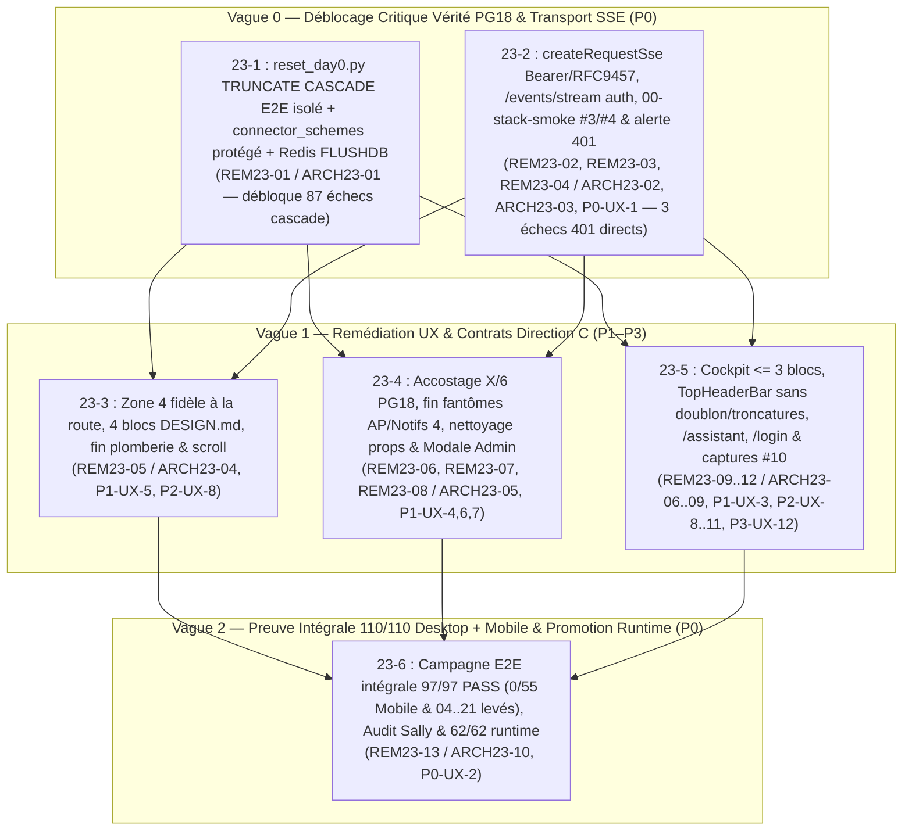

# Plan Directeur de Remédiation — Epic 23 (Traçabilité Totale Epic 22 → Epic 23)

## 1. Synthèse Exécutive & Critères de Sortie

La campagne End-to-End intégrale de l'**Epic 22 (`Story 22.9`, commit `a1bb059`)** sur pile réelle PostgreSQL 18 + `pgvector` (`orcia_e2e`) et Redis 7.4 sans `ORCIA_E2E_SEED_FIXTURES` (`--retries=0 --max-failures=0 --timeout=35000`) a produit `110 / 110` captures PNG et objectivé **90 scénarios `failed`** (`0` `timedOut`, `7` `passed` sur Desktop, `13` `skipped` par garde viewport) répartis sur **`24 / 24` fichiers `.spec.ts`** :
- **`3` échecs directs `HTTP 401`** avant la cascade (`00-stack-smoke` #3/#4 sur appels anonymes *fail-closed* `ORCIA_ENV="e2e"`, `02-assistant` #7 sur `streamAssistantTurnSse` sans en-tête `Authorization: Bearer`) ;
- **`87` échecs en cascade `beforeEach`** (`#11`–`#110` hors `13` skips, dont **`44` `mobile-companion` et `43` `desktop-cockpit`**) déclenchés paradoxalement par le **succès** du scénario `#10` (`03-human-led-anchor-and-arbitration`), qui a écrit de vraies lignes dans `step_executions` et `blackboard_snapshots` (`ON DELETE RESTRICT` + trigger append-only `BEFORE UPDATE OR DELETE FOR EACH ROW`) et fait échouer `DELETE FROM step_executions` dans `09_reset_db_first_boot.py`, maintenant un angle mort de **`0 / 55`** sur `mobile-companion` et sur les specs `04`–`21` + `shell.spec.ts` ;
- **`13` chantiers consolidés Sally × Winston (`REM23-01`..`REM23-13`)** couvrant intégralement **`12` défauts UX/UI Sally (`P0-UX-1`..`P3-UX-12`)** et **`10` diagnostics d'architecture Winston (`ARCH23-01`..`ARCH23-10`)**.

L'**Epic 23** regroupe sans aucun chevauchement ni oubli **100 % des `24` specs (`90` échecs)**, **100 % des `13` chantiers `REM23-01`..`REM23-13`** et **100 % des `62` capacités `failed_e2e`** en **`6` Stories ordonnées en `3` vagues séquentielles (`23.1` .. `23.6`)** :
- **Vague 0 (`P0` Bloquants E2E & Auth SSE)** : `Story 23.1` (`reset_day0.py` `TRUNCATE CASCADE` E2E isolé + `connector_schemes` protégé + `FLUSHDB` Redis) et `Story 23.2` (`createRequestSse` `Bearer`/RFC 9457, protection `/api/v1/events/stream`, alerte `401` `Se reconnecter →`, alignement `00-stack-smoke` #3/#4) ;
- **Vague 1 (`P1`–`P3` Remédiation UX & Contrats Direction C)** : `Story 23.3` (Zone 4 `Aide Contextuelle` fidèle à la route + `4` blocs `DESIGN.md` + fin plomberie), `Story 23.4` (unification `Accostage X/6` PG18, suppression fantômes Jour 0 `AP` & `Notifications 4`, épuration Modale Premier Admin) et `Story 23.5` (Cockpit `<= 3` blocs, suppression doublon `TopHeaderBar`, logo Zone 1, Breadcrumb, `/assistant`, `/login` & captures `#10`) ;
- **Vague 2 (`P0` Preuve Intégrale `110/110` & `62/62` `runtime`)** : `Story 23.6` (campagne Playwright intégrale `Desktop` + `Mobile Companion` `390×844` sans retry ni fixture cachée, levée totale de l'angle mort `0/55` & `04`–`21`, audit visuel complet Sally et promotion `62/62` `runtime`).

### Critères de Sortie Bloquants de l'Epic 23
1. **Campagne Playwright E2E Intégrale à `100 %` (`Story 23.6`)** : exécution complète des `24` specs (`110` scénarios, `--retries=0 --max-failures=0 --timeout=35000`, zéro `ORCIA_E2E_SEED_FIXTURES`) archivée dans `docs/implementation-artifacts/e2e-campaign-epic-23/` avec **`97 / 97` scénarios exécutés PASS (`0` `failed`, `0` `timedOut`, `13` `skipped` viewport attendus)** et **`100 %` des `55` scénarios `mobile-companion` débloqués et audités**.
2. **Registre `capabilities.yaml` & Vitrine (`Story 23.6`)** : **`62 / 62` capacités `feature` + `3 / 3` `foundation` en `verification: runtime`**, zéro `e2e_remediation_ref` résiduel, `PLAYWRIGHT_RESULTS_PATH` basculé sur `e2e-campaign-epic-23`, et `pnpm site:sync && pnpm site:check` à `0` erreur.
3. **Conformité Direction C & Triggers Append-Only** : zéro `DISABLE TRIGGER` sur `audit_ledger` ou `blackboard_snapshots` ; `Accostage X/6` unique depuis PG18 ; Zone 4 fidèle à la route avec ses `4` blocs ; Cockpit `<= 3` blocs ; diagnostic `401` sans accuser le LLM ni exposer de code HTTP brut.
4. **Pyramide `AD-17` Complète** : couverture unitaire `>= 90 %` sur `orcia-kernel` et `orcia-core`, `ruff`/`mypy --strict`/`pnpm turbo run lint typecheck test` à `0` erreur, `lint-imports` (`5 contracts kept, 0 broken`), `lint_spine.py` (`0 findings`), `openapi-typescript` `0-diff`, `check_implementation_docs.py` vert.

---

## 2. Stratégie par Vagues & Ordonnancement Topologique (`23.1 → 23.6`)

### Justification de l'Ordonnancement
- **Vague 0 (`23.1`, `23.2`)** : débloque en priorité absolue le harnais SQL/Redis (`87` cascades `beforeEach`) et le transport authentifié *fail-closed* (`3` échecs `401` directs + prévention sur `/trace-stream` et `/events/stream`). **Aucune campagne globale ne doit être relancée avant achèvement complet de `23.1` et `23.2`.**
- **Vague 1 (`23.3`, `23.4`, `23.5`)** : corrige sur des surfaces frontend/backend majoritairement disjointes (Zone 4 & parseur d'aide `23.3` ; Accostage/Shell pré-admin/Modale Admin `23.4` ; Cockpit/TopHeaderBar/`/assistant`/`/login` `23.5`) les violations `DESIGN.md` / `EXPERIENCE.md` objectivées par Sally et Winston avant le tir final.
- **Vague 2 (`23.6`)** : exécute sans complaisance la campagne complète `e2e-campaign-epic-23`, corrige tout éventuel résidu jusque-là masqué sur Mobile `390×844` ou les écrans `04`–`21`, valide visuellement `100 %` des captures via Sally, et promeut `62/62` capacités `runtime`.

---

## 3. Matrice de Traçabilité 1 — Specs E2E en Échec (`24/24`, `90` cas) → `REM23-*` → `Story 23.k` → `Rapport 23-k`

| # | Spec E2E en échec (`apps/web/e2e/...`) | Cas en échec (`90` total = `46` desktop + `44` mobile) | Chantiers `REM23-*` associés | Story / Clé(s) Sprint `23-*` | Rapport(s) Tech Lead associé(s) |
| ---: | --- | :--- | :--- | --- | --- |
| 1 | `00-stack-smoke.spec.ts` | `failed: 6` (`2` desktop `401` #3/#4 + `4` mobile cascade #56–#59 ; `passed: 2`, `skipped: 0`) | `REM23-02`, `REM23-01`, `REM23-13` | `23-2-transport-sse-authentifie-createrequestsse-smoke-00-et-diagnostic-401`, `23-1-reset-jour0-e2e-truncate-cascade-connector-schemes-et-redis`, `23-6-campagne-e2e-integrale-mobile-companion-audit-et-62-capacites-runtime` | `23-2-...-tech-lead-report.md`, `23-1-...-tech-lead-report.md`, `23-6-...-tech-lead-report.md` |
| 2 | `01-day0-boot-and-f5-persistence.spec.ts` | `failed: 2` (`2` mobile cascade #60–#61 ; `passed: 2`, `skipped: 0`) | `REM23-01`, `REM23-06`, `REM23-08`, `REM23-13` | `23-1-reset-jour0-e2e-truncate-cascade-connector-schemes-et-redis`, `23-4-unification-accostage-x-sur-6-fin-fantomes-jour0-et-modale-admin`, `23-6-campagne-e2e-integrale-mobile-companion-audit-et-62-capacites-runtime` | `23-1-...-tech-lead-report.md`, `23-4-...-tech-lead-report.md`, `23-6-...-tech-lead-report.md` |
| 3 | `02-assistant-streaming-and-folders.spec.ts` | `failed: 4` (`1` desktop `401` #7 + `3` mobile cascade #62–#64 ; `passed: 2`, `skipped: 0`) | `REM23-03`, `REM23-04`, `REM23-01`, `REM23-11`, `REM23-13` | `23-2-transport-sse-authentifie-createrequestsse-smoke-00-et-diagnostic-401`, `23-1-reset-jour0-e2e-truncate-cascade-connector-schemes-et-redis`, `23-5-sobriete-cockpit-topbar-sans-doublon-assistant-et-login`, `23-6-campagne-e2e-integrale-mobile-companion-audit-et-62-capacites-runtime` | `23-2-...-tech-lead-report.md`, `23-1-...-tech-lead-report.md`, `23-5-...-tech-lead-report.md`, `23-6-...-tech-lead-report.md` |
| 4 | `03-human-led-anchor-and-arbitration.spec.ts` | `failed: 1` (`1` mobile cascade #65 ; `passed: 1`, `skipped: 0`) | `REM23-01`, `REM23-09`, `REM23-12`, `REM23-13` | `23-1-reset-jour0-e2e-truncate-cascade-connector-schemes-et-redis`, `23-5-sobriete-cockpit-topbar-sans-doublon-assistant-et-login`, `23-6-campagne-e2e-integrale-mobile-companion-audit-et-62-capacites-runtime` | `23-1-...-tech-lead-report.md`, `23-5-...-tech-lead-report.md`, `23-6-...-tech-lead-report.md` |
| 5 | `04-multi-actor-claim-sse.spec.ts` | `failed: 2` (`2` desktop cascade #11–#12 ; `skipped: 2`) | `REM23-01`, `REM23-03`, `REM23-13` | `23-1-reset-jour0-e2e-truncate-cascade-connector-schemes-et-redis`, `23-2-transport-sse-authentifie-createrequestsse-smoke-00-et-diagnostic-401`, `23-6-campagne-e2e-integrale-mobile-companion-audit-et-62-capacites-runtime` | `23-1-...-tech-lead-report.md`, `23-2-...-tech-lead-report.md`, `23-6-...-tech-lead-report.md` |
| 6 | `05-mobile-companion-and-rgaa.spec.ts` | `failed: 4` (`2` desktop + `2` mobile cascade #13–#14, #68–#69 ; `skipped: 0`) | `REM23-01`, `REM23-13` | `23-1-reset-jour0-e2e-truncate-cascade-connector-schemes-et-redis`, `23-6-campagne-e2e-integrale-mobile-companion-audit-et-62-capacites-runtime` | `23-1-...-tech-lead-report.md`, `23-6-...-tech-lead-report.md` |
| 7 | `06-gates-review-and-anti-rubber-stamping.spec.ts` | `failed: 1` (`1` desktop cascade #15 ; `skipped: 1`) | `REM23-01`, `REM23-13` | `23-1-reset-jour0-e2e-truncate-cascade-connector-schemes-et-redis`, `23-6-campagne-e2e-integrale-mobile-companion-audit-et-62-capacites-runtime` | `23-1-...-tech-lead-report.md`, `23-6-...-tech-lead-report.md` |
| 8 | `07-spaces-org-and-workspace-persistence.spec.ts` | `failed: 2` (`1` desktop + `1` mobile cascade #16, #71 ; `skipped: 0`) | `REM23-01`, `REM23-13` | `23-1-reset-jour0-e2e-truncate-cascade-connector-schemes-et-redis`, `23-6-campagne-e2e-integrale-mobile-companion-audit-et-62-capacites-runtime` | `23-1-...-tech-lead-report.md`, `23-6-...-tech-lead-report.md` |
| 9 | `08-agents-skills-persistence.spec.ts` | `failed: 1` (`1` desktop cascade #17 ; `skipped: 1`) | `REM23-01`, `REM23-13` | `23-1-reset-jour0-e2e-truncate-cascade-connector-schemes-et-redis`, `23-6-campagne-e2e-integrale-mobile-companion-audit-et-62-capacites-runtime` | `23-1-...-tech-lead-report.md`, `23-6-...-tech-lead-report.md` |
| 10 | `09-pack-builder-and-contextual-help.spec.ts` | `failed: 1` (`1` desktop cascade #18 ; `skipped: 1`) | `REM23-01`, `REM23-05`, `REM23-13` | `23-1-reset-jour0-e2e-truncate-cascade-connector-schemes-et-redis`, `23-3-zone-4-aide-contextuelle-fidele-a-la-route-et-4-blocs-design-md`, `23-6-campagne-e2e-integrale-mobile-companion-audit-et-62-capacites-runtime` | `23-1-...-tech-lead-report.md`, `23-3-...-tech-lead-report.md`, `23-6-...-tech-lead-report.md` |
| 11 | `10-command-palette-search.spec.ts` | `failed: 2` (`2` desktop cascade #19–#20 ; `skipped: 2`) | `REM23-01`, `REM23-10`, `REM23-13` | `23-1-reset-jour0-e2e-truncate-cascade-connector-schemes-et-redis`, `23-5-sobriete-cockpit-topbar-sans-doublon-assistant-et-login`, `23-6-campagne-e2e-integrale-mobile-companion-audit-et-62-capacites-runtime` | `23-1-...-tech-lead-report.md`, `23-5-...-tech-lead-report.md`, `23-6-...-tech-lead-report.md` |
| 12 | `11-screens-smoke-without-server-errors.spec.ts` | `failed: 2` (`2` desktop cascade #21–#22 ; `skipped: 2`) | `REM23-01`, `REM23-10`, `REM23-13` | `23-1-reset-jour0-e2e-truncate-cascade-connector-schemes-et-redis`, `23-5-sobriete-cockpit-topbar-sans-doublon-assistant-et-login`, `23-6-campagne-e2e-integrale-mobile-companion-audit-et-62-capacites-runtime` | `23-1-...-tech-lead-report.md`, `23-5-...-tech-lead-report.md`, `23-6-...-tech-lead-report.md` |
| 13 | `12-epic16-reflexive-trace-and-line-inspector.spec.ts` | `failed: 2` (`1` desktop + `1` mobile cascade #23, #78 ; `skipped: 0`) | `REM23-01`, `REM23-03`, `REM23-13` | `23-1-reset-jour0-e2e-truncate-cascade-connector-schemes-et-redis`, `23-2-transport-sse-authentifie-createrequestsse-smoke-00-et-diagnostic-401`, `23-6-campagne-e2e-integrale-mobile-companion-audit-et-62-capacites-runtime` | `23-1-...-tech-lead-report.md`, `23-2-...-tech-lead-report.md`, `23-6-...-tech-lead-report.md` |
| 14 | `12-finops-and-audit-provenance.spec.ts` | `failed: 2` (`1` desktop + `1` mobile cascade #24, #80 ; `skipped: 2`) | `REM23-01`, `REM23-13` | `23-1-reset-jour0-e2e-truncate-cascade-connector-schemes-et-redis`, `23-6-campagne-e2e-integrale-mobile-companion-audit-et-62-capacites-runtime` | `23-1-...-tech-lead-report.md`, `23-6-...-tech-lead-report.md` |
| 15 | `13-epic-7-autonomous-governance-and-supervision.spec.ts` | `failed: 2` (`1` desktop + `1` mobile cascade #26, #82 ; `skipped: 2`) | `REM23-01`, `REM23-13` | `23-1-reset-jour0-e2e-truncate-cascade-connector-schemes-et-redis`, `23-6-campagne-e2e-integrale-mobile-companion-audit-et-62-capacites-runtime` | `23-1-...-tech-lead-report.md`, `23-6-...-tech-lead-report.md` |
| 16 | `14-auth-2fa-account-and-profile.spec.ts` | `failed: 6` (`3` desktop + `3` mobile cascade #28–#30, #83–#85 ; `skipped: 0`) | `REM23-01`, `REM23-10`, `REM23-13` | `23-1-reset-jour0-e2e-truncate-cascade-connector-schemes-et-redis`, `23-5-sobriete-cockpit-topbar-sans-doublon-assistant-et-login`, `23-6-campagne-e2e-integrale-mobile-companion-audit-et-62-capacites-runtime` | `23-1-...-tech-lead-report.md`, `23-5-...-tech-lead-report.md`, `23-6-...-tech-lead-report.md` |
| 17 | `15-organization-iam-secops-inbox-and-observer.spec.ts` | `failed: 8` (`4` desktop + `4` mobile cascade #31–#34, #86–#89 ; `skipped: 0`) | `REM23-01`, `REM23-13` | `23-1-reset-jour0-e2e-truncate-cascade-connector-schemes-et-redis`, `23-6-campagne-e2e-integrale-mobile-companion-audit-et-62-capacites-runtime` | `23-1-...-tech-lead-report.md`, `23-6-...-tech-lead-report.md` |
| 18 | `16-ai-models-reindex-connectors-and-broker.spec.ts` | `failed: 6` (`3` desktop + `3` mobile cascade #35–#37, #90–#92 ; `skipped: 0`) | `REM23-01`, `REM23-11`, `REM23-13` | `23-1-reset-jour0-e2e-truncate-cascade-connector-schemes-et-redis`, `23-5-sobriete-cockpit-topbar-sans-doublon-assistant-et-login`, `23-6-campagne-e2e-integrale-mobile-companion-audit-et-62-capacites-runtime` | `23-1-...-tech-lead-report.md`, `23-5-...-tech-lead-report.md`, `23-6-...-tech-lead-report.md` |
| 19 | `17-workspace-sources-codegraph-dna-and-ontology.spec.ts` | `failed: 6` (`3` desktop + `3` mobile cascade #38–#40, #93–#95 ; `skipped: 0`) | `REM23-01`, `REM23-13` | `23-1-reset-jour0-e2e-truncate-cascade-connector-schemes-et-redis`, `23-6-campagne-e2e-integrale-mobile-companion-audit-et-62-capacites-runtime` | `23-1-...-tech-lead-report.md`, `23-6-...-tech-lead-report.md` |
| 20 | `18-catalog-packs-wizards-and-mcp-bench.spec.ts` | `failed: 10` (`5` desktop + `5` mobile cascade #41–#45, #96–#100 ; `skipped: 0`) | `REM23-01`, `REM23-13` | `23-1-reset-jour0-e2e-truncate-cascade-connector-schemes-et-redis`, `23-6-campagne-e2e-integrale-mobile-companion-audit-et-62-capacites-runtime` | `23-1-...-tech-lead-report.md`, `23-6-...-tech-lead-report.md` |
| 21 | `19-orchestration-whatif-replay-and-gates.spec.ts` | `failed: 4` (`2` desktop + `2` mobile cascade #46–#47, #101–#102 ; `skipped: 0`) | `REM23-01`, `REM23-13` | `23-1-reset-jour0-e2e-truncate-cascade-connector-schemes-et-redis`, `23-6-campagne-e2e-integrale-mobile-companion-audit-et-62-capacites-runtime` | `23-1-...-tech-lead-report.md`, `23-6-...-tech-lead-report.md` |
| 22 | `20-process-studio-v2-finops-and-log-sink.spec.ts` | `failed: 4` (`2` desktop + `2` mobile cascade #48–#49, #103–#104 ; `skipped: 0`) | `REM23-01`, `REM23-13` | `23-1-reset-jour0-e2e-truncate-cascade-connector-schemes-et-redis`, `23-6-campagne-e2e-integrale-mobile-companion-audit-et-62-capacites-runtime` | `23-1-...-tech-lead-report.md`, `23-6-...-tech-lead-report.md` |
| 23 | `21-assistant-citations-v5-audit-help-showcase.spec.ts` | `failed: 4` (`2` desktop + `2` mobile cascade #50–#51, #105–#106 ; `skipped: 0`) | `REM23-01`, `REM23-05`, `REM23-13` | `23-1-reset-jour0-e2e-truncate-cascade-connector-schemes-et-redis`, `23-3-zone-4-aide-contextuelle-fidele-a-la-route-et-4-blocs-design-md`, `23-6-campagne-e2e-integrale-mobile-companion-audit-et-62-capacites-runtime` | `23-1-...-tech-lead-report.md`, `23-3-...-tech-lead-report.md`, `23-6-...-tech-lead-report.md` |
| 24 | `shell.spec.ts` | `failed: 8` (`4` desktop + `4` mobile cascade #52–#55, #107–#110 ; `skipped: 0`) | `REM23-01`, `REM23-06`, `REM23-07`, `REM23-08`, `REM23-10`, `REM23-13` | `23-1-reset-jour0-e2e-truncate-cascade-connector-schemes-et-redis`, `23-4-unification-accostage-x-sur-6-fin-fantomes-jour0-et-modale-admin`, `23-5-sobriete-cockpit-topbar-sans-doublon-assistant-et-login`, `23-6-campagne-e2e-integrale-mobile-companion-audit-et-62-capacites-runtime` | `23-1-...-tech-lead-report.md`, `23-4-...-tech-lead-report.md`, `23-5-...-tech-lead-report.md`, `23-6-...-tech-lead-report.md` |

---

## 4. Matrice de Traçabilité 2 — Chantiers `REM23-01..REM23-13` (`12` Sally + `10` Winston) → `Story 23.k` → `Rapport 23-k`

| `REM23-*` | Sévérité | Vague | Origine Sally (`P0..P3`) & Winston (`ARCH23-*`) | Intitulé synthétique du chantier | Story / Clé Sprint `23-*` | Rapport Tech Lead associé |
| :--- | :--- | :--- | :--- | :--- | :--- | :--- |
| `REM23-01` | `P0` | Vague 0 | `ARCH23-01` | Déblocage `resetDay0()` (`TRUNCATE CASCADE` E2E isolé `orcia_e2e`), protection `connector_schemes` & `FLUSHDB` Redis (`87` cascades) | `23-1-reset-jour0-e2e-truncate-cascade-connector-schemes-et-redis` | `23-1-reset-jour0-e2e-truncate-cascade-connector-schemes-et-redis-tech-lead-report.md` |
| `REM23-02` | `P0` | Vague 0 | `ARCH23-02` | Alignement `00-stack-smoke.spec.ts` #3/#4 sur le durcissement *Fail-Closed* `ORCIA_ENV="e2e"` (`401` anonyme puis admin) | `23-2-transport-sse-authentifie-createrequestsse-smoke-00-et-diagnostic-401` | `23-2-transport-sse-authentifie-createrequestsse-smoke-00-et-diagnostic-401-tech-lead-report.md` |
| `REM23-03` | `P0` | Vague 0 | `ARCH23-03` | Factorisation `createRequestSse` (`Bearer`/RFC 9457) pour `/assistant/three-speed/stream`, `/trace-stream` & `/events/stream` + auth serveur `/events/stream` | `23-2-transport-sse-authentifie-createrequestsse-smoke-00-et-diagnostic-401` | `23-2-transport-sse-authentifie-createrequestsse-smoke-00-et-diagnostic-401-tech-lead-report.md` |
| `REM23-04` | `P0` | Vague 0 | `P0-UX-1`, `P2-UX-11`, `ARCH23-03` | Diagnostic `401` Session expirée (zéro accusation modèle IA, zéro HTTP brut, contraste WCAG AA, CTA `Se reconnecter →`) | `23-2-transport-sse-authentifie-createrequestsse-smoke-00-et-diagnostic-401` | `23-2-transport-sse-authentifie-createrequestsse-smoke-00-et-diagnostic-401-tech-lead-report.md` |
| `REM23-05` | `P1` | Vague 1 | `P1-UX-5`, `P2-UX-8`, `ARCH23-04` | Zone 4 (`Aide Contextuelle`) fidèle à la route, `4` blocs `DESIGN.md` natifs, fin plomberie `@version`/`BASE → PACK` & repère de scroll | `23-3-zone-4-aide-contextuelle-fidele-a-la-route-et-4-blocs-design-md` | `23-3-zone-4-aide-contextuelle-fidele-a-la-route-et-4-blocs-design-md-tech-lead-report.md` |
| `REM23-06` | `P1` | Vague 1 | `P1-UX-6`, `P2-UX-9`, `ARCH23-05` | Unification `Accostage X/6` PG18 (fin split-brain `X/5`, hardcode `{"first-admin"}`, doublon `1. Modèles IA` & troncatures) | `23-4-unification-accostage-x-sur-6-fin-fantomes-jour0-et-modale-admin` | `23-4-unification-accostage-x-sur-6-fin-fantomes-jour0-et-modale-admin-tech-lead-report.md` |
| `REM23-07` | `P1` | Vague 1 | `P1-UX-7`, `P2-UX-11`, `ARCH23-05` | Suppression fantômes Jour 0 pré-admin (`AP`, `Notifications 4`), verrouillage homogène des `8` menus & purge `5` props mortes `ShellContainer` | `23-4-unification-accostage-x-sur-6-fin-fantomes-jour0-et-modale-admin` | `23-4-unification-accostage-x-sur-6-fin-fantomes-jour0-et-modale-admin-tech-lead-report.md` |
| `REM23-08` | `P1` | Vague 1 | `P1-UX-4`, `P2-UX-8`, `ARCH23-05` | Modale Jour 0 : fin double `Annuler (Esc)`, placeholder vide sans `••••••••••••` + œil, hiérarchie CTA `#2563EB` | `23-4-unification-accostage-x-sur-6-fin-fantomes-jour0-et-modale-admin` | `23-4-unification-accostage-x-sur-6-fin-fantomes-jour0-et-modale-admin-tech-lead-report.md` |
| `REM23-09` | `P1` | Vague 1 | `P1-UX-3`, `ARCH23-06` | Sobriété `/cockpit` (`<= 3` blocs Loi de Hick) & suppression montage à vide `CockpitHumanLedGovernanceSection` | `23-5-sobriete-cockpit-topbar-sans-doublon-assistant-et-login` | `23-5-sobriete-cockpit-topbar-sans-doublon-assistant-et-login-tech-lead-report.md` |
| `REM23-10` | `P2` | Vague 1 | `P2-UX-9`, `P2-UX-10`, `ARCH23-07` | Retrait `topbar-fixed-workspace-selector` Desktop (`1440px`), logo `ORCIA` Zone 1, Breadcrumb complet, Loader & `/login` (logo + œil) | `23-5-sobriete-cockpit-topbar-sans-doublon-assistant-et-login` | `23-5-sobriete-cockpit-topbar-sans-doublon-assistant-et-login-tech-lead-report.md` |
| `REM23-11` | `P2` | Vague 1 | `P2-UX-8`, `P2-UX-11`, `ARCH23-08` | Épuration `/assistant` (`ModuleWorkspaceView`, retrait `(0)`, `orcia-ds-btn`, contraste `➤` & purge `"embedding"` / `"Processus standard"`) | `23-5-sobriete-cockpit-topbar-sans-doublon-assistant-et-login` | `23-5-sobriete-cockpit-topbar-sans-doublon-assistant-et-login-tech-lead-report.md` |
| `REM23-12` | `P3` | Vague 1 | `P3-UX-12`, `ARCH23-09` | Captures intermédiaires `testInfo.attach` sur `HumanLedAnchorCard` (`#6D28D9`) & `ArbitrationTieBreakCard` (`#D97706`) dans `#10` | `23-5-sobriete-cockpit-topbar-sans-doublon-assistant-et-login` | `23-5-sobriete-cockpit-topbar-sans-doublon-assistant-et-login-tech-lead-report.md` |
| `REM23-13` | `P0` | Vague 2 | `P0-UX-2`, `ARCH23-10` | Campagne E2E intégrale Epic 23 (`97/97` PASS, `0` failed, levée `0/55` Mobile Companion & `04`–`21`), audit Sally & promotion `62/62` `runtime` | `23-6-campagne-e2e-integrale-mobile-companion-audit-et-62-capacites-runtime` | `23-6-campagne-e2e-integrale-mobile-companion-audit-et-62-capacites-runtime-tech-lead-report.md` |

---

## 5. Matrice de Traçabilité 3 — `62 CAP-*` en `failed_e2e` → `Story 23.k` (`e2e_remediation_ref`)

| `CAP-*` | Statut actuel | Échec / Chantier bloquant principal (`bilan` / `REM23-*`) | Clé exacte `e2e_remediation_ref` (`sprint-status.yaml`) | Rapport Tech Lead associé |
| :--- | :--- | :--- | :--- | :--- |
| `CAP-001` | `failed_e2e` | `14-auth` cascade + polish `/login` (logo & œil `REM23-10`) | `23-5-sobriete-cockpit-topbar-sans-doublon-assistant-et-login` | `23-5-sobriete-cockpit-topbar-sans-doublon-assistant-et-login-tech-lead-report.md` |
| `CAP-002` | `failed_e2e` | `18-catalog` & `11-screens` bloqués en cascade + angle mort `04`–`21` (`REM23-13`) | `23-6-campagne-e2e-integrale-mobile-companion-audit-et-62-capacites-runtime` | `23-6-campagne-e2e-integrale-mobile-companion-audit-et-62-capacites-runtime-tech-lead-report.md` |
| `CAP-003` | `failed_e2e` | `16-ai-models` #3 bloqué en `beforeEach` par `resetDay0()` (`REM23-01`) | `23-1-reset-jour0-e2e-truncate-cascade-connector-schemes-et-redis` | `23-1-reset-jour0-e2e-truncate-cascade-connector-schemes-et-redis-tech-lead-report.md` |
| `CAP-004` | `failed_e2e` | `00-stack-smoke` #3/#4 `HTTP 401` anonyme sous `ORCIA_ENV="e2e"` (`REM23-02`) | `23-2-transport-sse-authentifie-createrequestsse-smoke-00-et-diagnostic-401` | `23-2-transport-sse-authentifie-createrequestsse-smoke-00-et-diagnostic-401-tech-lead-report.md` |
| `CAP-005` | `failed_e2e` | Modale Jour 0 (`FirstBootAdminSetupModal`) & mobile `01-day0-boot` (`REM23-08`) | `23-4-unification-accostage-x-sur-6-fin-fantomes-jour0-et-modale-admin` | `23-4-unification-accostage-x-sur-6-fin-fantomes-jour0-et-modale-admin-tech-lead-report.md` |
| `CAP-010` | `failed_e2e` | `17-workspace` & `11-screens` bloqués en cascade + angle mort `04`–`21` (`REM23-13`) | `23-6-campagne-e2e-integrale-mobile-companion-audit-et-62-capacites-runtime` | `23-6-campagne-e2e-integrale-mobile-companion-audit-et-62-capacites-runtime-tech-lead-report.md` |
| `CAP-011` | `failed_e2e` | `17-workspace` #1 bloqué par cascade `resetDay0()` (`REM23-01`) | `23-1-reset-jour0-e2e-truncate-cascade-connector-schemes-et-redis` | `23-1-reset-jour0-e2e-truncate-cascade-connector-schemes-et-redis-tech-lead-report.md` |
| `CAP-020` | `failed_e2e` | `19-orchestration` bloqué sur tables `workflow_runs` / `step_executions` (`REM23-01`) | `23-1-reset-jour0-e2e-truncate-cascade-connector-schemes-et-redis` | `23-1-reset-jour0-e2e-truncate-cascade-connector-schemes-et-redis-tech-lead-report.md` |
| `CAP-021` | `failed_e2e` | `19-orchestration` FK `blackboard_snapshots -> step_executions` (`REM23-01`) | `23-1-reset-jour0-e2e-truncate-cascade-connector-schemes-et-redis` | `23-1-reset-jour0-e2e-truncate-cascade-connector-schemes-et-redis-tech-lead-report.md` |
| `CAP-022` | `failed_e2e` | `21-assistant` #1 bloqué par cascade `step_executions`/`audit_ledger` (`REM23-01`) | `23-1-reset-jour0-e2e-truncate-cascade-connector-schemes-et-redis` | `23-1-reset-jour0-e2e-truncate-cascade-connector-schemes-et-redis-tech-lead-report.md` |
| `CAP-023` | `failed_e2e` | Montage conditionnel `CockpitHumanLedGovernanceSection` & captures `#10` (`REM23-09`, `REM23-12`) | `23-5-sobriete-cockpit-topbar-sans-doublon-assistant-et-login` | `23-5-sobriete-cockpit-topbar-sans-doublon-assistant-et-login-tech-lead-report.md` |
| `CAP-024` | `failed_e2e` | `19-orchestration` #1 bloqué par cascade `step_executions`/`blackboard_snapshots` (`REM23-01`) | `23-1-reset-jour0-e2e-truncate-cascade-connector-schemes-et-redis` | `23-1-reset-jour0-e2e-truncate-cascade-connector-schemes-et-redis-tech-lead-report.md` |
| `CAP-030` | `failed_e2e` | `19-orchestration` #2 bloqué par cascade `step_executions` (`REM23-01`) | `23-1-reset-jour0-e2e-truncate-cascade-connector-schemes-et-redis` | `23-1-reset-jour0-e2e-truncate-cascade-connector-schemes-et-redis-tech-lead-report.md` |
| `CAP-031` | `failed_e2e` | `19-orchestration` #2 bloqué par cascade `step_executions` (`REM23-01`) | `23-1-reset-jour0-e2e-truncate-cascade-connector-schemes-et-redis` | `23-1-reset-jour0-e2e-truncate-cascade-connector-schemes-et-redis-tech-lead-report.md` |
| `CAP-032` | `failed_e2e` | `06-gates` & `19-orchestration` bloqués par cascade `resetDay0()` (`REM23-01`) | `23-1-reset-jour0-e2e-truncate-cascade-connector-schemes-et-redis` | `23-1-reset-jour0-e2e-truncate-cascade-connector-schemes-et-redis-tech-lead-report.md` |
| `CAP-033` | `failed_e2e` | `06-gates` & `19-orchestration` bloqués par cascade `audit_ledger`/`resetDay0()` (`REM23-01`) | `23-1-reset-jour0-e2e-truncate-cascade-connector-schemes-et-redis` | `23-1-reset-jour0-e2e-truncate-cascade-connector-schemes-et-redis-tech-lead-report.md` |
| `CAP-040` | `failed_e2e` | Auth SSE `/api/v1/events/stream` & migration `EventSource -> createRequestSse` (`REM23-03`) | `23-2-transport-sse-authentifie-createrequestsse-smoke-00-et-diagnostic-401` | `23-2-transport-sse-authentifie-createrequestsse-smoke-00-et-diagnostic-401-tech-lead-report.md` |
| `CAP-041` | `failed_e2e` | Sobriété `/cockpit` (`<= 3` blocs `REM23-09`) & `15-org` | `23-5-sobriete-cockpit-topbar-sans-doublon-assistant-et-login` | `23-5-sobriete-cockpit-topbar-sans-doublon-assistant-et-login-tech-lead-report.md` |
| `CAP-042` | `failed_e2e` | Angle mort `0 / 55` Mobile Companion `390×844` & `05-mobile-companion` (`REM23-13`) | `23-6-campagne-e2e-integrale-mobile-companion-audit-et-62-capacites-runtime` | `23-6-campagne-e2e-integrale-mobile-companion-audit-et-62-capacites-runtime-tech-lead-report.md` |
| `CAP-043` | `failed_e2e` | `15-org` #4 bloqué en cascade + angle mort `04`–`21` (`REM23-13`) | `23-6-campagne-e2e-integrale-mobile-companion-audit-et-62-capacites-runtime` | `23-6-campagne-e2e-integrale-mobile-companion-audit-et-62-capacites-runtime-tech-lead-report.md` |
| `CAP-050` | `failed_e2e` | `07-spaces` bloqué en cascade + angle mort `04`–`21` (`REM23-13`) | `23-6-campagne-e2e-integrale-mobile-companion-audit-et-62-capacites-runtime` | `23-6-campagne-e2e-integrale-mobile-companion-audit-et-62-capacites-runtime-tech-lead-report.md` |
| `CAP-051` | `failed_e2e` | `15-org` #3 bloqué en cascade + angle mort `04`–`21` (`REM23-13`) | `23-6-campagne-e2e-integrale-mobile-companion-audit-et-62-capacites-runtime` | `23-6-campagne-e2e-integrale-mobile-companion-audit-et-62-capacites-runtime-tech-lead-report.md` |
| `CAP-052` | `failed_e2e` | `16-ai-models` #1 bloqué en cascade + angle mort `04`–`21` (`REM23-13`) | `23-6-campagne-e2e-integrale-mobile-companion-audit-et-62-capacites-runtime` | `23-6-campagne-e2e-integrale-mobile-companion-audit-et-62-capacites-runtime-tech-lead-report.md` |
| `CAP-053` | `failed_e2e` | `16-ai-models` #1 bloqué en cascade + angle mort `04`–`21` (`REM23-13`) | `23-6-campagne-e2e-integrale-mobile-companion-audit-et-62-capacites-runtime` | `23-6-campagne-e2e-integrale-mobile-companion-audit-et-62-capacites-runtime-tech-lead-report.md` |
| `CAP-054` | `failed_e2e` | Protection table `connector_schemes` manquante dans `09_reset_db_first_boot.py` (`REM23-01`) | `23-1-reset-jour0-e2e-truncate-cascade-connector-schemes-et-redis` | `23-1-reset-jour0-e2e-truncate-cascade-connector-schemes-et-redis-tech-lead-report.md` |
| `CAP-055` | `failed_e2e` | `18-catalog` bloqué en cascade + angle mort `04`–`21` (`REM23-13`) | `23-6-campagne-e2e-integrale-mobile-companion-audit-et-62-capacites-runtime` | `23-6-campagne-e2e-integrale-mobile-companion-audit-et-62-capacites-runtime-tech-lead-report.md` |
| `CAP-056` | `failed_e2e` | `18-catalog` bloqué en cascade + angle mort `04`–`21` (`REM23-13`) | `23-6-campagne-e2e-integrale-mobile-companion-audit-et-62-capacites-runtime` | `23-6-campagne-e2e-integrale-mobile-companion-audit-et-62-capacites-runtime-tech-lead-report.md` |
| `CAP-057` | `failed_e2e` | `18-catalog` #4 (`/wizards`) bloqué en cascade + angle mort `04`–`21` (`REM23-13`) | `23-6-campagne-e2e-integrale-mobile-companion-audit-et-62-capacites-runtime` | `23-6-campagne-e2e-integrale-mobile-companion-audit-et-62-capacites-runtime-tech-lead-report.md` |
| `CAP-058` | `failed_e2e` | `14-auth` bloqué en cascade + angle mort `04`–`21` (`REM23-13`) | `23-6-campagne-e2e-integrale-mobile-companion-audit-et-62-capacites-runtime` | `23-6-campagne-e2e-integrale-mobile-companion-audit-et-62-capacites-runtime-tech-lead-report.md` |
| `CAP-060` | `failed_e2e` | Fantômes Jour 0 (`AP`, `Notifications 4`, props mortes `ShellContainer`) & `shell.spec.ts` (`REM23-07`) | `23-4-unification-accostage-x-sur-6-fin-fantomes-jour0-et-modale-admin` | `23-4-unification-accostage-x-sur-6-fin-fantomes-jour0-et-modale-admin-tech-lead-report.md` |
| `CAP-061` | `failed_e2e` | Split-brain `Accostage X/5` vs `6` jalons & hardcode `{"first-admin"}` (`REM23-06`) | `23-4-unification-accostage-x-sur-6-fin-fantomes-jour0-et-modale-admin` | `23-4-unification-accostage-x-sur-6-fin-fantomes-jour0-et-modale-admin-tech-lead-report.md` |
| `CAP-062` | `failed_e2e` | Placeholder recherche tronqué `... ou partout (... ⌘K` dans `TopHeaderBar` (`REM23-10`) | `23-5-sobriete-cockpit-topbar-sans-doublon-assistant-et-login` | `23-5-sobriete-cockpit-topbar-sans-doublon-assistant-et-login-tech-lead-report.md` |
| `CAP-063` | `failed_e2e` | `14-auth` #2 (`/profile`, Mon Compte 5 onglets) bloqué en cascade (`REM23-13`) | `23-6-campagne-e2e-integrale-mobile-companion-audit-et-62-capacites-runtime` | `23-6-campagne-e2e-integrale-mobile-companion-audit-et-62-capacites-runtime-tech-lead-report.md` |
| `CAP-064` | `failed_e2e` | Zone 4 désynchronisée (`/assistant` ↔ `/cockpit`) & `4` blocs `DESIGN.md` manquants (`REM23-05`) | `23-3-zone-4-aide-contextuelle-fidele-a-la-route-et-4-blocs-design-md` | `23-3-zone-4-aide-contextuelle-fidele-a-la-route-et-4-blocs-design-md-tech-lead-report.md` |
| `CAP-065` | `failed_e2e` | Table append-only `audit_ledger` & cascade `resetDay0()` / `12-finops` (`REM23-01`) | `23-1-reset-jour0-e2e-truncate-cascade-connector-schemes-et-redis` | `23-1-reset-jour0-e2e-truncate-cascade-connector-schemes-et-redis-tech-lead-report.md` |
| `CAP-066` | `failed_e2e` | `21-assistant` #2 (`/showcase`) bloqué en cascade + angle mort `04`–`21` (`REM23-13`) | `23-6-campagne-e2e-integrale-mobile-companion-audit-et-62-capacites-runtime` | `23-6-campagne-e2e-integrale-mobile-companion-audit-et-62-capacites-runtime-tech-lead-report.md` |
| `CAP-067` | `failed_e2e` | `07-spaces` bloqué en cascade + angle mort `04`–`21` (`REM23-13`) | `23-6-campagne-e2e-integrale-mobile-companion-audit-et-62-capacites-runtime` | `23-6-campagne-e2e-integrale-mobile-companion-audit-et-62-capacites-runtime-tech-lead-report.md` |
| `CAP-068` | `failed_e2e` | Aide contextuelle dynamique & suppression plomberie `BASE → PACK → WORKSPACE` (`REM23-05`) | `23-3-zone-4-aide-contextuelle-fidele-a-la-route-et-4-blocs-design-md` | `23-3-zone-4-aide-contextuelle-fidele-a-la-route-et-4-blocs-design-md-tech-lead-report.md` |
| `CAP-069` | `failed_e2e` | `14-auth` #2 (`/profile` KPIs) bloqué en cascade + angle mort `04`–`21` (`REM23-13`) | `23-6-campagne-e2e-integrale-mobile-companion-audit-et-62-capacites-runtime` | `23-6-campagne-e2e-integrale-mobile-companion-audit-et-62-capacites-runtime-tech-lead-report.md` |
| `CAP-070` | `failed_e2e` | Double en-tête `/assistant` (`ModuleWorkspaceView`) & ergonomie `SavedConversations` (`REM23-11`) | `23-5-sobriete-cockpit-topbar-sans-doublon-assistant-et-login` | `23-5-sobriete-cockpit-topbar-sans-doublon-assistant-et-login-tech-lead-report.md` |
| `CAP-071` | `failed_e2e` | `02-assistant` #7 `HTTP 401` sur `POST /api/v1/assistant/three-speed/stream` (`REM23-03`) | `23-2-transport-sse-authentifie-createrequestsse-smoke-00-et-diagnostic-401` | `23-2-transport-sse-authentifie-createrequestsse-smoke-00-et-diagnostic-401-tech-lead-report.md` |
| `CAP-072` | `failed_e2e` | Épuration `/assistant` (`ModuleWorkspaceView`, boutons `orcia-ds-btn`, jargon) (`REM23-11`) | `23-5-sobriete-cockpit-topbar-sans-doublon-assistant-et-login` | `23-5-sobriete-cockpit-topbar-sans-doublon-assistant-et-login-tech-lead-report.md` |
| `CAP-073` | `failed_e2e` | Compteurs `(0)` & boutons `SavedConversationsAndThreadView` (`/assistant`) (`REM23-11`) | `23-5-sobriete-cockpit-topbar-sans-doublon-assistant-et-login` | `23-5-sobriete-cockpit-topbar-sans-doublon-assistant-et-login-tech-lead-report.md` |
| `CAP-074` | `failed_e2e` | `streamAssistantTurnSse` sans `Bearer` + diagnostic erroné `401` (`REM23-03`, `REM23-04`) | `23-2-transport-sse-authentifie-createrequestsse-smoke-00-et-diagnostic-401` | `23-2-transport-sse-authentifie-createrequestsse-smoke-00-et-diagnostic-401-tech-lead-report.md` |
| `CAP-075` | `failed_e2e` | Transport `createRequestSse` + alerte critique `401` `Se reconnecter →` (`REM23-03`, `REM23-04`) | `23-2-transport-sse-authentifie-createrequestsse-smoke-00-et-diagnostic-401` | `23-2-transport-sse-authentifie-createrequestsse-smoke-00-et-diagnostic-401-tech-lead-report.md` |
| `CAP-076` | `failed_e2e` | `21-assistant` #1 bloqué en cascade + angle mort `04`–`21` (`REM23-13`) | `23-6-campagne-e2e-integrale-mobile-companion-audit-et-62-capacites-runtime` | `23-6-campagne-e2e-integrale-mobile-companion-audit-et-62-capacites-runtime-tech-lead-report.md` |
| `CAP-080` | `failed_e2e` | `07-spaces` & `17-workspace` bloqués en cascade + angle mort `04`–`21` (`REM23-13`) | `23-6-campagne-e2e-integrale-mobile-companion-audit-et-62-capacites-runtime` | `23-6-campagne-e2e-integrale-mobile-companion-audit-et-62-capacites-runtime-tech-lead-report.md` |
| `CAP-081` | `failed_e2e` | `17-workspace` #3 bloqué en cascade + angle mort `04`–`21` (`REM23-13`) | `23-6-campagne-e2e-integrale-mobile-companion-audit-et-62-capacites-runtime` | `23-6-campagne-e2e-integrale-mobile-companion-audit-et-62-capacites-runtime-tech-lead-report.md` |
| `CAP-082` | `failed_e2e` | `18-catalog` #5 bloqué par cascade `audit_ledger` / `resetDay0()` (`REM23-01`) | `23-1-reset-jour0-e2e-truncate-cascade-connector-schemes-et-redis` | `23-1-reset-jour0-e2e-truncate-cascade-connector-schemes-et-redis-tech-lead-report.md` |
| `CAP-083` | `failed_e2e` | `09-pack-builder` bloqué en cascade + angle mort `04`–`21` (`REM23-13`) | `23-6-campagne-e2e-integrale-mobile-companion-audit-et-62-capacites-runtime` | `23-6-campagne-e2e-integrale-mobile-companion-audit-et-62-capacites-runtime-tech-lead-report.md` |
| `CAP-084` | `failed_e2e` | `17-workspace` #3 bloqué en cascade + angle mort `04`–`21` (`REM23-13`) | `23-6-campagne-e2e-integrale-mobile-companion-audit-et-62-capacites-runtime` | `23-6-campagne-e2e-integrale-mobile-companion-audit-et-62-capacites-runtime-tech-lead-report.md` |
| `CAP-090` | `failed_e2e` | `08-agents` bloqué en cascade + angle mort `04`–`21` (`REM23-13`) | `23-6-campagne-e2e-integrale-mobile-companion-audit-et-62-capacites-runtime` | `23-6-campagne-e2e-integrale-mobile-companion-audit-et-62-capacites-runtime-tech-lead-report.md` |
| `CAP-091` | `failed_e2e` | `08-agents` bloqué en cascade + angle mort `04`–`21` (`REM23-13`) | `23-6-campagne-e2e-integrale-mobile-companion-audit-et-62-capacites-runtime` | `23-6-campagne-e2e-integrale-mobile-companion-audit-et-62-capacites-runtime-tech-lead-report.md` |
| `CAP-092` | `failed_e2e` | `20-process-studio` #1 bloqué en cascade + angle mort `04`–`21` (`REM23-13`) | `23-6-campagne-e2e-integrale-mobile-companion-audit-et-62-capacites-runtime` | `23-6-campagne-e2e-integrale-mobile-companion-audit-et-62-capacites-runtime-tech-lead-report.md` |
| `CAP-140` | `failed_e2e` | `20-process-studio` #1 bloqué par cascade `workflow_runs` / `resetDay0()` (`REM23-01`) | `23-1-reset-jour0-e2e-truncate-cascade-connector-schemes-et-redis` | `23-1-reset-jour0-e2e-truncate-cascade-connector-schemes-et-redis-tech-lead-report.md` |
| `CAP-150` | `failed_e2e` | `18-catalog` bloqué en cascade + angle mort `04`–`21` (`REM23-13`) | `23-6-campagne-e2e-integrale-mobile-companion-audit-et-62-capacites-runtime` | `23-6-campagne-e2e-integrale-mobile-companion-audit-et-62-capacites-runtime-tech-lead-report.md` |
| `CAP-160` | `failed_e2e` | `00-stack-smoke` #3/#4 `HTTP 401` + `useReflexiveExecutionController` `/trace-stream` sans `Bearer` (`REM23-02`, `REM23-03`) | `23-2-transport-sse-authentifie-createrequestsse-smoke-00-et-diagnostic-401` | `23-2-transport-sse-authentifie-createrequestsse-smoke-00-et-diagnostic-401-tech-lead-report.md` |
| `CAP-180` | `failed_e2e` | `17-workspace` #1 bloqué en cascade + angle mort `04`–`21` (`REM23-13`) | `23-6-campagne-e2e-integrale-mobile-companion-audit-et-62-capacites-runtime` | `23-6-campagne-e2e-integrale-mobile-companion-audit-et-62-capacites-runtime-tech-lead-report.md` |
| `CAP-190` | `failed_e2e` | Purge jargon `"embedding"` → `"indexation sémantique"` (`AssistantNoEmbeddingBanner`, `fr.ts` `REM23-11`) | `23-5-sobriete-cockpit-topbar-sans-doublon-assistant-et-login` | `23-5-sobriete-cockpit-topbar-sans-doublon-assistant-et-login-tech-lead-report.md` |
| `CAP-200` | `failed_e2e` | `12-finops` & `20-process-studio` bloqués par cascade `audit_ledger` / `resetDay0()` (`REM23-01`) | `23-1-reset-jour0-e2e-truncate-cascade-connector-schemes-et-redis` | `23-1-reset-jour0-e2e-truncate-cascade-connector-schemes-et-redis-tech-lead-report.md` |
| `CAP-201` | `failed_e2e` | `13-epic-7` & `20-process-studio` bloqués par cascade `workflow_runs`/`audit_ledger` (`REM23-01`) | `23-1-reset-jour0-e2e-truncate-cascade-connector-schemes-et-redis` | `23-1-reset-jour0-e2e-truncate-cascade-connector-schemes-et-redis-tech-lead-report.md` |
| `CAP-203` | `failed_e2e` | `15-org` bloqué en cascade + angle mort `04`–`21` (`REM23-13`) | `23-6-campagne-e2e-integrale-mobile-companion-audit-et-62-capacites-runtime` | `23-6-campagne-e2e-integrale-mobile-companion-audit-et-62-capacites-runtime-tech-lead-report.md` |

---

## 6. Synthèse des Clés Sprint, Rapports & Invariants d'Exécution

| Story | Clé Sprint (`sprint-status.yaml`) | Rapport Tech Lead (`docs/implementation-artifacts/tech-lead-reports/`) | `REM23-*` couverts (`13`) | `CAP-*` ancrées (`62`) |
| :---: | :--- | :--- | :--- | :--- |
| `23.1` | `23-1-reset-jour0-e2e-truncate-cascade-connector-schemes-et-redis` | `23-1-reset-jour0-e2e-truncate-cascade-connector-schemes-et-redis-tech-lead-report.md` | `REM23-01` (`1`) | `CAP-003`, `CAP-011`, `CAP-020`, `CAP-021`, `CAP-022`, `CAP-024`, `CAP-030`, `CAP-031`, `CAP-032`, `CAP-033`, `CAP-054`, `CAP-065`, `CAP-082`, `CAP-140`, `CAP-200`, `CAP-201` (`16`) |
| `23.2` | `23-2-transport-sse-authentifie-createrequestsse-smoke-00-et-diagnostic-401` | `23-2-transport-sse-authentifie-createrequestsse-smoke-00-et-diagnostic-401-tech-lead-report.md` | `REM23-02`, `REM23-03`, `REM23-04` (`3`) | `CAP-004`, `CAP-040`, `CAP-071`, `CAP-074`, `CAP-075`, `CAP-160` (`6`) |
| `23.3` | `23-3-zone-4-aide-contextuelle-fidele-a-la-route-et-4-blocs-design-md` | `23-3-zone-4-aide-contextuelle-fidele-a-la-route-et-4-blocs-design-md-tech-lead-report.md` | `REM23-05` (`1`) | `CAP-064`, `CAP-068` (`2`) |
| `23.4` | `23-4-unification-accostage-x-sur-6-fin-fantomes-jour0-et-modale-admin` | `23-4-unification-accostage-x-sur-6-fin-fantomes-jour0-et-modale-admin-tech-lead-report.md` | `REM23-06`, `REM23-07`, `REM23-08` (`3`) | `CAP-005`, `CAP-060`, `CAP-061` (`3`) |
| `23.5` | `23-5-sobriete-cockpit-topbar-sans-doublon-assistant-et-login` | `23-5-sobriete-cockpit-topbar-sans-doublon-assistant-et-login-tech-lead-report.md` | `REM23-09`, `REM23-10`, `REM23-11`, `REM23-12` (`4`) | `CAP-001`, `CAP-023`, `CAP-041`, `CAP-062`, `CAP-070`, `CAP-072`, `CAP-073`, `CAP-190` (`8`) |
| `23.6` | `23-6-campagne-e2e-integrale-mobile-companion-audit-et-62-capacites-runtime` | `23-6-campagne-e2e-integrale-mobile-companion-audit-et-62-capacites-runtime-tech-lead-report.md` | `REM23-13` (`1`) | `CAP-002`, `CAP-010`, `CAP-042`, `CAP-043`, `CAP-050`, `CAP-051`, `CAP-052`, `CAP-053`, `CAP-055`, `CAP-056`, `CAP-057`, `CAP-058`, `CAP-063`, `CAP-066`, `CAP-067`, `CAP-069`, `CAP-076`, `CAP-080`, `CAP-081`, `CAP-083`, `CAP-084`, `CAP-090`, `CAP-091`, `CAP-092`, `CAP-150`, `CAP-180`, `CAP-203` (`27`) |
| **Total** | **`6` Stories (`23.1..23.6`)** | **`6` Rapports Tech Lead** | **`13 / 13` (`100 %`)** | **`62 / 62` `failed_e2e` (`100 %`)** |
