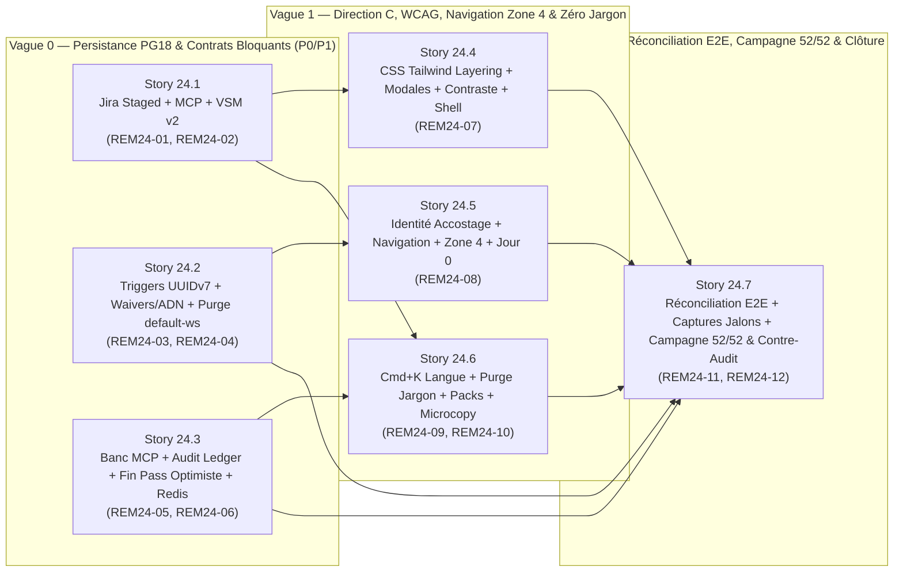

# Sprint Change Proposal — Plan Directeur Global de Remédiation Epic 24 (Case B post-Story 23.7)

**Date :** 2026-11-20
**Auteur :** Winston (`bmad-architect-worker`, Tech Lead / Architecte Principal — `23.8-impl`)
**Verdict déclencheur :** **`Case B`** confirmé par `Story 23.7` sur le commit `dd2d382`
**Sources probantes :**
- [`bilan-execution-tests-e2e-epic-23.md`](../implementation-artifacts/e2e-campaign-epic-23/bilan-execution-tests-e2e-epic-23.md) (`55` scénarios / `24` specs : **`44 passed / 7 failed / 1 timedOut / 3 skipped / 0 flaky`**, `84,6 %` Desktop, `58` PNG `< 450 KB`, max `276 950` B)
- [`notes-audit-sally-ux.md`](../implementation-artifacts/e2e-campaign-epic-23/notes-audit-sally-ux.md) (`58/58` PNG inspectés : **`17` constats `UX23-01..UX23-17`** = `1 P0`, `9 P1`, `5 P2`, `2 P3`)
- [`notes-audit-winston-architecture.md`](../implementation-artifacts/e2e-campaign-epic-23/notes-audit-winston-architecture.md) (`8` fiches RCA + **`12` diagnostics `ARCH24-01..ARCH24-12`**)
- [`synthese-remediation-sally-winston-epic-23.md`](../implementation-artifacts/e2e-campaign-epic-23/synthese-remediation-sally-winston-epic-23.md) (`12` remédiations **`REM24-01..REM24-12`**, DAG en `3` vagues)
- [`capabilities.yaml`](../product/capabilities.yaml) (`65` capacités : `39 runtime` [`36 feature` + `3 foundation`] et `26 failed_e2e` [`25` Desktop $\rightarrow$ Epic 24 + `CAP-042` $\rightarrow$ `ACTION_ITEM-23.6`])

---

## 1. Synthèse Décisionnelle & Déclencheur `Case B`

L'Epic 23 a résolu `82` des `90` échecs historiques (passage à **`84,6 %`** de réussite Desktop, `0` erreur de schéma PG18, `0` blocage SSE `00-smoke` authentifié). En revanche, la campagne figée `Story 23.7` met en évidence **`8` échecs/timeouts Desktop** et **`10` écarts UX bloquants (`1 P0` + `9 P1`)** qui empêchent la clôture directe sans remédiation ciblée :

1. **Poches de persistance RAM & contrats cassés (`Vague 0` — `Stories 24.1..24.3`)** :
   - Actions Jira staged (`REM24-01` / `06 #15`) et propositions/expositions MCP (`REM24-01` / `19#2 #47`) stockées en dictionnaires Python en mémoire (`MultiProjectJiraStagedActionService`, `GovernedMcpServerService`) ou instanciées via des helpers lazy en routeur (`jira_and_mcp.py`), provoquant une perte d'état HTTP `404`/`500` entre workers et une persistance fictive au rechargement `F5`.
   - Store `SqlWorkflowDefinitionsV2Store` non câblé en runtime (`strict_sql=False`, `get_vsm_store()`/`get_runs_store()` dans `_workflows_helpers.py`) $\rightarrow$ `20#1 #48` (`vsm_definitions_v2` absent pour le workflow canonique 11 étapes / packs).
   - Collision UUIDv7 sur `trigger_key = f"trg-{tid[:8]}"` (`_triggers_lifecycle_ops.py:46-47` : les `32` bits MSB encode un horodatage commun sur `65,5 s`) $\rightarrow$ `20#2 #49` (`409` / erreur SQL d'unicité).
   - Appels non `await` dans `WorkspaceDnaAndWaiversSection.tsx`, ADN Starlark non persisté dans PG18 et résidus `"default-ws"` / `"ws-claims-alpha"` / `"ws-mon-compte"` en Jour 0 $\rightarrow$ `17#3 #40`.
   - Banc de test distant (`useCatalogRemoteTestBench.ts`) affichant un `PASS` optimiste synchrone avant la réponse HTTP `200`, contrat `audit_ledger` désynchronisé du test E2E `18#5 #45`, activations MCP/Remote (`handleToggleMcp`) non persistées dans PG18 (`RemoteServiceTestBenchAndGovernedMcpService`), et cache `_speed2_cache` en RAM dans `TwoSpeedFederatedSearchService`.
2. **Dette CSS Tailwind v4, Contraste RGAA, Navigation Zone 4 & Jargon (`Vague 1` — `Stories 24.4..24.6`)** :
   - Import CSS inversé dans `main.tsx` + classes utilitaires non encadrées dans `@layer utilities` (`tokens.css` `1 266` L) écrasant `md:flex-row` / `sm:grid-cols-2 xl:grid-cols-4` (`UX23-02`, `UX23-04`, `UX23-13`, `UX23-14`, `ARCH24-08`).
   - `AgentDetailAndSandboxModal` hors `OrciaDialog` sans scroll ni pied sticky (`UX23-03`), défaut contraste sombre `--color-sidebar-active-fg` et bande `#EAF2FB` dans `FourZoneDirectionCShell` (`ARCH24-11`, `UX23-16`).
   - Confusion d'identité Accostage Jour 0 (`authDisplayName` affiché comme `platformAdmin`), `/inbox` dépourvu d'entrée dédiée en Zone 4 (`_contextualHelpSections.ts`), Sidebar sur `/showcase`, fil d'Ariane `/organization` et `/spaces`, verrouillage `Mes Espaces` pré-admin (`UX23-07`, `UX23-09`, `UX23-15`, `ARCH24-09`).
   - Recherche `Cmd+K` polluée par `HELP_ARTICLE` multilingues (`sql_federated_search.py`), émoji rouge `❓`, fuite d'enums brutes (`PENDING`, `RUNNING`, `PAUSE_AND_ESCALATE`, `OPT_A_*`, `1_NETWORK_TLS_ANTI_SSRF..4_HOT_DRY_RUN`), compteurs `/settings/packs` incohérents et troncatures `1440×900` (`UX23-05`, `UX23-08`, `UX23-10`, `UX23-11`, `UX23-12`, `UX23-16`, `ARCH24-10`).
3. **Réconciliation des sélecteurs E2E & preuve finale `52/52` (`Vague 2` — `Story 24.7`)** :
   - Sélecteur ambigu dans `openCatalogOrAgentsPage` (`workspaceAndCatalogHelpers.ts:126-130` $\rightarrow$ `18#1 #41` timeout) et `07-spaces` (`L42` non borné à `main` $\rightarrow$ `07 #16`).
   - Captures manquantes des états métier riches (`VSM 11 étapes`, `drawer HITL`, `tripartite/waivers` $\rightarrow$ `UX23-17`) et campagne finale Desktop `52/52` + contre-audit Sally `0 P0 / 0 P1` clôturant sans boucle infinie.

---

## 2. Architecture d'Exécution — DAG en `3` Vagues (`Stories 24.1..24.7`)

---

## 3. Matrice 1 — Échecs E2E Desktop (`8/8`) & Skips Mobile (`3`)

| # | Spec E2E | Scénario (`manifest.jsonl`) | Statut `23.7` | Cause Racine Confirmée | Story Cible | Statut Cible |
|---|---|---|---|---|---|---|
| 1 | `06-gates-and-human-review.spec.ts` | `#15` Staged Jira + HITL + Outbox | `failed` | `MultiProjectJiraStagedActionService` en RAM + helper lazy routeur (`ARCH24-01`) | `24-1-persistance-pg18-actions-jira-staged-mcp-et-vsm-v2` | `PASS` |
| 2 | `07-spaces-org-and-workspace-persistence.spec.ts` | `#16` Espaces / Org / Persistance | `failed` | Sélecteur L42 non borné à `page.getByRole("main")` + fuite breadcrumb/navigation (`ARCH24-09`) | `24-7-reconciliation-e2e-captures-jalons-campagne-52-sur-52-et-cloture-epic-24` (appuyée par `24-5`) | `PASS` |
| 3 | `17-workspace-waivers-and-dna-starlark.spec.ts` | `#40` `17#3` Waivers & ADN Starlark | `failed` | Appels non `await`, ADN en RAM, fallback `"default-ws"` / `"ws-claims-alpha"` (`ARCH24-04`) | `24-2-triggers-uuidv7-sans-collision-waivers-await-adn-pg18-et-fin-default-ws` | `PASS` |
| 4 | `18-catalog-packs-wizards-and-mcp-bench.spec.ts` | `#41` `18#1` Catalog / Packs / Wizards | `timedOut` | `openCatalogOrAgentsPage` attend `agents-and-skills-manager-view` même sur `/catalog` (`ARCH24-06`) | `24-7-reconciliation-e2e-captures-jalons-campagne-52-sur-52-et-cloture-epic-24` | `PASS` |
| 5 | `18-catalog-packs-wizards-and-mcp-bench.spec.ts` | `#45` `18#5` Banc MCP & Audit Ledger | `failed` | `PASS` optimiste synchrone + contrat `audit_ledger` + RAM `_exposed_agents` (`ARCH24-05`, `ARCH24-07`) | `24-3-banc-mcp-audit-ledger-fin-pass-optimiste-et-assainissement-composition-root` | `PASS` |
| 6 | `19-orchestration-blackboard-and-mcp.spec.ts` | `#47` `19#2` Governance MCP & Blackboard | `failed` | `GovernedMcpServerService._draft_proposals` en RAM + `_get_mcp_service` lazy (`ARCH24-01`) | `24-1-persistance-pg18-actions-jira-staged-mcp-et-vsm-v2` | `PASS` |
| 7 | `20-process-studio-and-triggers.spec.ts` | `#48` `20#1` VSM v2 11 étapes | `failed` | `SqlWorkflowDefinitionsV2Store` non câblé (`strict_sql=False`, RAM) (`ARCH24-02`) | `24-1-persistance-pg18-actions-jira-staged-mcp-et-vsm-v2` | `PASS` |
| 8 | `20-process-studio-and-triggers.spec.ts` | `#49` `20#2` Déclencheurs séquentiels | `failed` | Collision `f"trg-{tid[:8]}"` dans `_triggers_lifecycle_ops.py:46-47` (`ARCH24-03`) | `24-2-triggers-uuidv7-sans-collision-waivers-await-adn-pg18-et-fin-default-ws` | `PASS` |
| 9–11 | `05`, `10`, `11` (`mobile-only`) | `#14`, `#25`, `#27` Mobile Companion | `skipped` | Hors `--project=desktop-cockpit` — conservés sous `ACTION_ITEM-23.6` (`P2`) | `ACTION_ITEM-23.6` | `skipped` (`mobile-only`) |

---

## 4. Matrice 2 — Remédiations `REM24-01..REM24-12`, Constats `UX23-01..UX23-17` & Diagnostics `ARCH24-01..ARCH24-12`

| `REM24` | Story Cible (`slug`) | `UX23-*` Résolus | `ARCH24-*` Résolus | Contraintes Techniques & Split `< 350` L |
|---|---|---|---|---|
| `REM24-01` | `24-1-persistance-pg18-actions-jira-staged-mcp-et-vsm-v2` | `UX23-01` (`P0`, zéro état fantôme) | `ARCH24-01`, `ARCH24-12` | Migration Alembic `jira_staged_actions` (`UUIDv7` + outbox) + persistance `GovernedMcpServerService` en PG18 + suppression `_get_jira_service`/`_get_mcp_service` (`jira_and_mcp.py` 7 routes) + split `jira_actions.py` (`459` L $\rightarrow$ `< 300` L) et `GatesAdaptiveHumanReviewSection.tsx` (`378` L $\rightarrow$ `< 300` L). |
| `REM24-02` | `24-1-persistance-pg18-actions-jira-staged-mcp-et-vsm-v2` | `UX23-01` (`P0`) | `ARCH24-02`, `ARCH24-12` | Câblage `SqlWorkflowDefinitionsV2Store` (`vsm_definitions_v2`), seed VSM 11 étapes / packs idempotent, retrait `get_vsm_store`/`get_runs_store` de `_workflows_helpers.py` vers `dependencies/`, `strict_sql=True` hors tests unitaires sans DB. |
| `REM24-03` | `24-2-triggers-uuidv7-sans-collision-waivers-await-adn-pg18-et-fin-default-ws` | `UX23-06` (triggers & erreurs) | `ARCH24-03` | Correction `_triggers_lifecycle_ops.py:46-47` (`tid` complet ou suffixe entropique `[-12:]`) + `trigger_key` optionnel dans `WorkflowTriggersModal` (`workflow_triggers.py` 8 routes). |
| `REM24-04` | `24-2-triggers-uuidv7-sans-collision-waivers-await-adn-pg18-et-fin-default-ws` | `UX23-06` (`P1` waivers & ADN sans `"default-ws"`), **`USER24-BUG-6`** | `ARCH24-04` | `await` effectif + état `submitting` dans `WorkspaceDnaAndWaiversSection.tsx`, persistance PG18 des mécanismes Starlark (`dependencies/workspace_and_packs.py`), purge totale `"default-ws"`/`"ws-claims-alpha"`/`"ws-mon-compte"`, non-montage si `0` espace, commutation effective des 5 onglets dans `WorkspaceFiveTabsAndExternalRebaseView.tsx` (`USER24-BUG-6`), split `dna_starlark_and_glossary_lifecycle.py` (`447` L $\rightarrow$ `< 350` L). |
| `REM24-05` | `24-3-banc-mcp-audit-ledger-fin-pass-optimiste-et-assainissement-composition-root` | `UX23-08` (statuts/étapes banc MCP) | `ARCH24-05`, `ARCH24-07` | Suppression `PASS` optimiste synchrone dans `useCatalogRemoteTestBench.ts` (`await` HTTP 200), alignement contrat `audit_ledger` (`event_type`/`actor_type`), persistance PG18 `RemoteServiceTestBenchAndGovernedMcpService` (`handleToggleMcp`, `_exposed_agents`, `_pat_tokens`), split `remote_test_bench_and_mcp_exposure.py` (`440` L $\rightarrow$ `< 350` L). |
| `REM24-06` | `24-3-banc-mcp-audit-ledger-fin-pass-optimiste-et-assainissement-composition-root` | — | `ARCH24-12` | Migration `TwoSpeedFederatedSearchService._speed2_cache` vers Redis (TTL `300s` cloisonné utilisateur/rôle/workspace/scope/route), santé réelle `PacksRegistryPage`, `wfKey` réel dans `cockpit/index.tsx:113`, audit `dependencies/`. |
| `REM24-07` | `24-4-refonte-css-tailwind-tokens-modales-rgaa-contraste-onglets-et-shell` | `UX23-02` (`P1`), `UX23-03` (`P1`), `UX23-04` (`P1`), `UX23-13` (`P2`), `UX23-14` (`P2`), `UX23-16` (double scroll), **`USER24-BUG-1`**, **`USER24-BUG-4A`**, **`USER24-BUG-4B`**, **`USER24-BUG-5`** | `ARCH24-08`, `ARCH24-11` | Ordre `tokens.css` $\rightarrow$ `virtual:orcia-tailwind.css` dans `main.tsx:1-2` + découpage/encapsulation `@layer` dans `tokens.css` (`1 266` L) ; verrouillage scroll vertical Desktop (`100dvh`/`overflow: hidden`) + test systématique Vitest & E2E (`USER24-BUG-1`) ; passage de `UserSettingsModalDialog` en onglets horizontaux `.orcia-ds-tabs` (style « Mes Espaces », résolvant `UX23-02` & `USER24-BUG-4A`) ; suppression de l'entrée doublon `Paramètres` dans `SidebarAccountPopover` (`USER24-BUG-4B`) ; reset `lastIssuedPlaintext` à la fermeture de la modale + libellés lisibles FR sans `IDE MCP (SPACE · default)` / `60 RPM` (`USER24-BUG-5`) ; migration `AgentDetailAndSandboxModal` (`318` L) sur `OrciaDialog` (`max-h-[82vh]`, footer sticky, slug complet) ; suppression transition `150ms` onglets + unification `[aria-selected="true"]` `FinopsScopePills` + contraste dark `--color-sidebar-active-fg >= 4.5:1` ; correction hauteur `FourZoneDirectionCShell` (`348` L) contre bande `#EAF2FB`, auto-compactage `Accostage`, alignement `Journal d'Activité →` `/finops`. |
| `REM24-08` | `24-5-identite-accostage-cockpit-sync-navigation-zone4-et-coherence-jour0` | `UX23-07` (`P1`), `UX23-09` (`P1`), `UX23-15` (`P2`), **`USER24-BUG-2`** | `ARCH24-09` | Passage `platformAdmin` réel dans `cockpit/index.tsx:207-209` + filtrage jalons Accostage selon permissions (`ProgressiveDay0AccostageService`) ; correction route jalon `"1. Compte Admin"` (`/welcome-setup` $\rightarrow$ `/profile` post-admin / `/cockpit` Jour 0) et audit des 6 jalons contre `router.tsx` (`USER24-BUG-2`) ; route `/inbox` dédiée Zone 4 + `docs/help/{fr,en}/inbox.md` ; surbrillance `help` sur `/showcase` (`shellPresets.ts`) ; détachement `/organization` du parent masqué + `[Espace]` dans `buildShellBreadcrumbItems` ; verrouillage uniforme `Mes Espaces` Jour 0 pré-admin + clarté modale `FirstBootAdminSetupModal` ; `6` onglets `/settings` sur `1` ligne ; retrait pied pack dupliqué & breadcrumb `/spaces` dupliqué ; split `ShellContainer.tsx` (`378` L $\rightarrow$ `< 300` L). |
| `REM24-09` | `24-6-recherche-cmdk-filtre-langue-purge-jargon-packs-et-microcopy` | `UX23-05` (`P1`), `UX23-08` (`P1`), `UX23-10` (`P1`), `UX23-11` (`P2`), **`USER24-BUG-3`** | `ARCH24-10`, `ARCH24-11` | Rendu Markdown (`renderInlineMarkdownNodes` / `FormattedMarkdownContent`) dans `ContextualHelpSharedBlocks.tsx` et `ContextualHelpSectionsAndFooter.tsx` (« Ce qui coince souvent », « Questions fréquentes », « Un exemple réel », « Comment procéder pas à pas », « Repères utiles ») sur `/help` et Zone 4 (`USER24-BUG-3`) ; filtre SQL `ci.lang = locale` sur `HELP_ARTICLE` (`sql_federated_search.py:51-329`, `portal_and_help.py:106`) ; icône blanche `OrciaIcon` dans `TopHeaderSearchCommand` (`338` L) ; traduction `100 %` des enums/statuts/étapes (`PENDING`, `RUNNING`, `PAUSE_AND_ESCALATE`, `OPT_A_*`, `1_NETWORK_TLS_ANTI_SSRF..4_HOT_DRY_RUN`, `COMPLETED`, `PASS`, `HTTP 403`, `(AD-24.7)`, `PostgreSQL 18`, `< 15 s`, `0.5 ms`, `depth=0/1`) ; Markdown rendu dans `PermissionBrokerCard` + décodage URI ; remplacement `0` nu dans `CatalogExplorerPanel.tsx:149` (`impactedCount: 261`, `CRITICAL`). |
| `REM24-10` | `24-6-recherche-cmdk-filtre-langue-purge-jargon-packs-et-microcopy` | `UX23-12` (`P2`), `UX23-16` (`P3`) | `ARCH24-11` | Correction grille `5` compteurs `/settings/packs` (`4 Compétences`, split `PacksRegistryPage.tsx` `381` L $\rightarrow$ `< 300` L) ; règle pluriel `n <= 1` ; libellés lisibles connecteurs/agents ; correction `docs/help/fr/` (`` `@` ``, `L4 → L1`) ; troncatures `1440×900` (`StudioCopilotSidebar`, `/spaces`, split `IamSecopsExceptionForm.tsx` `403` L $\rightarrow$ `< 350` L) ; dédoublonnage `/ontology`, `/showcase` `4` onglets sans chemin interne, `/wizards`, double espace `Mes  Espaces`, `paliers`, casse `Cassette`, précision FinOps `0.002 €`. |
| `REM24-11` | `24-7-reconciliation-e2e-captures-jalons-campagne-52-sur-52-et-cloture-epic-24` | `UX23-17` (`P3` captures jalons) | `ARCH24-06` | Correction `openCatalogOrAgentsPage` (`workspaceAndCatalogHelpers.ts:126-130`) pour `catalog-explorer-panel` (`/catalog`) vs `agents-and-skills-manager-view` (`/agents`) ; bornage `07-spaces` L42 à `page.getByRole("main")` ; attente surface métier établie `00 #3/#4` & `04 #12` + ajout captures `< 450 KB` (`milestone-*.png`) VSM 11 étapes, drawer HITL et tripartite/waivers. |
| `REM24-12` | `24-7-reconciliation-e2e-captures-jalons-campagne-52-sur-52-et-cloture-epic-24` | Contre-audit Sally (`0 P0`, `0 P1`) | `ARCH24-12` + Clôture | Exécution figée `--project=desktop-cockpit --retries=0 --max-failures=0` dans `e2e-campaign-epic-24/`, promotion `capabilities.yaml` vers `runtime` (`64/65` avec `CAP-042` inchangé sur `ACTION_ITEM-23.6`), sortie conditionnelle clôturant Epic 24 sans boucle infinie. |

> **Couverture totale vérifiée :** `12/12` `REM24-*`, `17/17` `UX23-*`, `12/12` `ARCH24-*`, `8/8` échecs/timeouts Desktop (`#15`, `#16`, `#40`, `#41`, `#45`, `#47`, `#48`, `#49`).

---

## 5. Matrice 3 — Réaffectation des `26` Capacités `failed_e2e` (`capabilities.yaml`)

Toutes les **`25` capacités Desktop `failed_e2e`** quittent `"23-8-rapports-tech-lead-plan-correction-global-et-initialisation-epic-24"` vers leur Story Epic 24 dédiée ; **`CAP-042`** reste strictement sur **`ACTION_ITEM-23.6`** (`P2` Mobile Companion `390×844`).

| Story Epic 24 (`e2e_remediation_ref`) | Nombre | Capacités `CAP-*` assignées | Périmètre & Critère de Promotion `runtime` |
|---|---:|---|---|
| `24-1-persistance-pg18-actions-jira-staged-mcp-et-vsm-v2` | `8` | `CAP-020`, `CAP-021`, `CAP-024`, `CAP-030`, `CAP-031`, `CAP-032`, `CAP-033`, `CAP-140` | Actions Jira staged, gouvernance MCP Blackboard, portes/HITL (`06 #15`, `19#2 #47`) et VSM v2 `11` étapes (`20#1 #48`). |
| `24-2-triggers-uuidv7-sans-collision-waivers-await-adn-pg18-et-fin-default-ws` | `6` | `CAP-010`, `CAP-011`, `CAP-081`, `CAP-084`, `CAP-180`, `CAP-201` | Waivers tripartite, ADN Starlark, espaces sans `"default-ws"` (`17#3 #40`) et déclencheurs séquentiels + glossaire (`20#2 #49`). |
| `24-3-banc-mcp-audit-ledger-fin-pass-optimiste-et-assainissement-composition-root` | `5` | `CAP-055`, `CAP-082`, `CAP-092`, `CAP-150`, `CAP-200` | Exposition MCP, banc de test distant HTTP réel, `audit_ledger` (`18#5 #45`), Outbox FinOps et cache Redis. |
| `24-4-refonte-css-tailwind-tokens-modales-rgaa-contraste-onglets-et-shell` | `0`* | *Transverse UX/CSS (`UX23-02..04`, `UX23-13..14`, `UX23-16` sur `CAP-060`, `CAP-063`, `CAP-090`, `CAP-200`, etc.)* | Protège les surfaces déjà `runtime` et corrige les régressions visuelles Direction C avant la campagne finale `24-7`. |
| `24-5-identite-accostage-cockpit-sync-navigation-zone4-et-coherence-jour0` | `2` | `CAP-050`, `CAP-067` | Verrouillage `Mes Espaces` Jour 0, cohérence organisation/breadcrumb/navigation Zone 4 (`07`, Accostage, `/inbox`, `/showcase`). |
| `24-6-recherche-cmdk-filtre-langue-purge-jargon-packs-et-microcopy` | `2` | `CAP-056`, `CAP-057` | Catalogue/Packs/Wizards sans jargon ni compteurs erronés, filtre langue `Cmd+K` et Markdown permissions (`18`). |
| `24-7-reconciliation-e2e-captures-jalons-campagne-52-sur-52-et-cloture-epic-24` | `2` | `CAP-002`, `CAP-080` | Sélecteurs E2E `/catalog` & `07-spaces`, captures jalons `< 450 KB` et campagne figée Desktop `52/52` (`0` échec). |
| `ACTION_ITEM-23.6` (hors Epic 24) | `1` | `CAP-042` | Compagnon Mobile `390×844` (`#14`, `#25`, `#27` `mobile-only`, priorité `P2`). |
| **Total `failed_e2e`** | **`26`** | **`25` Epic 24 + `1` `ACTION_ITEM-23.6`** | Total registre inchangé : `39 runtime + 26 failed_e2e = 65` capacités. |

---

## 6. Synthèse des Stories & Rapports Tech Lead (`24-1..24-7`)

| Story | Clé `sprint-status.yaml` & Rapport Tech Lead | Vague | Objectif Principal & Fichiers Volumineux Découpés (`< 350` L) |
|---|---|---|---|
| `24.1` | [`24-1-persistance-pg18-actions-jira-staged-mcp-et-vsm-v2`](../implementation-artifacts/tech-lead-reports/24-1-persistance-pg18-actions-jira-staged-mcp-et-vsm-v2-tech-lead-report.md) | `0` | Migration Alembic `jira_staged_actions` + persistance PG18 `GovernedMcpServerService` + câblage `SqlWorkflowDefinitionsV2Store` + split `jira_actions.py` (`459` L) & `GatesAdaptiveHumanReviewSection.tsx` (`378` L). |
| `24.2` | [`24-2-triggers-uuidv7-sans-collision-waivers-await-adn-pg18-et-fin-default-ws`](../implementation-artifacts/tech-lead-reports/24-2-triggers-uuidv7-sans-collision-waivers-await-adn-pg18-et-fin-default-ws-tech-lead-report.md) | `0` | Fix collision `tid[:8]` (`_triggers_lifecycle_ops.py:46-47`), `await` + PG18 waivers & ADN Starlark, purge `"default-ws"`, non-montage détail `/spaces` à `0` espace + commutation 5 onglets (`USER24-BUG-6`), split `dna_starlark_and_glossary_lifecycle.py` (`447` L). |
| `24.3` | [`24-3-banc-mcp-audit-ledger-fin-pass-optimiste-et-assainissement-composition-root`](../implementation-artifacts/tech-lead-reports/24-3-banc-mcp-audit-ledger-fin-pass-optimiste-et-assainissement-composition-root-tech-lead-report.md) | `0` | Fin `PASS` optimiste (`useCatalogRemoteTestBench.ts`), contrat `audit_ledger` & PG18 MCP exposure, cache Redis `TwoSpeedFederatedSearchService`, split `remote_test_bench_and_mcp_exposure.py` (`440` L). |
| `24.4` | [`24-4-refonte-css-tailwind-tokens-modales-rgaa-contraste-onglets-et-shell`](../implementation-artifacts/tech-lead-reports/24-4-refonte-css-tailwind-tokens-modales-rgaa-contraste-onglets-et-shell-tech-lead-report.md) | `1` | Import `tokens.css` $\rightarrow$ Tailwind (`main.tsx:1-2`), split/layering `tokens.css` (`1 266` L), verrouillage scroll `100dvh` Desktop + test systématique (`USER24-BUG-1`), `UserSettingsModalDialog` en onglets horizontaux `.orcia-ds-tabs` (`USER24-BUG-4A`), fin doublon `Paramètres` (`USER24-BUG-4B`), reset secret + libellés MCP (`USER24-BUG-5`), `AgentDetailAndSandboxModal` (`318` L) sur `OrciaDialog`, onglets & contraste RGAA sombre. |
| `24.5` | [`24-5-identite-accostage-cockpit-sync-navigation-zone4-et-coherence-jour0`](../implementation-artifacts/tech-lead-reports/24-5-identite-accostage-cockpit-sync-navigation-zone4-et-coherence-jour0-tech-lead-report.md) | `1` | Route jalon `1. Compte Admin` `/welcome-setup` $\rightarrow$ `/profile` / `/cockpit` et audit 6 jalons vs `router.tsx` (`USER24-BUG-2`), identité `platformAdmin` Accostage, route Zone 4 `/inbox`, Sidebar `/showcase`, breadcrumb `/organization` & `/spaces`, verrouillage Jour 0 `Mes Espaces` & modale admin, split `ShellContainer.tsx` (`378` L). |
| `24.6` | [`24-6-recherche-cmdk-filtre-langue-purge-jargon-packs-et-microcopy`](../implementation-artifacts/tech-lead-reports/24-6-recherche-cmdk-filtre-langue-purge-jargon-packs-et-microcopy-tech-lead-report.md) | `1` | Rendu Markdown HTML dans `/help` & Zone 4 (`USER24-BUG-3`), filtre `ci.lang = locale` (`sql_federated_search.py`), purge enums & émoji `❓` (`TopHeaderSearchCommand`), compteurs `/settings/packs`, troncatures `1440×900`, split `PacksRegistryPage.tsx` (`381` L) & `IamSecopsExceptionForm.tsx` (`403` L). |
| `24.7` | [`24-7-reconciliation-e2e-captures-jalons-campagne-52-sur-52-et-cloture-epic-24`](../implementation-artifacts/tech-lead-reports/24-7-reconciliation-e2e-captures-jalons-campagne-52-sur-52-et-cloture-epic-24-tech-lead-report.md) | `2` | Helpers E2E `/catalog` & `07-spaces`, captures jalons `< 450 KB`, campagne figée Desktop `52/52` (`e2e-campaign-epic-24/`), contre-audit Sally `0 P0 / 0 P1` incluant `USER24-BUG-1..6`, promotion `capabilities.yaml` & clôture finale sans Epic 25. |

---

## 7. Invariants PG18, Refus de Régression & Sortie Conditionnelle sans Boucle Infinie

1. **Garantie de persistance PostgreSQL 18 (`testcontainers` réel, zéro mock)** : toute écriture utilisateur (`jira_staged_actions`, propositions/expositions MCP, `vsm_definitions_v2`, déclencheurs séquentiels, waivers, ADN Starlark, `audit_ledger`, préférences/packs) doit survivre à un redémarrage backend / rechargement `F5` (`reloadColdFromPg`) sans stockage métier RAM ni `default-ws` synthétique.
2. **Zéro régression sur les acquis Epic 23 (`44 passed` Desktop) & Jour 0 (`pnpm db:reset`)** :
   - `_first_boot_reset_guards.py` et `09_reset_db_first_boot.py` doivent inclure toute nouvelle table mutable (`jira_staged_actions`, etc.) dans `ORDERED_MUTABLE_TABLES_TO_CLEAR`.
   - Aucun retour de `ORCIA_E2E_SEED_FIXTURES`, de routes de bypass ou de retry Playwright (`--retries=0`).
   - `ACTION_ITEM-23.6` reste explicitement ouverte (`P2`) pour la compatibilité Mobile Companion `390×844` (`#14`, `#25`, `#27`, `CAP-042`).
3. **Clôture conditionnelle en `Story 24.7` (sans boucle infinie Epic 25)** :
   - **Si** la campagne figée `e2e-campaign-epic-24/` obtient **`52/52` PASS Desktop (`0 failed`, `0 timedOut`, `3 skipped` `mobile-only`, `0 flaky`)** et que le contre-audit Sally × Winston confirme **`0 P0`, `0 P1`** : promotion des `25` capacités vers `runtime` (`64/65` avec `CAP-042` sur `ACTION_ITEM-23.6`) et passage direct de `epic-24: done`.
   - **Si** un résidu marginal subsiste après `24.7`, seul un ticket borné `action_items:` ou un correctif ciblé sous décision utilisateur explicite est ouvert — jamais de génération automatique d'un Epic 25 non arbitré.

---

## 8. Remontées Utilisateur Intégrées à l'Epic 24 (`USER24-BUG-1` .. `USER24-BUG-6`)

En complément des constats `UX23-*` et `ARCH24-*`, six défauts observés en session réelle sur le Cockpit, l'Aide, le menu Compte et Mes Espaces sont intégrés directement dans le chemin d'exécution de l'Epic 24 :

| ID Remontée | Story Cible | Description Exacte & Cause Racine | Correction & Garde-Fou de Test Systématique |
|---|---|---|---|
| `USER24-BUG-1` | `24-4` (+ `24-7`) | Scroll vertical de la fenêtre permettant de descendre plus bas que la coquille de travail (zone vide `#EAF2FB` sous la sidebar et le contenu principal). | Verrouiller le viewport Desktop (`100dvh`, `overflow: hidden` sur `html, body, #root` et `FourZoneDirectionCShell`, colonnes internes `h-full min-h-0 overflow-y-auto`) + ajouter `shell-desktop-viewport-scroll-lock-audit.test.tsx` et `assertNoDesktopVerticalPageOverflow` dans `layoutGeometryAssertions.ts` / `shell.spec.ts`. |
| `USER24-BUG-2` | `24-5` (+ `24-7`) | Dans le Cockpit (« Étape 3 : Parcours en 6 jalons »), le clic sur « 1. Compte Admin » navigue vers `/welcome-setup` et affiche `Not Found`. | Remplacer `/welcome-setup` par `/profile` post-admin (`/cockpit` Jour 0 pré-admin) dans `progressive_accostage.py` et `platformSetupAccostage.ts`, et vérifier que les 6 jalons pointent sur des routes existantes de `router.tsx` (test Vitest + clic E2E). |
| `USER24-BUG-3` | `24-6` (+ `24-7`) | Dans `/help` et la colonne Zone 4 (« Ce qui coince souvent », « Questions fréquentes », « Un exemple réel »), du Markdown brut (`**...**`, `` `ⓘ` ``) s'affiche sans mise en forme HTML. | Utiliser `renderInlineMarkdownNodes` / `FormattedMarkdownContent` dans `ContextualHelpSharedBlocks.tsx` et `ContextualHelpSectionsAndFooter.tsx` + test vérifiant `0` `**` / backtick brut dans le DOM rendu. |
| `USER24-BUG-4A` | `24-4` (+ `24-7`) | La modale `Paramètres du compte` affiche une liste verticale en haut à gauche avec un vide et le panneau en dessous *(l'arbitrage 2 colonnes `REM24-07` est remplacé par la barre d'onglets horizontale)*. | Passer `UserSettingsModalDialog.tsx` en onglets horizontaux `.orcia-ds-tabs` / `.orcia-ds-tab` (`aria-orientation="horizontal"`) identiques à « Mes Espaces », avec panneau sous les onglets. |
| `USER24-BUG-4B` | `24-4` (+ `24-7`) | Dans le menu Compte en bas à gauche (`SidebarAccountPopover`), `Paramètres` et `Personnalisation` ouvrent la même modale. | Supprimer l'entrée `Paramètres` (`account-popover-settings-btn`) pour ne conserver que `Personnalisation` (`account-popover-personalization-btn`), `Profil`, `Aide` et `Se déconnecter`, et synchroniser helpers/tests E2E/Vitest. |
| `USER24-BUG-5` | `24-4` (+ `24-7`) | Dans l'onglet `Clés IDE & MCP`, l'affichage `"IDE MCP (SPACE · default) · pat_mcp_... /api/v1/mcp/spaces/default · 60 RPM"` est confus et la bannière « ne sera plus jamais affichée » réapparaît après fermeture/réouverture de la modale. | Réinitialiser `lastIssuedPlaintext` à `null` dès la fermeture de la modale (et changement d'onglet) dans `useSidebarAccountSettings.ts`, refondre l'affichage des cartes en français clair sans `IDE MCP (SPACE · default)` ni `60 RPM`, et vérifier en E2E l'absence de la bannière après réouverture. |
| `USER24-BUG-6` | `24-2` (+ `24-7`) | Dans « Mes Espaces » (`/spaces`), le bloc de détail `"default-ws"` s'affiche alors qu'aucun espace n'existe (et l'onglet `5. Membres & Équipe` affiche `2. DOCUMENTS & SOURCES`). | Ne jamais monter `WorkspaceDnaAndWaiversSection` à `0` espace (`targetWorkspace === null`), purger `"default-ws"` partout, et brancher le rendu du panneau de `WorkspaceFiveTabsAndExternalRebaseView.tsx` sur `activeTab`. |
