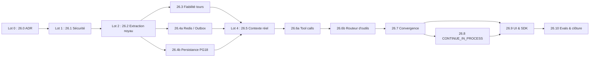

# Sprint Change Proposal — Plan Directeur de l'Epic 26 : Harnais « Mon Assistant » Unifié, Gouverné & Persistant

**Date :** 2026-11-21
**Auteur :** Tech Lead (audit multi-agents + revue `VALIDATE` `bmad-architect-worker`)
**Statut :** `approved` (arbitré en session `/grill-me` le 2026-11-21, rebasé via `bmad-correct-course`, puis **simplifié par la révision `R1–R4`** du 2026-11-21 09:00). Epic enregistrée (`epic-26: backlog`) et stories `ready-for-dev`. **Non lancée.**
**Déclencheur :** audit approfondi du harnais de Mon Assistant, qui conclut à une non-adéquation du chemin réellement servi à l'UI avec les garanties ORCIA (gouvernance, sécurité, persistance, citations).
**Sources probantes :**
- [`epic-26-decisions-grill-2026-11-21.md`](../implementation-artifacts/epic-26-decisions-grill-2026-11-21.md) : **14 arbitrages ratifiés (`D1–D11`)** issus de la session `/grill-me` (branche `feat/epic-26-assistant-harness-debt-remediation`, base `bc4bff0`), **amendés par la révision de simplification `R1–R4`** : hébergement unique dans l'API, Studio Mode B reporté, bouton « Approfondir », pas d'étrangleur.
- [`2026-11-21-audit-harnais-assistant-et-plan-remediation-tech-lead-report.md`](../implementation-artifacts/tech-lead-reports/2026-11-21-audit-harnais-assistant-et-plan-remediation-tech-lead-report.md) : 38 constats `H-01..H-38` (14 P0, dont 13 confirmés et 1 partiel ; 16 P1 ; 6 P2 ; 2 P3), 13 endpoints assistant sur 22 sans appelant UI, ~2 100 L de logique métier dans `apps/api/routers/`.
- [`epics.md` — Epic 26](./epics.md) : 13 stories avec critères d'acceptation.
- [`sprint-status.yaml`](../implementation-artifacts/sprint-status.yaml) : `epic-26` et ses stories.
- [`ARCHITECTURE-SPINE.md`](./architecture/architecture-ORCIA-2026-10-24/ARCHITECTURE-SPINE.md) : `AD-2`, `AD-3`, `AD-8`, `AD-10`, `AD-12`, `AD-15`, `AD-17`, `AD-19`, `AD-21`, `AD-24`.

---

## 1. Synthèse décisionnelle

Le modèle conceptuel du harnais (prompt constitutionnel à 5 couches, casquettes, ontologie L1–L4, 3 vitesses, citations à niveau d'autorité, Verrou V5, ancres humaines) est **adapté** à ORCIA. Son implémentation servie à l'UI ne l'est **pas** :

1. **Trois chemins concurrents.** L'UI emprunte `/three-speed/stream`, qui contourne `AssistantHarness`, le RAG, la vérification des citations et les ancres humaines. En mode `deep`/`@agent`, le runtime réflexif est déclenché **en parallèle** (double exécution LLM).
2. **Boucle d'outils factice ou cassée** et `save_and_launch_workflow` qui contourne `AD-3`.
3. **Failles de sécurité** : contrôle Observateur après le `200`, absence de `ScopeAccessGuard` (IDOR), droits `READ_SOURCE` fournis par le client, Couche 1 surchargeable.
4. **État critique en RAM** (tours, cache, gouvernance, citations, verrous) : perte au redémarrage, aucun fonctionnement multi-worker.

Les briques nécessaires existent déjà : `NonDeterministicReflexiveRuntime`, `PermissionBrokerService`, `SurgicalContextExplorer`, Verrou V5, `SqlHybridRagRepository`, sandbox Tier 1/2, MCP gouverné. L'Epic 26 est donc un travail de **convergence et de câblage**, pas de réinvention.

## 2. Architecture cible (arbitrée en `/grill-me`, à ratifier en spine par la Story 26.0)

- **Un seul moteur de tour** (`AssistantTurnEngine`, `orcia_core`) :
  - **Speed 1** = fast-path single-shot sans outil : pré-fetch RAG borné (`< 50 ms`), stream direct, persistance après le premier octet, TTFT `< 1,2 s`. **Pas d'escalade automatique (`R3`)** : un bouton **« Approfondir »** (si `supports_tools=true`) relance la question en Speed 2 comme **nouveau tour** du même fil (`parent_turn_id`). L'indicateur déterministe `low_evidence` (`EvidenceTable` vide) le met en avant.
  - **Speed 2/3** = profil `ASSISTANT` du `NonDeterministicReflexiveRuntime` : boucle d'outils bornée et gouvernée.
  - **Hébergement unique (`R1`)** : tous les tours s'exécutent en `asyncio.Task` bornée dans `apps/api`. Registre, flux d'événements et `stop` passent par Redis (rattachement F5 et multi-worker). Arrêt gracieux sur `SIGTERM`. Un tour orphelin après crash d'un pod est signalé `ERR_ASSISTANT_TURN_INTERRUPTED`, sans reprise. **Aucun worker Dramatiq pour l'assistant.**
- **Les 5 nœuds `AD-15` deviennent des phases** : N1 IntentGuard déterministe → N2 Planner + ontologie → N3 pré-fetch ou boucle d'outils → N4 `EvidenceTable` serveur → N5 synthèse via un `AssistantPromptBuilder` unique, puis `CitationGuard` avant `turn_completed`. **Topologie `N1–N5` fixe et verrous scellés** : Couche 1, `N1`, V5 et `CitationGuard` non désactivables. **Aucun paramétrage graphique Studio Mode B dans l'Epic 26 (`R2`, reporté en `ACTION_ITEM-26.1`)** ; seule la gouvernance Mode A (consignes texte sur 3 niveaux) alimente les couches 4 et 5.
- **Chaîne d'exécution des outils** : `PermissionBroker` → V5/ancre → exécuteur (sandbox pour les skills) → timeout → scrub → `audit_ledger` + Outbox. **Aucune écriture SI depuis l'Assistant** : toute mutation passe par `approval_required` → `CONTINUE_IN_PROCESS` (DBOS + Gate humaine).
- **État zéro RAM** : PG18 pour le durable (sessions, messages, gouvernance, brouillons, feedback, audit) ; Redis pour l'éphémère partagé (flux d'événements rattachable, cache de prompt, verrous, limite de débit).
- **Bascule directe, sans étrangleur (`R4`, façade consignée en `ACTION_ITEM-26.2`)** : la SPA, unique consommateur, bascule sur `/assistant/turns*` dans le **même commit** que le moteur (`26.7`, specs E2E `02`/`12`/`16`/`21` migrées). Chaque route remplacée ou sans appelant est supprimée dans la story qui livre son remplaçant : `/three-speed/*`, `/chat*`, `/verify-turn`, `/artifacts/action` en `26.7` ; `/workflows/save-and-launch` en `26.8` ; doublon `POST /threads/{id}/turns` en `26.9` ; routes Mode B en `26.4b`.

### 2.1 Décisions arbitrées (`D1–D11` + révision `R1–R4`, consignées dans `epic-26-decisions-grill-2026-11-21.md`)

| # | Décision | Arbitrage ratifié (`/grill-me` 2026-11-21, révisé `R1–R4`) |
| :---: | :--- | :--- |
| D1 + `R2` + `R3` | Moteur unique, approfondissement & Mode B | Runtime réflexif à profils (`ASSISTANT`) pour Speed 2/3 + fast-path Speed 1. **`R3`** : pas d'escalade automatique ; bouton « Approfondir » qui crée un nouveau tour Speed 2 (`parent_turn_id`) et indicateur déterministe `low_evidence`. **`R2`** : topologie `N1–N5` fixe et verrous scellés (Couche 1, `N1`, V5, `CitationGuard`) ; Studio Mode B reporté (`ACTION_ITEM-26.1`). Nouvel **`AD-25`** + amendement `AD-15`. |
| D2 + `R1` | Protocole & hébergement | `POST /assistant/turns` (202 + `turn_id`) + `GET …/stream?after=cursor` (Redis Streams). **`R1`** : **tous** les tours en `asyncio.Task` bornée dans `apps/api` (registre, flux et `stop` dans Redis, arrêt gracieux sur `SIGTERM`, clé de vie par tour → `ERR_ASSISTANT_TURN_INTERRUPTED` au rattachement après crash, sans reprise). Pas de Dramatiq ; `D2.a` annulée. |
| D3 | Politique SSRF & `platform-setup-state` | Liste d'autorisation administrée (hôtes / CIDR, `localhost` uniquement en `local`/`test`) + blocage permanent métadonnées / link-local / ports internes + validation DNS à la connexion (*pinning*). `GET /bootstrap/platform-setup-state` limité sans auth à `{is_initialized, step}` (`0` secret, Jour 0 `pnpm db:reset`), détail complet réservé à `PLATFORM_ADMIN`. Amendements `AD-21` / `AD-24`. |
| D4 | Messages de fil & trace | Nouvelle table `assistant_thread_messages` (`UUIDv7`, `role IN ('user','assistant')`, `citation_map`, `token_count`) + trace d'outils liée par `turn_id` dans `reflexive_execution_sessions`. |
| D5 | Modèles sans function calling | Drapeau `supports_tools` découvert par le Hub IA (0 token + override `PLATFORM_ADMIN`) + Speed 2/3 désactivées en UI + refus serveur `422 ERR_MODEL_TOOLS_UNSUPPORTED` (zéro émulation XML/ReAct). |
| D6 + `R4` | `save_and_launch_workflow` vs `CONTINUE_IN_PROCESS` | Raccordement de `POST /turns/{id}/approve` et `POST /folders/{id}/launch-process` à DBOS + PG18 (`AD-2`) avec `WAITING_FOR_HUMAN_ANCHOR` (`AD-3`) ; **suppression directe en `26.8`** de `/assistant/workflows/save-and-launch` (sans phase `deprecated`, `R4`). |
| D7 | Outil MCP `assistant.ask` | Raccordement à `AssistantTurnEngine` en **Speed 1 synchrone lecture seule** (7 verrous MCP + `QuotaGuard` + `ScopeAccessGuard` + `CitationGuard`, zéro écriture SI). |
| D8 + `R4` | Routes v1 & surface v2 | **Sans étrangleur** (`ACTION_ITEM-26.2`) : bascule backend + UI + E2E vers `/assistant/turns*` dans le même commit de `26.7`. Suppression des routes remplacées ou sans appelant dans la story qui livre leur remplaçant (`26.7` : `/three-speed/*`, `/chat*`, `/verify-turn`, `/artifacts/action` ; `26.8` : `/save-and-launch` ; `26.9` : doublon `POST /threads/{id}/turns` ; `26.4b` : routes Mode B). `26.10` vérifie qu'il reste 0 endpoint sans appelant. |
| D9 | Registre `capabilities.yaml` & `CAP-260` | Rétrogradation de `CAP-022`, `CAP-070`, `CAP-072` en `verification: api` dès `26.1` ; création de `CAP-260` (`api`) en `26.6b` ; promotion des 4 en `verification: runtime` uniquement en `26.10` après preuve E2E. |
| D10 | Lot 3 parallèle isolé | Exécution de `26.3`, `26.4a`, `26.4b` en **3 worktrees `share`**, suivie d'une fusion séquentielle `26.3 → 26.4a → 26.4b` avec rechaînage linéaire Alembic. |

> [!IMPORTANT]
> Les décisions `D1–D11`, **amendées par `R1–R4`**, font foi pour `26.0` (`bmad-architect-worker`) et pour les stories aval rebasées dans `epics.md`. Aucune story aval ne démarre tant que `26.0` n'est pas `done`. Deux sujets sont **reportés hors Epic 26** dans `sprint-status.yaml › action_items` : `ACTION_ITEM-26.1` (Studio Mode B) et `ACTION_ITEM-26.2` (façade de compatibilité v1).

## 3. Lotissement (8 lots, 13 stories)

| Lot | Stories | Objet | Parallélisme | Taille |
| :--- | :--- | :--- | :--- | :---: |
| **Lot 0 — Cadrage** | `26.0` | ADR `D1–D11` + `R1–R4`, `AD-25`, contrat SSE v2, rafraîchissement GitNexus | — | S |
| **Lot 1 — Sécurité immédiate** | `26.1` | Gardes avant stream, portée / IDOR, Observateur, `READ_SOURCE` serveur, Couche 1, SSRF, secrets | — | M |
| **Lot 2 — Fondations noyau** | `26.2` | Extraction LLM / prompt vers `orcia_core`, prompt builder unique, suppression des branches de test, découpage `> 300 L` | — | L |
| **Lot 3 — Fiabilité & persistance** | `26.3`, `26.4a`, `26.4b` | Registre de tours Redis, event loop async, limite de débit ; cache, verrous et Outbox Redis ; persistance PG18 de la gouvernance, des citations et du feedback | **3 en parallèle en worktrees isolés (`workspace: "share"`) → fusion séquentielle `26.3 → 26.4a → 26.4b` (rechaînage linéaire Alembic)** | M ×3 |
| **Lot 4 — Contexte réel** | `26.5` | Ontologie PG18, RAG hybride, Blackboard, `EvidenceTable`, budget de tokens | — | L |
| **Lot 5 — Boucle d'outils** | `26.6a` → `26.6b` | Tool calls 4 dialectes + budgets → routeur d'outils gouverné et audité | séquentiel | M ×2 |
| **Lot 6 — Convergence** | `26.7` → `26.8` | Moteur de tour unique + **bascule directe UI/E2E** + citations serveur → `CONTINUE_IN_PROCESS` DBOS + ancres | séquentiel | L + M |
| **Lot 7 — UI & clôture** | `26.9` → `26.10` | Câblage UI (historique PG18, citations, trace d'outils, « Approfondir », Mode A) → evals, red-team, multi-worker, clôture | séquentiel | M + S |

### 3.1 Matrice constats → stories

| Story | Constats `H-xx` couverts |
| :--- | :--- |
| `26.0` | H-38 + prérequis `D1–D11` / `R1–R4` |
| `26.1` | H-06, H-07, H-08, H-15, H-16, H-17, H-30 (assert) |
| `26.2` | H-24, H-25, H-30 (P2), H-31, H-34 |
| `26.3` | H-10, H-11, H-20, H-21, H-23, H-33 |
| `26.4a` | H-09 (partiel), H-19, H-22 (Outbox), H-32, H-35 |
| `26.4b` | H-09 (solde), H-37 (partiel) |
| `26.5` | H-12, H-13, H-18 (serveur) |
| `26.6a` | H-03 (transport), H-04, H-27 (dialectes) |
| `26.6b` | H-03 (exécution), H-22 (outils), H-27 (catalogue), H-28, H-29 |
| `26.7` | H-01, H-02, H-14 (serveur) |
| `26.8` | H-05 |
| `26.9` | H-14 (UI), H-18 (UI), H-26 |
| `26.10` | H-36, H-37 |

## 4. Définition de « Prêt » (Definition of Ready) et protocole de lancement

Chaque story est `ready-for-dev` : ses critères d'acceptation, dépendances, constats, capacités, fichiers impactés et le chemin de son rapport Tech Lead figurent dans `epics.md`. **Au lancement** (non effectué à ce jour), pour chaque story, dans l'ordre du lotissement :

1. Vérifier que les dépendances sont `done` dans `sprint-status.yaml`.
2. Créer le rapport `docs/implementation-artifacts/tech-lead-reports/26-<n>-<slug>-tech-lead-report.md` (Sections 1 et 2) **avant toute modification de code**, après `npx gitnexus analyze` et `gitnexus_impact` sur les symboles cités.
3. Router selon `bmad-model-routing.md` et la décision **`D11`** :
   - `26.0` → `bmad-architect-worker` (`pro`), suivi d'un STOP de validation utilisateur (`lint_spine.py`) ;
   - chaque story dev (`26.1` à `26.10`) → **2 `bmad-dev-worker` (`flash`) distincts** : **#1 Implémentation** (Sections 1 & 2 du rapport Tech Lead + code `< 300 L`) puis **#2 Tests & Vérifications** (5 couches `AD-17` `>= 90 %`, Section 3 du rapport Tech Lead, `README.md`, `capabilities.yaml`) ;
   - escalade en `pro` après 2 échecs consécutifs sur la même cause ;
   - pour le Lot 3 (`D10`), exécution en worktrees isolés `workspace: "share"` puis fusion séquentielle `26.3 → 26.4a → 26.4b` avec rechaînage linéaire du `down_revision` Alembic de `26.4b`.
4. Appliquer TDD strict, 5 couches `AD-17`, couverture `>= 90 %`, `lint-imports` 5/5, OpenAPI `0-diff`, `lint_spine` à 0.
5. Faire passer la story en `review`, lancer `bmad-code-review` (`bmad-architect-worker` `pro`), puis la passer en `done`, mettre à jour `capabilities.yaml`, lancer `pnpm site:sync && pnpm site:check`, et produire **1 commit Git local atomique par story** (avec STOP et demande de **GO** utilisateur en fin de chaque lot).

`epic-26` passe à `in-progress` automatiquement au démarrage de `26.0`.

## 5. Invariants de non-régression (toute l'Epic)

- **Acquis de `25-5`** : Mon Assistant actif dès 1 modèle `chat` sans embedding (`get_optional_embedding_port`, `ensure_active_chat_model_if_live`), blocage `422 ERR_NO_ACTIVE_EMBEDDING_MODEL` des sources RAG hors `SOURCE_CODE`, aucune réintroduction de `require_rag_available` sur les routes Assistant.
- **Processus** : le comportement `PROCESS` du runtime réflexif reste inchangé par défaut (`process_dispatcher`, tests `16-2`).
- **`agents_and_skills`** : ce consommateur du bridge et de `system_instructions_override` est migré **avant** toute suppression.
- **Specs E2E** `02`, `12`, `16` et `21` vertes à chaque story. Elles sont **migrées sur `/assistant/turns*` dans le commit de `26.7`** (bascule directe, sans façade, `R4`).
- **Append-only** : triggers `audit_ledger` et `blackboard_snapshots` intacts.

## 6. Critères de sortie de l'Epic 26

| Indicateur | Cible |
| :--- | :--- |
| Chemins d'exécution LLM par tour utilisateur | 1 |
| Constructeurs de prompt | 1 (Couche 1 immuable) |
| Routes `/assistant/*` mutantes sans garde de portée et Observateur | 0 (audit AST) |
| État métier mutable module-level / `InMemory*` dans le harnais (prod) | 0 (audit AST) |
| Branches `testclient` / `pytest in sys.modules` dans `src/` | 0 |
| Endpoints assistant sans appelant ni consommateur documenté | 0 |
| Appels d'outils audités (`audit_ledger`) | 100 % |
| Citations sans entrée `EvidenceTable` serveur | 0 (eval golden) |
| TTFT p95 Speed 1 (cassette, PG18 réel) | `< 1,2 s` |
| `stop` / rattachement inter-workers | ✅ |
| Fichiers du harnais `> 300 L` | 0 |
| Couverture unitaire | `>= 90 %` |

## 7. Risques

| Risque | Mitigation |
| :--- | :--- |
| Régression Processus (runtime partagé) | Composition par profil, défaut `PROCESS` inchangé, tests en garde. |
| TTFT Speed 1 | Fast-path hors runtime, pré-fetch `< 50 ms`, persistance après le premier octet, p95 mesuré en Couche 2. |
| Hétérogénéité du function calling | `supports_tools` (D5) + cassettes par dialecte. |
| Bascule directe sans façade (`R4`) | Moteur, UI de transport et specs E2E migrés dans **un seul commit atomique** de `26.7`, revue `pro` obligatoire. Retour arrière par `git revert` du commit. Façade réévaluable via `ACTION_ITEM-26.2` si un consommateur externe apparaît. |
| Perte d'un tour long en cas de crash d'un pod (`R1`, **risque accepté**) | Arrêt gracieux sur `SIGTERM` (les déploiements ne coupent pas les tours) ; clé de vie par tour → `ERR_ASSISTANT_TURN_INTERRUPTED` explicite au rattachement ; relance manuelle par l'utilisateur. |
| Décision `26.0` divergente | Arbitrages `D1–D11` + `R1–R4` déjà rebasés avant le lancement de `26.0` ; tout nouvel écart détecté en `26.0` est rebasé avant `26.1`. |
| Registre surévalué (`CAP-022`, `CAP-070`, `CAP-072`) | Requalification en `verification: api` dès `26.1` puis promotion en `verification: runtime` en `26.10` après preuve E2E (`D9`). |
