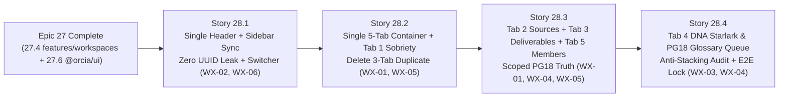

# Sprint Change Proposal — Epic 28: Unified "Mes Espaces" (`/workspaces`) 5-Tab Screen, Component De-Duplication & Direction C Sobriety

**Date:** 2026-11-23
**Authors:** Sally (UX Designer) & Winston (System Architect)
**Trigger:** Cross-review of the live `/workspaces` ("Mes Espaces") screenshot and component hierarchy (`apps/web/src/routes/workspaces.tsx` and `apps/web/src/features/workspaces/`).
**Target Status:** `backlog` (prepared on branch `feat/epic-28-workspaces-screen-unification`; **wait for Epic 27 Stories 27.4 and 27.6 to merge before starting Story 28.1**).

---

## 1. Executive Summary & Problem Statement

Visual inspection of `/workspaces` ("Mes Espaces") together with a structural code trace confirms that three successive waves of features were stacked vertically inside the same page container instead of converging into a single unified layout. As a result, a single screen renders **six stacked vertical cards**, **two competing tab bars**, **five redundant header bands**, **exposed raw `UUIDv7` technical slugs**, and **empty-state clutter (`0 / 0 / 0` counters and unused filter pills)**.

This proposal defines **Epic 28 (`Stories 28.1`–`28.4`)** to consolidate `/workspaces` onto the single canonical 5-tab Direction C specification (`DESIGN.md` §Brand & Style #3, `EXPERIENCE.md` §2.2 `Mes Espaces`) backed 100% by scoped PostgreSQL 18 state, without modifying any application code while Epic 27 (`feat/epic-27-bilingual-i18n-and-deterministic-locale-guards`) is in progress.

---

## 2. Root-Cause Diagnosis (`WX-01`..`WX-06`)

| ID | Observation on Live Screenshot | Exact Structural Cause in Codebase | Specification Violated |
| :--- | :--- | :--- | :--- |
| **`WX-01`** | **Dual competing tab systems** on the same screen (`3` tabs in the middle card vs `5` tabs below it, duplicating *Sources*, *Glossary*, and *Members*). | `WorkspacesFeaturePanel` (`apps/web/src/features/workspaces/index.tsx:L95-L196`) renders `WorkspaceStudioCardsAndDetailView` (which mounts the 3-tab `WorkspaceDetailTabsPanel.tsx:L63-L208` with `SOURCES`, `GLOSSARY`, `MEMBERS`) **and** immediately below it renders `WorkspaceDnaAndWaiversSection.tsx:L244-L330` (which mounts the 5-tab `@orcia/ui` primitive `WorkspaceFiveTabsAndExternalRebaseView.tsx:L266-L322`). | `EXPERIENCE.md` §1.1 #2 (Hick's Law) & §2.2 `Mes Espaces` (single 5-sub-tab bar) |
| **`WX-02`** | **Five redundant stacked header bands & raw technical slug leak** (`personal-<uuidv7>` visible under the title and in an inline URI box). | Five headers stack vertically: `ModuleWorkspaceView.tsx:L60-L92` → secondary `<nav>` (`index.tsx:L97-L116`) → `workspaces-header-and-filters-bar` (`WorkspaceStudioCardsAndDetailView.tsx:L111-L181`) → `WorkspaceDetailTabsPanel.tsx:L69-L123` → `WorkspaceFiveTabsAndExternalRebaseView.tsx:L266-L322` (displaying raw `workspaceSlug` `personal-<uuid>`) → `DnaStarlarkCompilerAndGlossaryLifecycleView.tsx:L71-L96`. | `DESIGN.md` §Brand & Style #3 (1 sober header + 1-sentence intent), `EXPERIENCE.md` §1.2 #1 (zero internal plumbing/UUIDs) |
| **`WX-03`** | **Permanent bottom-of-page DNA Starlark & Glossary validation block** visible even when viewing Overview or Sources, backed by local RAM state. | `WorkspaceDnaAndWaiversSection.tsx:L282-L328` unconditionally mounts `DnaStarlarkCompilerAndGlossaryLifecycleView` (`packages/ui/src/primitives/DnaStarlarkCompilerAndGlossaryLifecycleView.tsx:L65-L268`) beneath the 5-tab card, feeding `in-flow-top3-panel` and `glossary-fifo-queue-panel` from a local `useState([])` (`glossaryCandidates` at `WorkspaceDnaAndWaiversSection.tsx:L102-L104`). | `EXPERIENCE.md` §2.2 `Mes Espaces` (Glossary lifecycle belongs inside Tab 4) & zero ephemeral RAM business state |
| **`WX-04`** | **Split data truth between top and bottom panels** for Sources and Glossary. | `WorkspaceDetailTabsPanel` (`L125-L134`) mounts `WorkspaceSourcesRagTab` (`WorkspaceSourcesRagTab.tsx:L238-L344`), which queries scoped sources via `client.listWorkspaceDatasources(wsId)`. Meanwhile, `WorkspaceDnaAndWaiversSection` (`L263-L271`) passes a separate unscoped `datasources` prop into `WorkspaceFiveTabsAndExternalRebaseView`. | Single PG18 source of truth (`workspace_datasources` scoped per `wsId`) |
| **`WX-05`** | **Empty-state KPI `0 / 0 / 0` clutter and empty filter pills** shown on a blank personal workspace. | `WorkspaceFiveTabsAndExternalRebaseView` (`L141-L152`) renders a 4-card overview grid displaying `0` Documents & Sources, `0` Glossaire & Règles Métiers, and `0` Adaptations, while `WorkspaceSourcesRagTab` displays 5 category filter pills (`Toutes`, `Connaissances`, `Modèles & Trames`, `Code & Contrats`, `Schémas SQL`) above an empty message. | `DESIGN.md` §Brand & Style #3 & §Do's and Don'ts (`L198`: hide `0/0/0` KPIs and filter pills when `total == 0`) |
| **`WX-06`** | **Ambiguous dual workspace selection** (sidebar selector vs stacked card grid with `"Travailler dans cet espace"` button). | The global Left Sidebar already hosts the canonical Active Workspace Selector (`DESIGN.md:L84`), yet `/workspaces` stacks a full filterable workspace card grid on top of two detail panels. | `DESIGN.md` §Brand & Style #1 (`L84`), `EXPERIENCE.md` §2.1 #1 |

---

## 3. Target Unified Architecture (`/workspaces`)

### 3.1 Single Screen Skeleton (Header + Single 5-Tab Workspace Container)

```
┌─────────────────────────────────────────────────────────────────────────┐
│ TopHeaderBar: [O] ORCIA › Mes Espaces · <Active Workspace Name>         │
├──────────────┬──────────────────────────────────────────┬───────────────┤
│ Left Sidebar │ Central Workspace Area (Single Container)│ Right Help    │
│              │                                          │ Column (340px)│
│ Active       │ ┌──────────────────────────────────────┐ │               │
│ Workspace    │ │ Compact Header (NO raw UUID slug)    │ │ Contextual    │
│ Selector     │ │ Title · Phase · Visibility · [+ New] │ │ Help (4       │
│ (Canonical)  │ │ (Compact switcher / team share CTA)  │ │ standard      │
│              │ └──────────────────────────────────────┘ │ blocks)       │
│ 9 Fixed      │ ┌──────────────────────────────────────┐ │               │
│ Nav Items    │ │ Single 5-Tab Bar:                    │ │               │
│              │ │ [1. Accostage & Vue d'ensemble]      │ │               │
│              │ │ [2. Documents & Sources]             │ │               │
│              │ │ [3. Livrables & Artefacts]           │ │               │
│              │ │ [4. Glossaire & Règles Métiers]      │ │               │
│              │ │ [5. Membres & Paramètres]            │ │               │
│              │ ├──────────────────────────────────────┤ │               │
│              │ │ Active Tab Content ONLY              │ │               │
│              │ │ (Scoped to activeWorkspaceId PG18; │ │               │
│              │ │  KPIs & filter pills hidden if == 0) │ │               │
│              │ └──────────────────────────────────────┘ │               │
└──────────────┴──────────────────────────────────────────┴───────────────┘
```

### 3.2 Canonical Responsibility of Each Tab

1. **Tab 1 — `Accostage & Vue d'ensemble`** (`default` when `onboarding < 6/6`, otherwise user-selectable):
   - Unified workspace readiness/onboarding checklist (when incomplete), default deliverable destination selector, local adaptations / exception waivers (`workspace_exception_waivers` Lock V1), and external edit reset summary.
   - KPI summary cards are **hidden when `total == 0`** (`DESIGN.md:L198`), showing a single clear pedagogical empty-state sentence and CTA instead.
2. **Tab 2 — `Documents & Sources`**:
   - Absorbs the real scoped `WorkspaceSourcesRagTab` (`client.listWorkspaceDatasources(wsId)`), `+ Rattacher une source` modal (`WorkspaceSourceAttachModal`), `Vérifier fraîcheur` action, and `[STALE_WARNING]` waiver banner.
   - Category filter pills (`Toutes`, `Connaissances`, `Modèles & Trames`, `Code & Contrats`, `Schémas SQL`) are **hidden when the workspace has `0` sources** (`total == 0`).
3. **Tab 3 — `Livrables & Artefacts`**:
   - Validated deliverable catalog (`orcia://workspaces/<ws>/artifacts/<type>/<slug>@v<N>`), default destination configuration, `diff` preview, download CTA, and `ExternalEditRebaser` (`🔒 Human-Amended` Lock V2).
4. **Tab 4 — `Glossaire & Règles Métiers`**:
   - Consolidates `WorkspaceGlossaryAndOntologyTab` **and** the DNA Starlark Gate Compiler + `Top-3` in-flow promotions (`Lock V4`) + `✨ À valider (N <= 15 FIFO)` queue (`DnaStarlarkCompilerAndGlossaryLifecycleView`) **strictly inside Tab 4** (never rendered globally at the bottom of the page).
   - Wired 100% to PG18 endpoints (`dna_and_glossary.py` / `ontology_promotions.py`), removing the ephemeral `useState([])` candidate store.
5. **Tab 5 — `Membres & Paramètres de l'espace`**:
   - Consolidates workspace membership management, role/tool toggles with immediate PG18 persistence, lifecycle phase transition, and team-sharing modal/drawer.

---

## 4. Execution Plan & Git Coordination with Ongoing Epic 27

### 4.1 Execution Sequence (`Stories 28.1`–`28.4`)



### 4.2 Git Isolation Strategy During Epic 27

- **Main worktree (`/home/romain/Documents/Projects/ORCIA`)**: Remains dedicated to **Epic 27** (`feat/epic-27-bilingual-i18n-and-deterministic-locale-guards`), which extracts hardcoded strings across `apps/web/src/features/workspaces/*` (`Story 27.4`) and `packages/ui/src/primitives/*` (`Story 27.6`).
- **Epic 28 worktree / branch (`feat/epic-28-workspaces-screen-unification`)**: Branched cleanly from the Epic 27 initialization commit (`4e43a17`), containing **only** planning artifacts (`sprint-change-proposal`, `epics.md`, `sprint-status.yaml`) with `epic-28: backlog` and `Stories 28.1..28.4: backlog`.
- **Conflict Prevention**:
  1. Epic 28 does **not** touch any `.ts` or `.tsx` files while Epic 27 runs.
  2. Subsequent Epic 27 story commits (`27.1`–`27.8`) do not touch Epic 28's planning sections; `sprint-status.yaml` appends cleanly under `epic-27`.
  3. Once Epic 27 merges into `main`, rebase `feat/epic-28-workspaces-screen-unification` onto `main` (`git rebase main`) before starting `Story 28.1` so all workspace components already use the finalized `fr`/`en` i18n dictionaries and pass Gate 1–3 (`0` baseline).

---

## 5. Verification & Exit Criteria

- **Code hygiene & modularity**: Every refactored file under `apps/web/src/features/workspaces/` and `packages/ui/src/primitives/` stays `<= 300` lines, bilingual (`fr`/`en`) with zero Gate 1/2/3 regressions, and passes `zero-dead-buttons-and-silent-catches-audit.test.tsx` + `e2e-testids-sync-audit.test.ts`.
- **Anti-regression structural guard (`Story 28.4`)**: Vitest / AST check asserting that `/workspaces` renders at most **1** `[role="tablist"]` for workspace sections, **0** raw `personal-<uuid>` strings in visible text, **0** KPI counter cards or source filter pills when `total == 0`, and that `DnaStarlarkCompilerAndGlossaryLifecycleView` only mounts when Tab 4 (`Glossaire`) is active.
- **Full `AD-17` verification**: `pnpm turbo run lint typecheck test`, `apps/web/e2e/07-spaces-org-and-workspace-persistence.spec.ts` + `17-workspace-sources-codegraph-dna-and-ontology.spec.ts` (Desktop `env -u ORCIA_E2E_SEED_FIXTURES`, F5 cold PG18 persistence, `fr` & `en`), `pnpm site:sync && pnpm site:check`, and `scripts/check_implementation_docs.py`.
