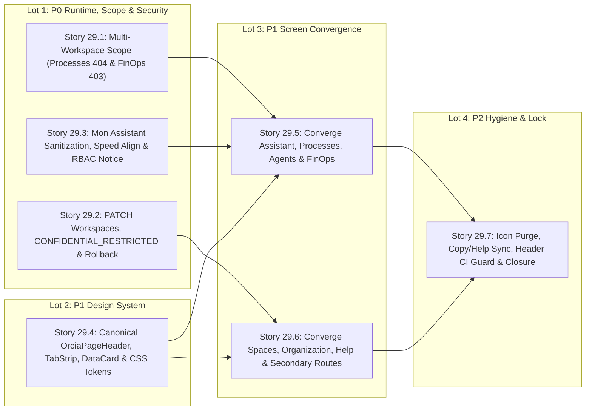

# Sprint Change Proposal — Epic 29: Canonical Page Headers (`<OrciaPageHeader />`), Scope & Security Hardening, Visual Grammar & Cross-Screen Consistency

**Date:** 2026-11-24
**Authors:** Sally (UX Designer) & Winston (System Architect)
**Trigger:** Cross-screen visual and codebase audit of 8 primary ORCIA screens (`Mon Assistant`, `Mes Processus`, `Mes Agents` tabs 1 & 3, `Mes Espaces`, `Mon Organisation`, `FinOps`, `Aide`) plus the live `Mes Espaces` `"Confidentiel isolé"` / `Phase` / dual-403 interaction trace.
**Target Status:** `backlog` (created on branch `audit_ui_headers`; plan only — do not start implementation until user approval).

---

## 1. Executive Summary & Problem Statement

A visual and structural audit across ORCIA's primary navigation screens revealed that the portal feels like seven distinct applications stitched together, alongside live runtime failures and real RBAC confinement gaps:

1. **No shared `<OrciaPageHeader />` primitive in `@orcia/ui`**: `packages/ui/src/index.ts` exports no canonical page header component, while `ModuleWorkspaceView` (`apps/web/src/components/ModuleWorkspaceView.tsx:L55-L88`) skips its card header for 5 main screens (`cockpit`, `catalog`, `finops`, `inbox`, `admin`). Consequently, the 8 audited screens exhibit **7 incompatible header structures**, ranging from missing headers (`Mon Assistant`, `Mes Processus`), to a single giant nested card (`Mes Agents`), to bare canvas headings and unboxed tables (`FinOps`), to a half-width card beneath a full-width Showcase banner (`Aide`).
2. **Broken global `Espace actif` (`scope-global` / `"Tous mes espaces"`) resolution**: While the left sidebar displays `"Tous mes espaces"` (`scope-global`) and the top bar displays `ORCIA > BGPN`, each screen interprets global scope differently — causing a **live HTTP 404** on `Mes Processus`, a **live HTTP 403 + zero selected scope pills** on `FinOps`, **internal UUID/enum prompt leakage** on `Mon Assistant`, and a **duplicate conflicting workspace selector** on `Mes Espaces`.
3. **Missing workspace-scoped `PATCH /api/v1/workspaces/{id}`, unrolled-back optimistic `localStorage` state, dual 403 banners, `CONFIDENTIAL_RESTRICTED` enforcement gaps, and a dead `Phase` header selector**: Changing visibility (e.g., `"Confidentiel isolé"`) or `Phase` as a `TEAM_LEAD` routes through admin-only `PUT /api/v1/bootstrap/platform-setup-state`, mutates React state and `localStorage` optimistically with zero rollback on HTTP 403, fires two misaligned red banners (`"Synchronisation plateforme"` + `"⚠️ ... Visibilité de l'espace"`), and leaves `Espace personnel — Rouge Gorge` corrupted as `Collectif d'équipe` / `Équipe`. Meanwhile, `"Confidentiel isolé"` (`CONFIDENTIAL_RESTRICTED`) does not isolate same-team teammates in `evaluator.py` and is bypassed across 5 adjacent routers/queries.
4. **Overloaded Primary Cobalt (`#2563EB`) visual grammar, missing disabled secondary button styling, mixed emoji/SVG icons, and Zone 4 Contextual Help drift**: Solid `#2563EB` is simultaneously used for active tabs, active filter pills, header CTAs, and repeated row actions; `.orcia-ds-btn-secondary:disabled` lacks an opacity rule (`0.72` vs `0.48`/`0.50`), making disabled buttons appear clickable; raw Unicode emojis (`🤖`, `🛠️`, `🔌`) mix with monochrome `<OrciaIcon />` SVGs; and Zone 4 Contextual Help deviates from `DESIGN.md`'s 4-block structure and references obsolete UI elements (`ⓘ` icons, non-existent filters).

This proposal defines **Epic 29 (`Stories 29.1`–`29.7`)** across 4 structured Lots to eliminate all 15 findings (`UH-01`..`UH-15`).

---

## 2. Complete Root-Cause Diagnosis (`UH-01`..`UH-15`)

| ID | Severity | Observation | Exact Structural Cause in Codebase | Specification / Security Violated |
| :--- | :---: | :--- | :--- | :--- |
| **`UH-01`** | **P0** | **Live HTTP 404 on `Mes Processus`** (`"Exécutions automatisées sous contrat"`: `"La ressource ou la route demandée n'existe pas sur la plateforme ORCIA."`) paired with a contradictory empty-state line beneath it. | `AutonomousRunsSupervisionPanel.tsx:L61-L65` unconditionally calls `GET /api/v1/workspaces/${ws}/autonomous-runs` (`packages/api-client/src/domains/autonomousSupervision.ts:L14-L33`) even under `"Tous mes espaces"` (`scope-global`) or synthetic IDs; `autonomous_supervision.py:L76-L89` -> `_finops_scope_guards.py:L77-L79` finds `ws is None` and raises `ERR_RESOURCE_NOT_FOUND` (404). The empty-state fallback renders even when `error !== null`. | `DESIGN.md` §Brand & Style #1 (`scope-global` handling) & honest error-vs-empty rendering |
| **`UH-02`** | **P0** | **Live HTTP 403 on `FinOps`** for `TEAM_LEAD` under `"Tous mes espaces"`, **0 of 3 scope pills selected**, contradictory empty state beneath the 403 banner, and misleading `"demandez l'habilitation dans Mon Organisation"` copy. | `useFinopsDashboardController.ts:L29-L60` maps `scope-global` to `"GLOBAL"` (triggering `ScopeAccessDeniedError` in `_finops_scope_guards.py:L116-L126` when the caller lacks global scope) and derives `"BU"` when `activeScopeNode.level === "BU"`, whereas `FinopsGovernanceDashboardView.tsx:L150-L170` only renders `["WORKSPACE", "TEAM", "GLOBAL"]` buttons (none matches `"BU"`). Empty notice card renders unconditionally even on error. | `DESIGN.md` §2.2 `FinOps` (scope bar strictly filtered by caller RBAC) & `AD-21` |
| **`UH-03`** | **P0** | **Dual stacked 403 banners on `Mes Espaces`** (`"Synchronisation plateforme"` + `"⚠️ ... Visibilité de l'espace"` with double `✕ ⚠️` icon and `32px` width mismatch) plus **optimistic `localStorage` & UI state corruption** (`Espace personnel — Rouge Gorge` turns into `Équipe` / `Collectif d'équipe` despite 403). | `WorkspaceCompactHeader.tsx:L91-L107` calls `updateWorkspaceVisibility` (`platformSetupContextTypes.ts:L249-L265`) -> `persistSnapshotStrict` (`usePlatformSetupHydrationEffect.ts:L152-L168`), which sets React state & `localStorage` **before** calling admin-only `PUT /api/v1/bootstrap/platform-setup-state` (`_bootstrap_setup_state.py:L222-L237`), with zero rollback on 403. `persistSetupSnapshotStrict` sets `lastSyncError` (Banner 1 inside `px-4` in `ShellAuthFallbackView.tsx:L81-L87`) and re-throws; `WorkspaceCompactHeader` catches and prepends `"⚠️ "` (Banner 2 without `px-4` in `features/workspaces/index.tsx:L85-L93`, colliding with `OrciaAlertBanner.tsx:L26-L31` `<OrciaIcon name="cross" />`). | `AD-19`, `AD-21`, `ACTION_ITEM-28.1` item (1), `EXPERIENCE.md` §1.1 #4 (accurate feedback & transactional integrity) |
| **`UH-04`** | **P0** | **`CONFIDENTIAL_RESTRICTED` (`"Confidentiel isolé"`) security enforcement gaps**: same-team members retain full contributor access and 5 adjacent surfaces bypass isolation. | `evaluator.py:L177-L187` grants `DIRECT_TEAM` `CONTRIBUTOR_ACTION_REQUIRED` access to all members/leads of `owner_org_unit_id` even when `visibility_mode == "CONFIDENTIAL_RESTRICTED"`. `ontology/permissions.py:L167-L231`, `ontology_and_rag.py:L230-L268` (`POST /rag/search`), `workspace_governance.py:L82`, `workspace_datasources.py:L99-L156`, and `sql_federated_search.py:L260-L265` (`PLATFORM_ADMIN`) bypass `CONFIDENTIAL_RESTRICTED` / explicit `workspace_memberships` checks. | `architecture.md:L692` (explicit membership confinement) & `AD-21` |
| **`UH-05`** | **P0** | **`Mon Assistant` prompt/jargon leak, speed/tier contradiction & RBAC-broken notice CTA**: response dumps raw UUID `01a26729-...`, `SPEED_1_FAST`, `"PM (Product Manager)"`, and unattached `orcia://sources/repo-main`; footer shows `Polyvalent · Standard` vs `SPEED_1_FAST`; non-admin `TEAM_LEAD` sees clickable `Configurer dans Administration › Modèles IA →` link. | `assistant_prompt_preview.py:L83-L93` injects raw `[WORKSPACE: {workspace_id}]` and `speed_mode`; defaults come from `assistant_governance_models.py:L38-L53` (`default_hat = "PM"`, hardcoded `orcia://sources/repo-main`). `AssistantSpeedSelectorAndStreamView.tsx:L44-L125` sends `requestedSpeed = "SPEED_1_FAST"` while displaying `tier="medium"` (`Polyvalent`) + `effort="balanced"` (`Standard`). `AssistantStickyPromptFooter.tsx:L217-L221` + `InboxDisabledBanner.tsx` / `AssistantNoEmbeddingBanner.tsx` render stacked notices with an unguarded Admin route CTA. | `EXPERIENCE.md` §1.2 #1 (zero internal constants/UUIDs), `AD-15`, `AD-21` |
| **`UH-06`** | **P1** | **Zero shared `<OrciaPageHeader />` primitive**: 7 incompatible header structures across 8 primary screens (missing headers on `Mon Assistant` & `Mes Processus`, giant nested outer card on `Mes Agents`, bare canvas heading on `FinOps`, inverted Showcase banner on `Aide`, plus inconsistent secondary routes `/cockpit`, `/profile`, `/activity`, `/settings/packs`, `/ontology`). | `packages/ui/src/index.ts` exposes no `<OrciaPageHeader />`, `<OrciaTabStrip />`, or `<OrciaDataCard />`; `ModuleWorkspaceView.tsx:L55-L88` skips `cockpit`, `catalog`, `finops`, `inbox`, `admin` and renders `16px <strong>` for `ontology`, `gates`, `bootstrap`. | `DESIGN.md` §Brand & Style #3 & §UI Rules #1, #3, #4 |
| **`UH-07`** | **P1** | **Overloaded Primary Cobalt `#2563EB` visual grammar & disabled secondary buttons looking active**: tabs, filters, creation CTAs, and repeated card buttons compete in solid `#2563EB`; disabled `.orcia-ds-btn-secondary` renders at `opacity: 0.72` beside `0.48` primary / `0.50` danger. | `tokens-palette.css:L68-L74` uses Cobalt fill for active tabs; `tokens-components.css:L37-L65,L118-L183` defines `:disabled` overrides for `.orcia-ds-btn-primary` (`0.48`) and `.orcia-ds-btn-danger` (`0.50`) but omits `.orcia-ds-btn-secondary:disabled`. | `DESIGN.md` §UI Rules #1, #3, #5 (visual hierarchy & contrast clarity) |
| **`UH-08`** | **P1** | **`Mes Espaces` cluttered & contradictory header**: dead `Phase : Construction / Exploitation / Évolution` `<select>`, duplicate workspace `<select>` contradicting sidebar `"Tous mes espaces"`, Row-2 selects duplicating Row-1 badges, duplicate `Glossaire métier` button, numbered `1.`–`5.` tabs with noisy `0` badge, and personal workspace exposing in-place `"Partager avec l'Équipe"` / visibility switchers. | `WorkspaceCompactHeader.tsx:L132-L287` duplicates `sidebar-workspace-selector` (`L179-L216`), mounts dead `Phase` dropdown (`ProductLifecycleCard.tsx:L5`, legacy `control_center.py:L50-L54` never read by Gates/FinOps/Assistant), and offers visibility switching on `personal-*` spaces (explicitly filtered out in `sql_platform_setup_relational_sync.py:L268-L274`). Numbered tab labels hardcoded in `governance_and_packs_labels_fr.ts:L7-L11`. | `DESIGN.md` §Brand & Style #1 (`L84` single workspace selector), `EXPERIENCE.md` §1.1 #2 (Hick's Law) |
| **`UH-09`** | **P1** | **`Mes Agents` tab-switch header wrap (CLS) & misplaced MCP/IDE cards**: clicking `Serveurs d'outils & MCP` widens the CTA (`Tester & Découvrir...`) and wraps the entire toolbar onto Row 2; Agent/Skill KPIs & filter bar remain rendered on Tab 3; outbound MCP buttons share a card whose body only holds inbound IDE exposure (`assistant.ask`, `agent.invoke`, `agent.list_exposed`). | `AgentsAndSkillsHeaderAndToolbar.tsx:L54-L140` bundles tabs and CTAs in one `flex-wrap` block, and renders KPIs (`L142-L187`) and search/filters (`L189-L231`) outside any `activeTab` guard. `AgentsAndSkillsManagerView.tsx` wraps everything in one mega-card and mixes outbound MCP vs inbound IDE exposure. | `DESIGN.md` §UI Rules #3–#4 & `EXPERIENCE.md` §1.2 #1 |
| **`UH-10`** | **P1** | **`Mon Organisation` split header/actions & misleading sibling row states**: header right is empty while `+ Inviter un utilisateur` & `+ Nouvelle unité` sit in Card 2; sibling team `CRL` is badged `"Contexte parent (lecture seule)"`; read-only rows display enabled-looking `Modifier` beside faded `Supprimer`; inline `Repères` box duplicates Zone 4. | `organization.tsx:L33-L50` puts no actions in `<header>`, leaving them in `SettingsOrganizationUnitsBlock.tsx:L48-L120`. `SettingsOrganizationUnitRow.tsx:L71-L74,L199-L205` labels every `!capabilities.canEdit` unit (siblings included) as `"Contexte parent (lecture seule)"` and leaves `Modifier`/`Supprimer` mounted. | `DESIGN.md` §UI Rules #1, #3 & `EXPERIENCE.md` §1.2 #3 |
| **`UH-11`** | **P1** | **`Mes Processus` missing `<OrciaPageHeader />`, 7 simultaneous solid-blue CTAs, and `"Mon Compte"` leakage under `"Tous mes espaces"`**. | `ProcessesHubPage.tsx:L1-L197` renders no screen header card and uses solid primary CTA styling on all 5 `Lancer ce processus` cards + `Examiner & Valider` + `+ Nouveau processus` + `Tous` filter; seed/display data renders `"Mon Compte"` titles under global scope. | `DESIGN.md` §Brand & Style #3 & §UI Rules #1 |
| **`UH-12`** | **P1** | **`FinOps` unboxed canvas header & bare table**: title/subtitle sit raw on `#EAF2FB`, `Journal d'activité…` truncates, scope pills look identical to content tabs, and the entire table sits unboxed directly on `#EAF2FB`. | `FinopsGovernanceDashboardView.tsx` renders neither a white `<OrciaPageHeader />` card nor an `<OrciaDataCard />` around the table, and styles scope pills and content tabs with identical `.orcia-ds-tab` classes. | `DESIGN.md` §Elevation & Depth (`#FFFFFF` cards on `#EAF2FB`) & §UI Rules #3–#4 |
| **`UH-13`** | **P1** | **`Aide` inverted hierarchy, >55% empty void & silent no-op TopBar `Aide` button**. | `apps/web/src/routes/help.tsx:L116-L158` puts `help-showcase-site-banner` above `<ContextualHelpColumnAndCenter>`; `HelpCenterCatalogView.tsx:L46` constrains content to `w-full max-w-4xl` left-aligned while `ShellContainer.tsx:L131,L206-L208` forces Zone 4 closed and turns `onHelpColumnOpenChange` into a no-op. | `DESIGN.md` §Layout & Spacing & `EXPERIENCE.md` §2.2 `Aide` |
| **`UH-14`** | **P2** | **Mixed icon systems (SVG vs emojis), technical jargon, FR grammar/pluralization errors & test fixture pollution** (`Story 26.1 Regression Agent`, `Verify agent execution`, `🤖`, `🛠️`, `🔌`, `Temp 0.2 · 4096 tok`, `Skills`, `(/SKILLS)`, `1 actifs`, `1 réutilisables`). | Raw Unicode emojis hardcoded in `governance_and_packs_labels_fr.ts:L122-L127` and `iconRegistry.ts` alongside monochrome SVGs in `OrciaIcon.tsx`; missing pluralization rules and unpurged E2E regression fixture in default/dev seeds. | `EXPERIENCE.md` §1.2 #1 & `DESIGN.md` §UI Rules #3 |
| **`UH-15`** | **P2** | **Zone 4 Contextual Help structural & content drift**: prepended cards push `EN N GESTES` below the fold (`Mon Assistant`, `Mes Espaces`, `FinOps`); `Mes Espaces` cites removed list filters (`« Tous »`, `« Espaces d'équipe »`); `Mon Organisation` displays Administration help; `Aide` instructs clicking removed `ⓘ` icons; `DESIGN.md` TopBar vs Bottom-Left `Mon Compte` discrepancy. | `docs/help/{fr,en}/*.md` and Zone 4 bindings (`shellZone4HelpWiring.tsx`) drifted from `DESIGN.md`'s 4-block structure and from Epic 25/28 UI updates. | `DESIGN.md` §Brand & Style #4 & §Microcopy (`L125`) |

---

## 3. Target Canonical `<OrciaPageHeader />`, Visual Grammar & Visibility Rules

### 3.1 Canonical Two-Tier `<OrciaPageHeader />` & Content Rhythm

Every top-level screen (`Cockpit`, `Mon Assistant`, `Mes Processus`, `Mes Agents`, `Mes Espaces`, `Mon Organisation`, `FinOps`, `Administration`, `Aide`) and primary workspace surface will share **one** `<OrciaPageHeader />` card (`#FFFFFF`, `border: 1px solid #E2E8F0`, `rounded-lg`, `padding: 16px 20px`), followed by at most one aligned page-level alert slot, and white `<OrciaDataCard />` body surfaces (never nesting an entire page inside one mega-card and never floating raw tables on `#EAF2FB`):

```text
┌─────────────────────────────────────────────────────────────────────────────┐
│ [OrciaIcon] Page Title (<h1>, 20-22px, 700)    [Optional Context Pill]      │
│             1-line plain-language intent subtitle (13.5px, muted)           │
│                                     [Secondary Action]  [+ Primary Action]  │
├─────────────────────────────────────────────────────────────────────────────┤  <- Optional Tier 2 (tabs &/or scope bar)
│  [Tab A (underline/segmented)]  [Tab B]  [Tab C]         │  [Scope Switcher]│
└─────────────────────────────────────────────────────────────────────────────┘
  [Optional single <OrciaAlertBanner /> aligned to exact page width — never above Header]
┌─────────────────────────────────────────────────────────────────────────────┐
│ <OrciaDataCard /> (KPIs if total >= 1, Filters, List / Table / Stream)      │
└─────────────────────────────────────────────────────────────────────────────┘
```

### 3.2 Three-Tier Visual Grammar (Strict Separation)
1. **Primary CTA (`+ Nouveau…`, `Documentation`)**: **At most 1 solid Cobalt (`#2563EB`) button** in the header. Repeated per-card actions (e.g., `Lancer ce processus`) use secondary/subtle Cobalt outline buttons (`border-blue-200 text-blue-700 hover:bg-blue-50`), never 7 competing solid-blue buttons per viewport.
2. **Page Tabs (`<OrciaTabStrip />`)**: Dedicated Tier-2 navigation strip (underline active border or neutral segmented container, never numbered `1.`–`5.` and never solid Cobalt buttons sharing a `flex-wrap` row with CTAs).
3. **Filters & Scope Switchers**: Neutral pill toggles (`#F1F5F9` default, subtle `#EFF6FF` + Cobalt border/text when active), clearly distinct from both Tabs and Primary CTAs.
4. **Disabled Buttons**: Fix `.orcia-ds-btn-secondary:disabled` (and `.orcia-ds-btn-ghost:disabled`) in `tokens-components.css` to `opacity: 0.48; cursor: not-allowed; pointer-events: none;`, matching primary (`0.48`) and danger (`0.50`) disabled feedback.

### 3.3 Workspace Visibility & Lifecycle Rules
- **`STANDARD` (`Collectif d'équipe`)**: Team members/leads access workspace; parent BU/team leads & `PLATFORM_ADMIN` get `READ_ONLY_OBSERVER` roll-up and FinOps visibility.
- **`CONFIDENTIAL_RESTRICTED` (`Confidentiel isolé`)**: Strictly confined to **explicit `workspace_memberships`** (blocks same-team `DIRECT_TEAM` auto-access, `ROLLUP_PARENT`, and `GLOBAL_ADMIN` payload visibility across `evaluator.py`, `ontology/permissions.py`, `ontology_and_rag.py`, `workspace_governance.py`, `workspace_datasources.py`, and `sql_federated_search.py`). Parents/admins retain only aggregate FinOps counters (`finops_cost_usd`).
- **`PRIVATE_USER` (`Privé personnel`)**: Strictly owner-only (`user.id == personal_owner_user_id`), **locked** against in-place header/Tab-5 conversion to `STANDARD`/`CONFIDENTIAL_RESTRICTED`.
- **Dead `Phase` Header Control Removed**: Delete the `Phase : Construction / Exploitation / Évolution` `<select>` and header badge from `Mes Espaces` (`WorkspaceCompactHeader.tsx`) completely; move team-workspace visibility settings into Tab 5 (`Membres & Paramètres`) with 1-line plain-language descriptions per mode.

---

## 4. Execution Plan (`Stories 29.1`–`29.7`)



- **Coordination & Parallelism**:
  - **Lot 1 (`29.1`, `29.2`, `29.3`)** and **Lot 2 (`29.4`)** have disjoint primary file ownership and can run sequentially or on separate feature branches/worktrees (`29.2` resolves item `(1)` of `ACTION_ITEM-28.1` with mandatory `bmad-architect-worker` security check).
  - **Lot 3 (`29.5`, `29.6`)** converges all 8+ screens onto `<OrciaPageHeader />`, `<OrciaTabStrip />`, and `<OrciaDataCard />` (`29.5` depends on `29.1`, `29.3`, `29.4`; `29.6` depends on `29.2`, `29.4`).
  - **Lot 4 (`29.7`)** finishes icon/copy/Zone-4 hygiene, locks header consistency via an automated static/DOM audit test (`page-header-structure-and-visual-grammar-audit.test.tsx`), executes full `AD-17` & `fr`/`en` Playwright verification, and closes Epic 29 after `bmad-architect-worker` (`pro`) review.

---

## 5. Verification & Exit Criteria

- **Code hygiene & modularity**: All modified files remain `<= 300` lines, pass `.venv/bin/ruff check`, `ruff format --check`, `mypy --strict`, `lint-imports` (`5/5`), `export_openapi.py --check` (`0-diff`), and `fr`/`en` i18n Gates 1–4 (`0` baseline).
- **Security & persistence (`AD-17` Layers 1–2)**: Real `testcontainers` PostgreSQL 18 + Redis tests verify `PATCH /api/v1/workspaces/{id}` authorization (`TEAM_LEAD` allowed on owned team workspaces, `PRIVATE_USER` locked, cross-team & `READ_ONLY_OBSERVER` rejected with 403) and strict `CONFIDENTIAL_RESTRICTED` confinement across `evaluator.py`, Ontology, RAG search, Datasources, Governance, and `⌘K` Federated Search (`>= 90%` branch coverage).
- **UI & E2E verification (`AD-17` Layers 1 & 5)**: `page-header-structure-and-visual-grammar-audit.test.tsx`, `zero-dead-buttons-and-silent-catches-audit.test.tsx`, `e2e-testids-sync-audit.test.ts`, `pnpm turbo run lint typecheck test`, and Desktop Playwright E2E (`env -u ORCIA_E2E_SEED_FIXTURES`, both `fr` & `en`) across all 8 primary screens confirm 0 console/4xx errors, single aligned banners, F5 cold survival, and clean visual header parity.
- **Documentation & Showcase sync**: All 7 Story Tech Lead Reports pass `scripts/check_implementation_docs.py`, `pnpm site:sync && pnpm site:check` passes, and `npx gitnexus analyze` refreshes cleanly at closure.
