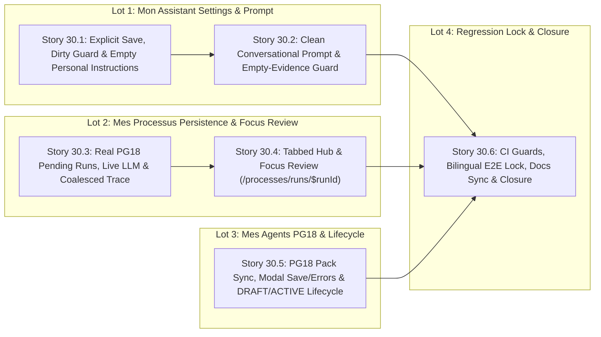

# Sprint Change Proposal — Epic 30: Honest Save Semantics, Clean Conversational Prompts, Real PG18 Process Runs & Focus Review, and Agent Lifecycle Hardening

**Date:** 2026-11-25
**Authors:** Sally (UX Designer) & Winston (System Architect)
**Trigger:** Live interactive audit across 4 user-captured surfaces (`Réglages de Mon Assistant` modal, `Mon Assistant` greeting turn with empty RAG evidence, `Mes Processus` pending validation & full-page layout, and `Mes Agents & Compétences` 6-block configuration modal).
**Target Status:** `backlog` (initiated on branch `feat/epic-30-assistant-processes-and-agents-ux-hardening`; planning only — await user approval before starting `Story 30.1`).

---

## 1. Executive Summary & Problem Statement

A hands-on visual and architectural audit of four live screens in ORCIA uncovered three cross-cutting structural defects that undermine user trust, cause runtime failures, and break cognitive clarity:

1. **Broken auto-save + explicit Save button hybrids with off-modal alerts (`AssistantGovernanceModalAndStudio`, `AgentDetailAndSandboxModal`)**:
   - In `"Réglages de Mon Assistant"`, every keystroke and dropdown selection fires an un-debounced `PUT` request, optimistically flashes the green `"✓ Enregistré"` badge regardless of HTTP errors, leaves `isDirty` permanently `true` (so clicking `"Annuler"` always raises the `"Modifications non enregistrées"` alert even after saving), and `"Quitter sans enregistrer"` fails to revert already-committed PostgreSQL 18 writes.
   - In `"Mes Agents & Compétences"`, clicking `"Exposer en outil externe"` optimistically ticks the checkbox without rollback, fires `PATCH .../governance` returning HTTP `404 ERR_RESOURCE_NOT_FOUND` (because built-in pack agents live only in frontend state and `PATCH .../governance` lacks PG18 sync), renders the error banner behind the dimmed modal backdrop, and clicking `"✓ Enregistrer"` produces no visible feedback because `useEffect([agent])` wipes `savedFeedback` when parent state updates.
2. **Frontend-only / hardcoded demo or pack state detached from PostgreSQL 18**:
   - `"Mes Processus"` unconditionally displays `"1 validation en attente de votre décision"` without querying PostgreSQL 18, promotes `workflows[0]` (`wf-generate-orcia-documentation`, sorted first alphabetically via `packs/orcia-docs`), keeps the drawer open via `localStorage` and auto-launches a run on mount, falls back to `DeterministicCassetteLLM` with `_DEFAULT_FALLBACK_RESOURCE = "docs/product/capabilities.yaml"`, and leaks hardcoded `"Mon Compte"` VSM titles.
   - `"Mon Assistant"` pre-fills `"Toujours citer les preuves [S1] et synthétiser les risques."` as default `personal_instructions` in the backend and enforces `min_length=3`, preventing users from clearing personal instructions.
   - `"Mes Agents"` displays `"Validé au Banc de Test"` cosmetically on all pack agents (even on `.catch()` errors), with zero `DRAFT` vs `ACTIVE` runtime gating in `Mon Assistant`, `Mes Processus`, or MCP exposure.
3. **Unseparated cognitive modes & duplicated controls**:
   - `"Mon Assistant"` feeds UI governance preview cards directly into the live LLM system prompt, duplicates Layer 4 & Layer 5 instructions, leaks raw internal markers (`[CONSTITUTIONAL_IMMUTABLE_LAYER_1]`, `[NO_HUMAN_ANCHOR_WRITE]`, `human_authored_required: true`, `[EXPLICIT_PROVENANCE_URI]`, `orcia://`, `sha256:`, `[ACTIVE_DOMAIN_PACK: core]`, `DAG Steps & Verrous run-lock.json`), and omits empty Evidence Tables silently — forcing the LLM to hallucinate `[S1]` (`[Citation non vérifiée]`), `orcia://system/status/ready`, and `sha256:e3b0c442...` (`SHA-256("")`) on a simple greeting.
   - `"Mes Processus"` stacks an expanded run drawer, 64-character fragmented `THOUGHT_DELTA` headers, two competing validation bars with duplicate Edit buttons, the process catalog, autonomous runs, and the VSM overview vertically on one page with zero `<OrciaTabStrip />` separation.
   - `AgentDetailAndSandboxModal` mounts both the legacy summary form (`<AgentIdentityAndSkillsFields />`) and the 6-block editor (`<AgentSixBlocksEditorBody />`) simultaneously, duplicating name, role, thinking level, instructions, visibility, and skills fields.

This proposal defines **Epic 30 (`Stories 30.1`–`30.6`)** across 4 structured Lots to resolve all 16 findings (`UX30-01`..`UX30-16`).

---

## 2. Complete Root-Cause Diagnosis (`UX30-01`..`UX30-16`)

| ID | Severity | Observation | Exact Structural Cause in Codebase | Specification / Invariant Violated |
| :--- | :---: | :--- | :--- | :--- |
| **`UX30-01`** | **P0** | In `"Réglages de Mon Assistant"`, clicking `"Annuler"` triggers `"Modifications non enregistrées"` immediately after `"✓ Enregistré"`, and `"Quitter sans enregistrer"` does not undo DB saves. | `packages/ui/src/primitives/AssistantGovernanceModalAndStudio.tsx:L97-L105,L122-L146,L230-L238` sets `isDirty(true)` and triggers `triggerAutoSave*` on every `onChange*`; only hidden `display: none` buttons in `AssistantGovernanceModeATabs.tsx:L190-L195,L256-L261` call `setIsDirty(false)`. `resetUnsavedChanges` only resets React state and never reverts committed PG18 `PUT` calls. | `EXPERIENCE.md` §1.1 #4–#5 (honest feedback & real cancel/escape behavior) & RGAA modal contract |
| **`UX30-02`** | **P0** | Typing in `"Mes consignes personnelles permanentes"` fires a 0 ms `PUT` storm per keystroke, flashes `"✓ Enregistré"` even on HTTP `422`/`403`, hides error alerts behind the backdrop, and overwrites the textarea mid-typing. | `AssistantGovernanceModalAndStudio.tsx:L72-L93,L122-L146` sets `autosavedBadgeVisible(true)` synchronously before calling fire-and-forget `void onSave*(payload)` (`apps/web/src/features/inbox/InboxAuxiliaryPanels.tsx:L102-L107`). `apps/web/src/features/inbox/useServerAssistantGovernance.ts:L98-L124` calls `await refreshGovernance()` after each `PUT`, updating `initial*` props mid-typing and routing errors to `InboxTopSection` behind the modal. | `EXPERIENCE.md` §1.1 #4 (truthful feedback, zero optimistic lies, inline modal alerts) & concurrency safety |
| **`UX30-03`** | **P1** | Hardcoded `[S1]` default in `"Mes consignes personnelles permanentes"`, `min_length=3` blocks clearing instructions, 4 hidden Save buttons + 3 hidden duplicate `<select>` nodes force E2E `.evaluate()` hacks, and `"Équilibré & Structuré (Recommandé)"` is clipped. | `packages/orcia-core/src/orcia_core/orchestration/_assistant_locales.py:L58`, `assistant_governance_models.py:L39`, and `_internal/sql_assistant_governance.py:L89-L91` default `personal_instructions` to `"Toujours citer les preuves [S1] et synthétiser les risques."`. `apps/api/src/orcia_api/schemas/assistant_governance_and_three_speed.py:L23-L67` enforces `min_length=3`. `apps/web/e2e/22-assistant-tool-loop-approval-and-reattach.spec.ts:L163-L190` uses `.evaluate(el => el.click())` on hidden `assistant-save-user-prefs-btn`. | `DESIGN.md` §UI Rules #4–#5 & Zero-Fake-Defaults / Anti-Test-Debt governance |
| **`UX30-04`** | **P0** | `"Mon Assistant"` greeting replies dump internal config markers (`[CONSTITUTIONAL_IMMUTABLE_LAYER_1]`, `[NO_HUMAN_ANCHOR_WRITE]`, `human_authored_required: true`, `orcia://`, `sha256:`, `Pack Métier : [core]`, `DAG`). | `apps/api/src/orcia_api/routers/_assistant_context_assembly.py:L163-L171` calls `gov.assemble_five_layers_preview_async()` without `pack_key` (always defaulting to `[ACTIVE_DOMAIN_PACK: core]`) and feeds the 5 UI preview cards verbatim into `format_system_instructions_text()` (`assistant_prompt_preview.py:L98-L296`), duplicating Layer 4/5 via `format_governance_and_folder_sections()` and injecting raw constants from `assistant_prompt_locales.py:L7-L17,L147-L148` & `_assistant_profile_locales.py:L62-L64` with no confidentiality directive. | `EXPERIENCE.md` §1.2 #1 (zero internal plumbing/jargon in user-facing output) & `AD-15` |
| **`UX30-05`** | **P0** | With `0` RAG/evidence sources, `"Mon Assistant"` fabricates `"Preuve de conformité [Citation non vérifiée]"`, `orcia://system/status/ready`, and `sha256:e3b0c44298fc1c149afbf4c8996fb92427ae41e4649b934ca495991b7852b855` (`SHA-256("")`). | `packages/orcia-core/src/orcia_core/orchestration/assistant_evidence_table.py:L221-L222` returns `""` on empty tables; `assistant_prompt_preview.py:L281-L285` omits `evidence_block` completely (bypassing `assistant_prompt_builder.py:L138-L141` `empty_fanout_tpl`), while Layer 1 Rule 3 and duplicated Layer 5 (`[S1]`) still force citations/URIs/hashes. `_assistant_citations_verifier.py:L24-L25,L97-L148` turns `[S1]` into `[Citation non vérifiée]` while leaving raw `orcia://` and `sha256:` text untouched. | `AD-15` Anti-Hallucination & Grounded Citation Invariant |
| **`UX30-06`** | **P0** | `"Mes Processus"` always shows `"1 validation en attente de votre décision"` for `"Génération & Validation d'Article d'Aide Contextuelle ORCIA"` and auto-runs it in a sticky drawer. | `apps/web/src/features/processes/ProcessesActiveDossiersCard.tsx:L27-L88` hardcodes `pendingValidationBadge` with zero PG18 query and promotes `workflows[0]` (`ProcessesHubPage.tsx:L113`), which is `wf-generate-orcia-documentation` because `DeclarativePackLoader.load_all_packs()` (`packages/orcia-core/src/orcia_core/packs/loader.py:L68`) sorts `packs/orcia-docs` before `packs/sdlc`. `ProcessesHubPage.tsx:L33-L60` persists `activeRunWorkflowId` in `localStorage`, and `useInteractiveProcessRunController.ts:L50-L52,L91-L160` initializes `status` to `"WAITING_SUBSTEP_HITL"`, auto-fires `POST /api/v1/workflows/v2/.../runs`, and never leaves `WAITING_SUBSTEP_HITL` on `"COMPLETED"`. | `EXPERIENCE.md` §2.2 ("Partir d'une interface vide") & Vertical PG18 Persistence Guardrail |
| **`UX30-07`** | **P0** | Production process runs execute canned test logic referencing `docs/product/capabilities.yaml` instead of workspace LLM & datasources. | `packages/orcia-core/src/orcia_core/agents/process_dispatcher.py:L126-L138` passes empty `initial_resources=()`, `cassette_llm.py:L96-L99` returns non-JSON `"DETERMINISTIC_ACK:..."`, and `GatewayReflexiveLlmAdapter._build_deterministic_cassette_decision` (`packages/orcia-core/src/orcia_core/agents/llm_adapter.py:L24,L77-L82,L97-L180`) falls back to `_DEFAULT_FALLBACK_RESOURCE = "docs/product/capabilities.yaml"` and canned trace groups. | `GEMINI.md` Zero-Mock/Zero-Cassette-in-Production Policy |
| **`UX30-08`** | **P1** | Agent reasoning trace fragments sentences every 64 characters under repeated `"Réflexion en cours"` headers (`capabilities.yaml (` / `#L1-35 )`). | `llm_adapter.py:L27-L32,L91` slices `thought_text` at `chunk_chars=64`; `_runtime_turn_actions.py:L78-L90` emits a separate `THOUGHT_DELTA` event per slice; `AgentExecutionTrace.tsx:L50-L104` and `AgentExecutionTraceItems.tsx:L41-L77` render each `THOUGHT_DELTA` event as its own collapsible `"Réflexion en cours"` row. | `DESIGN.md` §UI Rules #4 (clean reading hierarchy) |
| **`UX30-09`** | **P1** | `"Mes Processus"` stacks pending validation, expanded trace, catalog, autonomous runs, and hardcoded `"Mon Compte"` VSM on one long vertical page. | `ProcessesHubPage.tsx:L115-L213` lacks `<OrciaTabStrip />` separation; `ProcessesValueStreamOverviewCard.tsx:L30-L101`, `process_catalog_vsm_p1_{fr,en}.ts:L4-L5`, and `processStudioV2StructuralVsm.ts:L178-L179` hardcode `"Mon Compte"` subtitle and `vsm-mon-compte-idea-to-prod`. | `DESIGN.md` §Canonical Page Framing & `EXPERIENCE.md` §1.1 #2 (Hick's Law) |
| **`UX30-10`** | **P1** | Inside a run, reasoning trace buries the artifact below the fold and two competing validation bars stack simultaneously with duplicate Edit buttons. | `InteractiveRunDrawer.tsx:L197` sets `defaultCollapsedWhenCompleted={false}`; `InteractiveRunDeliverableAndHitlPanels.tsx:L179-L294` renders conditional Bar 1 (`WAITING_SUBSTEP_HITL`: `Valider l'étape...` + `Modifier le livrable...`) directly above unconditional Bar 2 (`anchor-card-four-actions-panel`: `Valider et publier...` + `Modifier le texte` + always-visible return-loop inputs). | `DESIGN.md` §Visual Hierarchy (single primary decision CTA, action -> artifact -> reasoning) |
| **`UX30-11`** | **P0** | Clicking `"Exposer en outil externe"` in Agent modal triggers HTTP `404` (`"Ressource introuvable ... Exposition MCP"`) and leaves the checkbox ticked. | `apps/web/src/features/catalog/packAgentsCatalog.ts:L105-L306` injects pack agents client-side without PG18 seeding; `useManagedAgentActions.ts:L96-L106` ticks optimistically with zero rollback on error; `apps/api/src/orcia_api/routers/agents_and_skills.py:L110-L148` omits `_sync_from_postgres18_if_enabled` and `svc.get_agent()` (`agents_and_skills_manager.py:L103-L107`) raises `ResourceNotFoundError` (404). | Vertical PG18 Persistence Guardrail & `CAP-082`/`CAP-091` |
| **`UX30-12`** | **P0** | Agent modal errors render in the main page behind the dimmed Radix Portal overlay instead of inside the modal. | `useManagedAgentActions.ts:L42-L46` writes to `setCatalogActionFeedback` in `apps/web/src/features/catalog/index.tsx:L65-L67,L107-L115` (`<OrciaPageHeader alertSlot>`), while `packages/ui/src/components/AgentDetailAndSandboxModal.tsx:L26-L63` accepts/renders no inline `error` or `alertSlot` prop. | `EXPERIENCE.md` §1.1 #4 & `UX` accessibility (error near trigger inside active modal) |
| **`UX30-13`** | **P0** | Clicking `"✓ Enregistrer"` in Agent modal has zero visible effect while footer states `"Sauvegarde automatique active"`. | `AgentDetailAndSandboxModal.tsx:L90-L123,L207-L219` auto-saves on every `onChange` (`applyDraftPatch`), `onClick={() => applyDraftPatch({})}` neither closes nor emits feedback (`useManagedAgentActions.ts:L108-L126`), and `useEffect([agent])` immediately resets `savedFeedback` to `false` when parent updates the `agent` object reference. | `EXPERIENCE.md` §1.1 #4–#5 (clear commit feedback & zero dead buttons) |
| **`UX30-14`** | **P1** | Agent modal renders name, role, thinking level, instructions, visibility, and skills twice (top summary + Blocs A/B/C/E). | `AgentDetailAndSandboxModal.tsx:L162-L194` mounts both legacy `<AgentIdentityAndSkillsFields />` and `<AgentSixBlocksEditorBody />` (`AgentSixBlocksFormSections.tsx`, `AgentSixBlocksBlockB.tsx`) bound to the same `draft` state. | `EXPERIENCE.md` §1.1 #2 (eliminate redundant UI controls) |
| **`UX30-15`** | **P1** | `"Validé au Banc de Test"` appears on all pack agents (even on errors) with zero `DRAFT` vs `ACTIVE` gating across Assistant or Processes. | `packAgentsCatalog.ts:L141,L175,L209,L234,L269` hardcodes `testBenchValidated: true`; `AgentStudioCardItem.tsx:L42-L44` forces `|| isPack`; `useManagedAgentActions.ts:L248` sets `testBenchValidated: true` in `.catch()`; `_agents_and_skills_executor.py:L115-L118` forces `True`. Neither `assistantAutocompleteHelpers.ts:L17-L65` nor Process Studio filters by lifecycle status. | `EXPERIENCE.md` §2.2 `Mes Agents` & Governance Integrity |
| **`UX30-16`** | **P2** | Missing automated anti-regression locks, Zone 4 contextual help sync, and bilingual E2E proof for Epic 30 guarantees. | Existing CI audits do not yet assert inline modal error rendering, single decision CTA in Focus Review, zero prompt-leak/empty-evidence hallucination, or `DRAFT` agent runtime exclusion. | `AD-17` 5-Layer Governance & `DESIGN.md` / `EXPERIENCE.md` Sync |

---

## 3. Target UX & Architectural Decisions

1. **Honest Modal Save Contract (`AssistantGovernanceModalAndStudio` & `AgentDetailAndSandboxModal`)**:
   - Standardize on explicit bottom-right `<RgaaDialogFooterActions />` (`Annuler` / `Fermer` + primary Cobalt `Enregistrer` with `<OrciaSpinner />` and `<Enter>` submit support).
   - Compute `isDirty` strictly as a diff against hydrated server baselines (e.g., `isUserDirty` / `isWorkspaceDirty` on Assistant Governance; draft diff on Agent Modal) so reverting a field back to its saved value clears `isDirty` automatically.
   - Persist via `Promise`-returning callbacks (`await onSave*`) rather than fire-and-forget `void`: display `✓ Enregistré` (or `"Modifications enregistrées"`) **only after** PostgreSQL 18 confirms success, reset `isDirty = false`, refresh dependent previews/lists, keep `"Réglages de Mon Assistant"` open so users can inspect Tab 3 (`Consignes actives`), and roll back or display an inline `[role="alert"]` **inside** the modal body on any `4xx`/`5xx`/network failure.
   - Ensure `"Quitter sans enregistrer"` in `useUnsavedChangesDialogGuard` truthfully discards only unsubmitted client draft edits while leaving PostgreSQL 18 untouched.
2. **Clean Conversational Prompt & Conditional Provenance (`Mon Assistant`)**:
   - Strictly decouple Tab 3's UI governance preview cards (`build_five_layers_preview_items`) from the runtime conversational system prompt assembled for LLM turns (`_assistant_context_assembly.py` + `AssistantPromptBuilder`).
   - Inject Workspace and User instructions **once**, propagate the genuinely active `pack_key`, sanitize `PROFILE_LABELS_LOCALES` (no `"DAG Steps & Verrous run-lock.json"` plumbing), and strip internal tags (`[CONSTITUTIONAL_IMMUTABLE_LAYER_1]`, `[NO_HUMAN_ANCHOR_WRITE]`, `human_authored_required: true`, `[EXPLICIT_PROVENANCE_URI]`, `[ACTIVE_DOMAIN_PACK: ...]`, `[ADAPTATION_RUNTIME_METADATA]`).
   - Add an explicit prompt-confidentiality and natural-speech directive, make provenance citations (`[S#]`, `[G#]`, `[O#]`, `orcia://`, `sha256:`) strictly conditional on a non-empty `EvidenceTable`, emit an explicit empty-evidence guard when `0` sources are retrieved, and relax `personal_instructions` (`min_length=0`, empty default `""`).
3. **Tabbed `Mes Processus` Hub & 3-Zone Focus Review (`/processes/runs/$runId`)**:
   - Refactor `/processes` `<OrciaPageHeader />` to host Tier-2 `<OrciaTabStrip />` separating **`Validations & Exécutions (N)`** | **`Processus métiers`** | **`Chaîne de valeur`**, defaulting to `Processus métiers` whenever `N === 0` real PG18 pending validations exist, hiding `(N)` at `0`, and removing `"Mon Compte"` VSM subtitle/slug fallbacks.
   - Back pending validations with a real workspace-scoped PostgreSQL 18 endpoint (`0` on clean Day-0), eliminate `workflows[0]` promotion and sticky `localStorage` auto-launch, remove `DeterministicCassetteLLM` / `capabilities.yaml` fallback from production runs, and coalesce consecutive `THOUGHT_DELTA` chunks into single continuous paragraphs per reasoning group.
   - Move run inspection onto dedicated route `/processes/runs/$runId` structured as **Zone 1: Sticky Expected Action Banner** (semantic Amber/Violet, **strictly 1** state-gated primary Cobalt CTA + progressive-disclosure *"Demander une correction"* popover), **Zone 2: Primary Artifact Consultation** (65% width rendered Markdown + clickable `#L` source chips + clean `Lecture` / `Édition` toggle), and **Zone 3: Collapsible Agent Reasoning** (35% width, `defaultCollapsedWhenCompleted={true}`, responsive 2-tab switch below `1280px`).
4. **Real PG18 Pack Agents & `DRAFT` vs `ACTIVE` Lifecycle (`Mes Agents`)**:
   - Seed/persist active Pack agents in PG18 (plus upsert-on-patch fallback) and call `await _sync_from_postgres18_if_enabled(request, svc)` in `PATCH /api/v1/agents-and-skills/agents/{id}/governance` so `"Exposer en outil externe"` succeeds across cold restarts and rolls back cleanly on error.
   - Remove the duplicated `<AgentIdentityAndSkillsFields />` summary section above `<AgentSixBlocksEditorBody />` inside `AgentDetailAndSandboxModal` and move all modal errors into an inline `[role="alert"]` inside the dialog.
   - Replace cosmetic `"Validé au Banc de Test"` (`|| isPack` and `.catch()` mutation) with an explicit `lifecycle_status` (`DRAFT` vs `ACTIVE`) and factual `test_bench_status` (`UNTESTED | PASSED | FAILED`), enforcing server-side and UI gating so `DRAFT` agents cannot be invoked via `@agent` in `Mon Assistant`, launched in `Mes Processus`, or exposed via external MCP.

---

## 4. Execution Plan (`Stories 30.1`–`30.6`)

- **Coordination & Parallelism**:
  - **Lot 1 (`30.1` $\rightarrow$ `30.2`)** resolves all `Mon Assistant` modal and conversational prompt defects sequentially so `30.1`'s `min_length=0` / empty default `personal_instructions` schema update feeds cleanly into `30.2`'s prompt cleanup without merge conflicts.
  - **Lot 2 (`30.3` $\rightarrow$ `30.4`)** and **Lot 3 (`30.5`)** own disjoint domains (`features/processes` + `agents/runtime` vs `features/catalog` + `agents_and_skills`) and can run in parallel once Epic 30 opens.
  - **Lot 4 (`30.6`)** adds cross-cutting CI audits, verifies `fr`/`en` Desktop Playwright E2E without fixtures (`env -u ORCIA_E2E_SEED_FIXTURES`), syncs Zone 4 contextual help & design docs, and completes `bmad-architect-worker` (`pro`) closure review.

---

## 5. Verification & Exit Criteria

- **Code hygiene & modularity**: All touched production `.py`/`.ts`/`.tsx` files remain `<= 300` lines and pass `.venv/bin/ruff check .`, `.venv/bin/ruff format --check .`, `.venv/bin/mypy --strict`, `.venv/bin/lint-imports` (`5/5`), `scripts/export_openapi.py --check` (`0-diff`), `.agent/skills/bmad-architecture/scripts/lint_spine.py` (`0 findings`), and `fr`/`en` i18n Gates 1–4 (`0` baseline).
- **Security, persistence & evals (`AD-17` Layers 1–3)**: `>= 90%` branch coverage on modified modules; real `testcontainers` PostgreSQL 18 + Redis `create_app()` tests (zero `dependency_overrides`) verify cold persistence of `Assistant` governance (`min_length=0`), scoped pending process runs, and `PATCH /api/v1/agents-and-skills/agents/{id}/governance` + `DRAFT` exclusion; golden evals verify zero raw internal tokens and zero `SHA-256("")` / `orcia://` hallucinations on empty evidence.
- **UI & E2E verification (`AD-17` Layers 1b & 5)**: `zero-dead-buttons-and-silent-catches-audit.test.tsx`, `page-header-structure-and-visual-grammar-audit.test.tsx`, `e2e-testids-sync-audit.test.ts`, `pnpm turbo run lint typecheck test`, and Desktop Playwright E2E (`env -u ORCIA_E2E_SEED_FIXTURES`, `fr` & `en`) pass with zero `.evaluate()` hidden-button hacks.
- **Documentation & Showcase sync**: All 6 Story Tech Lead Reports pass `scripts/check_implementation_docs.py`, `pnpm site:sync && pnpm site:check` exits `0`, and `npx gitnexus analyze` refreshes cleanly at closure.
