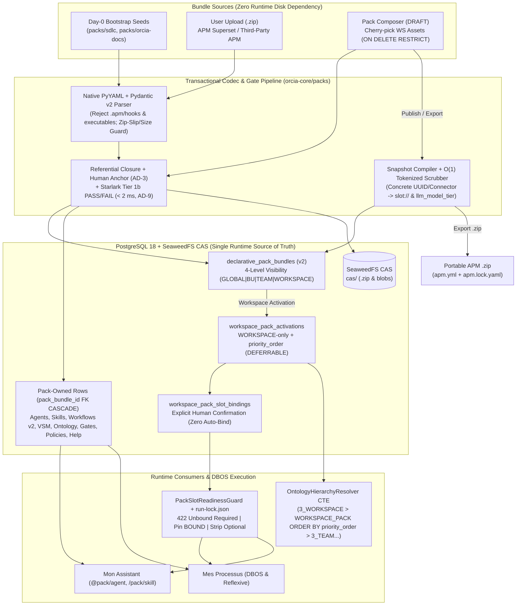
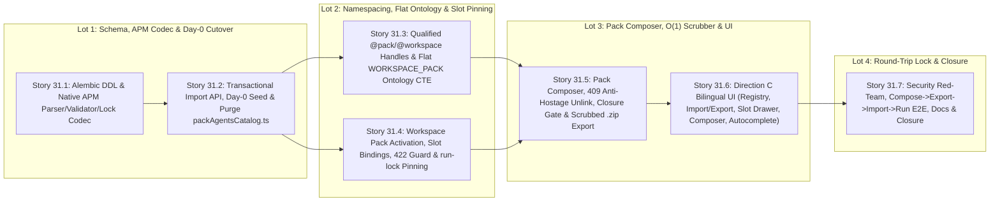

# Sprint Change Proposal — Epic 31: Declarative APM-Compatible Packs, PostgreSQL 18 Source of Truth, Pack Composer & Scoped Import/Export

**Date:** 2026-11-25
**Authors:** Winston (System Architect) & Sally (UX Designer)
**Trigger:** Architectural feasibility and `/grill-me` alignment (`D1–D6`, `R1–R5`, `A1–A4`) to transition ORCIA Packs from disk-coupled metadata into self-contained, database-backed, importable and exportable configuration bundles immediately usable by end users.
**Decision Record:** [`epic-31-decisions-grill-2026-11-25.md`](../implementation-artifacts/epic-31-decisions-grill-2026-11-25.md)
**Target Status:** `backlog` (**Starts strictly AFTER `Epic 30` (`feat/epic-30-assistant-processes-and-agents-ux-hardening`) merges into `main`** — zero edits to `epics.md`, `sprint-status.yaml`, `capabilities.yaml`, or application code during Epic 30 execution).

---

## 1. Executive Summary & Six Current-State Silos

Today, ORCIA's "Business Pack" concept is split across four disconnected persistence layers (disk YAML/Markdown, shallow PostgreSQL 18 metadata, hardcoded TypeScript arrays, and `platform_settings` JSONB), preventing clean round-trip Pack authoring, sharing, import, and export:

1. **`declarative_pack_bundles` is a shallow index, not a bundle store (`sql_declarative_packs.py`)**: It stores only manifest counts and slug arrays (`agents_slugs`, `skills_slugs`, `gates_slugs`). Agent prompts, skill definitions, gate rules, and glossary bodies stay on disk (`packs/<domain>/`) and are re-read from the container filesystem by `apps/api/src/orcia_api/routers/packs.py` and `_workflows_helpers.py`.
2. **Pack Agents & Skills are hardcoded in TypeScript and unstructured on disk**: `apps/web/src/features/catalog/packAgentsCatalog.ts` hardcodes built-in pack agents/skills client-side (`PACK_AGENTS_BY_PACK_KEY`, `PACK_SKILLS_BY_PACK_KEY`), while `packs/*/agents/*.md` and `skills/*.md` are plain prose files lacking the structured YAML governance fields required by `ManagedAgentRecord` and `ManagedSkillRecord`.
3. **Glossary & Starlark DNA are disconnected from Packs (`glossary.yaml` vs `ontology_concepts`)**: `packs/*/glossary.yaml` is never imported into `ontology_concepts`, `ontology_relations`, or `ontology_axioms`, nor does Pack export serialize workspace/domain ontology concepts or signed Starlark mechanisms (`workspace_dna_mechanisms`) back into portable pack artifacts.
4. **Export (`POST /api/v1/packs/export/{workspace_id}`) ignores PostgreSQL 18**: It merely zips static disk files from `packs/<slug>/` while ignoring `workspace_id`, edited `workflow_definitions_v2`, user/workspace `USER_AGENT` and `USER_SKILL` rows, promoted ontology rules, and Starlark scripts.
5. **No transactional `.zip` Pack Import pipeline exists**: Only single-skill in-memory BMAD imports (`BmadSkillPackAdapter`) exist; there is no validated, atomic importer ingesting full multi-asset bundles (`agents`, `skills`, `workflows`, `VSM`, `ontology`, `gates`, `policies`, `help`) into PostgreSQL 18 + SeaweedFS CAS.
6. **Unregistered `pack://` URI scheme & global uniqueness constraints**: Declarative workflows in `packs/sdlc/workflows/*.yaml` reference `pack://sdlc/...` URIs rejected by `parse_federated_uri()` (`connector_schemes` lacks `pack`), while `declarative_pack_bundles` (`UNIQUE(pack_id)`, `UNIQUE(slug)`) and `vsm_definitions_v2` (`UNIQUE(vsm_id)`, `UNIQUE(slug)`) forbid multi-version or scoped Pack coexistence in PG18.

**Epic 31 (`Stories 31.1`–`31.7`)** resolves all six silos by adopting an **APM-Compatible Superset (`apm.yml` + `apm.lock.yaml` + `x-orcia` extensions)** stored **100% in PostgreSQL 18 + SeaweedFS CAS**, paired with **Workspace-only runtime activation**, **abstract `ConnectorSlot` de-binding**, a **Pack Composer**, and a **fail-closed `O(1)` tokenized export scrubber**.

---

## 2. Coordination Contract with Concurrent `Epic 30` (`A4`)

`feat/epic-30-assistant-processes-and-agents-ux-hardening` is actively executing in parallel. To guarantee **zero merge conflicts** and **zero throwaway code**, Epic 30 and Epic 31 maintain strict boundaries:

| Surface / Capability | Owned by `Epic 30` (`Stories 30.1–30.6`) | Owned by `Epic 31` (`Stories 31.1–31.7`) |
| :--- | :--- | :--- |
| **Agent Modal UX & Lifecycle (`Story 30.5`)** | Deduplicates `AgentDetailAndSandboxModal` (removes duplicate `<AgentIdentityAndSkillsFields />`), adds inline `[role="alert"]`, enforces explicit Save/rollback, wires `_sync_from_postgres18_if_enabled` in `PATCH .../governance` for PG18 user agents, introduces `lifecycle_status` (`DRAFT \| ACTIVE`) + `test_bench_status` (`UNTESTED \| PASSED \| FAILED`), and guards/disables external MCP exposure toggles on legacy read-only TS pack presets. **Does NOT refactor `packAgentsCatalog.ts` into temporary TS-to-PG18 sync glue.** | Materializes all Pack agents/skills directly into PostgreSQL 18 via the unified Import pipeline (`D1`), deletes `packAgentsCatalog.ts` completely (`Story 31.2`), and reuses `lifecycle_status: DRAFT \| ACTIVE` directly for `D4` readiness classification. |
| **Processes Hub & Tabs (`Stories 30.3–30.4`)** | Refactors `/processes` onto `<OrciaPageHeader />` + `<OrciaTabStrip />` (`Validations & Exécutions` \| `Processus métiers` \| `Chaîne de valeur`), queries real PG18 pending runs, removes `DeterministicCassetteLLM` fallback, and separates `/processes/runs/$runId`. | Switches `GET /api/v1/vsm` and `GET /api/v1/workflows/v2` to read strictly from Workspace-activated Pack rows in PG18 (eliminating runtime disk merging in `_workflows_helpers.py`) and enforces `PackSlotReadinessGuard` + `run-lock.json` slot pinning (`A2`). |
| **Canonical UI Grammar (`Epic 29.4`)** | Consumes `<OrciaPageHeader />`, `<OrciaTabStrip />`, and `<OrciaDataCard />`. | Mounts `/settings/packs` Registry/Import/Export Hub, Workspace Pack Activation/Priority/Slot Drawer, and Pack Composer cleanly inside the same canonical primitives. |
| **Shared Tracking Files** | `epics.md`, `sprint-status.yaml`, `capabilities.yaml`, `tech-lead-reports/README.md` are updated exclusively in Epic 30 until closure. | Epic 31 adds `epic-31` and `ACTION_ITEM-31.*` to shared indexes only **after** Epic 30 merges to `main` and this branch rebases cleanly onto `main`. |

---

## 3. Target Architecture & Data Model (`PostgreSQL 18` + `SeaweedFS CAS`)

### 3.1 End-to-End Lifecycle Diagram



### 3.2 Canonical APM-Compatible Superset Layout (`D3` — `Option A1`)

Every exported or Day-0 seeded ORCIA Pack uses visible root folders compatible with Microsoft's APM (`apm.yml`, `apm.lock.yaml`, `SKILL.md`, `.agent.md`, `.instructions.md`) plus ORCIA domain directories:

```text
<pack-slug>/
├── apm.yml                         # Standard APM manifest (name, version, description, author, license, mcp)
│                                   # + `x-orcia:` (title_fr/en, description_fr/en, rbac_namespace,
│                                   #   connector_slots[{slot_key, scheme, connector_kind, source_nature, required_access, required}],
│                                   #   quick_actions)
├── apm.lock.yaml                   # Deterministic canonical per-file SHA-256 checksums + bundle_sha256
├── agents/*.agent.md               # YAML frontmatter (APM metadata + `x-orcia:` 6-block Studio spec) + Markdown instructions
├── skills/<slug>/SKILL.md          # Standard Agent Skills spec + `x-orcia:` (command_handle, input_parameters, is_si_write, human_authored_required)
├── instructions/*.instructions.md  # Mode A context instructions (`applyTo`, `description`, `x-orcia`)
├── workflows/
│   ├── vsm-*.yaml                  # ValueStreamMapSpec (sanitized, zero hardcoded workspace IDs)
│   └── wf-*.yaml                   # WorkflowDefinitionV2 (`deterministic_dbos` | `non_deterministic`)
├── ontology/
│   ├── glossary.yaml               # Bilingual terms, definitions, synonyms, banned_terms, relations, axioms, 6 profile translations
│   └── mechanisms/*.star           # Certified Starlark Tier 1b gate scripts + YAML metadata/test vectors
├── gates/*.yaml                    # Deterministic & probabilistic gate pipeline specs
├── policies/*.policy.md            # Declarative Permission Broker policies (`uri_pattern`, `required_role`, `sla_hours`)
└── help/{fr,en}/*.md               # Contextual help articles (`bound_routes` frontmatter)
```

- **Import Compatibility & Security (`D3`, `D4`)**:
  - Accepts `.apm/{agents,skills,instructions}/` paths when importing external third-party APM archives, as well as legacy `pack.yaml` / root `glossary.yaml`.
  - Rejects `.apm/hooks/` and executable extensions (`.py`, `.sh`, `.bash`, `.js`, `.ts`, `.wasm`) with `HTTP 422 ERR_PACK_EXECUTABLE_HOOK_FORBIDDEN` (`AD-9`, `AD-20`).
  - Complete valid `x-orcia:` entities land as **`ACTIVE` / `published`** (`D4`); incomplete community APM files land as **`DRAFT` (`UNTESTED`)**, requiring Studio validation before runtime invocation (`Epic 30.5`).

### 3.3 Target PostgreSQL 18 Schema (`Expand -> Backfill -> Contract`)

All new primary keys use `UUIDv7`, migrations use raw SQL (`op.execute(sa.text(...))`), and SQL adapters stay isolated in `packages/orcia-core/src/orcia_core/packs/_internal/` (`AD-19`):

1. **`declarative_pack_bundles` (Evolved v2)**:
   - Columns: `id UUID PK`, `pack_id VARCHAR(128)`, `pack_slug VARCHAR(128) NOT NULL`, `name VARCHAR(255) NOT NULL`, `version VARCHAR(64) NOT NULL`, `visibility_scope VARCHAR(16) NOT NULL CHECK (visibility_scope IN ('GLOBAL','BU','TEAM','WORKSPACE'))`, `owner_scope_id UUID NULL`, `status VARCHAR(24) NOT NULL CHECK (status IN ('DRAFT','PUBLISHED','DEPRECATED'))`, `source_origin VARCHAR(24) NOT NULL CHECK (source_origin IN ('DAY0_SEED','IMPORTED_ZIP','COMPOSED'))`, `bundle_sha256 CHAR(64) NOT NULL`, `cas_archive_key VARCHAR(128) NULL`, `apm_manifest_jsonb JSONB NOT NULL`, `lockfile_jsonb JSONB NOT NULL`, `connector_slots_jsonb JSONB NOT NULL DEFAULT '[]'::jsonb`, `created_by_user_id UUID NULL`, `published_at TIMESTAMPTZ NULL`, `loaded_at TIMESTAMPTZ NOT NULL`.
   - Uniqueness: `CREATE UNIQUE INDEX uq_pack_bundle_scope_slug_ver ON declarative_pack_bundles (visibility_scope, COALESCE(owner_scope_id, '00000000-0000-0000-0000-000000000000'::uuid), pack_slug, version)`.
2. **Pack-Owned Constituent Rows (Zero Split Lookup Path)**:
   - Add nullable `pack_bundle_id UUID NULL REFERENCES declarative_pack_bundles(id) ON DELETE CASCADE` and `pack_item_origin VARCHAR(24) DEFAULT 'STANDALONE'` across `catalog_items` (`USER_AGENT`, `USER_SKILL`, `HELP_ARTICLE`), `workflow_definitions_v2`, `vsm_definitions_v2`, `ontology_concepts`, `ontology_relations`, `ontology_axioms`, `permission_broker_policies`, and a pack-level Starlark mechanism table `pack_dna_mechanisms` (copied/applied alongside `workspace_dna_mechanisms`).
   - Relax global `UNIQUE(vsm_id)` / `UNIQUE(slug)` on `vsm_definitions_v2` and `workflow_definitions_v2` to scope/pack-aware uniqueness `(COALESCE(pack_bundle_id, workspace_id), slug, version)`.
   - Seed `pack` scheme into `connector_schemes` (or normalize all legacy `pack://` URIs at import/parse time to canonical `orcia://packs/<pack_slug>/...`).
3. **`pack_draft_memberships` (`D6.b` + `R2`)**:
   - Columns: `id UUID PK`, `draft_pack_bundle_id UUID NOT NULL REFERENCES declarative_pack_bundles(id) ON DELETE CASCADE`, `entity_kind VARCHAR(32) NOT NULL CHECK (entity_kind IN ('AGENT','SKILL','WORKFLOW_V2','VSM_V2','ONTOLOGY_CONCEPT','DNA_MECHANISM','HELP_ARTICLE','BROKER_POLICY'))`, `target_entity_id UUID NOT NULL`, `target_catalog_resource_id VARCHAR(128) NULL`, `added_by_user_id UUID NULL`, `created_at TIMESTAMPTZ NOT NULL`, `UNIQUE (draft_pack_bundle_id, entity_kind, target_entity_id)`.
   - Enforces `HTTP 409 ERR_ENTITY_REFERENCED_BY_PACK_DRAFT` on standalone delete unless `?unlink_from_draft_packs=true` is invoked by an authorized owner/lead/admin (`audit_ledger` logged).
4. **`workspace_pack_activations` (`A1`)**:
   - Columns: `id UUID PK`, `workspace_id UUID NOT NULL REFERENCES workspaces(id) ON DELETE CASCADE`, `pack_bundle_id UUID NOT NULL REFERENCES declarative_pack_bundles(id) ON DELETE RESTRICT`, `priority_order INTEGER NOT NULL CHECK (priority_order >= 1)`, `activated_by_user_id UUID NULL`, `activated_at TIMESTAMPTZ NOT NULL`.
   - Constraints: `UNIQUE (workspace_id, pack_bundle_id)` and `CONSTRAINT uq_ws_pack_priority UNIQUE (workspace_id, priority_order) DEFERRABLE INITIALLY DEFERRED` (enables single-transaction priority rank swaps).
5. **`workspace_pack_slot_bindings` (`R4` + `A1`)**:
   - Columns: `id UUID PK`, `workspace_id UUID NOT NULL REFERENCES workspaces(id) ON DELETE CASCADE`, `pack_bundle_id UUID NOT NULL REFERENCES declarative_pack_bundles(id) ON DELETE CASCADE`, `slot_key VARCHAR(128) NOT NULL`, `target_kind VARCHAR(24) NOT NULL CHECK (target_kind IN ('DATASOURCE','CONNECTOR'))`, `bound_datasource_id UUID NULL REFERENCES workspace_datasources(id) ON DELETE SET NULL`, `bound_connector_id UUID NULL REFERENCES enterprise_connectors(id) ON DELETE SET NULL`, `bound_by_user_id UUID NULL`, `bound_at TIMESTAMPTZ NULL`, `UNIQUE (workspace_id, pack_bundle_id, slot_key)`.

### 3.4 Runtime Guarantees (`R1`–`R5`, `A1`–`A3`)

- **Strict Namespacing (`D6.a`)**: Handles are always qualified (`@workspace/<slug>`, `/workspace/<slug>` vs `@<pack_slug>/<slug>`, `/<pack_slug>/<slug>`). `OntologyHierarchyResolver` evaluates `4_RUN_EPHEMERAL -> 3_WORKSPACE -> WORKSPACE_PACK (JOIN workspace_pack_activations ORDER BY priority_order ASC) -> 3_TEAM -> 2_DOMAIN -> 1_ENTERPRISE` in a single bounded SQL CTE (`< 5 ms`).
- **Pre-Execution Slot Guard & `run-lock.json` Pinning (`R5` + `A2`)**: `PackSlotReadinessGuard` executes before any run allocation or LLM call:
  - `required: true` + `UNBOUND`/disabled $\rightarrow$ **`HTTP 422 ERR_PACK_SLOT_UNBOUND`** (`unbound_slots` list).
  - `BOUND` $\rightarrow$ pins concrete target ID/URI/SHA-256 into `run_lock_manifests.run_lock_jsonb.resolved_pack_slots` (immutable across multi-week DBOS HITL pauses and `Replay Step N`, guarded by `409 ERR_RESOURCE_PINNED_BY_ACTIVE_RUNS`).
  - `required: false` + `UNBOUND` $\rightarrow$ strips `slot://<key>` cleanly from runtime tool/RAG lists and logs `{slot_key, status: "optional_unbound", target_id: null}` in `run-lock.json`.
- **`O(1)` Tokenized Export Scrubber (`A3`)**: Single `O(bytes)` pass extracting UUIDs, URLs/hosts, email literals, and credential patterns checked in `O(1)` against pre-loaded `frozenset` tenant infra identifiers; permits standard `$schema` URLs (`json-schema.org`, `spdx.org`), blocks internal hosts/secrets (`AD-21`, `NFR-SEC-4`), and rejects any email literal outside `apm.yml` `author`/`maintainers` (`HTTP 422 ERR_PACK_PII_OR_INFRA_LEAK`).

---

## 4. Execution Plan (`Stories 31.1`–`31.7`)



| Story | Scope & Primary Deliverables |
| :--- | :--- |
| **`Story 31.1`** | **Alembic DDL & Native APM/`x-orcia` Bundle Codec**: `Expand -> Backfill -> Contract` migrations for `declarative_pack_bundles` v2, `pack_draft_memberships` (`ON DELETE RESTRICT`), `workspace_pack_activations` (`DEFERRABLE INITIALLY DEFERRED` priority), `workspace_pack_slot_bindings`, and `pack_bundle_id` FKs; pure Python `PyYAML` + `Pydantic v2` parser, `apm.lock.yaml` generator/verifier, zip-slip/size/hook-rejection guards, and Starlark Tier 1b vector check (`< 2 ms`). |
| **`Story 31.2`** | **Transactional Import API (`POST /api/v1/packs/import`), Day-0 Seed Cutover & Disk/TS Elimination**: Migrate `packs/sdlc` & `packs/orcia-docs` to `apm.yml` + `agents/*.agent.md` + `skills/*/SKILL.md` + `ontology/glossary.yaml` + `mechanisms/*.star` + `apm.lock.yaml`; wire transactional PG18 + SeaweedFS CAS importer (`dry_run`, SemVer/SHA-256 conflict `409`, `ACTIVE` vs `DRAFT` classification `D4`); route Day-0 startup & `09_reset_db_first_boot.py` through importer; eliminate runtime disk reads in `packs.py`/`workflows.py` and delete `packAgentsCatalog.ts`. |
| **`Story 31.3`** | **Qualified Runtime Namespacing & Flat `WORKSPACE_PACK` Ontology Resolution**: Enforce `@workspace/<slug>` vs `@<pack>/<slug>` (and `/workspace/` vs `/<pack>/`) across `_assistant_tool_catalog.py`, `WorkflowDefinitionV2`, `parse_federated_uri` (`orcia://packs/...` + `pack://` alias), and `OntologyHierarchyResolver` CTE (`3_WORKSPACE > WORKSPACE_PACK ORDER BY priority_order ASC > 3_TEAM > 2_DOMAIN > 1_ENTERPRISE`), plus conflict transparency badge payload. |
| **`Story 31.4`** | **Workspace Pack Activation, Priority Swap, Explicit `ConnectorSlot` Binding & `run-lock.json` Pinning**: Expose `WORKSPACE`-scoped activation (`PUT`/`DELETE`, priority swap via `DEFERRABLE` constraint), `PUT .../slot-bindings` (`R4`, `audit_ledger`), `PackSlotReadinessGuard` (`422 ERR_PACK_SLOT_UNBOUND` on unbound `required: true`, strip + `optional_unbound` on `required: false`), concrete slot target pinning in `run_lock_manifests` (`A2`), and `409 ERR_RESOURCE_PINNED_BY_ACTIVE_RUNS` guard. |
| **`Story 31.5`** | **Pack Composer, Anti-Hostage `409` Unlink, Closure Gate & `O(1)` Scrubbed `.zip` Export**: Implement `POST /api/v1/packs` (`DRAFT`), `pack_draft_memberships` CRUD, `409` delete guard + `?unlink_from_draft_packs=true` atomic owner/lead/admin unlink (`R2`), `422` transitive closure check & structured-only snapshot URI compiler + prose bare-handle linter (`R1`), structural `slot://<key>` + `llm_model_tier` de-binding, and `O(1)` tokenized infra/email/secret export scanner (`A3`) writing deterministic APM `.zip` to CAS/stream. |
| **`Story 31.6`** | **Direction C Bilingual (`fr`/`en`) UI & `@orcia/api-client` Convergence**: Regenerate OpenAPI 3.1 SDK (`0-diff`); update `/settings/packs` (4-level Registry visibility, `.zip` upload + `dry_run` diff preview, export download); add Workspace Pack Activation, Priority Reorder & Explicit Slot Mapping Drawer (visual candidate pre-selection only, `R4`) in `/workspaces/$wsId`; wire Pack Composer (`DRAFT` cherry-picking + `409` 1-click unlink modal + prose lint warnings); and update qualified `@`/`/` autocomplete in `Mon Assistant`. |
| **`Story 31.7`** | **Red-Team Security, Full Round-Trip PG18 + Bilingual E2E Lock & Closure**: Adversarial tests (zip-slip, `.apm/hooks`, SHA-256 tamper, $O(1)$ tenant UUID/host/email leak scanner, unbound `slot://` `422`, mid-run slot rebind `run-lock` invariance, anti-hostage RBAC); E2E round-trip (`Compose in WS A -> Export .zip -> Import in WS B -> Bind Slots -> Execute @agent & DBOS Workflow`) in `fr` & `en` (`env -u ORCIA_E2E_SEED_FIXTURES`); Zone 4 Help & `capabilities.yaml` update; `pnpm site:sync && pnpm site:check`; `bmad-architect-worker` (`pro`) closure review. |

---

## 5. Deferred Backlog Action Items (To Register at Epic 31 Kickoff)

- **`ACTION_ITEM-31.1`**: Real outbound `httpx.AsyncClient` MCP Streamable HTTP / OpenAPI connector client (`McpClientBridgeConnector`) + persistent 4-step Anti-SSRF Test Bench registrations (`D5`).
- **`ACTION_ITEM-31.2`**: Organization/BU default Pack auto-activation templates applied on new Workspace creation (`A1`).

---

## 6. Verification & Exit Criteria (`AD-17`)

- **Code hygiene & boundaries**: Every touched file stays `<= 300` lines, passes `.venv/bin/ruff check .`, `.venv/bin/ruff format --check .`, `.venv/bin/mypy --strict`, `.venv/bin/lint-imports` (`5/5`), `scripts/export_openapi.py --check` (`0-diff`), `.agent/skills/bmad-architecture/scripts/lint_spine.py` (`0 findings`), and `fr`/`en` i18n Gates 1–4 (`0` baseline).
- **Persistence, Security & Red-Team (`AD-17` Layers 1–3)**: `>= 90%` branch coverage; real `testcontainers` PG18 + SeaweedFS S3 + Redis `create_app()` tests (zero `dependency_overrides`) prove Day-0 seeding without runtime disk reads, cold round-trip (`Compose -> Publish -> Export .zip -> Import -> Activate -> Slot Bind -> Run -> Replay Step N`), `O(1)` scrubber fail-closed behavior, and `403`/`409`/`422` guards.
- **UI & E2E (`AD-17` Layers 1b & 5)**: `zero-dead-buttons-and-silent-catches-audit.test.tsx`, `page-header-structure-and-visual-grammar-audit.test.tsx`, `e2e-testids-sync-audit.test.ts`, `pnpm turbo run lint typecheck test`, and Desktop Playwright E2E (`env -u ORCIA_E2E_SEED_FIXTURES`, `fr` & `en`) pass cleanly.
- **Docs & Showcase sync**: All 7 Story Tech Lead Reports pass `scripts/check_implementation_docs.py`, `pnpm site:sync && pnpm site:check` passes, and `npx gitnexus analyze` refreshes cleanly at closure.
