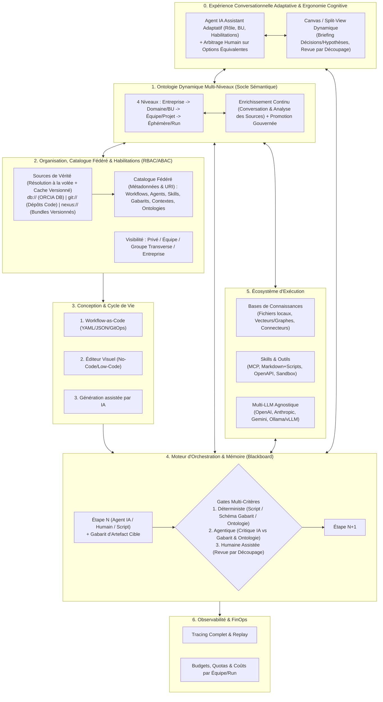

# Project Brief : ORCIA (Orchestration of Processes, Context, and Intelligent Agents)

> **Méthode** : BMAD (Breakthrough Method of Agile AI-Driven Development) — **Phase 1 : Analyst**
> **Statut** : Draft v1.0 (En attente de validation pour passage en Phase 2 : PM / PRD)
> **Date** : 24 Octobre 2026

---

## 1. Résumé Exécutif & Vision

**ORCIA** est une plateforme logicielle complète (**Interface Web "Conversational-First" avec Canvas dynamique** + Moteur d'Orchestration) permettant de concevoir, gouverner et exécuter des **processus d'entreprise complexes ou des processus personnels**.

L'accès par défaut à la plateforme se fait via une **interface conversationnelle intelligente** où l'**Agent IA d'accueil (Assistant / Orchestrateur)** s'adapte dynamiquement au profil de son interlocuteur humain (Rôle, Département/BU, Habilitations) : synthèse exécutive et KPIs pour un Directeur, détails techniques/code/logs pour un Développeur, focus conformité/risques pour un Auditeur. Depuis cette conversation (enrichie d'un volet latéral *Canvas / Split-View*), l'utilisateur peut lancer et piloter ses processus, passer ses Gates, co-éditer des livrables, explorer le catalogue ou demander des habilitations.

Chaque processus est modélisé comme une séquence ou un graphe d'étapes combinant :
1. **Des Agents IA spécialisés** (exécuteurs ou orchestrateurs), propulsés de manière agnostique par des modèles Cloud ou Locaux (Ollama/vLLM).
2. **Des Skills & Outils (MCP, Scripts, APIs)** et des **Gabarits d'Artefacts** résolus à la volée depuis la DB d'ORCIA, Git ou Nexus.
3. **Des Bases de Connaissances (Contextes / RAG)** multi-sources aidant à la fois à l'orchestration du flux et à l'exécution métier de chaque étape.
4. **Des Profils Humains (Human-in-the-Loop)** pouvant réaliser des étapes entières, co-éditer les livrables intermédiaires, intervenir sur escalade, ou valider le passage entre les étapes.
5. **Un Système de Gates Multi-niveaux** entre chaque étape, combinant des validations **Humaines**, **Agentiques** (agent critique/vérificateur) et **Déterministes** (scripts, tests, conformité aux gabarits).

Pensée dès l'origine pour les **structures d'entreprise complexes** tout en restant fluide pour un usage individuel, ORCIA place **l'expérience conversationnelle adaptative, la gouvernance, les habilitations (RBAC/ABAC), la fédération de ressources (DB, Git, Nexus)** et **le contrôle FinOps/Observabilité** au cœur de son architecture.

---

## 2. Problématique & Opportunité

Aujourd'hui, les organisations et les individus font face à trois limites majeures avec l'IA générative et l'automatisation :
- **Le fossé entre le "Chat IA" libre et l'automatisation rigide (BPM/RPA classique)** : Les workflows traditionnels (Camunda, Temporal, Zapier/n8n) imposent des interfaces complexes et gèrent mal le raisonnement probabiliste, la co-création humaine et l'injection dynamique de connaissances, tandis que les chats IA classiques ne sont pas connectés à un moteur de processus gouverné avec des gates formelles.
- **L'absence de gouvernance et d'habilitations à l'échelle de l'entreprise** : Dans une organisation complexe, les équipes créent des prompts, des skills, des agents ou des bases documentaires en silo sans pouvoir les exposer proprement (avec contrôle d'accès, fédération Git/Nexus et masquage des sources sensibles) au reste de l'entreprise, à un département ou à un groupe restreint.
- **Le manque de traçabilité, de reproductibilité et de maîtrise des coûts** : Lorsqu'un processus échoue ou dérive à l'étape 6 sur 10, il est souvent impossible de rejouer uniquement l'étape 6 (Replay), d'épingler la version exacte du workflow pour les processus longs, ou d'imputer finement la consommation de tokens par équipe ou projet.

---

## 3. Les 10 Piliers Fonctionnels d'ORCIA

### Pilier 0 : Interface Conversationnelle par Défaut, Agent IA Adaptatif & Ergonomie Cognitive ("Chat-First + Canvas")
- **Point d'entrée universel par la conversation** : Lorsqu'un utilisateur se connecte à ORCIA, l'écran d'accueil par défaut est une interface conversationnelle intelligente doublée d'un volet latéral dynamique (**Split-View / Canvas**), tout en conservant un accès direct aux vues dédiées (Catalogue, Administration, Monitoring).
- **Adaptation automatique à l'interlocuteur humain (Persona-Aware AI)** : L'Agent IA qui dialogue avec l'utilisateur connaît son profil organisationnel (Rôle, Département/BU, Groupes transverses, Habilitations) et adapte automatiquement sa posture, son vocabulaire (via l'Ontologie Multi-Niveaux) et le niveau d'information restitué :
  - *Profil Direction / Manager* : Vision synthétique, avancement macro des processus, KPIs, alertes FinOps et décisions Go/No-Go métier.
  - *Profil Technique / Développeur / Architecte* : Détails techniques, inspection des diffs de code, logs d'exécution en sandbox, schémas YAML/JSON, traces MCP.
  - *Profil Sécurité / Conformité / Qualité* : Focus sur les rapports d'audit des Gates Agentiques/Déterministes, le respect des gabarits et la traçabilité des habilitations.
- **Ergonomie Cognitive & Accompagnement sur les Artefacts Volumineux** :
  - Lorsqu'un artefact produit par une étape est volumineux ou complexe, le système ne submerge jamais l'humain avec un bloc brut. Il sélectionne dynamiquement une **stratégie d'accompagnement cognitive adaptée** :
    1. **Synthèse Structurée (Briefing de Revue)** : Présentation immédiate du **Résumé exécutif**, des **Éléments clés**, des **Décisions prises par l'agent**, et des **Hypothèses retenues (Assumptions)** qui méritent l'attention de l'humain.
    2. **Validation par Découpage (Chunked / Step-by-Step Review)** : Découpage logique de l'artefact en sections ou lots digestes (ex: par module, par chapitre du gabarit, ou par niveau de criticité) permettant à l'humain de valider, commenter ou régénérer section par section dans le *Canvas*.
- **Principe d'Arbitrage Humain Systématique sur Options Équivalentes (No Silent Arbitrary Choice)** :
  - Durant l'exécution d'une étape ou l'orchestration, **si un Agent IA fait face à plusieurs options ou architectures équivalentes** (compromis métier, choix de design, interprétations possibles d'une règle) sans qu'une Base de Connaissances ou l'Ontologie ne tranche formellement, **il a l'interdiction de choisir arbitrairement en silence**. Il suspend son action ou sollicite immédiatement l'humain dans la conversation en lui présentant clairement les options, leurs avantages/inconvénients et sa recommandation éventuelle pour obtenir un arbitrage explicite.
- **Pilotage intégral depuis la conversation** :
  1. **Lancement et suivi des processus** en langage naturel (*"Lance le workflow de release pour le service Paiement"*, *"Où en sont les processus de mon équipe ?"*).
  2. **Passage des Gates, Revue Guidée & Co-édition** : L'utilisateur peut demander *"Quelles gates attendent ma validation ?"*, parcourir la synthèse des décisions/hypothèses, valider par découpage dans le volet *Canvas*, et approuver/rejeter directement depuis le fil de discussion.
  3. **Interrogation du Catalogue, des KB et du Permission Broker** : Recherche de workflows/agents disponibles et accompagnement interactif pour obtenir une habilitation manquante.

### Pilier 1 : Ontologie Dynamique Multi-Niveaux (Socle Sémantique Vivant)
- **Structuration en 4 niveaux avec héritage et alignement** :
  1. **Niveau 1 — Socle Entreprise (Corporate)** : Concepts universels, glossaire global, politiques et axiomes transverses de l'organisation.
  2. **Niveau 2 — Domaine / Business Unit (BU)** : Concepts spécialisés par métier (ex: *Finance*, *Ingénierie IT*, *Juridique*, *SecOps*) héritant du socle Entreprise.
  3. **Niveau 3 — Équipe / Projet / Workspace** : Concepts locaux, conventions d'équipe et mappings spécifiques.
  4. **Niveau 4 — Éphémère / Exécution (Run-level)** : Concepts, entités et relations découverts à la volée lors d'une conversation avec l'humain ou de l'analyse des sources documentaires durant l'exécution d'un workflow.
- **Évolution continue et Promotion Gouvernée** :
  - Au fil de la conversation avec l'humain ou de l'ingestion des sources (KB), les agents détectent en temps réel les nouveaux concepts, synonymes, règles ou ambiguïtés sémantiques.
  - Ces découvertes sont immédiatement exploitées au **Niveau 4 (Run)** et le système propose leur **promotion gouvernée** (via une carte interactive dans le chat ou une Gate dédiée) vers l'ontologie d'**Équipe (Niveau 3)**, de **BU (Niveau 2)** ou d'**Entreprise (Niveau 1)**.
- **Les 3 Rôles Actifs Combinés de l'Ontologie dans ORCIA** :
  1. **Ancrage du Blackboard et des Gabarits (Contrat de données sémantique)** : Les variables du dossier d'exécution (Blackboard) et les sections/schémas des Gabarits d'artefacts sont typés par les concepts de l'ontologie, garantissant que tous les agents d'un workflow partagent exactement les mêmes définitions et attributs obligatoires.
  2. **Traduction Adaptative par Profil Humain (Pont linguistique)** : L'Agent Assistant s'appuie sur les correspondances entre niveaux d'ontologie pour traduire automatiquement les concepts techniques (ex: *Microservice Tier-1 / Latence P99* pour le Développeur) en concepts métiers/exécutifs (ex: *Actif Stratégique / Impact SLA* pour le Directeur).
  3. **Guidage du RAG et Contrôle par les Gates (Garde-fou sémantique)** : La recherche dans les Bases de Connaissances utilise les relations de l'ontologie pour étendre le contexte pertinent, tandis que les **Gates Déterministes et Agentiques** vérifient formellement que les artefacts produits respectent le vocabulaire autorisé et les axiomes de l'ontologie active.

### Pilier 2 : Modélisation des Processus, Gabarits d'Artefacts & Ancrages "Human-Led"
- **3 modes de création des processus supportés** :
  1. **Déclaratif / Workflow-as-Code (Priorité MVP)** : Définition structurée en YAML/JSON avec schémas stricts.
  2. **Éditeur Visuel (Phase 2)** : Interface graphique en graphe (No-Code/Low-Code) synchronisée bidirectionnellement avec la représentation déclarative.
  3. **Génération Assistée par IA (Phase 3)** : Création et modification de workflows par prompt en langage naturel à partir des agents et skills disponibles dans le catalogue.
- **Gabarits d'Artefacts Multi-Audience (Humain vs Agent) & Zones d'Intention Humaine Obligatoire (`Human-Led Anchors`)** :
  - Chaque étape peut imposer un ou plusieurs **Gabarits de sortie** (Markdown structuré et/ou JSON/YAML Schema ancrés sur l'**Ontologie**) distinguant la **vue décisionnelle humaine** et la **vue structurée pour les agents aval**.
  - **Prévention du biais d'ancrage ("Maintenir le *Think* humain au bon niveau")** : Certaines sections critiques d'un Gabarit ou d'une étape (ex: *Intention métier*, *Évaluation du risque à ne pas faire*, *Découpage tactique*, *Choix d'architecture structurant*) peuvent être marquées **`human_authored_required: true`**. L'Agent IA a l'interdiction de les pré-remplir : il sollicite d'abord la réflexion de l'expert humain avant de générer le reste du livrable.
  - **Discipline du cycle `Intention -> Code`** : Si une rétro-documentation (`Code -> Doc`) est possible une fois lors de l'initialisation d'un projet existant (*Brownfield Bootstrap*), le cycle normal impose toujours **Déclaration d'Intention/Doc $\rightarrow$ Code $\rightarrow$ Vérification de conformité Doc/Code** afin de ne jamais transformer un bug de code en fonctionnalité documentée.

### Pilier 3 : Orchestration, Indépendance des Modèles & Réversibilité
- **3 modes d'orchestration** :
  1. **Hybride "Human-Led & Agent-Accelerated" (Priorité MVP)** : Chaque étape mobilise un agent spécialisé (ou un humain/script) tandis qu'un orchestrateur supervise le flux, le passage de contexte et l'évaluation des gates.
  2. **Déterministe par étape** : Graphe fixe où l'IA n'intervient que comme exécutant isolé d'une tâche bornée.
  3. **Dynamique / Autonome** : Un agent "Chef d'orchestre" planifie et adapte dynamiquement les sous-étapes et agents à activer en fonction de l'objectif et des bases de connaissances.
- **Abstraction Multi-Modèles & Orthogonalité (Exécuteur $\neq$ Évaluateur)** : Routage agnostique Cloud (OpenAI, Anthropic, Google Gemini) et Local (Ollama, vLLM), avec la capacité d'imposer qu'une **Gate Agentique** utilise un **modèle/fournisseur différent** et un contexte vierge par rapport à l'**Agent Exécuteur** ayant produit l'artefact.
- **Réversibilité Humaine & Lutte contre la Dette de Compréhension (`Pattern Drift`)** :
  - Suivi de la cohérence globale du codebase/système pour éviter que la multiplication de livrables individuellement valides n'introduise une dérive des patterns architecturaux rendant le système incompréhensible ou non maintenable sans IA.

### Pilier 4 : Système de Gates (Jalons) Adaptatives, Contrôles Transverses & Human-in-the-Loop Outillé
- **Gates multiples et composables entre les étapes** :
  - **Gate Déterministe** : Exécution d'un script en sandbox, validation formelle vis-à-vis du **Gabarit** et de l'**Ontologie**, tests unitaires/linters, et **détection de dérive des patterns (`Pattern Drift`)**.
  - **Gate Agentique (Adversariale / Cross-Model)** : Un **Agent Évaluateur** indépendant (modèle distinct, sans accès au brouillon de pensée de l'exécuteur) vérifie la qualité sémantique, effectue un **Contrôle Transverse d'Invariants (`Cross-Step Alignment`)** contre les documents fondateurs de haut niveau (ex: PRD, Architecture, Ontologie — pour éviter l'amplification d'erreurs en chaîne d'une étape à l'autre), et génère le **Briefing de Revue**.
  - **Gate Humaine Assistée & Politiques de Déclenchement Adaptatives** :
    1. **`mandatory_full` (100% guidé)** : Revue humaine obligatoire outillée par le **Briefing de Revue** (Résumé, Éléments clés, Décisions, Hypothèses), la **Validation par Découpage** et les **Zones d'Intention Humaine Obligatoire**.
    2. **`risk_or_exception_based` (Sur risque ou exception)** : La Gate Humaine ne bloque que si les Gates Déterministes/Agentiques détectent un score de risque élevé, une dérive de pattern ou une exception, évitant la fatigue de revue humaine sur les étapes à forte fiabilité.
    3. **`sampling` (Par échantillonnage, ex: $1/N$)** : Audit humain par échantillon statistique pour contrôler la fiabilité de la chaîne dans la durée.
- **4 modes d'intervention humaine** :
  1. **Cadrage amont & Rédaction des Ancrages Humains Obligatoires (`Human-Led`)**.
  2. **Go / No-Go aux Gates (Global, par Découpage, sur Exception ou par Échantillon)** avec détection des validations trop rapides (*Anti-Rubber-Stamping*).
  3. **Co-création et édition directe** des artefacts/livrables produits par les agents IA.
  4. **Arbitrage d'options équivalentes & Intervention sur escalade** : Retour systématique vers l'humain dès que plusieurs options équivalentes se présentent.

### Pilier 5 : Organisation Complexe, Catalogue Fédéré (DB / Git / Nexus) & Habilitations
- **Structure organisationnelle tri-dimensionnelle** :
  1. **Hiérarchique** : Organisation $\rightarrow$ Département / Business Unit $\rightarrow$ Équipe $\rightarrow$ Individu.
  2. **Transverse (Rôles & Groupes métiers)** : Ex. *Architectes*, *SecOps*, *Juristes*, *Release Managers*.
  3. **Workspaces (Espaces projets)** : Espaces isolés regroupant des membres invités et des ressources dédiées.
- **Architecture de Catalogue en Fédération Pure (URI Resolution + Cache Local Versionné)** :
  - Les définitions des **Agents**, des **Skills**, des **Workflows**, des **Gabarits d'artefacts** et des **Ontologies** peuvent résider soit dans la base de données d'ORCIA, soit dans des **dépôts partagés d'entreprise (Git dans le code source ou Sonatype Nexus / Artifactory)**.
  - **Résolution à la volée par URI** : Le catalogue d'ORCIA ne duplique pas inutilement les contenus externes ; il stocke les métadonnées, les règles d'habilitation et l'URI versionnée de la ressource :
    - `db://org/team/agent-architect@1.2.0` (Stocké nativement dans la DB d'ORCIA).
    - `git://git.entreprise.internal/repo/project.git///.orcia/agents/reviewer.yaml?ref=v1.4.0` (Colocalisé dans le dépôt Git du code source).
    - `nexus://nexus.entreprise.internal/repository/orcia-bundles/security-skill-bundle@2.1.0.tar.gz` (Packages/Bundles versionnés `.tar.gz`/`.zip`/OCI/NPM/PyPI publiés dans Nexus contenant Agents, Skills + scripts, Workflows, Ontologies ou Gabarits).
  - **Cache local immuable & Content-Addressable (SHA-256)** : Au moment de l'exécution, le moteur d'ORCIA résout et télécharge le bundle ou fichier depuis Git/Nexus/DB, vérifie son empreinte cryptographique et le conserve dans un cache local versionné pour garantir la performance et le *Version Pinning*.
- **Droits granulaires & Cycle de publication du Catalogue** :
  - **Droits** : *Découverte (Catalogue)* vs *Exécution (Usage)* vs *Lecture/Inspection (voir le prompt/code/sources)* vs *Édition* vs *Administration*.
  - **Cycle de vie de publication** : `Brouillon Privé` $\rightarrow$ `Partagé (Équipe/Workspace)` $\rightarrow$ `Soumis à validation` $\rightarrow$ `Publié (Catalogue Global ou Groupe restreint)`.
  - **Fork & Surcharge (Inheritance)** : Une équipe peut cloner ou surcharger un workflow/agent/gabarit/ontologie standard de l'entreprise en y injectant son propre contexte ou ses propres gates additionnelles.
- **Habilitations à l'exécution & "Permission Broker" IA** :
  - **Modèle Hybride (Priorité MVP)** : Exécution par défaut avec les droits de l'utilisateur déclencheur (*Passthrough*), avec possibilité de déléguer un *Service Principal* (compte de service propre à l'agent) sur certaines ressources encapsulées (y compris l'authentification vers les dépôts Git ou Nexus privés de l'équipe).
  - **Assistant d'Habilitation Intelligent (Fonctionnalité différenciante)** : Si un agent IA ou un utilisateur tente d'exécuter une étape ou d'accéder à un Skill/Contexte/Dépôt sans disposer de l'habilitation requise, l'agent ne se contente pas d'échouer : **il consulte une base/application de référence des procédures d'accès de l'entreprise et guide précisément l'humain sur la marche à suivre** (qui contacter, quel formulaire/workflow d'accès déclencher, quel rôle demander).
- **Gouvernance des Gates** :
  - **MVP** : Attribution aux rôles/groupes + délégation temporaire.
  - **Roadmap (TODO)** : Quorum / approbations multiples (ex: $2/3$ architectes), Séparation des tâches (*Separation of Duties* : l'exécuteur ne peut pas valider sa propre gate), confidentialité intra-processus (masquage de certaines étapes/données selon l'intervenant), et fédération SSO/OIDC/SAML/LDAP + Audit Log immuable.

### Pilier 6 : Bases de Connaissances (Contextes)
- Utilisables à deux niveaux : **aide à l'orchestration** (choisir la bonne route, vérifier les règles de gouvernance, guider sur les habilitations) et **aide à l'exécution** (fournir le contexte métier à l'agent d'une étape), enrichies par l'**Ontologie Multi-Niveaux**.
- **3 typologies supportées** :
  1. **Documents & Fichiers locaux (Priorité MVP)** : Markdown, PDF, dépôts de fichiers locaux, indexation RAG locale guidée par l'ontologie.
  2. **Bases vectorielles & Graphes de connaissances (Phase 2)** : pgvector, Qdrant, Neo4j/GraphRAG.
  3. **Connecteurs d'entreprise externes (Phase 3)** : GitHub/GitLab, Notion, Confluence, Google Drive, SharePoint, APIs métiers.

### Pilier 7 : Skills, Outils & Exécution Technique
- **4 formats de Skills (résolus via `db://`, `git://` ou `nexus://`)** :
  1. **Skills "Prompt + Ressources" (Markdown + Scripts)** : Dossiers ou bundles de compétences structurés (à la manière des skills Antigravity/Claude) réutilisables par plusieurs agents.
  2. **Protocole MCP (Model Context Protocol)** : Connexion standardisée aux serveurs MCP d'outils et de contexte.
  3. **Sandbox d'exécution de scripts** : Exécution isolée (Python, Bash, Node/TS) indispensable à la fois pour les Skills techniques et pour les **Gates déterministes**.
  4. **Connecteurs HTTP / OpenAPI / Webhooks** : Appels déclaratifs vers le SI de l'entreprise.

### Pilier 8 : Gestion du Contexte & Mémoire Inter-Étapes
- **Blackboard / Dossier d'Exécution Typé par l'Ontologie** : Chaque instance de processus possède un espace d'état structuré où chaque étape lit ses entrées et dépose ses artefacts/livrables versionnés (conformes aux **Gabarits d'artefacts** et aux concepts de l'**Ontologie**).
- **Passage de contexte sélectif (Context Pruning & Privacy)** : Chaque étape ne reçoit que le sous-ensemble d'artefacts et de mémoire pertinent (optimisation des tokens, réduction des hallucinations et respect de la confidentialité).
- **Mémoire Épisodique & Boucle d'Apprentissage Ontologique** : Les décisions prises aux gates humaines, les arbitrages d'options équivalentes, les nouveaux concepts découverts et les corrections apportées en co-édition peuvent être promus vers l'ontologie et les bases de connaissances pour améliorer les exécutions suivantes.

### Pilier 9 : Provenance Auditable, Versioning, Observabilité, FinOps & Impact Humain
- **Invariance Structurelle & Provenance Auditable (plutôt qu'une illusoire idempotence textuelle LLM)** : ORCIA ne cherche pas à figer le texte mot-à-mot d'un LLM probabiliste, mais garantit l'**Invariance Structurelle et Ontologique** des livrables et une **Provenance Auditable à 100%** (Version Pinning des URI `db://`, `git://`, `nexus://`, empreintes SHA-256, paramètres exacts du modèle, prompts, chunks de KB et décisions humaines sauvegardés).
- **Time-Travel, Simulation & Replay** : Capacité à rejouer une exécution à partir de l'étape $N$ (en modifiant un artefact, un prompt, un gabarit ou un modèle) sans ré-exécuter les étapes $1$ à $N-1$.
- **Observabilité, FinOps Complet (Setup + Run) & Métriques d'Impact Humain** :
  - **Tracing granulaire** : Inspection complète de chaque étape.
  - **FinOps Complet (Optimisation Budgétaire vs TTM)** : Suivi du coût de setup initial des workflows, du coût des tokens/modèles et du temps humain investi par Exécution, par Workflow et par Équipe/BU.
  - **Indicateurs Cognitifs & Maintien de la Maîtrise Humaine** : Suivi de l'équilibre entre le temps de cadrage actif (*Human-Led Think*) et le temps de revue (*Human-in-the-Loop*), détection du *Rubber-Stamping* (validations aveugles trop rapides), et suivi de l'indice de dette de compréhension globale.

---

## 4. Cas d'Usage Pilote (Validation MVP) : Ingénierie Logicielle / IT

Pour valider de bout en bout l'architecture d'ORCIA dès le MVP, le premier workflow de référence sera un **Processus d'Ingénierie Logicielle (ex: "De la demande de fonctionnalité / ticket jusqu'à la Pull Request validée et prête au déploiement")** :
- **Ressources fédérées & Ontologie mobilisées** :
  - *Ontologie Multi-Niveaux* : Socle Entreprise + Ontologie BU IT + Ontologie Équipe (avec enrichissement en temps réel lors de l'analyse du besoin).
  - *Agents & Gabarits* résolus depuis le dépôt Git du projet (`git://...`) et la DB d'ORCIA (`db://...`).
  - *Skills de vérification sécurité/qualité* résolus sous forme de bundle versionné depuis Nexus (`nexus://...`).
  - *Contextes (KB)* : Architecture et conventions de code de l'équipe (Markdown local), politiques de sécurité de l'entreprise, et référentiel des habilitations IT.
- **Étapes & Gates** :
  1. **Étape 1 (Cadrage Human-Led + Agent Analyste/Architecte + KB + Ontologie + Gabarit Spec Technique)** : L'humain renseigne les **Ancrages Obligatoires** (*Intention métier & Risque à ne pas faire*), l'agent analyse le besoin, sollicite l'**Arbitrage Humain** si plusieurs options d'architecture équivalentes se présentent, enrichit l'ontologie Run, et génère la spécification technique selon le Gabarit officiel.
     - *Gate 1.1 (Déterministe & Agentique Cross-Model)* : Validation automatique de la structure du Gabarit, du respect de l'Ontologie, puis Agent Évaluateur (modèle distinct) vérifiant la conformité aux standards d'architecture et générant le Briefing de Revue (Résumé, Éléments clés, Décisions, Hypothèses).
     - *Gate 1.2 (Humaine Assistée - Rôle Tech Lead)* : Revue guidée par découpage de la spec dans le *Canvas*, co-édition éventuelle et validation Go/No-Go depuis le Chat.
  2. **Étape 2 (Agent Développeur + Skills MCP/Scripts)** : Implémentation du code et des tests selon la discipline `Intention -> Code`.
     - *Gate 2.1 (Déterministe)* : Exécution automatique du compilateur, du linter, des tests unitaires en sandbox et détection de dérive des patterns (`Pattern Drift`).
     - *Gate 2.2 (Agentique Cross-Model & Contrôle Transverse)* : Revue de code automatisée par un modèle distinct et vérification transverse d'alignement avec l'intention initiale de l'Étape 1.
  3. **Étape 3 (Préparation Déploiement / Release)** : Vérification des droits de déploiement sur l'environnement cible (avec déclenchement du *Permission Broker* dans le chat si l'utilisateur ou l'agent n'a pas l'habilitation requise) et approbation finale par le *Release Manager* (Gate Humaine adaptative selon le niveau de risque, avec synthèse traduite selon son profil via l'Ontologie).

---

## 5. Stratégie de Lotissement (MVP vs Roadmap)

| Domaine | Lot 1 : MVP (Fondations & Pilote IT) | Lot 2 : Scale Entreprise & Visuel | Lot 3 : Écosystème Avancé & Autonomie |
| :--- | :--- | :--- | :--- |
| **Expérience & Posture "Human-Led"** | **Interface "Chat-First + Canvas/Split-View"**, **Agent Assistant adaptatif**, **Ancrages Humains Obligatoires (`human_authored_required`)**, **Briefing, Découpage & Arbitrage d'options équivalentes** | Éditeur Visuel de Graphe (No-Code/Low-Code) bidirectionnel YAML, Widgets Generative UI avancés | Génération et modification de workflows assistées par IA directement dans le chat |
| **Ontologie Multi-Niveaux** | **Ontologie déclarative à 4 niveaux (`Entreprise -> BU -> Équipe -> Run`)**, **Extraction temps réel + Promotion gouvernée**, **3 usages (Ancrage Blackboard/Gabarits, Traduction profil, Contrôle Gates/RAG)** | Éditeur visuel de graphe ontologique (OWL/RDF/Property Graph), détection avancée de conflits sémantiques inter-BU | Alignement ontologique autonome inter-entreprises et raisonnement neuro-symbolique complet |
| **Fédération & Gabarits** | **Résolution à la volée `db://`, `git://`, `nexus://` + Cache local immuable SHA-256**, **Gabarits Multi-Audience (Humain/Agent) + validation par Gates** | Publication en un clic depuis l'UI ORCIA vers Git (PR) ou Nexus (Bundle), Scaffolds multi-fichiers | Signature cryptographique des bundles (Cosign/SLSA) et gouvernance inter-registres |
| **Orchestration & Réversibilité** | Mode **Hybride Human-Led**, **Orthogonalité des modèles (Exécuteur $\neq$ Évaluateur)**, **Discipline `Intention -> Code`** | Mode **Déterministe pur** haute performance, Tableaux de bord de **Dette de Compréhension & Réversibilité** | Mode **Dynamique / Autonome** encadré par invariants transverses |
| **Gates** | Multi-gates : **Humaine Assistée (100%, sur Risque/Exception ou Échantillonnage)**, **Agentique Cross-Model + Contrôle Transverse**, **Déterministe (Script, Gabarit, Ontologie, Pattern Drift)** | Quorum (approbations multiples), Séparation des tâches (SoD) | Gates prédictives et auto-adaptatives selon la fiabilité statistique observée |
| **Habilitations** | Org/Équipe/Groupes/Workspaces, RBAC Catalogue, Passthrough + Service Principal, **Guide IA d'obtention d'habilitation** | Confidentialité intra-processus (masquage d'étapes), SSO (OIDC/SAML), Audit Log immuable | Gouvernance fédérée inter-organisations et politiques ABAC dynamiques |
| **Bases de Connaissances** | **Fichiers locaux (Markdown, PDF)** & Indexation RAG locale enrichie par l'Ontologie + KB procédures d'accès | Bases vectorielles dédiées (pgvector/Qdrant) & Graphes (Neo4j/GraphRAG) | Connecteurs externes temps réel (Confluence, Notion, GitHub, Drive...) |
| **Skills & Outils** | **Skills Markdown+Scripts (DB/Git/Nexus)**, Exécution Sandbox, premiers outils **MCP** | Connecteurs HTTP/OpenAPI déclaratifs, Catalogue MCP d'entreprise | Marketplace interne de Skills versionnés avec tests de sécurité auto |
| **Contexte & Provenance** | **Blackboard typé par l'Ontologie**, filtrage par étape, **Provenance Auditable & Version Pinning**, **Replay d'étape** | Synchronisation webhooks Git/Nexus, Dry-Run comparatif entre 2 versions | Mémoire épisodique auto-apprenante à partir des retours des gates humaines |
| **Observabilité, FinOps & Impact Humain** | Tracing complet, **FinOps (Coût Setup + Run/Tokens par Équipe)**, **Métriques Cognitives (Ratio Cadrage/Revue, Anti-Rubber-Stamping)** | Tableaux de bord ROI Budgétaire vs TTM par BU/Département, quotas mensuels, alertes | Routage FinOps automatique multi-modèles (optimisation coût/qualité/risque) |
