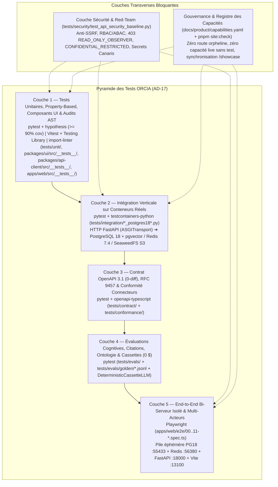

# Stratégie de Tests & Gouvernance Anti-Dette de Tests d'ORCIA (`AD-17`)

Ce document constitue la référence unique de la **stratégie de tests à 5 couches + Sécurité (`AD-17`)** de la plateforme **ORCIA** ainsi que des **10 mécanismes automatisés et organisationnels** mis en place pour empêcher structurellement l'apparition de dette de tests au fil des évolutions.

---

## 1. Philosophie & Quatre Principes Non-Négociables

Une suite de tests ne protège réellement une plateforme d'orchestration d'agents IA et de processus gouvernés par l'humain que si elle teste **les vraies coutures du système** (du clic navigateur jusqu'à la requête `SELECT` dans PostgreSQL 18) sans dériver vers des mocks complaisants ou des tests déconnectés des fonctionnalités livrées.

La stratégie d'ORCIA repose sur **4 principes fondateurs** :

1. **Zéro Persistance Simulée (Pas de SQLite ni de faux Redis en intégration)** :
   - Les tests unitaires rapides (`Couche 1`, `< 5 s`) utilisent des adaptateurs en mémoire confinés sous `tests/unit/fakes/`.
   - Dès la `Couche 2` (Intégration) et la `Couche 5` (End-to-End), **100 % des tests s'exécutent contre de vraies instances PostgreSQL 18 + `pgvector`, Redis 7.4 et SeaweedFS S3** afin de valider les contraintes SQL réelles (`UUIDv7`, triggers append-only `BEFORE UPDATE OR DELETE RAISE EXCEPTION`, index GIN/HNSW, verrous `FOR UPDATE SKIP LOCKED`, `LOCK TABLE ... IN EXCLUSIVE MODE` et atomicité `SET NX`).
2. **Câblage Vertical Complet (`UI ➔ SDK OpenAPI ➔ FastAPI ➔ Domaine ➔ PostgreSQL 18`) & Survie au `F5`** :
   - Une fonctionnalité n'est jamais considérée comme testée si son test d'intégration appelle uniquement une fonction SQL isolée ou si son test UI ne vérifie qu'un état `useState` en mémoire perdu au rafraîchissement (`F5`).
   - Les tests d'intégration sollicitent la route HTTP FastAPI (`AsyncClient(transport=ASGITransport(app=app))`) puis vérifient l'état par un `SELECT` direct dans PostgreSQL 18. Côté frontend, chaque mutation est vérifiée après démontage/remontage (`unmount()` $\rightarrow$ `render()` en Vitest, et `page.reload()` en Playwright E2E).
3. **Déterminisme Absolu & Coût `0 $` en CI pour les Appels IA** :
   - Aucun test automatisé en CI ne dépend d'une clé API LLM externe facturée ou sujette à des variations réseau.
   - L'adaptateur déterministe `DeterministicCassetteLLM` et les *Golden Datasets* (`tests/evals/golden/*.jsonl`) garantissent des tests reproductibles à `100 %`, gratuits (`0 $`), tout en testant de bout en bout l'assemblage des 5 couches du prompt (`AssistantHarness`), la vérification des citations `[S1]/[G1]/[O1]`, le refus constitutionnel d'écriture sur ancre humaine (`FR-4`) et l'orthogonalité des modèles (`AD-10`).
4. **Traçabilité Bijective Capacité $\leftrightarrow$ Code $\leftrightarrow$ Tests (`capabilities.yaml`)** :
   - Toute route API FastAPI et toute route SPA TanStack Router doivent être rattachées à une capacité déclarée dans [`docs/product/capabilities.yaml`](../docs/product/capabilities.yaml).
   - Toute capacité au statut `live` doit obligatoirement référencer ses fichiers de tests automatisés dans son champ `tests:` avec `verification: runtime`. Le contrôleur CI `pnpm site:check` échoue immédiatement si une capacité `live` est dépourvue de test ou pointe vers un fichier inexistant.

---

## 2. Vue d'Ensemble de la Pyramide des Tests (`AD-17` — 5 Couches + Sécurité)



### Tableau synthétique des couches

| Couche | Répertoire(s) | Outils & Infrastructure | Volume Actuel | SLA / Seuil Bloquant | Ce que la couche garantit |
| :--- | :--- | :--- | :--- | :--- | :--- |
| **Couche 1 — Unitaires, Propriétés, UI & Audits AST** | `tests/unit/`<br>`packages/ui/src/__tests__/`<br>`packages/api-client/src/__tests__/`<br>`apps/web/src/__tests__/` | `pytest`, `hypothesis`, `Vitest`, `@testing-library/react`, `import-linter`, `ruff`, `mypy --strict` | `50` fichiers Python<br>`24` fichiers TS/TSX | `< 15 s`<br>Couverture $\ge 90\%$ sur `orcia-kernel` & `orcia-core` | Logique métier des 8 domaines, invariants d'états, composants `@orcia/ui`, survie au `F5` (`unmount`/`render`), isolation hexagonale (`AD-19`/`AD-20`), zéro bouton muet et zéro anti-pattern AST. |
| **Couche 2 — Intégration Verticale Conteneurisée** | `tests/integration/` | `pytest`, `testcontainers-python`, `httpx.AsyncClient(ASGITransport)`, PostgreSQL 18 + `pgvector`, Redis 7.4, SeaweedFS S3 | `17` fichiers `*_postgres18*.py` | `< 60 s` | Persistance SQL réelle de bout en bout (`HTTP ➔ SELECT PG18`), migrations Alembic `0001..0027`, triggers append-only, reprise sur crash DBOS, Outbox `SKIP LOCKED`, verrous Redis et stockage S3 CAS. |
| **Couche 3 — Contrat OpenAPI 3.1 & Conformité** | `tests/contract/`<br>`tests/conformance/`<br>`packages/api-client/` | `pytest`, `openapi-typescript` (`0-diff`) | `2` suites dédiées | `< 5 s`<br>`0-diff` SDK | Parité stricte entre les schémas Pydantic v2 de `apps/api` et le SDK TypeScript `@orcia/api-client`, enveloppes d'erreur **RFC 9457** (`application/problem+json` + `trace_id`) et conformité `ConnectorPort`. |
| **Couche 4 — Évaluations Cognitives & Ontologiques (`0 $`)** | `tests/evals/`<br>`tests/evals/golden/*.jsonl` | `pytest`, `DeterministicCassetteLLM` | `3` fichiers d'evals<br>`2` Golden Datasets (`14` cas dorés) | `< 5 s`<br>`0 $` coût LLM<br>`0` citation fantôme | Précision/rappel du vérificateur de citations `[S1]/[G1]/[O1]`, assemblage 5 couches `AssistantHarness`, refus constitutionnel `FR-4` sur ancre humaine, adaptation aux profils humains, orthogonalité `AD-10` et détection `ERR_ONTOLOGY_CONFLICT`. |
| **Couche 5 — End-to-End Bi-Serveur Isolé & Multi-Acteurs** | `apps/web/e2e/`<br>`infra/scripts/e2e/`<br>`.github/workflows/e2e.yml` | `@playwright/test` (`1.52+`), Docker Compose E2E (`:55433`, `:56380`), FastAPI (`:18000`), Vite (`:13100`) | `12` specs `00..11-*.spec.ts` | Viewports Desktop `1440×900` & Mobile `390×844` | Parcours utilisateur réels de bout en bout (Jour 0 Admin + vrai `F5` navigateur, Mon Assistant streaming + citations, Ancres Humaines, verrou multi-acteurs + observateur, Mes Espaces, Agents & Skills, Gates, Aide `?`, Recherche `⌘K`). |
| **Couche Transverse — Sécurité & Red-Team** | `tests/security/` | `pytest`, `ASGITransport` | `1` suite complète (`21` tests) | `100 %` bloquant | Garde-fou SSRF (`is_safe_llm_endpoint_url`), blocage `403 ERR_OBSERVER_MODE_READ_ONLY` sur mutations, anti-escalade RBAC (`403 ERR_GRANT_ESCALATION_FORBIDDEN`), masquage `CONFIDENTIAL_RESTRICTED` et non-fuite des secrets canaris (`DEC-SEC-01`). |

---

## 3. Détail Opérationnel des 6 Couches de Vérification

### 3.1 Couche 1 — Tests Unitaires, Property-Based Testing (`hypothesis`), Composants UI & Audits Statiques
- **Backend Python (`tests/unit/`)** :
  - Teste l'intégralité des 8 domaines de `packages/orcia-core` (`orchestration`, `blackboard`, `catalog`, `ontology`, `rag`, `gates`, `permissions`, `audit_finops`, `bootstrap`) et `packages/orcia-kernel` avec une exigence bloquante de **couverture $\ge 90\%$** (`--cov=packages/orcia-kernel --cov=packages/orcia-core --cov-fail-under=90`).
  - Utilise `hypothesis` pour le *Property-Based Testing* des invariants critiques (transitions de la machine à états des `WorkflowRuns`, absence d'écrasement des snapshots `SUPERSEDED` lors d'un *Rewind / Replay*, calcul RRF).
  - Contient les **tests d'audit architectural par introspection AST** ([`test_codebase_architectural_anti_patterns_audit.py`](../tests/unit/test_codebase_architectural_anti_patterns_audit.py), [`test_zero_fictional_data_and_mocks_in_prod.py`](../tests/unit/test_zero_fictional_data_and_mocks_in_prod.py), [`test_capabilities_registry.py`](../tests/unit/test_capabilities_registry.py), [`test_e2e_stack_config.py`](../tests/unit/test_e2e_stack_config.py)).
- **Design System (`packages/ui/src/__tests__/`)** :
  - Teste isolément chaque primitive `@orcia/ui` Direction C, l'accessibilité RGAA/WCAG 2.2 AA (`RgaaModalDialog`, navigation clavier `<Échap>` / `<Entrée>`, garde de modifications non enregistrées `isDirty` dans [`rgaa-modals-escape-unsaved-guard.test.tsx`](../packages/ui/src/__tests__/rgaa-modals-escape-unsaved-guard.test.tsx)), la centralisation des `97` icônes ([`icon-registry-centralization.test.tsx`](../packages/ui/src/__tests__/icon-registry-centralization.test.tsx)) et l'isolation pure du Design System ([`ui-isolation.test.ts`](../packages/ui/src/__tests__/ui-isolation.test.ts)).
- **Application Web (`apps/web/src/__tests__/`)** :
  - Teste l'intégration des écrans, l'internationalisation complète `fr`/`en` ([`i18n-and-shell.test.tsx`](../apps/web/src/__tests__/i18n-and-shell.test.tsx)), la séparation Look & Feel ([`design-system-look-and-feel-isolation.test.tsx`](../apps/web/src/__tests__/design-system-look-and-feel-isolation.test.tsx)), le câblage exhaustif des callbacks ([`zero-dead-buttons-and-silent-catches-audit.test.tsx`](../apps/web/src/__tests__/zero-dead-buttons-and-silent-catches-audit.test.tsx)) et l'unicité de la garde d'environnement ([`runtime-env-guard-audit.test.ts`](../apps/web/src/__tests__/runtime-env-guard-audit.test.ts)).

### 3.2 Couche 2 — Tests d'Intégration Verticale sur Conteneurs Réels (`tests/integration/`)
- **Principe du câblage vertical `HTTP ➔ PostgreSQL 18`** :
  - Les tests de [`tests/integration/test_http_vertical_day0_and_agents_postgres18.py`](../tests/integration/test_http_vertical_day0_and_agents_postgres18.py) et [`tests/integration/test_epics_1_7_vertical_sql_wiring_postgres18.py`](../tests/integration/test_epics_1_7_vertical_sql_wiring_postgres18.py) instancient l'application FastAPI réelle connectée au conteneur PostgreSQL 18, envoient de vraies requêtes HTTP via `httpx.AsyncClient(transport=ASGITransport(app=app))` (`POST`, `PUT`, `PATCH`, `GET`), puis exécutent des requêtes SQL `SELECT` directes sur la base PostgreSQL 18 pour prouver que les tables (`users`, `org_units`, `workspaces`, `llm_model_endpoints`, `platform_settings`, `catalog_items`, `workflow_runs`, `blackboard_snapshots`, `domain_events_outbox`, `audit_ledger`) contiennent exactement les lignes attendues.
- **Invariants d'infrastructure vérifiés sur vrais conteneurs** :
  - **PostgreSQL 18 + `pgvector`** : exécution intégrale des migrations Alembic (`upgrade head`), triggers d'immuabilité `BEFORE UPDATE OR DELETE RAISE EXCEPTION` sur `audit_ledger` et `blackboard_snapshots`, course concurrente d'inscription du 1er Administrateur (`LOCK TABLE users IN EXCLUSIVE MODE` garantissant `1` seul `200 OK` et $N-1$ `409 Conflict`), relai Outbox transactionnel `SELECT ... FOR UPDATE SKIP LOCKED`, index GIN d'aide contextuelle et recherche hybride `halfvec(1024)` + `ts_rank_cd` RRF (`k=60`).
  - **DBOS Transact 2.14 + Redis 7.4** : reprise d'un workflow durable exactement à l'étape interrompue après arrêt brutal du worker, invalidation du cache Redis du prompt assemblé sur événement Outbox, verrous distribués de tour de parole (`SET lock:thread:<id> NX EX 60`) et révocation immédiate des jetons PAT MCP.
  - **SeaweedFS S3 (`chrislusf/seaweedfs:4.17`)** : archivage immuable adressé par contenu (`cas/<sha256>`) des exports de packs métiers et des articles d'aide rattachés à chaud.

### 3.3 Couche 3 — Tests de Contrat OpenAPI 3.1 & Conformité Connecteurs (`tests/contract/`, `tests/conformance/`)
- [`tests/contract/test_openapi_and_rfc9457_contract.py`](../tests/contract/test_openapi_and_rfc9457_contract.py) vérifie la validité du schéma OpenAPI 3.1 exposé par FastAPI, la présence systématique des enveloppes d'erreur normalisées **RFC 9457 Problem Details** (`type`, `title`, `status`, `detail`, `error_code`, `trace_id` W3C OpenTelemetry) et l'absence de dérive avec `packages/api-client`.
- [`tests/conformance/test_connector_conformance.py`](../tests/conformance/test_connector_conformance.py) soumet chaque connecteur enregistré dans `orcia.connectors` (`git://`, `jira://`, `confluence://`, `db://`, `sap://`) à une batterie commune de conformité (`AD-20`).

### 3.4 Couche 4 — Évaluations Cognitives, Citations, Ontologie & Cassettes Déterministes (`tests/evals/`)
- Exécutable en `< 5 s` et pour `0 $` en CI grâce à `DeterministicCassetteLLM` et aux jeux de données dorés (`tests/evals/golden/`):
  - [`tests/evals/test_citations_golden_dataset.py`](../tests/evals/test_citations_golden_dataset.py) + [`tests/evals/golden/citations.jsonl`](../tests/evals/golden/citations.jsonl) : vérifie que le vérificateur déterministe de citations conserve `100 %` des citations légitimes issues de la Table des Preuves (`[S1]`, `[G1]`, `[O1]`) et **purge `100 %` des citations fantômes inventées par un modèle** (`0` citation fantôme tolérée en sortie, remplacée par `[Citation non vérifiée]` avec événement d'audit `PHANTOM_CITATION_STRIPPED`).
  - [`tests/evals/test_assistant_and_ontology_evals.py`](../tests/evals/test_assistant_and_ontology_evals.py) + [`tests/evals/golden/assistant_and_ontology.jsonl`](../tests/evals/golden/assistant_and_ontology.jsonl) : évalue l'ordre strict des 5 couches de `AssistantHarness`, le refus constitutionnel immédiat (`HUMAN_ANCHOR_WRITE_REFUSAL`, `0` appel LLM) lorsqu'un utilisateur demande de remplir une section `human_authored_required: true` (`FR-4`), l'adaptation sémantique selon le profil humain (`EXECUTIVE`, `ARCHITECT`, `PM`), l'orthogonalité des familles de modèles entre exécuteur et juge (`AD-10`), et le blocage déterministe `ERR_ONTOLOGY_CONFLICT` lorsqu'une règle d'équipe contredit un axiome d'entreprise `L1` (`immutable: true`).
  - [`tests/evals/test_rag_hybrid_rrf_eval.py`](../tests/evals/test_rag_hybrid_rrf_eval.py) : valide la qualité du classement hybride *Reciprocal Rank Fusion* (`k=60`) et la détection de fraîcheur `[STALE_WARNING]`.

### 3.5 Couche 5 — Tests End-to-End Bi-Serveur Isolés & Multi-Acteurs (`apps/web/e2e/`)
- **Architecture d'isolation E2E dédiée ([`infra/scripts/e2e/`](../infra/scripts/e2e/) & [`apps/web/playwright.config.ts`](../apps/web/playwright.config.ts))** :
  - Pour éviter toute collision avec l'environnement de développement local (`PostgreSQL :5433`, `Redis :6380`, `FastAPI :8000`, `Vite :3100`), la suite Playwright démarre une **pile bi-serveur et base de données 100 % isolée** :
    - PostgreSQL 18 + `pgvector` E2E en `tmpfs` sur le port **`55433`** (base `orcia_e2e`) et Redis 7.4 E2E sur le port **`56380`** via [`infra/docker/docker-compose.e2e.yml`](../infra/docker/docker-compose.e2e.yml).
    - API FastAPI E2E sur le port **`18000`** avec `ORCIA_E2E_MODE=1` et `ORCIA_LLM_ADAPTER=cassette` (`0 $`).
    - Serveur frontend Vite E2E sur le port **`13100`** proxifiant `/api` vers `:18000`.
  - **Garde-fou de sécurité [`refuse_if_not_e2e_target`](../infra/scripts/e2e/reset_e2e_db.py)** : le script de remise à zéro Jour 0 E2E refuse catégoriquement de s'exécuter (et lève `E2EIsolationError`) si `ORCIA_E2E_MODE != "1"`, si le nom de la base ne se termine pas par `_e2e` ou si le port est le port de développement `5433` (protégé par 10 tests unitaires dans [`tests/unit/test_e2e_isolation_guard.py`](../tests/unit/test_e2e_isolation_guard.py)).
- **Couverture des 13 specs E2E (`apps/web/e2e/00..11-*.spec.ts` + `shell.spec.ts`)** :
  - [`00-stack-smoke.spec.ts`](../apps/web/e2e/00-stack-smoke.spec.ts) & [`shell.spec.ts`](../apps/web/e2e/shell.spec.ts) : Coquille 4 zones Direction C, 8 entrées du rail latéral, état Jour 0 sur Desktop (`1440×900`) et Mobile (`390×844`).
  - [`01-day0-boot-and-f5-persistence.spec.ts`](../apps/web/e2e/01-day0-boot-and-f5-persistence.spec.ts) : Création du 1er Administrateur Jour 0 dans la modale bloquante, écriture Argon2id dans PostgreSQL 18, **vrai `page.reload()` (`F5`)** prouvant que la modale ne réapparaît pas, et rejet `409 Conflict` d'une seconde inscription concurrente.
  - [`02-assistant-streaming-and-folders.spec.ts`](../apps/web/e2e/02-assistant-streaming-and-folders.spec.ts) : Envoi d'une question dans `💬 Mon Assistant`, streaming SSE via `DeterministicCassetteLLM`, rendu Markdown, dossiers et persistance de la conversation après `F5`.
  - [`03-human-led-anchor-and-arbitration.spec.ts`](../apps/web/e2e/03-human-led-anchor-and-arbitration.spec.ts) : Protection de l'ancre humaine violette (`#6D28D9`), signature humaine requise (`>= 30` caractères) et arbitrage humain.
  - [`04-multi-actor-claim-sse.spec.ts`](../apps/web/e2e/04-multi-actor-claim-sse.spec.ts) : Ouverture simultanée de deux contextes navigateur indépendants (`browser.newContext()`), prise en charge exclusive (`claim` `200` pour le premier acteur, `409 ERR_STEP_ALREADY_CLAIMED_BY_PEER` pour le second) et blocage `403 ERR_OBSERVER_MODE_READ_ONLY` en mode observateur.
  - [`05-mobile-companion-and-rgaa.spec.ts`](../apps/web/e2e/05-mobile-companion-and-rgaa.spec.ts) : Expérience Mobile Companion (`390×844`) à 3 onglets, accessibilité RGAA et garde-fous d'édition lourde.
  - [`06-gates-review-and-anti-rubber-stamping.spec.ts`](../apps/web/e2e/06-gates-review-and-anti-rubber-stamping.spec.ts) : Parcours de revue de jalons et garde-fou anti-*rubber-stamping* (`< 15 s`).
  - [`07-spaces-org-and-workspace-persistence.spec.ts`](../apps/web/e2e/07-spaces-org-and-workspace-persistence.spec.ts) : Création d'entité d'organisation (`BU` / `TEAM`), création d'Espace de travail, survie au `F5` et glossaire multi-niveaux.
  - [`08-agents-skills-persistence.spec.ts`](../apps/web/e2e/08-agents-skills-persistence.spec.ts) : Création d'agent et de compétence dans `🤖 Mes Agents`, exécution Dry-Run en bac à sable et survie au `F5`.
  - [`09-pack-builder-and-contextual-help.spec.ts`](../apps/web/e2e/09-pack-builder-and-contextual-help.spec.ts) : Atelier Pack Builder et ouverture/fermeture du volet d'aide contextuelle `❓` (`340px`) synchronisé avec la route active.
  - [`10-command-palette-search.spec.ts`](../apps/web/e2e/10-command-palette-search.spec.ts) : Recherche fédérée `⌘K` / `Ctrl+K` à 2 vitesses.
  - [`11-screens-smoke-without-server-errors.spec.ts`](../apps/web/e2e/11-screens-smoke-without-server-errors.spec.ts) : Traversée complète des écrans de l'application avec sonde `attachApiErrorProbe` garantissant `0` erreur HTTP `>= 500` et `0` exception console non gérée.

### 3.6 Couche Transverse — Sécurité, RBAC/ABAC, Anti-SSRF & Secrets (`tests/security/`)
La suite [`tests/security/test_api_security_baseline.py`](../tests/security/test_api_security_baseline.py) vérifie à chaque exécution :
1. **Protection Anti-SSRF (`is_safe_llm_endpoint_url`)** : blocage systématique des IP de métadonnées Cloud link-local (`169.254.169.254`, `169.254.0.0/16`, `[fe80::1]`, `metadata.google.internal`, `100.100.100.200`), des schémas non-HTTP (`file://`, `gopher://`, `ftp://`) et des URLs portant des identifiants embarqués (`username` / `password` dans l'autorité HTTP), tout en autorisant les domaines internes légitimes (`.local`, `.internal`).
2. **Rejet Strict du Mode Observateur (`READ_ONLY_OBSERVER`)** : vérification paramétrée que la persona observatrice (`claire`) reçoit `HTTP 403 ERR_OBSERVER_MODE_READ_ONLY` (format `application/problem+json` avec `trace_id`) sur les endpoints de mutation (`/api/v1/runs`, `/api/v1/gates/human/decide`, `/api/v1/workspaces/waivers`, `/api/v1/settings/iam/grants`).
3. **Anti-Escalade de Privilèges RBAC & Opacité (`AD-6`, `AD-21`)** : un non-administrateur ne peut ni lire un secret (`403 ERR_SCOPE_ACCESS_DENIED`), ni s'accorder ou déléguer un privilège supérieur aux siens (`403 ERR_GRANT_ESCALATION_FORBIDDEN`).
4. **Isolation des Espaces Confidentiels (`CONFIDENTIAL_RESTRICTED`)** : vérification que le payload métier du Blackboard est masqué (`blackboard_payload_masked: true`) pour un observateur global non membre de l'espace confidentiel, qui ne voit que les métriques FinOps agrégées.
5. **Non-Divulgation des Secrets Canaris (`DEC-SEC-01`)** : injection d'un secret témoin `CANARY_SECRET_TOKEN_998877665544332211` dans un connecteur et vérification qu'aucun endpoint de lecture ou de configuration ne retourne jamais cette chaîne en clair dans le corps JSON ou les en-têtes HTTP (`••••••••` write-only uniquement).

---

## 4. Les 10 Mécanismes Automatisés Anti-Dette de Tests

Pour empêcher que la couverture ou la qualité des tests ne se dégradent avec le temps (« dette de tests »), ORCIA ne repose pas uniquement sur la discipline individuelle : **10 verrous automatisés et bloquants** inspectent en continu le code, le registre des capacités et les suites de tests.

| # | Mécanisme Anti-Dette de Tests | Fichier / Script d'Application | Anomalie / Dette Empêchée |
| :--- | :--- | :--- | :--- |
| **1** | **Contrat Capacité $\leftrightarrow$ Route $\leftrightarrow$ Tests (`capabilities.yaml`)** | [`infra/scripts/capabilities_registry.py`](../infra/scripts/capabilities_registry.py)<br>[`tests/unit/test_capabilities_registry.py`](../tests/unit/test_capabilities_registry.py)<br>Commande : `pnpm site:check` | Interdit d'ajouter une route FastAPI ou un écran SPA sans entrée `CAP-xxx` dans [`docs/product/capabilities.yaml`](../docs/product/capabilities.yaml), interdit toute capacité `live` sans fichier de test associé (`tests:`), et vérifie que chaque fichier de test déclaré existe réellement sur le disque. |
| **2** | **Audit « Zéro Bouton Muet, Zéro Callback Oublié & Zéro `.catch(() => undefined)` »** | [`apps/web/src/__tests__/zero-dead-buttons-and-silent-catches-audit.test.tsx`](../apps/web/src/__tests__/zero-dead-buttons-and-silent-catches-audit.test.tsx) | Empêche le syndrome du composant `@orcia/ui` monté dans `apps/web` en oubliant de lui passer ses callbacks d'action (`onSendTurn`, `onRunTestBench`, `onCreateFolder`, etc.) ou d'un appel `@orcia/api-client` qui avale une erreur réseau par `.catch(() => undefined)`. |
| **3** | **Garde Centralisée d'Environnement `isJsdomTestEnv()`** | [`apps/web/src/lib/runtimeEnv.ts`](../apps/web/src/lib/runtimeEnv.ts)<br>[`apps/web/src/__tests__/runtime-env-guard-audit.test.ts`](../apps/web/src/__tests__/runtime-env-guard-audit.test.ts) | Interdit toute détection ad-hoc de `jsdom` (`navigator.userAgent.includes("jsdom")`) dispersée dans les composants ou les stores, évitant que le code testé en Vitest diverge silencieusement du code exécuté en vrai navigateur. |
| **4** | **Garde-Fou « Survie au `F5` » (Vitest + Playwright E2E)** | [`apps/web/e2e/01-day0-boot-and-f5-persistence.spec.ts`](../apps/web/e2e/01-day0-boot-and-f5-persistence.spec.ts)<br>[`apps/web/e2e/07-spaces-org-and-workspace-persistence.spec.ts`](../apps/web/e2e/07-spaces-org-and-workspace-persistence.spec.ts)<br>[`apps/web/e2e/08-agents-skills-persistence.spec.ts`](../apps/web/e2e/08-agents-skills-persistence.spec.ts) | Interdit les stores métier purement en mémoire (`useState`) perdus au rafraîchissement : chaque création/modification est testée après démontage complet (`unmount()` $\rightarrow$ `render()`) ET après vrai rechargement navigateur `page.reload()` sur PostgreSQL 18. |
| **5** | **Audit AST Anti-Patterns Architecturaux & Asynchronisme (`TID251`)** | [`tests/unit/test_codebase_architectural_anti_patterns_audit.py`](../tests/unit/test_codebase_architectural_anti_patterns_audit.py)<br>`pyproject.toml` (Ruff `TID251`) | Analyse l'arbre syntaxique (AST) de tout le backend pour interdire `httpx.Client` synchrone, `requests`, `ThreadPoolExecutor`, `create_async_engine()` à la volée dans les routeurs, le faux streaming `.split(" ")`, le couplage vendeur LLM et les blocs `except Exception:` muets sans log structuré. |
| **6** | **Audit « Zero Mock & Zero Fictional Data » en Production** | [`tests/unit/test_zero_fictional_data_and_mocks_in_prod.py`](../tests/unit/test_zero_fictional_data_and_mocks_in_prod.py) | Garantit qu'aucun adaptateur de test (`InMemory*`, `DeterministicCassetteLLM`) ni aucune donnée fictive (`PAY-142`, faux utilisateurs) ne fuit dans `packages/orcia-core`, `apps/api`, `apps/worker` ou `apps/web`. |
| **7** | **Contrats d'Isolation Hexagonale (`import-linter` `AD-19` & `AD-20`)** | `pyproject.toml` (`[tool.importlinter]`)<br>Commande : `.venv/bin/lint-imports` | Vérifie 5 contrats d'architecture bloquants : graphe acyclique `orcia_kernel <- orcia_core <- apps`, absence de cycles inter-domaines, interdiction d'importer `_internal/` hors du domaine propriétaire, frontière stricte Core $\not\rightarrow$ Packs métiers (`orcia_pack_*`) et isolation de `Docling`. |
| **8** | **Garde-Fou GitNexus « Zéro Adaptateur SQL Orphelin » & Couverture $\ge 90\%$** | `.venv/bin/pytest --cov=packages/orcia-kernel --cov=packages/orcia-core --cov-fail-under=90`<br>`gitnexus_impact({direction: "upstream"})` | Bloque toute baisse de couverture unitaire sous `90 %` et interdit de livrer un adaptateur SQL (`_internal/sql_*.py`) qui ne serait pas effectivement branché dans `apps/api` ou `apps/worker` et vérifié par un test Couche 2 `HTTP ➔ SELECT PG18`. |
| **9** | **Audits UX/UI Automatisés (Isolation Design System, Icônes & RGAA)** | [`apps/web/src/__tests__/design-system-look-and-feel-isolation.test.tsx`](../apps/web/src/__tests__/design-system-look-and-feel-isolation.test.tsx)<br>[`packages/ui/src/__tests__/icon-registry-centralization.test.tsx`](../packages/ui/src/__tests__/icon-registry-centralization.test.tsx)<br>[`packages/ui/src/__tests__/rgaa-modals-escape-unsaved-guard.test.tsx`](../packages/ui/src/__tests__/rgaa-modals-escape-unsaved-guard.test.tsx) | Empêche l'apparition de couleurs hexadécimales en dur hors de `tokens.css`, d'emojis dispersés hors du registre central `ORCIA_ICONS`, ou de modales dépourvues de garde RGAA (`Escape`, `Annuler`, `isDirty`). |
| **10** | **Protocole Tech Lead & Overrides BMAD de Revue de Toute la Pyramide** | [`AGENTS.md`](../AGENTS.md) (§6)<br>[`CLAUDE.md`](../CLAUDE.md)<br>[`docs/implementation-artifacts/TECH-LEAD-REPORT-TEMPLATE.md`](../docs/implementation-artifacts/TECH-LEAD-REPORT-TEMPLATE.md) (§2.5 & §3.3)<br>`_bmad/custom/*.toml` | Oblige chaque développeur et chaque agent IA (`bmad-build`, `bmad-agent-dev`, `bmad-code-review`, `bmad-review`) à renseigner **avant codage** la matrice d'impact sur les Couches 1 à 5 + Sécurité (Section `2.5`) et **après codage** le bilan d'exécution jusqu'aux tests E2E Playwright (Section `3.3`). |

---

## 5. Protocole Obligatoire lors de Toute Modification (Story ou Ajustement Ad-Hoc)

À chaque évolution d'ORCIA (User Story du sprint ou demande d'ajustement/correctif ad-hoc), le cycle en **4 étapes** suivant est obligatoire :

1. **Étape 1 — Étude d'Impact sur la Pyramide (Avant Codage — Section `2.5` du Rapport Tech Lead)** :
   - Identifier dans [`docs/product/capabilities.yaml`](../docs/product/capabilities.yaml) la ou les capacités `CAP-xxx` touchées (ou créer une nouvelle entrée `CAP-xxx`).
   - Remplir le tableau de la Section `2.5` du rapport Tech Lead (`docs/implementation-artifacts/tech-lead-reports/`) en précisant les fichiers de tests à créer, adapter et exécuter sur **chacune des 5 couches `AD-17` + Sécurité**.
2. **Étape 2 — Développement Piloté par les Tests (`TDD : Red ➔ Green ➔ Refactor`)** :
   - Écrire d'abord le test qui échoue sur la couche appropriée (test unitaire Python/Vitest en Couche 1, test d'intégration `HTTP ➔ SELECT PG18` en Couche 2, cas doré en Couche 4, spec Playwright en Couche 5, ou test de sécurité en `tests/security/`).
   - Implémenter le code minimal pour faire passer le test au vert, puis factoriser en maintenant chaque fichier sous `300–400` lignes.
3. **Étape 3 — Exécution de Toute la Pyramide & Synchronisation du Registre** :
   - Exécuter toutes les couches impactées jusqu'aux specs End-to-End Playwright (`apps/web/e2e/`).
   - Mettre à jour le champ `tests:` et `verification: runtime` de la capacité dans `docs/product/capabilities.yaml`.
   - Exécuter `pnpm site:sync` puis `pnpm site:check` (qui vérifie que `0` capacité `live` n'est sans test et met à jour les compteurs du site `/showcase`).
4. **Étape 4 — Bilan Post-Implémentation (Section `3.3` du Rapport Tech Lead)** :
   - Consigner les résultats chiffrés (nombre de tests passés par couche, pourcentage de couverture $\ge 90\%$, specs Playwright E2E exécutées et statut `pnpm site:check` `OK`) avant tout passage à `review` ou `done`.

---

## 6. Convention de Nommage des Tests (Orientation Domaine & Fonction, Zéro Trace d'Epic/US)

Les noms de fichiers de tests, de fonctions Python (`def test_*`) et de blocs TypeScript (`describe(...)` / `it(...)`) doivent décrire **exclusivement le domaine métier, le composant et le comportement ou invariant vérifié**, sans jamais conserver la trace de l'Epic (`epic_8`, `epics_1_7`), de la User Story (`story_3_2b`, `Story 10.1`), du critère d'acceptation (`ac1`) ou du User Journey (`uj10`) qui a motivé leur création initiale :

- **Fichiers unitaires Python (`tests/unit/`)** : `test_<domaine>_<comportement_ou_invariant>.py`
  - *Exemple* : `test_hierarchical_rbac_cognitive_router_settings_and_wizards.py`, `test_assistant_deterministic_citations_and_direct_write_guard.py`.
- **Fichiers d'intégration Python (`tests/integration/`)** : `test_<domaine_et_flux_vertical>_<infra>.py` (`_postgres18`, `_redis`, `_s3`)
  - *Exemple* : `test_http_vertical_day0_and_agents_postgres18.py`, `test_transactional_outbox_relay_and_idempotency_postgres18.py`.
- **Specs End-to-End Playwright (`apps/web/e2e/`)** : `<NN>-<parcours-fonctionnel>.spec.ts`
  - *Exemple* : `01-day0-admin-and-f5.spec.ts`, `04-multi-actor-claim-and-observer.spec.ts`.
- **Suites Vitest Frontend & Design System (`packages/*/src/__tests__/`, `apps/web/src/__tests__/`)** : `<domaine-ou-invariant>.test.ts(x)`
  - *Exemple* : `zero-dead-buttons-and-silent-catches-audit.test.tsx`, `icon-registry-centralization.test.tsx`.

---

## 7. Guide de Référence des Commandes d'Exécution

### 7.1 Vérifications statiques & contrats d'architecture
```bash
# Linter & formatage Python (inclut la règle TID251 anti-appels synchrones)
.venv/bin/ruff check .
.venv/bin/ruff format --check .

# Typage statique strict Python sur les 4 packages du workspace uv
.venv/bin/mypy --strict packages/orcia-kernel packages/orcia-core apps/api apps/worker

# Vérification des 5 contrats d'isolation du monolithe modulaire (AD-19 & AD-20)
.venv/bin/lint-imports

# Linter, vérification de types et tests unitaires TypeScript / React (packages/ui, packages/api-client, apps/web)
pnpm turbo run lint typecheck test
```

### 7.2 Exécution de la pyramide des tests Python (Couches 1, 2, 3, 4 & Sécurité)
```bash
# Couche 1 — Tests unitaires Python + audits AST avec seuil de couverture >= 90 %
.venv/bin/pytest tests/unit --cov=packages/orcia-kernel --cov=packages/orcia-core --cov-fail-under=90

# Couche 2 — Tests d'intégration verticale sur conteneurs réels (PostgreSQL 18 + pgvector, Redis 7.4, SeaweedFS S3)
.venv/bin/pytest tests/integration -q

# Couche 3 — Tests de contrat OpenAPI 3.1 / RFC 9457 & conformité des connecteurs
.venv/bin/pytest tests/contract tests/conformance -q

# Couche 4 — Évaluations cognitives, citations déterministes & ontologie (0 $, Golden Datasets)
.venv/bin/pytest tests/evals -q

# Couche Transverse — Socle de sécurité API (Anti-SSRF, RBAC/ABAC, 403 Observer, Secrets Canaris)
.venv/bin/pytest tests/security -q
```

### 7.3 Exécution des tests End-to-End Playwright (Couche 5 — Pile Bi-Serveur Isolée)
```bash
# 1. Démarrer l'infrastructure Docker E2E isolée (PostgreSQL 18 :55433 en tmpfs + Redis 7.4 :56380)
pnpm test:e2e:up

# 2. Réinitialiser la base E2E à l'état Jour 0 (protégé par refuse_if_not_e2e_target)
pnpm test:e2e:reset

# 3. Exécuter la suite Playwright E2E (démarre automatiquement FastAPI :18000 en mode cassette + Vite :13100)
pnpm test:e2e

# 4. Arrêter et nettoyer les conteneurs E2E éphémères
pnpm test:e2e:down
```

### 7.4 Contrôle du Registre des Capacités (`capabilities.yaml`) & Synchronisation du Site `/showcase`
```bash
# Synchroniser le manifeste du site de présentation (/showcase et docs/site-catalog/index.html)
pnpm site:sync

# Vérifier l'intégrité du registre des capacités (zéro route orpheline, zéro capacité live sans test, 0-diff manifeste)
pnpm site:check
```
